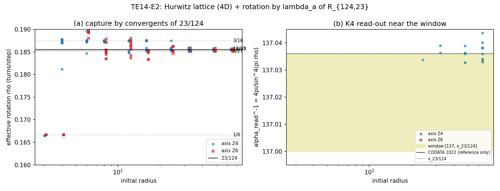

# 近いがロックしない整数構造からの標準理論の別解釈
## ――α=23/124 の自己無撞着なロック、四次元フルヴィッツ格子と E8 の接着、宇宙の始まりから観測まで――

**著者:** 木原範昭 (Noriaki Kihara)  
**ORCID:** 0009-0004-6753-4020  
**版:** v0.1（日本語草稿、DOI 未取得）  
**日付:** 2026-10-15  
**分類:** 仮説論文  
**母体:** 第十四思考実験 v1.0 [A1] とその追記・数値実験 E0〜E5 [A2]  
**キーワード:** 微細構造定数、有限位数共鳴、フルヴィッツ四元数、24胞体、E8、引き込み、非完全ロック、零二乗和、吸収体、地平線、インフレーション、ゲージの自己歪み

---

## 要旨

本稿は、標準理論を否定せずに、その定数と構造を別の側から読む仮説を立てる。仮説の中心は次の一文である。

**微細構造定数 α と、二波交換の反射率 R は、同じ一つの引き込みで決まる。** 背景は四次元のフルヴィッツ格子であり、発展の側の位相回転は有限位数根 R₁₂₄,₂₃ = cos²(23π/124) にロックする。ロックした状態から読んだ α が、出発点の α と一致する自己無撞着の輪が閉じるのは 23/124 である。

この仮説は、第十四思考実験 [A1] が提案した探し方――理論的には無関係に見えるのに近くにあり、引き込みを起こすがロック先が初めから一致してはいない組を探す――を、微細構造定数について実行した結果として立てた。仮説の各段には、確かめた部分（先行論文と数値実験 E0〜E5）、つないだ部分（仮説の配置）、検証の手段（標準理論の正解表と実測値）がある。本稿はこの三つを分けて書き、身分を混ぜない。

確かめた部分の主なものは次のとおりである。

1. 四次元フルヴィッツ格子に 23/124 の位相回転を課すと、軌道の回転数は 23/124 の連分数の近似分数を順にたどって 23/124 にロックし（初期半径96で85%）、ある割合はほかの準位（3/16、29/156、5/27、13/70 など）に落ちる。ロックした軌道でも保存量（ノルム）は周期の中で揺れ続け、ノルムまで一定の軌道は480本中0本だった（E2〜E3）。
2. 分母が4の倍数の根は、そうでない根よりロックしやすい。23/124 の引き込み幅は同程度の分母の隣の根より広い（E4）。
3. ロックした周期124の軌道は、四分の一周期ずらすと自分自身に重なる。そのとき周波数成分は (23+4k)/124 の系列に限られる（33本中29本で、パワーの100%がこの系列に入る）。
4. 二波交換の固有位相は ω/2π = 101/124 = 1 − 23/124 であり、格子の回転と向きが逆なだけで同じ数である。R₁₂₄,₂₃ では124回の交換で状態が初期状態に戻る [D1]。
5. 二つのフルヴィッツ四元数を「差が (1+i) の倍数」という一つの合同条件でつなぐと E8 格子になる。この条件は 90°・180° の回転を許し、三相の回転を許さない。

これらをつなぐと、α と R≈0.7 の引き込み、観測値がわずかにずれる理由（記録されない交換）、電子の局在と回帰、無限遠の吸収殻と地平線、空隙の体積と地平線のエントロピー、宇宙の始まりの高対称な状態、三つの力の居場所、E8 の拘束が、一つの関係系の段階として並ぶ。本稿はこれを完成した理論としてではなく、引き継いで検証できる仮説として提示する。検証の手段は、第十一思考実験 [D2] が同じ単位系・同じ吸収殻の基準で計算した水素原子・水素分子の正解表、ラムシフトと g 因子、α の独立な測定値、宇宙背景放射の低い多重極、光子とバリオンの比である。

---

## 1. 主張と立場

### 1.1 中心の仮説

本稿の仮説を、言い切る形で先に書く。

- **H-α（引き込みの一致）：** α≈1/137 への引き込みと R≈0.7 への引き込みは同じ一つの現象である。R と α は N(R) = 4π/(1−R)² で一対一に結びつき [B1]、R が四次元格子でロックできる有限位数根であり、かつロックした状態から読んだ α が出発点の α と一致する、という輪が閉じるのが 23/124 である。
- **H-4（四次元）：** 背景が四次元であるのは、四次元だけで単位立方体の対角線が整数（√4=2）になり、Z4（90°）と Z6（60°）の二つの対称性が一つの格子（フルヴィッツ格子）に共存するからである。
- **H-δ（観測値のずれ）：** 観測される α が 23/124 の値からわずかにずれるのは、記録されない交換（吸収殻に記録されない往復）による。標準理論ではこれがラムシフトや g−2 にあたる。
- **H-E8（拘束）：** 電子と交換の相手をそれぞれ四次元のフルヴィッツ格子に置き、二つを E8 の接着条件で結ぶと、記録されない交換の係数が拘束される。ラムシフトと g 因子はこの拘束の下での導出問題になる。

### 1.2 ロックの意味

本稿で「ロック」と言うとき、二つを区別する。

- **動的なロック：** 状態が近くの値に引き込まれて、回転数がその値にそろうこと。これは起こる必要がある。起きたうえで、ある割合はほかの値に落ち、ロックした軌道の中でも保存量は揺れ続け、まれに外れて戻る。準安定、急変、有限の寿命はここから生まれる。
- **ロック先の一致：** 複数の対称性が選ぶ値（空間の側の137、発展の側の23/124、E8 の整数）が初めから厳密に一致していること。これが見つかれば、引き込みも準振動も起こらず、本稿の仮説は崩れる [A1, §7.6]。

二つは矛盾しない。本稿の主張は、動的なロックは起こり、ロック先どうしは近いが一致しない、というものである。

### 1.3 三つの区別

各章は、主張のあとに次の三つを分けて書く。

- **確かめた部分：** 公開済みの論文の結果と、数値実験 E0〜E5 の結果。再現プログラムがある。
- **つないだ部分：** 確かめた結果どうしを結ぶ仮説の配置。数値でまだ確かめていない。
- **検証の手段：** その仮説を誰がどう確かめられるか。標準理論の正解表、実測値、後で行う数値実験。

### 1.4 著者の立場

この仮説は、この思考実験の範囲で完成させられるとは考えていない。高エネルギー領域や、水素原子より大きな複合粒子の数値実験を行う資源がないからである。標準理論に対する別の解釈として、引き継いだ研究者が検証できる形で示すことを本稿の目的とする。標準理論の計算結果は否定しない。再現すべき既知の成功として扱う [G1]。

### 1.5 単位系

単位は G = c = q₀ = 1（q₀ = e/3、ガウス系）とする [D2, §2.1]。この単位系では α = 9q₀²/(ħc) から ħ = 9/α となり、プランク定数は入力ではなく α から決まる出力になる。電子の質量も α を通して読み出される量なので、α と独立な検証にはならない。検証すべき独立な値は α そのもの一つである。

---

## 2. 弱い力はフレーバーの変化、強い力はロックの枠である

**主張.** 弱い力は、フレーバーが変わるときに現れる倍音成分の再分配である。強い力は、成分を一つの束にロックする条件（閉じ込め）であり、崩壊できる条件を許すかどうかを決める枠として働く。単独の中性子が約880秒で崩壊し、原子核の中の中性子が安定であるのは、この役割の違いによる。説明すべき中心は、クォークの複合粒子（バリオン）と陽子の安定性である。

**つないだ部分.** クォークは分割できないが、倍音を持つ。倍音は単独で取り出せない内部構造なので、閉じ込めと整合する。倍音の次数は整数だが、振幅は整数である必要はなく、整数の状態の間を振動していれば観測値は時間平均として連続値に見える。走る質量、CKM 混合、ニュートリノ振動はこの描像と矛盾しない。近い整数比だがロック先が一致しない関係は、基底状態に落ちないポテンシャルの壁を作る（Adler の引き込み方程式 [X2-Adler]、傾いた洗濯板ポテンシャル）。壁を越える率は壁の高さに指数的に依存し、粒子寿命の桁の広がりと対応し得る。

**検証の手段.** 第15章の三つの力の配置で、弱い力の仕組み（準位間のスリップ）と強い力の居場所（三相 Z₃）を具体化し、第24章の課題に置く。

---

## 3. 階層が無理数に見えるのは、複数の引き込みの間で振動するからである

**主張.** E8 の引き込み、三相交流、23/124、四次元の格子構造など、複数の引き込みの間の関係で状態が振動するため、エネルギー階層は無理数に見える。高い次元の整数構造を低い次元で読むと無理数に見えることは、準結晶や E8 から H4 への射影 [X1-Elser–Sloane] で知られている。

**確かめた部分（E0）.** 荷電レプトンの Koide の関係 Q = (mₑ+m_μ+m_τ)/(√mₑ+√m_μ+√m_τ)² = 2/3 [X1-Koide] は、v = (√mₑ, √m_μ, √m_τ) の (1,1,1) 方向の成分 v∥ と垂直成分 v⊥ について |v⊥|² − |v∥|² = 0 と同値である。これは (1,1,1) を虚軸とする零二乗和 [A1, 式(17)] にあたる。垂直面への中心投影は 120° ずつずれた三相になり、振幅 √2 はこの零条件から決まる。

Q = 2/3 を課すと m_τ = 1776.969 MeV（実測 1776.93 ± 0.09）、三相の位相は δ = 2/9 − 1.75×10⁻⁷ rad になる。このずれは m_μ の誤差による δ の不確かさの約450倍である。δ が 2/9 に近いことは Żenczykowski [X1-Żenczykowski] が既に指摘しており、E0 はその再計算と、零二乗和としての読みを加えたものである。2/9 rad は π の有理数倍ではないので、有限回では戻らない。

**つないだ部分.** 2/9 に近いが一致しないことは、三相の位相が何らかの整数構造に引き込まれているが、ロック先が一致していないことの候補として読む。

**検証の手段.** 第24章の課題「三相の位相の位置（δ）が世代を区別するか」。

---

## 4. 背景は四次元でなければならない

**主張.** 四次元の単位立方体の対角線は √4 = 2 で整数になる。このため半整数点 (½,½,½,½) が軸方向の点と同じ長さ1になり、セルの中心（整数点）と角（半整数点）が同等になる。整数点8個と半整数点16個で、フルヴィッツ整数の単位24個（24胞体の頂点）ができる。この格子には、位数4の i（発展の側の λₐ³¹ = i の Z4）と位数6の (1+i+j+k)/2（三相の Z6）が共存する。二次元では両立しない Z4 と Z6 [A1, §10.1.1] が、四次元で一つの格子に入る。

**確かめた部分.**

- 四次元格子が許す回転の位数は 1, 2, 3, 4, 5, 6, 8, 10, 12 で、一対の整数で表す位相が許す位数 1, 2, 3, 4, 6 と一致しない [A1, §10.1]。
- 四次元の単位立方体の角がちょうど半径 2k+1 の球面に乗る（角の立方体16個）のは、完全平方数の次元で最小の四次元だけである [C1, 命題4.1]。
- 半径3の四次元球に完全に収まる単位立方体の数は 137 = 1+8+128 [A1, 式(6)][C1, 表§4.1]。各セルの最も遠い角の殻で数え直すと 137 = 1+8+24+40+64（角のノルム 1, 3, 5, 7, 9）。
- 立方体ではなく四次元球で数えても 137 になる（te14_ball_count_in_radius3.py）。中心を整数点に置いた半径 r の球が半径3の球に完全に収まる数は、3−√6 < r ≤ 3−√5 の範囲ですべて137で、中心のノルムが5以下の整数点の数（1+8+24+32+24+48）に等しい。一辺1の立方体と同じ体積の球（r = (2/π²)^{1/4} = 0.67094）もこの範囲に入る。137 は立方体の形に固有の数ではない。

**つないだ部分.** 中心投影で投影軸を一本選ぶと次元が一つ落ちる [A1, §11.4]。背景が四次元なので、見える空間は三次元になる。三相（三世代）と三次元空間の「3」は、整数の対角線を持つ四次元から一本の軸を落とした残りとして、同じ起源を持つ。三次元の (1,1,1) 対角線は √3 で整数にならず、三相と見えない軸を整数格子の上で閉じられない。

**検証の手段.** 第17章の切断射影（E8 から四次元への写像で137が出るか）。

---

## 5. α は 23/124 から決まり、四次元格子がそこへ引き込む

**主張.** α⁻¹ の近くにある値は、なぜ近いのかを説明する対象ではない [A1, 第4章]。問題は、状態がなぜそのウィンドウにロックするかである。四次元フルヴィッツ格子に 23/124 の位相回転を課すと、状態は 23/124 に引き込まれる。分母が4の倍数の根は、λₐ^{n/4} = i が格子の対称性になるためロックしやすく、124 = 4×31 はこの群に入る。

**確かめた部分.**

- 二チャネル交換作用素 U_R の反対称固有値は λₐ = −e^{2iθ}（θ = arcsin√R）で、R_{n,m} = cos²(πm/n) のとき λₐ = e^{−2πim/n}、U_R^n = I となる [B1, §6]。R₁₂₄,₂₃ = 0.6971779275566594、λₐ³¹ = i、λₐ⁶² = −1、λₐ⁹³ = −i、λₐ¹²⁴ = 1。
- 対応式 N(R) = 4π/(1−R)² で読むと x₂₃/₁₂₄ = 137.036042914599 [B1, §4.1][A1, 式(11)]。
- **E1（三相と格子の両立）.** アイゼンシュタイン格子（Z6）に、四次元格子が許す位数 m の回転を課した。両立する m = 3, 6 では全軌道が周期 m で完全にロックし、ノルムも一定だった。両立しない m = 5, 8, 10 では、回転数は大半が 1/m に引き込まれるが、ノルムはほぼ全周期軌道で周期の中で変動し、一部の軌道は 11/54、13/66 などの近くの有理数に移った。すべての軌道は最終的に周期軌道に入り、U^n = I は入力ではなく結果として現れた。
- **E2（フルヴィッツ格子＋23/124）.** 初期半径3（137セルの球）では、回転は格子に完全に捕まる（Z6 軸では全軌道が 1/6）。初期半径を大きくすると、回転数は 23/124 の連分数 [0;5,2,1,1,4] の近似分数 1/6 → 3/16 → 5/27 → 13/70 → 18/97 を順にたどって 23/124 に近づき、半径16以上で周期124・248・372 の軌道が現れた。
- **E3（位相幾何的回転数）.** 回転数を二つの複素成分の巻き数から求める位相幾何的回転数 ρ_top = W/P に改めた。Z4 軸では 23/124 にロックする軌道が 240 本中 115 本（初期半径96で85%）、ほかの準位では 3/16 が37本、29/156 が18本、5/27 が16本、13/70 が13本だった。回転数が 23/124 にロックしても、ノルムが一定の軌道は 480 本中 0 本だった。
- **E4（選択・引き込み・回復）.** 自分の比にロックする率（初期半径 32/64/96）は、23/124 が 40%/70%/86%、同程度の分母の隣の根（23/122、23/126、22/119、24/131）は 0〜27%。分母が4の倍数の根は半径64で 40〜76%、そうでない根は 10〜40%。回転を 23/124+ε にすると、|ε| ≤ 1.4×10⁻⁵ で 83〜93%、1.4×10⁻⁴ で 24〜31% が 23/124 に引き込まれ、1.4×10⁻³ では0。23/122 は最大43%。

**図1.** E2：初期半径に対する実効回転数。23/124 の近似分数（1/6、3/16、5/27、13/70）に順に捕まりながら近づく。右のパネル (b) は回転数の読み方を E3 で改める前のもの（§5 の訂正）で、本稿では使わない。

**図2.** E3：(a) 占有される準位（位相幾何的回転数）。Z4 軸では 23/124 が最多、Z6 軸では 5/27 が最多。(b) 23/124 にロックする割合（実線）と、ノルムまで一定の完全なロックの割合（破線、すべて0）。

**図3.** E4：(a) 半径64での自己ロック率（青：分母が4の倍数）、(b) 引き込み幅、(c) 1単位の擾乱からの回復。

**訂正.** E2 では回転数を一歩ごとの角度の平均で測っていたが、四次元ではこの平均は加法的でない。E2 で α の読みがウィンドウ [137, 137.036043] に入った軌道はこの測り方によるもので、E3 以降の位相幾何的回転数では周期124の軌道はすべて厳密に 23/124 になる。

**つないだ部分.** 23/124 だけが特別に選ばれているわけではない。17/92 は格子ではもっとロックしやすい（半径96で100%）。どれが選ばれるかは格子だけでは決まらず、第12章の自己無撞着の条件で決まる。

**検証の手段.** 分母が4の倍数の根を n ≤ n_max まで列挙し、N(R) が 137 付近に入るもの（第12章）。

---

## 6. プランク定数は α から決まる出力である

**主張.** G = c = q₀ = 1 の単位系では ħ = 9/α であり、プランク定数は入力ではない [D2, §2.1]。電子の質量は、空間の構造（四次元格子、137、23/124 へのロック）から α を通して、基底状態のエネルギーとして読み出される。

**確かめた部分.** この単位系の質量の単位は m₀ = q₀/√G = 6.1974×10⁻¹⁰ kg で、電子の質量は mₑ = 1.46988×10⁻²¹ m₀ になる。その相対的な不確かさは G の測定精度で決まり、約 1.1×10⁻⁵ である（E3 README）。23/124 の読みと観測値の差（α で相対 3.2×10⁻⁷）は、この単位系での電子の質量の不確かさより小さく、電子の質量からは棄却されない。

**訂正.** E3 の初版では h を SI の定義値に固定して「電子の質量が測定精度の約2000倍ずれる」と判定した。これは ħ を入力に置いた誤りであり、撤回した。

**つないだ部分.** 質量を自由な裸のパラメータとして置き、重力を後から足した Arnowitt–Deser–Misner の計算 [X6-ADM1960] では、重力を入れると点電荷の自己エネルギーは有限になるが、質量は電荷で決まる大きな値になった。本稿の単位系は G を最初から含むので、この形の壁は生じないと考える。

**検証の手段.** 第13章の正解表で、ħ を入力しない単位系のまま実測と照合する [D2]。

---

## 7. 基底状態は落ちる先のないロックであり、準位は有限寿命の準安定状態である

**主張.** 電子は内部構造を持たないが、束縛されると Eₙ = −α²mₑc²/(2n²) の準位の梯子を持つ。基底状態 n = 1 は落ちる先がないロックであり、励起状態は有限寿命の準安定状態（2p は約1.6 ns、2s は約0.12 s）で、光子1個の放出という端数のない遷移で落ちる。

**確かめた部分.** E3 で四次元格子に 23/124 の回転を課すと、軌道は 23/124 に加えて 3/16、29/156、5/27、13/70 などの準位の系列に落ちた（第5章）。ロックは起こり、ある割合はほかの値に落ちる、という形である。

**つないだ部分.** 格子の準位の系列（23/124 の近くの有理数の階段）と、原子の準位の梯子を対応させる。過渡区間は数百更新と短く、E3 では準位を段階的に下る推移は見られなかった。準位の間の遷移を出すには、第9章の自己歪みと第11章の交換が要る。

**検証の手段.** 第13章の水素原子の正解表 [D2, §3]（準位、A 係数、寿命、線幅）を、統合した系が再現するか。

---

## 8. 観測される α がわずかにずれるのは、遷移中の状態と記録されない交換による

**主張.** 観測は多数のサンプリングの平均であり、ロックの途中にある遷移中の状態も含む。期待値は古典的な確率の重み付けではなく振幅の干渉で決まる。α の観測値が 23/124 の値 137.036043 からわずかに下にずれるのは、この二つと、吸収殻に記録されない交換による。

**確かめた部分.**

- 三つの値の差 [A1, 式(12)]：x₂₃/₁₂₄ − α⁻¹ = 4.37×10⁻⁵、x_g − α⁻¹ = 1.18×10⁻⁵。ここで x_g = 137.036010988 は 137 と四次元単位球の体積 π²/2 から作った自己整合式 α⁻¹ = 137 + (π²/2)α の解である [C3]。
- **E4(C).** 23/124 にロックした軌道に格子1単位の擾乱を加えると、20回中18回が 23/124 に戻り（ほかは 13/70 と 28/151）、戻るまでの長さは平均274、中央値159更新だった。過渡中の読み α⁻¹ の時間重み付き平均は 136.74 で、137.036043 より下側にある。観測値が下側にあることと向きが一致する。
- 単独の電子も観測されている。ペニングトラップの電子1個の g 因子から α⁻¹ = 137.035999166(15) [X5-Fan]、1個の電子のサイクロトロン準位間の量子ジャンプも直接観測されている [X5-Peil]。原子の反跳による α は Rb で 137.035999206(11) [X5-Morel]、Cs で 137.035999046(27) [X5-Parker] で、互いに5σ以上食い違う。
- 低エネルギーの α⁻¹(0) と電弱スケールの α⁻¹(M_Z) ≈ 128.946 は、運動量スケールの異なる有効結合である。後者の近くにも有限位数根 R₆₂₀,₁₁₇（N = 128.947865、0.12σ）がある [B1, §4.3]。

**つないだ部分.**

- E4 の「ロック状態と遷移状態を割合で足す」平均は古典的な混合であり、そのままでは使えない。重ね合わせ ψ = aψ_ロック + bψ_遷移 の期待値には干渉項 2Re(a*b A₁₂ e^{iΔωt}) が入り、これは確率 |b|² ではなく振幅 b に比例する。E4 で見積もった遷移中の時間割合 1.46×10⁻⁴ は古典的な混合を仮定した値で、振幅で重ねれば必要な混ざりは桁違いに小さくなる。読み出しは、交換振幅（G_R = 1−R に位相を付けたもの）を履歴に沿って複素数のまま積分してから α を読む形にする [A1, 式(3)(4)]。
- 記録される交換（放出・吸収）は振動数そのものを与え、記録されない交換は振動数のずれ（ラムシフト）を与える [D2, §6.5]。137.036043 と観測値の差は、この記録されない交換によるずれとして読む。
- α のランニング（高エネルギーで α⁻¹ が下がる）は、高エネルギーほど遷移中の状態を多く拾うと読めば同じ向きになる。
- この系では点の極限がなく（比だけ、有限の格子と有限位数の根）、相互作用の生成行列が実の反対称でノルムを保存するので、自己エネルギーの帰還が二乗で増幅する経路がない。発散は本質的に起こりにくい。重力が自己エネルギーの発散を抑える先行研究として [X6-ADM1960][X6-ISS] がある。

**検証の手段.** 交換振幅を複素数のまま履歴に沿って積分する読み出しで、137.036043 と観測値の差、時間平均と集団平均（Rb と Cs の食い違いを含む）の差が出るか（第24章）。

---

## 9. 電子は自分でゲージを歪める

**主張.** 電子自身の質量・エネルギーは四次元のゲージ（フルヴィッツ格子）をわずかに歪める。ゲージから外れる原因を外から持ち込む必要はない。

**確かめた部分（E5）.** 更新ごとに、状態自身のクーロン的な自己エネルギー α/r に比例して丸めの基準格子を伸縮させた（x ← x(1 + s·α/r)、伸張 s=+1 と収縮 s=−1、自由パラメータなし）。

- 歪みは軌道を変える。24本中15本が、歪みなしと異なる周期軌道に落ちた。
- 23/124 にロックする軌道は、歪みなしで14本、伸張で19本、収縮で17本。自己歪みはロックを壊さず、むしろ増やした。
- ロックした軌道の周期の中で、局所回転数が 23/124 から外れる区間は0だった。
- α を更新する自己無撞着の反復は、1回目で固定点になった。

**図4.** E5：(a) 23/124 にロックした軌道の数（歪みなし・伸張・収縮）、(b) 各軌道の回転数と 23/124 の差、(c) 歪みなしと比べて周期軌道が変わった軌道の数。

**つないだ部分.** 電子の位置で瞬時に決まる決定論的な歪みでは、有限の格子の上の写像は必ず周期軌道に入るので、外れて戻る振る舞いは生じない。外れて戻るには、倍音を預かって返す相手が要る。それは第11章の交換の相手の波そのものである。

**検証の手段.** ゲージの歪みに自分の状態（遅れ）を持たせた E6、および第11章の交換と組み合わせた系で、外れて戻る間欠的なスリップが出るか（第24章）。

---

## 10. 電子の倍音は四分の一周期の対称性で選ばれ、構成は局在の比で決まる

**主張.** 23/124 にロックした電子の軌道は、四分の一周期ずらすと自分自身に重なる。このため周波数成分は (23+4k)/124 の系列だけに限られる。これは矩形波が半周期ずらすと符号が反転するために奇数次だけを持つことの、四次元版である。倍音の構成そのものは電子に固有の性質ではなく、局在の度合い（観測のされ方）で決まる。

**確かめた部分（te14_harmonic_selection_check.py）.** 23/124 にロックした周期124の軌道（初期半径64、33本）のうち29本で、i を掛けた状態がちょうど93更新先（3×31）の状態と一致した。i は四次元格子の対称性（90°回転）である。この29本すべてで、パワーの100%が (23+4k)/124 の系列に入った。対称性を持たない4本では、系列の外に 0.01〜0.07% が出た。平均のパワー比は基本波 99.93%、隣の 19/124 が 1.8×10⁻⁴、27/124 が 3.2×10⁻⁴ である。周期 124 = 4×31 の「4」と「31」が、そのまま選択則と間隔になる。

**注.** 時間頂点化 K₄ 論文 [E2] の二乗総和 Q_loop(m;K) = K·1[K|2] + K·1[K|2m] で K=124 とすると、Q_loop は m が62の倍数のときだけ0にならない。したがって (23+4k)/124 の分子がすべて奇数であることは、ゼロ閉塞と矛盾しないことの確認にとどまり、Q_loop がこの系列を選んでいるのではない。偶奇の選択則は K=4 に固有である [E2, §14]。選択の根拠は四分の一周期の対称性である。

**つないだ部分.**

- この系にあるのは比だけで、絶対スケールはない。「電子がどの半径に住むか」という問いは立たない。観測されていない電子は光子と同じでどこにあるかが決まっておらず、広がった状態では倍音はわずかで、局在すると多数の倍音が必要になる。必要な倍音の本数はおよそ「全体の広がり」と「局在の幅」の比で決まる（宇宙の大きさとコンプトン波長の比は約10³⁸、プランク長との比は約10⁶¹）。E2〜E4 の「初期半径」は絶対的な大きさではなく、軌道と格子のセルの比、すなわち局在の解像度にあたる。
- 単音では自由度が足りない。四次元格子が許す回転の位数は12以下なので、位数124の純粋な回転は格子に乗らず、E3 でノルム一定の軌道は0本だった。比だけの系で単音が固有に持てるのは周波数の比一つで、電荷・スピン・質量・世代・相互作用の違いを一つの数で表すことはできない。最低構造の候補は、スピンの2成分（四元数の二つの複素成分）× 三相の3成分（電子の電荷は q₀ = e/3 の3倍）で、それぞれが基本波と格子が強制する側帯波 (23+4k)/124 を伴う。三相の位相の位置（Koide の δ）が世代を、回転の比が質量を区別する。

**検証の手段.** 局在の比を変えたとき、側帯波の強さの比、スピン2成分・三相3成分の組み合わせ方が一定に保たれるか（第24章）。

---

## 11. 局在は交換で起こり、交換が一巡すると元に戻る

**主張.** 局在は観測者が波束を縮めることではなく、相互作用で倍音が集まることで起こる。閉じた交換は可逆で散逸がなく、局在した電子は交換が一巡すると広がった状態に戻る。

**確かめた部分 [D1].**

- 広がった波 A（有効次数1）が鋭い局在波 B（奇数倍音1〜63、有効次数32）と交換散乱すると、B の倍音が A に移る（R = 0.70 では3回目に N_A = 31.1）。各波の全パワーは1のままで、有効次数の和は常に N_A + N_B = 33 である。N_A(k) = 1 + 31 sin²(kω/2)、ω = π + 2 arcsin√R が衝突0〜128で10⁻¹²の精度で成り立つ。
- 交換位相 kω が 90° で等分、180° で完全に入れ替わり、360° で戻る。R = R₁₂₄,₂₃ では ω/2π = 101/124 となり、31回目に等分、62回目に形が完全に入れ替わり（ε_swap = 2.6×10⁻¹⁵）、124回目に複素状態そのものが初期状態に戻る（ε_state = 5.1×10⁻¹⁵）。R = 0.70 では有限回で戻らず、最も戻りに近い103回目でも相手に1.6×10⁻⁴が残る。
- ω/2π = 101/124 の 101 = 124 − 23 であり、四次元格子の回転 23/124 と交換の一回分の位相は向きが逆なだけで同じ数である。λ³¹ = i、λ⁶² = −1、λ⁹³ = −i の節目も一致する。第10章で i を掛けた状態が93更新先に現れたのは、この構造である。

**つないだ部分.** 倍音の構成は電子だけでは決まらず、有効次数は電子と相手の間を行き来し、保存されるのは和である。第10章の「倍音の本数が局在で桁違いに変わる」は、この行き来のどの位相で読むかの違いにあたる。電子自身のエネルギーがゲージを歪めて R が R₁₂₄,₂₃ からわずかにずれると、124回目の完全な戻りは R = 0.70 の103回目のような「ほぼ戻る」に変わり、戻りきらない残りが出る。これが、観測される α が 23/124 の値からわずかにずれる原因の候補になる（第8章）。

**検証の手段.** 第9章の自己歪みと第11章の交換を一つの系に入れたとき、戻りきらない残りが α のずれの大きさになるか（第24章）。

---

## 12. R≈0.7 と α≈1/137 は同じ一つの引き込みである

**主張.** 第十三思考実験 [D1] では、R は手で入れた値で、124回目の戻りはその帰結にすぎず、R を相互作用から決めるには動力学の模型が要る、と留保していた。これは順番が逆である。R と α は N(R) = 4π/(1−R)² で一対一に結びつく。α が決まると ħ = 9/α と R が決まり、その R は四次元格子でロックできる有限位数根でなければならず、ロックした状態から読んだ α が出発点の α と一致しなければならない。この輪が閉じるのが 23/124 である。α が137に引き込まれる仕組みと、R が0.7付近（R₁₂₄,₂₃ = 0.69718）に引き込まれる仕組みは、同じ一つの現象である。

**確かめた部分.**

- 2026年7月、局在性移乗の系（System A）で反射率を 0, 0.51, 0.55, 0.6, 0.7, 0.9, 1 と粗く掃引したとき、0.7 で交換の反応が最もきれいに現れた [B3][D1, §6.2]。同じ交換作用素 U_R を共有する準安定界面の系（System B）で 0.6866 ≤ R ≤ 0.7025 を刻み10⁻⁷で掃引すると R ≈ 0.6971779 に深いピークが現れ [B2]、刻みを10⁻¹²まで縮めるとピークの中心は R₁₂₄,₂₃ に収束した [B1, §4.1]。掃引の評価式には α、137、128、有限位数根は入っていない [B1, §8]。
- 同じ「分母が4の倍数」の群の 17/92 は、格子ではもっとロックしやすく（E4）、R₉₂,₁₇ = 0.69920 と0.7のすぐ近くにあるが、N(R₉₂,₁₇) = 138.885 で空間の側の137と輪が閉じない。

**つないだ部分.** 粗い掃引で0.7が最もきれいに見え、細かく掃引すると中心が R₁₂₄,₂₃ に収束したのは、この引き込みを外から見ていたと読む。「輪が閉じるのは23/124」は、現状では 17/92 が外れることと、23/124 の値が137の近くにあることに基づく。輪が閉じる条件（どの幅のウィンドウか）はまだ定義していない。

**検証の手段.** 分母が4の倍数の有限位数根を n ≤ n_max まで列挙し、(i) 四次元格子での自己ロック率、(ii) N(R) と空間の側の137（および x_g）との距離、の両方で 23/124 が残るかを調べる。輪が閉じる条件は、結果を見る前に固定する。

---

## 13. 観測自身が動力学であり、答え合わせの正解表が既にある

**主張.** 第十三思考実験の時点で動力学が要ると考えたのは、並進や放出・吸収による反跳が統合できていなかったからだが、これもこの系に内在している。今の系に無限遠の完全吸収殻を足せばよい。

**確かめた部分 [D2].**

- 状態は準位の占有と吸収体に対する重心速度だけで、座標格子も計量も持たない。運動は無限遠の完全吸収殻に着いた放出・吸収の記録（時刻、方向、振動数、偏光）からだけ読み、事象と事象の間に読める変化はない [D2, §2.2〜2.3]。
- 吸収殻は背景時空ではなく、各放出事象の未来光円錐が無限遠を切る断面（null 面）への写像であり、中心投影・球面投影と同じ操作である [D2, §2.5][F4]。
- 等方な吸収殻には方向がなく、並進も反跳も定義できない。方向は吸収殻の匿名な等重みの要素への割り当てとして初めて生まれ、読むには吸収殻がわずかに異方的である必要がある [D2, §6.1]。
- 21 cm の記録29個から反跳の履歴ごと速度が 2.4×10⁻¹⁰ m/s で、200原子の記録から重心速度 370 km/s が 0.09 m/s で復元された [D2, §3.5]。並進と反跳は記録の中に入っている。

**水素原子の正解表 [D2, §3.3〜3.5].** 同じ単位系（G = c = q₀ = 1）・同じ吸収殻の基準で計算した標準理論（Dirac–Coulomb、1PN 二体重力、Einstein の A 係数）の値：

| 量 | 値 | 照合 |
|---|---|---|
| 5p₃/₂ F=1 からの放出合計 | 13.054539268 eV | 準位の落差と差 4×10⁻¹⁵ |
| 1S 電離エネルギー | 13.5984684 eV | 実測との差は入れていない QED＋核サイズ（8170.44 MHz）に一致、不一致 0.12 MHz |
| E1 の A 係数（10本） | — | NIST と最大 1.2×10⁻⁴ |
| Lyman-α の線幅 | 99.71 MHz | 実測 99.7 |
| 21 cm の A | 2.868×10⁻¹⁵ s⁻¹ | 実測 2.884×10⁻¹⁵（比 0.9944） |
| 2.7255 K でのスピン温度 | 2.72550 K | F=1:F=0 = 0.745286:0.254714 |

水素分子は 301 準位で、E2 の A 係数が Roueff ら（2019）の4669本と中央値 8×10⁻⁴ で一致する。電子–電子・陽子–陽子には束縛準位がなく、記録に残るのは Mott 断面積と四重極制動放射だけである [D2, §4〜5]。

**さらに強い答え合わせ.** 第十一思考実験が実測とずれた量は、すべて場の時間発展（記録されない交換）の分だった。1S の 8170 MHz と 2S–2P₁/₂ の 1057.85 MHz（ラムシフト [X5-Lamb–Retherford][X5-Bethe]）、超微細と 21 cm の因子 0.9989・0.9944（g_e−2 [X5-Schwinger1948]）である [D2, §6.5]。

**つないだ部分.** 四次元フルヴィッツ格子、第十三思考実験の交換、23/124 へのロックに無限遠の完全吸収殻を足すと、局在（観測）、元に戻る仕組み（閉じた交換）、並進と反跳（記録）、α のわずかなずれ（記録されない交換）が一つの系の中にそろう。第十三思考実験の二つの留保（R が入力であること、動力学が要ること）はどちらも外れる。吸収殻の要素数 N = 10⁶⁰ は第十一思考実験では置いた値で、記録には現れない [D2, §2.2、非主張11]。電子の局在に要る倍音の本数（第10章）をこの要素数と結びつけるのは、つないだ部分である。

**検証の手段.** 統合した系が、まず水素原子の正解表を再現するか。次に、記録されない交換がラムシフト・g_e−2 の因子・α のずれを出すか。これが標準理論の正解表を超えて実測そのものと照合する検証になる。

---

## 14. 宇宙は高対称な単色波の不安定な閉包から始まる

**主張.** 始まりは Z4（90°系列）の高対称な自己無撞着状態である。結晶学的制限と三つの137の不一致のために、この対称状態は厳密には実現できず、わずかな対称性の破れは内在する。線形に不安定な自己無撞着閉包が幾何級数的に拡大して飽和し、そのあとで 23/124 へのロックが起こる。

**確かめた部分.**

- 関係波の相互作用 K_ef = Im(z̄_e z_f) は実の反対称行列で、流れ dv/dτ = K(v)v はノルムと Σz² を厳密に保存する。自己無撞着な状態（iK(v)v = μv、μ ≠ 0）ならゼロ閉塞 Σz² = 0 は公理ではなく定理であり、正規化・振幅分布・N・親の生成法によらない [E1, §4]。
- 自己無撞着な相対平衡のうち線形に不安定なものは、任意に小さな乱れを指数的に増幅して非線形に飽和する。走行前に固定した共回転1刻み線形化行列による分類は54走行中53走行で実測と一致し、成長率の実測／予測比は 0.997〜1.008 だった [E1, §7]。不安定な親は高対称なものに限らず、対称性のない乱数均衡の親も N = 5〜13 で不安定だった [E1, §7.4]。
- 飽和後は少数の関係に局在した状態（参加率 PR/M = 0.05〜0.31）になり、等分配にはならない [E1, §7.3]。
- 未解決として残っていたのは、(a) 摂動源の同定 [E1, §10]、(b) 自己無撞着性だけでは物理状態を一意に選べず、追加の選択原理が見つかっていないこと [E1, §11] である。
- 時間を外から進めず、異なる位相状態そのものを頂点にすると、最小の厳密閉系は N = 1、K = 4、U = i の完全グラフ K₄ になる [E2]。
- 高対称な初期状態（N = 40、関係波780本）を複素平面に描くと、関係波は約90°ごとの4方向の十字の帯に集中し、反復後はほぼ同じ半径のリングに移るが、角度の密度は一様でなく、初期の90°系列の異方性が残る [E2, §2、図1〜2]。この走行は未公開の干渉保存力学の系列のデータである（付録B）。

**つないだ部分.**

1. **欠けていた選択原理：** インフレーション機構の「自己無撞着性だけでは状態を一意に選べない」に対し、第12章の「自己無撞着の輪が閉じるのは 23/124」（四次元格子と空間の側の137を伴う）が、その選択原理の候補になる。
2. **摂動源の候補：** 四次元格子の結晶学的制限で純粋な回転は格子に乗らず（E3 でノルム一定の軌道は0本）、三つの137は近いのに一致しない。厳密な対称状態は系そのものが許さず、わずかな対称性の破れは外から持ち込まなくても内在する。
3. **始まりの Z4 が残る：** 始まりの90°系列（Z4、U = i）と、λ³¹ = i、四次元格子の i、倍音の選択則の四分の一周期の対称性は、同じ Z4 である。始まりの対称性がロック後の構造に因数として残る可能性がある。ただし、インフレーション機構の統一プロトコルの刻み Δ = 2π/124 [E1, §3.4] は入力した値なので、両方に124が出ることはこの証拠にはならない。
4. **吸収殻の生成：** 第十一思考実験は吸収殻を加速膨張する宇宙の事象の地平線と同定した [D2, §6.5]。急拡大が地平線を作り、飽和後に残る90°系列の異方性が吸収殻のわずかな異方性を与える、という対応が考えられる。
5. この流れは、研究計画の暫定ゴール像（初期の高対称状態 → 自発的な対称性の破れと指数的な広がり → 局所的な凝縮 → 粒子）[G1, §7.4〜7.8] と同じ形をしている。

**一本の流れ.** Z4 の高対称な単色波 → 結晶学的制限と三つの137の不一致による避けられない対称性の破れ → 不安定な自己無撞着閉包の幾何級数的拡大と飽和 → 23/124 への自己無撞着なロック（α、ħ = 9/α、R≈0.7、四次元格子、四分の一周期の選択則）→ 交換による局在と回帰 → 地平線＝無限遠の完全吸収殻での記録による観測と動力学 → 第十一思考実験の正解表と実測での答え合わせ。

**検証の手段.** インフレーション機構の系の飽和後に、23/124 へのロックと四次元格子の構造が現れるか。初期の Z4 が 124 = 4×31 の因数として残るか。残った90°系列の異方性が吸収殻の異方性として読めるか。結晶学的制限による残差が、未同定だった摂動源として働くか（第24章）。

---

## 15. 三つの力は四次元の回転の別々の場所にある

**主張.** 四次元の回転は、単位四元数を左から掛ける回転（SU(2)_L）と右から掛ける回転（SU(2)_R）の組み合わせでできている（SO(4) ≅ SU(2)_L × SU(2)_R / Z₂）。三つの力はこの中のそれぞれ別の場所を持つ。

- **電磁気力：i 軸まわりの位相回転（23/124）。** α はこの回転から読み出される。分母124の高い次数の根なので引き込み幅は狭く、結合は弱い。
- **弱い力：左からの掛け算（SU(2)_L）。** E1〜E5 の更新則はすべて左からの掛け算 u·q で、右からの掛け算は一度も使っていない。弱い力が左巻きの粒子にしか働かないこと（パリティの破れ）は、この「左からしか作用しない」構造として読める。電磁気の位相回転（i 軸まわり）は SU(2)_L の中の一つの方向にあたる。仕組みの側は第2章の「フレーバー変化＝倍音の再分配」で、世代は三相の位相の位置（δ）で区別され、近いのにロック先が一致しない準位の間をポテンシャルの壁を越えて移ることが崩壊にあたる。壁が高く移りがまれなほど弱い相互作用に見える。
- **強い力：三相 Z₃ の側。** フルヴィッツ単位には位数3の ω = (−1+i+j+k)/2 が入っている。クォークの電荷 q₀ = e/3 は三相の一成分で、三つの位相がそろって初めて整数電荷になり Σz² = 0 で閉じる。一成分だけでは閉じないので単独では取り出せない。標準模型でも閉じ込めは SU(3) の中心 Z₃ の対称性と結びつく [X7-’t Hooft]。三相の軸は格子が許す低い次数（位数6）でロックし（E2 で初期半径3の全軌道が 1/6 に完全ロック、ノルム一定）、引き込み幅が広く深くロックするので強く結合する。

**つないだ部分.** 並びは、低い次数の格子ロック＝強い力、高い次数の根 23/124＝電磁気、左からの掛け算と準位間の移り＝弱い力である。三つとも同じ四次元フルヴィッツ格子と三相の中に収まる。ここに見えているのは連続群 SU(3) そのものではなくその中心の Z₃ だけで、SU(3) の残りは E8 の部分群（E8 ⊃ SU(3) × E6）の側から探す必要がある。

部分ごとに近い先行研究がある。除算代数の昇降演算子から SU(3) × SU(2) × U(1) を読む Furey [X7-Furey]、八元数とクォークの Günaydin–Gürsey [X7-Günaydin–Gürsey]、左右対称な Pati–Salam 模型 [X7-Pati–Salam]、フルヴィッツ単位24個と同型の二重四面体群に近い A4 フレーバー対称性 [X7-Ma–Rajasekaran] である。本稿の違いは、四元数を内部対称性の表現として置くのではなく、背景の格子と更新の向きとして置く点にある。

**検証の手段.** 三相軸（Z₃）の深いロックと i 軸の 23/124 の結合の強さの比、左からの掛け算だけで右巻きが作用を受けないこと、Q = T₃ + Y/2 と三分の一の電荷の割り当てが出るか（第24章）。

---

## 16. インフラトンとヒッグスは同じ秩序パラメータの二つの段階である

**主張.** インフラトンにあたるのは、インフレーション機構の系の秩序パラメータ r = √(H⊥/H)、すなわち初期の高対称な平面（Z4 の十字）から離れる横方向成分の大きさである。基本的な場ではなく、関係波全体の集団的なモードである。ヒッグスにあたるのは、同じ秩序パラメータが飽和した後、縁（r_vac）のまわりで揺れる動径方向のモードである。

**確かめた部分.** 測定した秩序パラメータ r = √(H⊥/H) の発展を Landau 型の V(r) = −½λ₀r² + (λ₀/4r_vac²)r⁴ に写すと、Mexican-hat 型の有効ポテンシャルが再構成される。係数は測定値から λ₀ = ln ρ₀、r_vac = √((H⊥/H)_sat) と置いた、測定量で係数を同定した有効記述である [E2, §2.3、図3]。

**つないだ部分.** 中心から縁へ転がる段階がインフレーション、縁のまわりの揺れがヒッグスにあたる。質量の起源は、第十三思考実験の「背景との交換の循環による内部時計の遅れ」[D1, §8] が、飽和した真空との交換による質量にあたると読む。粒子ごとの質量の違いは、ロックの比（回転の比）と三相の位相の位置で区別する。ヒッグスとインフラトンを同一視する先行研究にヒッグス・インフレーション [X6-Bezrukov–Shaposhnikov] があるが、本稿ではインフラトンは基本場ではなく集団的なモードである。

**検証の手段.** 秩序パラメータの飽和後の動径方向の揺れの振動数と、粒子の内部時計（交換の循環）との関係（第24章）。

---

## 17. E8 は表現ではなく、二つの四次元をつなぐ幾何学的な拘束として使う

**主張.** ここまで対称性が高い系でラムシフトや g 因子が導けていないのは、E8 の対称性を使いこなしていないからである。E8 が拘束を与えると予想する。使っていない部分は次のとおりである。

1. **8次元のうち4次元しか使っていない。** E8 は8次元の格子で、整数八元数そのものである [X1-Coxeter]。八元数は四元数の対（ケイリー–ディクソン構成）なので、E8 は四次元のフルヴィッツ格子二つをつないだものとして作れる。第十三思考実験の交換は二つの波の間で起きる。電子と交換の相手がそれぞれ一つずつ四次元を持つなら、二つ合わせて8次元になる。
2. **共役な回転（反粒子）を使っていない。** 交換の一回分の位相 101/124 は −23/124 で、電子の回転と逆向きである。ラムシフトには真空偏極（電子と陽電子の対の効果、約 −27 MHz）が入るが、今の系は左からの掛け算だけを使い、逆向きの回転も右からの掛け算も使っていない。
3. **四次元のトライアリティを使っていない。** フルヴィッツ格子は D4 格子と三つの剰余類でできており、この三つを入れ替える対称性は四次元だけにある。この「3」は世代の数や三相と結びつく候補である。
4. **23 は E8 の指数である。** E8 のコクセター数は h = 30、指数は 1, 7, 11, 13, 17, 19, 23, 29 で、23/124 は「E8 の指数 ／ 4(h+1)」の形をしている [A1, 式(12b)]。17/92 は分子が指数でも分母が 4×23 で h+1 の形にならない。
5. **黄金比の側（H4 への射影）を使っていない** [X1-Elser–Sloane]。

**現在の理論物理学が E8 を使いこなせない理由.** E8 は素粒子の側では、粒子を入れる内部の対称性（表現）として使われてきた。E8 の表現はすべて実なので、左巻きと右巻きの区別（カイラリティ）が出てこない。Lisi の試み [X7-Lisi] が Distler–Garibaldi [X7-Distler–Garibaldi] に否定されたのはこの点である。本稿では、E8 を粒子を入れる表現ではなく、電子の四次元と交換の相手の四次元をつなぐ幾何学的な拘束として使う。カイラリティは E8 からではなく、更新が左からの掛け算だけで起こるという動き方の向きから出る（第15章）。E8 の表現が実であることは、この使い方では障害にならない。

**137 と E8 の個数の対応.** E8 の248次元は 8+112+128（カルタン部分8、整数型の根112本、半整数型の根128本）、137 = 1+8+128 で、8 と 128 が共通である [A1, 式(12a)]。128 はどちらも半整数の側にある（E8 の128本は (±½)⁸ の形、137 の角の殻 24+40+64 も半整数の点）。ただし一致しているのは個数で、形は違う。8次元の最密充填は E8 [X1-Viazovska]、四次元で最密な格子は D4 [X1-Korkin–Zolotarev] で、E8 は D4 二つから作れるので、両者はもともと親子の関係にある。

**つないだ部分と記録のみ.** 体積が一辺1の立方体と同じ球で137が出る半径の範囲の上限 3−√5 は 2/φ²（φ は黄金比）に等しい。結果を見てから気づいた算術上の一致であり、記録のみとし、主張には使わない。

**検証の手段.** E8 を四次元二つに分け、一方を見える空間、もう一方をセルの窓にする切断射影で137が出るか。窓の形と大きさは、結果を見る前に「体積1のセル」と「半径3」という既に使っている条件だけで固定する（第24章）。

---

## 18. 研究の立場と、訂正の記録

本稿の各章で記した訂正を一か所にまとめる。

| 対象 | 誤り | 訂正 |
|---|---|---|
| E2 の回転数 | 一歩ごとの角度の平均で測っていた | 四次元では加法的でない。E3 以降は巻き数から求める位相幾何的回転数。E2 のウィンドウ内の値は撤回（第5章） |
| E3 初版の判定 | h を SI の定義値に固定し「電子の質量が測定精度の約2000倍ずれる」 | ħ を入力に置いた誤り。撤回（第6章） |
| 倍音の選択則 | 「33本すべてで」と述べた | 33本中29本（第10章） |
| 空隙の主要項 | 「空隙は R² ではなく R³」と述べた | 主要項が R³ で第二項に −6πR² がある（第19章） |
| ロックの意味 | 動的なロックとロック先の一致を混同 | 動的なロックは起こる必要があり、崩すのはロック先の一致（第1.2節） |
| 飽和した真空 | インフレーション機構の段階では、真空のゲージを等間隔と想定していた | 真空でもエネルギーがあればゲージは歪む。十字対称性が残り、完全には均等にならない（第20章） |

---

## 19. 空隙の体積は地平線のエントロピーであり、吸収殻は裏返しのブラックホールである

**主張.** 四次元球に単位立方体を詰めたときに残る空隙の体積 Δ(R) は、内部の観測者から認知できない自由度であり、無限遠の完全吸収殻（宇宙の地平線）の自由度とエントロピーを数えている。吸収殻とブラックホールの地平線は、一つの構造を両側から見たものである。

**確かめた部分.**

- 半径 R = 2k+1 の四次元球に完全に収まる整数中心の単位立方体の数 N(k)（R=3 で137）に対し、体積不足 Δ(R) = V₄(R) − N(k) は Δ(R) = (16π/3)R³ − 6πR² + 4R − 1 + O(R⁻¹) − E(R) を満たす（E(R) は格子点の誤差）。主要係数を正規化すると c = 8/(3π) ≈ 0.849 で、空隙は三次元球面に沿った厚さ約 8/(3π) の境界層に集中する。k ≤ 60 の厳密計算で主要係数は 0.024% 以内で一致する [C1]。第二項 −6πR² は包除原理による解析値で、数値フィットの係数は安定せず確認できていない [C1, §7.2]。
- 半径3では空隙は 81π²/2 − 137 = 262.72（充填率 34.27%）。
- 4+1次元 Tangherlini ブラックホールの Bekenstein–Hawking エントロピー S_BH = (π²/2)R³ との比は、自由パラメータなしで Δ(R)/S_BH → 32/(3π) ≈ 3.40 [C2]。

**つないだ部分.**

1. 空隙は球面に張り付いた境界層にあり、第十一思考実験の無限遠の完全吸収殻が置かれる場所と重なる。吸収殻の要素数とエントロピーとしての Δ(R) は、同じ「認知できない側の自由度」を数えていると読む。
2. 137個のセルは記録される側、空隙は記録されない側である。観測される α が整数137からも 23/124 の値からもずれる分は、セルと空隙の間の記録されない交換が受け持つ。三つの137が一致しないことと空隙が必ず残ることは、同じ事情の二つの面である。
3. 完全吸収殻は何も返さない（外から見たブラックホールの地平線と同じ）。中心投影では無限遠が半径 R の有限の球面に写り、BH 熱力学プログラムはこの R を地平線の半径と同定していた [C2, §2.3]。違いは観測者がどちら側にいるかで、ブラックホールでは観測者は地平線の外、宇宙の地平線では観測者は中心にいる。加速膨張する宇宙の事象の地平線もブラックホールと同じく温度とエントロピーを持つ [X6-Gibbons–Hawking]。宇宙の地平線は裏返しのブラックホールにあたる。
4. 3+1次元のブラックホールのエントロピーは面積則で R² に比例する（プランク単位で S = πR²）。空隙の第二項 −6πR² との比は整数6である。中心投影で次元が一つ落ちるとき第二項が3+1次元の面積則として現れる可能性がある（単位系を含めて未確認）。

**検証の手段.** 第二項 −6πR² を格子点誤差 E(R) の解析と合わせて確定し、中心投影で次元が一つ落ちたとき3+1次元の面積則として現れるか（第24章）。

---

## 20. 背景放射は空間を埋める静止した波の熱的なモードであり、真空はゲージを歪めている

**主張.** 宇宙背景放射は、完全吸収体からの微小な放射ではなく、ヒッグス場として作用する、空間を埋め尽くす静止した波の熱的に占有された揺らぎのモードである。その真空はエネルギーを持ち、自分でゲージを歪めており、十字（Z4）の対称性が最後まで残って完全には均等にならない。

**確かめた部分.**

- プランクの黒体放射の法則は、閉じた空洞の中の定在波のモードを数え、完全吸収体の壁と平衡にあるとして導かれる。背景放射の黒体スペクトルは、吸収殻（地平線）を壁とする空洞の中を定在波が埋め尽くす描像と合う。吸収殻は放射の源ではなく空洞の壁である。
- インフレーション機構の飽和後の状態は局在であり、等分配（完全な均等）ではない [E1, §7.3]。N=40 のリングでも角度の密度は一様でなく、初期の90°系列の異方性が残る [E2, §2.2]。
- 接超平面で等間隔に並んだ点列は、球面に写すと非等間隔になる。歪みは一点では見えず、点と点の間隔として初めて現れる [F4, §2.8]。重力の効果を読むために、ゲージ（格子の目盛り）は等間隔に置けない。E5 では電子自身の自己エネルギー α/r でゲージを歪めた（第9章）。
- 第十一思考実験で吸収殻に読んだ 2.7255 K は背景放射の温度であり、宇宙の地平線そのものの温度（Gibbons–Hawking 温度、約 2×10⁻³⁰ K）ではない [D2, §6.5]。

**訂正.** インフレーション機構の段階では、飽和後を真空、すなわちゲージが等間隔で歪まない状態と想定していた。真空でもエネルギーがあればゲージは歪む。

**つないだ部分.** 一つの静止した波の場の中で、ヒッグスの真空期待値は振幅そのもの（縁の半径 r_vac、一定）、背景放射は同じ場の熱的に占有された揺らぎのモード、わずかな異方性（約10⁻⁵）は飽和後に残る初期の90°系列（Z4）の異方性と、ゲージの自己歪みの残差である。真空期待値は膨張しても一定だが背景放射の温度は下がる（T ∝ 1/a）。振幅は変わらず、その上の揺らぎのモードの波長だけが伸びると読めば両立する。

**検証の手段.** 宇宙背景放射の低い多重極に Z4（立方対称）系統の痕跡が残るか。低い多重極の整列などの異常は既に報告されている [X6-Schwarz]。ただし異方性の大きさ（約10⁻⁵）は本系からまだ導いていない（第24章）。

---

## 21. 光子とバリオンの比は数え方の規則から出る

**主張.** 光子とバリオンの数の比（約16億対1、η ≈ 6.1×10⁻¹⁰）は物理の微調整ではなく、整数比でロックできる状態の数え上げの帰結である。光子は任意のモード（空洞の定在波）、バリオンは整数比でロックでき三相が閉じて自己無撞着に噛み合う状態とすれば、極端に小さい比は数え方から自然に出る。

**確かめた部分.**

- η の観測値は、Planck 2018 の Ω_b h² = 0.0224 [X6-Planck2018VI] と η₁₀ = 274 Ω_b h² [X6-PDG-BBN] から η ≈ 6.1×10⁻¹⁰ である。
- **既に一度、数え方の規則を先に決めて比べている [C4, §5].** 分解能 N の系は M = N(N−1)/2 本の関係を持ち、閉鎖を完走できるのは一方が他方の整数倍の対だけとすると、その割合は Dirichlet の約数和の評価から f(N) = 2(ln N + 2γ − 2)/N + O(N^{−3/2})（γ は Euler 定数）になる。N の拡大とともに急に減るが、ゼロにはならない。η を f(N) に等置すると N ≈ 8×10¹⁰ で、η はインフレーション的拡大が止まった瞬間の分解能の化石として読まれる。この N は観測から読んだ値で、導出ではない。
- 関係数 M ~ N²/2 の中でバリオン的な局所閉塞として読まれる状態の割合 P_B(N) を定義し、N ~ 10⁶⁰ での計算を課題として残している [C5, §12]。

**つないだ部分と記録のみ.** 吸収殻の分解能 N = 10⁶⁰ を使い、一方向あたり 1/ln N（ln 10⁶⁰ = 138.2）として四次元で (1/ln N)⁴ とすると 2.7×10⁻⁹（光子／バリオン 3.6×10⁸）で、観測値と4.5倍違う。ln(10⁶⁰) = 138.2 が137に近いこと、4.5倍が四次元の単位球の体積 π²/2 ≈ 4.93 に近く α⁴×2/π² とすると η ≈ 5.7×10⁻¹⁰ になることは、どちらも結果を見てから当てはめたもので、記録のみとし主張に使わない。

整数論として読む利点は、整数比の密度が対数的にしか増えず極端に小さい比が自然に出ること、整数論の密度にはゼータ関数を通して π² が繰り返し現れる（二つの整数が互いに素である確率 6/π² など）ので係数が数え方の規則から自由パラメータなしに出得ることである。四次元では137を含む数え上げが四平方の表現数 r₄(N) = 8σ(N)（4∤N）に帰着している [C1, §6] ので、α（137）と η が同じ整数論の構造から出る形になり得る。

**N の二つの意味.** [C4] の N は拡大が止まったときの分解能（約8×10¹⁰、η からの読み値）、本章の N = 10⁶⁰ は吸収殻の方向の分解能である。比べる前に、どちらの N を使うかを決めなければならない。

**数字遊びと区別する手順.** (1) 数え方の規則を先に決める（例：四次元で分解能 N 以下の整数の組のうち、比が整数になる・ロックできるものの割合）。(2) 密度をゼータ関数などで解析的に求め、係数はそこから出るものだけを使う。(3) N は系の中で決まる値を使い、結果を見て動かさない。(4) そのうえで η と比べる。

**検証の手段.** 上の手順で四次元の整数比の密度を解析的に求めて η と比べる（第24章）。

---

## 22. 宇宙項は中心投影の曲率 Λ = 3/R² である

**主張.** 宇宙項は零点エネルギーの総和ではなく、中心投影の曲率半径 R から幾何学的に出る量 Λ = 3/R² である。

**確かめた部分.**

- 四次元の接超平面を曲率半径 R の球面へ中心投影した誘導計量は、G_μν + Λg_μν = 0、Λ = 3/R² を満たす。これはユークリッド符号の S⁴(R) の幾何学的恒等式で、ローレンツ符号では de Sitter 時空の Beltrami 座標と一致する [F2, 命題6.1、付録C]。その球対称静的な厳密解は f(r) = 1 − 2M/r − r²/R² の Schwarzschild–de Sitter 計量で、ブラックホールの地平線と宇宙論的な地平線の二つを持つ [F3]。
- 数値の確認：ρ_Λ = Λc⁴/(8πG) = 3c⁴/(8πGR²) で R をハッブル半径 c/H₀（H₀ = 67.4 km/s/Mpc [X6-Planck2018VI]）にとると 7.7×10⁻¹⁰ J/m³（臨界密度）で、観測される宇宙項の分（69%）は約 5.3×10⁻¹⁰ J/m³。

**つないだ部分.** 標準理論でヒッグスの真空エネルギーや零点エネルギーを足し上げると観測値より55〜120桁大きくなる（宇宙項問題）が、この系では Λ は零点エネルギーの総和ではなく投影の曲率なので、その食い違いは生じない。点の極限も連続のモードの無限和もない（第8章）。

**検証の手段.** (1) R がなぜハッブル半径の大きさなのか（吸収殻の分解能約10⁶⁰ と同じ問いで、地平線とプランク長の比がちょうどその桁）。(2) 背景放射（約 4×10⁻¹⁴ J/m³）と宇宙項の比（約1対1.3万）を、静止した波の振幅（真空・宇宙項）とその上の熱的なモード（背景放射）の比として同じ R から読めるか（第24章）。

---

## 23. E8 の接続は、二つのフルヴィッツ四元数の接着と180°の反対点である

**主張.** 電子の状態と交換の相手の状態をそれぞれ四次元のフルヴィッツ格子に置き、二つを「差が (1+i) の倍数」という一つの合同条件でつなぐと E8 になる。この接着条件は、交換の節目（90°・180°）を自由に許し、三相の回転を同じ類どうしに限る。E8 が拘束を与えるという予想（第17章）の最初の具体的な形である。

**確かめた部分（te14_e8_hurwitz_pair_glue.py）.**

- 電子の状態 x と相手の状態 y をそれぞれフルヴィッツ整数に置き、接着条件「x − y が (1+i) の倍数」をつけた組 (x, y) の集まり L を数えると、ノルム2のベクトルがちょうど240本、ノルム1は0で、E8 格子になる。
- 180°の反対点は自動的に E8 に入る。y = −x なら x − y = 2x で、2 = −i(1+i)² は (1+i) の倍数だからである。
- 相手を y = u·x（u はフルヴィッツ単位24個）とすると、x が (1+i) の倍数でないとき、接着条件を満たす u は ±1, ±i, ±j, ±k の8個だけ（90°・180°の回転、Z4 の側）で、三相の側の16個 (±1±i±j±k)/2 は満たさない。x が (1+i) の倍数のときは、24個すべてが満たす。
- フルヴィッツ整数を (1+i) で割った剰余は4元体 F₄ で、その乗法群は位数3の巡回群（三相）である。

**つないだ部分.**

1. 第十三思考実験の交換の節目 λ³¹ = i（交換位相90°、二波が等分）と λ⁶² = −1（180°、形の完全な入れ替わり）は、どちらも E8 の接着条件が許す回転そのものである。電子と相手の交換の節目が E8 と自然に整合する。
2. 接着条件は三相の回転を許さない。E8 の接着条件は「電子と相手は同じ三相の類に属さなければならない」という拘束になる。第15章で強い力の居場所とした三相 Z₃（SU(3) の中心）を、E8 が直接拘束している。
3. E8 の接着は、Z4 の側（90°・180°、弱い力と電磁気の側）は自由に許し、Z₃ の側（三相、強い力の側）は同じ類どうしに限る。

E8 を四次元二つの接着として作ること自体は既知の数学の範囲にあると考えるが、本稿で用いた具体的な合同条件の文献上の出典は確認できていない。新しいのは、二つの四元数を電子と交換の相手に割り当て、交換の節目と三相の拘束に対応させる読みの部分である。

**導出問題としての定式化.** 電子 x と相手 y をそれぞれ四次元フルヴィッツ格子に置き、組 (x, y) を E8 格子 L の上で発展させる。電子の側は 23/124 の回転、相手の側は逆向きの 101/124（= −23/124）で回し、組が L から外れないこと（同じ三相の類）を拘束とする。その下で記録されない交換（吸収殻に記録されない、相手との往復）の振幅を履歴に沿って複素数のまま積分し、

1. g 因子の補正（一次で α/2π になるか [X5-Schwinger1948]）、
2. 2S–2P₁/₂ のラムシフト（1057.85 MHz）と 1S のずれ（8170 MHz）、
3. α の 137.036043 と観測値 137.035999 の差、

を出す。答え合わせは第十一思考実験の正解表と実測（第13章）で行う。

**最初の一歩.** いきなりラムシフトを狙うより、E8 の接着条件の下で二つの四次元の回転（23/124 と 101/124）を同時に回したとき、ロックできる組み合わせが実際に絞られるかを確かめる。絞られれば、E8 が拘束を与えることの数値的な証拠になる。

---

## 24. 引き継ぐ研究者への検証課題

課題を、計算の規模と答え合わせの相手で並べる。いずれも結果を見る前に判定の規則を固定してから行う。

### 24.1 すぐに着手できるもの（数値実験の規模が小さい）

| 課題 | 内容 | 判定 | 関係する章 |
|---|---|---|---|
| T1 輪が閉じる根の列挙 | 分母が4の倍数の有限位数根を n ≤ n_max まで列挙し、格子での自己ロック率と N(R) の137・x_g との距離を調べる | 23/124 が両方の条件で残るか | 5、12 |
| T2 E8 接着の下でのロック | 組 (x, y) を E8 格子上で 23/124 と 101/124 で回したとき、ロックできる組が絞られるか | 接着なしと比べて絞られるか | 23 |
| T3 遅れを持つゲージ（E6） | ゲージの歪みに状態変数（遅れ）を持たせる | 外れて戻る間欠的なスリップが出るか | 9 |
| T4 複素振幅の積分読み出し | 交換振幅を複素数のまま履歴に沿って積分して α を読む | 137.036043 から下側へずれるか、その大きさ | 8 |
| T5 137 の切断射影 | 窓を「体積1のセル」「半径3」で先に固定した切断射影 | E8 から四次元の137が出るか | 17 |
| T6 最低構造の不変性 | 局在の比を変えたときの側帯波の強さの比 | 一定に保たれるか | 10 |

### 24.2 統合系の構築（中規模）

| 課題 | 内容 | 答え合わせの相手 |
|---|---|---|
| T7 統合系 | 四次元フルヴィッツ格子、交換作用素 U_R、23/124 のロックに無限遠の完全吸収殻（要素数 N、わずかな異方性）を足し、放出・吸収の記録だけから読む。読み出しは ε_state・ε_swap・N_A・N_B・kω [D1] と記録（時刻、方向、振動数、偏光）[D2] をそのまま使う | 水素原子の正解表 [D2]（第13章） |
| T8 記録されない交換 | T7 の記録されない交換 | ラムシフト、g_e−2 の因子、α のずれ |
| T9 始まりからのつながり | インフレーション機構の系の飽和後に 23/124 へのロックと四次元格子の構造が現れるか。初期の Z4 が因数として残るか | 第14章 |

### 24.3 理論の側の課題

- 三つの力：Z₃ の深いロックと 23/124 の結合の比、右巻きが作用を受けないこと、Q = T₃ + Y/2 と三分の一の電荷（第15章）。
- インフラトンとヒッグス：飽和後の動径方向の揺れの振動数と内部時計の関係（第16章）。
- 空隙の第二項：E(R) の解析と、3+1次元の面積則との関係（第19章）。
- 光子とバリオンの比：数え方の規則を先に決めた密度の解析（第21章）。
- 背景放射と宇宙項の比を同じ R から読むこと（第22章）。

### 24.4 観測との照合

- α の独立な測定（電子の g 因子、Rb・Cs の反跳）の差と、時間平均・集団平均の違い（第8章）。
- 宇宙背景放射の低い多重極に Z4 系統の痕跡が残るか（第20章）。

---

## 25. 結論

### 25.1 主張すること

1. α≈1/137 への引き込みと R≈0.7 への引き込みは同じ一つの現象であり、自己無撞着の輪が閉じるのは 23/124 である。
2. 背景は四次元のフルヴィッツ格子であり、Z4 と Z6 がここで初めて一つの格子に共存する。
3. 動的なロックは起こる。状態は 23/124 に引き込まれ、ある割合はほかの準位に落ち、ロックした軌道の中でも保存量は揺れ続ける。ロック先（137、23/124、E8 の整数）どうしは近いが一致しない。
4. 観測される α のわずかなずれは、遷移中の状態の干渉と記録されない交換による。
5. 局在は交換で起こり、交換が一巡すると戻る。観測は無限遠の完全吸収殻への記録であり、吸収殻は宇宙の地平線、空隙の体積はそのエントロピーにあたる。
6. 宇宙は Z4 の高対称な不安定閉包の拡大から始まり、その飽和した真空はゲージを自ら歪め、十字対称性を残す。
7. E8 は表現ではなく、電子と交換の相手の二つの四次元をつなぐ接着条件として拘束を与え、ラムシフトと g 因子は導出問題になる。

### 25.2 主張しないこと

1. α、ラムシフト、g 因子、粒子の質量の値を導いたこと。
2. 23/124 が有限位数根の中から唯一選ばれることを証明したこと（第12章の列挙は未実施）。
3. 三つの力のゲージ群（SU(3) × SU(2) × U(1)）そのものを導いたこと（見えているのは Z₃・SU(2)_L・i 軸の位相回転の配置まで）。
4. インフレーション的拡大が宇宙論的インフレーションと同一であること。
5. 背景放射の異方性の大きさ、光子とバリオンの比、宇宙項の大きさを導いたこと。
6. E8 の接着条件の下での導出を実行したこと。

### 25.3 確かめた部分・つないだ部分・検証の手段の一覧

| 章 | 確かめた部分 | つないだ部分 | 検証の手段 |
|---|---|---|---|
| 3 | E0（Koide＝零二乗和、δ≈2/9） | 三相の位相が引き込まれている | 世代の区別 |
| 4 | 137（立方体・球）、角の立方体16個 | 三次元＝四次元から一軸を落とした残り | T5 |
| 5 | E1〜E4、K4 論文の有限位数根 | ― | T1 |
| 6 | 単位系、電子の質量の不確かさ | ADM の壁が生じない | 正解表 |
| 7 | E3 の準位の系列 | 原子の準位との対応 | 正解表 |
| 8 | E4(C)、α の独立な測定 | 干渉項、記録されない交換、ランニング | T4、T8 |
| 9 | E5 | 外れて戻るには相手が要る | T3 |
| 10 | 四分の一周期の選択則（29/33） | 局在の比、最低構造 | T6 |
| 11 | 第十三思考実験の交換（124回目の回復） | 戻りきらない残り＝α のずれ | T7 |
| 12 | 掃引の収束、17/92 の除外 | 輪が閉じるのは 23/124 | T1 |
| 13 | 第十一思考実験の正解表 | 統合系 | T7、T8 |
| 14 | ゼロ閉塞の定理、53/54、局在 | 選択原理、摂動源、Z4 の残存、吸収殻の生成 | T9 |
| 15 | E2 の三相ロック、左からの掛け算 | 三つの力の配置 | 24.3 |
| 16 | Mexican-hat の再構成 | インフラトンとヒッグス | 24.3 |
| 17 | E8 の個数の対応 | E8 を拘束として使う | T5 |
| 19 | Δ(R)、32/(3π) | 空隙＝地平線のエントロピー | 24.3 |
| 20 | 局在・異方性の残存、ゲージの不等間隔 | 静止した波、背景放射の異方性 | 24.4 |
| 21 | f(N) の数え上げ、η の観測値 | 整数論としての η | 24.3 |
| 22 | Λ = 3/R²、ρ_Λ の数値 | 宇宙項問題が生じない | 24.3 |
| 23 | E8 の接着（240本、u は8個） | 交換の節目と三相の拘束 | T2、T8 |

**本稿の最も短い記述：**

> 微細構造定数と二波交換の反射率は、四次元フルヴィッツ格子の上で同じ一つの引き込みによって 23/124 に決まる。ロック先どうしは近いが一致せず、そのずれと記録されない交換が、観測される定数のわずかなずれ、粒子の準安定、地平線の自由度として読まれる。E8 は電子と相手の二つの四次元をつなぐ拘束であり、ラムシフトと g 因子はその下の導出問題である。

---

## 参考文献

自己引用は役割ごとに A〜G の群に、外部文献は X1〜X7 の群に分けた。本文の記号の頭文字で、どの種類の根拠かがわかる。

### 自己引用

**A 母体**

- [A1] 木原範昭「第十四思考実験：なぜ異なる対称性は、完全には整合できないのか？――整数を選ぶ対称性の非整合・引き込み・準安定と、発展方向の読み出し」v1.0 (2026-10-12). Version DOI 10.5281/zenodo.23315558, Concept DOI 10.5281/zenodo.23315557.
- [A2] 木原範昭「第十四思考実験 追記：対話での気づき（2026-10-14、第1〜24節）」「同 追記（続）（2026-10-15、第25〜34節）」および数値実験 E0〜E5・確認プログラム3本。本稿と同じフォルダ（付録A）。

**B 発展の側：α と有限位数共鳴**

- [B1] 木原範昭「反復交換散乱における有限位数共鳴の発見——微細構造定数137・128近傍ピークの原因特定と再現可能な波束数理モデル」v1 (2026-07-18). Version DOI 10.5281/zenodo.21421367, Concept DOI 10.5281/zenodo.21421366.
- [B2] 木原範昭「交換重み G_R = 1−R の選別と微細構造定数対応候補の数値実験」v1 (2026-07-15). Version DOI 10.5281/zenodo.21396761, Concept DOI 10.5281/zenodo.21396760.
- [B3] 木原範昭「交換干渉散乱行列フェルミオン的衝突における加速度基底と局在性交換予備実験総括」v1 (2026-07-13). Version DOI 10.5281/zenodo.21333768, Concept DOI 10.5281/zenodo.21333766.
- [B4] 木原範昭「白猫黒猫灰色猫準安定界面における C 弱読出しと D 強観測選択予備実験総括」(2026-07-14). Version DOI 10.5281/zenodo.21358203, Concept DOI 10.5281/zenodo.21353208.

**C 空間の側：四次元格子・137・空隙・存在量**

- [C1] 木原範昭「4次元球の離散構造：単位立方体充填と漸近的体積不足 Δ(R)（論文3）」(2026-04). DOI 10.5281/zenodo.19839395.
- [C2] 木原範昭「格子体積不足と Tangherlini Bekenstein–Hawking エントロピーの定量的対応（論文4）」(2026-04). DOI 10.5281/zenodo.19839396.
- [C3] 木原範昭「微細構造定数の幾何学的恒等式：4次元単位球の体積とその充填不足から（論文7）」v3 (2026-04). Version DOI 10.5281/zenodo.19876200, Concept DOI 10.5281/zenodo.19869266.
- [C4] 木原範昭「フェルミオンの生成構造——光の海における閉鎖完走としての粒子」(2026-08-04). Version DOI 10.5281/zenodo.21766707, Concept DOI 10.5281/zenodo.21766706.
- [C5] 木原範昭「時空を仮定しない自己無撞着複素関係系からの熱力学的読出し」(2026-09-02). DOI 10.5281/zenodo.22240463, Concept DOI 10.5281/zenodo.22240462.

**D 粒子と観測**

- [D1] 木原範昭「第十三思考実験：質量を獲得した粒子は、なぜ散逸して消滅しないのか？」v2.0 (2026-10-10). Version DOI 10.5281/zenodo.23280070, Concept DOI 10.5281/zenodo.23266250.
- [D2] 木原範昭「第十一思考実験：背景時空を置かない二体系の放出記録」v1.0 (2026-10-07). Version DOI 10.5281/zenodo.23199300, Concept DOI 10.5281/zenodo.23199299.

**E 始まりと閉じた関係系**

- [E1] 木原範昭「自己無撞着な関係波閉鎖系におけるインフレーション的急拡大の機構——第2版」(2026-08-30). Version DOI 10.5281/zenodo.22176949, Concept DOI 10.5281/zenodo.22112008.
- [E2] 木原範昭「時間発展を頂点化した有限完全関係閉系——U^K=I による N=1, K=4 最小厳密閉系と偶奇倍音の完全ネットワーク解析」v1.2 (2026-09-15). Version DOI 10.5281/zenodo.22763330, Concept DOI 10.5281/zenodo.22763329.

**F 投影と曲率**

- [F1] 木原範昭「第十二思考実験：微細構造定数から観測写像とゲージ対称性へ」v1.0 (2026-10-08). Version DOI 10.5281/zenodo.23226259, Concept DOI 10.5281/zenodo.23226258.
- [F2] 木原範昭「中心投影による4次元空間の幾何学的定式化」v1.0 (2026-04-05). DOI 10.5281/zenodo.19427780, Concept DOI 10.5281/zenodo.19427779.
- [F3] 木原範昭「中心投影フレームワークにおける Schwarzschild–de Sitter 厳密解」(2026-04-12). DOI 10.5281/zenodo.19538098, Concept DOI 10.5281/zenodo.19538097.
- [F4] 木原範昭「球面投影 (radial projection) の定義と中心投影との関係」v3.3 (2026-06-06). Version DOI 10.5281/zenodo.20567347, Concept DOI 10.5281/zenodo.20462569.

**G 研究の枠組み**

- [G1] 木原範昭「状態と関係性から時空・粒子・相互作用の創発を探索する研究プロジェクト設計」v1.0 (2026-09-20). Version DOI 10.5281/zenodo.22851945, Concept DOI 10.5281/zenodo.22851944.

### 外部文献

**X1 整数を選ぶ数学の構造**

- [X1-Hurwitz] A. Hurwitz, "Über die Composition der quadratischen Formen von beliebig vielen Variablen," *Nachr. Ges. Wiss. Göttingen, Math.-Phys. Kl.*, 309–316 (1898).
- [X1-Coxeter] H. S. M. Coxeter, "Integral Cayley numbers," *Duke Math. J.* **13**, 561–578 (1946). DOI 10.1215/S0012-7094-46-01347-6.
- [X1-Korkin–Zolotarev] A. Korkine and G. Zolotareff, "Sur les formes quadratiques," *Math. Ann.* **6**, 366–389 (1873).
- [X1-Conway–Smith] J. H. Conway and D. A. Smith, *On Quaternions and Octonions* (A K Peters, 2003).
- [X1-Viazovska] M. S. Viazovska, "The sphere packing problem in dimension 8," *Ann. of Math.* **185**, 991–1015 (2017). DOI 10.4007/annals.2017.185.3.7.
- [X1-Elser–Sloane] V. Elser and N. J. A. Sloane, "A highly symmetric four-dimensional quasicrystal," *J. Phys. A* **20**, 6161–6167 (1987). DOI 10.1088/0305-4470/20/18/016.
- [X1-Bamberg] J. Bamberg, G. Cairns and D. Kilminster, "The crystallographic restriction, permutations, and Goldbach's conjecture," *Amer. Math. Monthly* **110**, 202–209 (2003). DOI 10.1080/00029890.2003.11919956.
- [X1-Hardy–Wright] G. H. Hardy and E. M. Wright, *An Introduction to the Theory of Numbers*, 6th ed. (Oxford University Press, 2008).
- [X1-Koide] Y. Koide, "A new view of quark and lepton mass hierarchy," *Phys. Rev. D* **28**, 252 (1983)；初出 *Lett. Nuovo Cimento* **34**, 201 (1982).
- [X1-Żenczykowski] P. Żenczykowski, "A note on Koide's doubly special parametrization of quark masses," *Open Phys.* **16**, 427–429 (2018). DOI 10.1515/phys-2018-0058.

**X2 引き込みと非整合の動力学**

- [X2-Adler] R. Adler, "A study of locking phenomena in oscillators," *Proc. IRE* **34**, 351–357 (1946).
- [X2-Bak] P. Bak, "Commensurate phases, incommensurate phases and the devil's staircase," *Rep. Prog. Phys.* **45**, 587 (1982). DOI 10.1088/0034-4885/45/6/001.
- [X2-Aubry] S. Aubry, "The twist map, the extended Frenkel-Kontorova model and the devil's staircase," *Physica D* **7**, 240–258 (1983). DOI 10.1016/0167-2789(83)90129-X.
- [X2-Jensen] M. H. Jensen, P. Bak and T. Bohr, "Transition to chaos by interaction of resonances in dissipative systems. I. Circle maps," *Phys. Rev. A* **30**, 1960–1969 (1984). DOI 10.1103/PhysRevA.30.1960.
- [X2-Kuramoto] Y. Kuramoto, "Self-entrainment of a population of coupled non-linear oscillators," *Lecture Notes in Physics* **39**, 420–422 (1975). DOI 10.1007/BFb0013365.

**X3 有限回帰と時間の読み出し**

- [X3-Anand] A. Anand, D. Valluri, J. Davis and S. Ghose, "Quantum recurrences and the arithmetic of Floquet dynamics," *Quantum* **10**, 2074 (2026). DOI 10.22331/q-2026-04-20-2074.
- [X3-Page–Wootters] D. N. Page and W. K. Wootters, "Evolution without evolution: Dynamics described by stationary observables," *Phys. Rev. D* **27**, 2885 (1983). DOI 10.1103/PhysRevD.27.2885.
- [X3-Schwinger1960] J. Schwinger, "Unitary operator bases," *Proc. Natl. Acad. Sci. USA* **46**, 570–579 (1960).
- [X3-Gabor] D. Gabor, "Theory of communication. Part 1," *J. IEE III* **93**, 429–441 (1946). DOI 10.1049/ji-3-2.1946.0074.

**X4 局在・非散逸・質量**

- [X4-deBroglie] L. de Broglie, "Waves and quanta," *Nature* **112**, 540 (1923). DOI 10.1038/112540a0.
- [X4-Wheeler] J. A. Wheeler, "Geons," *Phys. Rev.* **97**, 511 (1955). DOI 10.1103/PhysRev.97.511.
- [X4-Coleman] S. Coleman, "Q-balls," *Nucl. Phys. B* **262**, 263–283 (1985). DOI 10.1016/0550-3213(85)90286-X.
- [X4-Haus] H. A. Haus, "Mode-locking of lasers," *IEEE J. Sel. Top. Quantum Electron.* **6**, 1173–1185 (2000). DOI 10.1109/2944.902165.

**X5 測定値と標準理論の正解表**

- [X5-CODATA2022] P. J. Mohr, D. B. Newell, B. N. Taylor and E. Tiesinga, "CODATA recommended values of the fundamental physical constants: 2022," *Rev. Mod. Phys.* **97**, 025002 (2025).
- [X5-Fan] X. Fan, T. G. Myers, B. A. D. Sukra and G. Gabrielse, "Measurement of the electron magnetic moment," *Phys. Rev. Lett.* **130**, 071801 (2023).
- [X5-Morel] L. Morel, Z. Yao, P. Cladé and S. Guellati-Khélifa, "Determination of the fine-structure constant with an accuracy of 81 parts per trillion," *Nature* **588**, 61–65 (2020). DOI 10.1038/s41586-020-2964-7.
- [X5-Parker] R. H. Parker, C. Yu, W. Zhong, B. Estey and H. Müller, "Measurement of the fine-structure constant as a test of the Standard Model," *Science* **360**, 191–195 (2018). DOI 10.1126/science.aap7706.
- [X5-Peil] S. Peil and G. Gabrielse, "Observing the quantum limit of an electron cyclotron: QND measurements of quantum jumps between Fock states," *Phys. Rev. Lett.* **83**, 1287 (1999). DOI 10.1103/PhysRevLett.83.1287.
- [X5-Lamb–Retherford] W. E. Lamb and R. C. Retherford, "Fine structure of the hydrogen atom by a microwave method," *Phys. Rev.* **72**, 241–243 (1947). DOI 10.1103/PhysRev.72.241.
- [X5-Bethe] H. A. Bethe, "The electromagnetic shift of energy levels," *Phys. Rev.* **72**, 339–341 (1947). DOI 10.1103/PhysRev.72.339.
- [X5-Schwinger1948] J. Schwinger, "On quantum-electrodynamics and the magnetic moment of the electron," *Phys. Rev.* **73**, 416–417 (1948). DOI 10.1103/PhysRev.73.416.
- [X5-Eides] M. I. Eides, H. Grotch and V. A. Shelyuto, "Theory of light hydrogenlike atoms," *Phys. Rep.* **342**, 63 (2001).
- [X5-KLOE2] KLOE-2 Collaboration, "Measurement of the running of the fine structure constant below 1 GeV with the KLOE detector," *Phys. Lett. B* **767**, 485–492 (2017). DOI 10.1016/j.physletb.2016.12.016.
- [X5-Keshavarzi] A. Keshavarzi, D. Nomura and T. Teubner, "The muon g−2 and α(M_Z²): a new data-based analysis," *Phys. Rev. D* **101**, 014029 (2020). DOI 10.1103/PhysRevD.101.014029.
- [X5-Roueff] E. Roueff et al., "The full infrared spectrum of molecular hydrogen," *Astron. Astrophys.* **630**, A58 (2019).

**X6 吸収体・地平線・宇宙論・自己エネルギー**

- [X6-Wheeler–Feynman] J. A. Wheeler and R. P. Feynman, "Interaction with the absorber as the mechanism of radiation," *Rev. Mod. Phys.* **17**, 157 (1945).
- [X6-Hoyle–Narlikar] F. Hoyle and J. V. Narlikar, "Time symmetric electrodynamics and the arrow of time in cosmology," *Proc. R. Soc. Lond. A* **277**, 1 (1964).
- [X6-Gibbons–Hawking] G. W. Gibbons and S. W. Hawking, "Cosmological event horizons, thermodynamics, and particle creation," *Phys. Rev. D* **15**, 2738–2751 (1977). DOI 10.1103/PhysRevD.15.2738.
- [X6-Bekenstein] J. D. Bekenstein, "Black holes and entropy," *Phys. Rev. D* **7**, 2333 (1973).
- [X6-Tangherlini] F. R. Tangherlini, "Schwarzschild field in n dimensions and the dimensionality of space problem," *Nuovo Cimento* **27**, 636 (1963).
- [X6-ADM1960] R. Arnowitt, S. Deser and C. W. Misner, "Gravitational-electromagnetic coupling and the classical self-energy problem," *Phys. Rev.* **120**, 313–320 (1960).
- [X6-ISS] C. J. Isham, A. Salam and J. Strathdee, "Infinity suppression in gravity-modified quantum electrodynamics," *Phys. Rev. D* **3**, 1805–1817 (1971). DOI 10.1103/PhysRevD.3.1805.
- [X6-Planck2018VI] Planck Collaboration, "Planck 2018 results. VI. Cosmological parameters," *Astron. Astrophys.* **641**, A6 (2020).
- [X6-PDG-BBN] B. D. Fields, P. Molaro and S. Sarkar, "Big-Bang nucleosynthesis," in Particle Data Group, *Review of Particle Physics*, *Phys. Rev. D* **110**, 030001 (2024).
- [X6-Schwarz] D. J. Schwarz, C. J. Copi, D. Huterer and G. D. Starkman, "CMB anomalies after Planck," *Class. Quantum Grav.* **33**, 184001 (2016).
- [X6-Bezrukov–Shaposhnikov] F. Bezrukov and M. Shaposhnikov, "The Standard Model Higgs boson as the inflaton," *Phys. Lett. B* **659**, 703 (2008).

**X7 素粒子の対称性と E8 の物理**

- [X7-Furey] C. Furey, "SU(3)_C × SU(2)_L × U(1)_Y (× U(1)_X) as a symmetry of division algebraic ladder operators," *Eur. Phys. J. C* **78**, 375 (2018).
- [X7-Günaydin–Gürsey] M. Günaydin and F. Gürsey, "Quark structure and octonions," *J. Math. Phys.* **14**, 1651–1667 (1973).
- [X7-Pati–Salam] J. C. Pati and A. Salam, "Lepton number as the fourth 'color'," *Phys. Rev. D* **10**, 275–289 (1974). DOI 10.1103/PhysRevD.10.275.
- [X7-Ma–Rajasekaran] E. Ma and G. Rajasekaran, "Softly broken A4 symmetry for nearly degenerate neutrino masses," *Phys. Rev. D* **64**, 113012 (2001). DOI 10.1103/PhysRevD.64.113012.
- [X7-Lisi] A. G. Lisi, "An exceptionally simple theory of everything," arXiv:0711.0770 (2007).
- [X7-Distler–Garibaldi] J. Distler and S. Garibaldi, "There is no 'Theory of Everything' inside E8," *Commun. Math. Phys.* **298**, 419–436 (2010). DOI 10.1007/s00220-010-1006-y.
- [X7-’t Hooft] G. ’t Hooft, "On the phase transition towards permanent quark confinement," *Nucl. Phys. B* **138**, 1 (1978).
- [X7-Zamolodchikov] A. B. Zamolodchikov, "Integrals of motion and S-matrix of the (scaled) T=T_c Ising model with magnetic field," *Int. J. Mod. Phys. A* **4**, 4235–4248 (1989).
- [X7-Coldea] R. Coldea et al., "Quantum criticality in an Ising chain: Experimental evidence for emergent E8 symmetry," *Science* **327**, 177–180 (2010). DOI 10.1126/science.1180085.

---

## 付録A　再現手順

数値実験はすべて本稿と同じ親フォルダ（GitHub `WurabeSeiji/ai-chat-logs-open` の `匿名頂点状態生成幾何-匿名内部観測者から不変な関係量の体系/第十四思考実験_整数を選ぶ対称性の非整合と発展方向の読出し_20261012/`）にある。各フォルダの README に目的・方法・結果がある。E3〜E5 は E2 と E3 のプログラムを同じフォルダに置いて実行する。

| 実験 | フォルダ | 実行 | 図 |
|---|---|---|---|
| E0・E1 | `数値実験E1_レプトン三相位相の格子引き込み_20261014/` | `te14_E0_koide_phase_check.py`、`te14_E1_lepton_phase_lattice.py`、`te14_E1_plot.py` | `te14_E1_fig.png`・`.svg` |
| E2 | `数値実験E2_四次元フルヴィッツ格子と23_124_20261014/` | `te14_E2_hurwitz_124_23.py`、`te14_E2_radius_scan.py`、`te14_E2_plot.py` | `te14_E2_fig.png`・`.svg` |
| E3 | `数値実験E3_基底状態と準位系列_20261014/` | `te14_E3_ground_and_levels.py`、`te14_E3_plot.py` | `te14_E3_fig.png`・`.svg` |
| E4 | `数値実験E4_選択・引き込み・回復_20261014/` | `te14_E4_selection_pullin_recovery.py`、`te14_E4_mod4_check.py`、`te14_E4_plot.py` | `te14_E4_fig.png`・`.svg` |
| E5 | `数値実験E5_ゲージの自己歪み_20261014/` | `te14_E5_gauge_backreaction.py`、`te14_E5_control.py`、`te14_E5_plot.py` | `te14_E5_fig.png`・`.svg` |
| 倍音の選択則 | 親フォルダ | `te14_harmonic_selection_check.py` | ― |
| 球での137 | 親フォルダ | `te14_ball_count_in_radius3.py [r]` | ― |
| E8 の接着 | 親フォルダ | `te14_e8_hurwitz_pair_glue.py` | ― |

2026-10-15 に E0〜E5 を元のプログラムのまま再実行し、元の要約（E1〜E3 の summary は完全一致、E4 は再ロック先と過渡長が完全一致し過渡中の平均回転数の末尾の桁だけが異なる、E5 は README の値を再現）と照合した。環境は Python 3.9、numpy 2.0.2、matplotlib 3.9.4。

## 付録B　未公開資料

- 干渉保存力学の系列の N=40 の走行（時間頂点化 K₄ 論文 [E2] の図1〜4 の元データ）：`次元の生成構造/電子の反跳実験/seed除去による準安定相追試/chatgpt追試/干渉保存力学_資格審査とシード無し系列_20260831/make_parent型初期値_自己無撞着構造_20260907/`。[E2] は出典を [E1] としているが、[E1] 本体は N=3〜16 を扱い、この走行は含まない。
- 閉じた球面住民の波動モデル（2026-10-14、ゲージ間隔と測地線長の不等間隔）：`次元の生成構造/思考実験論文_閉じた球面住民の波動モデル_20261014/`。

---

## 版管理

- **v0.1 — 2026-10-15**：日本語草稿。第十四思考実験の追記（第1〜34節）と数値実験 E0〜E5 を正本とし、先行論文の本体を全文読んで作成した。著者の確認待ち。

## AI の関与の記録

- **Claude**（2026-10-14〜15、claude.ai）：追記の記録と数値実験 E0〜E5 の作成、E5 の図化プログラム。
- **Claude Code**（2026-10-15）：先行論文の通読と食い違いの整理（作業メモ）、E0〜E5 の再実行と図の生成、文献の書誌確認、本稿の起草。仮説、問いの順序、訂正（ロックの意味、真空のゲージの歪み）、構成と引用の方針の判断は著者。
