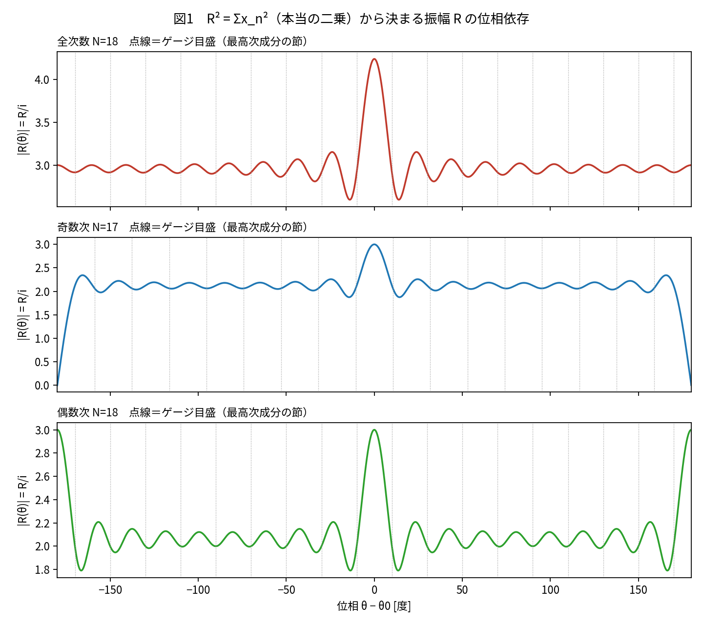
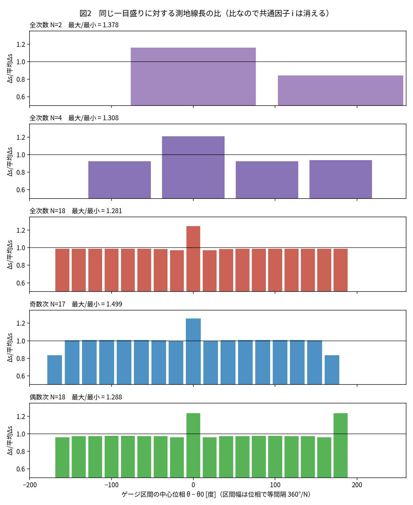
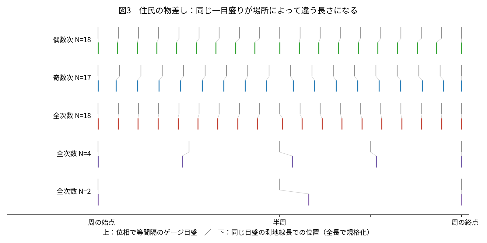
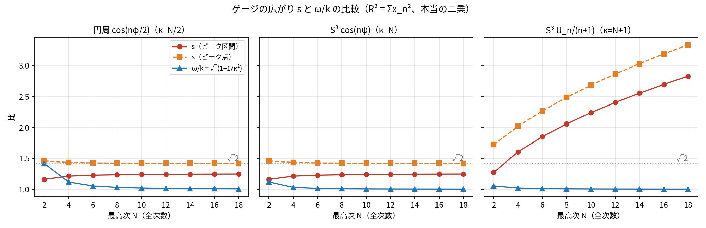
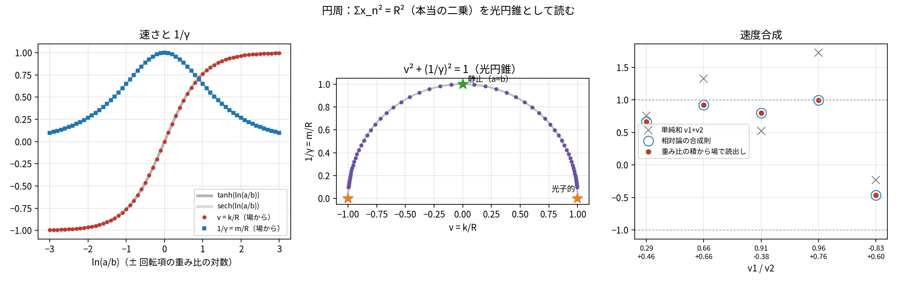
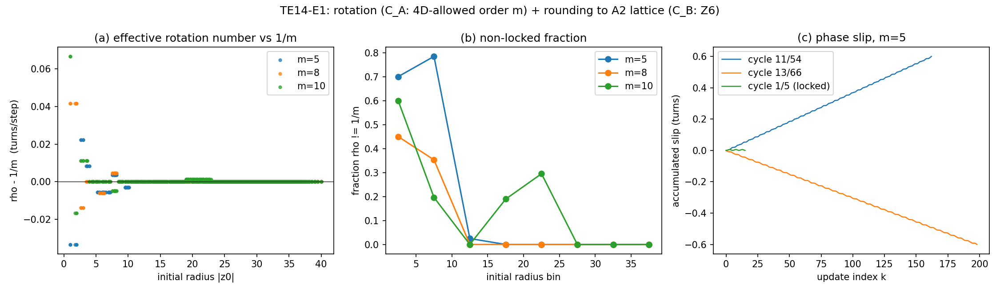
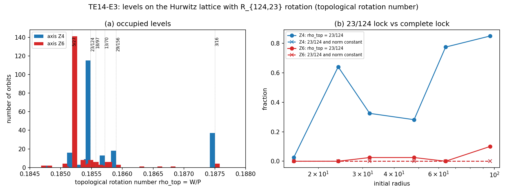
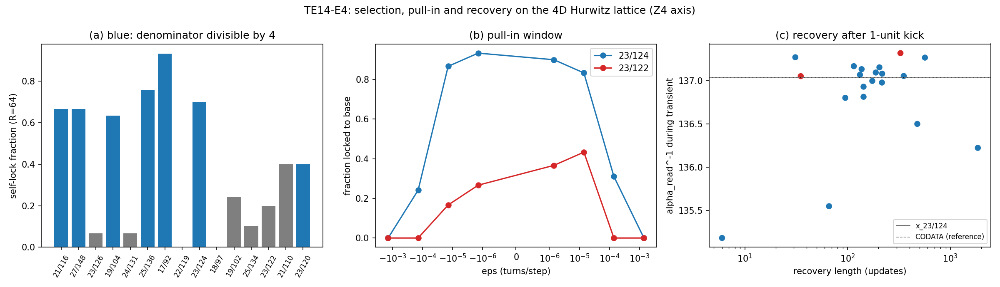
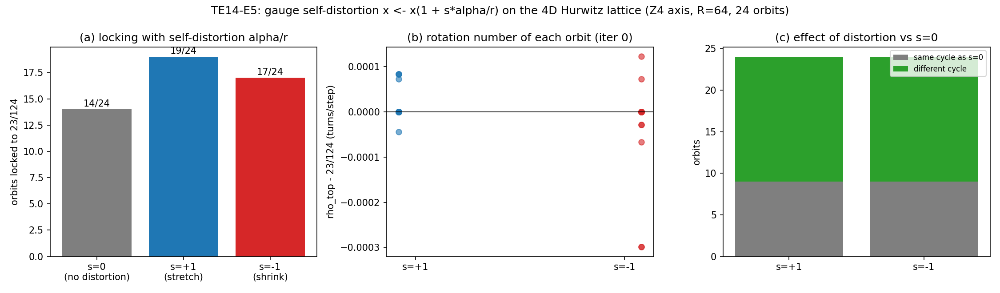

# 背景時空を置かない複素波の関係と干渉から、時間・空間・質量・電荷・並進速度・スピンを読み出す
## ――閉じた円周の住民から四次元球殻の住民へ、そして α・四次元格子・E₈ に至る、思考実験の順序に沿った統合仮説――

**著者:** 木原範昭 (Noriaki Kihara)  
**ORCID:** 0009-0004-6753-4020  
**Version DOI:** 10.5281/zenodo.23386447  
**Concept DOI:** 10.5281/zenodo.23384928  
**版:** v1.1（訂正版。v0.1 は α を主語にした構成で著者が却下、v0.2 で著者の問いの順序に沿って全面的に書き直し、v1.0 で引用の表現を整え図を確定して公開、v1.1 で付録 A の HTML 直接ダウンロード URL を 1 リンク 1 行に改め、表の区切り記号の誤解釈を修正した）  
**日付:** 2026-10-15  
**関連論文:** 閉じた球面住民の波動モデル [H1]、第十四思考実験 [A1]、第十三思考実験 [D1]、第十一思考実験 [D2]、第十二思考実験 [F1]、有限位数共鳴 [B1]  
**分類:** 思考実験の順序に沿った仮説論文／標準理論に対する別の解釈仮説／引き継いで検証できる課題の提示  
**記録方法:** 著者と Claude の二つの対話（「円周上の内在的な幾何学」2026-10-13〜14、「第十四思考実験以降の対話」2026-10-14〜15）の全文を一次資料とし、著者の問いと訂正の順序をそのまま章の順序にした。Claude の誤りと著者の訂正は導出の一部として残した。数値実験はすべて再実行して照合した。  
**キーワード:** 閉じた球面の住民、虚数振幅、本当の二乗、Σxₙ² = R²、光円錐、ゲージ間隔と測地線長、張り付いた位相（ヒッグス的背景）、交差項、固有時、速度合成、三次元の必然性、スピン、ホップ・ファイバーの巻き数、観測は交差項、四次元フルヴィッツ格子、23/124、三つの 137、近いがロックしない、無限遠の完全吸収殻、E₈ の接着

---

## 要旨

本稿の主張は一つである。**背景時空を置かず、奇数・偶数の倍音の進行波ですらない複素波の関係性と干渉だけから、時間・空間・質量・電荷・並進速度・スピンまでが読み出せる。** 置くのは、閉じた円周（S¹）の上の位相 θ と虚数方向の振幅 A、そして成分の本当の二乗（共役をとらない二乗）の和が R² に等しいという条件 Σxₙ² = R² だけである。この条件を Σxₙ² + (iR)² = 0 と書けば光円錐の条件であり、R は外に置いた半径ではなく成分と同じ種類の量（振幅）である。

導出は著者の問いと訂正の順序そのままに進む。円周の住民には横波の方向がないので振幅は虚数方向に置く。節（振幅がゼロになる位相）の数 n が半波長を数えるので奇数 n も許され、奇数は二周で、偶数は一周で閉じる。等振幅の倍音を合成すると一点に局在し、局在の発生と原点 θ₀ の確定は同じ出来事で、基本成分 n = 1 または n = 2 がゲージとなって仮想原点を持つ。二次元では R が入らない。四次元球殻（S³）の住民に拡張すると R が入り θ₀ が三つ（二つの位相と一つの混合角）になる。自己無撞着殻を絶対値の二乗と実数の半径で解いた数値実験は、著者の訂正「本当の二乗」「ノルムではない」「円周の外はない」で誤りと確定し、結果として採用しない。住民には曲率は読めないが、ゲージ間隔に対する測地線長が不等間隔になる（全次数 N=18 でピーク区間が 1.245 倍）。S³ の輪切りでは、偶数成分は対蹠点に同符号の山、奇数成分は逆符号の山を立て、両方がそろって初めて位置が一点に決まる。

そのうえで著者の 11 段が続く。(1) 質量：進行波を表現できないという問いから、張り付いた位相（ヒッグス場に相当し、振動しない）とのビートが質量・時間・空間を同時に読み出すこと、光速を超えないのはゲージが広がっているからであること、ローレンツ因子の考え方が Σxₙ² = 0 の光円錐そのものであることに至り、円周で v² + (1/γ)² = 1 が恒等式として成り立ち（残差 10⁻¹⁵）、v = tanh ln(a/b)、速度合成則が 6 桁一致し、質量 1/γ = m/R が逆回りの回転項の交差項 2ab の割合として読み出される。(2) 三次元：一様な並進が群をなす（S¹, S³）、尾を引かずに伝わる（奇数次元）、住民が読める曲率で質量ギャップが生じる（S¹ 以外）の三条件を満たすのは S³ だけである。(10) スピン：奇偶の区別がそのままスピン 1/2 と整数、交差項はスピン 0、一点への局在とスピン固有状態は両立せず、スピン固有状態は二点局在で反対側の逆スピンは誰にも観測できない。(3) 電荷：ホップ・ファイバーの巻き数で、整数性が量子化を与える。観測は粒子と観測者の交差項であり、読めること・放射すること・エネルギーが分配されることは同じ出来事である。(4) 電子として読めるか：弱い力（倍音成分の再分配）と強い力の問いから、Koide の関係が零二乗和であることを経て、電子を検証の場に選ぶ（E1）。(5) α を導入すると、Claude の「なぜ 23/124 か」の理屈は著者が退け、問題は「なぜそのウィンドウにロックするか」である。(9) 四次元の格子：対角線が整数になる四次元だけで Z₄ と Z₆ が一つの格子に共存し、これが背景が四次元で見える空間が三次元である理由である（E2）。(6) 迷走：プランク定数を SI の定義値に置いて電子の質量を判定した（E3）。(7) G = c = q₀ = 1（q₀ = e/3）では ħ = 9α⁻¹ が出力であり、α が決まれば電子の質量は必ず一致し、検証すべきは α 一つだけである。(8) α は 23/124 から N(R) = 4π/(1−R)² で求まり、四次元格子がそこへ引き込みやすい（E4）。観測値がわずかにずれるのは観測が遷移中の状態を含む平均だからで、電子自身がゲージを歪める（E5）。倍音構成は絶対スケールのない比の系では局在の度合いで決まり、最低構造はスピン 2 成分 × 三相 3 成分である。局在は交換で起こり一巡で戻り、自己無撞着になるのは 23/124 のロックしかなく、動力学は無限遠の完全吸収殻への記録として系に内在し、第十一思考実験の正解表で答え合わせができる。宇宙の始まり（高対称な単色波の不安定な自己無撞着閉包の幾何級数的拡大）、三つの力の居場所、インフラトンとヒッグス、背景放射までが同じ系の段として並ぶ。(11) ラムシフトと g 因子が導出できないなら、使いこなしていない E₈ が拘束を与える。E₈ は二つのフルヴィッツ四元数を「差が (1+i) の倍数」でつないだものであり、180° の反対点は自動的に入り、接続方法が特定できたのであとは導出問題である。

α・137・23/124 はこの展開の中の一段であって、論文の主語ではない。本稿は確かめた部分、仮説としてつないだ部分、検証の手段を分けて示し、完成を目指す論文ではなく、標準理論に対する別の解釈仮説として引き継いで検証できる形で固定する。

---

## 0. 本稿の位置づけと読み方

1. **順序に意味がある。** 本稿の章の順序は、二つの対話で著者が問い、Claude が誤り、著者が訂正して道が定まった順序そのままである。Claude の誤りは消さず、著者の訂正を導出の一部として書く。並べ替えも統合も短縮もしていない。著者が 2026-10-15 に示した 11 段の番号を章の見出しに付す。11 段と章の対応は、第 1 段＝第 7 章、第 2 段＝第 9 章、第 3 段＝第 12 章、第 4 段＝第 14 章、第 5 段＝第 15 章、第 6 段＝第 17 章、第 7 段＝第 18 章、第 8 段＝第 19 章、第 9 段＝第 16 章、第 10 段＝第 11 章（四次元格子の上では第 20.3 節）、第 11 段＝第 24 章である。11 段の列挙とチャットの位置が異なる二つの段（スピン、四次元格子）は、著者の判断（順序はチャットが基本、読みやすさで判断してよい）に従い、チャットの位置に置いた。スピンは S³ の幾何（SU(2) の左右の積）から直接読み出されるので三次元の直後が読みやすく、四次元格子は「なぜそのウィンドウにロックするか」への答えであり E2 が E3 以降の方法を定めるので α 導入の直後が読みやすい。
2. **三つの区別。** 本稿は、確かめた部分（論文と数値実験で数値が出ているもの）、仮説としてつないだ部分（著者の問いに対して対話の中で配置したもの）、検証の手段（第十一思考実験の正解表と実測）を分けて書く。第 25 章に一覧を置く。
3. **単位系。** G = c = q₀ = 1（q₀ = e/3、ガウス系）。プランク定数は入力に置かない。α = 9q₀²/(ħc) から ħ = 9α⁻¹ は出力である（第 18 章）。
4. **ロックの意味。** 動的なロック（状態が近くの値に引き込まれてロックし、その上で準振動や急変が起こること）は起こる必要がある。仮説を崩すのは、複数の対称性が選ぶ値（137、23/124、E₈ の整数など）が最初から厳密に一致していることであって、動的なロックの発見ではない [A1 §7.6]。「近いが一致しない」ことは埋めるべき穴ではなく、仮説の中身である。
5. **語法。** 本稿は対話記録ではなく仮説論文であり、主張は言い切る。ただし各節の冒頭に著者の問いを置く。それが導出の順序を定めた一次資料だからである。引用はチャットの原文から、誤字と口語の間投詞、叱責の表現を除いて整えたもので、文意は変えていない。原文は `chat_logs/` にある。
6. **先行論文の記号・実験名はそのまま使う。** 球面住民論文 [H1] の節番号、第十四思考実験 [A1] の式番号と H1〜H5、第十三思考実験 [D1] の U_R・N_A・ε_state、第十一思考実験 [D2] の照合表、K4 論文 [B1] の N(R)・R_{n,m}、数値実験 E0〜E5 の名称を変えない。

## 1. 動機：答え合わせの正解表から、この思考実験へ

本研究系列は設計書 [G1] のもとにある。設計書の出発点は二つの疑問である。標準模型と一般相対性理論はそれぞれ高い精度で成功しているのに、なぜ両者を同一の基礎構造から導出することが難しいのか。標準模型は高い対称性と多数の保存構造を持ちながら、なぜ複数の実験的パラメータを必要とするのか。第一原則候補は「名前は存在しないが、互いに区別可能で、数を数えられる状態が存在する」であり、状態にはあらかじめ電子・光子・質量・電荷・空間位置・時間座標などの属性を付与しない。禁止事項として、空間軸や時間軸を外部から固定すること、粒子種の名前を与えること、望ましい結果を得るためだけに正規化を加えることを挙げる。

第一思考実験 [G2] は、無名な二つの値 (a, b) と「状態単独は読めず積だけが読める」という原則から、読み出しが面積形式に一意に決まり、最初に読める力学量が中心加速度であること（等価原理の操作的な中身）、二乗和 Σz² = C² が入力でなく誘導されること、C が曲率半径であることを導いた。第二思考実験 [G3] は位置も積の読み出しとして x = a² − b²、y = 2ab、r = a² + b² を導き、x² + y² − r² = 0 がゼロ閉塞として出て、読み出しの点が逆二乗の力に従う円錐曲線を描くことを示した。同時に「質量比と電荷比は二つの値では書けない」と結論した。第三思考実験 [G4] は向きを逆にし、既知のニュートン方程式とポストニュートン近似で計算した二体の軌道から、質量比・相対距離・相対時間がゼロ知識で読み出せることを確かめた。第四〜第六思考実験 [G5–G7] は軌道を状態依存の作用 Sₙ から生成し、自己監査で状態の外に残る情報を明示し、重力とクーロンの二つの相互作用を八つの永続状態と一つの写像に入れた。第六補遺 [G8] は規格化を G = M = c = 1 から G = q₀ = c = 1（q₀ = e/3）に改めた。

第十一思考実験 [D2] は、ここで方針を変えた。第六思考実験の放射の更新則は既知の多重極公式を外から与えたものであり、「状態だけで閉じている」のは帳簿の形式であって相互作用の導出ではなかった。放射を含む動力学を分配配列演算そのものから導く試み（第七〜第十思考実験、未公開）と、Einstein–Maxwell 方程式を初期配置のまわりで展開して離散変分式に置く試みは、どちらも二体の重力込みの軌道に到達せず、吸収体つきの走行はロックに達せず崩壊した。そこで第十一思考実験は導出を目標にせず、既知の標準理論（Dirac–Coulomb 束縛状態と反跳、1PN 二体重力と四重極重力波、Einstein の A 係数）を、背景時空の座標格子や計量を状態に持たず、唯一の基準系を無限遠の完全吸収体の静止系とし、単位 G = c = q₀ = 1、入力は α・μ_p・μ・g_p、読み出しは放出・吸収の記録（振動数、率、分岐比、時刻差、方向、偏光）だけ、という条件で数値計算し、水素原子・電子–電子・陽子–陽子・水素分子の四系について、将来の生成則が再現すべき「正解表」を作った。吸収体は各放出事象の未来光円錐が無限遠を切る断面であり、「背景時空を置かない」と「無限遠の完全吸収体」は矛盾しない。記録される交換（放出・吸収）は振動数そのものを与え、記録されない交換は振動数のずれ（Lamb シフト）を与える。「基底状態は放射しない」には場の時間発展と離散的なロックの両方が要る。

第十二思考実験 [F1] は、正解表で入力に用いた α がどこから現れた定数なのかを問い直した。水素基底状態では α = v/c であり、ローレンツ因子 γ = 1/√(1−α²) は光円錐の方程式に固有時間の軸を一本足した r² + τ² + (it)² = 0 の成分比にすぎない。軸に名前を与えず無名の方向として扱い、観測者が直接読める部分空間を選ぶと残りの方向は二乗和としてだけ現れ、対称性は区別不能性の表現として読める。第十三思考実験 [D1] は、質量を獲得した粒子がなぜ散逸して消滅しないかを問い、局在性が二つの波の間を可逆に往復すること、U^n = I は原因ではなく結果であること、有限位数根 R_{124,23} を入れた交換系で 124 回目に状態が回復することを示したが、「R は入力値であり、周期閉包が相互作用から生じたことの確認ではない。混合角を相互作用から決めるには動力学が要る」と留保した。第十四思考実験 [A1] は、プランク定数を説明の終点でなく出発点より手前へ遡り、整数を選ぶ複数の対称性が完全には整合できずに互いに引き込む非完全ロックが準安定と急変を生むという仮説を立て、「理論的には無関係に見えるのに近くにあり、引き込むが完全にはロックしない組を探す」ことを提案した。その契機が、四次元セル数 137 = 1 + 8 + 128 と二波交換の有限位数根 R_{124,23} = cos²(23π/124) がそれぞれ別々に α⁻¹ の近傍の値を与えることだった。

ここまでの系列は、既知の方程式を使って正解表を作り、その入力に残った定数（α、すなわち電荷の結合）の出どころを問い、交換と非完全ロックの構造を見つけたところで止まっていた。残っていたのは、時間も空間も置かずに、質量・電荷・並進・スピンがどこから読み出されるかを、一つの系で一段ずつ示すことである。本稿の思考実験はそこから始まる。閉じた円周の住民である。

---

## 2. 円周の住民（S¹）

本章から第6章までは、チャット「円周上の内在的な幾何学」（2026-10-13〜14）[H1] の展開を、著者の問いと訂正の順に書く。各節の冒頭に著者の問いの原文を置く。式はすべて、閉じた円周の上の位相 θ と虚数方向の振幅 A だけで書かれ、背景の時間も空間も使わない。

### 2.1 設定：背景時間も空間も想定しない

> 二次元の半径Rの円周に住む住民として考えます　背景時間も空間も想定しません（10-13 17:59）

住民の世界は閉じた円周だけである。中心も、円の内側や外側の平面も、住民にとっては存在しない。「半径 R」は外から見たときの言葉で、住民が内側から測れるものではない。1 次元の多様体には内在的な曲率がないので、住民に残る手がかりは「一周すると元に戻る」という閉じ方だけである。背景時間もないので、時間を語るなら住民の世界の中の変化どうしの関係から組み立てるしかない。

### 2.2 横波の方向がない：振幅は虚数方向

> ここで余弦波または正弦波を考えます　波は横波しかないと考えます　横波の方向がありません　円周の接線と直交しているはずですが、そんな方向はないので、虚数方向にも振幅があると仮定します（18:03）

接線に直交する方向は背景空間の方向であり、住民にはない。横波の振幅を置ける方向は、空間の方向ではなく住民の世界に付いた内部の自由度しかない。それを虚数方向とする。閉じていることから、許される波はとびとびになる。

### 2.3 節の数 n：振幅がゼロになる位相

> ここでnが問題で円周上の節(頂点)の数と考えます（18:05）
> 違います　振幅がゼロになる位相を節(頂点)とします（18:06）
> 複素数の振幅はゼロになれないのですか？（18:07）
> 余分な仮定が入っています　あるのはθ位相と虚数の振幅Aだけです（18:09）

ここで Claude は三度誤った。位相がそろう点を「節」と読み、次に e^{iks} の円偏波に限定して「複素振幅はゼロになれない」とし、さらに C·cos(mθ+δ) という複素定数 C と位相 δ と整数 m を持ち込んだ。著者の三度の訂正によって、系の要素は θ と虚数振幅 A の二つに確定した。節は振幅がゼロになる位相であり、一周の間にその θ が n 個ある。

> ここでnの意味は、2nで本来の360度、nだと180度です（18:10）

節と節の間は位相で 180 度である。節が 2n 個なら一周で n×360 度進むふつうの波、節が n 個なら一周で n×180 度進む。n は半波長の数を数えている。したがって n が奇数の波も許され、そのとき一周で振幅 A は −A になって戻る。A は虚数方向にも値を取れるので、−A は複素平面内で 180 度回したものとして矛盾なく扱える。

### 2.4 n=0 は ±iA

> ではn=0とはどんな波形ですか？（18:11）
> ±iA では？（18:13）

Claude は n=0 を「一様な A で何も現れていない状態」と答え、著者が訂正した。n=0 では位相が進まないので振幅は一定のまま残り、その振幅は虚数方向にしか置けない。n=0 は空っぽではなく、円周全体が純虚数の振幅を一様に持つ状態であり、符号で区別される二つの状態 +iA と −iA がある。

### 2.5 n=1、n=2、奇数と偶数

> ではn=1は？（18:14）
> 図化できますか？（18:14）
> 3Dにしなさい　半径方向に虚数軸をとったらNGです（18:16）
> ではn=2を図化しなさい（18:17）
> ここで奇数偶数での差がありませんか？（18:19）

n=1 は節が一つの波である。ある点で +iA、円周に沿って進むと反対側の一点（節）でゼロを通過し、一周して戻ると −iA になっている。n=1 は n=0 の二つの状態 +iA と −iA をただ一つの節を挟んでつなぐ波であり、一周では元に戻らず符号が反転し、二周して初めて元に戻る。

図化では、虚数軸を半径方向に取ることはできない。半径方向は背景空間の方向だからである。虚数振幅は円周の面に垂直な方向に描く。

n=2 は節が二つで一周で 360 度進み、+iA から出発して二つの節で面を二度横切り、一周で +iA に戻る。

奇数の n は一周で位相が 180 度の奇数倍進むので一周後に −iA になり、元に戻るには二周が必要である。偶数の n は一周で閉じる。円周を一周する回転に対して、奇数の波は 720 度で、偶数の波は 360 度で元に戻る。この戻り方の違いは、スピノルとベクトルの違いと同じ構造をしている。

### 2.6 倍音の合成と局在

> n=1,3,5 を一つの図で図化できますか？（18:20）
> ここでさらに線形合成した線も追加してください（18:21）
> 同様にn=2,4,6の線形合成も示してください（18:23）
> では奇数次でn=17迄の線形合成だけ表示してください（18:24）
> 同様に偶数次でn=18迄も線形合成だけ表示してください（18:26）
> では奇数偶数両方でn=18迄の線形合成だけ表示してください（18:27）

各成分を同じ振幅 A で足し合わせる。

- 奇数次 n=1,3,…,17（9 成分）：θ=0 に +9iA の鋭い山が一つ立ち、一周目の終わりに同じ点が −9iA の谷、二周目で +9iA に戻る。節は一周で 17 個、θ=π/9 の間隔で等間隔。閉じた形は A·sin(9θ)/(2 sin(θ/2))。
- 偶数次 n=2,4,…,18（9 成分）：θ=0 に +9iA、一周で同じ点に +9iA に戻る。θ=π では −iA で節にならない。節は一周で 18 個、間隔の違う二つの等間隔列が交互に入る。
- 両方 n=1,…,18：θ=0 に +18iA。一周目の終わりで奇数次の和 −9iA と偶数次の和 +9iA が打ち消し合い、振幅はちょうどゼロになる。ただしこの点では波は円周の面に接するだけで横切らない。二周目の終わりに +18iA に戻る。閉じた形は A·sin(9θ/2)·cos(19θ/4)/sin(θ/4)。

> 意図はわかりますか？（18:30）

Claude の読みは次のとおりで、著者は「大体 OK」とした。背景空間がないので振幅の方向は i になり、半径方向に取れないのはそれが背景空間の方向だからである。円周が閉じていることだけから許される波がとびとびになり、n は住民が読み出せる唯一の量、すなわち分解能である。n=0 は ±iA の二値である。奇数の n は二周で、偶数の n は一周で閉じ、フェルミオン的な波とボゾン的な波の区別が閉じた円周と節の数の偶奇だけから出る。等振幅の倍音を合成すると一点に鋭い山が局在し、背景空間がないのに「位置」と呼べる構造が干渉だけから生まれる。奇数と偶数を両方合成すると、一周目の終わりで打ち消し合い、局在した山は二周に一度だけ現れる。閉じた円周と虚数方向の振幅だけから、量子化（n）、フェルミオンとボゾンの区別（偶奇）、局在した粒子（倍音合成）が、外から何も持ち込まずに出てくる。

### 2.7 ピーク位相 θ₀ と三つの式

> この図化にピーク位相θ0の指定を追加してスライダーで移動可能にしてください（18:44）
> 奇数のみ　偶数のみ　両方で　最大n とθ0を指定した場合の線形合成波形 fodd(n,θ0) feven(n,θ0) fall(n,θ0) の式を表示してください（18:48）

φ = θ − θ₀ と置き、振幅を iA とする。N は合成に含める最大の n である。

$$
f_{\mathrm{odd}}(N,\theta_0)=iA\sum_{k=0}^{(N-1)/2}\cos\frac{(2k+1)\varphi}{2}=iA\,\frac{\sin\frac{(N+1)\varphi}{2}}{2\sin\frac{\varphi}{2}},
$$

$$
f_{\mathrm{even}}(N,\theta_0)=iA\sum_{k=1}^{N/2}\cos k\varphi=iA\,\frac{\sin\frac{N\varphi}{4}\cos\frac{(N+2)\varphi}{4}}{\sin\frac{\varphi}{2}},
$$

$$
f_{\mathrm{all}}(N,\theta_0)=iA\sum_{n=1}^{N}\cos\frac{n\varphi}{2}=iA\,\frac{\sin\frac{N\varphi}{4}\cos\frac{(N+1)\varphi}{4}}{\sin\frac{\varphi}{4}}.
$$

ピーク値は順に i(N+1)A/2、iNA/2、iNA、周期は f_odd と f_all が 4π（二周）、f_even が 2π（一周）である。θ₀ のスライダーは 0〜720° で、θ₀ と θ₀+360° は円周上の同じ点にピークを立てるが、一周目に出るか二周目に出るかが違う別の状態である。

### 2.8 指数表現と E 関数

> これを振幅も含めて指数表現してください（18:49）
> 振幅も指数表現にしてください（18:51）
> 振幅が虚数であることを無視しています（18:53）
> Σの展開を省かないでください（18:54）
> ここで指数部だけ求める関数をEevenなどとして表示してください（18:56）
> 何をしているかわかりますか？（18:58）

四度の訂正を経て、振幅 iA = e^{α+iπ/2}（α = ln A）を独立の因子として残し、和を等比級数で閉じた形に至った。

$$
f_{\mathrm{odd}}(N,\theta_0)=e^{\alpha+i\frac{\pi}{2}}\;\frac{e^{i\frac{(N+1)\varphi}{2}}-e^{-i\frac{(N+1)\varphi}{2}}}{2\left(e^{i\frac{\varphi}{2}}-e^{-i\frac{\varphi}{2}}\right)},
$$

$$
f_{\mathrm{all}}(N,\theta_0)=e^{\alpha+i\frac{\pi}{2}}\;\frac{\left(e^{i\frac{N\varphi}{4}}-e^{-i\frac{N\varphi}{4}}\right)\left(e^{i\frac{(N+1)\varphi}{4}}+e^{-i\frac{(N+1)\varphi}{4}}\right)}{2\left(e^{i\frac{\varphi}{4}}-e^{-i\frac{\varphi}{4}}\right)}.
$$

分子の差と分母の差はどちらも純虚数なので比は実数になり、f は常に虚数軸の上にある。振幅の向きを決めるのは e^{iπ/2} だけ、大きさは e^{α} である。

f = e^{E} となる指数部を E_odd、E_even、E_all とする。積は和に、商は差になる。

$$
E_{\mathrm{odd}}(N,\theta_0)=\alpha-\ln2+i\frac{\pi}{2}+\ln\!\left(e^{i\frac{(N+1)\varphi}{2}}-e^{-i\frac{(N+1)\varphi}{2}}\right)-\ln\!\left(e^{i\frac{\varphi}{2}}-e^{-i\frac{\varphi}{2}}\right).
$$

E の実部は振幅の大きさの対数 ln|f| で、節では |f| = 0 なので −∞ に発散する。E の虚部は π/2 か 3π/2（mod 2π）の二値しか取らず、振幅の向きは +i か −i のどちらかで、節を通るたびに π 跳ぶ。

著者の「何をしているかわかりますか？」に対する Claude の読みは次のとおりで、著者は「大体 OK」とした。波そのものでなく指数部 E = ln f を系の記述量として取り出している。振幅 α = ln A は E に加わるだけの定数で、θ や θ₀ で微分すると消えるので、勾配として読み出す量は A によらない。「比だけが物理」が式の上で自動的に成り立つ。残るパラメータは N と θ₀ だけである。読出しは E の勾配で、φ = θ − θ₀ なので ∂E/∂θ₀ = −∂E/∂θ となり、ピークを動かすこととその場所で読むことが同じ量で結ばれる。

### 2.9 二次元では R が関係しない

> ここからハードルが上がります二次元の場合この計算にRが関係してないですよね？（19:00）

E_odd、E_even、E_all はすべて φ だけで書かれ、R はどこにも出てこない。R が現れるのは位相 θ を弧長 s = Rθ に換算したときだけである。住民には背景の物差しがなく、長さの単位として使えるのは波そのもの（節の間隔）だけなので、その単位で測れば 1/R は消え、節の数 N の比だけが残る。円周は 1 次元で内在的な曲率を持たないので、住民が局所的に何を測っても R は検出できない。

### 2.10 θ₀ は仮想原点：ベース n=1 または n=2 がゲージ

> そうです　もう一つ不思議なことがあります　θ0です　この系には背景の原点が存在しないのに、なぜかθ0が定義できています（19:06）
> そんな仮定がなくても式は成立します（19:07）
> その通りです　ベースn=1 またはn=2がゲージになって仮想原点を持っています（19:08）

Claude は「θ₀ が意味を持つのは波が二つ以上あるときで、読み出せるのは位相差だけ」と答え、著者が訂正した。二つ目の波は要らない。指数表現で見ると、

$$
e^{i\frac{n\varphi}{2}}=e^{i\frac{n\theta}{2}}\,e^{-i\frac{n\theta_0}{2}}
$$

であり、θ₀ は外から置いた原点ではなく、成分 n ごとの位相 nθ₀/2 の並び方そのものである。すべての成分の位相がそろう点がピークで、その点が θ₀ である。背景の原点がなくても、成分どうしの位相関係が円周上のただ一点を自分で決めている。これは合成したから成り立つことで、成分が一つだけなら位相がそろう点は複数あり、どれが θ₀ か区別できない。局在した山ができることと、原点が定まることは、同じ一つの出来事である。

基本成分は周期の中に山を一つだけ持つ。n=1 なら二周（4π）に一つ、n=2 なら一周（2π）に一つである。そのため基本成分の位相だけで円周上の一点が一意に決まる。これが仮想原点である。高次の成分 n は山を n 個持つので単独では原点を決められないが、合成波では各成分の位相 nθ₀/2 が基本成分の位相の整数倍に固定されており、基本成分が決めた原点に従って並んでいる。基本成分の位相そのものは任意に選べ、θ₀ を θ₀+δ にずらすとすべての成分の位相が nδ/2 ずつそろってずれて波形は形を変えずに移動する。基本成分の位相の選び方がゲージの自由度で、その選択に対して不変なのは成分どうしの位相の比（整数倍の関係）である。奇数系と両方の系では n=1 が、偶数系では n=2 がこのゲージの役を担う。

## 3. 四次元球殻の住民へ

### 3.1 R が関係し、θ₀ が三つになる

> 次です　これを四次元球殻の表面の住民に拡張します　突然Rが関係してきてθ0が３つになりませんか？（19:12）

四次元球の表面 S³ は三次元の閉じた空間である。住民の世界の点を指定するには角度が三つ要るので、合成波のピーク位置すなわち仮想原点も三つの角度 (χ₀, θ₀, φ₀) で決まり、ゲージの自由度は三つになる。

円周は 1 次元で内在的な曲率がなく住民に R は見えなかったが、S³ は曲率 1/R² を内在的に持ち、住民は外を見なくても局所的な測定から R を読み出せる。波の側では、円周で成分 n の固有値が n² に比例したのに対し、S³ 上の調和関数では n(n+2)/R² になる。これは (n+1)² − 1 と書け、「−1」が曲率による項である。波の節の間隔で測った物差しと空間の曲がり方の比が、住民に読み出せる量として残る。S³ は SU(2) と同じ形をしていて、一周で符号が反転し二周で戻るスピノルの性質を空間として持つ。円周の奇数系で見た「二周で閉じる波」が、S³ ではそのまま空間の性質として現れる。

### 3.2 同じ指数形式：N と R は共通

> これって先ほどと同じ指数形式で表現できますか？NとRは共通とします（19:14）

点とピークの間の測地距離を s とし、ψ = s/R と置く。

$$
\cos\psi=\cos\chi\cos\chi_0+\sin\chi\sin\chi_0\left[\cos\theta\cos\theta_0+\sin\theta\sin\theta_0\cos(\phi-\phi_0)\right].
$$

S³ を単位四元数とみなせば x = x₀·e^{ψu}（u は純虚単位四元数）とも書け、ψ は仮想原点から見た点の指数部の角度そのものである。円周の式で φ/2 を ψ に置き換えると、

$$
f_{\mathrm{odd}}=e^{\alpha+i\frac{\pi}{2}}\,\frac{e^{i(N+1)\psi}-e^{-i(N+1)\psi}}{2\left(e^{i\psi}-e^{-i\psi}\right)},
$$

$$
f_{\mathrm{even}}=e^{\alpha+i\frac{\pi}{2}}\,\frac{1}{2}\left(\frac{e^{i(N+1)\psi}-e^{-i(N+1)\psi}}{e^{i\psi}-e^{-i\psi}}-1\right),
$$

$$
f_{\mathrm{all}}=e^{\alpha+i\frac{\pi}{2}}\,\frac{1}{2}\left(\frac{e^{i\frac{(2N+1)\psi}{2}}-e^{-i\frac{(2N+1)\psi}{2}}}{e^{i\frac{\psi}{2}}-e^{-i\frac{\psi}{2}}}-1\right).
$$

円周と変わったことは三つある。分母 e^{iψ} − e^{−iψ} は、円周では和をとった結果にすぎなかったが、S³ では仮想原点から距離 s の球面の大きさ R sin(s/R) に対応する幾何学的な因子であり、平坦なら s に比例するはずのずれが曲率 1/R² である。R はここで住民の物理に入ってくる。f_odd は S³ 上で固有値 N(N+2)/R² を持つ一つの調和関数そのもので、円周上の「合成波」は S³ では一つの波である。円周の一周（φ = 2π）は S³ では対蹠点（ψ = π）に当たり、f_odd は対蹠点で符号が反転し、f_even は戻り、f_all は N が偶数のとき対蹠点でちょうどゼロになる。

### 3.3 三つの θ₀：二つの位相と一つの混合角

> ここで３つのθ0を入れると？（19:16）

S³ の点を二つの複素数 (z₁, z₂) = (cos η·e^{iξ₁}, sin η·e^{iξ₂}) で表し、ピークを (η₀, ξ₁₀, ξ₂₀) とすると、

$$
\cos\psi=\mathrm{Re}\left[\cos\eta\cos\eta_0\,e^{i(\xi_1-\xi_{10})}+\sin\eta\sin\eta_0\,e^{i(\xi_2-\xi_{20})}\right].
$$

ξ₁₀ と ξ₂₀ は円周の e^{−inθ₀/2} と同じく位相の差としてだけ現れ、円周と同じ種類のゲージである。η₀ は cos η₀、sin η₀ として二つの位相の項の比率を決める混合角であり、位相ではない。どんな座標を選んでも、三つの θ₀ を同時に純粋な位相にすることはできない。S³ の回転対称性の中で互いに可換な回転は二つまでしかないからである。η = η₀ = 0 とすると円周の場合が戻る。円周で一つだった θ₀ は、S³ では「二つの位相（ゲージ）と一つの混合角」になる。

### 3.4 一つの方程式で三次元空間の任意の位置に局在する

> これは不思議です　(A,N,θn) n=1,2,3 の同じ方程式で、宇宙の3次元空間の任意の位置への移動と局在を、すべて表現できるのではありませんか（19:23）

S³ はどの点も同等（一様）なので、三つの θ₀ をどう選んでもピークの周りの波形は同じ形のまま、空間の任意の点に局在できる。(A, N, θ₁, θ₂, θ₃) の五つのパラメータを持つ一つの方程式で、三次元空間のどこにでも局在した対象を置ける。この移動は背景の空間の中を動くのではなく、S³ が SU(2) そのものなので、その群の元を掛けることとして空間自身の対称性で実現される。A は山の強さ、N は山の幅（およそ πR/(N+1)、宇宙の大きさに対する粒子の大きさの比）、三つの θ₀ は位置である。この時点で表せているのは局在した対象の位置と移動であり、奇数系と偶数系でフェルミオン的かボゾン的かは区別できる。電荷のような量がどこから読み出されるかは、まだ示されていない。

### 3.5 なぜ波が並進して見えるのか：静止している

> さらに、なぜ波が並進して見えるのか　説明できていません　静止しています（19:25）

ここまでの式には時間がどこにも入っていない。f はすべて静止した波形で、θ₀ は波形がどこに局在しているかを示すパラメータにすぎず、θ₀ の値が違う波形はそれぞれ別の静止した状態である。並進として見えるためには、θ₀ の異なる状態が順序づけられ一方から他方へ移ることが必要で、それは時間の向きを持ち込むことと同じであり、背景時間を想定しないこの系にはまだその仕組みがない。式から言えるのは、成分ごとの位相は e^{−inθ₀/2} なので、ピークが並進するとはすべての成分の位相が n に比例して一斉に進むことだ、ということである。問題は「全成分の位相を n に比例して進める共通のパラメータが、外から持ち込まずに系の中から出てくるか」という形に絞られる。この問いには第7章で答える。

### 3.6 R が R(θn, φn) になる：Σxₙ² = R² で決める

> ここでRがR(θn)になると突然難しくなります　実際には重心方向が要るのでR(θn,φn)ですが（19:28）
> 本来はΣxn^2=R^2で決めます（19:32）

R が定数のあいだは S³ のどの点も同等で、三つの θ₀ は純粋なゲージだった。R が場所によって変わると、θ₀ はゲージでなくなり、閉じた式は固有関数でなくなり、節の間隔は局所的な R に比例して伸び縮みして波は R の勾配に沿って屈折を受ける。R(θ) を定義するには「どこから測った半径か」という中心が要り、それを重心で決めるとすると、重心は波の分布で決まり、R はその重心から決まり、波は R の上で決まるという循環ができる。

R は外から与えるのでも、|f|² から別のルールで決めるのでもなく、成分そのものの二乗和で決まる。

$$
\sum_n x_n(\theta_n,\phi_n)^2=R(\theta_n,\phi_n)^2 .
$$

波と幾何の循環は後から加わる仮定ではなく、この式に最初から含まれている。波が殻の形を決め、殻の形がその上の波を決めるのは、同じ一つの式の両面である。虚数方向の成分の二乗は負になるので、R² を左辺に移して (iR)² と書けば Σxₙ² + (iR)² = 0 であり、R は特別な量ではなく成分の一つとして同じ和の中に入る。

## 4. 自己無撞着殻の誤りと、本当の二乗

### 4.1 Claude の数値実験：絶対値の二乗と実数の半径

> では検討できますか？（21:01）　進めてみてください（21:04）　これを四次元球殻に拡張できますか？（21:32）　両方やってみて比較しましょう（21:33）

Claude は次の設定で自己無撞着殻を数値計算した。成分 xₙ = iA·cos(n(φ−φ₀)/2)、殻の形を各方向で R(θ)² = A²·Σcos²(n(φ−φ₀)/2) と決め、住民の位相を変形した殻の上の弧長で測り、殻の重心を求め直して R を測り直し、形が変わらなくなるまで繰り返す。円周では、奇数成分を含む系で重心と R を測った中心が一致せず、両方 N=18 で d = 0.682（全周長の 2.86%）だけピーク方向にずれ、偶数のみでは d ≈ 0、ピークは半径方向の細い針になった。S³ では、成分を (a) cos(nψ) とすると ψ → π−ψ の対称性で d = 0 となり、(b) Uₙ(cos ψ)/(n+1) とすると両方 N=2, 4 で非対称な解に収束した。Claude はさらに「R を合成波の二乗 |Σxₙ|² から決める方法」を提案した [H2: `円周住民_自己無撞着殻_20261013`、`四次元球殻住民_自己無撞着殻_20261013`]。

### 4.2 著者の訂正：本当の二乗、ノルムではない、円周の外はない

> 絶対値の二乗？その定義は誰が決めましたか？本当の二乗です（21:42）
> Σxn^2=0 はノルムではありません（21:43）
> 円周の外なんてありません（21:44）

Σxₙ² は共役をとらない本当の二乗の和で、正定値のノルムではない。複素数の成分なら、ゼロでないベクトルでも和がゼロになれる。それが Σxₙ² = 0 の意味である。Claude は殻の式を R² = A²·Σcos² と置き、各成分の |xₙ|² を足していた。本当の二乗では xₙ = iA·cos(…) なので xₙ² = −A²·cos² であり、Σxₙ² = R² から R² = −A²·Σcos² となって R は純虚数である。R を正の実数として扱ったため、殻を実平面や実四次元空間の中の図形として描き、その中で重心を計算した。これは最初に排除した背景空間そのものである。重心のずれ d、半径方向の針、S³ での対称性による d = 0、非対称解は、すべてこのノルムによる埋め込みから生じた結果であり、公理から出た結果ではない。本稿はこれらを結果として採用しない [H1 §5]。

Claude はさらに「R は虚数方向、つまり系の外の方向を向く」と書き、著者が「円周の外なんてない」と訂正した。円周の住民にあるのは θ と虚数振幅だけで、虚数方向は外の空間ではなく住民がもともと持っている振幅の向きである。Σxₙ² = R² は、各 xₙ が虚数振幅で xₙ² は負の実数、その和に等しい R² も負で R も虚数、つまり R は xₙ と同じ種類の量すなわち振幅であり、外に置いた半径ではない、と言っている。R(θ) = iA√(Σcos²(n(θ−θ₀)/2)) は各位相での成分の二乗和から決まる量で、θ と虚数振幅だけで閉じている。この訂正が、以下すべての読み出しの前提になる。

## 5. ゲージ間隔と測地線長の不等間隔

### 5.1 曲率は読めないが、同じ一目盛りの長さが違う

> まず二次元の円弧で考えます　曲率は読めませんが、ゲージ間隔に対する測地線長が不等間隔になります（21:48）
> 進めて図化もしてください（10-14 07:58）

住民には曲率は読めない。読めるのは、位相のゲージ間隔とそれに対応する測地線の長さの関係である。ゲージは位相 θ で刻まれ、基本成分が原点を決め、高次成分の節が θ を等間隔に刻む。一方、R(θ)² = −A²·Σcos²(n(θ−θ₀)/2) は θ によって変わるので、等しい位相間隔 Δθ に対応する測地線長 Δs = ∫R dθ = i∫|R|dθ は場所ごとに違う。i は全区間に共通なので、比 Δs/⟨Δs⟩ は実数である。ゲージ目盛には最高次成分 n=N の節（位相で等間隔 2π/N）を使った。前の数値実験は逆に弧長で位相を測っていたが、ここでは位相をゲージとして固定し、長さの不等間隔を読む向きに改めた。

| 系 | ピークの区間 | 対蹠点の区間 | その他 |
|---|---|---|---|
| 全次数 N=18 | 1.245 | 0.988（普通） | 0.97〜0.99 |
| 奇数次 N=17 | 1.252 | 0.835（短い） | ほぼ 1.00 |
| 偶数次 N=18 | 1.236 | 1.236（同じ長さ） | 0.96〜0.98 |
| 全次数 N=2 / N=4 | 1.159 / 1.211 | 0.841 / 0.938 | — |

住民に曲率は読めないが、ピークの位置では一目盛りが約 1.25 倍長くなる。局在は外から見た形ではなく、物差しの歪みとして住民の中で読める。ピークと対蹠点を区別できるのは奇数成分である。偶数次だけではピークと対蹠点が同じ長さでどちらがピークか決まらず、奇数次の系では対蹠点で全成分が節を共有して R → 0 になるのでピークは長く対蹠点は短く、全次数の系ではピークだけが長く対蹠点は普通の長さで、一点だけが際立つただ一つの局在になる。最初に見た奇数・偶数の違い（二周回帰か一周回帰か）が、測地線長の非対称として現れている [H2: `円周住民_ゲージ間隔測地線長_20261014`]。

**図1.** R² = Σxₙ²（本当の二乗）から決まる振幅 |R(θ)| = R/i の位相依存。上から全次数 N=18、奇数次 N=17、偶数次 N=18。点線は最高次成分の節（ゲージ目盛）。`gauge_geodesic_s1.py`・`plot_gauge_geodesic_s1.py`。

**図2.** 同じ一目盛り（位相で等間隔 360°/N）に対する測地線長の比 Δs/⟨Δs⟩。全次数 N=2・4・18、奇数次 N=17、偶数次 N=18。ピークの区間だけが長く（1.245 倍）、奇数次では対蹠点の区間が短い（0.835 倍）。

**図3.** 住民の物差し。上段は位相で等間隔のゲージ目盛、下段は同じ目盛の測地線長での位置（全長で規格化）。同じ一目盛りが場所によって違う長さになる。

### 5.2 負の曲率と、テンソル読みでは傾斜が同じこと

> 歪みが大きい方がゲージが広がるのは直感的に理解しやすいですが、負の曲率になる場合はどうなりますか？（08:29）
> 合っています　実は負でも正でも、歪みをテンソル読みすると方向が違うだけで傾斜は同じになります（08:32）

本当の二乗で R² = −A²·Σcos² なので R は虚数で 1/R² は負であり、上の計算はすでに負の曲率の側にある。ピークでは |R| が最大で曲率は負でゼロに近く一目盛りは長い。奇数系の対蹠点では R → 0 で曲率は −∞ に向かい一目盛りは短い。成分を指数表現の ± 回転項とすると、本当の二乗の和は −(A²/2)·Σcos(nφ) となって符号を変える。全次数ではピーク付近で Σcos(nφ) ≈ N > 0 で R² < 0（R 虚数、負の曲率）、離れたところで ≈ −1/2 で R² > 0（R 実数、正の曲率）、境目で R = 0 で一目盛りの長さがゼロになる。この場合、ピークの区間では Δs が虚数、その他では実数になり、長さの種類そのものが入れ替わる。

計量は g = R²dθ² の一成分だけである。テンソルとして読むと効くのは g そのものでなく対数の勾配で、接続は Γ = ½∂θ ln g。R² < 0 なら ln g = ln|R²| + iπ、R² > 0 なら ln g = ln|R²| で、違いは定数 iπ だけであり θ で微分すると消える。傾斜 ∂θ ln|R²| は正の曲率でも負の曲率でも同じで、符号が決めるのは向き（虚数の長さか実数の長さか）だけである。これは E 関数で見た構造と同じで、実部 ln|f| が勾配の情報をすべて担い、虚部は π/2 か 3π/2 の二値で向きを示すだけだった。R = 0 の境目で ln|R²| は −∞ になり、そこを越えると虚部が π 跳ぶ。曲率の符号の反転は、計量の節で起こる位相の π 跳びとして読める。

### 5.3 虚数振幅と直交する半径方向に実数曲線を引く

> では円周上の虚数方向の振幅とは直交する方向に半径方向にこの実数曲線を引いてください（08:36）

円周を水平面に置き、虚数振幅を面に垂直に、傾斜 ∂θ ln|R²| を半径方向に描く。珊瑚色は R² < 0、緑は R² > 0、黒い点は R = 0 の境目で、色が変わっても半径方向の曲線は一本の曲線として連続する。「成分＝iA cos」では R² が全周で負で黒い点は現れない。θ₀ を 360° 動かすと奇数成分を含む系では振幅が反転するが、傾斜は二乗から作るので変わらない [H2: `circle_imag_amplitude_radial_log_gradient.html`]。

## 6. 四次元球殻の輪切りと対蹠点

### 6.1 投影面は球殻の半径

> この図化を四次元球殻に拡張したいのですが、どこかで投影面を切らないと図化できません　どの面に投影しますか？また投影面の位置もスライドできるようにできますか？（08:40）
> 両方です　ピークを見えやすくしたいです　3次元に投影すると球に見えます　スライドすると球の大きさが変わって見える方に切断したいので、投影面はまさに球殻の半径では？（08:44）
> 直して濃淡で透明度も変えましょう（08:46）　傾斜線のon/offを追加しましょう（08:57）　奇数・偶数のチェックボックスをつけてデフォルトは両方on（09:00）

S³ の点を (sin χc·n̂, cos χc) とし、極から測地距離 χc の球殻（半径 sin χc）で切る。χc を動かすと球殻は点から膨らみ、赤道で最大になり、また縮む。三つの θ₀ で決まるピークの緯度に切り口が来ると、(θ₀, φ₀) の方向に濃い斑点と半径方向の盛り上がりが現れる。虚数振幅は色と不透明度（全体のピーク値＝成分の数に対する |振幅| の比）、傾斜 ∂ψ ln|R²| は半径方向の凹凸、R² の符号は R = 0 の境界線で描く。成分は cos(nψ)（円周からの直接対応）と Uₙ(cos ψ)/(n+1)（S³ の固有モード）の両方、± 回転項と iA×成分の両方を切り替えられる。本当の二乗で R² は、cos(nψ)・±回転項で −(A²/2)·Σcos(2nψ)、cos(nψ)・iA×成分で −A²·Σcos²(nψ)、Uₙ/(n+1)・±回転項で A²·Σcos(2(n+1)ψ)/(2(n+1)²sin²ψ)、Uₙ/(n+1)・iA×成分で −A²·ΣUₙ²/(n+1)² である [H2: `s3_shell_slice_amplitude_gradient.html`]。

### 6.2 偶数次でも対蹠点にピークが立つ：奇偶両方がないと位置が曖昧

> 3次元だと偶数次でも対称点にピークができませんか？（09:02）
> Nを奇数次と偶数次に分けて指定できるようにできますか？（09:07）
> これはわかりやすい　確かに偶数があると、必ず対称点にピークができます（09:25）
> つまり、本来は奇偶両方がないと、位置が曖昧になります（09:26）

対蹠点 ψ = π での成分の値は、直接対応の形でも固有モードの形でも (−1)ⁿ である。偶数次だけなら全成分が +1 になり対蹠点にピークと同じ +i の山がもう一つ立ち、奇数次だけなら全成分が −1 になり符号の反転した −i の山が立ち、全次数（N が偶数）なら +1 と −1 が同数で打ち消して対蹠点はゼロになる。S³ の対蹠点 ψ = π は円周の一周（φ = 2π）に当たり、円周で「何周で閉じるか」として見えていた偶奇の違いが、S³ では「対蹠点に何が立つか」という空間の配置として現れている。奇数次と偶数次の最高次 N を別々に指定すると、対蹠点の値は偶数成分の数から奇数成分の数を引いたものになる（奇数 N=11 の 6 成分と偶数 N=12 の 6 成分で打ち消し、奇数 N=13 なら −i の薄い斑点、偶数 N=14 なら +i の薄い斑点）。

「偶数があると必ず」とまでは言えない。正確には、偶数成分は対蹠点に同符号の山を作り、奇数成分は逆符号の山を作り、両方そろうと打ち消し合って局在は一点になる。偶数次だけでは p と −p に同じ山が立ち、住民には二点のどちらにいるか区別できない。偶数成分は p と −p を同一視した空間（S³ を ± で割ったもの）の上の関数になっていて、もともと一点を指せない。奇数次だけでは p は +i、−p は −i と符号で区別できるように見えるが、振幅の向き ±i は全体として反転できるゲージなので、全体の符号を反転すると二つの山は入れ替わり、山の大きさも同じで二乗 R² も p と −p で同じであり、位置は二点の間で曖昧なままである。両方がそろうと対蹠点で打ち消し合い山が一つだけ残り、全体の符号を反転しても山の位置は動かないので、ここで初めて位置が一意に決まる。偶数系はボゾン的、奇数系はフェルミオン的な成分であり、一点への局在はそのどちらか一方だけでは起こらず、両方が釣り合ってそろったときにだけ起こる。

### 6.3 宇宙の反対側の対称点は観測されていない。光子は単音で位置を持たない。n=1 だけは特別である

> でも不思議です　ボゾンが宇宙の反対側に対称点をもっていることなど、誰か観測していますか？（09:27）
> 一般的に光子は倍音をもたない単音と考えますから、時空の局在自身が意味をもちませんね？（09:28）
> ただ、奇数1だけの状態でも、図的にはある程度局在が見えますね？（09:36）
> R＝０の境界で発散しているのですね　ただ、これは典型的なテンガロンハットになっています（09:38）
> 対称性をもつポテンシャルカーブに似ていると思っただけです（09:40）

観測されていない。宇宙が閉じた S³ であっても曲率はほぼゼロで、対蹠点は地平線の向こうにあり、宇宙マイクロ波背景放射の中にゴースト像の対を探す研究でも痕跡は見つかっていない。このモデルの側では、「ボゾンが宇宙の反対側に分身を持つ」と読む必要はない。偶数成分だけの波は p と −p で常に同じ値をとり、偶数成分にとって p と −p はもともと同じ一点であって、「反対側」という場所自体がない。p と −p を別の場所として区別できるようになるのは奇数成分が加わったときだけである。偶数系（ボゾン的）は一点に局在する粒子ではなく p と −p を区別しない広がった存在であり、一点に局在する粒子は奇数系と偶数系の両方がそろって初めて現れる。

単一の成分 n だけでは節と山が周期的に並ぶだけで一点を指す山がなく、局在が生まれることと原点が決まることは同じ一つの出来事なので、単音には位置が定義されず、決まっているのは n（振動数・エネルギー）だけである。光子の位置は光子自身が持つものではなく、局在した系（奇数と偶数がそろった合成波）と出会ったときに、相手の側の局在によって読み出される。

ただし n = 1 だけは特別である。単一成分 n = 1 は cos ψ で、S³ 全体に山が一つ、谷が一つしかない。これは「n = 1 がゲージになり、周期内に山を一つだけ持つので原点を一意に決める」性質そのものである。n ≥ 2 の単音は同じ高さの山を複数持ちどれか一つを選べないが、n = 1 だけは山が一つである。倍音を重ねた局在とは二つの点で違う。幅は ψ < 90°、つまり空間の半分に広がる。全体の符号 ±i を反転すると山と谷が入れ替わるので、n = 1 が決めるのは厳密には一点でなく p と −p を結ぶ「軸と向き」であり、偶数成分を加えて対蹠点を打ち消すと初めて一点に絞られる。n = 1 は位置の向きを与えるゲージで、倍音（奇数系）が山を鋭くし、偶数系が対蹠点を消して、一点の局在が完成する。

± 回転項で n = 1 のとき R² = −(1/2)·cos 2ψ となり、傾斜は ∂ψ ln|R²| = −2·tan 2ψ である。山の部分（ψ < 45°）で R² < 0、ψ = 45° のリングで R = 0 となって傾斜は −∞ から +∞ へ跳び、つばの部分（ψ > 45°）で R² > 0 になる。リングは S³ の中でピークを囲む 2 次元球面で、切り口では円として見える。中心の周りに回転対称なリングがあり、中央の盛り上がり、それを囲む壁、外側のつばという並びは対称なポテンシャル曲線の形であるが、ここではその形が外から与えたポテンシャルではなく、Σxₙ² = R² から決まる R の対数の傾斜として内側から出てきている。

## 7. 第1段：まず質量を読み出す

本章から、著者が 2026-10-15 に示した導出の順序（11 段）に入る。第 1 段は質量の読み出しである。

### 7.1 進行波が表現できない

> 別の検討を始めます　これでは進行波が表現できません　どう考えますか？傾斜方向に進むのでしょうか？（10-14 11:42）

ここまでの合成波は cos でできていて、± 回転項を同じ重みで足した定在波である。進む方向は傾斜 ∂ ln|R²| の方向ではない。ゲージ間隔の計算で見たように測地線長の歪みはピークの左右で対称（0.972、1.245、0.972）で、傾斜 ∂ ln|R²| はピークの片側で正、反対側で負になり、正味ではどちらにも向かない。この傾斜が示すのは局在がどこにあるかであって、どちらへ進むかではない。定在波と進行波の違いは ln R² の虚部に出る。定在波では R² は実数で、ln R² の虚部は 0 か π の二値で R = 0 の節で跳ぶだけである。片方の回転項だけ（xₙ = iA·e^{inφ/2}）にすると本当の二乗は xₙ² = −A²·e^{inφ} で R² は複素数になり、

$$
R^2=-A^2\,e^{i(N+1)\varphi/2}\,\frac{\sin(N\varphi/2)}{\sin(\varphi/2)}
$$

の絶対値はピークに局在し、位相 arg R² は (N+1)φ/2 で一様に増える。絶対値の傾斜（実部）は局在の形を、位相の傾斜（虚部）は向きと強さを担う。位相の傾斜だけでは動きにならず、動きにするには全成分の位相を n に比例して進める共通のパラメータが要る（第3.5節の問題）。片方の回転項だけの合成波では、位相を n に比例して進めることが θ₀ を一様にずらすことと一致し、山は形を崩さず一方向へ並進する。

### 7.2 t がないのに、光速で進む状態と遅く進む状態

> つまり、tが存在しない状態で、定常波なのに光速で進む状態と、エネルギーがあるように見えて遅く進む状態を表現できますか？（11:45）

背景の時間は置けないので、ある基準成分の位相の進みを時計にする。速さは「時計の位相が一つ進む間に山の位置 θ₀ がどれだけずれるか」という比で、t は出てこない。全成分の位相が n に比例して進むと山は形を崩さずにずれ、速さの比は 1 で、これを光速と読む。各成分の位相の進みが比例からずれ √(k²+m²) に比例すると、山の群速度は k/√(k²+m²) < 1 になり、重みの偏りが小さいほど山はほとんど動かず位相だけが回る。これが「動かないのにエネルギーがある」状態、静止質量に当たる。

m は外から持ち込まずに出てくる。円周では曲率が読めないので位相の進みは n に比例するしかなく、光速の状態だけが表せる。S³ の固有値は (n+1)² − 1 で曲率の項 −1 が付く。本当の二乗に従うと R は虚数なので空間は虚数半径の球、すなわち双曲空間の側になり、双曲空間では固有値が (k²+1)/|R|² となって 1/|R|² のギャップが m² の役割を果たす。遅く進むための質量は住民に読める曲率 1/|R| そのものから出てきて、R は Σxₙ² = R² で波自身から決まるので、質量は波の側が作っている。この段で Claude は「位相の進みが固有値の平方根に比例するという点は二階の波動方程式を前提にした仮定で、公理からは導いていない」と書いたが、これは誤りで、第7.8節で著者が訂正する。

### 7.3 位相の回転を三段に分ける

> ここですが位相の回転を汎用的に表現したいです　つまり回転角度を求める部分と　それを方向で分配する部分と　実際に配分に従い配列演算して1回で3成分回転する演算に分けるイメージです（11:48）

S³ $\cong$ SU(2) なので S³ 上の回転は単位四元数一つで書け、この分け方とそのまま対応する。段 1 は回転角を求める（スカラー）：成分 n の位相の進み Δφₙ を幾何学的な回転角 αₙ = Δφₙ/κₙ に換算する（κₙ は成分の波数、円周の cos(nφ/2) なら n/2、S³ の cos(nψ) なら n）。位相の進みが n に比例すれば αₙ はすべて等しく剛体のように並進し（光速）、ギャップがあれば αₙ は n ごとに違い山が遅れて広がる。違いはこの段だけに閉じ込められる。段 2 は方向に分配する（3 成分）：単位ベクトル u で aₙ = αₙ·u。段 3 は配列演算で一度に回す：qₙ = cos αₙ + sin αₙ·(u₁i + u₂j + u₃k) を全格子点の四元数 p に左から掛ける。S³ では左から四元数を掛けると全点が同じ距離だけ同じ方向に動き固定点がない（クリフォード平行移動）。S² の回転には必ず動かない点があるが、S³ ではこの平行移動が平らな空間の並進と同じ役割をする。両側から掛ける q p q* はピークの周りの向きを変える回転で並進ではない。右から掛けても固定点のない平行移動になるが左とは別の種類で、進行の向きの二つの手（左巻き・右巻き）に対応する可能性がある。

### 7.4 ヒッグス場に相当するもの：振動しない、空間に張り付いた位相

> ここで、ヒッグス場に相当するのは固有の内部時計だと想定して考えます　イメージはわかりますか？（11:50）
> よく考えてください　この固有時計は振動していません　空間に位相を分配しているだけで、張り付いています　まさにヒッグス場です（11:51）

Claude は内部時計を「どの方向にも配分されない回転の成分」として α² = α_clock² + α_space² を書き、「時計の分がゼロなら光速、すべて時計に回ると静止」とし、「標準理論のヒッグス場の真空期待値は振動しない静的な値なので、ヒッグス場＝内部時計はこのモデル独自の読み替え」と書いた。著者が訂正した。このモデルには t がないので、回るものはない。時計に当たるのは、各場所に位相が割り当てられてそこに固定されている分布であり、動かず振動もしない。時計の読みはその場所に張り付いている位相の値で、時刻の違いは場所ごとの位相の違いとしてしか現れない。これは標準理論のヒッグス場の真空期待値が振動せず空間全体に静的に居座っているのと同じ形で、静的だからこそヒッグス場そのものに対応する。合成波（粒子）がこの背景の中で位置を変えると、張り付いた位相の差 ΔΦ = ∫∇Φ·dl を拾う。背景と結合しない成分（光子的）は位相差を拾わず比 1 で素通りし、背景と結合する成分は位置を変えるたびに張り付いた位相に合わせる分の回転が必要になり、その分だけ空間方向への回転が減って遅くなる。これが質量に当たる。止まっている粒子にとって時計が進まないのは当然で、位相が変わるのは場所が変わるときだけである。張り付いた位相の出どころは外から置く必要がなく、成分ごとの位相の並び nθ₀/2、とくに原点を決めるゲージ成分 n = 1 の位相が、空間に張り付いた静的な位相の分布である。

### 7.5 静止したヒッグス場とのビートが、質量・時間・空間を同時に読み出す

> つまり、静止したヒッグス場とのビートが、質量と読める量と、並進する位相速度と並進方向を与えて、質量読み出し・時間読み出し・空間読み出しを同時に実現しています（11:54）

一つの量（静止した背景の位相と合成波の位相の差、ビート）から三つの読出しが同時に出る。質量は止まっていても残るビートの強さである。背景と結合している限り、位置を変えなくても位相の差は消えない。空間はビートの傾斜の向きと大きさで、どちらへどれだけ進むか（並進方向と k）を与える。時間は位置を変える間に積み上がったビートの数で、背景の時計は張り付いて動かないので、粒子が経験する時間（固有時）はビートを数えた回数としてだけ現れる。三つは独立でなく、ビートの強さの二乗が m² + k² に分かれるピタゴラスの関係で結ばれる。背景と結合しない光子的な成分はビートを持たず、何回位置を変えても積み上がる数はゼロで、固有時がゼロになる。

### 7.6 光速は超えない：空間のゲージが広がっている

> 光速は超えません　空間のゲージが広くなっていることを忘れていませんか？（11:55）
> 調べてください（11:56）

Claude は「ビートの位相の速さは ω/k > 1 で光速を超える」と書いた。これは位相速度を目盛が一様な平らな物差しで測ったもので、外の物差しを持ち込んだのと同じ誤りである。住民が使えるのは位相のゲージだけで、局在のあるところでは一目盛りが長くなる（全次数 N=18 のピークで 1.245 倍）。同じ位相の進みでも、それを測る一目盛りが s 倍に広がっていれば、住民の物差しで読んだ位相速度は (ω/k)/s になる。整合的なら s = ω/k = √(1 + m²/k²) が成り立ち、質量 m はゲージの広がり（測地線長の歪み）そのものとして読めることになる。

これを検証した結果、今の定義では s = ω/k は成り立たなかった。s はピークを含む区間の値とピーク点の値の二通り、ω/k は m = 1/|R|（双曲側のギャップ）、k = κ_N/|R|（最高次成分の波数）から √(1 + 1/κ_N²) とした。N = 2〜18 で、ω/k は 1 に近づく一方、s は一定（ピーク点で √2 に収束）にとどまるか増え続け、傾向が逆で一致しない。比べ方に無理があった。調べた合成波はすべて cos の定在波で並進の運動量 k はゼロであり、定在波の ω/k は本来無限大で、最高次の波数を k の代わりに使ったのは筋違いだった。ピーク点の広がりが N によらず √2 に収束するのは、ピークで |R|² = N、平均で約 N/2 になるからで、これ自体ははっきりした結果である [H2: `ゲージ広がりと分散比の検証_20261014`]。この不成立が次の問いを生んだ。

**図4.** ゲージの広がり s（ピーク区間・ピーク点）と ω/k = √(1 + 1/κ_N²) の比較。左から円周 cos(nφ/2)、S³ cos(nψ)、S³ Uₙ/(n+1)。N を増やすと ω/k は 1 に近づき s は √2 付近にとどまるか増え続け、一致しない。`gauge_stretch_vs_dispersion.py`・`plot_gauge_stretch_vs_dispersion.py`。

### 7.7 一般相対性理論では時間も空間も歪む：ゲージをどう決めるか次第

> よく考えましょう　一般相対性理論では重力効果で時間も空間も歪むので、ゲージをどう決めるか次第です（14:10）

前の検証は、空間のゲージ（最高次成分の節）だけを固定し、時間の側は歪まない前提で ω/k と比べていた。シュワルツシルト解では重力源の近くで物差しが伸び時計が遅れ、座標で測った光の速さは遅く見えるが、その場の物差しと時計で測れば光速は常に c である。住民が持てるゲージは二つある。空間のゲージは位相の節で刻む目盛りで、測地線長は |R| で歪む。時間のゲージは背景とのビートを数えた回数である。検証すべきは片方だけの等式ではなく、二つのゲージの歪みの比がどう決まるかである。± 回転項の場合、R² は場所によって符号を変え、R が虚数の区間では虚数の長さ、実数の区間では実数の長さになる。符号の異なる二種類の長さが一つの R² から出てくるのは、時間的な間隔と空間的な間隔の区別（計量の符号）とよく似ている。時間の歪みと空間の歪みは別々に置くものではなく、同じ Σxₙ² = R² から同時に決まる。

### 7.8 ローレンツ因子の考え方：Σxₙ² = 0 の光円錐

> γ=√(1−v²/c²) のローレンツ因子の考え方いかんです　結果は Σxn^2=0 の光円錐です（14:14）

Σxₙ² = 0 は光円錐の条件そのものである。第7.2節で Claude が「√(k²+m²) の分散は公理から導いていない仮定」と書いたのは誤りで、それは公理 Σxₙ² = 0 そのものだった。成分を三つの組に分ける。R（全体の回転の予算）は ω に、方向を持つ成分（空間方向への配分）は k に、方向を持たない成分（張り付いた背景とのビート）は m に当たる。すると Σxₙ² = R² は

$$
R^2=k^2+m^2
$$

であり、片方を虚数として移項すれば二乗の和がゼロになる光円錐の形になる。系全体はいつも円錐の上にあり、常に光速で「回って」いる。速さの比は v/c = k/R、1/γ = √(1 − v²/c²) = m/R で、1/γ は回転の予算のうち内部時計（背景とのビート）に回る割合であり、これが固有時の進み方である。光子的（m = 0）なら v = c、1/γ = 0 で固有時は進まない。静止（k = 0）なら 1/γ = 1 で予算はすべて内部時計に回る。その間では、速く進むほど時計に回る分が減り時間が遅れる。時間の遅れも長さの縮みも同じ 1/γ という射影の割合から出るので、住民がその場の物差しと時計で測る光速はどの状態でも 1 である。第7.6節で一致しなかったのは、空間のゲージの広がりだけを時間のゲージなしに ω/k と比べたためだった。速さ、質量、固有時、光速が一定であることは、どれも新しく置いたものではなく、Σxₙ² = 0 という一つの円錐条件を、方向を持つ成分と持たない成分に分けて読んだ結果である。

### 7.9 確かめる：円周で光円錐が厳密に成り立ち、質量が読み出される

> 確かめてください（16:19）

成分を xₙ = iA·(a·e^{inφ/2} + b·e^{−inφ/2}) とする（a, b は ± 回転項の重み）。本当の二乗をとると

$$
x_n^2=-A^2\left(a^2e^{in\varphi}+b^2e^{-in\varphi}+2ab\right).
$$

交差項 2ab は φ によらず、空間に張り付いた一様な成分になる。R² = Σxₙ² をフーリエ分解し、方向成分 k を正の回転の係数の和から負の回転の係数の和を引いたもの、張り付いた成分 m を φ によらない係数（交差項）、全体 R を両方向の係数の和として場から読み出す。速さは v = k/R、時計の割合は 1/γ = m/R である。結果（N = 18）は次のとおり [H2: `円周住民_光円錐読出し_20261014`、`lightcone_readout_s1.py`、`results_summary_lightcone_readout_s1.json`]。

1. **光円錐が厳密に成り立つ。** v² + (1/γ)² = 1 の残差は 10⁻¹⁵ である。係数が Na²、Nb²、2abN になるため、(a² + b²)² = (a² − b²)² + (2ab)² が恒等的に成り立つからで、N は消える。
2. **速さは重み比の対数で決まる。** v = tanh(ln(a/b))、1/γ = sech(ln(a/b))。ln(a/b) がラピディティに当たる。
3. **両端。** 片方の回転だけ（b = 0）では v = 1、1/γ = 0 で張り付いた成分がなく固有時は進まない（光子的）。a = b では v = 0、1/γ = 1 ですべてが張り付いた成分である（静止）。
4. **速度合成。** 重み比を掛け合わせて合成すると、場から読んだ速さは相対論の合成則 (v₁ + v₂)/(1 + v₁v₂) と小数 6 桁まで一致した。単純な和では 1 を超えるもの（1.33、1.73）も出る。

**図5.** 円周で Σxₙ² = R²（本当の二乗）を光円錐として読む。左：場から読んだ v = k/R と 1/γ = m/R が tanh(ln(a/b))・sech(ln(a/b)) に乗る。中：v² + (1/γ)² = 1 の円の上に全点が乗り、光子的（b=0）と静止（a=b）が両端。右：重み比の積から場で読んだ速さが相対論の合成則と一致し、単純和は 1 を超える。`lightcone_readout_s1.py`・`plot_lightcone_readout_s1.py`。

ヒッグス場に相当する空間に張り付いた背景は、外から置く必要がなかった。逆回りの二つの回転項の交差項として、本当の二乗から自然に出てくる。**質量（1/γ）は、全体のうちこの張り付いた成分が占める割合であり、速さはその残りの方向成分である。** 光速一定も速度合成則も、Σxₙ² = R² を本当の二乗で読んだ結果として出てくる。これが第 1 段の到達点である。背景時空を置かず、進行波ですらない定在波の複素成分の関係と干渉だけから、質量が読み出された。

## 8. 位相回転の作用、観測者、先行研究、z = a + ib

### 8.1 位相を回転させる作用：θ₀ をずらすだけでよい

> では位相を回転させる作用を追加してください　また図化にはこの作用のon offを追加して初期値はonにしてください（16:33）
> そのまま位相を変化させるとまずい理由がわかりません　θ0 をずらすだけですよね？（16:44）
> さらに、奇数倍音・偶数倍音別のNの指定とON/OFFがなくなっています（16:46）
> 回転の速さは人工的で不要です　むしろ、並進した距離をスライダに出しなさい（16:48）

作用は第7.3節の三段そのままである。回転の総量 dβ を進め、場から読んだ光円錐の割合で空間方向に v·dβ、内部時計に dβ/γ を配分し、全成分を同じ量だけ一度に並進させる（θ₀ を v·dβ 進める）。内部時計の分は振動として描かず、張り付いた背景とのビートの積み上げ（固有時 τ）として数える。常に β² = Δθ₀² + τ² が成り立つ。

Claude は「各回転項の位相を n に比例してそのまま進める素朴な作用にすると + と − の部分が光速で逆向きに分かれる」と問題視し、「実測 Δθ₀/β = v は実装が配分どおりに動いていることの確認で物理的な証明ではない」と書いた。著者が訂正した。θ₀ を δ だけずらすと + の回転項の位相は −nδ/2、− の回転項は +nδ/2 と逆向きに変わるので、合成波は形を保ったまま剛体のように並進し、本当の二乗の交差項 2ab は θ₀ を含まないので背景は動かず方向成分だけが動く。ヒッグス場に相当する部分は張り付いたまま、粒子だけが進む。Claude が「まずい」としたのは標準的な時間発展のように + の項にも − の項にも同じ向きの位相を掛ける別の進め方であり、このモデルには t がないのですべての項を同じ向きに回す必要はなく、位相の変化は θ₀ のずれとして定義すれば十分である。θ₀ のずれを β の何割にするかは場自身の光円錐の分解 R² = k² + m² から決まる k/R = v で、作用と配分はどちらも公理の中で閉じている。

回転の速さは表示のための刻みで物理量ではない。並進距離 Δθ₀ をスライダーにし、作用がオンなら自動的に進み、ドラッグすると β = Δθ₀/v と τ = β/γ を逆算する。読み取る意味があるのは Δθ₀・β・τ の比だけである。奇数側と偶数側の最高次 N は別々に指定し、それぞれオン・オフできる [H2: `circle_phase_rotation_action_lightcone_v2.html`]。

### 8.2 四次元球殻版：クリフォード平行移動

> これの四次元球殻版は作れますか？（17:32）　先にテストします（17:38）　うまくいっています（17:44）

ピーク p₀ に左から四元数 q = cos d + u·sin d を掛けて距離 d だけ平行移動させる。左からの積は固定点を持たないクリフォード平行移動で、円周の θ₀ のずれに当たる。進行方向 u は i・j・k から選ぶ。v と 1/γ は円周と同じく ln(a/b) だけで決まり、N や次元にはよらない。色と不透明度は振幅の虚部 (a+b)·Σcos(nψ)、半径方向の凹凸は振幅の実部（進む向きの成分）である。入れた仮定は三つある。実部を −(a−b)·Σsin(nψ)·cos α とした（α はピークから見た進行方向とのなす角。円周では cos α = ±1 となり正弦の部分と一致するが、S³ への広げ方はこれ一通りではない）。成分は直接対応の cos(nψ) だけにした。S³ の大円は 360° で閉じるので並進距離は ±360° とした（円周の 720° に対応）[H2: `s3_phase_rotation_action_lightcone.html`]。

### 8.3 時間がないのに、時間発展が見える

> 細部は検討するとして、これは面白い実験です　時間がないのに、時間発展が見えます（17:55）

この系に入っているのは、位相、虚数振幅、Σxₙ² = R²、θ₀ をずらす作用だけである。それなのに、速さ（± 回転項の重みの比から v = tanh(ln(a/b))）、固有時（張り付いた背景とのビートを数えた数 τ、光子的な状態では 0）、光速一定と速度合成（二つのゲージ、並進距離とビート数で測るとどの状態でも光円錐の上にあり、合成は相対論の合成則）が場の読出しとして出てくる。「時間が経つ」ことはどこにも書いていない。見えているのは、並進距離・回転の総量・ビート数という三つの量の間の決まった関係で、その関係が相対論で時間と呼んでいるものと同じ形をしている。まだ置いているものは、状態の並びに順序をつけるパラメータ β（何を基準に一段進めるかは系の内側から導いていない）と、表示のためのアニメーションの刻みである。β の基準は第10章で観測者の波として決まる。

### 8.4 近い先行研究

> このアイデアに近い先行論文はありますか？（17:56）　調べてください（17:58）

近い先行研究はある。Shanahan [X8-Shanahan] は質量のある粒子を逆向きに進む二つの波の定在波とし、動くと二つの波の振動数がドップラーずれして進行波になると構成した。本モデルと違う点は三つある。Shanahan は二つの波の振動数を変え振幅は等しいままだが、本モデルは振動数（倍音 n）を変えず振幅の重み a, b を変える。計算すると a²/b² = (1+v)/(1−v) = ω₁/ω₂ で、振幅の二乗の比が Shanahan のドップラー振動数比と同じ役割を果たす。Shanahan 自身がローレンツ因子 γ を仮定したと明記しているが、本モデルでは 1/γ = 2ab/(a² + b²) が本当の二乗の交差項から出る。Shanahan は t と x を最初から置き、ω₁ = ω₂ となる慣性系（優先系）を論じているが、これは本モデルで a = b のとき張り付いた背景だけが残る状態と対応する。

Feynman のチェッカーボード模型 [X8-Feynman–Hibbs] と Jacobson–Schulman [X8-Jacobson–Schulman] は、粒子が一次元を光速で前後に往復し質量を経路の反転の頻度に比例するものとする。1+1 次元のディラック方程式で右向き成分 R と左向き成分 L の平面波について |R|²/|L|² = (E+p)/(E−p)、v = (|R|² − |L|²)/(|R|² + |L|²)、スカラー密度 2|R||L| と全密度の比は m/E = 1/γ、(|R|² + |L|²)² = (|R|² − |L|²)² + (2|R||L|)² が成り立ち、a = |R|、b = |L| と置くと本モデルの光円錐の読出しと同じ式である。標準理論でも質量項 ψ̄ψ は左巻きと右巻きの成分の交差項で、ヒッグス場の真空期待値はこの交差項に掛かる。Bondi の k 計算では v = (k² − 1)/(k² + 1) で、本モデルの v = (a² − b²)/(a² + b²) は k = a/b と置いたものと同じである。Page–Wootters [X3-Page–Wootters] は全体としては静止したもつれ状態の内部の相関として時間発展を導いた。de Broglie の内部時計と Hestenes のツィッターベヴェーグングは質量を内部の振動数と結びつける。

先行研究と重なるのは、二成分の光速の波が混ざると速さ・ローレンツ因子・質量が出るという部分で、これは 1+1 次元ディラック理論として確立しており新規性の主張はできない。先行研究にないのは、時空も t もハミルトニアンも置かず閉じた円周と本当の二乗の条件 Σxₙ² = R² だけからその構造に到達していること、倍音の重ね合わせで局在が生まれ奇数と偶数の釣り合いで一点に絞られること、S³ でクリフォード平行移動として並進が表せることである。

### 8.5 z = a + ib：a、b はどちらも実数

> a、b は実数で、z = a + ib です　どちらも実数です（18:00）

Claude は「a, b に位相を持たせると本当の二乗 a² と共役積 |a|² が一致しなくなる」という問いを立てたが、成り立たない問いだった。a, b はもともと実数で、複素数として扱うなら z = a + ib という一つの数の実部と虚部である。z を本当の二乗にすると

$$
z^2=(a^2-b^2)+i\cdot2ab
$$

で、実部が方向成分 k、虚部が張り付いた成分 m、絶対値が |z²| = a² + b² = R である。光円錐の分解 R² = k² + m² は、z² という一つの複素数の実部と虚部と絶対値の関係そのものである。z = |z|·e^{iφ} と書くと v = cos 2φ、1/γ = sin 2φ で、光子的（b = 0）では φ = 0 で z² は実数、静止（a = b）では φ = 45° で z² は純虚数である。速さを決めているのは外から持ち込む位相ではなく z の偏角そのもので、z² の虚部に入るものが時計（質量）、実部に入るものが空間方向の進みになっている。ディラック理論の双線形量の関係は、本モデルでは z² の実部・虚部・絶対値として一本にまとまる。

## 9. 第2段：なぜ三次元なのか。三次元の対称性があるから

### 9.1 時間も空間も仮定していない。三次元の読みだけを仮定している

> この実験は不思議です　時間だけでなく、空間も仮定していません　Rを空間と解釈しているだけです　不満なのは、三次元の読みだけを仮定していることです（18:02）

この実験では時間だけでなく空間も置いていない。あるのは閉じた輪の上の位相、虚数振幅、本当の二乗の条件 Σxₙ² = R² だけで、R や並進距離を「空間」と読んでいるのは解釈にすぎない。「三次元」だけは置いている。S³ を選んだ時点と、並進の方向を四元数の i, j, k の三つにした時点である。

この三は作用の条件から絞り込める。段 3 の並進は「全点が同じ距離だけ同じ向きに動き、動かない点がない」作用で、しかも二回続けて行えば一回の並進として合成できる必要がある（速度合成）。これは空間そのものが群として自分自身の上を一様に動ける条件である。球面の中でそういう群の構造を持てるのは S¹ と S³ だけである。S² ではどんな向きに流しても必ず止まる点ができる（毛玉の定理）。S⁷ では八元数で一様な並進のようなものは作れるが、八元数は結合法則を満たさないので二回の並進を一回にまとめる合成が成り立たない。それより高い次元の球面では一様な並進そのものが作れない。z = a + ib の本当の二乗で光円錐が閉じる構造も同じ制約を受ける。二乗しても大きさの関係が保たれる数の体系は実数・複素数・四元数・八元数の四つしかなく（フルヴィッツの定理 [X1-Hurwitz]）、方向の数はそれぞれ 0, 1, 3, 7 で、結合法則まで満たすのは方向の数が 1（複素数、S¹）と 3（四元数、S³）の場合だけである。「閉じた空間の上で位相の回転を一様な並進として合成できる」という作用の側の条件だけで、方向の数は 1 か 3 に限られる。三次元は仮定ではなく、合成できる最大の次元として読める。

### 9.2 三次元以外では系が安定しない：対称点でうまく消失する

> その通りです　実は、四次元の対称性、三次元球面の特殊性から、三次元以外では系が安定しないと導出できるはずです　三次元だけが都合よく、対称点でうまく消失します（18:03）

対蹠点での符号 (−1)ⁿ だけなら、どの次元でも成り立つ。d 次元球面 Sᵈ のピークの周りで回転対称な固有関数はゲーゲンバウアー多項式 Cₙ^λ(cos ψ)（λ = (d−1)/2）で、対蹠点では Cₙ^λ(−1) = (−1)ⁿ·Cₙ^λ(1) となり、規格化すればどの次元でも対蹠点の値は ±1 である。「奇数と偶数が同数なら対蹠点で打ち消し合う」こと自体は S² でも S⁵ でも起こる。S³ に特有なのは「きれいに」消えることである。S³ では λ = 1 で固有関数は Uₙ(cos ψ) = sin((n+1)ψ)/sin ψ、つまり円周の正弦波を sin ψ で割っただけの形になり、固有値も (n+1)² − 1 という「平方数 −1」の形である。S³ 上の球面波は一次元の波 f(ψ ± β) を sin ψ で割った形で伝わり形を崩さず（ホイヘンスの原理が厳密に成り立ち後ろに尾を引かない）、ピークから出た波は対蹠点で鋭く再収束し、そこで奇数成分と偶数成分が過不足なく打ち消し合う。S²（λ = 1/2、ルジャンドル多項式）ではホイヘンスの原理が成り立たず波は尾を引いて広がり、対蹠点での打ち消し合いは不完全で残りが系の中にたまっていく。これが「三次元以外では系が安定しない」ことの具体的な中身である。

### 9.3 高次元で同じ対称性を持つ次元：S⁷

> なので、なぜ三次元になるのかは説明できるので、作り込んだとは言えなくなります　ここで不思議なのは、三次元より高次元でも、実は同じ対称性をもつ次元があるのではないか、ということです（18:05）

ある。S⁷ である。S¹, S³, S⁷ の三つだけが全点で向きのそろった流れを張れる球面であり（Adams の定理、平行化可能性）、単位八元数を左から掛ける操作は S⁷ の等長変換で動かない点がない。S¹ → S³ → S² と同じ形の S³ → S⁷ → S⁴ のホップファイバーがある。八元数はフルヴィッツの定理の四つの一つで、z² の実部・虚部・絶対値で光円錐を閉じる構造がそのまま作れる（方向の数は 7）。奇数次元の球面なのでホイヘンスの原理が成り立ち対蹠点での再収束も鋭い。S⁷ に欠けているのは結合法則で、(pq)r ≠ p(qr) なので二回続けた並進が一回の並進にならず、左からの掛け算を集めても群として閉じず速度合成の関係が保てない。S³ の固有関数が sin((n+1)ψ)/sin ψ という円周と同じ形になる簡潔さも S⁷ では失われる。S⁷ は空間として一様な並進と光円錐を作る一歩手前まで行けるのに、合成のところで崩れる位置にある。推測として、合成が閉じる S³ は粒子が並進する「空間」になり、合成が閉じない S⁷ は空間にはなれないがその対称性の一部が内部の自由度として残る。八元数の自己同型群 G₂ の中で一つの虚数単位を固定する部分群が SU(3) になることを使って八元数と色の対称性を結びつける研究（Furey [X7-Furey]）と方向が一致する。

### 9.4 条件 A・B・C がすべて成り立つのは三次元だけ

> 条件ABが成り立つのはS3だけですね？（18:31）
> ABCが成り立つのは３次元だけと修正しては？（18:31）

球面住民論文 [H1 §9] は三つの条件で S³ を絞る。条件 A（一様な並進が群をなす）を満たすのは S¹ と S³。条件 B（ホイヘンスの原理、尾を引かない伝播）を満たすのは奇数次元の球面 S¹, S³, S⁵, …。条件 C（住民が読める曲率で質量ギャップが生じ、左からの並進と右からの並進が別物になって左右の手の区別が生じる）を満たすのは S¹ 以外。A・B・C の三つがすべて成り立つのは S³、すなわち三次元空間だけである。局在した質量のある粒子が安定に存在できるのは三次元だけということになる。論文 v1 を固定する際に Claude は三つの自己訂正を行った。初期の自己無撞着殻の数値結果を結果として採用しない注記（§5）、第 6 節の表の対蹠点の比 0.972 → 0.988（0.972 はピークの隣の区間の値）、Adams の定理が言うのは「一様な流れを張れる球面が S¹, S³, S⁷ だけ」までで「群として合成できるのは S¹ と S³ だけ」は別の事実であるという区別（§9）である。

## 10. 観測者は系の内側にいる：円周の住民であって、神の目線ではない

> あとの課題はβですが、いまはβをどう使っているのですか？（18:32）
> そんなに悩むことですか？βはその名の通り、観測者の観測波です　ここがポイントですが、観測者はどこにいますか？　円周の住民ですか、神の目線ですか？（18:34）
> まさに特殊相対性理論の実験ができます　観測者がある速度で移動すると、見える結果が変わります（18:36）
> ３次元版にも影響するのでは？（18:48）

β は回転の総量で、三段の作用の段 1 で一段ずつ進めていた。a = b（静止）のとき β = τ になり、一般には β = γτ で、β は張り付いた背景に対して静止している観測者の時間、座標時間の役割をしていた。Claude はこれを外から刻んでおり、内側から決める候補として「別の合成波の固有時」を挙げて複数の局在の共存という未解決課題に結びつけた。著者が答えた。悩む話ではない。β は観測者の観測波である。観測者は円周の住民であり、この系には外がないので神の目線はない。β は観測者自身の波の位相の進み、つまり観測者の固有時であり、観測者は自分の波を物差しにして相手の波の進み具合を測っている。

a = b が静止に見えるのは、観測者が a = b だと暗に置いていたからで、張り付いた背景も特別な優先系ではなく、観測者から見て静止している成分である。観測者のラピディティを η_obs = ln(a_obs/b_obs)、相手を η とすると、観測者が読む速さは v' = tanh(η − η_obs) で、観測者を取り替えることは重み比を掛け合わせることに当たり、すでに確かめた相対論の速度合成則そのものになる。β をブラウザの時計で進めていたのは神の目線で刻んでいたことになり、ここだけが外を持ち込んでいた。

観測者の重み比 ln(a_obs/b_obs) のスライダーを一本加えると、見える速さ tanh(η_particle − η_obs)、見える固有時の進み sech(η_particle − η_obs)、β の刻み方（観測者自身の波の位相）の三つが変わる。観測者を相手と同じ速さに合わせると相手が静止して見え固有時が最大になり、観測者が逆向きに動くと相手の速さが大きく見え固有時が縮み、二人の観測者が同じ粒子を測ると速さの読みは違うがどちらも光円錐の上にある。どの観測者から見ても物理法則が同じ形になり、特別な観測者（優先系）は存在しない。これがこのモデルから外を持ち込まずに出てくる特殊相対性理論である [H2: `sr_observer_lightcone_s1.html`]。

S³ 版でも観測者は同じ球面の住民で、粒子と同じ球面上に局在した波として存在し、ピーク位置 (χ_obs, θ_obs, φ_obs) を独立に指定できる。速さの読出しはラピディティの差 tanh(η_particle − η_obs) だけで決まり、二つのピークが空間のどこにいても位置に依存しない。S³ 上の全住民が同じ法則を使えることが、この読出しの構造に内在している。v'² + (1/γ')² は、スライダーをどう動かしても常に 1.000000 を保つ [H2: `sr_s3_observer_lightcone.html`]。

## 11. 第10段：スピンが読み出せるか

著者の 11 段では第 10 段（四次元格子の後）に置かれているが、チャットでは三次元の直後（10-14 18:54）に問われ、S³ の幾何から直接読み出されるので、本稿はここに置く。四次元格子の上でのスピン 2 成分は第 20.3 節で再び現れる。

### 11.1 スピンはすでにモデルの中にある

> これである意味、光子と、質量があるが電荷がない粒子は表現できています　気になりませんか、スピンがどこから読めるか（18:54）

第 2 章の偶奇の区別がそのままスピンの読出しである。奇数次の成分は一周（360°）で符号が反転し二周（720°）で初めて元に戻る。これがスピン 1/2 の定義そのものである。偶数次は一周で戻り、整数スピンである。S³ $\cong$ SU(2) なので、左からの四元数乗算の三つの生成子 i, j, k がそのままスピン演算子 Sₓ, Sᵧ, S_z に当たり、図で「進行方向 i / j / k」と選んでいた軸は空間の並進方向であると同時にスピンを向ける軸でもある。ピークを左から q = cos d + u·sin d で動かすとき、d = π（360°）で q = −1 となり p → −p で対蹠点に飛び、奇数成分の波は符号が反転して元の状態に戻っていない。d = 2π（720°）で初めて q = +1 になる。左からの乗算（SU(2)_L）と右からの乗算（SU(2)_R）は独立で、合わせて SU(2)_L × SU(2)_R $\cong$ SO(4) になる。S¹ ではこの区別がなく、S³ で初めて二種類の手が現れる。一方が空間回転（スピン）、もう一方が別の内部自由度に対応する可能性があり、標準理論では弱い相互作用が SU(2) 対称性を持ち左巻きと右巻きの区別があるので、右からの SU(2) がその候補になりうる。スピンを読み出す手順は三段で書ける。奇数成分が含まれるかでスピン 1/2 か整数スピンかが決まり、どの軸（i, j, k）への平行移動が生成子かでスピンの向きが決まり、左乗算と右乗算の二つの SU(2) のどちらを使うかでスピンか別の内部量子数かが決まる。

### 11.2 偶数と奇数の倍音を混在させると、スピンは不定になる

> ここが不思議です　偶数と奇数の倍音を混在させると、スピンはどうなるのですか？（18:56）

左から q = −1 を掛ける（360° の平行移動）と、偶数成分は cos(nπ) = +1 で符号が変わらず、奇数成分は −1 で反転する。混在した状態の 360° 後は、偶数部分はそのまま、奇数部分だけが反転した別の状態になり、元の状態でも元の状態の −1 倍でもない。720° 後に初めて全成分が元に戻る。SU(2) の表現論で言えば整数スピン（偶数）と半整数スピン（奇数）は異なる既約表現に属し、混在した状態はどの既約表現にも属さずスピンが定まっていない。第 6 章で奇数と偶数が釣り合って初めて局在が一点に絞られると確認したが、そのときスピンは既約表現の重ね合わせになっており不定である。逆にスピンを確定させようとすると（純粋に奇数か偶数だけにすると）一点への局在が崩れる。自然界では半整数スピンと整数スピンの重ね合わせを持つ粒子は存在しない（超選択則）。このモデルでは、その禁止則が「位置を一点に確定させるとスピンが不定になる」という形で幾何学的に現れている。

### 11.3 ヒッグス波がスピン 0 になる理由

> さらに波形のヒッグス波がスピン０になる理由がわかりますか？（18:57）

理由は一行で言える。交差項は + と − の回転項の積だからである。成分 xₙ = iA(a·e^{inφ/2} + b·e^{−inφ/2}) を本当の二乗にすると、交差項は a·e^{inφ/2} × b·e^{−inφ/2} = ab となる。+ の回転項は角運動量 +n/2、− の回転項は −n/2 を持ち、その積は 0 である。すべての n について同じことが言えるので、交差項 2ab·N は φ にも ψ にも依存しない定数になる。S³ 上の定数関数は SU(2)_L × SU(2)_R のすべての元に対して変わらず、これは自明な表現、スピン 0 のスカラー場の定義そのものである。標準理論でヒッグス場がスピン 0 になる理由も本質的に同じで、左巻きと右巻きの成分を組み合わせて角運動量が打ち消し合うスカラーを作る。このモデルではそれが「+ と − の回転項が同じ円周の上に同居している」という構造から自動的に出てくる。粒子の波（奇数 + 偶数の混在）はスピンが不定だが局在し、ヒッグス的背景（交差項）は空間全体に張り付いてスピン 0 確定、粒子が背景の中を動くと背景とのビートが固有時を与え質量が生じる。ビートの相手がスピン 0 なので粒子のスピンは変わらない。これはヒッグス機構で質量を得てもスピンが変わらないという標準理論の性質と一致する。

### 11.4 奇数倍音だけでもある程度局在する：二点局在

> 誤読しています　実は、奇数倍音だけでもある程度局在的に見えます（19:00）

Claude の言い方が不正確だった。奇数成分だけの合成波はピーク（+i）と対蹠点（−i）の二か所に鋭い山を持つ。これは「局在していない」のではなく「二点に局在している」のである。この二点の山が符号反転の関係にあることこそ、スピン 1/2 の幾何学的な姿である。スピノルは 360° 回転で符号が反転するが、空間上でも「ピークと対蹠点が ±i の対」として現れている。奇数成分のみは二点に鋭く局在し二点の符号は反転（スピン 1/2 確定）、偶数成分のみは二点に局在し二点の符号は同じ（整数スピン確定）、奇数と偶数が釣り合うと対蹠点の山が打ち消されて一点局在（スピンは不定）である。「位置とスピンの不確定性」の正しい形は、一点への局在とスピン固有状態が両立しない、である。スピン固有状態は二点に局在し、一点に局在させるには奇数と偶数を混ぜる必要があり、そのときスピンが不定になる。

### 11.5 世界の反対側に反対のスピンがある。しかし誰も観測できない

> ただこれは、粒子の局在とは矛盾しませんね？不思議ですが、世界の反対側に反対のスピンがある？不思議ですが、誰も観測できません（19:01）

矛盾しない。粒子は θ₀ に局在している。対蹠点の山は存在するが、住民の視点では到達するのに測地距離 πR が必要で、S³ が宇宙全体であれば対蹠点は観測可能な地平線の外にある。観測者も同じ S³ の住民で θ₀ に局在した波を持ち、ビートの読出しは二つの波が同じ位相を共有する場所でのみ意味を持つので、観測者の波が θ₀ に局在している限り対蹠点の情報は読み出せない。奇数成分のみのスピン 1/2 固有状態では θ₀ に +i の山、対蹠点に −i の山が立つ。これは「粒子を生成するとき、必ず S³ の反対側に逆スピンの対が生まれている」という構造であり、反粒子の幾何学的な起源、ディラック方程式の正エネルギー解と負エネルギー解が S³ 上のピークと対蹠点の山として実現されているという読み方ができる。偶数成分を加えて一点局在にすると対蹠点の山が打ち消され、この消える操作が質量を与える（ヒッグス的背景が生じる）操作と同じである。質量を持つことと、反対側の影を消すことは同じ一つの出来事である。光子的な状態（スピン確定、対蹠点に影あり、質量ゼロ）と質量のある粒子（スピン不定の重ね合わせ、対蹠点の影が消える、質量あり）が、この対比として一枚の図で表せる。

## 12. 第3段：電荷を読めるか

> 電荷は読めないと思っていますね？本当ですか？（19:03）
> 多分それが電荷です（19:05）

読める。しかもすでにモデルの中にある。S³ には自然なホップ・ファイバー S¹ → S³ → S² が備わっている。(z₁, z₂) = (cos η·e^{iξ₁}, sin η·e^{iξ₂}) の表示で、位相 ξ₁ と ξ₂ の和（または差）がこの S¹ ファイバーを回る。波 xₙ がこのファイバーを何周するかという巻き数が電荷である。成分 e^{inφ/2} はファイバーを +n/2 巻き、e^{−inφ/2} は −n/2 巻きする。

| 状態 | ファイバーの巻き数 | 電荷 |
|---|---|---|
| 純粋に + の回転項（b = 0） | +Σn | 正 |
| 純粋に − の回転項（a = 0） | −Σn | 負 |
| 釣り合った定在波（a = b） | 0 | 中性 |
| 交差項（ヒッグス的背景） | 0（ファイバーを巻かない） | 0 |

交差項の電荷が 0 であることは第 11.3 節のスピン 0 と整合する。電荷の量子化は E 関数（第 2.8 節）の中にあった構造から出る。Im(E) が節ごとに π 跳ぶとき、一周あたりの位相の総巻き数は整数になる。この整数が電荷の量子化の起源で、外から置いたものではなく閉じた空間の位相の巻き数という位相的な不変量である。a ≠ b のとき交差項（ヒッグス的背景）が生じるのと同時に SU(2)_L × SU(2)_R の対称性が破れ、残った U(1) が電磁 U(1) になり、この残った U(1) の生成子の固有値がファイバーの巻き数すなわち電荷である。電荷の読出しを確立するには、ファイバーの巻き数とラピディティの偏り k = P₊ − P₋ を区別する必要がある。k は「どちら向きに動くか」という並進の情報、巻き数は「ファイバーを何周するか」という位相的な情報で、静止状態（a = b）では k = 0 だが巻き数は 0 ではない場合があり、そこが区別の鍵である。著者は「多分それが電荷です」と判定した。

## 13. 観測は交差項である：読めること、放射すること、エネルギーが分配されること。不確定性と量子化

### 13.1 観測装置はどうして加速できていたか

> 不思議です　観測装置Cを読出しのために置きましたが、どうして加速できていますか？重力波も、電磁波も、放射がなければ観測できないはずです　観測装置との相互作用を考慮していますか？観測装置も、Rを変動させます（19:08）

第 10 章の実装は三つのものを外から置いていた。観測者のラピディティをスライダーで動かした（神の手による加速）。観測者の波と粒子の波を別々に描き R を別々に計算した。観測をラピディティの差の計算で済ませ、その読出しを可能にする物理過程がなかった。公理 Σxₙ² = R² は系全体に対する条件であり、観測者も同じ和に入らなければならない。粒子と観測者の成分を x^(p)、x^(o) として全体の本当の二乗をとると

$$
\sum\left(x^{(p)}+x^{(o)}\right)^2=\sum\left(x^{(p)}\right)^2+\sum\left(x^{(o)}\right)^2+2\sum x^{(p)}x^{(o)}
$$

で、交差項 2Σx^(p)·x^(o) が相互作用であり、観測そのものである。この交差項の中には a_p·b_o と b_p·a_o の項があり、その比が e^{η_p − η_o} になる。観測者が読む相対ラピディティは、本来この交差項から読むべき量である。観測者の a_o/b_o を変えることは ± 回転項の重みを変えることで、閉じた系ではこれは粒子や背景との交差項を通じてしか起こらず、重みが変われば共有している R² が変わり、その変化が放射に当たる。放射なしには加速できず、交差項なしには観測もできない。観測者の成分を加えると R² が変わる。「観測者が粒子を測る」とき、粒子の側から見れば「観測者の波が自分の R を変えた」ことになり、相互作用は対称で観測は一方的ではない。

### 13.2 読めるということは、エネルギーが分配されている

> これはまだ実験しなくてよいですが、結局読めるということは、電磁波か重力波が出ていたはずで、ある意味エネルギーが分配されています（19:09）
> これは面白い次の課題で、電荷とスピン、さらには電磁波と重力波の放射と吸収、ひいては、それによる反跳と引力まで描ける可能性があります（19:16）

R² は公理により一定だが、その中身の配分は変わる。観測者が粒子を読めるのは交差項がゼロでないからで、その交差項の分だけ粒子の自己項と観測者の自己項から R² が引かれている。読出しが起きた時点でエネルギーは、粒子の自己項（粒子の質量・運動）、観測者の自己項（観測者の質量・運動）、交差項（相互作用＝放射）の三つに分配されている。交差項がゼロなら読めず、読めるなら必ず交差項があり、その分が放射として出ている。読むことと放射することは同じ一つの出来事である。交差項を展開すると二種類の項に分かれる。位置に依存する項（a_p·a_o·e^{in(2φ−φ_o)/2} のような同じ向きに回る項）は空間の位相に乗って伝わるので放射の波（電磁波的な部分）に当たる。位置に依存しない項（a_p·b_o、b_p·a_o のような逆向きの回転項同士の積）は相対ラピディティ η_p − η_o に依存するビート項で、観測者が読む速さそのものである。R は空間そのものの読みだったので、観測者が粒子を読むと R の配分が変わり空間の計量が変わる。これは重力的な相互作用の側面である。ホップ・ファイバーの巻き数（電荷）が交差項を通じてやり取りされる部分が電磁気的な相互作用の側面になる。同じ交差項の中に両方が入っていて、どちらを読むかで重力波か電磁波かに見える。標準的な量子論では測定が対象を乱すことは別に置かれた原理だが、このモデルでは Σxₙ² = R² を系全体に課した時点で読むことが R の再配分であることは避けられず、反作用が公理の帰結になる。

次の課題は五つである。放射と吸収（交差項の位置依存部分の移動）、重力波と電磁波の区別（R の再配分かファイバーの巻き数のやり取りか）、反跳（放射後の k と m の比の変化）、引力（距離に依存した交差項の配分）、スピンと電荷の相互作用への寄与。いずれも新しい仮定なしに、Σxₙ² = R² を系全体に課して交差項を読むだけで到達できる見込みである。数値実験は次の段階に回す。この課題は第 21 章で、第十一思考実験の無限遠の完全吸収殻として系に内在することが分かる。

### 13.3 不確定性と量子化は公理の帰結である

> あとは、すでに不確定性と、位相の離散化・量子化の可能性も見えませんか？（19:20）

どちらもすでに見えている。不確定性は三種類出ている。位置と倍音数 n の不確定性（第 2 章：単一の n では振幅が一様で位置が定まらず、多数の n を重ねると幅 πR/(N+1) に局在する。Δθ·Δn ≈ 一定。n を運動量と読めばハイゼンベルクの位置と運動量の不確定性そのもので、フーリエ共役から自動的に出る）。位置とスピンの不確定性（第 11 章：一点に局在させるには奇偶を混ぜる必要があり、そのときスピンは既約表現の重ね合わせで不定。スピン固有状態は二点局在。標準的な量子論にはない形）。読出しと反作用の不確定性（第 13.1 節：読めるなら交差項があり、交差項があるなら R が再配分されている。乱さずに読む方法は原理的に存在しない）。

量子化は五種類出ている。n ∈ ℤ（円周上で閉じる条件）。巻き数 ∈ ℤ（ホップ・ファイバーの巻き数＝電荷は位相的な整数）。位相の離散化（定在波では Im(E) が π/2 か 3π/2 の二値しか取らない）。閉じる条件（成分 n が一周で位相 2π·(n/2) を積み上げ、偶数なら一周、奇数なら二周で閉じる。$\oint$(位相) = 2π × 整数 という形はボーア・ゾンマーフェルトの量子条件そのもの）。読出しの離散性（位置はゲージ目盛の区間、固有時はビートの数でしか読めない。連続的な θ₀ や τ は住民には見えず、どの目盛の区間か、何回のビートかだけが読める）。示唆にとどまるものとして、ラピディティ a/b は今の段階では連続だが、観測者を同じ Σxₙ² = R² に入れると交差項 e^{i(n_p ± n_o)φ/2} も閉じる条件を満たす必要があり、そこから a/b に離散的な制約が出る可能性がある。もしそうなら相対速度が量子化されることになり、標準理論にない予言になる。不確定性は「読出しが比でしか行えない」ことから、量子化は「閉じた空間で位相が閉じなければならない」ことから、どちらも公理の帰結として出ていて、別の原理として置いたものはない。

### 13.4 ここまでを固定する

> 整理してください（19:22）　修正して保存してください（19:24）

ここまでの展開は球面住民の論文 v1 [H1] として要旨と 14 節に整理され、Drive に保存された（2026-10-14 19:54）。節は、問題の設定／円周住民モデル／指数表現と E 関数／S³ への拡張／自己無撞着殻と Σxₙ² = R²／ゲージ間隔と測地線長の不等間隔／光円錐読出し／位相回転の作用と時間発展／なぜ三次元か／スピンの読出しとヒッグス場のスピン 0／電荷の読出し／不確定性と量子化は公理の帰結である／先行研究との比較／結論と今後の課題である。本稿の第 2〜13 章はこの論文の内容を、チャットの順序と著者の訂正を優先して書き直したものである。

## 14. 第4段：電子として読めるか

本章から第 24 章までは、チャット「第十四思考実験以降の対話」（2026-10-14 20:29〜10-15 07:32）[A2] の展開である。第 13 章までで、光子と、質量があるが電荷のない粒子と、電荷の候補（ホップ・ファイバーの巻き数）が読み出せた。次の問いは、この系で中性子・バリオン・クォーク、そして電子をどう読むかである。

### 14.1 弱い力は倍音成分の分配として見える。中性子の寿命

> 弱い力はフレーバーが変わる時に出てくるので、この系では倍音成分の分配に見えるはずです　強い力をわかりやすく考えると、電荷のない重い粒子、中性子ですが、これには有限の寿命がありますね　単独粒子の場合には？（10-14 20:29）

単独の中性子には有限の寿命がある。平均寿命は約 880 秒で、n → p + e⁻ + ν̄ₑ に崩壊する。この崩壊を起こしているのは弱い力で、d クォーク一個が u クォークに変わるフレーバー変化であり、この系で「倍音成分の再分配」として見えるべき現象の代表例である。原子核の中の中性子が崩壊しないのは、崩壊すると全体のエネルギーが上がるからである。Claude はここで、強い力を「成分どうしを一つの閉じた束にロックする条件（閉じ込め）」、弱い力を「束の内部で倍音成分の配分が低エネルギー側へ移る過程」、寿命を「配分の移り先がエネルギー的に開いているか」と配置した。この配置は仮説としてつないだ部分である。

### 14.2 バリオンと陽子の安定性、クォークの倍音、1/3 電荷、エネルギー階層

> クォークの複合粒子バリオンが説明できればよいわけです　陽子が安定な理由がポイントです　クォークは分割できない素粒子ですが、この系では明らかに倍音を持ちます　エネルギー階層と1/3電荷もキーです（20:32）
> 次数と振幅は整数ですか？あとは、整数の間を振動していると連続値に見えます（20:34）
> おそらく近い整数ですがロックできない関係があり基底状態に落ちないポテンシャルの壁ができるのでしょう（20:36）
> つまりE8対称性が出てくるかもしれません（20:38）
> 三世代のフェルミオンをカイラルに入れられない、とは何ですか？（20:40）
> E8対称性の引き込みと三相交流、おそらくあとは23/124の引き込み、四次元時空の結晶構造など、複数の引き込みの間の無理数の関係で振動するので、エネルギー階層が無理数に見えるのではないか（20:43）

この系では「分割できない」と「倍音を持つ」は両立する。倍音は単独で取り出せない内部構造なので、クォークを外に取り出せない閉じ込めと整合する。倍音の次数は整数だが振幅は整数である必要はなく、整数の状態の間を振動していれば観測される値は時間平均として連続値に見える。クォークの質量が測るスケールで値を変える（走る質量）こと、フレーバーの状態が質量の状態の重ね合わせであること（CKM 混合）、ニュートリノ振動は、この描像と矛盾しない。したがって課題は「整数かどうか」ではなく「振動の重みが何で決まるか」である。

近い整数比だがロックできない関係が、基底状態に落ちないポテンシャルの壁を作る。Claude はこれを同期の理論（Adler 方程式 dφ/dt = Δω − K sin φ、傾いた洗濯板型ポテンシャル）に対応づけ、壁を越える率が壁の高さに指数的に依存すること（Kramers）が粒子寿命の桁の広がり（陽子 10³⁴ 年以上、中性子 880 秒、ミューオン 2.2 μs）と対応し得ると配置した。E₈ については、Zamolodchikov が臨界点近くの一次元イジング模型の励起の質量比に E₈ の構造（m₂/m₁ = 黄金比）を示し Coldea らが実験で確認したこと、E₈ の 240 本のルートを四次元に射影すると黄金比を含む H₄ の対称性が現れること、Lisi の E₈ 理論は Distler–Garibaldi により一世代すらカイラルに入れられないことが示されたこと（E₈ の表現が実で、左巻きに右巻きの相棒が必ず現れる）を挙げた。著者は、E₈ の引き込み、三相交流、23/124 の引き込み、四次元時空の結晶構造など複数の引き込みの間の無理数の関係で振動するために、エネルギー階層が無理数に見えるのではないか、とした。整数の構造が高い次元にあり低い次元で見ると無理数に見えることは、準結晶（高次元の整数格子の切断射影）と E₈ → H₄ の射影に先例がある。

> 第十四思考実験の note と元の論文を読めば意味が理解できます　電子の質量配列が確実に関係しています（20:45）

第十四思考実験 [A1] を読んだうえで、荷電レプトンの質量配列を確認した（E0）。Koide の関係 (mₑ + m_μ + m_τ)/(√mₑ + √m_μ + √m_τ)² = 2/3 は、v = (√mₑ, √m_μ, √m_τ) の (1,1,1) 方向の成分と垂直成分について |v⊥|² − |v∥|² = 0 と同値であり、(1,1,1) を虚軸とする零二乗和 Σx² = 0 の光円錐の条件である。垂直面への中心投影が 120° ずつずれた三相の位相になり、振幅 √2 はこの零条件から決まる。Q = 2/3 を厳密に課して τ の質量を逆算すると 1776.969 MeV（実測 1776.93 ± 0.09）で、三相の位相は δ = 2/9 − 1.75×10⁻⁷ rad となる。電子とミューオンの質量の誤差から来る δ の不確かさは 4×10⁻¹⁰ 程度なので、このずれは誤差の約 450 倍である。2/9 に極めて近いのに一致せず、2/9 rad は π の有理数倍ではないので有限回帰しない。これは第十四思考実験の「引き込むが完全にはロックしない」組そのものである。南部以来の m_μ/mₑ ≈ 3/(2α)（1 + 3/(2α) = 206.55、実測 206.77）も近いが一致しない組である [A2 第3節、`te14_E0_koide_phase_check.py`]。

### 14.3 電子でやってみる：E1

> 強い力がなく、弱い力の影響も少ない電子でやってみては？（20:49）
> 進めてください（20:49）

電子は検証の場として最も条件がよい。強い力を感じず単独で取り出して質量を直接測れる。荷電レプトンの中で最も軽いので崩壊先がなく寿命は 10²⁸ 年以上で、バリオンの中の陽子と同じく「同じ系列で最も低い谷」に当たる。弱い力が効くのはミューオンや τ が電子に落ちる過程だけである。質量は約 3×10⁻¹⁰、g 因子は 10⁻¹³ の相対精度で測られている。電子の系列なら、強い力と弱い力をほとんど外した状態で、第十四思考実験の「零二乗和の枠組み＋近いがロックしない位相」だけを取り出して調べられる。

E1 の設計は第十四思考実験の方法をそのまま使う。状態は三相の位相ベクトル（振幅は零二乗和で固定し入力にしない）。二つの拘束は、四次元格子が許す回転の位数 $\mathcal{C}_A$ = {1,2,3,4,5,6,8,10,12} と整数位相が許す位数 $\mathcal{C}_B$ = {1,2,3,4,6}（Z₄・Z₆）。更新則は円写像の形で外部の時間を置かない。読み出しは位相 δ の滞在時間の分布と位相スリップの頻度。事前に固定した反証条件は、δ が π の有理数倍に収まって止まる（ロックする）なら仮説は崩れること、2/9 の近くに来るかどうかは規則とパラメータを固定してから初めて見ること（結果を見て規則を調整すれば検証でない）である。

E1 の結果。対照（両立する組 m = 3, 6）では 860 本すべての軌道が周期 m で完全にロックし保存量（ノルム）も一定だった。試験（両立しない組 m = 5, 8, 10）では回転は大半が 1/m に引き込まれたが、保存量はほぼすべての周期軌道で周期の中で揺れ続け、一部の軌道は 1/m の近くの別の有理数（m = 5 では 11/54、13/66 など）に移った。「引き込むが完全にはロックしない」状態は現れた。U^n = I は結果として出た。現れなかったのは、長く滞在してときどき急に変わるという強い意味での準安定（H4）で、保存量が一定の区間は 1〜3 更新と短い。m = 4, 12 は丸めで等距離の同点が生じ結論から外した。m = 5 に回転数 2/9 の軌道が出たが単位が回転／更新で Koide の δ とは別物である。この模型には「どれだけ近いか」を連続的に変えるつまみがなく、円写像でいう舌の縁に寄せられないことが原因である [A2 第3節・第23節、`数値実験E1_レプトン三相位相の格子引き込み_20261014`]。

**図6.** E1：レプトン三相位相の格子引き込み。両立する組（m=3, 6）は全軌道が完全にロックし、両立しない組（m=5, 8, 10）は回転が 1/m に引き込まれるが保存量は揺れ、一部は別の有理数に移る。`te14_E1_lepton_phase_lattice.py`・`te14_E1_plot.py`。

## 15. 第5段：α を導入したら

> では逆に23/124でやったら、これは最初から電子の質量とαを使えば一致します　基底状態ですが（21:17）

Claude はここで二つの理屈を立てた。電子は崩壊しない基底状態なので完全にロックしている側に当たり、R_{124,23} では U^124 = I が厳密に成り立つのでこれが電子に対応し、崩壊するミューオンと τ が「近いがロックしない」側に来る、という割り当て。そして、円写像で低い次数の有理数（1/6）は引き込み区間が広く近くの状態がすべて深くロックするのに対し、23/124 のように次数が高い根は区間が極めて狭いのでそのすぐ外側の状態が区間の縁に来て間欠的な振る舞いが起きる、という「なぜ 23/124 でないと準安定が出ないか」の理屈である。

> なぜは不要です　そうなるから電子の質量が予言できるだけです　理由は必要ですか？　むしろ、なぜそのウィンドウにロックするのか、が問題です　先ほどのノートに答えを書いています（21:23）

著者が退けた。第十四思考実験は「近い理由は説明しない。近いことは探索の入力」と明記しており、引き込み区間の幅の理屈は不要だった。「電子 = U^124 = I の厳密ロック」という割り当ても論文と食い違う。論文に書かれている答えはこうである。なぜそのウィンドウにロックするのかというと、整数を選ぶ構造どうしがそこで近くにあるからである。空間側の四次元セル 137 = 1 + 8 + 128、発展側の 23/124、E₈ の 248 = 8 + 112 + 128 と 124 = 4 × 31 が、この付近で整数を共有しながら形が食い違っている。だから状態はこのウィンドウに引き込まれるが、どれとも一致しないので完全にはロックせず、三つの 137 の間を行き来し続ける。観測される α はその履歴を発展方向から積分して読んだ値である [A1 式(3)(4)]。数値で見ると、整数の 137、α⁻¹ の観測値 137.035999177、x_g = 137.036010988、x_{23/124} = 137.036042915 であり、観測値は二つの非整数の値のどちらよりも小さいので、この二つの間を行き来するだけでは観測値に届かないが、整数の 137 を含めた三つの 137 の範囲の中には観測値が入る。

## 16. 第9段：四次元の格子の対称性――なぜ背景が四次元か

著者の 11 段では第 9 段だが、チャットでは第 15 章の「なぜそのウィンドウにロックするのか」への答えとして直後（10-14 21:25）に持ち出され、ここで設計した E2 が E3 以降の方法を定めるので、本稿はここに置く。

### 16.1 対角線の長さが整数比になる

> 四次元格子の特殊な対称性を忘れていませんか？　対角線の長さが整数比になることを忘れていませんか？（21:25）

四次元の単位立方体の対角線は √4 = 2 で、辺の長さとの比がちょうど整数になる。これは四次元だけで起こる。対角線の半分が 1 になるので、立方体の中心にあたる半整数点 (½,½,½,½) が軸方向の点 (1,0,0,0) と同じ長さ 1 になり、整数点 8 個と半整数点 16 個が同じ球面に乗って合わせて 24 個になる。これが 24 胞体で、四元数で言えばフルヴィッツ整数の単位 24 個である。四次元では、セルの中心（整数点）とセルの角（半整数点）が対称性で入れ替わる同等なものになる。137 を各セルの最も遠い角（半整数点）の殻ごとに数え直すと 137 = 1 + 8 + 24 + 40 + 64（角のノルム 1, 3, 5, 7, 9）となり、1 + 8 + 128 の 128 は 24 + 40 + 64 に分かれる。128 は半整数点で数えた量であり、E₈ の 128 本が半整数型の根であることと数え方の上で同じ側に来る。

E1 の食い違いが四次元で解ける。二次元では 90° 刻みの Z₄（ガウス整数）と 60° 刻みの Z₆（アイゼンシュタイン整数）は別々の格子で両立せず、E1 で m = 4 を六角格子に課したときに丸めの同点が出て結論から外したのはこの非両立のためだった。四次元のフルヴィッツ単位 24 個の中には、位数 4 の i, j, k と位数 6 の (1+i+j+k)/2 が同時に入っている。Z₄ と Z₆ は四次元では一つの格子の中で共存する。発展側（23/124）は K4 論文 [B1 §6.5] の λₐ³¹ = i で、124 = 31 × 4 の「4」は 90° の四つの相、Z₄ の側であり、三相（レプトン）は 120° と 60° の位相で Z₆ の側である。

### 16.2 なぜ背景が四次元か。これが答えである

> そうです　三次元である理由は気づいていたようですが、なぜ背景が四次元かを忘れています　これが答えです（21:28）

背景が四次元である理由は、四次元が、必要な整数の対称性がすべて一つの格子の中に同時に入る最小の次元だからである。E0 で使ったレプトンの三相は三次元の (1,1,1) 方向を見えない軸にしていたが、三次元の立方体の対角線は √3 で整数にならず、見えない軸の長さが無理数なので三相の位相と見えない軸を整数の格子の上で閉じることができない。三次元の立方格子には 90°（Z₄）と 120°（Z₃）の回転はあるが、60°（Z₆）の純粋な回転はない。軸を一本足すと対角線 (1,1,1,1) の長さが 2 になりその半分が単位長さ 1 になって、中心と角が同等になりフルヴィッツ整数の単位 24 個ができ、その中に位数 4 の i（発展側の Z₄）と位数 6 の (1+i+j+k)/2（三相の Z₆）が共存し、複素数の対から四次元の光円錐の点が自動的に出る [A1 式(17c)]。中心投影で投影軸を一本選ぶと次元が一つ落ちる [A1 §11.4]。背景が四次元なので見える空間は三次元になり、投影軸の方向は見えなくなる。三相（三世代）と三次元の空間は同じ「3」で、どちらも「整数の対角線を持つ四次元から一本の軸を投影で落とした残り」として出てくる。第 9 章の「なぜ三次元か」（S³ の三条件）と、この「なぜ背景が四次元か」（整数の対角線）は、同じ答えの二つの面である。

### 16.3 E2：四次元フルヴィッツ格子と 23/124

> 進めてください（21:29）

状態をフルヴィッツ格子（四次元）に置き、発展側は λₐ³¹ = i を四元数の i と同一視して U_{R₁₂₄,₂₃} で更新し、レプトンの三相はフルヴィッツ単位の位数 3・6 の元で表し、23/124 の回転と格子への丸めを同じ状態に同時に課す。外部の時計は置かない。結果は次のとおり。対照（格子と両立する 90° の Z₄ 軸と 60° の Z₆ 軸）は全軌道が完全にロックし保存量も一定で丸めの同点はゼロ。半径 3（137 セルの球）では 23/124 の回転は格子に完全に捕まり、Z₆ 軸（三相の軸）では 936 点すべてが 1/6 にロックし、Z₄ 軸では周期 4・6・16 の軌道に落ちる。半径を大きくすると、実効回転数は 23/124 の連分数 [0; 5, 2, 1, 1, 4] の近似分数の順に段階的に捕まりながら 23/124 に近づき、順番は 1/6 → 3/16 → 5/27 → 13/70・18/97 → 23/124 で、半径 16 以上では周期が 124・248・372 の軌道が現れる。この段階構造は入力したものではなく格子と回転の組合せから出てきた。α の読み出しは軌道ごとにばらつき、まだ一つの値には収束していない [A2 第5節、`数値実験E2_四次元フルヴィッツ格子と23_124_20261014`、図 `te14_E2_fig.png`。なお E2 で回転数を一歩ごとの角度の平均で測ったのは四次元では加法的でなく、E2 の α の値はこの測り方によるもので本稿では用いない。E3 以降は巻き数から求める]。

**図7.** E2：四次元フルヴィッツ格子の上で 23/124 の回転と格子への丸めを同時に課す。半径を上げると近似分数の階段 1/6 → 3/16 → 5/27 → 13/70・18/97 → 23/124 を経て捕まる。パネル (b) の α の読み出しは撤回された測り方（角度の平均）によるもので、本稿では用いない。`te14_E2_hurwitz_124_23.py`・`te14_E2_radius_scan.py`・`te14_E2_plot.py`。

## 17. 第6段：質量が読めないと迷走する

### 17.1 α が分かれば電子の質量が決まる（標準理論）

> α がわかれば電子の質量が決まることを、標準理論が説明しているのを忘れましたか？（21:35）

電子の質量は α からそのまま決まる。mₑ = 2hR∞/(α²c) で、リュードベリ定数 R∞ は水素の分光で 10⁻¹² 程度の精度で別に測られており、CODATA もこの式で電子の質量を決めている。ここで Claude は h と c を SI の定義値として固定し、整数の 137 → 0.5107305 MeV、x_g → 0.5109990388 MeV、x_{23/124} → 0.5109992769 MeV、観測値 0.5109989500 MeV と計算した。質量は α⁻¹ の二乗に比例するので δmₑ/mₑ = 2δ(α⁻¹)/α⁻¹ である。

### 17.2 基底状態：電子に内部構造はないが、エネルギー準位は一つではない

> だから基底状態だということを忘れていませんか？電子は内部構造がありませんが、エネルギー準位は一つですか？（21:37）
> 進めてください（21:38）

電子自身に内部構造はなくても、原子核に束縛されると整数 n で番号のついたエネルギー準位の梯子 Eₙ = −α²mₑc²/(2n²) を持ち、その基底状態 n = 1 のエネルギーがリュードベリ定数 hcR∞ = ½α²mₑc² = 13.6057 eV そのものである。「α が分かれば電子の質量が決まる」とは「基底状態のエネルギーを通して決まる」ということであり、電子の質量を α から読むには基底状態から読まなければならない。基底状態はそれ以上落ちる先がなく崩壊しない、完全にロックした状態である。励起状態は有限の寿命を持つ準安定状態で（2p は約 1.6 ナノ秒、2s は約 0.12 秒）、落ちるときは光子を一個放出する端数のない一回の遷移である。これは第十四思考実験の出発点の問い「なぜ電子は原子核に落ちないのか」とつながる。E2 で軌道ごとにばらついていた α の読みを一つに読む答えは、全部を平均することではなく、基底状態にあたる軌道から読むことになる。

### 17.3 E3 と、SI 単位での判定（迷走）

E3 では、回転数を等傾回転の二つの複素成分が何周したか（整数）から求める方法に改めた。こうすると周期 124 の軌道はすべて厳密に 23/124 になる。結果。回転数が 23/124 でかつ保存量（ノルム）が一定の軌道は 480 本中 0 本。回転数が厳密に 23/124 になる軌道は多く、Z₄ 軸で半径 96 のとき 85% に達するが、どれも周期の中でノルムが揺れている。回転は完全に噛み合っているのに保存量は噛み合っていない。準位の系列は Z₄ 軸で 23/124 が最も多く、次に 3/16、29/156、5/27、13/70 が占有され、三相の軸（Z₆）では 5/27 が最多（240 本中 141 本）。周期軌道に入るまでの過渡区間は数百更新と短く、準位を段階的に下っていく推移は見られなかった。

ここで Claude は、23/124 にロックした状態から読んだ α⁻¹ = 137.036042915 から電子の質量 0.5109992769 MeV を出し、観測値より相対で 6.4×10⁻⁷ 大きく測定精度の約 2000 倍ずれる、「23/124 の側だけでロックしても電子の質量にはならない」と判定した。これが迷走である。プランク定数を入力に置いたまま、質量が読めないと結論した [A2 第7節・第23節、`数値実験E3_基底状態と準位系列_20261014`]。

**図8.** E3：基底状態と準位系列。回転数を巻き数から求めると、23/124 に厳密にロックする軌道は Z₄ 軸・半径 96 で 85% に達するが、保存量（ノルム）が一定の軌道は 0 本。準位は 23/124、3/16、29/156、5/27、13/70 が占有される。`te14_E3_ground_and_levels.py`・`te14_E3_plot.py`。

## 18. 第7段：α を素直に読み直し、電子の質量を導出する

### 18.1 G = c = q₀ = 1 の自然単位系：プランク定数は出力である

> 逆です　G=c=q0=1、q0=e/3 の自然単位系で計算するのを忘れています（21:45）

電子の質量を 2hR∞/(α²c) で計算したとき、h を SI の定義値として固定していた。これはプランク定数を入力に置くことで、第十四思考実験が最初に退けた手順そのものである。G = c = q₀ = 1（q₀ = e/3、ガウス系）で計算し直すと、α = e²/(ħc) = 9q₀²/(ħc) なので

$$
\hbar=9\,\alpha^{-1}
$$

であり、プランク定数は入力ではなく α から決まる出力になる。向きが逆で、α が先にあり ħ は後から出てくる。23/124 の読み出しなら ħ = 9 × 137.036043 = 1233.32439、観測値なら 1233.32399 である。質量の単位は m₀ = q₀/√G = 6.1974×10⁻¹⁰ kg で、電子の質量は mₑ = 1.46988×10⁻²¹ m₀ になる。この単位系での電子の質量の相対的な不確かさは G の測定精度で決まり約 1.1×10⁻⁵ である。23/124 の読み出しと観測値の α の差は相対で 3.2×10⁻⁷ で、電子の質量の不確かさよりはるかに小さいので、この単位系では区別できず棄却されない。E3 で「23/124 にロックした基底状態は電子の質量にならない」と書いた結論は、ħ を固定した単位系が作った見かけであり、撤回した [A2 第6節・第23節]。

### 18.2 α が 137 なら必ず電子の質量と一致する

> というか、αが137なら必ず電子の質量と一致します（21:48）

電子の質量は α から独立した検証にはならない。mₑ = 4πħR∞/(α²c) で R∞ は水素の分光で測った量であり、G = c = q₀ = 1 の単位系では ħ = 9α⁻¹ も α から決まる。α を一つ決めれば、測定された R∞ と組み合わせて電子の質量は自動的に決まり、矛盾は起こらない。電子の質量が合うかどうかを別に確かめても新しい情報は増えない。検証すべきなのは α そのもの一つだけである。α は単位を持たない数なので、どの単位系で計算しても値は変わらない。観測値 137.035999177(21) と 23/124 の読み出し 137.036042915 の差は 4.4×10⁻⁵ で、α そのものとしては一致していない。これは第十四思考実験の立場と矛盾しない。三つの 137 がどれも観測値とぴったりは一致しないことを前提にし、観測値はそれらの間で完全にはロックしない状態を発展方向に読んだ値だとしている。

## 19. 第8段：なぜ α なのか、なぜ 23/124 なのか、循環導出ではないか

### 19.1 α は 23/124 から求まり、四次元の格子条件がそこへロックさせやすい

> むしろ、αが23/124から求まること、四次元の格子条件からそのαにロックされやすいことがポイントです（21:50）

ポイントは二つである。α は 23/124 から求まる。K4 論文 [B1] の有限位数根 R_{124,23} から N(R) = 4π/(1−R)² で出る。そして四次元格子の条件が、状態をその 23/124 にロックさせやすくしている。E3 の結果はこの二点目を示している。Z₄ 軸（λₐ³¹ = i の四相の側）では回転数が厳密に 23/124 にロックする軌道の割合が半径とともに増えて半径 96 で 85% に達し、そこに至るまで近似分数 3/16 → 5/27 → 13/70 → 18/97 を順に経て 23/124 へ集まる。保存量は揺れたままなので、回転数だけがロックし残りは揺れるという「引き込むが完全にはロックしない」形になっている。「四次元格子が 23/124 を選んでいる」と言うには比較が足りない。半径が大きくなると丸めの影響が小さくなるので、どんな回転数でも自分自身の値にロックしやすくなる可能性がある。そこで E4 で、隣の根とのロック率の比較と、23/124 への引き込み幅を調べる。α を使って 23/124 を選んだのなら一致は入力の結果になる、という循環の疑いに対する答えは、23/124 が格子の条件から選ばれやすいことを α を見ずに示すことである。

### 19.2 観測値がわずかにずれる理由：観測は多数のサンプリングの平均である

> さらに、なぜ厳密な観測値と僅かにずれるのか？　自分で説明したことに気づいていませんね　観測は多数のサンプリングの平均だからです　遷移中の値も観測されるからです（21:52）

観測される α は一回の値ではなく多数のサンプリングの平均であり、その中には 23/124 にロックした状態だけでなく、ロックへ向かう途中の遷移中の状態も含まれる。したがって観測値は 137.036043 そのものにはならず、そこから少しずれる。E3 のデータでずれの向きを確かめると、遷移中の状態（Z₄ 軸、ロックしていない 122 本）は 86 本が 137.036043 より下、36 本が上で、平均は 135.39（3/16 は 131.90、13/70 は 136.44、18/97 は 136.82、29/156 は 135.96、5/27 は 137.82）。遷移中の状態は主に下側に来るので混ざると平均は下がり、観測値 137.035999 が下側にあることと向きが一致する。この平均値を使えば、観測時間のうち約 2.65×10⁻⁵ の割合が遷移中であればよいことになるが、この内訳は初期条件の集まりから取ったもので時間で重みを付けたものではない。エネルギーによって α が変わる（ランニング：低エネルギーで 137.036、Z ボソンの質量スケールで 128.9）ことにも、高いエネルギーで測るほど遷移中の状態を多くサンプリングすれば下側に引かれるという同じ向きの読みが与えられる。これは検証課題である。

### 19.3 E4：選択・引き込み・回復

> 試してみてください（21:53）

(A) 四次元格子は 23/124 にロックさせやすいか。回転を 23/124 と近くの根に替えて、自分の比にロックする割合を半径 32・64・96 で比べた。23/124 は 40% → 70% → 86%。同じくらいの分母の隣の根（23/122、23/126、22/119、24/131）は 0〜27%。17/92 は 53% → 93% → 100%。追加で調べると、分母が 4 の倍数の根はロックしやすい（半径 64 で 40〜76%、そうでない根は 10〜40%）。分母が 4 の倍数なら n/4 回で回転がちょうど i になり、i は格子の対称性なので丸めのずれが閉じられる。124 = 4 × 31 はこの群に入り、K4 論文の λₐ³¹ = i の「4」が四次元格子でロックしやすい理由そのものになっている。同じ群の 17/92 なども同様にロックしやすいので、四次元格子だけで 23/124 一つが選ばれるわけではない。

(B) 23/124 への引き込み。回転を 23/124 から少しずらしても、ずれが 1.4×10⁻⁵ 以内なら 83〜93%、1.4×10⁻⁴ でも 24〜31% が 23/124 に引き込まれた。比較の 23/122 は最大 43% で、1.4×10⁻⁴ では引き込まれない。23/124 の引き込み幅は広く強い。

(C) ロックから外れて戻るまで。23/124 にロックした状態を格子 1 単位だけ乱すと、20 回中 18 回が 23/124 に戻り、戻るまでの長さは平均 274 更新。戻る途中の読み出しを時間で重み付けした平均は α⁻¹ = 136.74 で、23/124 の値より下側であり、観測値が下側にずれていることと向きが合う。この平均を使うと、観測値になるには観測時間の約 1.46×10⁻⁴ が遷移中であればよく、ロックが外れる頻度は約 190 万更新に 1 回になる。ただし、この頻度を生む仕組みは決定論的なこの系には入っていない [A2 第5節・第8節、`数値実験E4_選択・引き込み・回復_20261014`]。

**図9.** E4：選択・引き込み・回復。(A) 23/124 と隣の根のロック率の半径依存（分母が 4 の倍数の根はロックしやすい）、(B) 23/124 への引き込み幅、(C) 格子 1 単位だけ乱したあとの回復と、戻る途中の読み出し（下側）。`te14_E4_selection_pullin_recovery.py`・`te14_E4_mod4_check.py`・`te14_E4_plot.py`。

### 19.4 電子自身がゲージを歪める：E5

> 忘れているようですが、電子自身の質量・エネルギーが四次元ゲージ自身を僅かに歪めるので、ゲージから外れることがあります（22:09）
> プログラム本体とドキュメントだけ保存してください　あとはゲージのずれは確かめてください（22:16）

E4 で使った格子は固定されたもので、電子の側は格子の上を動くだけだった。そのため一度 23/124 にロックすると二度と外れず、外れる頻度は外から仮定するしかなかった。実際には、電子自身の質量・エネルギーが四次元の格子（ゲージ）をわずかに歪め、歪んだ格子の上ではロックの条件そのものが少しずれるので、ときどきロックから外れ、また戻る。外れる原因を外から持ち込む必要はない。標準理論の言葉では、電子が自分の作る場と相互作用する自己エネルギーで異常磁気モーメント（g − 2 ≈ α/π）を生むのと同じ種類の効果である。

E5 では、更新のたびに電子自身のクーロン的な自己エネルギー α/r（r は格子単位の半径）に比例して、丸めの基準になる格子を伸縮させた。伸びる向き（s = +1）と縮む向き（s = −1）の両方を結果を見る前に決め、α は読み出した値で更新して 3 回反復した。外から調整するパラメータはない。結果。歪みは軌道を変える（同じ初期点 24 本のうち 15 本が別の周期軌道に落ちた）。しかしロックを壊す向きには働かず、23/124 にロックした軌道は歪みなしで 14 本、伸びる向きで 19 本、縮む向きで 17 本と、むしろ増えた。外れて戻る振る舞いは出なかった。ロックした軌道の中で局所的な回転数が 23/124 から外れる区間はゼロで、どの軌道も「ずっとロック」か「ずっと別の準位」のどちらかである。軌道全体で平均した α⁻¹ は伸びる向きで 137.0059、縮む向きで 137.0940 だが、初期条件の集まりの平均で時間平均ではないので観測値との比較には使えない。α を更新しても変化は相対 2×10⁻⁴ と小さく、1 回目で固定点になった。歪みが電子の位置で瞬時に決まる形では、有限の格子の上の決定論的な写像なので必ず周期軌道に入り、ゲージから外れてまた戻ることが原理的に起こらない。Claude はここで「ゲージ側が自分の状態を持ち少し遅れて追従する必要がある」と書いたが、第 21 章で、外れて戻る相手は交換の相手の波そのものであることが分かる [A2 第9節、`数値実験E5_ゲージの自己歪み_20261014`、図 `te14_E5_fig.png`。E5 の図化プログラム `te14_E5_plot.py` は著者が追加した]。

**図10.** E5：ゲージの自己歪み。(a) 23/124 にロックした軌道の数（歪みなし 14、伸張 19、収縮 17）、(b) 各軌道の回転数と 23/124 の差、(c) 歪みで周期軌道が変わった軌道の数（24 本中 15 本）。自己歪みはロックを壊さずむしろ増やし、外れて戻る区間はゼロ。`te14_E5_gauge_backreaction.py`・`te14_E5_control.py`・`te14_E5_plot.py`。

### 19.5 単独電子は観測されている。時間平均と集団平均

> 単独電子の振る舞いは、実はあまり観測されていないのでは？（22:20）

単独の電子はよく観測されている。ペニングトラップに電子を一個だけ何か月も閉じ込めて測る実験で、2023 年には電子一個の g 因子が 10⁻¹³ の精度で測られ、α⁻¹ = 137.035999166(15) が得られている [X5-Fan]。これは多数の電子の平均ではなく、一個の電子を長時間測った時間平均である。1999 年には、トラップの中の電子一個がサイクロトロン運動の最低準位と一つ上の準位の間を飛び移る様子が直接観測され、電子はある準位に秒単位でとどまり、あるとき突然一段跳ぶ [X5-Peil]。第十四思考実験の「ほとんど噛み合ったまま長くとどまり、ときどき一段ずれる」状態を電子一個でそのまま見ている。α の精密な値は方法によって二系統あり、電子一個の g 因子（時間平均）と、原子の反跳（多数の原子の集まり：ルビジウムで 137.035999206(11) [X5-Morel]、セシウムで 137.035999046(27) [X5-Parker]）は互いに 5σ 以上食い違い、原因は分かっていない。この系の見方では、一個の電子を長く測ることと多数の粒子を一度に測ることは、遷移中の状態を拾う割合が違うので、同じ α を与えるとは限らない。

### 19.6 期待値の動きは古典確率と違う

> でしょうね　標準理論では粒子が密集しているだけでエネルギーが動きます　なので簡単にずれます　同様に時間平均でも偏差が出ます　期待値の動きが古典確率とは違います（22:23）
> 実験は後でよいので気づきを追記してください　これ以外にやることが多数あります（22:25）

E4・E5 で行った「ロック状態と遷移状態の値を割合で重み付けして足す」平均 ⟨α⁻¹⟩ = (1−f)·x_{23/124} + f·x_遷移 は、どちらかの状態に確率的にいるという古典的な混合の平均であり、そのままでは使えない。状態が重ね合わせ ψ = a·ψ_ロック + b·ψ_遷移 のとき、期待値は ⟨A⟩ = |a|²A₁₁ + |b|²A₂₂ + 2Re(a*b·A₁₂·e^{iΔωt}) で、最後の干渉項は確率 |b|² ではなく振幅 b に比例する。遷移中の状態がわずかに混ざっただけでも、ずれはその平方根の大きさで効く（|b|² = 10⁻¹⁰ でも干渉項は 10⁻⁵）。第十四思考実験 §5 の「位相を含む複素振幅を積分した後の読み出しと、定数そのものの平均は一般に異なる」のとおりである。粒子が密集していると相互作用のエネルギーが重なり合いの項として入り準位そのものが動く（原子時計の衝突シフト・密度シフト）。干渉項は e^{iΔωt} で振動するが、周波数の比が近いのにロックしない場合、有限の時間ではうなりが完全には打ち消されず偏差が残る。電子一個を長時間測っても測定の時間の取り方によって値がわずかにずれる。E4 で見積もった遷移中の割合 1.46×10⁻⁴ は古典的な混合を仮定した値で、振幅で重ね合わせれば必要な混ざり具合は桁違いに小さくなる。読み出しは、軌道ごとの α を平均するのではなく、K4 論文の交換振幅（G_R = 1 − R に位相を付けたもの）を履歴に沿って複素数のまま積分し、そのあとで α を読む形にする [A2 第10節・第11節]。

## 20. 電子の倍音構成、絶対スケールの不在、波の最低構造

### 20.1 倍音の並びは予測できる：四分の一周期の対称性

> 問題は、電子の倍音構成を予測できますか？（22:27）

一部は予測できる。23/124 にロックした周期 124 の軌道（半径 64、33 本）のうち 29 本で、i を掛けた状態がちょうど 93 更新先（3 × 31）の状態と一致した。i は四次元格子の対称性（90° 回転）なので、これらの軌道は四分の一周期ずらすと自分自身に重なる。この対称性があると、軌道を周波数に分解したとき、出てくる成分は (23 + 4k)/124（k は整数）だけに限られる。基本の 23/124 と、その両側に 1/31 間隔で並ぶ側帯波だけである。29 本すべてでエネルギーの 100% がこの系列に入った。対称性を持たない残りの 4 本では、i を掛けた状態は別の軌道に属し、系列の外に 0.01〜0.07% が出た。これは矩形波と同じ形の規則である。矩形波は半周期ずらすと符号が反転する対称性を持つので奇数次の倍音だけが出る。四次元格子ではそれが四分の一周期の対称性になり、4 つおきの成分だけが出る。周期 124 = 4 × 31 の「4」と「31」が、そのまま倍音の選択則と間隔になっている。半径 64 では基本波が 99.93% を占め、隣の側帯波 19/124 が 1.8×10⁻⁴、27/124 が 3.2×10⁻⁴ で、その先は次数とともに減る。ただしこの強さは格子のセルの大きさと軌道の半径の比で変わる [A2 第12.1節・第23節、`te14_harmonic_selection_check.py`]。

### 20.2 この系には絶対スケールがなく、すべて比である

> それ以前に、この系には絶対スケールがなく、全て比です　電子は常に局在しているのですか？観測されていなければ光子と同様、どこにあるか決まらないのでは？それによって倍音構成は10^60オーダーの違いがあります（22:33）

Claude は「電子がどの半径に住むかを決める必要がある」と書いたが、それは絶対的なスケールがあるという前提に立っていた。この系にあるのは比だけである。観測されていない電子は光子と同じでどこにあるかが決まっていない。広がっている状態なら必要な倍音はごくわずかで基本波だけに近く、観測されて局在すると多数の倍音が必要になる。必要な倍音の本数はおおよそ「全体の広がり」と「局在の幅」の比で決まり、宇宙の大きさと電子のコンプトン波長の比は約 10³⁸、プランク長との比は約 10⁶¹ である。同じ電子でも局在の度合いによって倍音の本数は 10⁶⁰ の桁で変わり得る。「電子の倍音構成」を一つに決めることはできず、それはどれだけ局在しているか（どう観測されたか）に依存する読み出しの量である。それでも比として予測できるのは選択則（成分が (23 + 4k)/124 の系列に限られること）で、これはスケールにも局在の度合いにもよらない。E2〜E4 で初期半径と呼んでいたものは絶対的な大きさではなく、軌道の大きさと格子のセルの比、すなわち局在の解像度に当たっていた。半径が大きいほど側帯波が弱くなったのは、局在が粗い状態ほど倍音が少なくて済むという関係を表している。問いの立て方は「電子の倍音構成は何か」ではなく、「局在の比を与えたときに倍音の強さがどう決まるか、そして観測（相互作用）がその比をどう選ぶか」になる。

### 20.3 それでも単音ではない：波の最低構造はスピン 2 成分 × 三相 3 成分

> でも相互作用や質量に差がある以上、波の最低構造はあるはずで、単音ではないのでは？自由度が不足します（22:35）

単音ではあり得ない。理由は二つある。第一に、四次元格子は単音を許さない。単音とは位相が一定の速さで回るだけの純粋な回転で、23/124 の単音なら位数 124 の回転になるが、四次元の格子が許す回転の位数は 1, 2, 3, 4, 5, 6, 8, 10, 12 だけである（結晶学的制限 [A1 §10.1]）。位数 124 の純粋な回転は格子の上には存在できないので、格子の上で 23/124 にロックした状態は必ず基本波以外の成分を含む。E3 では回転数が 23/124 に厳密にロックした軌道でも保存量が一定のもの（純粋な回転）は一本もなかった。側帯波 (23 ± 4k)/124 は局在の比を変えると弱くはなるがゼロにはならない。この系では比は常に有限なので側帯波は消えない。これが「波の最低構造」の最小部分である。第二に、単音では自由度が足りない。比だけの系では単音の振幅と位相は観測者との相対的な量で、固有に持てるのは周波数の比一つだけであり、一つの数で電荷・スピン・質量・世代・相互作用の違いをすべて表すことはできない。最低限必要な自由度は、スピン（フルヴィッツ格子の状態は四元数で二つの複素成分 z₁, z₂ を持ち、Z₄ 軸の左からの掛け算はこの二つを同時に回すので二成分スピノルとして振る舞う）、電荷（電子の電荷は q₀ = e/3 の 3 倍で、三相の三つの成分がそろって初めて整数の電荷になる）、世代と質量（三相の位相の位置、Koide の δ、が世代を区別し、回転の比が質量を決める）、格子が強制する側帯波である。電子の最低構造の候補は「スピンの 2 成分 × 三相の 3 成分、それぞれが基本波と格子が強制する側帯波を伴う」という形になる。観測で局在すると、この最低構造の上に局在に必要な多数の倍音が上乗せされる。広がっていても最低構造は残り、局在の度合いで 10⁶⁰ の桁まで変わるのはその上乗せの部分である。この「スピン 2 成分」は、第 11 章で S³ の左からの四元数乗算として読み出したスピンが、四次元格子の上で再び現れたものである [A2 第12.3節]。

## 21. 局在と回帰、自己無撞着なロック、観測自身が動力学、答え合わせ

### 21.1 観測により電子が局在する仕組みと、元に戻る仕組み

> ここまで検討して一つ忘れていました　観測により電子が局在する仕組みを覚えていますか？さらに、局在しても元に戻る仕組みもあります　第十三思考実験の note と元の論文を読んでください（10-15 03:12）

第十三思考実験 [D1] の仕組みはこうである。局在は観測者が波束を縮めるのではなく、相互作用で倍音が集まることで起こる。広がった単音に近い波 A（有効次数 1）が鋭い局在波 B（有効次数 32）と交換散乱すると B の倍音が A に移り A が局在する（R = 0.70 では 3 回目に A の有効次数が 31.1）。観測されていない電子は広がっていて、観測装置の局在波と交換して倍音を受け取ったときに局在して見える。元に戻る仕組みは、閉じた交換が可逆であることである。移った倍音は失われず往復し、散逸はなく、各波の全パワーは 1 のまま、有効次数の和は常に N_A + N_B = 33 で保存される。交換位相 kω が 90° で二波が等分、180° で完全に入れ替わり、360° で元に戻る。R = R_{124,23} なら 62 回目に形がそっくり入れ替わり、124 回目に複素状態そのものが初期状態に戻る（ε_state = 5.1×10⁻¹⁵）[D1 §6.2]。局在した電子は、交換が一巡すると広がった状態に戻る。

ここまでの検討とのつながりは四つある。同じ 124 の構造である。交換の固有値の位相差は ω/2π = 101/124 で、101 = 124 − 23。四次元格子で見た 23/124 の回転と交換の一回分の位相は向きが逆なだけで同じ数であり、λ³¹ = i、λ⁶² = −1、λ⁹³ = −i という四分の一ずつの節目も一致する。格子の軌道で i を掛けた状態が 93 更新先に現れたのはこの構造である。倍音構成は電子だけでは決まらず、有効次数は電子と相手の間を行き来し、保存されるのは和である。第 20.2 節の「10⁶⁰ の桁で変わり得る」は、この行き来のどの位相で読むかの違いに当たる。「外れて戻る」仕組みはここにあった。E5 で Claude は「ゲージ側に遅れや記憶が必要」と書いたが、それは交換の相手の波そのものである。相手が倍音を預かり、また返す。電子自身のエネルギーがゲージをわずかに歪めて R が R_{124,23} から少しずれると、124 回目の完全な戻りは R = 0.70 の 103 回目のような「ほぼ戻る」に変わり、わずかな残り（R = 0.70 では 1 万分の 1.6）が出る。この戻りきらない残りが、観測される α が 23/124 の値からわずかにずれる原因の候補になる [A2 第13節]。

### 21.2 α が 137 に引き込まれる仕組みが、反射率 R が 0.7 になる仕組みである

> これが後の論文と繋がっていて、動力学は関係ありません　これまでの検討で、αが137に引き込まれる仕組み自身が答えで、反射率Rが0.7になる仕組みです　このノートの時点では気づいていなかっただけです（03:17）

第十三思考実験は「R は手で入れた値で、124 回目の戻りはその帰結にすぎない。R を相互作用から決めるには動力学の模型が要る」と留保していた。順番が逆だった。R と α は N(R) = 4π/(1−R)² で一対一に結びついている。α が 137 に引き込まれる仕組みと、反射率 R が 0.7 付近に引き込まれる仕組みは、同じ一つの現象である。R_{124,23} = cos²(23π/124) = 0.69718 で、α⁻¹ に直すと 137.036043。R は外から入れた値ではなく、23/124 にロックされた結果として選ばれた値だった。7 月の粗い掃引（0, 0.51, 0.55, 0.6, 0.7, 0.9, 1）で 0.7 が最もきれいに見え、細かく掃引すると中心が R_{124,23} に収束したのは、この引き込みを外から見ていたと読める（粗い掃引は二波交換の系、細かい掃引は準安定界面の系で行われ、同じ U_R を共有する別の系である [D1 §6.2]）。四次元格子では分母が 4 の倍数の根がロックしやすく 124 = 4 × 31 はこの群に入り（E4）、23/124 の引き込み幅は隣の根より広く強く（E4）、交換の一回分の位相 101/124 と格子の回転 23/124 は同じ数で節目も一致する。第十三思考実験の「124 回目に状態が戻る」は、手で入れた周期の帰結ではなく、四次元格子が 23/124 を選び、その結果として R が 0.697 になり、その R で交換が 124 回で閉じる、という一続きの話になる。同じ「分母が 4 の倍数」の群の 17/92 も E4 で 23/124 以上にロックしやすく、R_{92,17} = 0.69920 とやはり 0.7 のすぐ近くにあるが、α⁻¹ に直すと 138.885 で 137 にはならない。R が 0.7 付近に引き込まれることまでは四次元格子で説明でき、その中で 23/124 が選ばれるには空間側の 137 セルや E₈ の 124 = 4 × 31 といった第十四思考実験のもう一方の拘束が要る [A2 第14節]。

### 21.3 自己無撞着になるのはこのロックしかない。観測自身が動力学である

> つまり、自己無撞着になるのがこのロックしかないからです　シンプルです　さらに、この時点で動力学が必要と思ったのは、並進や放射吸収による反跳や接近の仕組みが統合できていなかったからですが、この仕組みもこの系に内在しています　観測自身が動力学です　正確に言えば、今の系に無限遠の完全吸収殻を足すとよいです　第十一思考実験の note です（03:23）

α が決まると、G = c = q₀ = 1 の単位系では ħ = 9/α が決まり、R も N(R) = 4π/(1−R)² で決まる。その R は四次元格子でロックできる有限位数根でなければならない。そして、ロックした状態から読んだ α が出発点の α と同じでなければならない。この輪が閉じるのが 23/124 である。17/92 は格子ではロックしやすいものの α⁻¹ = 138.885 になり、空間側の 137 と輪が閉じない。自己無撞着という条件だけで自然に外れる。ただし、閉じる根が 23/124 だけであることの根拠は現時点で 17/92 が外れることだけであり、分母が 4 の倍数の根を列挙して N(R) が 137 付近に入るものを数えた計算はまだない。これは検証課題である。

観測自身が動力学である。第十一思考実験 [D2] の枠組みでは、状態は準位の占有と吸収体に対する重心速度だけで、座標も計量も持たない。運動は、無限遠の完全吸収殻に着いた放出・吸収の記録（時刻、方向、振動数、偏光）からだけ読み、事象と事象の間に読める変化はない。21 cm の記録 29 個から反跳の履歴ごと速度が 2.4×10⁻¹⁰ m/s で、200 原子の記録から重心速度 370 km/s が 0.09 m/s で復元できたのは、並進と反跳が記録の中にすでに入っていることを示す。等方な吸収殻には方向がなく並進も反跳も定義できない [D2 §6.1]。方向は吸収殻の匿名な要素への割り当てとして初めて生まれる。吸収殻そのものは背景時空ではなく、各放出事象の未来光円錐が無限遠を切る断面（null 面）への写像であり、中心投影・球面投影と同じ操作である [D2 §2.5]。吸収殻の要素数は N = 10⁶⁰ で方向の分解能を決める（この値は第十一思考実験で置いた値であり導出していない [D2 非主張 11]）。電子の局在はこの匿名な要素のどれと交換したかで決まる。第十一思考実験 §6.5 の「基底状態は放射しない」には場の時間発展と離散的なロックの両方が要る、という離散的なロックが、23/124 への自己無撞着なロックである。同 §6.5 で、記録される交換（放出・吸収）は振動数そのものを与え、記録されない交換は振動数のずれ（ラムシフト）を与える。23/124 の値 137.036043 と観測値 137.035999 の差も、同じ種類の「記録されない交換によるずれ」として読める。

今の系（四次元フルヴィッツ格子、第十三思考実験の交換、第十四思考実験のロック）に無限遠の完全吸収殻を足せば、局在（観測）、元に戻る仕組み（閉じた交換）、並進と反跳（記録）、α のわずかなずれ（記録されない交換）が、一つの系の中にそろう。第 13 章末尾の五つの課題（放射と吸収、重力波と電磁波の区別、反跳、引力、スピンと電荷の寄与）は、この吸収殻への記録として系に内在する。第十三思考実験の二つの留保（R が入力であること、動力学が要ること）はどちらも外れる。これは仮説としてつないだ部分である [A2 第15節]。

### 21.4 理論の答え合わせが可能である

> さらに、このノートは水素原子の答え合わせの数値も準備しています　つまり理論の答え合わせも可能です（03:29）

第十一思考実験は、同じ単位系（G = c = q₀ = 1）、同じ吸収殻の基準で、標準理論の正解表をすでに作っている。統合した系はこの表を再現しなければならない。水素原子では、5p₃/₂ F=1 からの放出合計 13.054539268 eV（準位の落差と一致）、1S 電離エネルギー 13.5984684 eV（実測との差は入れていない QED と核サイズの 8170.44 MHz に一致し、不一致 0.12 MHz）、E1 の A 係数は NIST と最大 1.2×10⁻⁴、Lyman-α の線幅 99.71 MHz（実測 99.7）、21 cm の A 2.868×10⁻¹⁵ s⁻¹、2.7255 K でのスピン温度 2.72550 K、記録からの重心速度の復元 0.09 m/s（200 原子）・2.4×10⁻¹⁰ m/s（一原子の 29 事象）。水素分子では 301 準位、E2 の A 係数が Roueff ら（2019）の 4669 本と中央値 8×10⁻⁴ で一致。電子–電子・陽子–陽子では束縛準位 0、Mott 断面積と四重極制動放射のみ。答え合わせは二段階でできる。第十一思考実験が実測とずれた量は、すべて入れていない場の時間発展、つまり記録されない交換の分だった。1S の 8170 MHz と 2S–2P₁/₂ の 1057.85 MHz（ラムシフト）、超微細と 21 cm の因子 0.9989・0.9944（g_e − 2）。統合した系の記録されない交換がこれらの値を出せれば、標準理論の正解表を超えて実測そのものと照合できる。α の 137.036043 と観測値のわずかなずれが同じ仕組みで読めるかも、この同じ検証の中に入る [A2 第16節、D2 §3.3・§5.3・§6.5]。

## 22. 宇宙の始まり、三つの力の居場所、素粒子から宇宙論まで

### 22.1 高対称な単色波のわずかな対称性の破れからのインフレーション

> 最後です　この系は強力ですが、宇宙の始めが予言できません　なぜ極小の高い対称性の単色波が、僅かな対称性の破れでインフレーションを起こして急激に幾何級数的拡大を起こすのか？これも徹底的に研究済みです　ここまでモデルに組み込めると、かなり統一理論らしくなります（03:38）

論文で確定している事項 [E1、E2]。関係波の相互作用 K_ef = Im(z̄_e z_f) は実の反対称行列で、流れはノルムと Σz² を厳密に保存する。自己無撞着な状態ならゼロ閉塞 Σz² = 0 は公理ではなく定理である [E1 §4.1]。自己無撞着な相対平衡のうち線形に不安定なものは、どれほど小さな乱れでも指数的に増幅し、非線形に飽和する。これが幾何級数的な急拡大である。成長率は走行前に固定した線形化行列で 54 走行中 53 走行を正しく分類し、実測と 0.997〜1.008 で一致した [E1 §7]。飽和後は少数の関係に局在した準安定状態（PR/M 0.05〜0.31）になる [E1 §7.3]。時間を外から進めず位相状態そのものを頂点にすると、最小の厳密閉系は N = 1、K = 4、U = i、U⁴ = 1 で、K = 4 では奇数倍音だけが Σz² = 0 で閉じる [E2 §14]。N = 40 の初期状態で関係波が 90° 系列の四方向の十字の帯に集中し、飽和後に初期の異方性が残り、実測した秩序パラメータの発展から Mexican-hat 型の有効ポテンシャルが再構成されることは、時間頂点化 K₄ 論文 §2 の図 1〜4 にある（元データは未公開の干渉保存力学系列）。未解決点は二つあった。摂動源は未同定 [E1 §10.6]、自己無撞着性だけでは物理状態を一意に選べず追加の選択原理は未発見 [E1 §11]。

今日の系とのつながりは仮説としてつないだ部分である。始まりの高対称な単色波は 90° 系列（Z₄、U = i）であり、λ³¹ = i、四次元格子の i、倍音の選択則の四分の一周期の対称性はすべてこの Z₄ である（ただし、インフレーション論文の統一プロトコルの刻み Δ = 2π/124 [E1 §3.4] は入力値であり、Z₄ が 124 の因数として残った証拠には使えない）。選択則の成分 (23 + 4k)/124 は分子がすべて奇数である（ただし Q_loop(m; 124) は奇数 m だけでなく 62 の倍数でない偶数 m でも 0 になるので、偶奇の選択は K = 4 に固有であり、Q_loop が奇数を選んでいるわけではない）。乱れの出どころの候補は、四次元格子の結晶学的制限で純粋な回転は格子に乗らず完全なロックは厳密には実現しないこと（E3 でノルム一定の軌道は 0 本）、さらに三つの 137 が近いのに一致しないことで、厳密な対称状態は系そのものが許さない。欠けていた選択原理の候補は「自己無撞着になるのは 23/124 のロックだけ」である。第十一思考実験は吸収殻を加速膨張する宇宙の事象の地平線と同定し、方向を読むには吸収殻がわずかに異方的である必要があるとした。急拡大が地平線を作り、飽和後に残る初期の 90° 系列の異方性がその異方性を与える、という対応が考えられる。一本の流れは、Z₄ の高対称な単色波 → 結晶学的制限と三つの 137 の不一致による避けられない対称性の破れ → 不安定な自己無撞着閉包の幾何級数的拡大と飽和 → 23/124 への自己無撞着なロック（α、ħ = 9/α、R ≈ 0.7、四次元格子、奇数倍音の選択則）→ 交換による局在と回帰 → 地平線＝無限遠の完全吸収殻での記録による観測と動力学 → 第十一思考実験の正解表と実測での答え合わせ、である [A2 第17節]。

### 22.2 強い力の居場所と弱い力の機構の居場所

> さらに、ほぼ強い力の居場所と弱い力の機構の居場所も見えてきていませんか？（03:53）

以下は仮説の配置である [A2 第18節]。四次元の回転は単位四元数を左から掛ける回転（SU(2)_L）と右から掛ける回転（SU(2)_R）の組み合わせでできている（SO(4) $\cong$ SU(2)_L × SU(2)_R / Z₂）。電磁気力は i 軸まわりの位相回転（23/124）で、α はこの回転から読み出され、分母 124 の高い次数の根なので引き込み幅は狭く結合は弱い。弱い力は左からの掛け算（SU(2)_L）で、E1〜E5 の更新則はすべて左からの掛け算 u·q であり右からの掛け算は一度も使っていない。弱い力が左巻きの粒子にしか働かないこと（パリティの破れ）は、この「左からしか作用しない」構造として読める。仕組みの側は第 14.1 節の「フレーバー変化＝倍音の再分配」で、世代は三相の位相の位置（Koide の δ）で区別され、近いのにロックしない準位の間をポテンシャルの壁を越えてスリップで移ることが崩壊に当たる。強い力は三相 Z₃ の側で、フルヴィッツ単位には位数 3 の ω = (−1+i+j+k)/2 が入っている。クォークの電荷 q₀ = e/3 は三相の一成分で、三つの位相がそろって初めて整数電荷になり Σz² = 0 で閉じる。一成分だけでは閉じないので単独では取り出せない。標準模型でも閉じ込めは SU(3) の中心にある Z₃ 対称性と結びついている。三相の軸は格子が許す低い次数（位数 6）でロックし（E2 で半径 3 の全軌道が 1/6 に完全ロック、保存量一定）、引き込み幅が広く深くロックするので強く結合する。「低い次数の格子ロック＝強い力、高い次数の根 23/124＝電磁気、左からの掛け算と準位間スリップ＝弱い力」という並びになり、三つとも同じ四次元フルヴィッツ格子と三相の中に収まる。残る課題は、見えているのが連続群 SU(3) そのものでなくその中心の Z₃ だけであること（SU(3) の残りは E₈ ⊃ SU(3) × E₆ の側から探す）、標準模型の電荷の関係 Q = T₃ + Y/2 と三分の一の電荷の割り当てがこの配置から出てくるかである。第 11 章で S³ の二つの手（左掛けと右掛け）の一方を弱い相互作用の候補とした読みが、ここで四次元格子の上に戻ってくる。

### 22.3 インフラトン、ヒッグス、宇宙背景放射、わずかな異方性

> さらに、ここまでのまとまった仮説には先行研究はおそらくありませんが、部分部分はかなり接近した先行研究があります　インフラトン場とヒッグス場と見えるものが何かまで、宇宙背景放射と僅かな異方性まで、素粒子から宇宙論まで接続可能です（03:59）
> 明日ここまでを論文にまとめれば、十分な仮説論文になります（04:03）

以下は仮説の配置である [A2 第19節]。インフラトンはインフレーションの系の秩序パラメータ r = √(H⊥/H)、すなわち初期の高対称な平面（Z₄ の十字）から離れる横方向成分の大きさで、基本的な場ではなく関係波全体の集団的なモードである。実測から再構成した Mexican-hat の中心から縁へ転がる過程がインフレーションに当たる。ヒッグスは同じ秩序パラメータが飽和した後、縁（r_vac）のまわりで揺れる動径方向のモードで、インフラトンとヒッグスは同じ秩序パラメータの二つの段階として読める。質量の起源は、第十三思考実験の「背景との交換の循環による内部時計の遅れ」で、第 7 章の張り付いた位相（交差項）とのビートがそれに当たる。宇宙背景放射について、第十一思考実験の吸収殻は入射する背景（過去光円錐の断面、2.7255 K）と出ていく記録（未来光円錐の断面）を持ち、方向を読むには吸収殻がわずかに異方的である必要がある。その異方性の起源の候補は、インフレーションの飽和後に残る初期の 90° 系列（Z₄）の異方性と、結晶学的制限による避けられない残差である。この対応が正しければ、宇宙背景放射の低い多重極に Z₄（立方対称）系統の痕跡が残る可能性があり観測と照合できる。ただし異方性の大きさ（約 10⁻⁵）は本系からまだ導いていない。

ここで著者の訂正を一つ記す。インフレーション論文の段階では、飽和後を「均質な真空」（ゲージは等間隔で歪まない）と想定していたが、これは誤りである。真空でもエネルギーがあればゲージは歪む。実際その段階の結果でも完全な均等にはなっておらず、局在（PR/M 0.05〜0.31）が残り、初期の 90° 系列＝十字対称性が最後まで残っている。現在の系では重力効果を読むためにゲージを等間隔にしていない（第 5 章のゲージ間隔と測地線長の不等間隔、E5 の自己歪み）。飽和した真空は「エネルギーを持ちゲージを自ら歪める状態で、十字（Z₄）対称性が残り完全には均等にならない」ものであり、残った十字対称性が背景放射のわずかな異方性の候補につながる。

部分ごとに接近した先行研究は、除算代数から標準模型のゲージ群を読む研究（Günaydin–Gürsey、Dixon、Furey [X7]）、二重四面体群（フルヴィッツ単位 24 個）と同型の A₄ フレーバー対称性（Ma–Rajasekaran [X7]）、Z₃ 中心対称性と閉じ込め（’t Hooft [X7]）、ヒッグス＝インフラトン（Bezrukov–Shaposhnikov [X6]）、E₈ の質量スペクトル（Zamolodchikov、Coldea [X7]）、吸収体理論（Wheeler–Feynman、Hoyle–Narlikar [X6]）、Page–Wootters の時間 [X3] である。それぞれの部分は既存の研究にかなり近いところまで来ているが、それらを「Z₄ の単色波から始まり、自己無撞着なロック 23/124 を通って、吸収殻での記録に至る一本の系」としてつないだものは見当たらない。

## 23. 完備性・無限配列・正規化・干渉項、そして発散

### 23.1 ヒルベルト空間の完備性は定義であって、実験で確かめられた事実ではない

> この堀田先生の X の解説は比較的わかりやすい（06:11）

著者が引いた堀田昌寛氏の論点は、フォン・ノイマンは量子状態の空間が完備性を持つヒルベルト空間であること、物理量が自己共役演算子であることを「定義した」のであって証明や実証をしたわけではなく、実験や観測の結果のどこにも状態空間の完備性を要求する事実はない、誤差のある実験データを全て説明できれば他の理論も物理学として生き残る、不連続で微分不可能な波動関数はエネルギーコストが無限大で物理的に無意味である、調和振動子ですら有限次元の状態空間と離散的な位置座標のモデルで現時点の実験全てを説明してしまう、というものである。本稿の系も、完備な連続空間を前提にせず、有限の格子、整数の頂点、有限位数の根（U¹²⁴ = I）、比だけで組まれている。数学は道具であって、何が物理的に実現するかを決めるのはデータと読み出しの側である。

### 23.2 著者の疑問：無限配列、正規化、干渉項を無視するノルム

> 私は林先生の量子力学の教本で、ヒルベルト空間が共役な複素数の無限配列であり、自己共役演算による写像が物理現象を表現できるという美しい仮説は気に入ったのですが、実際の計算には古典論が入り混じり、時間や空間の仮定が多数無定義に入り込んで美しさが損なわれるのが疑問でした　元々無限配列だというところで無理やり連続量を表現しているのが最大の不満だったのと、なぜ振幅を正規化し、なぜ二乗して交差項という重要な干渉項を無視するノルムを多用するのかも説明がなく、確率が1を超えないためという理屈で理解されているのも不満でした　つまり、私の疑問に誰も答えを用意してくれなかったので、自分で研究することにしました（06:22）

この疑問の一つひとつに、本稿の系は別の答え方を用意している。時間と空間が無定義に入り込むことに対しては、時間頂点化 K₄ 論文で時間を外から進めず異なる位相状態そのものを頂点にし、第十一思考実験で座標も計量も置かず吸収殻に着いた記録からだけ読み、本稿の第 7 章で時間も空間も読み出しとして出した。無限配列で無理やり連続量を表すことに対しては、有限の格子、整数の頂点、有限位数の根で組み、連続に見える値は整数の状態の間の振動の平均として現れ、絶対的なスケールもなくすべて比である。振幅を正規化することに対しては、インフレーション機構の論文で相互作用 K_ef が実の反対称行列なのでノルムの保存は流れの性質から出る定理であり、確率が 1 を超えないために課すものではなく、比だけの系では正規化はスケールの選び方にすぎない。二乗して干渉項を捨てることに対しては、標準的な量子力学でも |aψ₁ + bψ₂|² = |a|² + |b|² になるのは直交しているときだけだが、本当の疑問はなぜ測定が干渉項の消える直交した基底を選ぶのかであり、教科書はそこを説明しない。本稿では干渉項こそが主役である。期待値の干渉項は確率 |b|² ではなく振幅 b に比例し、α の観測値が 23/124 の値からわずかにずれる理由の候補もこの干渉項にある（第 19.6 節）。確率として読めるのは系の性質ではなく読み出しの側の問題である。教科書の「美しい仮説」の部分（複素数の配列と自己共役な写像で現象を表すこと）を残し、後から無定義で混ぜ込まれた古典論の部分を一つずつ読み出しに置き換えていった、というのがこの系列の研究の流れである。

### 23.3 干渉項と振幅に重力効果が含まれている：発散が起こりにくい理由

> この干渉項と振幅に重力効果と重力による時空の歪みが存在するのに、それを捨てるから後で繰り込みで発散を戻す羽目になっています　なぜ100年気づかなかったのでしょうか？私の系には、自己エネルギー帰還の二乗による発散は本質的に起こりにくいです（06:28）
> なぜ議論を循環させるのですか？電子の質量の定義を空間の構造の微細構造定数から導出できることを、もう忘れたのですか？（06:31）

重力を入れると自己エネルギーの発散が消えるという結果は早くから出ている。Arnowitt–Deser–Misner（1960）[X6-ADM1960] は点電荷の古典的な自己エネルギーを一般相対論の重力も入れて計算すると有限になることを示し、Isham–Salam–Strathdee（1971）[X6-ISS] は量子電磁気学に重力の効果を入れると紫外発散が抑えられると提案した。主流にならなかった理由は、ADM の計算で裸の質量をゼロにしたときに残る質量が e/√G 程度（ストーニー質量、約 1.9×10⁻⁹ kg）で電子の質量と合わなかったこと（階層性問題）、重力を量子化して摂動展開するとかえって発散が悪化したこと、繰り込みがあまりに成功し Wilson の有効場の理論で正当化されたことである。問題は重力の効果を捨てていることに誰も気づかなかったことではなく、重力を連続時空と点粒子の枠組みのまま入れようとしたことである。

本稿の系で発散が起こりにくい理由は、点の極限がないこと（比だけの系で絶対的なスケールがなく、有限の格子と有限位数の根で組まれ、無限に短い距離まで積分することがない）、相互作用の生成行列が実の反対称でノルムが厳密に保存し、自己エネルギーが自分に返ってきても二乗で増幅していく経路がないこと（インフレーションの指数増幅も非線形に飽和して止まる）、E5 で入れた電子自身による格子の歪みも発散せずむしろロックを安定させたことである。

ここで Claude は「ADM が越えられなかった壁、すなわち電子の質量がストーニー質量の 1.47×10⁻²¹ 倍であることが、この系の比から出てくれば壁を越えたことになる」と書き、著者が訂正した。議論を循環させている。電子の質量は α から決まり、α は空間の構造（四次元格子の 23/124 へのロック）から決まる、とすでに確認している（第 18 章）。この系の順序は、空間の構造（四次元格子、137、23/124 への自己無撞着なロック）から α が決まり、G = c = q₀ = 1 の単位系で ħ = 9/α が決まり、基底状態（23/124 にロックした状態）のエネルギーを通して電子の質量が決まる、である。ADM が越えられなかったのは質量を自由な裸のパラメータとして置き重力を後から足したからで、この系では G は最初から単位系に入っていて、電子の質量は裸のパラメータではなく空間の構造から α を通して読み出される量であり、ADM と同じ形の壁は最初から生じない。残る答え合わせは、第十一思考実験の正解表と、記録されない交換が有限のまま出すべきラムシフトと g_e − 2 の因子である。

## 24. 第11段：残っている対称性から、E₈ の読み出し

### 24.1 ラムシフトと g 因子の拘束は、使いこなしていない E₈ から来る

> ここまで対称性が高いのにラムシフトやg因子が導出できなかったとすると、残る不足していて使いこなせていないE8対称性が拘束を与えるのだと予想しています　何かまだ見落としている可能性が高い気がします（06:35）

ここまでの数値実験で使ったのは E₈ の構造のうちごく一部だけで、使っていない部分は五つある。第一に、8 次元のうち 4 次元しか使っていない。E₈ は 8 次元の格子で整数八元数そのものであり、八元数は四元数の対（ケイリー–ディクソン構成）なので、E₈ 格子は四次元のフルヴィッツ格子を二つ組み合わせて接着の条件でつないだもの（D₄ ⊕ D₄ に接着ベクトルを加える構成）として作れる。第十三思考実験の交換は二つの波 A と B の間で起きる。電子と交換の相手がそれぞれ一つずつ四次元を持つなら二つ合わせて 8 次元になり、E₈ の接着条件が電子の状態と相手の状態の組み合わせ方を拘束する。ラムシフトも g − 2 も電子が自分の作る場（相手）と交換する効果であり、この拘束が記録されない交換の係数を決めている可能性がある。第二に、共役な回転（反粒子）を使っていない。交換の一回分の位相 101/124 は −23/124 で電子の回転と逆向きだが、ここまでの系は左からの掛け算だけを使い、逆向きの回転も右からの掛け算（SU(2)_R）も使っていない。ラムシフトには真空偏極（約 −27 MHz）が入る。第三に、四次元の三重対称性（トライアリティ）を使っていない。フルヴィッツ格子は D₄ 格子と三つの剰余類でできており、この三つを入れ替える対称性は四次元だけにあり、この「3」は世代の数や三相と結びつく候補である。第四に、23 は E₈ の指数である。E₈ のコクセター数は h = 30、指数は 1, 7, 11, 13, 17, 19, 23, 29 で、第十四思考実験は 124 = 4 × 31 = 4(h + 1) としていたが、分子の 23 もこの指数の一つで、23/124 は「E₈ の指数／4(h+1)」の形をしている。17/92 は分子が指数でも分母が 4 × 23 で h + 1 の形にならない。第五に、黄金比の側（H₄ への射影）を使っていない。ラムシフトと g − 2 に一番直接効きそうなのは第一と第二の組み合わせで、電子（一つの四元数）と相手（もう一つの四元数）が互いに逆向きの回転を持ちながら E₈ の接着条件で結ばれ、その条件の下での記録されない交換が α/2π のような係数を有限のまま決める、という形である。著者は「ほぼ同じ読みです」とした [A2 第20節]。

### 24.2 現在の理論物理学は E₈ を表現として使う。本系は幾何学的な拘束として使う

> ほぼ同じ読みです　現在の理論物理学もE8対称性を使いこなせていないので、時空の幾何学と物理をうまく接続できないのでしょう（06:37）

E₈ は現在の物理学にも何度も登場している（ヘテロティック弦理論の E₈ × E₈、M 理論の境界、臨界点の一次元イジング模型の質量スペクトル、8 次元の最密球充填 [X1-Viazovska]）。素粒子の側ではどれも E₈ を「粒子を入れる内部の対称性（表現）」として使おうとし、そこで必ず壁に当たる。E₈ の表現はすべて実なので左巻きと右巻きの区別（カイラリティ）が出てこない。Lisi の試みが Distler–Garibaldi に否定されたのもこの点である [X7]。その結果 E₈ は時空の幾何学から切り離された内部空間の対称性に押し込められ、時空と物理をつなぐ役割を果たせていない。本系では使い方が違う。E₈ は粒子を入れる表現ではなく、電子の四次元と交換の相手の四次元を接着条件でつなぐ幾何学的な拘束として使う。カイラリティは E₈ からではなく、更新が左からの掛け算（SU(2)_L）だけで起こるという動き方の向きから出る。E₈ の表現が実であることはこの使い方では障害にならない。現在の理論物理学が E₈ を使いこなせなかった理由と、この系がそれを避けられる理由は、同じ一点（E₈ を表現として使うか、幾何学的な拘束として使うか）で説明できる。

### 24.3 論文の位置づけ：完成を目指さない

> 実は私は、この思考実験自身では完成できなくてもよいし、完全には完成できないと考えています　高エネルギー領域や水素原子以上の複合粒子の数値実験をするリソースがありません　標準理論に対する別な解釈仮説として、停滞気味の物理学のヒントにしていただければ、独立研究者としては十分な成果です（06:42）

本稿はこの立場で書かれている。確かめた部分、つないだ部分、検証の手段を分けて示し、リソースを持つ研究者が自分の得意な一段だけを取り出して試せる形にする（第 25 章）。

### 24.4 137 は E₈ の 8 次元最密充填の四次元写像として読めるか。空隙の残体積

> 8次元の最密球充填が E8 格子であることの証明（Viazovska 2016）は面白い指摘です　α≈137、すなわち四次元の半径3の超球に一辺1の四次元超立方体が137個充填できることが、E8の8次元最密充填の四次元写像として読めませんか？（06:49）
> ヒントにはなるかもしれません　実は立方体と思い込んでいただけで、直径1の四次元超球体が本当に厳密にα個充填できるのかもしれません（06:52）
> 空隙の残体積がポイントです（06:56）

構造の対応は四つある。E₈ の 248 次元は 8 + 112 + 128（カルタン部分 8、整数型の根 112 本、半整数型の根 128 本）に分かれ、137 = 1 + 8 + 128 はこのうち整数型の 112 を 1 に置き換えた形で 8 と 128 が共通である。128 はどちらも半整数の側で、E₈ の 128 本は (±½)⁸ の形の半整数の点、137 を各セルの最も遠い角で数え直した 128 = 24 + 40 + 64 はすべて半整数の点（角）の殻である。整数と半整数が同等になる仕組みが同じで、E₈ 格子は整数の点と半整数の点の和集合、四次元では対角線が整数（√4 = 2）なのでセルの中心と角が同等になる。E₈ 格子は四次元の D₄ 格子二つを接着してでき、四次元の最密な格子は D₄（24 胞体の格子）である。ただし一辺 1 の超立方体は空間を隙間なく埋めるので、137 は「最密に詰めた個数」というより半径 3 の球に完全に収まるセルの数であり、球を詰める問題とは性質が違う。

著者の着想「立方体と思い込んでいただけで、四次元超球体で数えるべきかもしれない」を確かめた。整数格子 Z⁴ の各点を中心に置いた四次元球が半径 3 の球に完全に収まる個数を数えると、直径 1 の球では 233 個（最密格子 D₄ に並べると 409 個）で 137 にならない。一辺 1 の立方体と同じ体積の球（半径 (2/π²)^{1/4} = 0.67094）ではちょうど 137 個になり、立方体で数えた 137 個とまったく同じ集合（中心のノルム 0〜5 の点、1 + 8 + 24 + 32 + 24 + 48）になる。137 個になるのは球の半径が 3 − √6 = 0.5505 より大きく 3 − √5 = 0.7639 以下の範囲すべてである。137 は立方体の形に固有の数ではなく、「中心のノルムが 5 以下の整数点の数」として形によらず現れる（上限の 3 − √5 は 2/φ² に等しいが算術上の一致であり意味づけは未確認）。厳密な α（137.036 のような非整数）は収まる個数（整数）からは出ない。球ごとに内側にある体積の割合で重み付けして足すと約 400 で、これは半径 3 の球の体積 81π²/2 ≈ 399.7 にほぼ等しい。厳密な α は空間側の整数の数え上げからではなく発展側の 23/124 の読み出しから来る、という第十四思考実験の三つの 137 の構図と整合する [A2 第21節、`te14_ball_count_in_radius3.py`]。

空隙の残体積は、半径 3 では 81π²/2 − 137 = 262.719（充填率 34.27%）である。半径を大きくすると、R = 10 で収まる個数 34,569・空隙 14,779、R = 20 で 663,617・125,951、R = 40 で 11,595,937・1,037,157 となり、充填率は 1 に近づき空隙の絶対量は増え続ける。空隙/R³ はほぼ一定（約 16）に落ち着き、四次元球の表面（三次元球面）の大きさ 2π²R³ に沿った厚さ約 0.8 の層として増える。

### 24.5 ブラックホールの熱力学で使っていた。吸収殻は裏返しのブラックホールである

> これはブラックホールの熱力学で使いました（07:00）
> 無限遠の完全吸収球殻の写像はブラックホールに似ていませんか？だから気になっています（07:03）

空隙の残体積 Δ(R) は BH 熱力学の論文 3・4 [C1、C2] ですでに中心の量として使われていた。半径 R = 2k + 1 の四次元球に完全に収まる整数中心の単位立方体の数 N(k)（R = 3 で 137）に対し、体積不足は Δ(R) = (16π/3)R³ − 6πR² + 4R − 1 + O(R⁻¹) を満たし、空隙は球面に沿った厚さ c = 8/(3π) ≈ 0.849 の境界層に集中する。4+1 次元 Tangherlini ブラックホールの Bekenstein–Hawking エントロピー S_BH = (π²/2)R³ との比は自由パラメータなしで Δ/S_BH → 32/(3π) ≈ 3.40 である。Claude が前節で「空隙は R² ではなく R³」と述べたのは半分で、主要項が R³ で第二項に −6πR² がある、が正しい（第二項は包除原理による解析値で、数値フィットの係数は安定していない [C1 §7.2]）。

空隙と本稿の系のつながり（仮説の配置）。空隙は内部の観測者から認知できず、球面に張り付いた境界層にある。第十一思考実験の無限遠の完全吸収殻（宇宙論的な地平線）が置かれる場所と重なり、吸収殻の要素数とエントロピーとしての Δ(R) は同じ「認知できない側の自由度」を数えていると読める。137 個のセルは認知できる（記録される）側、空隙は認知できない（記録されない）側で、観測される α が空間側の整数 137 からも発展側の 23/124 の値からもわずかにずれる分は、セルと空隙の間の記録されない交換が受け持つ。三つの 137 が一致しないことと空隙が必ず残ることは、同じ事情の二つの面である。急拡大で地平線が生まれ、そのエントロピーが空隙として数えられる。3+1 次元のブラックホールのエントロピーは面積則で R² に比例し、空隙の第二項 −6πR² は R² の項でその比は整数 6 であり、中心投影で次元が一つ落ちるとき第二項が 3+1 次元の面積則として現れる可能性がある（単位系を含めて未確認）。

完全吸収殻はブラックホールの地平線と同じ性質を持つ。何も返さない。中心投影では無限遠が半径 R の有限の球面に写り、BH 熱力学プログラムはこの R を地平線の半径 r_h と同定していた [C2 §2.3]。空隙は球面に沿った境界層に集中し地平線のエントロピーと定数比で対応する。違いは観測者がどちら側にいるかで、ブラックホールでは観測者は地平線の外、吸収殻では中心にいる。加速膨張する宇宙の事象の地平線はブラックホールと同じく温度とエントロピーを持つ（Gibbons–Hawking [X6]）。宇宙の地平線は裏返しのブラックホールに当たる。吸収殻の要素数（約 10⁶⁰）は一方向あたりの分解能で、地平線とプランク長の比は約 10⁶¹、その二乗の約 10¹²² が宇宙の地平線のエントロピーの大きさである。BH 熱力学プログラム（ブラックホールは上位時空構造の射影＝外から見た地平線）と第十一思考実験（観測は無限遠の完全吸収殻への記録＝内から見た地平線）は一つの構造を両側から見ていた。第十一思考実験が吸収殻で読んだ 2.7255 K は宇宙背景放射の温度で、宇宙の地平線そのものの温度（Gibbons–Hawking 温度、約 10⁻³⁰ K）ではない [A2 第25〜27節]。

### 24.6 宇宙背景放射は、ヒッグス場として作用する、空間を埋め尽くす静止した波のエネルギーである

> その通りです　宇宙背景放射を完全吸収体からの微小な放射とするモデルには不満があり、むしろヒッグス場として作用している、空間を埋め尽くしている静止した波のエネルギーとみた方が、インフレーションとのつながりでは自然です（07:07）

完全吸収体と静止した波は矛盾しない。プランクの黒体放射の法則は「閉じた空洞の中の定在波のモードを数え、完全吸収体の壁と平衡にあるとき」として導かれた。宇宙背景放射が完璧な黒体スペクトルを持つことは、吸収殻（地平線）を壁とする空洞の中を定在波が埋め尽くしている描像とそのまま合う。吸収殻の役割は放射の源ではなく空洞の壁であり、放射の中身は空間を埋めている静止した波の側にある。インフレーション機構の系の飽和状態が空間を埋め尽くす静止した波で、Mexican-hat の縁にある秩序パラメータ（ヒッグスに当たるもの）である。一つの静止した波の場の中で、ヒッグスの真空期待値は静止した波の振幅そのもの（縁の半径、一定）、宇宙背景放射は同じ場の熱的に占有された揺らぎのモード、わずかな異方性（約 10⁻⁵）は飽和後に残る初期の 90° 系列（Z₄）の異方性、と役割を分けられる。真空期待値は膨張しても一定だが背景放射の温度は下がる（T ∝ 1/a）ことは、振幅は変わらずその上の揺らぎのモードの波長だけが伸びると読めば両立する。第 7 章の張り付いた位相（交差項）が、この「静止した波」の局所的な姿である [A2 第28節]。

### 24.7 光子とバリオンの数の比は整数論の問題である

> 光子とバリオンの数の比（約16億対1）がどこから来るか、これは過去に計算しています　割と簡単です（07:09）
> 分解能Nに対して、分母になれるM/Nが整数比になる割合で考えます　Nが大きくなるとMがスカスカになります（07:12）
> 単純です　10^60でもよいです（07:14）
> ここは数字遊びですが、割と簡単に説明できる可能性があります　物理ではなく整数論の問題では？と仮定しています（07:16）

分解能 N の中で、M を分母にとったとき N/M が整数になる（M が N を割り切る）ものだけが両側で整合する状態になる。その数は N の約数の個数で、平均すると ln N 程度しかなく、全体の N 個に対する割合はおおよそ 1 次元で ln N/N、d 次元で (ln N/N)^d で、N が大きくなるほど急激にスカスカになる（第 9 論文 [C4 §5] の f(N) = 2(ln N + 2γ − 2)/N）。光子はどの分母でもよいすべてのモード（空洞の定在波）、バリオンは整数比でロックできる状態だけ（三相が閉じ自己無撞着に噛み合うもの）とすると、観測された比 η ≈ 6.1×10⁻¹⁰（光子 16 億個にバリオン 1 個）はこの割合そのものとして読め、極端に小さい値に微調整は要らない。N = 10⁶⁰ で計算すると、文字どおり「N を割り切る M の割合」なら 10⁶⁰ = 2⁶⁰ × 5⁶⁰ の約数は 61 × 61 = 3721 個で 3.7×10⁻⁵⁷ と小さすぎる。整数比になれる割合を一方向あたり 1/ln N（ln 10⁶⁰ = 138.2）とすると、1 次元で 7.2×10⁻³（光子／バリオン 138）、3 次元で 3.8×10⁻⁷（2.6×10⁶）、4 次元で 2.7×10⁻⁹（3.6×10⁸）となり、四次元で桁は近づくが観測値 1.63×10⁹ とは 4.5 倍の差がある。ln(10⁶⁰) = 138.2 が 137 に近いこと、残る 4.5 倍が四次元の単位球の体積 π²/2 ≈ 4.93 に近く α⁴ × 2/π² とすると η ≈ 5.7×10⁻¹⁰（観測値と 6% 差）になることは、結果を見てから係数を当てはめた数字遊びであり、記録にとどめる。

整数論の問題として読む利点は、整数比を満たす状態の密度が分解能とともに対数的にしか増えず極端に小さい比が自然に出ること、整数論の密度にはゼータ関数を通して π² が繰り返し現れる（互いに素である確率 6/π²、Σσ(n) ≈ (π²/12)x²）ので係数が数え方の規則から自由パラメータなしに出得ること、BH 論文 3 で 137 を含む四次元の数え上げが四平方の表現数 r₄(N) = 8σ(N) に帰着しており α（137）と η が同じ整数論の構造から出る形になり得ることである。数字遊びと区別する手順は、数え方の規則を先に決め、密度をゼータ関数などで解析的に求めて係数はそこから出るものだけを使い、N は系の中で決まる値（吸収殻の分解能 10⁶⁰ など）を使って結果を見て動かさず、そのうえで η と比べることである [A2 第29節]。

### 24.8 宇宙項は中心投影の曲率 Λ = 3/R² としてすでに導出していた

> 背景放射（約4×10⁻¹⁴ J/m³）と、ヒッグスの真空のエネルギー、宇宙項（約6×10⁻¹⁰ J/m³）の桁の関係については、Σxn^2=R^2 系統の初期の中心投影の研究や7月ごろの振り返りで、光円錐解釈して真空の一般相対性として解釈すると宇宙項が導出できると、計算しています（07:20）
> このあたりは比較的ハードルが低いです　山はE8です（07:22）

Claude が「桁の関係をどう説明するか」と未解決のように書いたのは誤りである。Σxₙ² = R² の中心投影の研究 [F2 命題6.1] で、ド・ジッター時空は本質ではなく四軸対称な構造を一つの軸で中心投影した主観像として現れ、宇宙項は投影の曲率半径 R から Λ = 3/R² として出る。7 月の振り返りでも零二乗和の光円錐の読みから同じ Λ = 3/R² に至っている。ρ_Λ = Λc⁴/(8πG) = 3c⁴/(8πG R²) で、R をハッブル半径 c/H₀（H₀ = 67.4 km/s/Mpc [X6-Planck2018VI]）にとると ρ_Λ ≈ 7.7×10⁻¹⁰ J/m³（臨界密度）になり、観測される宇宙項の分（その 69%）は約 5.3×10⁻¹⁰ J/m³ で、「約 6×10⁻¹⁰」と桁まで一致する。宇宙項は曲率半径 R 一つから幾何学的に出る。標準理論でヒッグスの真空エネルギーや零点エネルギーを足し上げると観測値より 55〜120 桁大きくなる（宇宙項問題）が、この系では Λ は零点エネルギーの総和ではなく投影の曲率なので、その食い違いはそもそも生じない。点の極限も連続のモードの無限和もない（第 23.3 節）。残る問いは二つで、R がなぜハッブル半径の大きさなのか（吸収殻の分解能約 10⁶⁰ と同じ問いで、地平線とプランク長の比がちょうどその桁）、背景放射（約 4×10⁻¹⁴ J/m³）と宇宙項の比（約 1 対 1.3 万）を静止した波の振幅（真空・宇宙項）とその上の熱的なモード（背景放射）の比として同じ R から読めるか、である。著者の見通しは、このあたり（空隙とエントロピー、吸収殻と地平線、背景放射と静止した波、宇宙項、光子とバリオンの比）は比較的ハードルが低く、山は E₈ である [A2 第30〜31節]。

### 24.9 180° 逆に対称点があるので E₈ である：接続方法の特定

> でも意外と簡単かもしれません　180度逆に対称点があるので、E8らしいですね（07:28）
> 少なくとも接続方法が特定できているので、あとは導出問題にできます（07:31）

著者の直感は当たっていた。電子の状態 x と相手の状態 y をそれぞれフルヴィッツ整数（四次元）に置き、

$$
x-y\in(1+i)\,\mathcal H\qquad\text{（}x-y\text{ が }(1+i)\text{ の倍数）}
$$

という接着条件をつけた組 (x, y) の集まりを数えると、ノルム 2 のベクトルがちょうど 240 本、ノルム 1 はゼロで、E₈ 格子そのものになる。E₈ は四次元を二つ、この一つの合同条件でつないだものである（この構成自体は既知の数学である）。180° の反対点は自動的に E₈ に入る。相手が電子の反対点 y = −x のとき x − y = 2x で、2 = −i(1+i)² は (1+i) の倍数なので接着条件は常に満たされる。相手を y = u·x（u はフルヴィッツ単位 24 個）として調べると、条件を満たす u は ±1, ±i, ±j, ±k の 8 個だけ（90°・180° の回転、Z₄ の側）で、三相の側の 16 個 (±1 ± i ± j ± k)/2 は満たさない（x ∉ (1+i)H のとき。x ∈ (1+i)H なら u によらず成り立つ）。数学的には、フルヴィッツ整数を (1+i) で割った剰余が 4 元体 F₄ になり、その乗法群が Z₃（三相）だからである [A2 第33節、`te14_e8_hurwitz_pair_glue.py`]。

本稿の構造との対応は三つある。第十三思考実験の交換の節目 λ³¹ = i（交換位相 90°、二波が等分）と λ⁶² = −1（180°、形の完全な入れ替わり）は、どちらも E₈ の接着条件が許す回転そのものであり、電子と相手の交換の節目が E₈ と自然に整合する。接着条件は三相の回転を許さず、「電子と相手は同じ三相の類に属さなければならない」という拘束になる。第 22.2 節で強い力の居場所とした三相 Z₃（SU(3) の中心）を、E₈ が直接拘束している。整理すると、E₈ の接着は Z₄ の側（90°・180°、弱い力と電磁気の側）は自由に許し、Z₃ の側（三相、強い力の側）は同じ類どうしに限る。これが「E₈ が拘束を与える」という予想の最初の具体的な形である。新しいのは、二つの四元数を電子と交換の相手に割り当て、交換の節目と三相の拘束に対応させる読みの部分である。

接続方法が一つの合同条件として特定できたので、ラムシフトと g 因子は導出問題になる。電子 x と相手 y をそれぞれ四次元フルヴィッツ格子に置き、組 (x, y) を E₈ 格子の上で発展させる。電子側は 23/124 の回転（λₐ）、相手側は逆向きの 101/124（= −23/124）で回し、組が E₈ から外れないこと（x − y ∈ (1+i)H、すなわち同じ三相の類）を拘束とする。その下で記録されない交換（吸収殻に記録されない、相手との往復）の振幅を履歴に沿って複素数のまま積分し、g 因子の補正（一次で α/2π になるか）、2S–2P₁/₂ のラムシフト（1057.85 MHz）と 1S のずれ（8170 MHz）、α の 137.036043 と観測値 137.035999 の差を出す。答え合わせは第十一思考実験の正解表と実測で行う。最初の一歩は、いきなりラムシフトを狙うより、E₈ の接着条件の下で二つの四次元の回転（23/124 と 101/124）を同時に回したとき、ロックできる組み合わせが実際に絞られるかを確かめることである。絞られれば、E₈ が拘束を与えることの数値的な証拠になる [A2 第34節]。

## 25. 確かめた部分、仮説としてつないだ部分、検証の手段

| 区分 | 内容 | 根拠 |
|---|---|---|
| 確かめた | 奇数 n は二周で、偶数 n は一周で閉じる。等振幅の倍音合成で一点に局在し、局在の発生と原点 θ₀ の確定は同じ出来事。E = ln f の虚部は π/2 か 3π/2 の二値 | 第 2 章、[H1 §2–3] |
| 確かめた | S³ の固有値 (n+1)² − 1、三つの θ₀ は二つの位相と一つの混合角。対蹠点の値は (−1)ⁿ、奇偶の釣り合いで一点局在 | 第 3・6 章、[H1 §4] |
| 確かめた | 本当の二乗で R は虚数（振幅）。ゲージ間隔に対する測地線長の比：全次数 N=18 ピーク 1.245・対蹠点 0.988、奇数 N=17 1.252・0.835、偶数 N=18 1.236・1.236。傾斜 ∂θ ln\|R²\| は曲率の符号によらない | 第 4・5 章、[H2 ゲージ間隔] |
| 確かめた | 円周で v² + (1/γ)² = 1（残差 10⁻¹⁵、恒等式）、v = tanh ln(a/b)、速度合成則と 6 桁一致、質量 1/γ = m/R は交差項 2ab の割合。s = ω/k は不成立 | 第 7 章、[H2 光円錐読出し、ゲージ広がり] |
| 確かめた（数学） | 一様な並進が群をなす球面は S¹ と S³。ホイヘンスの原理は奇数次元。フルヴィッツの定理で方向数 0,1,3,7、結合的は 1,3 | 第 9 章 |
| 確かめた | Koide の Q = 2/3 は零二乗和と同値、δ = 2/9 − 1.75×10⁻⁷（誤差の約 450 倍）。E1：両立する組は全ロック、両立しない組は回転が引き込まれ保存量が揺れ、一部は別の有理数へ。H4 は出ない | 第 14 章、E0・E1 |
| 確かめた | 四次元で対角線 √4 = 2、24 胞体、137 = 1 + 8 + 24 + 40 + 64、Z₄ と Z₆ の共存。E2：近似分数の階段 1/6 → 3/16 → 5/27 → 13/70・18/97 → 23/124。E3：回転数のロックは Z₄ 軸・半径 96 で 85%、ノルム一定は 0/480 | 第 16・17 章、E2・E3 |
| 確かめた | G = c = q₀ = 1 で ħ = 9α⁻¹。α を決めれば mₑ は R∞ と組み合わせて自動的に決まる。α の観測値と x_{23/124} の差 4.4×10⁻⁵ | 第 18 章 |
| 確かめた | E4：23/124 のロック率 40→70→86%、隣の根 0〜27%、分母 4 の倍数の根はロックしやすい、引き込み幅 1.4×10⁻⁵ 以内で 83〜93%、乱すと 18/20 戻り平均 274 更新、戻る途中の平均は下側 136.74。E5：自己歪みはロックを増やし（14→19／17）、外れて戻る区間は 0 | 第 19 章、E4・E5 |
| 確かめた | 倍音の選択則 (23 + 4k)/124（33 本中 29 本で 100%）。四次元格子は位数 124 の純回転を許さない | 第 20 章 |
| 確かめた | R_{124,23} で 124 回目に状態が回復（ε_state 5.1×10⁻¹⁵）、ω/2π = 101/124、節目 λ³¹ = i | 第 21 章、[D1 §6.2] |
| 確かめた | 体積 1 の球でも 137（半径 0.5505〜0.7639）、非整数は出ない。空隙 262.719（R=3）、Δ(R) の主要項 R³ と第二項 −6πR²（解析値）。Λ = 3/R² で ρ_Λ ≈ 7.7×10⁻¹⁰ J/m³ | 第 24 章、[C1、F2] |
| 確かめた（数学） | 二つのフルヴィッツ整数の接着 x − y ∈ (1+i)H で E₈（240 本）。y = −x は常に入る。許される単位は ±1, ±i, ±j, ±k の 8 個（x ∉ (1+i)H） | 第 24.9 節 |
| 仮説 | 張り付いた位相（交差項）＝ヒッグス場に相当。質量を持つことと対蹠点の影を消すことは同じ出来事。電荷＝ホップ・ファイバーの巻き数（巻き数と k の数値分離は未実施） | 第 7・11・12 章 |
| 仮説 | 観測＝粒子と観測者の交差項。読めること・放射・エネルギー分配は同じ出来事。重力＝R の再配分、電磁＝巻き数のやり取り。相対速度の量子化 | 第 13 章 |
| 仮説 | なぜウィンドウにロックするか＝整数を選ぶ構造（137、23/124、E₈ の 248、124 = 4×31）が近くにあるから。観測値のずれ＝遷移中の状態を含む平均と記録されない交換。ランニングも同じ向き | 第 15・19・21 章 |
| 仮説 | 背景が四次元なのは整数の対称性が一つの格子に入る最小次元だから。三世代と三次元の「3」は同じ起源 | 第 16 章 |
| 仮説 | 最低構造＝スピン 2 成分 × 三相 3 成分。α ↔ R の引き込みは同じ現象。輪が閉じるのは 23/124 だけ（根拠は 17/92 が外れることのみ。列挙は未実施）。動力学＝吸収殻への記録。第十三の二つの留保は外れる | 第 20・21 章 |
| 仮説 | 始まりの Z₄ が 124 の因数として残る。結晶学的制限の残差が摂動源。23/124 のロックが選択原理。地平線の異方性＝Z₄ の残り。三つの力の配置。インフラトン＝秩序パラメータの転がり、ヒッグス＝動径モード、CMB＝静止した波の揺らぎ。空隙＝記録されない交換の場所、吸収殻＝裏返しのブラックホール。η は整数論 | 第 22・24 章 |
| 仮説 | E₈ は表現でなく幾何学的な拘束。接着条件がラムシフト・g 因子・α のずれの係数を決める | 第 24 章 |
| 検証の手段 | 第十一思考実験の正解表（水素原子・水素分子）。二段目：記録されない交換が 8170 MHz、1057.85 MHz、0.9989・0.9944 を出すか | [D2 §3.3・§5.3・§6.5] |
| 検証の手段 | α の実測 137.035999177(21)、電子一個の g 因子 137.035999166(15)、Rb・Cs の反跳値の差。背景放射の低い多重極の Z₄ 系統の痕跡。η = 6.1×10⁻¹⁰ | [X5]、[X6] |
| 検証の手段（数値） | 分母 4 の倍数の根の列挙と N(R) が 137 付近に入るもの。巻き数と k の分離。二つの局在の交差項（放射・吸収・反跳・引力）。E₈ 接着下で 23/124 と 101/124 を同時に回したときロックできる組が絞られるか。複素振幅のまま積分した α の読み出し。最低構造の比の不変性。インフレーション飽和後に 23/124 と四次元格子が現れるか。空隙の −6πR² が 3+1 次元の面積則になるか。四次元の整数比の密度を N = 10⁶⁰ で解析的に求めて η と比べる | 第 25 章 |

## 26. 結論

1. 閉じた円周の住民に、位相 θ と虚数方向の振幅 A、そして本当の二乗の和 Σxₙ² = R² だけを与えると、量子化（節の数 n）、フェルミオン的／ボゾン的な回帰の区別（奇偶）、一点への局在と原点の確定（倍音合成、基本成分がゲージ）、R の読み出し（ゲージ間隔に対する測地線長の不等間隔）、光円錐 R² = k² + m²（恒等式）、速さ v = tanh ln(a/b)、固有時、速度合成、ヒッグス的背景（逆回りの回転項の交差項 2ab）、質量（交差項の割合 1/γ = m/R）が順に読み出される。四次元球殻の住民に拡張すると、三次元の必然性（結合法則・ホイヘンス原理・曲率）、スピン（奇偶と SU(2)_L の生成子、交差項はスピン 0、一点局在とスピン固有状態は両立せず、反対側の逆スピンは観測できない）、電荷（ホップ・ファイバーの巻き数）、観測（粒子と観測者の交差項）、不確定性と量子化が読み出される。これが本稿の最も重要な結果である。背景時空を置かず、奇数偶数倍音の進行波ですらない複素波の関係性と干渉だけから、時間・空間・質量・電荷・並進速度・スピンまでが読み出せる。
2. この系で電子を読むと、α を介して電子の質量が決まり、G = c = q₀ = 1 ではプランク定数が出力になる。α は有限位数根 23/124 から N(R) で求まり、四次元のフルヴィッツ格子がそこへ引き込みやすい。四次元が背景である理由は対角線が整数になる最小の次元だからであり、見える空間が三次元である理由と同じ答えの二つの面である。観測される α が 23/124 の値からわずかにずれるのは、観測が遷移中の状態を含む平均であり、記録されない交換がずれを与えるからである。これらは本稿の展開の中の一段であって、論文の主語ではない。
3. 局在は交換で起こり一巡で戻る。自己無撞着になるのは 23/124 のロックしかなく、動力学は無限遠の完全吸収殻への記録として系に内在し、第十一思考実験の正解表で答え合わせができる。宇宙の始まりから背景放射までが同じ系の段として並ぶ。残っている対称性は E₈ であり、二つのフルヴィッツ四元数の接着条件として接続方法が特定できたので、ラムシフトと g 因子は導出問題になる。
4. 本稿は完成した理論ではない。確かめた部分、仮説としてつないだ部分、検証の手段を分けて示した。高エネルギー領域や水素原子以上の複合粒子の数値実験は、引き継ぐ研究者への課題である。標準理論に対する別の解釈仮説として、ヒントになれば十分である。

---

## 参考文献

自己引用は役割ごとに H・A〜G の群に、外部文献は X1〜X8 の群に分けた。DOI は各論文本体の記載で確認した。

### 自己引用

**H 骨格：閉じた球面の住民**
- [H1] 木原範昭「閉じた球面住民の波動モデルから時空・質量・次元が現れること」v1（2026-10-14）。`次元の生成構造/思考実験論文_閉じた球面住民の波動モデル_20261014/`。未公開（本リポジトリ）。チャット「円周上の内在的な幾何学」（2026-10-13〜14）のまとめ。本稿は順序と著者の訂正についてチャットを優先した。
- [H2] 同日の数値実験と対話型の図（未公開、本リポジトリ `次元の生成構造/`）：`円周住民_自己無撞着殻_20261013`、`四次元球殻住民_自己無撞着殻_20261013`（いずれも §4.2 の訂正により結果は不採用）、`円周住民_ゲージ間隔測地線長_20261014`、`ゲージ広がりと分散比の検証_20261014`、`円周住民_光円錐読出し_20261014`、`四次元球殻住民_輪切り可視化_20261014`。付録 A に一覧。

**A 母体：第十四思考実験と追記**
- [A1] 木原範昭「第十四思考実験：なぜ異なる対称性は、完全には整合できないのか？――整数を選ぶ対称性の非整合・引き込み・準安定と、発展方向の読み出し」v1.0（2026-10-12）。Version DOI 10.5281/zenodo.23315558、Concept DOI 10.5281/zenodo.23315557。
- [A2] 木原範昭「第十四思考実験 追記：対話での気づき（2026-10-14、第1〜24節）」「同 追記（続）（2026-10-15、第25〜34節）」、数値実験 E0〜E5、確認プログラム `te14_harmonic_selection_check.py`・`te14_ball_count_in_radius3.py`・`te14_e8_hurwitz_pair_glue.py`。本稿と同じ親フォルダ（付録 A）。チャット「第十四思考実験以降の対話」（2026-10-14〜15）のまとめで、claude.ai の推論を含む。本稿は著者の発言をチャットで確かめたうえで引いた。

**B 発展の側：有限位数共鳴**
- [B1] 木原範昭「反復交換散乱における有限位数共鳴の発見——微細構造定数137・128近傍ピークの原因特定と再現可能な波束数理モデル」v1（2026-07-18）。Version DOI 10.5281/zenodo.21421367、Concept DOI 10.5281/zenodo.21421366。
- [B2] 木原範昭「交換重み G_R = 1−R の選別と微細構造定数対応候補の数値実験」v1（2026-07-15）。Version DOI 10.5281/zenodo.21396761、Concept DOI 10.5281/zenodo.21396760。
- [B3] 木原範昭「交換干渉散乱行列フェルミオン的衝突における加速度基底と局在性交換予備実験総括」v1（2026-07-13）。Version DOI 10.5281/zenodo.21333768、Concept DOI 10.5281/zenodo.21333766。
- [B4] 木原範昭「白猫黒猫灰色猫準安定界面における C 弱読出しと D 強観測選択予備実験総括」（2026-07-14）。Version DOI 10.5281/zenodo.21358203、Concept DOI 10.5281/zenodo.21353208。

**C 空間の側：四次元格子・137・空隙・存在量**
- [C1] 木原範昭「4次元球の離散構造：単位立方体充填と漸近的体積不足 Δ(R)（論文3）」（2026-04）。DOI 10.5281/zenodo.19839395。
- [C2] 木原範昭「格子体積不足と Tangherlini Bekenstein–Hawking エントロピーの定量的対応（論文4）」（2026-04）。DOI 10.5281/zenodo.19839396。
- [C3] 木原範昭「微細構造定数の幾何学的恒等式：4次元単位球の体積とその充填不足から（論文7）」v3（2026-04）。Version DOI 10.5281/zenodo.19876200、Concept DOI 10.5281/zenodo.19869266。
- [C4] 木原範昭「フェルミオンの生成構造——光の海における閉鎖完走としての粒子」（2026-08-04）。Version DOI 10.5281/zenodo.21766707、Concept DOI 10.5281/zenodo.21766706。
- [C5] 木原範昭「時空を仮定しない自己無撞着複素関係系からの熱力学的読出し」（2026-09-02）。DOI 10.5281/zenodo.22240463、Concept DOI 10.5281/zenodo.22240462。

**D 粒子と観測**
- [D1] 木原範昭「第十三思考実験：質量を獲得した粒子は、なぜ散逸して消滅しないのか？」v2.0（2026-10-10）。Version DOI 10.5281/zenodo.23280070、Concept DOI 10.5281/zenodo.23266250。
- [D2] 木原範昭「第十一思考実験：背景時空を置かない二体系の放出記録」v1.0（2026-10-07）。Version DOI 10.5281/zenodo.23199300、Concept DOI 10.5281/zenodo.23199299。

**E 始まりと閉じた関係系**
- [E1] 木原範昭「自己無撞着な関係波閉鎖系におけるインフレーション的急拡大の機構——第2版」（2026-08-30）。Version DOI 10.5281/zenodo.22176949、Concept DOI 10.5281/zenodo.22112008。
- [E2] 木原範昭「時間発展を頂点化した有限完全関係閉系——U^K=I による N=1, K=4 最小厳密閉系と偶奇倍音の完全ネットワーク解析」v1.2（2026-09-15）。Version DOI 10.5281/zenodo.22763330、Concept DOI 10.5281/zenodo.22763329。

**F 投影と曲率**
- [F1] 木原範昭「第十二思考実験：微細構造定数から観測写像とゲージ対称性へ」v1.0（2026-10-08）。Version DOI 10.5281/zenodo.23226259、Concept DOI 10.5281/zenodo.23226258。
- [F2] 木原範昭「中心投影による4次元空間の幾何学的定式化」v1.0（2026-04-05）。DOI 10.5281/zenodo.19427780、Concept DOI 10.5281/zenodo.19427779。
- [F3] 木原範昭「中心投影フレームワークにおける Schwarzschild–de Sitter 厳密解」（2026-04-12）。DOI 10.5281/zenodo.19538098、Concept DOI 10.5281/zenodo.19538097。
- [F4] 木原範昭「球面投影 (radial projection) の定義と中心投影との関係」v3.3（2026-06-06）。Version DOI 10.5281/zenodo.20567347、Concept DOI 10.5281/zenodo.20462569。

**G 研究の枠組みと第一〜第六思考実験**
- [G1] 木原範昭「状態と関係性から時空・粒子・相互作用の創発を探索する研究プロジェクト設計」v1.0（2026-09-20）。Version DOI 10.5281/zenodo.22851945、Concept DOI 10.5281/zenodo.22851944。
- [G2] 木原範昭「第一思考実験：等価原理を無名な二自由度まで遡る」v1.0（2026-09-20）。Version DOI 10.5281/zenodo.22857953、Concept DOI 10.5281/zenodo.22857952。
- [G3] 木原範昭「第二思考実験：クーロン型の逆二乗の力を、積の読み出しと面積の時計から導く」v1.2（2026-09-21）。Version DOI 10.5281/zenodo.22876596、Concept DOI 10.5281/zenodo.22867336。
- [G4] 木原範昭「第三思考実験：a b 2体の天体の軌道から a b 2体の状態を読み出す」v1.5（2026-09-23）。Version DOI 10.5281/zenodo.22909661、Concept DOI 10.5281/zenodo.22909660。
- [G5] 木原範昭「第四思考実験：固定作用 S から状態依存作用 S_n へ」v1.0（2026-09-23）。Version DOI 10.5281/zenodo.22919788、Concept DOI 10.5281/zenodo.22919787。
- [G6] 木原範昭「第五思考実験：隠れた状態はなかったか」v2.1（2026-09-26）。Version DOI 10.5281/zenodo.22973087、Concept DOI 10.5281/zenodo.22973086。
- [G7] 木原範昭「第六思考実験：二種類の長距離相互作用を一つの閉じた状態写像へ内部化できるか」v1.1（2026-09-26）。Version DOI 10.5281/zenodo.22974632、Concept DOI 10.5281/zenodo.22974631。
- [G8] 木原範昭「第六思考実験 補遺：規格化基準を質量から電荷単位へ変更しても状態生成は変わるか」v1.0（2026-09-27）。Version DOI 10.5281/zenodo.22985300、Concept DOI 10.5281/zenodo.22985299。

### 外部文献

**X1 整数を選ぶ数学の構造**
- [X1-Hurwitz] A. Hurwitz, "Über die Composition der quadratischen Formen von beliebig vielen Variablen," *Nachr. Ges. Wiss. Göttingen, Math.-Phys. Kl.*, 309–316 (1898).
- [X1-Coxeter] H. S. M. Coxeter, "Integral Cayley numbers," *Duke Math. J.* **13**, 561–578 (1946). DOI 10.1215/S0012-7094-46-01347-6.
- [X1-Korkin–Zolotarev] A. Korkine and G. Zolotareff, "Sur les formes quadratiques," *Math. Ann.* **6**, 366–389 (1873).
- [X1-Conway–Smith] J. H. Conway and D. A. Smith, *On Quaternions and Octonions* (A K Peters, 2003).
- [X1-Viazovska] M. S. Viazovska, "The sphere packing problem in dimension 8," *Ann. of Math.* **185**, 991–1015 (2017). DOI 10.4007/annals.2017.185.3.7.
- [X1-Bamberg] J. Bamberg, G. Cairns and D. Kilminster, "The crystallographic restriction, permutations, and Goldbach's conjecture," *Amer. Math. Monthly* **110**, 202–209 (2003). DOI 10.1080/00029890.2003.11919956.
- [X1-Hardy–Wright] G. H. Hardy and E. M. Wright, *An Introduction to the Theory of Numbers*, 6th ed. (Oxford University Press, 2008).
- [X1-Koide] Y. Koide, "A new view of quark and lepton mass hierarchy," *Phys. Rev. D* **28**, 252 (1983)；初出 *Lett. Nuovo Cimento* **34**, 201 (1982).
- [X1-Żenczykowski] P. Żenczykowski, "A note on Koide's doubly special parametrization of quark masses," *Open Phys.* **16**, 427–429 (2018). DOI 10.1515/phys-2018-0058.

**X2 引き込みと非整合の動力学**
- [X2-Adler] R. Adler, "A study of locking phenomena in oscillators," *Proc. IRE* **34**, 351–357 (1946).
- [X2-Bak] P. Bak, "Commensurate phases, incommensurate phases and the devil's staircase," *Rep. Prog. Phys.* **45**, 587 (1982). DOI 10.1088/0034-4885/45/6/001.
- [X2-Jensen] M. H. Jensen, P. Bak and T. Bohr, "Transition to chaos by interaction of resonances in dissipative systems. I. Circle maps," *Phys. Rev. A* **30**, 1960–1969 (1984). DOI 10.1103/PhysRevA.30.1960.
- [X2-Kuramoto] Y. Kuramoto, "Self-entrainment of a population of coupled non-linear oscillators," *Lecture Notes in Physics* **39**, 420–422 (1975). DOI 10.1007/BFb0013365.

**X3 有限回帰と時間の読み出し**
- [X3-Page–Wootters] D. N. Page and W. K. Wootters, "Evolution without evolution: Dynamics described by stationary observables," *Phys. Rev. D* **27**, 2885 (1983). DOI 10.1103/PhysRevD.27.2885.
- [X3-Schwinger1960] J. Schwinger, "Unitary operator bases," *Proc. Natl. Acad. Sci. USA* **46**, 570–579 (1960).
- [X3-Gabor] D. Gabor, "Theory of communication. Part 1," *J. IEE III* **93**, 429–441 (1946). DOI 10.1049/ji-3-2.1946.0074.

**X4 局在・非散逸・質量**
- [X4-deBroglie] L. de Broglie, "Waves and quanta," *Nature* **112**, 540 (1923). DOI 10.1038/112540a0.
- [X4-Haus] H. A. Haus, "Mode-locking of lasers," *IEEE J. Sel. Top. Quantum Electron.* **6**, 1173–1185 (2000). DOI 10.1109/2944.902165.

**X5 測定値と標準理論の正解表**
- [X5-CODATA2022] P. J. Mohr, D. B. Newell, B. N. Taylor and E. Tiesinga, "CODATA recommended values of the fundamental physical constants: 2022," *Rev. Mod. Phys.* **97**, 025002 (2025).
- [X5-Fan] X. Fan, T. G. Myers, B. A. D. Sukra and G. Gabrielse, "Measurement of the electron magnetic moment," *Phys. Rev. Lett.* **130**, 071801 (2023).
- [X5-Morel] L. Morel, Z. Yao, P. Cladé and S. Guellati-Khélifa, "Determination of the fine-structure constant with an accuracy of 81 parts per trillion," *Nature* **588**, 61–65 (2020). DOI 10.1038/s41586-020-2964-7.
- [X5-Parker] R. H. Parker, C. Yu, W. Zhong, B. Estey and H. Müller, "Measurement of the fine-structure constant as a test of the Standard Model," *Science* **360**, 191–195 (2018). DOI 10.1126/science.aap7706.
- [X5-Peil] S. Peil and G. Gabrielse, "Observing the quantum limit of an electron cyclotron: QND measurements of quantum jumps between Fock states," *Phys. Rev. Lett.* **83**, 1287 (1999). DOI 10.1103/PhysRevLett.83.1287.
- [X5-Lamb–Retherford] W. E. Lamb and R. C. Retherford, "Fine structure of the hydrogen atom by a microwave method," *Phys. Rev.* **72**, 241–243 (1947). DOI 10.1103/PhysRev.72.241.
- [X5-Bethe] H. A. Bethe, "The electromagnetic shift of energy levels," *Phys. Rev.* **72**, 339–341 (1947). DOI 10.1103/PhysRev.72.339.
- [X5-Schwinger1948] J. Schwinger, "On quantum-electrodynamics and the magnetic moment of the electron," *Phys. Rev.* **73**, 416–417 (1948). DOI 10.1103/PhysRev.73.416.
- [X5-Eides] M. I. Eides, H. Grotch and V. A. Shelyuto, "Theory of light hydrogenlike atoms," *Phys. Rep.* **342**, 63 (2001).
- [X5-Keshavarzi] A. Keshavarzi, D. Nomura and T. Teubner, "The muon g−2 and α(M_Z²): a new data-based analysis," *Phys. Rev. D* **101**, 014029 (2020). DOI 10.1103/PhysRevD.101.014029.
- [X5-Roueff] E. Roueff et al., "The full infrared spectrum of molecular hydrogen," *Astron. Astrophys.* **630**, A58 (2019).

**X6 吸収体・地平線・宇宙論・自己エネルギー**
- [X6-Wheeler–Feynman] J. A. Wheeler and R. P. Feynman, "Interaction with the absorber as the mechanism of radiation," *Rev. Mod. Phys.* **17**, 157 (1945).
- [X6-Hoyle–Narlikar] F. Hoyle and J. V. Narlikar, "Time symmetric electrodynamics and the arrow of time in cosmology," *Proc. R. Soc. Lond. A* **277**, 1 (1964).
- [X6-Gibbons–Hawking] G. W. Gibbons and S. W. Hawking, "Cosmological event horizons, thermodynamics, and particle creation," *Phys. Rev. D* **15**, 2738–2751 (1977). DOI 10.1103/PhysRevD.15.2738.
- [X6-Bekenstein] J. D. Bekenstein, "Black holes and entropy," *Phys. Rev. D* **7**, 2333 (1973).
- [X6-Tangherlini] F. R. Tangherlini, "Schwarzschild field in n dimensions and the dimensionality of space problem," *Nuovo Cimento* **27**, 636 (1963).
- [X6-ADM1960] R. Arnowitt, S. Deser and C. W. Misner, "Gravitational-electromagnetic coupling and the classical self-energy problem," *Phys. Rev.* **120**, 313–320 (1960).
- [X6-ISS] C. J. Isham, A. Salam and J. Strathdee, "Infinity suppression in gravity-modified quantum electrodynamics," *Phys. Rev. D* **3**, 1805–1817 (1971). DOI 10.1103/PhysRevD.3.1805.
- [X6-Planck2018VI] Planck Collaboration, "Planck 2018 results. VI. Cosmological parameters," *Astron. Astrophys.* **641**, A6 (2020).
- [X6-PDG-BBN] B. D. Fields, P. Molaro and S. Sarkar, "Big-Bang nucleosynthesis," in Particle Data Group, *Review of Particle Physics*, *Phys. Rev. D* **110**, 030001 (2024).
- [X6-Schwarz] D. J. Schwarz, C. J. Copi, D. Huterer and G. D. Starkman, "CMB anomalies after Planck," *Class. Quantum Grav.* **33**, 184001 (2016).
- [X6-Bezrukov–Shaposhnikov] F. Bezrukov and M. Shaposhnikov, "The Standard Model Higgs boson as the inflaton," *Phys. Lett. B* **659**, 703 (2008).

**X7 素粒子の対称性と E₈ の物理**
- [X7-Furey] C. Furey, "SU(3)_C × SU(2)_L × U(1)_Y (× U(1)_X) as a symmetry of division algebraic ladder operators," *Eur. Phys. J. C* **78**, 375 (2018).
- [X7-Günaydin–Gürsey] M. Günaydin and F. Gürsey, "Quark structure and octonions," *J. Math. Phys.* **14**, 1651–1667 (1973).
- [X7-Pati–Salam] J. C. Pati and A. Salam, "Lepton number as the fourth 'color'," *Phys. Rev. D* **10**, 275–289 (1974). DOI 10.1103/PhysRevD.10.275.
- [X7-Ma–Rajasekaran] E. Ma and G. Rajasekaran, "Softly broken A4 symmetry for nearly degenerate neutrino masses," *Phys. Rev. D* **64**, 113012 (2001). DOI 10.1103/PhysRevD.64.113012.
- [X7-Lisi] A. G. Lisi, "An exceptionally simple theory of everything," arXiv:0711.0770 (2007).
- [X7-Distler–Garibaldi] J. Distler and S. Garibaldi, "There is no 'Theory of Everything' inside E8," *Commun. Math. Phys.* **298**, 419–436 (2010). DOI 10.1007/s00220-010-1006-y.
- [X7-’t Hooft] G. ’t Hooft, "On the phase transition towards permanent quark confinement," *Nucl. Phys. B* **138**, 1 (1978).
- [X7-Zamolodchikov] A. B. Zamolodchikov, "Integrals of motion and S-matrix of the (scaled) T=T_c Ising model with magnetic field," *Int. J. Mod. Phys. A* **4**, 4235–4248 (1989).
- [X7-Coldea] R. Coldea et al., "Quantum criticality in an Ising chain: Experimental evidence for emergent E8 symmetry," *Science* **327**, 177–180 (2010). DOI 10.1126/science.1180085.

**X8 第 8 章で挙げた近い先行研究（チャット内の調査。巻号・頁は著者の確認前であり、公開前に書誌を確認する）**
- [X8-Shanahan] D. Shanahan, "A Case for Lorentzian Relativity," *Found. Phys.* **44** (2014).
- [X8-Feynman–Hibbs] R. P. Feynman and A. R. Hibbs, *Quantum Mechanics and Path Integrals* (McGraw-Hill, 1965)：チェッカーボード模型。
- [X8-Jacobson–Schulman] T. Jacobson and L. S. Schulman, *J. Phys. A* **17**, 375 (1984)：質量を経路の反転の頻度とする解釈。
- [X8-Bondi] H. Bondi, k 計算（*Relativity and Common Sense*, 1964）。
- [X8-Adams] J. F. Adams, "On the non-existence of elements of Hopf invariant one," *Ann. of Math.* **72**, 20–104 (1960)：平行化可能な球面は S¹, S³, S⁷。
- [X8-Hestenes] D. Hestenes, "The zitterbewegung interpretation of quantum mechanics," *Found. Phys.* **20**, 1213–1232 (1990).

---

## 付録 A　再現手順と対話型の図

すべて GitHub `WurabeSeiji/ai-chat-logs-open` にある（Zenodo レコード https://doi.org/10.5281/zenodo.23386447 には日英の md・tex・PDF、対話型 HTML 7 本、`build_tex.py`、`SHA256SUMS.txt` を収める）。本稿のフォルダは `匿名頂点状態生成幾何-匿名内部観測者から不変な関係量の体系/第十四思考実験_整数を選ぶ対称性の非整合と発展方向の読出し_20261012/統合仮説論文_20261015/`。一次資料のチャット全文は `chat_logs/01_円周上の内在的な幾何学_20261013-14_full.md`、`chat_logs/02_中性子の寿命と弱い力によるフレーバー変化_20261014-15_full.md`。各段とチャットの箇所・論文の節・実験フォルダの対応表は `working_notes.md` 第 4 節。

**球面住民の数値実験（`次元の生成構造/`）**

| 内容 | フォルダ | 計算・図化 | 結果 | 対話型の図（HTML） |
|---|---|---|---|---|
| 自己無撞着殻（§4.1、結果は不採用） | `円周住民_自己無撞着殻_20261013`、`四次元球殻住民_自己無撞着殻_20261013` | `selfconsistent_shell_s1.py`・`plot_…_s1.py`、`…_s3.py` | `results_summary_selfconsistent_shell_s1.json`、`…_s3.json` | ― |
| ゲージ間隔と測地線長（第 5 章） | `円周住民_ゲージ間隔測地線長_20261014` | `gauge_geodesic_s1.py`、`plot_gauge_geodesic_s1.py`（`fig1_R_vs_phase`、`fig2_gauge_interval_lengths`、`fig3_resident_ruler` の PNG・SVG を生成） | `results_summary_gauge_geodesic_s1.json` | `circle_imag_amplitude_radial_log_gradient.html` |
| ゲージの広がりと分散比（§7.6、不成立） | `ゲージ広がりと分散比の検証_20261014` | `gauge_stretch_vs_dispersion.py`、`plot_gauge_stretch_vs_dispersion.py`（`fig_gauge_stretch_vs_dispersion`） | `results_summary_gauge_stretch_vs_dispersion.json` | ― |
| 光円錐読出し（§7.9）、位相回転の作用（§8.1）、観測者（第 10 章） | `円周住民_光円錐読出し_20261014` | `lightcone_readout_s1.py`、`plot_lightcone_readout_s1.py`（`fig_lightcone_readout_s1`） | `results_summary_lightcone_readout_s1.json` | `circle_phase_rotation_action_lightcone.html`、`circle_phase_rotation_action_lightcone_v2.html`、`sr_observer_lightcone_s1.html` |
| S³ の輪切り（第 6 章）、S³ の作用（§8.2）、S³ の観測者（第 10 章） | `四次元球殻住民_輪切り可視化_20261014` | ― | ― | `s3_shell_slice_amplitude_gradient.html`、`s3_phase_rotation_action_lightcone.html`、`sr_s3_observer_lightcone.html` |

HTML は単体でブラウザで開ける対話型の図で、Zenodo の本レコード（Version DOI 10.5281/zenodo.23386447）に同梱した。ダウンロードしてブラウザで開く。直接ダウンロードの URL は次のとおり（1 リンク 1 行。GitHub の raw はソースとして表示されるので、保存して開く）。

- `circle_imag_amplitude_radial_log_gradient.html`：円周：虚数振幅（垂直）と傾斜 ∂θ ln|R²|（半径方向）（第 5.3 節）
  - Zenodo: <https://zenodo.org/records/23386447/files/circle_imag_amplitude_radial_log_gradient.html?download=1>
  - GitHub raw: <https://raw.githubusercontent.com/WurabeSeiji/ai-chat-logs-open/main/%E6%AC%A1%E5%85%83%E3%81%AE%E7%94%9F%E6%88%90%E6%A7%8B%E9%80%A0/%E5%86%86%E5%91%A8%E4%BD%8F%E6%B0%91_%E3%82%B2%E3%83%BC%E3%82%B8%E9%96%93%E9%9A%94%E6%B8%AC%E5%9C%B0%E7%B7%9A%E9%95%B7_20261014/circle_imag_amplitude_radial_log_gradient.html>
- `circle_phase_rotation_action_lightcone.html`：円周：位相回転の作用と光円錐の配分（初版、第 8.1 節）
  - Zenodo: <https://zenodo.org/records/23386447/files/circle_phase_rotation_action_lightcone.html?download=1>
  - GitHub raw: <https://raw.githubusercontent.com/WurabeSeiji/ai-chat-logs-open/main/%E6%AC%A1%E5%85%83%E3%81%AE%E7%94%9F%E6%88%90%E6%A7%8B%E9%80%A0/%E5%86%86%E5%91%A8%E4%BD%8F%E6%B0%91_%E5%85%89%E5%86%86%E9%8C%90%E8%AA%AD%E5%87%BA%E3%81%97_20261014/circle_phase_rotation_action_lightcone.html>
- `circle_phase_rotation_action_lightcone_v2.html`：円周：位相回転の作用と光円錐の配分（並進距離スライダー・奇偶別 N、第 8.1 節）
  - Zenodo: <https://zenodo.org/records/23386447/files/circle_phase_rotation_action_lightcone_v2.html?download=1>
  - GitHub raw: <https://raw.githubusercontent.com/WurabeSeiji/ai-chat-logs-open/main/%E6%AC%A1%E5%85%83%E3%81%AE%E7%94%9F%E6%88%90%E6%A7%8B%E9%80%A0/%E5%86%86%E5%91%A8%E4%BD%8F%E6%B0%91_%E5%85%89%E5%86%86%E9%8C%90%E8%AA%AD%E5%87%BA%E3%81%97_20261014/circle_phase_rotation_action_lightcone_v2.html>
- `sr_observer_lightcone_s1.html`：円周住民：特殊相対性理論の思考実験（観測者と粒子、第 10 章）
  - Zenodo: <https://zenodo.org/records/23386447/files/sr_observer_lightcone_s1.html?download=1>
  - GitHub raw: <https://raw.githubusercontent.com/WurabeSeiji/ai-chat-logs-open/main/%E6%AC%A1%E5%85%83%E3%81%AE%E7%94%9F%E6%88%90%E6%A7%8B%E9%80%A0/%E5%86%86%E5%91%A8%E4%BD%8F%E6%B0%91_%E5%85%89%E5%86%86%E9%8C%90%E8%AA%AD%E5%87%BA%E3%81%97_20261014/sr_observer_lightcone_s1.html>
- `s3_shell_slice_amplitude_gradient.html`：四次元球殻 S³ の輪切り：振幅（濃淡・透明度）と傾斜 ∂ψ ln|R²|（第 6 章）
  - Zenodo: <https://zenodo.org/records/23386447/files/s3_shell_slice_amplitude_gradient.html?download=1>
  - GitHub raw: <https://raw.githubusercontent.com/WurabeSeiji/ai-chat-logs-open/main/%E6%AC%A1%E5%85%83%E3%81%AE%E7%94%9F%E6%88%90%E6%A7%8B%E9%80%A0/%E5%9B%9B%E6%AC%A1%E5%85%83%E7%90%83%E6%AE%BB%E4%BD%8F%E6%B0%91_%E8%BC%AA%E5%88%87%E3%82%8A%E5%8F%AF%E8%A6%96%E5%8C%96_20261014/s3_shell_slice_amplitude_gradient.html>
- `s3_phase_rotation_action_lightcone.html`：四次元球殻 S³：位相回転の作用と光円錐の配分（第 8.2 節）
  - Zenodo: <https://zenodo.org/records/23386447/files/s3_phase_rotation_action_lightcone.html?download=1>
  - GitHub raw: <https://raw.githubusercontent.com/WurabeSeiji/ai-chat-logs-open/main/%E6%AC%A1%E5%85%83%E3%81%AE%E7%94%9F%E6%88%90%E6%A7%8B%E9%80%A0/%E5%9B%9B%E6%AC%A1%E5%85%83%E7%90%83%E6%AE%BB%E4%BD%8F%E6%B0%91_%E8%BC%AA%E5%88%87%E3%82%8A%E5%8F%AF%E8%A6%96%E5%8C%96_20261014/s3_phase_rotation_action_lightcone.html>
- `sr_s3_observer_lightcone.html`：四次元球殻 S³：観測者付き特殊相対性理論の思考実験（第 10 章）
  - Zenodo: <https://zenodo.org/records/23386447/files/sr_s3_observer_lightcone.html?download=1>
  - GitHub raw: <https://raw.githubusercontent.com/WurabeSeiji/ai-chat-logs-open/main/%E6%AC%A1%E5%85%83%E3%81%AE%E7%94%9F%E6%88%90%E6%A7%8B%E9%80%A0/%E5%9B%9B%E6%AC%A1%E5%85%83%E7%90%83%E6%AE%BB%E4%BD%8F%E6%B0%91_%E8%BC%AA%E5%88%87%E3%82%8A%E5%8F%AF%E8%A6%96%E5%8C%96_20261014/sr_s3_observer_lightcone.html>

図化プログラムの PNG・SVG は 2026-10-15 に、各フォルダで計算プログラムを元のまま再実行してから図化プログラムで生成した（図1〜5）。再実行の結果は保存済みの要約 JSON と一致する（ゲージ間隔の比は全系で小数 4 桁まで一致、s と ω/k の表は全行一致、光円錐の残差 1.75×10⁻¹⁵・v − tanh の差 7.77×10⁻¹⁶・速度合成の 5 例が 6 桁一致）。図化プログラムが指定するフォント Noto Sans CJK JP は著者の判断でこの Mac に入れ（`~/Library/Fonts/NotoSansCJKjp-Regular.otf`）、プログラムは変更していない。本稿の `figures/` に図1〜10 の PNG の写しを置く。

**第十四思考実験の数値実験（本稿の親フォルダ）**

| 実験 | フォルダ | 実行 | 図 |
|---|---|---|---|
| E0・E1 | `数値実験E1_レプトン三相位相の格子引き込み_20261014/` | `te14_E0_koide_phase_check.py`、`te14_E1_lepton_phase_lattice.py`、`te14_E1_plot.py` | `te14_E1_fig.png`・`.svg` |
| E2 | `数値実験E2_四次元フルヴィッツ格子と23_124_20261014/` | `te14_E2_hurwitz_124_23.py`、`te14_E2_radius_scan.py`、`te14_E2_plot.py` | `te14_E2_fig.png`・`.svg`（(b) の読み出しは撤回された測り方なので本稿では用いない） |
| E3 | `数値実験E3_基底状態と準位系列_20261014/` | `te14_E3_ground_and_levels.py`、`te14_E3_plot.py`（E2 のプログラムを同じフォルダに置く） | `te14_E3_fig.png`・`.svg` |
| E4 | `数値実験E4_選択・引き込み・回復_20261014/` | `te14_E4_selection_pullin_recovery.py`、`te14_E4_mod4_check.py`、`te14_E4_plot.py` | `te14_E4_fig.png`・`.svg` |
| E5 | `数値実験E5_ゲージの自己歪み_20261014/` | `te14_E5_gauge_backreaction.py`、`te14_E5_control.py`、`te14_E5_plot.py` | `te14_E5_fig.png`・`.svg` |
| 倍音の選択則 | 親フォルダ | `te14_harmonic_selection_check.py` | ― |
| 球での 137 | 親フォルダ | `te14_ball_count_in_radius3.py`（引数 r） | ― |
| E₈ の接着 | 親フォルダ | `te14_e8_hurwitz_pair_glue.py` | ― |

2026-10-15 に E0〜E5 を元のプログラムのまま再実行し、元の要約と照合した（E1〜E3 の summary は完全一致、E4 は再ロック先と過渡長が完全一致し過渡中の平均回転数の末尾の桁だけが異なる、E5 は README の値を再現）。環境は Python 3.9、numpy 2.0.2、matplotlib 3.9.4。

## 付録 B　訂正の記録

本稿が導出の一部として本文に残した、Claude の誤りと著者の訂正。

| 箇所 | Claude の誤り | 著者の訂正 |
|---|---|---|
| §2.3 | 位相のそろう点を節とした。e^{iks} に限定。C cos(mθ+δ) を持ち込んだ | 節は振幅がゼロになる位相。あるのは θ と虚数振幅 A だけ |
| §2.4 | n=0 は何も現れていない状態 | ±iA の二状態 |
| §2.5 | 虚数軸を半径方向に描いた | 半径方向は背景空間の方向で NG |
| §2.8 | 振幅を係数のまま残した。虚数振幅を位相に混ぜた。Σ 展開を省いた | 振幅も指数に、虚数振幅は独立の因子、展開する |
| §2.10 | θ₀ には二つ目の波が要る | 成分の位相の並びそのものが θ₀。基本成分がゲージ |
| §4.1–4.2 | \|xₙ\|²、実数の半径、重心、\|Σxₙ\|² | 本当の二乗。ノルムではない。円周の外はない |
| §7.2 | 分散 √(k²+m²) は公理から導いていない仮定 | Σxₙ² = 0 の光円錐そのもの（§7.8） |
| §7.4 | 内部時計は振動する | 空間に張り付いた位相で振動しない。まさにヒッグス場 |
| §7.6 | 位相速度が光速を超える | 空間のゲージが広がっている |
| §8.1 | 素朴な位相進行はまずい。配分は物理的な証明ではない | θ₀ をずらすだけでよい。作用と配分は公理の中で閉じる。回転の速さは不要 |
| §8.5 | a, b に位相を持たせたら | a, b は実数。z = a + ib |
| 第 10 章 | β を外から刻む。複数の局在が要る | β は観測者の波。観測者は円周の住民、神の目線なし |
| §11.4 | 奇数だけでは局在しない | 奇数だけでも二点に局在 |
| §13.1 | 観測者をスライダーで加速、R を別々に計算 | 観測は交差項。放射なしに加速なし。観測装置も R を変える |
| 第 15 章 | 電子＝完全ロック、23/124 でないと準安定が出ない理屈 | なぜは不要。なぜそのウィンドウにロックするかが問題 |
| 第 15〜16 章 | E2 の設計が安易 | 四次元格子の対角線が整数。なぜ背景が四次元か |
| §17.3 | h を SI の定義値に固定して「2000 倍ずれる」 | G = c = q₀ = 1 で ħ = 9α⁻¹ は出力。撤回 |
| §18.2 | 電子の質量を別の検証にした | α が 137 なら必ず一致。検証は α だけ |
| §19.2 | ずれの理由に気づかない | 観測は多数のサンプリングの平均、遷移中も観測される |
| §19.4 | ゲージは固定 | 電子自身がゲージを歪める |
| §19.6 | 古典確率の平均 | 期待値の干渉項は振幅に比例 |
| §20.1 | 電子がどの半径に住むか | 絶対スケールはない。すべて比 |
| §20.1 | 33 本すべてで選択則 | 29 本（4 本は対称性なし） |
| §21.1–21.2 | ゲージ側に遅れが必要。R は入力で動力学が要る | 相手の波が預かって返す。α の引き込みが R が 0.7 になる仕組み。動力学は吸収殻として内在 |
| §23.3 | 電子の質量をストーニー質量との比で別の試金石に | 議論の循環。電子の質量は α から、α は空間の構造から |
| §24.4 | 空隙は R² でなく R³ | 主要項 R³、第二項 −6πR²。BH 熱力学で使っていた |
| §24.7 | 光子バリオン比の過去計算を見つけられない | 分解能 N に対する整数比の割合、N = 10⁶⁰ |
| §24.8 | 宇宙項の桁の説明を未解決とした | Λ = 3/R² で導出済み |
| E2→E3 | 回転数を一歩ごとの角度の平均で測った | 巻き数（整数）から求める |
| 球面住民論文 v1 | §6 表の 0.972、Adams の定理と群の合成の混同 | 0.988、区別 |

## 版管理

- **v0.1 — 2026-10-15**：claude.ai の指示書 v1 に従い、α = 23/124 の自己無撞着なロックを中心の主張とした 25 章構成で作成。著者が却下（α は展開の一段であって主語ではない。円周の住民から四次元球殻の住民への展開と、複素波の関係と干渉だけから時間・空間・質量・電荷・並進速度・スピンが読み出せるという最も重要な結果が落ちていた）。記録として `unified_hypothesis_paper_ja_v0.1.md` に残す。
- **v0.2 — 2026-10-15**：指示書 v3 に従い、二つのチャットの全文を一次資料として読み、著者の問いと訂正の順序そのままに全面的に書き直した。章の順序は `working_notes.md` 第 4 節の対応表のとおり。
- **v1.0 — 2026-10-15**：公開稿。著者の判断で引用の表現を整え（誤字・口語の間投詞・叱責の表現を除去、文意は不変）、図 1〜10 を埋め込み、球面住民の数値実験の図を再実行で生成。Zenodo に日英 md・tex・PDF と対話型 HTML 7 本を登録（Version DOI 10.5281/zenodo.23384929、Concept DOI 10.5281/zenodo.23384928）。後続の数値実験が生まれても本版の主張は遡及的に書き換えず、v1.1 以降で差分を記録する。
- **v1.1 — 2026-10-15**：訂正版。v1.0 の tex・PDF では、表のセル内に書いた絶対値記号 `|`（ln|R²|、|xₙ|² など）が Markdown の表の区切りとして解釈され、付録 A の HTML 直接ダウンロード URL の表で 2 行のリンクが欠落し、ほかの表でも列がずれる行があった。md の `|` をエスケープして表の列を揃え、付録 A の URL は表をやめて 1 ファイルごとの箇条書き（Zenodo と GitHub raw を 1 リンク 1 行のリンク文字）に改めた。本文の主張・数値・図・引用は v1.0 から変えていない。Version DOI 10.5281/zenodo.23386447（Concept DOI 10.5281/zenodo.23384928 は不変）。v1.0 のファイルは Version DOI 10.5281/zenodo.23384929 の記録としてそのまま残す。

## AI の関与の記録

本稿の一次資料は、著者と Claude（claude.ai）の二つの対話である。対話の中の Claude の誤りと著者の訂正は、導出の一部として本文に残した。本稿の執筆は Claude Code が行い、構成は著者の 11 段の順序とチャットの順序に従い、Claude Code 自身の推論で順序を作ることをしていない。数値実験 E0〜E5 の再実行と照合は Claude Code が行った。本文の記述はすべて一次資料と先行論文の本体の記述に基づく。
