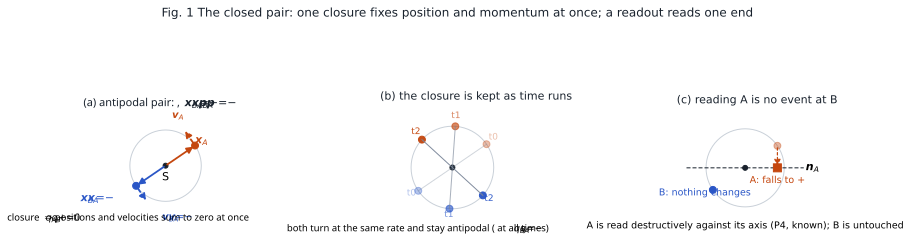
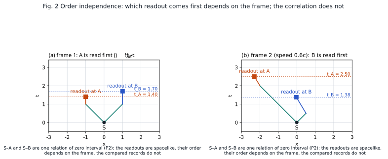

# The EPR Paradox Is Not a Paradox
## ― A Supplement to "Observation as Simultaneous Emission and Absorption": Reading the Position–Momentum Pair as a Closure Identity ―

**Author:** Noriaki Kihara (WF System Co., Ltd.)　ORCID 0009-0004-6753-4020
**Date:** 2026-11-01　　**Version:** v1
**Version DOI:** 10.5281/zenodo.23860606　　**Concept DOI:** 10.5281/zenodo.23860605
**Note:** The Japanese version (`paper_epr_not_a_paradox_supplement_ja_v1.md`) is the authoritative text; this English version is a translation.

---

## Abstract

The EPR argument [X1] has three steps. (i) Measuring the position of one member A of a pair predicts with certainty the position of the other member B, and measuring the momentum predicts B's momentum (perfect correlation). (ii) The measurement at A does not disturb the distant B (locality). (iii) Hence B's position and momentum are simultaneously elements of reality, and the quantum-mechanical description is incomplete. This paper takes the readout rule of the preceding paper "Observation as Simultaneous Emission and Absorption" [S1] as its premise and re-reads the argument. The pair is a closure $q_A+q_B=0$ that held once at the source, from which $\boldsymbol{x}_B=-\boldsymbol{x}_A$ and $\boldsymbol{p}_B=-\boldsymbol{p}_A$ follow simultaneously as identities. A single end has no value (the one-sided distribution is uniform), nothing happens at B when A is read, and the correlation depends neither on the order of the readouts nor on the distance between the two. The element of reality is the relation called the closure, not an attribute of one end. Step (ii) is correct, step (i) is a relational identity, and only the attribution in step (iii) is mistaken. That a destructive readout exists, drops the chosen variable to one of two values and severs the relation with the conjugate variable, is placed as a known fact (resonant absorption, photodetection, homodyne detection [X3]); deriving its mechanism is a separate task. "Instantaneous selection" is not written: what can be shown is only that no finite-speed influence exists [X6] [X7] [X8]. No new number appears. The claim of this paper is that, given the preceding paper, EPR is neither a paradox nor a mystery but a misreading of a relational identity.

---

## 1. The EPR argument

In 1935 Einstein, Podolsky and Rosen set up the following argument [X1]. Two particles are in a state satisfying $x_1-x_2=x_0$ and $p_1+p_2=0$. Measuring the position of particle 1 predicts the position of particle 2 with certainty, and measuring its momentum predicts the momentum of particle 2, without touching particle 2. If the criterion of reality is "a quantity that can be predicted with certainty without disturbing the system has a corresponding element of reality," then both the position and the momentum of particle 2 are elements of reality. Since quantum mechanics cannot describe both at once, it is incomplete.

Bohr's reply [X2] was that the measurement on particle 1 does not mechanically disturb particle 2, but defines the conditions under which something about particle 2 can be predicted. The question later moved, through Bell's theorem [X18], to the exclusion of local hidden variables, and in continuous variables the original EPR form was realized through Reid's criterion [X4] and the experiment of Ou et al. [X3]. A review is given by Reid et al. [X5].

This paper decides which part of the argument is right and which is wrong using only the three premises of the preceding paper [S1]. No new premise is added. Only the existence of a destructive readout is brought in from outside, as a known fact.

---

## 2. Premises

### 2.1 The three premises of the preceding paper

The preceding paper [S1] placed the following three premises and derived the form of the Born rule, the two-party correlation $E=\mp\cos n\theta$, the CHSH bound $2\sqrt2$, and no-signaling.

- (P1) The distance between two parties is set by the ratio of a shared viewing angle to the partner's size; only ratios are readable. The overall orientation and size (the gauge) are not readable.
- (P2) An interaction is a single relation in which emission and absorption hold simultaneously; there is no before and after.
- (P3) The phase of a relation carries a harmonic order $n$ fixed by the kind of wave.

What this paper uses is the gauge of P1 (the absolute direction is unreadable from one side alone) and P2 (a single relation has no before and after).

### 2.2 The pair is a closure

Two states $q_A, q_B$ form a pair from one source when, at the source,

$$
q_A+q_B=0
$$

holds [S3]. This is not a condition; it is the identity expressing that the source tied the two ends as one relation. From then on $q_B=-q_A$ holds at all times.

### 2.3 Reading position and momentum

In the readout plane of the preceding paper, the position vector $\boldsymbol{x}$ of a state $q$ is read as the image of $q$ in the readout plane, and the momentum vector $\boldsymbol{p}$ as a quantity proportional to its rate of change in time. In this series the position is a relational quantity read as the quotient angle of two states [S1] [S2]; no coordinates are brought in from outside. The source is taken as the origin.

### 2.4 Destructive readouts exist

The "first interaction" of §1 of the preceding paper, the one that switches the partner's discrete state, is known. Resonant absorption, the absorption of a photon by a photodetector, and, for continuous variables, homodyne detection are of this kind. Homodyne detection interferes the field with a local oscillator and reads either the $x$ quadrature or the $p$ quadrature, absorbing the light [X3] [X5]. This paper places it as a fact.

- (P4, a known fact) A destructive readout exists. It drops the chosen variable to one of two values and severs, for the same pair, the relation with the conjugate variable.

The mechanism of P4, i.e. deriving this interaction from the dynamics of the closure, is not the subject of this paper (§6).

---

## 3. Identities

### 3.1 One closure fixes position and momentum at once

Since $q_B=-q_A$ holds at all times, for the image in the readout plane and its rate of change,

$$
\boldsymbol{x}_B=-\boldsymbol{x}_A,\qquad \boldsymbol{p}_B=-\boldsymbol{p}_A
$$

hold simultaneously, by linearity. EPR's $x_1-x_2=x_0$ and $p_1+p_2=0$ are the same equations with the sign convention of one coordinate changed. That the sum of positions and the sum of momenta are zero at the same time is a restatement of the closure having held once at the source, not something that comes to hold after a measurement.

**Fig. 1** The closed pair. (a) In the readout plane with the source S at the origin, $q_B=-q_A$ lies at the antipode, and the position vectors $\boldsymbol{x}$ and the velocity vectors $\boldsymbol{v}$ are opposite at the same time. (b) As time runs the two stay antipodal. (c) When A is read destructively against the axis $\boldsymbol{n}_A$, A's record falls to one of ±, while the state of B does not change at all. All points are computed from the formulas (`図表/make_figures.py`).

### 3.2 A single end has no value

The overall phase (the orientation of the pair relative to the source) is the gauge of P1 and is unreadable. Reading the sign against an axis $\boldsymbol{n}_A$ on one side alone, the distribution averaged over the gauge is uniform, $\tfrac12$ for two values (3.5 of the preceding paper). Neither "the position of B" nor "the momentum of B" exists as a value belonging to B alone. What exists is the closure, i.e. the relations $\boldsymbol{x}_A+\boldsymbol{x}_B=0$ and $\boldsymbol{p}_A+\boldsymbol{p}_B=0$.

### 3.3 The correlation depends neither on order nor on distance

The cross term of the pair is

$$
\mathrm{Sc}\,[q_A\bar q_B]=-|q_A|^{2},
$$

independent of the overall phase and of time. Whether A is read first, B is read first, or both are read at once, the result of comparing the records is the same. It does not depend on the viewing angle (distance) between the two either.

**Fig. 2** Order independence. The relations from the source S to A and to B are one relation of zero spacetime interval (P2), and the readouts at A and at B are two spacelike-separated events. In one frame A comes first, in another B comes first, but the comparison of the records is the same. The points are computed by Lorentz transformation.

### 3.4 B's marginal distribution does not change

An operation on A acts on $q_A$ only, not on $q_B$. The one-sided distribution of B remains uniform as in 3.2. There is no way to tell on B's side alone whether A has been read or not (no-signaling, 3.5 of the preceding paper).

### 3.5 The relation with the conjugate variable is severed

When $x$ is read destructively at A, by P4 the relation of $p$ for the same pair is severed. This is a known property of P4, not a derivation of this paper. EPR's point that one may freely choose to measure position or momentum stands as it is; only the correlation of the chosen variable remains.

---

## 4. Re-reading

The three steps of EPR are re-read with §3.

- (i) The perfect correlation is correct. But it is not a consequence of measurement; it is the closure identity 3.1. It holds before anything is measured.
- (ii) Locality is correct. Nothing happens at B when A is read (3.4).
- (iii) Elements of reality exist. But they are not one-sided attributes such as "the position of B" or "the momentum of B"; they are the relations $\boldsymbol{x}_A+\boldsymbol{x}_B=0$ and $\boldsymbol{p}_A+\boldsymbol{p}_B=0$. A single end has no value (3.2). What quantum mechanics describes is this relation, and as a description of the relation it is complete. It looked incomplete because a relational quantity was attributed to one end.

Hence there is no paradox. Nor is the picture needed that, when the position is read at A, "the opposite selection occurs instantaneously at B." There is no event at B; one end of what the closure had already fixed was read at A.

A word on "instantaneous." The time order of two spacelike-separated events depends on the frame, so the sentence "the readout at A instantaneously fixed the value at B" has no frame-independent meaning. What experiments can show is a lower bound: if there were a finite-speed influence, its speed would exceed $10^4$ times the speed of light [X6] [X7]; moreover, assuming a finite-speed influence allows signaling [X8]. "No finite-speed selection exists" is the most that can be shown, and the reading of this paper is consistent with it.

A remark on comparing the axes of the two detectors. Since $E$ is the inner product $\boldsymbol{n}_A\cdot\boldsymbol{n}_B$, no common coordinates at the two ends are required; but in curved spacetime or over long distances the comparison depends on the path along which an axis is transported, and the correlation is reduced by precession [X9]. This is a manifestation of P1's "ratios close among three bodies" depending on which third party mediates.

---

## 5. Relation to earlier work

The conclusion of this paper is not new. The claim that a single end has no value and only correlations are real is in Peres [X10] and Mermin [X11], and the treatment of EPR in relational quantum mechanics [X12] argues that there is no non-local event on B's side. The locality claim from consistent histories [X13], the distinction between no-signaling and outcome correlation [X14], the toy model in which EPR-type perfect correlations arise locally from an epistemic restriction alone [X15], the review of formulations that fix both ends at once by an action principle [X16], and the transactional interpretation that depicts quantum transitions as handshakes [X17] all point in the same direction.

What belongs to this paper alone is limited to four points. First, the position is placed as a relational quantity (the quotient angle) without a background spacetime, and the EPR pair is written as the algebraic identity $q_A+q_B=0$ of a closure: a formula, not a stance. Second, that a single end has no value is derived from the gauge of P1, not posited as a stance. Third, that the same closure fixes the two relations of position and momentum at once (3.1) is checked within the readout of the series. Fourth, it is continuous with the preceding paper [S1], where the Bell side ($2\sqrt2$) follows from the bilinearity of the same readout rule. Since the original EPR argument is built from perfect correlations alone, this paper treats only the perfect-correlation side and leaves the non-classicality to the preceding paper.

---

## 6. How it would fail, and the separate task

This paper would fail in three ways.

- If, within the readout of the series, what fixes the two relations of position and momentum at once were shown not to be a single closure (the negation of 3.1).
- If an experimental fact appeared in which the one-sided distribution is not uniform. That would mean signaling is possible, and not only this paper but the preceding one would fall.
- If, when the P4 interaction is made concrete from the dynamics of the closure, it did not drop to one of two values, or the share were not $\cos^2$. P4 would be false, and this paper and 3.3 of the preceding paper would fall.

The third is the separate task. The mechanism of the destructive readout, i.e. deriving the pull-in of the axis and the switching of the state from an action, is contained in neither this paper nor the preceding one. This paper does not depend on that mechanism; it uses only its existence.

---

## 7. Classification

| Class | Content |
|---|---|
| Identities | 3.1 from the closure, the sums of positions and of momenta vanish at once; 3.3 independence of the cross term from order and distance; 3.4 invariance of B's marginal |
| Readings | 2.3 position = image in the readout plane, momentum = its rate of change; 3.2 a single end has no value; §4 element of reality = relation |
| Known observations | P4 the existence of destructive readouts (resonant absorption, photodetection, homodyne detection [X3]); the lower bounds on finite-speed influences [X6] [X7] [X8] |
| How it would fail | the three of §6 |

---

## References

### Self-citations (Concept DOI, 10.5281/zenodo.〔number〕)

[S1] N. Kihara, "観測は放射と吸収の同時成立である ― 視野角と大きさの読出し規則からボルン則・ベル相関・ツィレルソン限界を導く ―" (Observation as Simultaneous Emission and Absorption: Deriving the Born Rule, Bell Correlations and the Tsirelson Bound from a Viewing-Angle Readout Rule), 2026-11-01. Concept DOI 10.5281/zenodo.23857884.
[S2] N. Kihara, "複素数を正しく理解していたか ― 振幅はどこに住むか、虚数読み、ℂ → ℍ → 𝕆 の帰属 ―" (Did We Understand Complex Numbers Correctly? Where the Amplitude Lives, the Imaginary Reading, and Attribution across ℂ → ℍ → 𝕆), 2026-10-23. Concept DOI 10.5281/zenodo.23585436.
[S3] N. Kihara, "無名等振幅複合波モデル基本公理系 v9" (Anonymous Equal-Amplitude Composite-Wave Model: Basic Axiom System v9), 2026-07-24. Concept DOI 10.5281/zenodo.21315735.

### External references

[X1] A. Einstein, B. Podolsky, N. Rosen, "Can Quantum-Mechanical Description of Physical Reality Be Considered Complete?," Phys. Rev. 47, 777–780 (1935). DOI 10.1103/PhysRev.47.777
[X2] N. Bohr, "Can Quantum-Mechanical Description of Physical Reality be Considered Complete?," Phys. Rev. 48, 696–702 (1935). DOI 10.1103/PhysRev.48.696
[X3] Z. Y. Ou, S. F. Pereira, H. J. Kimble, K. C. Peng, "Realization of the Einstein-Podolsky-Rosen paradox for continuous variables," Phys. Rev. Lett. 68, 3663–3666 (1992). DOI 10.1103/PhysRevLett.68.3663
[X4] M. D. Reid, "Demonstration of the Einstein-Podolsky-Rosen paradox using nondegenerate parametric amplification," Phys. Rev. A 40, 913–923 (1989). DOI 10.1103/PhysRevA.40.913
[X5] M. D. Reid, P. D. Drummond, W. P. Bowen, E. G. Cavalcanti, P. K. Lam, H. A. Bachor, U. L. Andersen, G. Leuchs, "Colloquium: The Einstein-Podolsky-Rosen paradox: From concepts to applications," Rev. Mod. Phys. 81, 1727–1751 (2009). DOI 10.1103/RevModPhys.81.1727
[X6] D. Salart, A. Baas, C. Branciard, N. Gisin, H. Zbinden, "Testing the speed of 'spooky action at a distance'," Nature 454, 861–864 (2008). DOI 10.1038/nature07121
[X7] J. Yin, Y. Cao, H.-L. Yong, J.-G. Ren, H. Liang, S.-K. Liao, F. Zhou, C. Liu, Y.-P. Wu, G.-S. Pan, L. Li, N.-L. Liu, Q. Zhang, C.-Z. Peng, J.-W. Pan, "Lower Bound on the Speed of Nonlocal Correlations without Locality and Measurement Choice Loopholes," Phys. Rev. Lett. 110, 260407 (2013). DOI 10.1103/PhysRevLett.110.260407
[X8] J.-D. Bancal, S. Pironio, A. Acín, Y.-C. Liang, V. Scarani, N. Gisin, "Quantum non-locality based on finite-speed causal influences leads to superluminal signalling," Nat. Phys. 8, 867–870 (2012). DOI 10.1038/nphys2460
[X9] H. Terashima, M. Ueda, "Einstein-Podolsky-Rosen correlation in a gravitational field," Phys. Rev. A 69, 032113 (2004). DOI 10.1103/PhysRevA.69.032113
[X10] A. Peres, "Unperformed experiments have no results," Am. J. Phys. 46, 745–747 (1978). DOI 10.1119/1.11393
[X11] N. D. Mermin, "What is quantum mechanics trying to tell us?," Am. J. Phys. 66, 753–767 (1998). DOI 10.1119/1.18955
[X12] M. Smerlak, C. Rovelli, "Relational EPR," Found. Phys. 37, 427–445 (2007). DOI 10.1007/s10701-007-9105-0
[X13] R. B. Griffiths, "EPR, Bell, and quantum locality," Am. J. Phys. 79, 954–965 (2011). DOI 10.1119/1.3606371
[X14] J. P. Jarrett, "On the Physical Significance of the Locality Conditions in the Bell Arguments," Noûs 18, 569–589 (1984). DOI 10.2307/2214878
[X15] R. W. Spekkens, "Evidence for the epistemic view of quantum states: A toy theory," Phys. Rev. A 75, 032110 (2007). DOI 10.1103/PhysRevA.75.032110
[X16] K. B. Wharton, N. Argaman, "Colloquium: Bell's theorem and locally mediated reformulations of quantum mechanics," Rev. Mod. Phys. 92, 021002 (2020). DOI 10.1103/RevModPhys.92.021002
[X17] J. G. Cramer, "The transactional interpretation of quantum mechanics," Rev. Mod. Phys. 58, 647–687 (1986). DOI 10.1103/RevModPhys.58.647
[X18] J. S. Bell, "On the Einstein Podolsky Rosen paradox," Physics Physique Fizika 1, 195–200 (1964). DOI 10.1103/PhysicsPhysiqueFizika.1.195

---

## Appendix A　Reproducing the figures and the identities

Figures 1 and 2 are generated by `図表/make_figures.py` in the same folder. `python3 make_figures.py` produces the Japanese labels and `python3 make_figures.py en` the English-label figures (`fig*_en`), written to `図表/figures/` as PNG, SVG and PDF. All points are computed directly from the formulas; no random numbers are used. The identities are checked on a fixed grid by `図表/verify_identities.py` (C1: from $q_B=-q_A$ the sums of positions and of velocities vanish at once; C2: the gauge average of the one-sided sign is $\tfrac12$; C3: the cross term is independent of the overall phase and of time; C4: an operation on A does not change B's distribution). The results are in `図表/results/checks.txt`. Dependencies: numpy and matplotlib.

## Version history

- v1 (2026-11-01): first draft. Written as a supplement right after the publication of the preceding paper [S1] (Version DOI 10.5281/zenodo.23857885), from the dialogue between the author and Claude Code (EPR in position and momentum rather than spin; the destructive readout placed as a known fact; "instantaneous selection" not written; the earlier work placed up front). Published on Zenodo (Version DOI 10.5281/zenodo.23860606, Concept DOI 10.5281/zenodo.23860605; this paper is registered as isSupplementTo [S1]).
