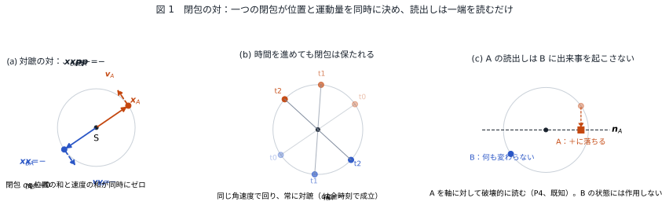
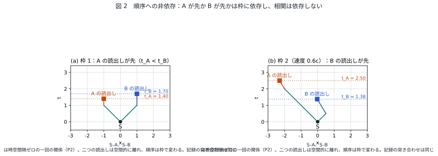

# EPR パラドックスはパラドックスではない
## ― 「観測は放射と吸収の同時成立である」の補遺：位置と運動量の対を閉包の恒等式として読む ―

**著者：** 木原範昭（株式会社WFシステム）　ORCID 0009-0004-6753-4020
**日付：** 2026-11-01　　**版：** v1（草稿）
**Version DOI：** （公開時に付与）　　**Concept DOI：** （公開時に付与）

---

## 要旨

EPR の論法 [X1] は三段である。(i) 対の一方 A で位置を測れば他方 B の位置が、運動量を測れば B の運動量が確実に予言できる（完全相関）。(ii) A の測定は離れた B を乱さない（局所性）。(iii) ゆえに B の位置と運動量は同時に実在の要素であり、量子力学の記述は不完全である。本稿は前稿「観測は放射と吸収の同時成立である」[S1] の読出し規則を前提に、この論法を読み替える。対は源で一回成立した閉包 $q_A+q_B=0$ であり、これから $\boldsymbol{x}_B=-\boldsymbol{x}_A$ と $\boldsymbol{p}_B=-\boldsymbol{p}_A$ が恒等式として同時に出る。片端の値は存在せず（片側の分布は一様）、A の読出しで B に起こる出来事はなく、相関は読出しの順序にも二者の距離にも依存しない。実在の要素は閉包という関係であって、片端の属性ではない。(ii) は正しく、(i) は関係の恒等式であり、誤っているのは (iii) の帰属だけである。破壊的な読出しが存在して選んだ変数を一方に落とし共役な変数との関係を切ることは、既知の事実（共鳴吸収、光検出、ホモダイン検出 [X3]）として置き、その機構の導出は別の課題とする。「瞬時の選択」は書かない。示せるのは、有限速度の影響が存在しないことまでである [X6] [X7] [X8]。新しい数は出ない。前稿を前提にすれば EPR は逆説でも謎でもなく、関係の恒等式の読み違いである、というのが本稿の主張である。

---

## 1. EPR の論法

Einstein、Podolsky、Rosen は 1935 年に次の論法を立てた [X1]。二つの粒子が $x_1-x_2=x_0$ かつ $p_1+p_2=0$ を満たす状態にあるとする。粒子 1 の位置を測れば粒子 2 の位置が、運動量を測れば粒子 2 の運動量が、粒子 2 に触れずに確実に予言できる。「系を乱すことなく確実に予言できる量には、対応する実在の要素がある」を実在の基準とすれば、粒子 2 の位置と運動量はともに実在の要素である。量子力学は両者を同時に記述できないから、不完全である。

Bohr の返答 [X2] は、粒子 1 の測定は粒子 2 を力学的に乱さないが、粒子 2 について何を予言できるかの条件を定義する、というものだった。以後この問いは、Bell の定理 [X18] によって局所隠れ変数の排除へ進み、連続変数では Reid の判定基準 [X4] と Ou らの実験 [X3] によって EPR の元の形が実現された。総説は Reid ら [X5] にある。

本稿は、この論法のどこが正しくどこが誤りかを、前稿 [S1] の三つの前提だけで決める。新しい前提は置かない。破壊的な読出しの存在だけを、既知の事実として外から持ち込む。

---

## 2. 前提

### 2.1 前稿の三つの前提

前稿 [S1] は次の三つを置き、ボルン則の形、二者相関 $E=\mp\cos n\theta$、CHSH 量の上限 $2\sqrt2$、信号不能性を導いた。

- (P1) 二者間の距離は共有された視野角と相手の大きさの比で決まり、読めるのは比だけである。全体の向きと大きさ（ゲージ）は読めない。
- (P2) 相互作用は放射と吸収が同時に成立する一回の関係であり、前後はない。
- (P3) 関係の位相は波の種類ごとに倍音次数 $n$ をもつ。

本稿で使うのは P1 のゲージ（片側だけでは絶対の向きが読めない）と P2（一回の関係に前後はない）である。

### 2.2 対は閉包である

二つの状態 $q_A, q_B$ が一つの源から出た対であるとは、源で

$$
q_A+q_B=0
$$

が成立していることである [S3]。これは条件ではなく、源が一回の関係として両端を結んだことの恒等式である。以後 $q_B=-q_A$ は時刻によらず成り立つ。

### 2.3 位置と運動量の読み

前稿の読出し平面で、状態 $q$ の位置ベクトル $\boldsymbol{x}$ を $q$ の読出し平面への像、運動量ベクトル $\boldsymbol{p}$ をその時間変化率に比例する量と読む。この系列では位置は二つの状態の商の角として読まれる関係量であり [S1] [S2]、外から座標を持ち込まない。源を原点にとる。

### 2.4 破壊的な読出しは存在する

前稿 §1 の「第一の相互作用」、すなわち相手の離散状態を切り替える相互作用は既知である。共鳴吸収、光検出器による光子の吸収、連続変数ではホモダイン検出がこれに当たる。ホモダイン検出は局所発振光と干渉させて $x$ 直交成分か $p$ 直交成分の一方を読み、光は吸収される [X3] [X5]。本稿はこれを事実として置く。

- (P4、既知の事実) 破壊的な読出しが存在する。選んだ変数を二値の一方に落とし、同じ対について共役な変数との関係を切る。

P4 の機構、すなわちこの相互作用を閉包の力学から導くことは本稿の対象ではない（§6）。

---

## 3. 恒等式

### 3.1 一つの閉包が位置と運動量を同時に決める

$q_B=-q_A$ が時刻によらず成り立つので、読出し平面への像とその時間変化率について

$$
\boldsymbol{x}_B=-\boldsymbol{x}_A,\qquad \boldsymbol{p}_B=-\boldsymbol{p}_A
$$

が同時に成り立つ。線形性による。EPR の $x_1-x_2=x_0$、$p_1+p_2=0$ は、片方の座標の符号の約束を変えただけで同じ式である。位置の和と運動量の和が同時にゼロであることは、源で閉包が一回成立したことの言い換えであって、測定の後に成立することではない。

**図 1** 閉包の対。(a) 源 S を原点とする読出し平面で、$q_B=-q_A$ は対蹠点にあり、位置ベクトル $\boldsymbol{x}$ と速度ベクトル $\boldsymbol{v}$ が同時に逆向きである。(b) 時間を進めても対蹠のまま回る。(c) A を軸 $\boldsymbol{n}_A$ に対して破壊的に読むと A の記録は ± の一方に落ちるが、B の状態は何も変わらない。点はすべて式から計算した（`図表/make_figures.py`）。

### 3.2 片端の値は存在しない

全体の位相（源に対する対の向き）は P1 のゲージであり、読めない。片側だけで軸 $\boldsymbol{n}_A$ に対する符号を読むと、ゲージについての平均で分布は一様、二値なら $\tfrac12$ である（前稿 3.5）。「B の位置」も「B の運動量」も、B だけに属する値としては存在しない。存在するのは閉包、すなわち $\boldsymbol{x}_A+\boldsymbol{x}_B=0$ と $\boldsymbol{p}_A+\boldsymbol{p}_B=0$ という関係である。

### 3.3 相関は順序にも距離にも依存しない

対の交差項は

$$
\mathrm{Sc}\,[q_A\bar q_B]=-|q_A|^{2}
$$

で、全体の位相にも時刻にも依存しない。A を先に読んでも B を先に読んでも、二つを同時に読んでも、記録を突き合わせた結果は同じである。二者の視野角（距離）にも依存しない。

**図 2** 順序への非依存。源 S から A と B へ向かう関係は時空間隔ゼロの一回の関係（P2）で、A の読出しと B の読出しは空間的に離れた二事象である。ある枠では A が先、別の枠では B が先になるが、記録の突き合わせは同じである。点はローレンツ変換で計算した。

### 3.4 B の周辺分布は変わらない

A への操作は $q_A$ だけに作用し、$q_B$ には作用しない。B の片側の分布は 3.2 のまま一様である。A を読んだか読まなかったかを B 側だけで知る方法はない（前稿 3.5 の信号不能性）。

### 3.5 共役な変数との関係は切れる

A で $x$ を破壊的に読むと、P4 により、同じ対について $p$ の関係は切れる。これは P4 の既知の性質であって本稿の導出ではない。EPR が「位置を測るか運動量を測るかは自由に選べる」とした点はそのまま正しく、選んだ方の相関だけが残る。

---

## 4. 読み替え

EPR の三段を、§3 で読み替える。

- (i) 完全相関は正しい。ただしそれは測定の帰結ではなく、閉包の恒等式 3.1 である。測る前から成り立っている。
- (ii) 局所性は正しい。A の読出しで B には何も起こらない（3.4）。
- (iii) 実在の要素は存在する。ただしそれは「B の位置」「B の運動量」という片端の属性ではなく、$\boldsymbol{x}_A+\boldsymbol{x}_B=0$ と $\boldsymbol{p}_A+\boldsymbol{p}_B=0$ という関係である。片端の値は存在しない（3.2）。量子力学が記述しているのはこの関係で、記述は関係としては完全である。不完全に見えたのは、関係量を片端に帰属させたからである。

したがって逆説はない。A で位置を読んだときに B で「反対側の選択が瞬時に起こる」という像も要らない。B には出来事がなく、閉包がもともと決めていたものの一端を A で読んだだけである。

「瞬時」について付け加える。空間的に離れた二事象の時間順は枠に依存するので、「A の読出しが B の値を瞬時に決めた」という文には枠に依らない意味がない。実験が示せるのは、もし有限速度の影響があるならその速さは光速の $10^4$ 倍以上という下限であり [X6] [X7]、さらに有限速度の影響を仮定すると信号が送れてしまう [X8]。有限速度の選択は存在しない、までが示せる上限で、本稿の読みはそれと整合する。

二つの検出器の軸の比較についても一言おく。$E$ は $\boldsymbol{n}_A\cdot\boldsymbol{n}_B$ の内積なので両端で共通の座標を要しないが、曲がった時空や長距離では軸を運ぶ経路に依存し、相関が歳差で減る [X9]。これは P1 の「三体で比が閉じる」が、どの第三者を経由するかに依存することの現れである。

---

## 5. 先行研究との関係

本稿の結論は新しくない。片端の値は存在せず相関だけが実在する、という主張は Peres [X10] と Mermin [X11] にあり、関係的量子力学による EPR の扱い [X12] は B 側に非局所の出来事がないことを論じている。整合歴史の立場からの局所性の主張 [X13]、信号不能性と結果の相関の区別 [X14]、知識の制限だけで EPR 型の完全相関が局所に出る玩具模型 [X15]、両端を作用原理で一度に決める定式化の総説 [X16]、握手として量子遷移を描くトランザクション解釈 [X17] も同じ方向にある。

本稿にしかないものは四つに限られる。第一に、位置を背景時空なしの関係量（商の角）として置き、EPR の対を閉包 $q_A+q_B=0$ という代数の恒等式で書くこと。立場ではなく式である。第二に、片端に値がないことを立場として置くのでなく、P1 のゲージから出すこと。第三に、同じ閉包が位置と運動量の二つの関係を同時に決めること（3.1）を、系列の読出しの中で確かめること。第四に、ベルの側（$2\sqrt2$）が同じ読出し規則の双線形性から出る前稿 [S1] と一続きであること。EPR の原論文が完全相関だけで組まれているので、本稿は完全相関の側だけを扱い、非古典性は前稿に預ける。

---

## 6. 落ちる形と、別の課題

本稿が落ちる形は三つである。

- 系列の読出しで、位置と運動量の二つの関係を同時に決めるものが一つの閉包でないと示されたとき（3.1 の否定）。
- 片側の分布が一様でない実験事実が出たとき。これは信号が送れることを意味し、本稿だけでなく前稿も落ちる。
- P4 の相互作用を閉包の力学から具体化したとき、二値の一方に落ちないか、分け前が $\cos^2$ にならないとき。P4 が偽になり、本稿も前稿の 3.3 も落ちる。

三つ目が別の課題である。破壊的な読出しの機構、すなわち軸の引き込みと状態の切替を作用から出すことは、本稿にも前稿にも含まれていない。本稿はその機構に依存せず、存在だけを使う。

---

## 7. 区分

| 区分 | 内容 |
|---|---|
| 恒等式 | 3.1 閉包から位置と運動量の和が同時にゼロ、3.3 交差項の順序・距離への非依存、3.4 B の周辺分布の不変 |
| 読み | 2.3 位置＝読出し平面への像、運動量＝その時間変化率、3.2 片端の値は存在しない、§4 実在の要素＝関係 |
| 既知の観測 | P4 破壊的な読出しの存在（共鳴吸収、光検出、ホモダイン検出 [X3]）、有限速度の影響の下限 [X6] [X7] [X8] |
| 落ちる形 | §6 の三つ |

---

## 参考文献

### 自己引用（Concept DOI、10.5281/zenodo.〔番号〕）

[S1] 木原範昭「観測は放射と吸収の同時成立である ― 視野角と大きさの読出し規則からボルン則・ベル相関・ツィレルソン限界を導く ―」2026-11-01. Concept DOI 10.5281/zenodo.23857884.
[S2] 木原範昭「複素数を正しく理解していたか ― 振幅はどこに住むか、虚数読み、ℂ → ℍ → 𝕆 の帰属 ―」2026-10-23. Concept DOI 10.5281/zenodo.23585436.
[S3] 木原範昭「無名等振幅複合波モデル基本公理系 v9」2026-07-24. Concept DOI 10.5281/zenodo.21315735.

### 外部文献

[X1] A. Einstein, B. Podolsky, N. Rosen, "Can Quantum-Mechanical Description of Physical Reality Be Considered Complete?," Phys. Rev. 47, 777–780 (1935). DOI 10.1103/PhysRev.47.777
[X2] N. Bohr, "Can Quantum-Mechanical Description of Physical Reality be Considered Complete?," Phys. Rev. 48, 696–702 (1935). DOI 10.1103/PhysRev.48.696
[X3] Z. Y. Ou, S. F. Pereira, H. J. Kimble, K. C. Peng, "Realization of the Einstein-Podolsky-Rosen paradox for continuous variables," Phys. Rev. Lett. 68, 3663–3666 (1992). DOI 10.1103/PhysRevLett.68.3663
[X4] M. D. Reid, "Demonstration of the Einstein-Podolsky-Rosen paradox using nondegenerate parametric amplification," Phys. Rev. A 40, 913–923 (1989). DOI 10.1103/PhysRevA.40.913
[X5] M. D. Reid, P. D. Drummond, W. P. Bowen, E. G. Cavalcanti, P. K. Lam, H. A. Bachor, U. L. Andersen, G. Leuchs, "Colloquium: The Einstein-Podolsky-Rosen paradox: From concepts to applications," Rev. Mod. Phys. 81, 1727–1751 (2009). DOI 10.1103/RevModPhys.81.1727
[X6] D. Salart, A. Baas, C. Branciard, N. Gisin, H. Zbinden, "Testing the speed of 'spooky action at a distance'," Nature 454, 861–864 (2008). DOI 10.1038/nature07121
[X7] J. Yin, Y. Cao, H.-L. Yong, J.-G. Ren, H. Liang, S.-K. Liao, F. Zhou, C. Liu, Y.-P. Wu, G.-S. Pan, L. Li, N.-L. Liu, Q. Zhang, C.-Z. Peng, J.-W. Pan, "Lower Bound on the Speed of Nonlocal Correlations without Locality and Measurement Choice Loopholes," Phys. Rev. Lett. 110, 260407 (2013). DOI 10.1103/PhysRevLett.110.260407
[X8] J.-D. Bancal, S. Pironio, A. Acín, Y.-C. Liang, V. Scarani, N. Gisin, "Quantum non-locality based on finite-speed causal influences leads to superluminal signalling," Nat. Phys. 8, 867–870 (2012). DOI 10.1038/nphys2460
[X9] H. Terashima, M. Ueda, "Einstein-Podolsky-Rosen correlation in a gravitational field," Phys. Rev. A 69, 032113 (2004). DOI 10.1103/PhysRevA.69.032113
[X10] A. Peres, "Unperformed experiments have no results," Am. J. Phys. 46, 745–747 (1978). DOI 10.1119/1.11393
[X11] N. D. Mermin, "What is quantum mechanics trying to tell us?," Am. J. Phys. 66, 753–767 (1998). DOI 10.1119/1.18955
[X12] M. Smerlak, C. Rovelli, "Relational EPR," Found. Phys. 37, 427–445 (2007). DOI 10.1007/s10701-007-9105-0
[X13] R. B. Griffiths, "EPR, Bell, and quantum locality," Am. J. Phys. 79, 954–965 (2011). DOI 10.1119/1.3606371
[X14] J. P. Jarrett, "On the Physical Significance of the Locality Conditions in the Bell Arguments," Noûs 18, 569–589 (1984). DOI 10.2307/2214878
[X15] R. W. Spekkens, "Evidence for the epistemic view of quantum states: A toy theory," Phys. Rev. A 75, 032110 (2007). DOI 10.1103/PhysRevA.75.032110
[X16] K. B. Wharton, N. Argaman, "Colloquium: Bell's theorem and locally mediated reformulations of quantum mechanics," Rev. Mod. Phys. 92, 021002 (2020). DOI 10.1103/RevModPhys.92.021002
[X17] J. G. Cramer, "The transactional interpretation of quantum mechanics," Rev. Mod. Phys. 58, 647–687 (1986). DOI 10.1103/RevModPhys.58.647
[X18] J. S. Bell, "On the Einstein Podolsky Rosen paradox," Physics Physique Fizika 1, 195–200 (1964). DOI 10.1103/PhysicsPhysiqueFizika.1.195

---

## 付録 A　図と恒等式の再現

図 1・2 は同じフォルダの `図表/make_figures.py` で生成した。`python3 make_figures.py` で日本語、`python3 make_figures.py en` で英語のラベルの図（`fig*_en`）を `図表/figures/` に PNG・SVG・PDF で出力する。点はすべて式から直接計算し、乱数は使わない。恒等式は `図表/verify_identities.py` が固定格子で確かめる（C1：$q_B=-q_A$ から位置と速度の和が同時にゼロ、C2：片側の符号のゲージ平均が $\tfrac12$、C3：交差項が全体の位相と時刻によらない、C4：A への操作で B の分布が変わらない）。結果は `図表/results/checks.txt`。依存は numpy と matplotlib。

## 版の履歴

- v1（2026-11-01）：初稿。前稿 [S1] の公開（Version DOI 10.5281/zenodo.23857885）の直後に、著者と Claude Code の対話（EPR はスピンでなく位置と運動量で、破壊的読出しは既知の事実として置き、瞬時の選択は書かない、先行一覧を正面に置く）から補遺として書いた。
