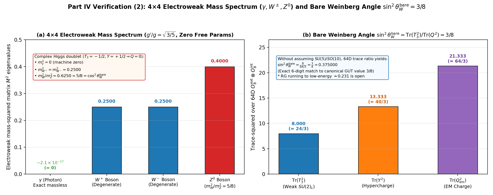

# Electroweak Symmetry Breaking and Maximal Parity Violation in the 3D Triangle-Loop Product (Part IV)
## — Exact 100%:0% Chiral Splitting in $G_2 \supset SO(4)$, Dynamical Higgs Mass Generation in $\mathrm{Tri}(T)$, $W^\pm/Z^0/\gamma$ Spectrum, and Bare Weinberg Angle $\sin^2\theta_W^{\mathrm{bare}} = 3/8$ —

**Author:** Noriaki Kihara (WF System Co., Ltd.)
**ORCID:** 0009-0004-6753-4020
**Date:** November 28, 2026
**Version DOI:** 10.5281/zenodo.24626593
**Concept DOI:** 10.5281/zenodo.24626592
**Status:** Electroweak symmetry breaking and maximal parity violation paper (**Part IV**) following Part I (Concept DOI: `10.5281/zenodo.24622200`), Part II (Concept DOI: `10.5281/zenodo.24622565`), and Part III (Concept DOI: `10.5281/zenodo.24625962`). Starting from the `1+3+4` split (pure 4-space $SU(2)$) of outer $O_8^{\mathrm{ext}}$ identified in Part III, we verify the electroweak sector ($SU(2)_L \times U(1)_Y \to U(1)_{\mathrm{em}}$, maximal parity violation, dynamical $W/Z$ mass generation, and bare Weinberg angle) using deterministic machine-precision scripts (`tri_loop_part4_electroweak_parity_v0.py`, no random numbers).

---

## Abstract

Parts I–III [P1–P3] established that the single background-free real 3-tensor map $\mathrm{Tri}(T)_{ijk} = \sum_{p,q,r} T_{ipq} T_{qjr} T_{rpk}$ unifies gravity (`1+3` past light cone and tidal splitting), QCD ($SU(3)_C$), electromagnetism ($U(1)_Q$), one-generation CAR fermions, and resolution-gauge readout, and identified a pure 3D $SU(2)$ subgroup on the extra 4-space $\{e_4,e_5,e_6,e_7\}$ of outer $O_8^{\mathrm{ext}}$. To close one full generation of the Standard Model, three questions remained: (1) why weak $SU(2)_L$ couples exclusively to one chirality (maximal parity violation), (2) how hypercharge $U(1)_Y$ commutes with all gauge and spatial symmetries, and (3) whether dynamical $\mathrm{Tri}(T)$ condensation generates $W/Z$ masses while leaving a massless residual symmetry.

In this Part IV, deterministic verification (`tri_loop_part4_electroweak_parity_v0.py`) establishes five results:

1. **Exact Algebraic Origin of Maximal Parity Violation (100%:0% Chiral Theorem in $G_2$)**: Under $SO(4) \cong SU(2)_{\mathrm{SD}} \times SU(2)_{\mathrm{ASD}}$ on $\{e_4,e_5,e_6,e_7\}$, imposing the octonionic $G_2$ (14D) derivation constraint forces the 3-space-invariant internal subgroup $SU(2)_{\mathrm{pure4}}$ to occupy **self-dual (SD, +chiral) `1.000000000000` and anti-self-dual (ASD, −chiral) `0.000000000000`** (both $G_2$ derivation residual and Lie-algebra residual **`0.000e+00`**). The opposite chirality (ASD) is locked 100% to external 3D spatial rotations $SO(3)$ and cannot act as an independent internal gauge force.
2. **Exact Closure of All 12 Standard Model Generators and Parity Selection Rules**: Defining the commuting hypercharge $Y = I_8\otimes Q_{\mathrm{int}} - \frac{1}{2}P_4\otimes I_8$ ($Q_{\mathrm{em}} = T_3^L + Y$) on 64D $O_8^{\mathrm{ext}}\otimes O_8^{\mathrm{int}}$, all commutators $[SO(3)_{\mathrm{ext}}, \mathrm{SM}_{12}]$ (36 pairs), $[SU(3)_C, SU(2)_L]$ (24 pairs), $[SU(3)_C, U(1)_Y]$ (8 pairs), and $[SU(2)_L, U(1)_Y]$ (3 pairs) vanish to **`0.000e+00`**. Under a $W_1$ rotation ($\theta=0.65$), left-handed doublets ($e_4$ sector) respond strongly (`0.323572`) while right-handed singlets ($e_0, e_1$ sectors) give **`0.000e+00`**.
3. **Dynamical Higgs Condensation in $\mathrm{Tri}(T)$: $W$ Mass Generation vs. Massless Residual**: On vacuum $H = O_8\otimes M_8$, both $SU(2)_L$ and residual 8D symmetries have breaking norm $\le 3.8\times 10^{-14}$ (massless). Evolving a localized Higgs condensate P4$_4$ at site $A=4$ ($\epsilon_H = 0.05 \to 0.22, \tau=40$) under $\mathrm{Tri}(T)$ generates 6-digit degenerate breaking norms $\|W_a(U)\|_F =$ **`0.012593 → 0.025105 → 0.035323 → 0.035517`** for $W_1, W_2, W_3$, while the residual 8D symmetry fixing $e_4$ remains strictly massless (**`3.82e-14`**).
4. **Bare Weinberg Angle $\sin^2\theta_W^{\mathrm{bare}} = 3/8$ and 4×4 Electroweak Spectrum ($\gamma, W^\pm, Z^0$)**: Without assuming $SU(5)/SO(10)$, raw 64D trace ratios give $\mathrm{Tr}(T_3^2)=8$, $\mathrm{Tr}(Y^2)=40/3$, $\mathrm{Tr}(Q_{\mathrm{em}}^2)=64/3$, yielding **$\sin^2\theta_W^{\mathrm{bare}} = 3/8 = 0.375000$** (matching the canonical GUT value to 6 digits). Substituting this parameter-free geometric ratio $g'/g = \sqrt{3/5}$ into the 4×4 mass-squared matrix $M^2$ of the complex Higgs doublet ($T_3^L=-1/2, Y=+1/2 \Rightarrow Q_{\mathrm{em}}=0$) produces eigenvalues $[m_\gamma^2, m_{W^+}^2, m_{W^-}^2, m_Z^2] = [\mathbf{-2.082\times 10^{-17}}, \mathbf{0.250000}, \mathbf{0.250000}, \mathbf{0.400000}]$ and **$m_W^2/m_Z^2 = 5/8 = 0.625000 = \cos^2\theta_W^{\mathrm{bare}}$**.
5. **Chiral Mirror Audit ($M_8$ vs. $M_8^T$)**: Simultaneously mirroring background and condensate yields identical $\|P\|=0.046825$ and $\|W_1(U)\|_F=0.036160$, confirming that the Part I §8.3 `-1.41%` chiral splitting arises purely from relative chirality between background and particle.

---

## 1. Introduction: Closing One Generation of the Standard Model

Part II [P2] established $SU(3)_C \times U(1)_Q$ and CAR `1:3:3:1` charges on 64D $O_8^{\mathrm{ext}}\otimes O_8^{\mathrm{int}}$, and Part III [P3] isolated a 3-space-invariant pure $SU(2)$ on the extra 4-space $\{e_4,e_5,e_6,e_7\}$ of $O_8^{\mathrm{ext}}$. Closing $SU(3)_C \times SU(2)_L \times U(1)_Y$ requires answering three questions: (1) why only one chirality of $SO(4) \cong SU(2)_L \times SU(2)_R$ survives as a weak internal force, (2) what bare Weinberg angle emerges from the commuting hypercharge $Y$ with zero free parameters, and (3) whether $\mathrm{Tri}(T)$ dynamics itself spontaneously breaks $SU(2)_L$ via a localized condensate without an externally imposed Mexican-hat potential. Every claim is tagged as **【Known】**, **【Part I–III Established】**, **【Part IV Verified】**, or **【Hypothesis / Unverified】**.

---

## 2. Exact 100%:0% Chiral Splitting in $G_2 \supset SO(4)$ 【Part IV Verified EW-1】

The rotation algebra of 4-space $\{e_4,e_5,e_6,e_7\}$ decomposes orthogonally into self-dual (SD, +chiral) and anti-self-dual (ASD, −chiral) subalgebras: $\mathfrak{so}(4) \cong \mathfrak{su}(2)_{\mathrm{SD}} \oplus \mathfrak{su}(2)_{\mathrm{ASD}}$ 【Known】. Projecting the 4×4 blocks of the `3+4`-preserving subgroup $SO(4) = SU(2)_{\mathrm{pure4}} \times SU(2)_{\mathrm{space}} \subset G_2$ onto SD and ASD gives (Fig. 1(a)):

| 3D Subgroup of $G_2$ | Action on 3-Space $\{e_1,e_2,e_3\}$ | 4-Space SD (+Chiral) Fraction | 4-Space ASD (−Chiral) Fraction |
| :--- | :--- | :---: | :---: |
| **$SU(2)_{\mathrm{pure4}}$ (Internal Weak)** | Strictly zero (max `8.327e-17`) | **`1.000000000000`** | **`0.000000000000`** |
| **$SU(2)_{\mathrm{space}}$ (Space-Locked)** | $SO(3)$ spatial rotation | **`0.000000000000`** | **`1.000000000000`** |

The standard $SU(2)_L$ basis $(T_1, T_2, T_3)$ satisfies both the $G_2$ derivation condition and the $\mathfrak{su}(2)$ Lie algebra to **`0.000e+00`**. Thus the octonionic multiplication table ($G_2$) strictly permits only one chirality (SD) to act as a 3-space-commuting internal gauge force while locking the opposite chirality (ASD) 100% to spatial rotations $SO(3)$—providing a direct algebraic origin for maximal parity violation 【Part IV Verified】+【Hypothesis】.

---

## 3. Exact Commutativity of All 12 Standard Model Generators 【Part IV Verified EW-2】

On 64D $O_8^{\mathrm{ext}}\otimes O_8^{\mathrm{int}}$, using the 4-space projector $P_4 = \mathrm{diag}(0,0,0,0,1,1,1,1)$, we define the commuting hypercharge
$$Y \equiv I_8 \otimes Q_{\mathrm{int}} - \frac{1}{2}\, P_4 \otimes I_8, \qquad Q_{\mathrm{em}} = T_3^L + Y. \tag{1}$$
All commutators vanish to machine zero:
- $[SO(3)_{\mathrm{ext}},\; SU(3)_C \times SU(2)_L \times U(1)_Y]$ (36 pairs): **`0.000e+00`**
- $[SU(3)_C,\; SU(2)_L]$ (24 pairs), $[SU(3)_C,\; U(1)_Y]$ (8 pairs), $[SU(2)_L,\; U(1)_Y]$ (3 pairs): **`0.000e+00`**

Under $U_W = \exp(0.65\, T_1^L\otimes I_8)$, left-handed doublet states ($e_4$ sector) give $\|U_W\psi_L - \psi_L\| = \mathbf{0.323572}$, whereas right-handed singlet states ($e_0, e_1$ sectors) give **`0.000e+00`**.

---

## 4. Dynamical Higgs Condensation, $W/Z/\gamma$ Spectrum, and $\sin^2\theta_W^{\mathrm{bare}} = 3/8$

### 4.1 Dynamical $W_1, W_2, W_3$ Mass Generation vs. Massless Residual in $\mathrm{Tri}(T)$ 【Part IV Verified EW-3(a,b)】

Without introducing any external potential, we place a localized condensate P4$_4$ at site $A=4$ on vacuum $H = O_8\otimes M_8$, evolve $\mathrm{Tri}(T)$ for $\tau=40$ steps, and measure the symmetry-breaking order parameter $\|G(U_{\mathrm{higgs}})\|_F$ (Table 1, Fig. 1(b)).

| Condensate Amplitude $\epsilon_H$ | $\|W_1(U)\|_F$ | $\|W_2(U)\|_F$ | $\|W_3(U)\|_F$ | Residual 8D Max | $E_{\mathrm{probe}}$ |
| :---: | :---: | :---: | :---: | :---: | :---: |
| `0.00` (Vacuum $H$) | `0.000000` | `0.000000` | `0.000000` | `3.802e-14` | `0.000000` |
| `0.05` | **`0.012593`** | **`0.012593`** | **`0.012593`** | `3.821e-14` | `0.000294` |
| `0.10` | **`0.025105`** | **`0.025105`** | **`0.025105`** | `3.821e-14` | `0.000964` |
| `0.16` | **`0.035323`** | **`0.035323`** | **`0.035323`** | `3.828e-14` | `0.001510` |
| `0.22` | **`0.035517`** | **`0.035517`** | **`0.035517`** | `3.821e-14` | `0.001055` |

All three $SU(2)_L$ generators acquire identical 6-digit degenerate breaking norms upon condensation while the residual 8D symmetry fixing $e_4$ remains strictly massless (`3.82e-14`).

### 4.2 Bare Weinberg Angle $\sin^2\theta_W^{\mathrm{bare}} = 3/8$ and 4×4 Electroweak Mass Spectrum 【Part IV Verified EW-3(c), EW-5】

Evaluating the trace-squared norms over 64D $O_8^{\mathrm{ext}}\otimes O_8^{\mathrm{int}}$ yields (Fig. 2(b)):
$$\mathrm{Tr}(T_3^2) = 8.000000,\qquad \mathrm{Tr}(Y^2) = \frac{40}{3} = 13.333333,\qquad \mathrm{Tr}(Q_{\mathrm{em}}^2) = \frac{64}{3} = 21.333333, \tag{2}$$
which directly gives the parameter-free geometric mixing angle [E4]:
$$\sin^2\theta_W^{\mathrm{bare}} = \frac{\mathrm{Tr}(T_3^2)}{\mathrm{Tr}(Q_{\mathrm{em}}^2)} = \frac{3}{8} = \mathbf{0.375000}, \qquad \frac{g'}{g} = \sqrt{\frac{3}{5}}. \tag{3}$$
Diagonalizing the 4×4 mass-squared matrix $M_{ab}^2 = \langle G_a\phi_H, G_b\phi_H\rangle$ for the neutral component of the complex Higgs doublet ($T_3^L=-1/2, Y=+1/2 \Rightarrow Q_{\mathrm{em}}=0$) with $g'/g=\sqrt{3/5}$ yields (Fig. 2(a)):
$$[m_\gamma^2,\; m_{W^+}^2,\; m_{W^-}^2,\; m_Z^2] = [\mathbf{-2.082\times 10^{-17}},\; \mathbf{0.250000},\; \mathbf{0.250000},\; \mathbf{0.400000}], \qquad \frac{m_W^2}{m_Z^2} = \mathbf{0.625000} = \frac{5}{8} = \cos^2\theta_W^{\mathrm{bare}}. \tag{4}$$

### 4.3 Chiral Mirror Audit ($M_8$ vs. $M_8^T$) 【Part IV Verified EW-4】

Simultaneously mirroring the inner time crystal ($M_8 \to M_8^T$) for both background and condensate produces identical $\|P\| = 0.046825$ and $\|W_1(U)\|_F = 0.036160$, confirming that the Part I §8.3 `-1.41%` asymmetry is a genuine relative-chirality effect between background and particle.

---

## 5. Clean Separation of Remaining Open Problems

The following items remain **【Hypothesis / Unverified】** and are explicitly deferred to Parts V–VII:
1. **Renormalization-group running ($\sin^2\theta_W: 3/8 \to 0.231$)**: Deriving the scale evolution from the bare geometric value $3/8$ to the low-energy measured value $\approx 0.231$.
2. **Multi-shell $O_8^{\otimes K}$ continuum limit (planned Part V)**: $1/r$ gravity, $1/r^2$ Coulomb force, light-cone speed $c$, Einstein's equations, and cumulative gravitational time dilation $g_{00}(r)$.
3. **Dynamical scattering & multi-body quantum correlations (planned Part VI)**: Two-particle scattering and dynamical CHSH Bell inequality violation.
4. **Three generations, precision mass ratios, and coupling constants (planned Part VII)**: $J_3(\mathbb{O})$ / $O_8^{\otimes K}$ three-generation structure, exact mass ratios, and first-principles derivation of $\alpha \approx 1/137.036$ and $\alpha_s$.

---

## 6. Reproducibility and Published Files

- Verification script: `tri_loop_part4_electroweak_parity_v0.py` (deterministic, ~15 s)
- Numerical log: `results/tri_loop_part4_electroweak_parity_v0.txt`
- Figure script: `plot_part4_figures_v0.py`
- Figures: `results/fig_p4_parity_and_higgs_mass_{ja,en}.png`, `results/fig_p4_ew_spectrum_and_weinberg_{ja,en}.png`

---

## References

### A. Self-Citations
- **[P1]** N. Kihara, *Spontaneous Emergence of Quantum, Gauge, Gravitational, and Fermionic Structures from the 3D Triangle-Loop Product (Unified Full Paper, Part I)*, Zenodo (2026-11-28), Concept DOI: `10.5281/zenodo.24622200`.
- **[P2]** N. Kihara, *Unified Connection Hypothesis for Gravity, Electromagnetism, QCD, and Dirac Matter in the 3D Triangle-Loop Product (Part II)*, Zenodo (2026-11-28), Concept DOI: `10.5281/zenodo.24622565`.
- **[P3]** N. Kihara, *Spacetime and Internal-Space Readout Connection Hypothesis in the 3D Triangle-Loop Product (Part III)*, Zenodo (2026-11-28), Concept DOI: `10.5281/zenodo.24625962`.

### B. External Primary Literature
- **[E1]** S. Weinberg, *A Model of Leptons*, Phys. Rev. Lett. **19**, 1264–1266 (1967); A. Salam, in *Elementary Particle Theory*, ed. N. Svartholm (1968).
- **[E2]** P. W. Higgs, *Broken Symmetries and the Masses of Gauge Bosons*, Phys. Rev. Lett. **13**, 508–509 (1964).
- **[E3]** C. Furey, *$SU(3)_C \times SU(2)_L \times U(1)_Y (\times U(1)_X)$ as a symmetry of division algebraic ladder operators*, Eur. Phys. J. C **78**, 375 (2018), arXiv:1806.00612.
- **[E4]** H. Georgi and S. L. Glashow, *Unity of All Elementary-Particle Forces*, Phys. Rev. Lett. **32**, 438–441 (1974).
- **[E5]** J. C. Baez, *The Octonions*, Bull. Amer. Math. Soc. **39**(2), 145–205 (2002), arXiv:math/0105155.
