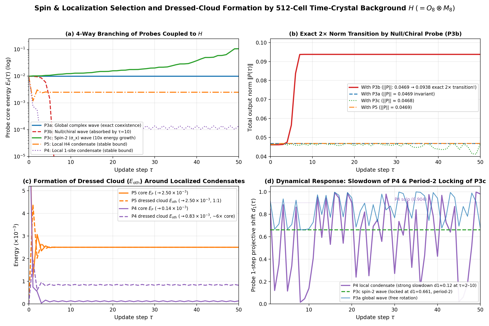
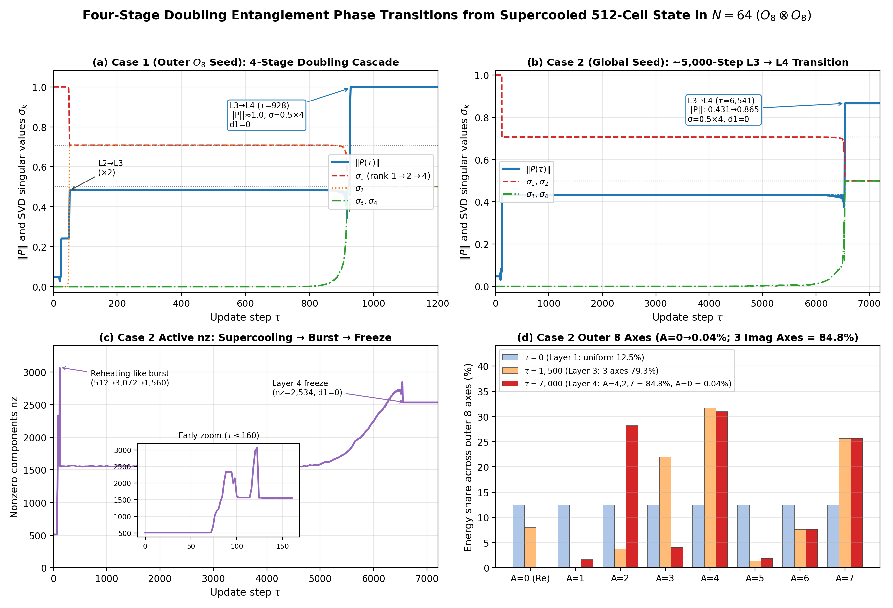

# Supercooled Time-Crystal Background, Probe Selection, and Four-Stage Doubling Entanglement Phase Transitions in the 3D Triangle-Loop Product (Second Rapid Communication)
## ― Self-Repair, Dressed-Cloud Formation, and 3-Axis Condensation Revealed by Exact τ = 10,000 Tracking of N = 64 (O8 ⊗ O8) ―

**Author:** Noriaki Kihara (WF System Co., Ltd.)
**ORCID:** 0009-0004-6753-4020
**Date:** November 28, 2026
**Version DOI:** 10.5281/zenodo.24618400
**First Rapid Communication:** Zenodo Concept DOI `10.5281/zenodo.24614040` (Version DOI `10.5281/zenodo.24614041`)
**Repository (all scripts, raw data, figures):** https://github.com/WurabeSeiji/ai-chat-logs-open/tree/main/%E6%AC%A1%E5%85%83%E3%81%AE%E7%94%9F%E6%88%90%E6%A7%8B%E9%80%A0/%E4%B8%89%E6%AC%A1%E5%85%83%E6%AD%A3%E6%96%B9%E9%85%8D%E5%88%97%E3%81%AE%E7%A9%8D%E3%81%A8%E8%87%AA%E5%B7%B1%E7%84%A1%E6%92%9E%E7%9D%80_20261127

---

## Abstract

In our first rapid communication, we introduced the **triangle-loop product** $\mathrm{Tri}(T)_{ijk} = \sum_{p,q,r} T_{ipq} T_{qjr} T_{rpk}$ on cubic arrays without background spacetime, external operators, division, or randomness, showing that only quaternions ($N=4$) and octonions ($N=8$) survive as period-2 crystals and that a single-cell defect in the coupled large crystal $N=64$ ($O_8 \otimes O_8$, 262,144 entries) yields a 512-cell composite remnant with bimodal view-angle splitting.

In this second rapid communication, we dissect the 512-cell state and extend exact full-$64^3$ tracking up to update step $\tau = 10,000$. We discover that **the 512-cell state is not an end state but a supercooled time-crystal intermediate phase**, followed by spin/localization-selective probe interactions, a reheating-like burst, and a **four-stage doubling entanglement cascade**. Our four main exact findings (zero randomness, full code open) are:

1. **Exact Anatomy & Self-Repair of the 512-Cell State**: Singular value decomposition (SVD) proves $H = O_8 \otimes M_8$ to 7 digits ($\sigma_1 = 1.0000000, \sigma_2 = 2.58\times 10^{-7}$): an intact outer octonionic skeleton $O_8$ tensored with an inner pure complex-scalar rotation pair $c_0 I + c_y(i\sigma_y)$ (spin-2 components $\sigma_x, \sigma_z \sim 10^{-16}$). Internal triangle view-angle ratios $\rho = L_3/L_1$ (effective couplings) are quantized into exactly 7 discrete values. The state repels a $+0.1$ shock in the zero background to $10^{-165}$ in 5 steps and heals an internal 1-cell hole (`= 0`) back to 512 cells in a single step.
2. **Four-Way Probe Branching & Dressed-Cloud Formation**: Introducing probes into the $i,k$-shared channel ($H^2 P$ cross-coupling, 99–100% contribution) produces four distinct responses: (i) a global complex rotation wave coexists with 5-digit energy invariance; (ii) a null/chiral wave ($\sum P^2 = 0,\; I+\sigma_y$) is absorbed while triggering an exact $2\times$ norm transition of $H$ itself ($\|P\|: 0.0469 \to 0.0938$); (iii) a spin-2 ($\sigma_x$) wave absorbs $>10\times$ energy from $H$ and locks into period-2; (iv) localized condensates (1-site or $H_4$) survive as stable bound states by clothing themselves with a "dressed cloud" ($E_{\mathrm{oth}}$) across $O_8$ ($1:1$ core-to-cloud ratio for $H_4$; strong transient slowdown for the 1-site condensate).
3. **Four-Stage Doubling Entanglement Transitions up to $\tau = 10,000$ & Two Exact Theorems**: Seeding the outer $O_8$ zero sector triggers a universal doubling cascade in both Case 1 (local real seed) and Case 2 (global $10^{-16}$ seed, passing through a reheating-like burst `nz: 512 → 3,072 → 1,560` and a ~5,000-step Layer 3 plateau): $\text{rank } 1\;(1.0) \to \text{rank } 2\;(\frac{1}{\sqrt{2}}\times 2,\; \|P\|\times 2) \to \text{rank } 4\;(\frac{1}{2}\times 4,\; \|P\|\times 2,\; d_1 = 0)$, terminating at a static fixed point. We prove analytically that Layer 3 is a single-complex-structure lock $U = \frac{1}{\sqrt{2}}(u\otimes v + Ju\otimes(-Jv))$, and Layer 4 is a rank-1 triple outer product $U_{ijk} = a_i b_j c_k$ ($\|P\| = (\mathbf{a}\cdot\mathbf{c})^2 = 0.999534$) whose vectors form Bell pairs $\frac{1}{\sqrt{2}}(|0,4\rangle + |1,5\rangle)$, explaining the exact $0.5 \times 4$ degeneracy.
4. **Spontaneous 3-Axis Condensation**: In the final static fixed point of Case 2 ($\tau = 10,000$, `nz = 2,534`, $d_1 = 0$), the outer real axis $A=0$ vanishes to `0.04%`, while exactly **three imaginary axes** ($A = 4, 2, 7$) capture **84.84%** of the total energy.

---

## 1. Introduction and Notation

Following our first rapid communication (DOI `10.5281/zenodo.24614040`), we study the background-free self-updating map on a cubic array $U \in \mathbb{R}^{N\times N\times N}$ (or $\mathbb{C}^{N\times N\times N}$):
$$P_{ijk} = \mathrm{Tri}(U)_{ijk} = \sum_{p,q,r=0}^{N-1} U_{ipq}\, U_{qjr}\, U_{rpk}, \qquad U^{(\tau+1)} = \frac{\mathrm{Tri}(U^{(\tau)})}{\|\mathrm{Tri}(U^{(\tau)})\|_F}.$$
To distinguish iteration count from emergent physical time $t$, we denote the update step strictly by **$\tau$** throughout this report.

Previously, a single real defect `(0,1,0) + 1e-4` in $N = 64$ ($O_8 \otimes O_8$) stabilized into a 512-cell composite remnant over $\tau = 70\text{--}500$. Here we answer three open questions: (1) What is the exact algebraic structure and self-repair mechanism of this 512-cell state? (2) How does it interact with nearby probes of different spin, chirality, and localization? (3) Does the 512-cell state undergo further phase transitions at larger $\tau$?

---

## 2. Exact Anatomy, Discrete Couplings, and Self-Repair of the 512-Cell State

### 2.1 Exact Tensor Product $H = O_8 \otimes M_8$ and 3-Level Energy Hierarchy [Verified]

Reshaping $H = U^{(200)}$ ($\|P\| = 0.04687271$) into a $512\times 512$ matrix separating outer $(A,B,C)$ and inner $(a,b,c)$ indices ($i = 8A+a$) yields SVD singular values $\sigma_1 = 1.00000000,\; \sigma_2 = 2.58\times 10^{-7},\; \sigma_{3\dots} = 0$ (`tri_loop_n64_512melt_anatomy_v0.py`).
- **Outer $O_8$ (64 cells)**: Identical to the octonion multiplication table ($d(\text{outer}, O_8) = 0.000$), with $i \leftrightarrow k$ transpose split $1/8$ symmetric (real unit) and $7/8$ antisymmetric ($G_2$-invariant 3-form).
- **Inner $M_8$ (8 cells)**: Supported on $a,c \in \{4,5\},\; b \in \{0,1\}$. Pauli decomposition $M_b = c_0 I + c_x \sigma_x + c_y(i\sigma_y) + c_z \sigma_z$ gives $c_x, c_z \sim 10^{-16}$ (exact zero spin-2 anisotropy), leaving a pure complex-scalar pair ($\|M_0\| = 0.796036,\; \|M_1\| = 0.605249$) that preserves $\|M_1\|/\|M_0\| = 0.760329$ and $\theta_1 - \theta_0 = +0.586^\circ$ while rotating on $S^1$.
- **Exact 3-level energy hierarchy**: $E_{a=4,5} = 1/24 = 0.041667$ (16 nodes), $E_{a=0} = \|M_0\|^2/24 = 0.026403$ (8 nodes), and $E_{a=1} = \|M_1\|^2/24 = 0.015264$ (8 nodes).

### 2.2 Quantized Internal Couplings $\rho$ and Self-Repair [Verified]

All 64 contributing triangles per active entry have view-angle ratios $\rho = L_3/L_1$ quantized to exactly **7 discrete values** ($1.0000$ [8], $0.7646$ [4], $0.7463$ [4], $0.7268$ [4], $0.5558$ [16], $0.5424$ [16], $0.4147$ [12]). Secondary perturbation tests over 100 steps show remarkable self-repair:

| Test | Secondary Perturbation on $H = U^{(200)}$ | Outcome (100 steps) |
|---|---|---|
| **(A1)(A2)** | Background zero cell `(0,0,0)` $+10^{-3}$ / **$+0.1$ shock** | Even $+0.1$ is expelled to `out_E = 4.3e-165` in 5 steps; **exact recovery** |
| **(B1)(B2)** | Internal 1-cell perturbation `(4,0,4)` $+10^{-4}, +10^{-2}$ | `nz = 512` preserved; $\sigma_2$ decays by $>50\%$ and stabilizes |
| **(C)** | Internal **1-cell complete hole** `(4,0,4) = 0` | **Hole heals in 1 step** (`nz = 512`); $\sigma_2$ heals $3.27\times 10^{-2} \to 9.58\times 10^{-3}$ |
| **(D)(E)** | SVD reconstruction global rounding seed (`out_E ~ 4.9e-32`) | Local shocks heal, but a global $10^{-16}$ seed grows exponentially into Layer 2–4 (Sec. 4) |

---

## 3. Four-Way Probe Selection and Dressed-Cloud Formation

Placing probes $P$ (initial energy $E_P \approx 0.0099$) in the $i,k$-shared channel ($b \in \{2,3\}$) activates $H^2 P$ cross-triangles (99–100% contribution), producing four sharply separated regimes (`tri_loop_n64_higgs_probe_v0.py`, Fig. 2).

| Probe Type | Shared Axes | State at $\tau = 50$ ($E_H / E_P / E_{\mathrm{oth}}$) | $\rho_{\mathrm{cross}}$ | Dynamical Outcome |
|---|---|---|---|---|
| **P1, P2** (Null / complex wave) | $j$ only | $E_P = 0.00000$ (`nz=512`) | `0.0000` | Expelled in 1–2 steps (decoupled) |
| **P3a** (Global complex wave $O_8\otimes M_8$) | $i, k$ | **`E_P = 0.00990` invariant** (`nz=1024`) | `0.47–0.98` (99%) | **Exact 5-digit coexistence** |
| **P3b, P6** (Null/chiral $\sum P^2=0,\; I+\sigma_y$) | $i, k$ | $E_P \to 0$ ($\tau=10$, `nz=512`) | $0.77 \to 0.00$ | **Absorbed; triggers exact $2\times$ norm jump of $H$ ($\|P\|: 0.0469 \to 0.0938$)** |
| **P3c** (Spin-2 $\sigma_x$ wave) | $i, k$ | **$E_P: 0.00990 \to 0.10553$ ($>10\times$)** (`nz=768`) | `0.18–0.98` (89–99%) | **Absorbs energy from $H$** and locks into period-2 ($d_1 = 0.661$) |
| **P4** (Local 1-site $\delta_{000}\otimes M_8$) | $i, k$ | $E_P=0.00014,\; E_{\mathrm{oth}}=0.00083$ (`nz=576`) | `0.22–1.00` (100%) | **Dressed bound state**; solo $d_1=0.904$ slows sharply to $0.12$ at $\tau=2\text{--}10$ |
| **P5** (Local $H_4\otimes M_8$ condensate) | $i, k$ | **$E_P=0.00250,\; E_{\mathrm{oth}}=0.00250$** (`nz=768`) | `0.64–0.98` (99%) | **Exact $1:1$ core-to-cloud bound state**, stable through $\tau = 50$ |

---

## 4. Four-Stage Doubling Entanglement Phase Transitions up to $\tau = 10,000$

Because the outer $O_8$ zero entries in $H = O_8 \otimes M_8$ were trapped at exact numerical zero, $H$ was a supercooled metastable state. Seeding the outer $O_8$ zero sector in three cases and sweeping full $64^3$ dynamics to $\tau = 10,000$ reveals a universal four-stage cascade (`tri_loop_n64_second_phase_transition_v0.py`, `tri_loop_n64_tau10000_sweep_v0.py`, Fig. 1).

### 4.1 Universal Four-Stage Cascade [Verified]

| Stage | Case 1 (Outer $O_8$ real seed `+1e-4`) | Case 2 (Global `~1e-16` seed) | Case 3 (Outer $O_8$ imag seed `+1e-4j`) | SVD Singular Values (Case 1 & 2) |
|---|---|---|---|---|
| **Layer 1** (Supercooled) | $\tau=0$: `nz=520`, $\|P\|=0.0469$ | $\tau=0\text{--}73$: `nz=512`, $\|P\|=0.0469$ | $\tau=0$: `nz=520`, $\|P\|=0.0469$ | `1.0` (rank 1) |
| **Layer 2** (Melt / Burst) | $\tau=26\text{--}48$: `nz=64`, $\|P\|=0.2409$ | $\tau=74\text{--}123$: `nz=512→3,072→1,560` | $\tau=30\text{--}100$: `nz=64`, $\|P\|=0.4438$, $|\sum U^2|\sim 10^{-9}$ | `1.0` (rank 1) |
| **Layer 3** (Single-Clock Lock) | $\tau=53\text{--}800$: `nz=64`, $\|P\|=0.4817$ ($\times 2$) | **$\tau=124\text{--}5,000$** (~5,000 steps): `nz=1,560`, $\|P\|=0.4310$ | $\tau=150\text{--}250$: `nz=64`, $\|P\|=0.8875$ ($\times 2$), $d_1=0$, $|\sum U^2|\sim 10^{-17}$ | **`0.7071 × 2`** ($\frac{1}{\sqrt{2}}$, rank 2) |
| **Layer 4** (Static Fixed Point) | **$\tau=928\to 10,000$**: `nz=64`, $N_{\mathrm{eff}}=8.02$, **`\|P\|=0.9995`** ($\times 2$), $d_1=0$ | **$\tau=6,541\to 10,000$**: `nz=2,534`, $N_{\mathrm{eff}}=24.81$, **`\|P\|=0.8655`** ($\times 2$), $d_1=0$ | (Reached static null fixed point at Layer 3) | **`0.5000 × 4`** ($\frac{1}{2}$, 4-fold) |

In Case 2 at $\tau = 10,000$ (Fig. 1d), the outer real axis $A=0$ drops to `0.04%`, while **three imaginary axes** ($A=4: 30.96\%,\; A=2: 28.24\%,\; A=7: 25.64\%$) capture **84.84%** of total energy (and inner axes reduce strictly to `a = 0, 1, 4, 5`).

### 4.2 Exact Analytical Theorems for Layers 3 and 4 [Verified]

- **Theorem 1 (Layer 3: Single-Complex-Structure Lock)**: SVD of Case 1 at $\tau = 80, 81, 82$ shows
  $$U_{\text{Layer 3}} = \frac{1}{\sqrt{2}}\Bigl( u \otimes v + (J u) \otimes (-J v) \Bigr), \qquad J = \begin{pmatrix} 0 & -1 \\ 1 & 0 \end{pmatrix}.$$
  Under $\mathbb{C}_{\mathrm{outer}} \otimes_{\mathbb{R}} \mathbb{C}_{\mathrm{inner}} \cong \mathbb{C}_{+} \oplus \mathbb{C}_{-}$, selecting solely the phase-locked sector ($i_{\mathrm{outer}} = -i_{\mathrm{inner}}$) doubles $\|P\|$ exactly ($0.2409 \to 0.4817$), freezing the outer skeleton $u$ while inner $v$ rotates as a single unified clock.
- **Theorem 2 (Layer 4: Rank-1 Triple Outer Product $\times$ Internal Bell Pairs)**: Gram matrices $G_i, G_j, G_k$ of the $4^3$ active block in Case 1 ($\tau = 1,000$, `tri_loop_n64_layer4_anatomy_v0.py`) all have eigenvalues `[1.0, 0, 0, 0]`, proving
  $$U_{\text{Layer 4}}[i, j, k] = a_i b_j c_k \quad (\|\mathbf{a}\|=\|\mathbf{b}\|=\|\mathbf{c}\|=1)$$
  $$\implies \quad \mathrm{Tri}(U)_{ijk} = \|\mathbf{b}\|^2(\mathbf{a}\cdot\mathbf{c})^2 U_{ijk}.$$
  The measured inner product $\mathbf{a}\cdot\mathbf{c} = 0.999767$ gives $(\mathbf{a}\cdot\mathbf{c})^2 = 0.999534$, matching $\|P\| = 0.999533$ to 6 digits and forcing $d_1 = 0$. Moreover, both $\mathbf{a}$ and $\mathbf{c}$ form Bell states $\frac{1}{\sqrt{2}}(|0,4\rangle + |1,5\rangle)$ across outer $A\in\{0,1\}$ and inner $a\in\{4,5\}$, so their tensor product yields the exact 4-fold degenerate SVD spectrum $\left(\frac{1}{2}, \frac{1}{2}, \frac{1}{2}, \frac{1}{2}\right)$.

---

## 5. Physical Interpretation (Working Hypotheses) and Open Problems

We clearly separate the exact numerical/analytical results above from our working physical hypotheses:
1. **Time-Crystal Background & Dressed States**: Layer 1 ($H = O_8 \otimes M_8$) acts as a dynamical time-crystal vacuum where spatial skeleton ($O_8$) and complex phase clock ($M_8$) remain unseparated, endowing localized condensates with a dressed cloud ($E_{\mathrm{oth}}$) and transient slowdown.
2. **Reheating-Like Burst & Spontaneous Entanglement**: The `nz: 512 → 3,072 → 1,560` excitation upon exiting the supercooled Layer 1 resembles post-inflationary reheating, while the $2\times$ norm advantage dynamically selects maximal entanglement (rank $1 \to 2 \to 4$) without imposing quantum entanglement externally.
3. **Limitations**: Quantitative derivation of isotropic 3D Euclidean/Lorentzian geometry ($SO(3)$ / $SO(3,1)$) from the 3-axis 84.8% condensation in Case 2, and quantitative connection to Standard Model or General Relativity constants, remain open problems.

---

## 6. Reproducibility (Zero Randomness)

All results and figures are reproduced deterministically with standard Python 3 (NumPy, Matplotlib) via:
1. `tri_loop_n64_512melt_anatomy_v0.py`
2. `tri_loop_n64_higgs_probe_v0.py`
3. `tri_loop_n64_second_phase_transition_v0.py`
4. `tri_loop_n64_tau10000_sweep_v0.py`
5. `tri_loop_n64_layer4_anatomy_v0.py`, `tri_loop_n64_probe_data_v0.py`, `tri_loop_n64_case2_data_v0.py`
6. `plot_second_report_figures_v0.py`
