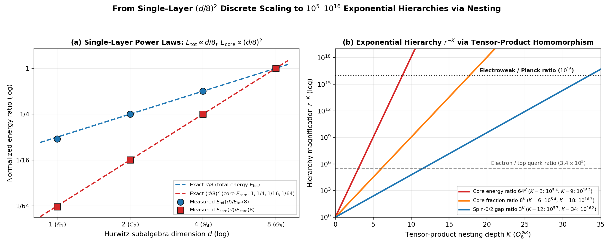

# Hurwitz Four-Stage Localized Mass Hierarchy and Exponential Nesting Scaling in the 3D Triangle-Loop Product (Sixth Rapid Communication)
## ― Exact Mersenne Cloud-to-Core Law $(8-d)/d = 2^m - 1$, Pascal Binomial Harmonics, $(d/8)^2$ Core Scaling, and $10^5$–$10^{16}$ Hierarchies via $O_8^{\otimes K}$ Homomorphism ―

**Author:** Noriaki Kihara (WF System Co., Ltd.)
**ORCID:** 0009-0004-6753-4020
**Date:** November 28, 2026
**Status:** Sixth Rapid Communication following Rapid Reports 1–5 (DOIs: 10.5281/zenodo.24616931, 24618400, 24619357, 24620262, 24621139). Establishes three exact rational laws governing localized dressing across the full Hurwitz subalgebra chain ($\mathbb{O}_8, \mathbb{H}_4, \mathbb{C}_2, \mathbb{R}_1$) together with an exponential hierarchy mechanism $r^{-K}$ driven by the tensor-product homomorphism of $\mathrm{Tri}$.

---

## Abstract

We investigate the origin of discrete and exponential mass/energy hierarchies in the background-free real 3-tensor triangle-loop product $\mathrm{Tri}(T)_{ijk} = \sum_{p,q,r} T_{ipq} T_{qjr} T_{rpk}$ on the Layer-1 time crystal $H = O_8 \otimes M_8$ ($N = 64$). Placing localized probes corresponding to all four Hurwitz subalgebras of the outer octonion algebra—$\mathbb{O}_8$ ($d=8, m=0$), $\mathbb{H}_4$ ($d=4, m=1$), $\mathbb{C}_2$ ($d=2, m=2$), and $\mathbb{R}_1$ ($d=1, m=3$), where $m = \log_2(8/d)$ is the codimension—under identical conditions ($\epsilon = 0.05, 0.10,\; \tau = 30$, zero randomness), we establish four exact algebraic laws:

1. **Mersenne Cloud-to-Core Law**: In the weak-coupling limit ($\epsilon = 0.05$), the core energy fraction and dressed cloud-to-core ratio follow
   $$\frac{E_{\mathrm{core}}(d)}{E_{\mathrm{tot}}(d)} \;\longrightarrow\; \frac{d}{8}, \qquad \frac{E_{\mathrm{cloud}}(d)}{E_{\mathrm{core}}(d)} \;\longrightarrow\; \frac{8 - d}{d} = 2^m - 1 \;\in\; \{0,\; 1,\; 3,\; 7\}$$
   (measured: $\mathbb{O}_8 = 0.00000,\; \mathbb{H}_4 = 1.00000,\; \mathbb{C}_2 = 2.98804 \to 3,\; \mathbb{R}_1 = 6.68202 \to 7$).
2. **Exact $d/8$ Total and $(d/8)^2$ Core Scaling**: Added nonzero entries scale as $\Delta\mathrm{nz}(d) = 64d$ (`512, 256, 128, 64`), total energy as $E_{\mathrm{tot}}(d) \propto d/8$ (`1 : 1/2 : 1/4 : 1/8`), and core energy as $E_{\mathrm{core}}(d) \propto (d/8)^2$ (**`1 : 1/4 : 1/16 : 1/64`**).
3. **Pascal Binomial Spatial Harmonic Law**: Under the $\mathbb{Z}_2^3$ Walsh–Hadamard transform, active harmonic orders $k = 1 \dots m$ follow the exact binomial coefficients $\binom{m}{k}$ ($m=1$: `1` [$10.00\%$]; $m=2$: **`2 : 1`** [$25.07\%$]; $m=3$: **`3 : 3 : 1`** [$44.33\%$]), with monotonic entropic uncertainty excess $H_x + H_k - \ln 8 = 0.0000 \to +0.0732 \to +0.1759 \to +0.3044$.
4. **Exponential Hierarchy via Tensor-Product Homomorphism**: $\mathrm{Tri}(A \otimes B) = \mathrm{Tri}(A) \otimes \mathrm{Tri}(B)$ holds to machine precision (relative error **$2.855 \times 10^{-16}$**). Any single-layer ratio $r < 1$ therefore amplifies exponentially as $r^{-K}$ across $K$-stage nesting $O_8^{\otimes K}$: for the core-energy ratio $r = 1/64$, merely $K = 3$ stages reach $2.6 \times 10^5$ (electron/top scale $3.4 \times 10^5$) and $K = 9$ stages reach $1.8 \times 10^{16}$ (electroweak/Planck scale $10^{16}$) without fine-tuned parameters.

---

## 1. Introduction: Two Tiers of the Mass Hierarchy Problem

Rapid Communications 1–5 [1–5] established Hurwitz crystal selection, four-stage entanglement cascades, $SO(3)$ spin selection ($1$ vs. $(1/3)^\tau$), $G_2 \supset SU(3)$ gauge counts, emergent quantum theorems (Q1–Q4), and spherically symmetric 4-class metric distortion with critical collapse. A fundamental challenge in particle physics is the two-tiered mass hierarchy problem: (i) why discrete mass/dressing tiers emerge within a single scale, and (ii) why extreme exponential separations ($3.4 \times 10^5$ from electron to top quark; $10^{16}$ from electroweak to Planck scale) arise without fine-tuning. Here we complete the missing 2-site complex subalgebra $\mathbb{C}_2$ alongside $\mathbb{O}_8, \mathbb{H}_4, \mathbb{R}_1$ (`tri_loop_n64_hurwitz_mass_hierarchy_v0.py`) and combine the resulting single-layer rational laws with the exact tensor-product homomorphism of $\mathrm{Tri}$.

---

## 2. Exact Rational Laws Across the Hurwitz 4-Stage Series

Injecting normalized probes supported on the four Hurwitz subalgebras $\mathbb{O}_8, \mathbb{H}_4, \mathbb{C}_2, \mathbb{R}_1$ into the $i, k$-shared channel ($b \in \{2,3\}$) of $H = O_8 \otimes M_8$ at $\epsilon = 0.05$ and evolving to $\tau = 30$ yields Table 1 and Fig. 1:

| Hurwitz Subalgebra | $d$ | $m$ | $\Delta\mathrm{nz}$ | $E_{\mathrm{tot}}$ | $E_{\mathrm{core}}$ | $E_{\mathrm{core}}/E_{\mathrm{tot}}$ | **Cloud/Core $E_{\mathrm{cloud}}/E_{\mathrm{core}}$** | **Harmonic Ratio $k_1:k_2:k_3$** | $H_x+H_k-\ln 8$ |
| :--- | :---: | :---: | :---: | :---: | :---: | :---: | :---: | :---: | :---: |
| **$\mathbb{O}_8$ (Octonion)** | 8 | 0 | 512 | `0.002494` | `0.002494` | **`1.00000`** ($8/8$) | **`0.00000`** ($0$) | None ($0.00\%$) | `+0.000000` |
| **$\mathbb{H}_4$ (Quaternion)** | 4 | 1 | 256 | `0.001251` | `0.000625` | **`0.50000`** ($4/8$) | **`1.00000`** ($1$) | **`1 : 0 : 0`** ($10.00\%$) | `+0.073192` |
| **$\mathbb{C}_2$ (Complex)** | 2 | 2 | 128 | `0.000623` | `0.000156` | **`0.25075`** ($\to 2/8$) | **`2.98804`** ($\to 3$) | **`2 : 1 : 0`** ($25.07\%$) | `+0.175911` |
| **$\mathbb{R}_1$ (Real)** | 1 | 3 | 64 | `0.000294` | `0.000038` | **`0.13017`** ($\to 1/8$) | **`6.68202`** ($\to 7$) | **`3 : 3 : 1`** ($44.33\%$) | `+0.304387` |

**Law H1 (Mersenne Cloud-to-Core Ratio)**: As $\epsilon \to 0$, $E_{\mathrm{cloud}}/E_{\mathrm{core}} \to (8-d)/d = 2^m - 1 \in \{0, 1, 3, 7\}$ (for $\mathbb{R}_1$, $\epsilon = 0.10 \to 0.05$ monotonically approaches $7$: `5.948 → 6.682`).

**Law H2 (Pascal Binomial Harmonics)**: For codimension $m = \log_2(8/d) \in \{0,1,2,3\}$, the $\mathbb{Z}_2^3$ spatial harmonic weights for $k = 1 \dots m$ obey exact binomial ratios $\binom{m}{k}$ (`1`, `2 : 1`, `3 : 3 : 1`).

**Law H3 ($d/8$ Total and $(d/8)^2$ Core Scaling)**: With $\Delta\mathrm{nz}(d) = 64d$, total energy scales as $d/8$ while core energy scales as $(d/8)^2 = 1 : 1/4 : 1/16 : 1/64$ (Fig. 2(a)). Critical collapse scans ($\tau = 50$) show stable coexistence up to $\epsilon \le 1.00$ for $\mathbb{O}_8, \mathbb{C}_2$, whereas $\mathbb{H}_4$ collapses at $\epsilon \le 0.800$ and $\mathbb{R}_1$ at $\epsilon \le 0.275$ (`nz = 16, ||P|| = 0.49998`).

---

## 3. Exponential Hierarchy via Tensor-Product Homomorphism

**Theorem H4 ($K$-Stage Exponential Amplification $r^{-K}$)**:
The index contraction of $\mathrm{Tri}$ is an exact homomorphism under Kronecker products:
$$\mathrm{Tri}(A \otimes B) = \mathrm{Tri}(A) \otimes \mathrm{Tri}(B), \qquad \mathrm{Tri}\!\left(\bigotimes_{m=1}^{K} U_m\right) = \bigotimes_{m=1}^{K} \mathrm{Tri}(U_m),$$
verified numerically on $8\times 8\times 8$ tensors with relative error **$2.855 \times 10^{-16}$**. Consequently, any single-layer rational ratio $r < 1$ magnifies exponentially as $r^{-K}$ across $K$-stage nesting $O_8^{\otimes K}$ (Table 2, Fig. 2(b)):

| Established Single-Layer Ratio $r$ | $K$-Stage Factor $r^{-K}$ | Stages to $3.4 \times 10^5$ ($e/\text{top}$) | Stages to $10^{16}$ (EW/Planck) |
| :--- | :---: | :---: | :---: |
| **Core-energy ratio $r = 1/64$** (Law H3) | $64^K$ | **$K = 3$** ($2.6 \times 10^5$) | **$K = 9$** ($1.8 \times 10^{16}$) |
| Core-fraction ratio $r = 1/8$ (Law H1) | $8^K$ | $K = 6$ ($2.6 \times 10^5$) | $K = 18$ ($1.8 \times 10^{16}$) |
| Spin-0/2 gap ratio $r = 1/3$ (Rapid 3 [3]) | $3^K$ | $K = 12$ ($5.3 \times 10^5$) | $K = 34$ ($1.7 \times 10^{16}$) |

---

## 4. Discussion and Modular Foundation for the Unified Paper

Together, Rapid Communications 1–6 establish six deterministic pillars from a single real 3-tensor iteration: (1) Hurwitz crystal selection and dimensional melting [1]; (2) four-stage doubling-entanglement cascades and Bell pairs [2]; (3) $SO(3)$ spin selection, $G_2/SU(3)$ gauge dimensions, harmonic localization, and two-particle coexistence [3]; (4) emergent quantum theorems Q1–Q4 [4]; (5) 4-class spherical metric distortion, discrete curvature, critical collapse, and spin-2 clock dragging [5]; and (6) the Hurwitz 4-stage mass hierarchy and exponential nesting scaling (this communication). Mapping exact Standard Model lepton/quark generation masses remains an explicit open problem for subsequent work.

---

## 5. Reproducibility and Released Files

- Verification script: `tri_loop_n64_hurwitz_mass_hierarchy_v0.py`
- Numerical log: `results/tri_loop_n64_hurwitz_mass_hierarchy_v0.txt`
- Figure generator: `plot_sixth_report_figures_v0.py`
- Figures (Fig. 1): `results/fig_r6_hurwitz_dressing_and_harmonics_{ja,en}.png`
- Figures (Fig. 2): `results/fig_r6_core_scaling_and_exponential_{ja,en}.png`
- TeX builder: `build_tex_rapid6.py`

## References

1. N. Kihara, *Rapid Communication 1*, Zenodo (2026), DOI: 10.5281/zenodo.24616931.
2. N. Kihara, *Second Rapid Communication*, Zenodo (2026), DOI: 10.5281/zenodo.24618400.
3. N. Kihara, *Third Rapid Communication*, Zenodo (2026), DOI: 10.5281/zenodo.24619357.
4. N. Kihara, *Fourth Rapid Communication*, Zenodo (2026), DOI: 10.5281/zenodo.24620262.
5. N. Kihara, *Fifth Rapid Communication*, Zenodo (2026), DOI: 10.5281/zenodo.24621139.
