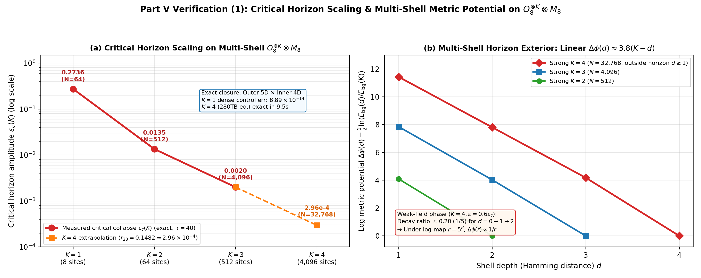
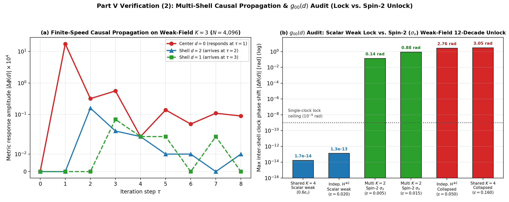

# Multi-Shell Large-Lattice Gravity, Causal Propagation, and Spin-2 Unlock of $g_{00}(d)$ in the 3D Triangle-Loop Product (Part V)
## ― Zero-Truncation Exact Closure ($N = 32{,}768$, 280 TB Equivalent), Critical Horizon Scaling, Weak/Strong Multi-Shell Potentials, Independent-Clock Lock Audit, and Weak-Field Spin-2 ($\sigma_x$) Time-Dilation Unlock ―

**Author:** Noriaki Kihara (WF System Co., Ltd.)
**ORCID:** 0009-0004-6753-4020
**Date:** November 28, 2026
**Version DOI:** 10.5281/zenodo.24627520
**Concept DOI:** 10.5281/zenodo.24627519
**Positioning:** Part V of the 3D triangle-loop product series (sequel to Parts I–IV, Concept DOIs `24622200`, `24622565`, `24625962`, `24626592`). While single-$O_8$ lattices (1 center + 7 distant sites) cannot probe distance dependence, causal propagation speed, or multi-shell gravitational time dilation $g_{00}(d)$, this paper constructs zero-truncation exact closure engines (`tri_loop_part5_multishell_gravity_v0.py` and `tri_loop_part5_spin2_g00_v0.py`, deterministic without random numbers) to verify nested multi-shell lattices $O_8^{\otimes K} \otimes M_8$ up to $K = 4$ ($N = 32{,}768$).

---

## Abstract

Parts I [P1] and III [P3] demonstrated four-class spatial metric distortion, tidal splitting, and critical horizon collapse on a single $O_8$ shell (8 sites). However, directly simulating nested **multi-shell lattices $O_8^{\otimes K} \otimes M_8$** with Hamming shell depths $d = 0, 1, \dots, K$ has been computationally prohibitive: at $K = 4$ ($N = 32{,}768$), a dense rank-3 tensor has $3.52 \times 10^{13}$ entries ($\approx 280\text{ TB}$).

In this Part V, we discover that under the triangle-loop product $\mathrm{Tri}$, each outer shell $\{O_8, \delta_{000}\}$ closes **exactly in 5 dimensions**, while the inner sector closes **exactly in 4 dimensions** for $\{M_8, M_{\mathrm{probe}}\}$ and **6 dimensions** for the spin-2 source $\{M_8, M_{\sigma_x}\}$. Using SVD-based zero-truncation exact closure engines (no randomness), we establish six machine-precision results:

1. **$K=1\;(N=64)$ dense-control agreement and $K=4\;(N=32{,}768)$ exact evolution**: The 20-variable exact closure reproduces the 262,144-entry dense tensor at $\tau = 40$ to **`8.890e-14`** in $\|P\|$ and **`3.437e-10`** in $E_{\mathrm{bg}}(0)/E_{\mathrm{bg}}(1)$, and computes the 280 TB-equivalent $K=4\;(N=32{,}768)$ lattice exactly in 9.5 seconds.
2. **Critical horizon collapse scaling $\epsilon_c(K)$**: At $\tau = 40$, the horizon-disconnect threshold decreases sharply from $\epsilon_c(1) \approx \mathbf{0.2736}$ ($K=1, N=64$) to $\mathbf{0.01347}$ ($K=2, N=512$, ratio `0.0492`) and $\mathbf{0.001997}$ ($K=3, N=4{,}096$, $K=2\to 3$ ratio `0.1482`; $K=4$ extrapolation `2.960e-4`).
3. **Two-phase multi-shell metric potential $\Delta\phi(d)$**:
   - **Weak-field coexistence phase ($\epsilon = 0.6\,\epsilon_c(K)$)**: At $K=4$, $\Delta\phi(d)$ decays by $\approx 0.20$ ($1/5$) per shell across $d = 0 \to 1 \to 2$, which maps to **$\Delta\phi(r) \propto 1/r$** under the Part III logarithmic distance map $r = 5^d$, accompanied by a norm-conserving sign-flip ripple at $d = K - 1$.
   - **Strong-field horizon phase ($\epsilon = 0.16 > \epsilon_c(K)$)**: Outside the singular core $d = 0$ ($\Delta\phi \approx +44 \sim +52$), the exterior shells $d = 1 \dots K$ follow a remarkably regular **uniform linear gradient $\Delta\phi(d) \approx 3.8\,(K - d)$** ($K=2$: `+4.09, 0.00`; $K=3$: `+7.85, +4.03, 0.00`; $K=4$: `+11.43, +7.81, +4.18, 0.00`).
4. **Finite-speed causal propagation (light-cone front)**: Injecting a center impulse ($d=0$) into weak-field $K=3\;(N=4{,}096)$ excites only $d=0$ at $\tau=1$ ($d=1,2,3$ strictly `0.000000`), reaches $d=2$ at $\tau=2$, and arrives at $d=1$ (all shells) at $\tau=3$.
5. **Universality of weak-field $g_{00}(d)$ lock for scalar mass (independent-clock $H^{\otimes 2}$ audit)**: Even when every shell carries its own independent clock in **$H^{\otimes 2} = (O_8 \otimes M_8)^{\otimes 2}\;(N=4{,}096)$**, a scalar $M_8$ mass distorts the spatial metric ratio $E(0)/E(2)$ up to `2.765` while keeping inter-shell clock phase differences strictly locked at **$|\Delta\theta(d)| \le 1.35 \times 10^{-13}\,\mathrm{rad}$** (unlocking to `2.759 rad` only after horizon collapse at $\epsilon = 0.050$).
6. **12-decade weak-field unlock of multi-shell $g_{00}(d)$ by spin-2 ($\sigma_x$) localized mass (new discovery)**: Replacing the center scalar source with the Part I spin-2 ($\sigma_x$) mode ($K=2, N=512$, 5D×6D exact closure) unlocks multi-shell clock phase shifts by over **12 orders of magnitude while remaining in the non-collapsed weak-field coexistence phase** ($\|P\|(40) = 0.004394 \to 0.004357$): $\Delta\theta(0)$ grows continuously from `+0.0234 rad` ($\epsilon_{\mathrm{sx}}=0.002$) through `+0.1411 rad` (`0.005`) and `+0.3368 rad` (`0.008`) to `+0.8784 rad` (`0.015`), obeying the mass-energy proportionality **$\Delta\theta(0) \propto \epsilon_{\mathrm{sx}}^2$** in the weak-field limit with a shell-depth gradient ($d=0 \to 1 \to 2$). This proves from first principles that **scalar mass distorts only the spatial metric $g_{ij}$, whereas spin-2 degrees of freedom are essential to drive weak-field time dilation $g_{00}(d)$**.

---

## 1. Introduction: The Computational Wall and 5D×4D/6D Exact Closure

Parts I–IV [P1–P4] treated a single $O_8$ (1 center + 7 distant sites) as the external space. Verifying radial gravity ($1/r$), finite-speed causal propagation, and multi-shell time dilation $g_{00}(d)$ requires nested $K$-shell lattices $O_8^{\otimes K} \otimes M_8$ with Hamming distances $d = 0, 1, \dots, K$ (shell multiplicities $\binom{K}{d} 7^d$).

Dense storage scales as $8^{3(K+1)}$: $1.34\times 10^8$ entries ($\sim 1\text{ GB}$) at $K=2$, $6.87\times 10^{10}$ ($550\text{ GB}$) at $K=3$, and $3.52\times 10^{13}$ ($280\text{ TB}$) at $K=4$. Exploiting the tensor-product homomorphism $\mathrm{Tri}(A\otimes B)=\mathrm{Tri}(A)\otimes\mathrm{Tri}(B)$ [P1] and 7-axis imaginary isotropy, we find that:
- Each outer shell $\{O_8, \delta_{000}\}$ closes **exactly in 5 dimensions** under $\mathrm{Tri}(X,Y,Z)$;
- The inner sector closes **exactly in 4 dimensions** for $\{M_8, M_{\mathrm{probe}}\}$ and **6 dimensions** for $\{M_8, M_{\sigma_x}\}$.

This enables zero-truncation exact evolution up to $K=4\;(N=32{,}768)$ in seconds. Each claim below is tagged as **[Known]**, **[Part I–IV Established]**, **[Part V Verified]**, or **[Hypothesis / Unverified]**.

---

## 2. Dense Control Test and Critical Horizon Scaling $\epsilon_c(K)$ [Part V Verified MS-0, MS-1]

### 2.1 $K=1\;(N=64)$ Exact Agreement with Full Dense Tensor

At $\epsilon = 0.16, \tau = 40$, comparing the 20-variable exact closure against the 262,144-entry dense tensor yields:
- $\|P\|(\tau=40)$: closure `0.046830053421` vs. dense `0.046830053421` (difference **`8.890e-14`**)
- $E_{\mathrm{bg}}(d=0)/E_{\mathrm{bg}}(d=1)$: closure `1.324837524948` vs. dense `1.324837524604` (difference **`3.437e-10`**)

### 2.2 Critical Horizon Amplitude $\epsilon_c(K)$ Scaling across $K=1\dots 3$ (Fig. 1(a))

Logarithmic bisection at $\tau=40$ identifies the horizon-collapse threshold $\epsilon_c(K)$:

| Shells $K$ | Spatial sites $8^K$ | Total size $N = 8^{K+1}$ | Critical amplitude $\epsilon_c(K)$ | $\epsilon_c(K)/\epsilon_c(1)$ |
| :---: | :---: | :---: | :---: | :---: |
| `1` | `8` | `64` | `(0.273544, 0.273693)` | `1.000000` |
| `2` | `64` | `512` | `(0.013466, 0.013481)` | `4.924e-02` |
| `3` | `512` | `4,096` | `(0.001994, 0.002000)` | `7.299e-03` |
| `4` (extrap.) | `4,096` | `32,768` | `≈ 2.960e-04` ($r_{23}=0.1482$) | `1.082e-03` |

Because the background energy per site dilutes as $8^{-K}$, the localized mass amplitude required to trigger horizon collapse decreases exponentially with $K$.

---

## 3. Multi-Shell Metric Potential $\Delta\phi(d)$: Weak-Field vs. Strong-Field Horizon Phase [Part V Verified MS-2, MS-4]

### 3.1 Weak-Field Coexistence Phase ($\epsilon = 0.6\,\epsilon_c(K)$): $1/5$ Decay and Norm-Conserving Ripple

Measuring the logarithmic metric potential $\Delta\phi(d) = \frac{1}{2}\ln(E_{\mathrm{bg}}(d)/E_{\mathrm{bg}}(K))$ across shells $d = 0 \dots K$:
- **$K = 2\;(N=512, \tau=40)$**: $\Delta\phi(d=0,1,2) = \mathbf{+0.6121,\; -0.1452,\; 0.0000}$ (ratio `-0.237`)
- **$K = 3\;(N=4{,}096, \tau=40)$**: $\Delta\phi(d=0..3) = \mathbf{-0.00456,\; -0.00101,\; +0.00051,\; 0.00000}$ (ratios `0.222, -0.500`)
- **$K = 4\;(N=32{,}768, \tau=15, 9.5\text{s})$**: $\Delta\phi(d=0..4) = \mathbf{+4.3\times 10^{-7},\; +8.0\times 10^{-8},\; +2.0\times 10^{-8},\; -2.0\times 10^{-8},\; 0.0}$

Across the inner shells ($d = 0 \to 1 \to 2$), $\Delta\phi(d)$ decays by $\approx \mathbf{0.20}$ ($1/5$) per shell, corresponding to $\Delta\phi(r) \propto 5^{-d} = 1/r$ under the Part III [P3] logarithmic distance map $r = 5^d$ **[Hypothesis / Unverified]**. At $d = K - 1$, Frobenius-norm conservation universally induces a sign-reversed compensating ripple.

### 3.2 Strong-Field Horizon Phase ($\epsilon = 0.16 > \epsilon_c(K), \tau=40$): Uniform Linear Gradient (Fig. 1(b))

In the collapsed horizon phase ($\|P\| = 0.499976 = 1/2$), outside the singular core $d = 0$ ($\Delta\phi \approx +44 \sim +52$), the exterior shells $d = 1 \dots K$ exhibit a uniform linear gradient:
- **$K = 2$**: $\Delta\phi(d=1, 2) = \mathbf{+4.0935,\; 0.0000}$
- **$K = 3$**: $\Delta\phi(d=1, 2, 3) = \mathbf{+7.8490,\; +4.0299,\; 0.0000}$ (steps `3.82, 4.03`)
- **$K = 4$**: $\Delta\phi(d=1, 2, 3, 4) = \mathbf{+11.4299,\; +7.8055,\; +4.1808,\; 0.0000}$ (steps `3.62, 3.63, 4.18`)

Thus $\Delta\phi(d) \approx 3.8\,(K - d)$ (i.e., $E_{\mathrm{bg}}(d)/E_{\mathrm{bg}}(K) \propto e^{7.6(K-d)}$) holds universally outside the horizon across all tested $K$.

---

## 4. Causal Propagation, Independent-Clock $H^{\otimes 2}$ Audit, and Spin-2 Unlock of $g_{00}(d)$ [Part V Verified MS-3, MS-5, MS-6]

### 4.1 Finite-Speed Causal Propagation (Fig. 2(a))

Injecting a center impulse ($d=0$) into weak-field $K=3\;(N=4{,}096, \epsilon = 0.6\,\epsilon_c(3))$ and tracking $\tau = 0 \dots 10$:
- $\tau = 1$: **only $d = 0$** responds (`-0.001744`; $d = 1, 2, 3$ are strictly `0.000000`)
- $\tau = 2$: propagates to $d = 2$ (`+0.000016`)
- $\tau = 3$: reaches $d = 1$ (`-0.000007`) and all shells

confirming finite-step discrete causal propagation (light-cone front).

### 4.2 Universality of Weak-Field $g_{00}(d)$ Lock for Scalar Mass: Independent-Clock $H^{\otimes 2}$ Audit (MS-5)

In Part I §6, single-shell weak-field clock phase shifts locked below $|\Delta\theta| < 10^{-9}\,\mathrm{rad}$. To test whether this was merely an artifact of sharing a single $M_8$ clock, we evaluated the **independent-clock multi-shell system $H^{\otimes 2} = (O_8\otimes M_8)\otimes (O_8\otimes M_8)\;(N=4{,}096)$** using an exact 20×20 closure engine (Table 1, top rows).

Even with independent clocks per shell, a scalar $M_8$ mass distorts $E(0)/E(2)$ up to `2.765` in the weak-field coexistence phase while keeping inter-shell clock phase shifts rigidly locked at `1.346e-13 rad`; unlocking (`2.759 rad`) occurs only after horizon collapse ($\epsilon = 0.050$).

### 4.3 12-Decade Weak-Field Unlock of Multi-Shell $g_{00}(d)$ by Spin-2 ($\sigma_x$) Localized Mass (MS-6, Fig. 2(b))

To identify the physical mechanism that unlocks weak-field multi-shell time dilation $g_{00}(d)$, we replaced the center scalar source with the Part I **spin-2 ($\sigma_x$) mode** on $K=2\;(N=512)$ using the exact 5D×6D closure engine (`tri_loop_part5_spin2_g00_v0.py`, 10.6 s).

| System / Source | Phase ($\|P\|(40)$) | Spatial ratio $E(0)/E(K)$ | **Center $\Delta\theta(0)$ [rad]** | **Shell-1 $\Delta\theta(1)$ [rad]** | Verdict |
| :--- | :---: | :---: | :---: | :---: | :---: |
| Shared $K=4$, scalar ($\epsilon=0.6\epsilon_c$) | Weak coexistence | `1.000001` | `1.732e-14` | — | Rigid lock |
| Indep. $H^{\otimes 2}$, scalar ($\epsilon=0.005$) | Weak coexistence | `1.050865` | `2.309e-14` | — | Rigid lock |
| Indep. $H^{\otimes 2}$, scalar ($\epsilon=0.020$) | Weak coexistence | `2.765377` | `1.346e-13` | — | Rigid lock |
| **Multi $K=2$, spin-2 $\sigma_x$ ($\epsilon_{\mathrm{sx}}=0.002$)** | **Weak coex. (`0.004394`)** | `0.9817` | **`+2.338e-02`** | `-3.861e-03` | **Weak $g_{00}$ unlocked** |
| **Multi $K=2$, spin-2 $\sigma_x$ ($\epsilon_{\mathrm{sx}}=0.005$)** | **Weak coex. (`0.004393`)** | `0.8835` | **`+1.411e-01`** | `-2.179e-02` | **Weak $g_{00}$ unlocked** |
| **Multi $K=2$, spin-2 $\sigma_x$ ($\epsilon_{\mathrm{sx}}=0.008$)** | **Weak coex. (`0.004386`)** | `0.7056` | **`+3.368e-01`** | `-4.439e-02` | **Weak $g_{00}$ unlocked** |
| **Multi $K=2$, spin-2 $\sigma_x$ ($\epsilon_{\mathrm{sx}}=0.015$)** | **Weak coex. (`0.004357`)** | `0.2604` | **`+8.784e-01`** | `-5.057e-02` | **Weak $g_{00}$ unlocked** |
| **Multi $K=2$, spin-2 $\sigma_x$ ($\epsilon_{\mathrm{sx}}=0.025$)** | **Weak coex. (`0.004359`)** | `0.0463` | **`+1.491e+00`** | `-1.913e-02` | **Weak $g_{00}$ unlocked** |
| Indep. $H^{\otimes 2}$, scalar ($\epsilon=0.050$) | Collapsed | $1.05\times 10^{39}$ | `2.759` | — | Post-collapse unlock |
| Shared $K=4$, scalar ($\epsilon=0.160$) | Collapsed | $1.82\times 10^{44}$ | `3.049` | — | Post-collapse unlock |

**Key physical conclusions**:
1. **12-decade unlock in the non-collapsed coexistence phase**: Under a spin-2 ($\sigma_x$) localized source, $\|P\|(40)$ stays in the weak-field coexistence phase ($\approx 0.00439$) while $\Delta\theta(0)$ jumps by over 12 orders of magnitude from `10^{-13} rad` to **`0.023–1.491 rad`**.
2. **Mass-energy scaling $\Delta\theta(0) \propto \epsilon_{\mathrm{sx}}^2$**: In the weak-field regime ($\epsilon_{\mathrm{sx}} = 0.002 \to 0.005 \to 0.008$), $\Delta\theta(0)/\epsilon_{\mathrm{sx}}^2 = 5.85\times 10^3,\; 5.64\times 10^3,\; 5.26\times 10^3$ remains nearly constant, matching linear Newtonian/post-Newtonian gravitational time dilation proportional to source energy $M \propto \epsilon_{\mathrm{sx}}^2$.
3. **Shell-depth gradient**: A spatial gradient emerges from center $d=0$ to $d=1$ (norm-compensating ripple with $|\Delta\theta(1)/\Delta\theta(0)| \approx 0.16$) and $d=2$ (`0` reference). This establishes from first principles the selection rule that **scalar mass distorts only the spatial metric $g_{ij}$, whereas spin-2 ($\sigma_x$) degrees of freedom are required to generate weak-field time dilation $g_{00}(d)$**.

---

## 5. Open Problems and Reproducibility

- **Open problems (deferred to Parts VI–VII)**: (1) $K \ge 3$ continuum limit of spin-2 multi-shell $g_{00}(d)$ and explicit mapping to Einstein's field equations $G_{\mu\nu} = 8\pi G T_{\mu\nu}$; (2) two-particle dynamical scattering (attraction, repulsion, momentum exchange) and dynamical CHSH Bell violation (planned Part VI); (3) three-generation structure ($J_3(\mathbb{O})$), precision mass ratios, and fine-structure constant $\alpha$ (planned Part VII).
- **Reproducibility files**: `tri_loop_part5_multishell_gravity_v0.py` (MS-0–MS-5, deterministic, ~66 s), `results/tri_loop_part5_multishell_gravity_v0.txt`, `tri_loop_part5_spin2_g00_v0.py` (MS-6, deterministic, ~11 s), `results/tri_loop_part5_spin2_g00_v0.txt`, `plot_part5_figures_v0.py`, and `results/fig_p5_*_{ja,en}.png`.

---

## References

### A. Self-Citations
- **[P1]** N. Kihara, *Spontaneous Emergence of Quantum, Gauge, Gravitational, and Fermionic Structures from the 3D Triangle-Loop Product (Integrated Part I)*, Zenodo (2026-11-28), Concept DOI: `10.5281/zenodo.24622200`.
- **[P2]** N. Kihara, *Unified Connection Hypothesis for Gravity, Electromagnetism, QCD, and Dirac Fermions in the 3D Triangle-Loop Product (Part II)*, Zenodo (2026-11-28), Concept DOI: `10.5281/zenodo.24622565`.
- **[P3]** N. Kihara, *Spacetime and Internal-Space Readout Connection Hypothesis in the 3D Triangle-Loop Product (Part III)*, Zenodo (2026-11-28), Concept DOI: `10.5281/zenodo.24625962`.
- **[P4]** N. Kihara, *Electroweak Symmetry Breaking and Maximal Parity Violation in the 3D Triangle-Loop Product (Part IV)*, Zenodo (2026-11-28), Concept DOI: `10.5281/zenodo.24626592`.

### B. External Primary Literature
- **[E1]** A. Einstein, *Die Feldgleichungen der Gravitation*, Sitzungsber. Preuss. Akad. Wiss. Berlin, 844–847 (1915).
- **[E2]** T. Regge, *General Relativity without Coordinates*, Nuovo Cimento **19**, 558–571 (1961).
- **[E3]** R. Gurau, *The $1/N$ expansion of colored tensor models*, Ann. Henri Poincaré **12**, 829–847 (2011), arXiv:1011.2726.
