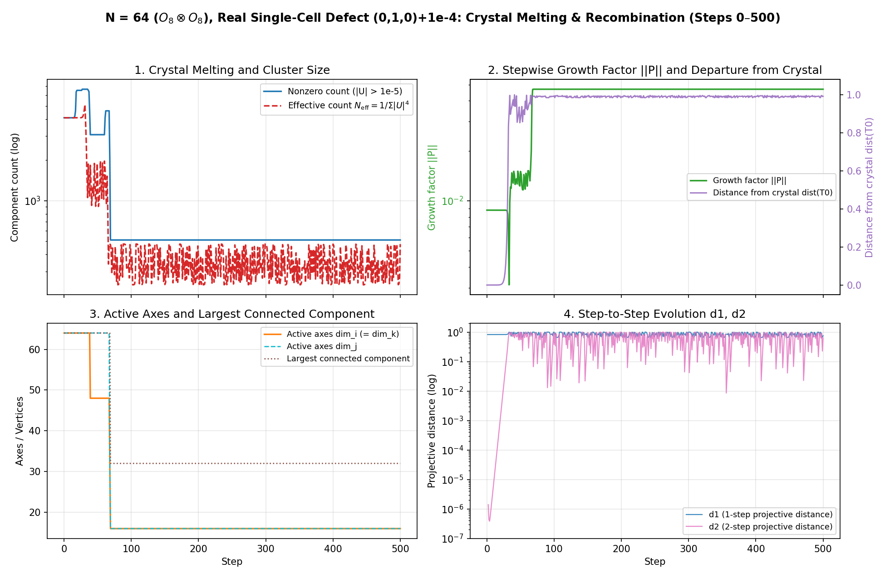
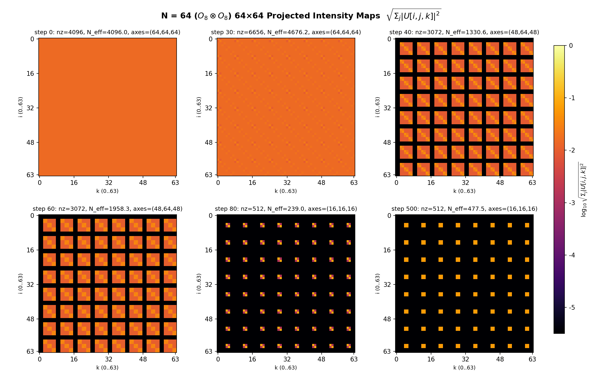
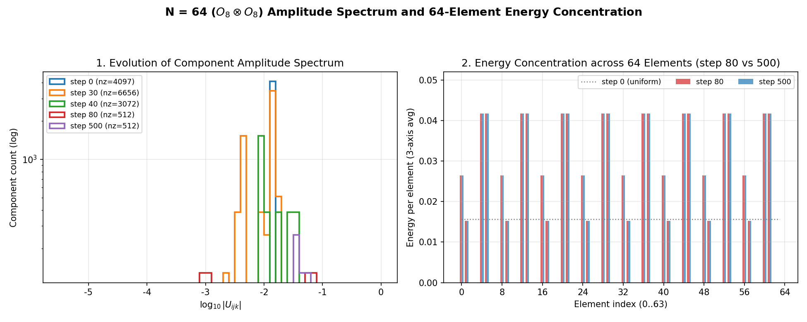
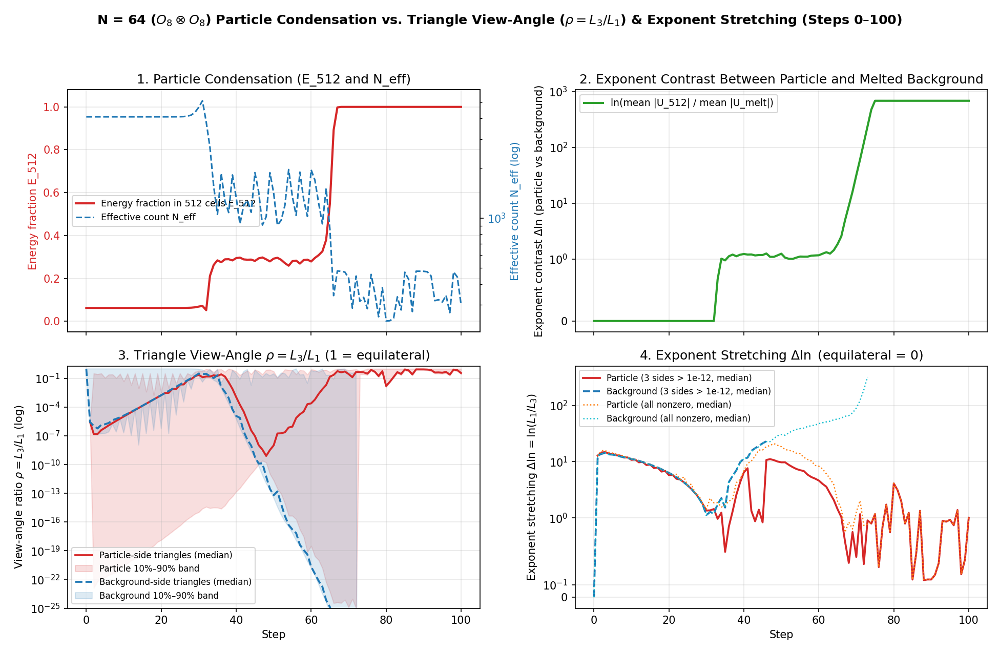
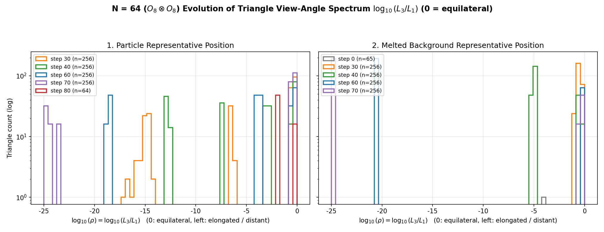

# Spontaneous Selection of Quaternionic and Octonionic Crystals, Cascade Melting, and Bimodal View-Angle Splitting under the Triangle-Loop Product on Cubic Arrays (Rapid Communication)
## ― Numerical Demonstration of Particle Condensation and Spatial Rarefaction in a Self-Updating System without Background Spacetime, External Operators, or Randomness ―

**Author:** Noriaki Kihara (WF System Co., Ltd.)　ORCID 0009-0004-6753-4020  
**Date:** 2026-11-28　　**Version:** v1.0 (Rapid Communication)  
**Version DOI:** 10.5281/zenodo.24614041　　**Concept DOI:** 10.5281/zenodo.24614040  
**Repository:** `次元の生成構造/三次元正方配列の積と自己無撞着_20261127/`  
**License:** CC BY 4.0

---

## Abstract

The author has been investigating a framework that derives spacetime, particles, and interactions (observation) solely from relational structures of states without assuming a background spacetime. Following the release on 2026-11-25 of V. Chandrasekaran's preprint on background-independent quantum gravity (arXiv:2611.34924v1) and the growing international attention to background-free approaches, this rapid communication reports interim results extending the author's previous complex-number numerical inflation experiments to octonions and higher-dimensional three-index cubic arrays, together with all reproducible source code, datasets, and plotting scripts.

The core of this work is the **triangle-loop product** on an $N \times N \times N$ cubic array $T$:
$$\mathrm{Tri}(T)_{ijk} = \sum_{p,q,r=0}^{N-1} T_{ipq}\, T_{qjr}\, T_{rpk}.$$
This operation treats all three axes symmetrically (anonymity), is non-associative, and contains no background spacetime, no external operators, no randomness, and no division. Through exact integer arithmetic, analytical reductions, and exact BLAS computations, we establish five results:

1. **Spontaneous Algebraic Selection (Exact Integer Arithmetic):** Among the multiplication tables $f_{abc} \in \{0, \pm 1\}$ of Cayley–Dickson algebras, **only the quaternions ($N=4$) and octonions ($N=8$)** form exact period-2 crystals ($U^2 = I$) under the triangle-loop product (complex numbers $N=2$ vanish at step 1; sedenions $N=16$ self-destruct without defects).
2. **Exhaustive 1,024 Single-Cell Defect Spectrum on the Octonion Crystal (Zero Extinctions: 0):** Whereas the star-contraction Bhattacharya–Mesner (BM) product suffers 100% zero extinction after defect collapse for $N = 8\text{–}24$, the triangle-loop product exhibits **0 zero extinctions (100% survival)** across all 512 cells $\times$ real/imaginary = 1,024 single-cell defects of the octonion table. Under real defects, all 448 originally zero cells precipitate into an **8-cell complex rotation-matrix pair**; under imaginary defects, the 448 originally zero cells split strictly **336 : 112 (exact 3 : 1)** into a **32-cell quaternionic-subalgebra intermediate phase** and an **8-cell complex-subalgebra fixed point** (both satisfying $\sum U^2 = 0$ and Pauli projection $I \pm \sigma_y$ structure without external constraints).
3. **Exact Analytical Theorem for the 8-Cell Survivor and Two-Stage Cascade Phase Transition (20,000-Step Tracking):** The real 8-cell survivor obeys the exact closed equation $z_j' = (z_0^2 + z_1^2) z_j$, conserving the internal ratio $z_1/z_0$ while executing a $3\times$-angle rotation on $S^1$ for more than 20,000 steps and blocking or neutrally deflecting perturbations from all 504 external cells. Meanwhile, the imaginary 32-cell intermediate phase undergoes a **two-stage cascade phase transition from octonions (8D) $\to$ quaternions (4D, 32 cells) $\to$ complex numbers (2D, 8 cells)**, fully saturating by step 100 and remaining invariant through step 20,000.
4. **Composite Survivor and Discrete Energy Hierarchy in Coupled Large Crystals ($N = 32, 64$):** Using the tensor-product covariance $\mathrm{Tri}(A \otimes B) = \mathrm{Tri}(A) \otimes \mathrm{Tri}(B)$, a real single-cell defect in the coupled large crystal $N = 64$ ($O_8 \otimes O_8$, 262,144 components) melts through an $8 \times 8$ lattice intermediate phase (3,072 cells) and recrystallizes into a **512-cell composite survivor** (stable through steps 70–500, with a strict three-level discrete energy hierarchy across the 64 elements).
5. **Bimodal Splitting of the Triangle View-Angle Spectrum (Simultaneous Emergence of Expansion and Condensation):** Measuring the coordinate-free triangle view-angle ratio $\rho = L_3 / L_1$ across all 262,144 triangle loops shows that triangles connected to the melted background collapse exponentially to causal separation ($\Delta\ln > 687$), while particle-internal triangles undergo a V-shaped rebound back to nearly equilateral geometry ($\rho \sim 1$), synchronized with the energy concentration $E_{512} \to 1$.

This paper strictly separates **Layer 1: mathematical definitions, exact theorems, and reproducible numerical experiments**, **Layer 2: physical interpretations as spacetime, distance, particles, and inflation**, and **Layer 3: current limitations and open problems**. All scripts, raw data, and plotting programs are openly available and can be independently verified in a standard Python environment within seconds to tens of seconds.

**Keywords:** background independence, cubic array, triangle-loop product, octonions, quaternions, self-consistency, cascade phase transition, inflation, view-angle spectrum, $\sum z_n^2 = 0$, reproducible numerical experiment

---

## How to Read This Paper and Evidentiary Labels

Following the author's previous papers [K1, K5], each claim is explicitly tagged with one of four evidentiary labels. Unlabeled sentences state definitions or experimental setups.

| Label | Meaning |
|---|---|
| **[Known]** | Established mathematical or physical fact, with citation |
| **[Analytically Proven]** | Theorem derived algebraically in this work and verified numerically to $< 10^{-14}$ |
| **[Verified]** | Fact confirmed by deterministic exact or double-precision computation using the published scripts (Appendix A) without randomness |
| **[Hypothesis / Unverified]** | Physical interpretation or prediction based on numerical facts; requires future theoretical and quantitative verification |

---

## 1. Motivation

The author has been using AI to investigate whether spacetime, particles, and interactions (observation) can be derived solely from relational structures of states—without assuming any background spacetime—in a manner consistent with the Standard Model, General Relativity, and other established theories [K1–K5].

Until recently, relatively few studies pursued a strictly background-free starting point. However, on 2026-11-25, V. Chandrasekaran released the preprint *"An algebraic quantization of gravity from the null cone"* (arXiv:2611.34924v1) [C1], prominently featuring AI-assisted theoretical work. A full-text comparison revealed substantial points of contact with the author's research: a formulation without a fixed background metric, finite-dimensional Hilbert spaces for finite regions, corner edge-mode frames with triple gluing consistency conditions, and subspace separation via null states (exact citation points and contrasts are detailed in §9).

Accordingly, the author decided to release this rapid communication reporting interim results from extending the previously published complex-number numerical inflation experiments on Zenodo [K1, K2] to octonions and three-dimensional cubic arrays. A major strength of this report is that **every single experimental result is accompanied by deterministic, randomness-free computation scripts, raw numerical data (CSV/NPZ/TXT), dedicated plotting scripts, and rendered figures**, enabling straightforward independent verification by any third party.

As a note on methodology, this investigation initially began with another AI (Claude Code), which stalled in dead ends involving 2D matrix multiplication and a misinterpretation of "exponentiation." After handing the redesign of the algebraic operation over to Google Gemini 4 Neon, the entire sequence—from conceiving the triangle-loop product to proving analytical theorems, completing the exhaustive 1,024-case classification, 20,000-step long-term tracking, and the $N = 64$ large-crystal melting and view-angle spectral measurements—was completed in roughly half a day. For full transparency, the record of the earlier AI's failed attempts and detours is also preserved in the repository [R1].

---

## 2. Starting Axioms and Limitations of 2D Matrix and BM Products

### 2.1 Three Foundational Requirements

The author's framework rests on three requirements ([K1, K5] and repository notes):

1. **Anonymity (Axiom 0):** No external labels, coordinates, or fixed real/imaginary distinctions are imposed on elements or axes.
2. **Self-Consistency (Axiom 1):** Without assuming background time, repeated application of the same operation yields self-consistent states such as fixed points, finite cycles ($U^n = I$), or quasi-periodic orbits. In prior complex-number experiments, the complex sum-of-squares condition $\sum z_n^2 = 0$ (not the norm squared) emerged spontaneously in metastable states without external enforcement, serving as an independent consistency check.
3. **Interaction = Observation (Axiom 2):** No external operator $U$ or external measuring apparatus is introduced; the next state is determined solely by mutual relations among internal states.

### 2.2 Why 2D Matrix Multiplication Cannot Reach This Regime [Known / Verified]

Left multiplication $L(x)$ by a single octonion $x$ can be written as an $8 \times 8$ real matrix, but ordinary matrix multiplication is associative, so $L(x)L(y) = L(xy)$ fails for distinct octonions **[Known]**. Moreover, squaring a single matrix $M \mapsto M^2$ permanently fixes the eigenspaces determined by the initial matrix $M$, making it impossible in principle for a small defect in a highly symmetric crystal to trigger a phase transition and spontaneous arrest into a different metastable remnant.

### 2.3 Verification of the Star-Contraction (BM) Product and 100% Zero Extinction [Verified]

As a standard non-associative ternary product on a cubic array $T \in \mathbb{C}^{N \times N \times N}$, we analyzed and numerically tested the Bhattacharya–Mesner (BM) product (`bm_product_*.py`):
$$\mathrm{Prod}_{\mathrm{BM}}(T)_{ijk} = \sum_{t=0}^{N-1} T_{itk}\, T_{ijt}\, T_{tjk}.$$
The results established that:

- Applying the BM product once to the multiplication tables $f_{abc}$ of $\mathbb{C}$ ($2^3$), $\mathbb{H}$ ($4^3$), or $\mathbb{O}$ ($8^3$) collapses them strictly onto diagonal entries $(+1, -1, \dots, -1)$, eliminating all off-diagonal cross terms.
- In fully anonymous ($S_N$-invariant) 5-variable reductions and circulant antisymmetric plane waves $F_{a,b}(u,v) = \omega^{au+bv} - \omega^{av+bu}$, exact crystals satisfying $\sum T^2 = 0$ and arbitrary-period solutions exist ($\mathrm{Prod}_{\mathrm{BM}}(F_{a,b}) = N F_{2a,2b}$ for odd $N$, period $\mathrm{ord}_N(2)$) **[Analytically Proven]**.
- However, apart from one special $N = 4$ case (diagonal $+i\varepsilon$ arresting at an 18-cell $N = 3$ state), **100% of tested single-cell defects in $S_N$ crystals ($N = 8, 12, 16, 24$) and antisymmetric wave crystals ($N = 5, 7, 11, 13$) suffered complete zero extinction within steps 23–49**.

Because the BM product contracts three factors through a single shared index $t$ (a star contraction without closed loops), defect-induced collapse cascades directly into zero absorption. Even a conjugated variant $\sum_t T_{itk} \overline{T}_{ijt} T_{tjk}$ exhibited complete extinction at $N = 8$ for initial $\sum T^2 = 0$ complex crystals.

---

## 3. Definition and Basic Properties of the Triangle-Loop Product

We replace the star contraction with the **triangle-loop product**, in which three internal indices $(p, q, r)$ are shared pairwise among the three factors to form a closed triangular loop:

$$\mathrm{Tri}(T)_{ijk} = \sum_{p,q,r=0}^{N-1} T_{ipq}\, T_{qjr}\, T_{rpk}. \tag{1}$$

This operation satisfies the following exact properties **[Analytically Proven]**:

1. **Anonymity and Cyclic Symmetry:** The three external legs $(i, j, k)$ and three internal edges $(p, q, r)$ are completely symmetric, and $\mathrm{Tri}$ is covariant under simultaneous permutations of element indices.
2. **Cubic Homogeneity:** For any scalar $s$, $\mathrm{Tri}(s T) = s^3 \mathrm{Tri}(T)$. Therefore, factoring out a common scalar $s_n = \|\mathrm{Tri}(U_{n-1})\|_F$ during numerical tracking to prevent floating-point overflow—recording the direction $U_n = \mathrm{Tri}(U_{n-1}) / s_n$ and growth factor $\|P_n\| = s_n$ separately—is an exact equivalence that leaves all ratios and directions strictly unchanged.
3. **Tensor-Product Covariance:** For the Kronecker-type tensor product $(A \otimes B)_{(i_1 i_2)(j_1 j_2)(k_1 k_2)} = A_{i_1 j_1 k_1} B_{i_2 j_2 k_2}$ of an $m^3$ array $A$ and an $n^3$ array $B$,
   $$\mathrm{Tri}(A \otimes B) = \mathrm{Tri}(A) \otimes \mathrm{Tri}(B). \tag{2}$$
4. **Fast Exact Evaluation:** Equation (1) decomposes exactly into two BLAS matrix multiplications ($X_{ipjr} = \sum_q T_{ipq} T_{qjr}$, $R_{ijk} = \sum_{r,p} X_{ijrp} T_{rpk}$) at $O(N^5)$ cost, running in $\sim 64\text{ ms}$ per step at $N = 64$ (verified against direct `einsum` at $N = 8$ to error $< 10^{-13}$).

---

## 4. Result 1: Spontaneous Selection of Cayley–Dickson Algebras (Exact Integer Arithmetic)

Using the multiplication tables $f_{abc} \in \{0, +1, -1\}$ generated by the Cayley–Dickson construction $(a,b)(c,d) = (ac - \bar{d}b,\, da + b\bar{c})$ for $\mathbb{C}$ ($N=2$), $\mathbb{H}$ ($N=4$), $\mathbb{O}$ ($N=8$), and $\mathbb{S}$ ($N=16$) directly as the initial array $T^{(0)}$, we iterated $\mathrm{Tri}$ with exact integer arithmetic (no division, no floating point; double precision for $N = 16$) (`tri_loop_product_v0.py`, `tri_loop_sedenion_and_multi_v0.py`) **[Verified]**.

| Algebra | Dim $N$ | Initial nonzeros | Step 1 ($P_1$) | Step 2 ($P_2$) | Defect-free long-term behavior | Pairwise $\sum z^2$ ($P_1$) |
|---|---|---|---|---|---|---|
| Complex $\mathbb{C}$ | 2 | 4 / 8 | **Complete extinction to 0** (all 6 axis perms) | — | Extinct | — |
| **Quaternion $\mathbb{H}$** | **4** | **16 / 64** | **All 16 survive** (values $\pm 2$) | **$P_2 = 16\, P_0$ (exact period 2)** | **Exact period-2 crystal** | **0 for all 6 pairs** |
| **Octonion $\mathbb{O}$** | **8** | **64 / 512** | **All 64 survive** (values $\pm 6$, 4 axis perms) | **$P_2 = 1296\, P_0$ (exact period 2)** | **Exact period-2 crystal** | **0 for all 28 pairs** |
| Sedenion $\mathbb{S}$ | 16 | 256 / 4,096 | Values split into $\{-14,-6,6,14\}$ | Departs $P_0$ (`dist=0.427`) | **Self-destructs to 4 cells at step 36** | — |

**Key takeaway:** Under the triangle-loop product, **only the quaternions ($N=4$) and octonions ($N=8$)** survive intact as exact period-2 crystals ($U^2 = I$) preserving all nonzero table entries. For octonions, the remaining two axis permutations `perm=(0,2,1), (1,2,0)` split into $\{-6, -2, 2, 6\}$, directly exposing non-associativity in contrast to associative quaternions (period 2 for all 6 axis permutations).

---

## 5. Result 2: Exhaustive 1,024-Case Single-Cell Defect Spectrum on the Octonion Crystal and Exact Theorem

We tracked all **1,024 single-cell defects**—real $+\varepsilon$ ($\varepsilon = 10^{-4}$) and imaginary $+i\varepsilon$ on every one of the 512 cells of the octonion table $O_8$ (64 originally nonzero + 448 originally zero)—for 150 steps (`tri_loop_octonion_spectrum_v0.py`, `tri_loop_32cell_analysis_v0.py`) **[Verified]**.

### 5.1 Complete Classification of All 1,024 Cases (Zero Extinctions: 0)

| Defect type | Initial cell | Classification at step 150 | Nonzeros | $\|P\|$ | Count |
|---|---|---|---|---|---|
| Real $+\varepsilon$ | Nonzero (64) | **Complete self-repair** to $O_8$ (period 2: 62, period 4: 2) | 64 / 512 | 0.0937 | **64** |
| Real $+\varepsilon$ | Zero (448) | **8-cell complex rotation-matrix pair** ($3\times$-angle on $S^1$) | **8 / 512** | **0.5000** | **448** |
| Imag $+i\varepsilon$ | Nonzero (64) | **Complete self-repair** to $O_8$ (period 2: 54, period 4: 10) | 64 / 512 | 0.0937 | **64** |
| Imag $+i\varepsilon$ | Zero (448) | **32-cell quaternionic-subalgebra intermediate phase** ($\sum U^2 = 0$) | **32 / 512** | **0.2500** | **336** |
| Imag $+i\varepsilon$ | Zero (448) | **8-cell complex-subalgebra fixed point** ($\sum U^2 = 0$) | **8 / 512** | **0.8140** | **112** |

Across all 1,024 cases, **zero extinctions occurred (100% survival)**. Moreover, the exact **336 : 112 (3 : 1)** bifurcation rule for imaginary defects on the 448 originally zero cells was completely identified:
- **8-cell fixed point (112 cases):** $j = 0$ or $i = k$ (the defect closes inside a 2D complex subalgebra $\mathbb{C} \subset \mathbb{O}$). The two $2 \times 2$ slices form orthogonal Pauli projections $a(I - \sigma_y)$ and $ib(I + \sigma_y)$, satisfying $|\sum U^2| / \sum |U|^2 = 0.000000$ without external constraints; internal perturbations are neutrally stable, and strictly external perturbations are blocked to exact zero in one step.
- **32-cell intermediate phase (336 cases):** $j \neq 0$ and $i \neq k$ (the defect spans a 4D quaternionic subalgebra $\mathbb{H} \subset \mathbb{O}$). It likewise forms a Pauli-projection block structure satisfying exact $\sum U^2 = 0$ without external constraints.

### 5.2 Exact Analytical Theorem for the Real 8-Cell Survivor [Analytically Proven / Verified]

For the 8-cell survivor into which all 448 real zero-cell defects condense—consisting of two $2 \times 2$ complex rotation matrices $M_j = \begin{pmatrix} a_j & b_j \\ -b_j & a_j \end{pmatrix} \leftrightarrow z_j = a_j + i b_j$ supported on two index pairs $I = \{i_0, i_1\},\; J = \{j_0, j_1\}$—the triangle-loop product preserves this 8-cell subspace exactly (numerical residual $1.39 \times 10^{-17}$, exact zero outside the 8 cells) and obeys (`tri_loop_8cell_analysis_v0.py`):

$$M_j' = \bigl(M_{j_0}^2 + M_{j_1}^2\bigr)\, M_j \quad \Longleftrightarrow \quad z_j' = \bigl(z_0^2 + z_1^2\bigr)\, z_j \qquad (j = 0, 1). \tag{3}$$

Three exact consequences follow and match numerical measurements:
1. **Internal conserved invariant:** The complex ratio $z_1 / z_0$ (both amplitude ratio and phase difference $\Delta = \theta_1 - \theta_0$) is strictly conserved.
2. **$3\times$-angle rotation on $S^1$:** The common phase obeys $\theta_{n+1} = 3\theta_n + \delta \pmod{2\pi}$ with constant $\delta = \arg(r_0^2 + r_1^2 e^{2i\Delta})$. The orbit never leaves the circle $S^1$ (angular stretch factor per step is strictly $3.0000$, Lyapunov exponent $\ln 3$).
3. **Shielding against external perturbations:** Infinitesimal $10^{-6}$ perturbations placed in the remaining 504 cells vanish in one step (complete shielding) at external and 1-axis-shared positions, and remain neutrally stable without growth at 2-axis-shared positions.

---

## 6. Result 3: 20,000-Step Long-Term Tracking — Two-Stage Cascade Phase Transition ($8 \to 4 \to 2$ Dimensions)

We tracked three representative imaginary 32-cell patterns and two comparison patterns up to **20,000 steps** (`tri_loop_32cell_long_v0.py`) **[Verified]**.

- **Imaginary 32-cell type (all 3 patterns):**
  - Steps 1–20: Octonionic crystal (8D, 64–112 cells, $\|P\| \approx 0.09375$).
  - Steps 30–50: Temporary dwell in the **quaternionic intermediate phase (4D, 32 cells, $\|P\| = 0.2500$, $\sum U^2 \sim 10^{-14}$)**.
  - Steps 60–80: Second-stage phase transition.
  - Steps 100–20,000: Full saturation into the **complex fixed point (2D, 8 cells, $\sum U^2 \sim 10^{-13}\text{–}10^{-11}$)**, remaining completely invariant through step 20,000 with $d_1 = d_2 = 0.00 \times 10^0$.
- **Real 8-cell rotating particle `(0,1,0)+ε`:** After entering the 8-cell complex rotation-matrix pair at step 80, it **never decays through step 20,000**, maintaining $\|P\| = 0.499999$ on $S^1$.

---

## 7. Result 4: 512-Cell Composite Survivor and Lattice Crystallization in Coupled Large Crystals ($N = 32, 64$)

In a block-diagonal system of two decoupled octonion crystals ($16^3$), slightly asymmetric defects (`1.00e-4` vs `1.01e-4`) exhibited **Winner-Take-All** competition leaving only one 8-cell survivor (`tri_loop_sedenion_and_multi_v0.py`).

Using Eq. (2), we constructed globally coupled large crystals $N = 32$ ($H_4 \otimes O_8$, 1,024 initial nonzeros) and $N = 64$ ($O_8 \otimes O_8$, 262,144 components, 4,096 initial nonzeros, exact period 2) and tracked their defect evolution (`tri_loop_large_crystal_v0.py`, `tri_loop_n64_512melt_run_v0.py`, `plot_tri_loop_n64_512melt_v0.py`) **[Verified]**.

- **$N = 64$ real single-cell defect `(0,1,0)+1e-4` (full tracking, steps 0–500):**
  - Steps 0–20: Uniform large crystal (4,096 cells, $64 \times 64 \times 64$, $\|P\| = 0.008789$).
  - Step 30: Global ripple and transient expansion (6,656 cells, effective count $N_{\mathrm{eff}} = 1/\sum|U|^4 = 4,676$).
  - Steps 40–60: An $8 \times 8$ grid of dark melting channels carves the $64 \times 64$ projected intensity map into 64 blocks of $6 \times 6$ (3,072 cells, $48 \times 64 \times 48$).
  - **Steps 70–500: 512-cell composite survivor** ($16 \times 16 \times 16$ active axes, 32 connected vertices, $\|P\| = 0.046873 = 0.09375 \times 0.5$ constant to six digits), recrystallizing into an $8 \times 8$ lattice of $2 \times 2$ spots and persisting stably through step 500 without collapsing to a single 8-cell unit (Figures 1–2).
- **Three-level discrete energy hierarchy across 64 elements (Figure 3):** Energy initially distributed uniformly across all 64 elements ($1/64 = 0.015625$) separates after step 80 into a strict period-8 three-level hierarchy ($\approx 0.0417 \times 16$, $0.0264 \times 8$, $0.0152 \times 8$, and $0.0000 \times 32$ elements), identically preserved from step 80 to step 500.
- **$N = 64$ imaginary single-cell defect:** Undergoes a large-scale cascade collapse: 64D (4,096 cells) $\to$ 32D (2,048 cells, $\sum U^2 \sim 10^{-12}$) $\to$ 2D (8 cells, $\sum U^2 \sim 10^{-9}\text{–}10^{-7}$).

---

## 8. Result 5: Bimodal Splitting of the Triangle View-Angle Spectrum (Simultaneous Background Rarefaction and Particle Condensation)

To measure "distance" strictly inside an anonymous system without coordinates, for all $64^3 = 262,144$ triangle loops $(p, q, r)$ contributing to a target component $(i, j, k)$, we sort the three side magnitudes $(|U_{ipq}|, |U_{qjr}|, |U_{rpk}|)$ in descending order $L_1 \ge L_2 \ge L_3 > 0$, defining the **view-angle ratio $\rho = L_3 / L_1 \in (0, 1]$** ($1$ = equilateral, smaller = elongated / distant) and **exponent stretching $\Delta\ln = \ln(L_1 / L_3)$**. We exhaustively measured these quantities across steps 0–100 at a particle representative `(5, 16, 20)` (maximum component in the 512-cell survivor) and a melted background representative `(0, 0, 0)` (representative of the 3,840 melted cells) (`tri_loop_n64_triangle_viewangle_run_v0.py`, `plot_tri_loop_n64_viewangle_v0.py`) **[Verified]**.

1. **Exponential collapse along background directions and V-shaped rebound inside the particle (Figure 4, Panel 3):**
   - For background-side triangles, $\rho = L_3/L_1$ plunges linearly on a log scale during steps 35–70 ($\Delta\ln = 1.5 \to 11.3 \to 30.4 \to 47.6 \to 89.6$), crossing the `float64` floor $10^{-300}$ at step 75 into complete causal separation from the background.
   - Particle-side triangles first stretch to $\rho \sim 10^{-9}$ (steps 35–48), then undergo a **V-shaped rebound during steps 50–68 back to $\rho \sim 0.1\text{–}1.0$ (nearly equilateral)**; after step 75, only 64 particle-internal triangles remain, maintaining tight coupling ($\Delta\ln \approx 0.14\text{–}4.1$).
2. **Bimodal splitting of the view-angle spectrum (Figure 5, Left):**
   - The 256 active triangles at the particle representative split sharply across steps $30 \to 40 \to 60 \to 70$ into **192 background-connected triangles marching leftward (distant) at uniform logarithmic intervals ($\log_{10}\rho \approx -6 \to -13 \to -19 \to -25$, vanishing at step 75)** and **64 particle-internal triangles condensing near the equilateral peak $\log_{10}\rho \approx 0$**.
3. **Exact synchronization of particle condensation and exponent contrast (Figure 4, Panels 1–2):**
   - Precisely during steps 65–75, as energy concentrates into the 512 survivor cells ($E_{512}: 0.28 \to 1.00$), the exponent contrast between particle and melted background $\ln(\langle|U_{512}|\rangle / \langle|U_{\text{melt}}|\rangle)$ expands doubly exponentially from $1.85 \to 31.8 \to 687.5$ (saturating at the $10^{-300}$ floor).

---

## 9. Physical Interpretation and Comparison with Chandrasekaran (arXiv:2611.34924)

### 9.1 Physical Interpretation [Hypothesis / Unverified]

- The closed-loop structure of $\sum_{p,q,r} T_{ipq} T_{qjr} T_{rpk}$ naturally parallels geometric holonomy (solid/view angle): the exponential collapse of $\rho = L_3/L_1$ may be interpreted as coordinate-free spatial expansion (rapidly growing distance / inflation), while the V-shaped rebound to $\rho \sim 1$ inside the 512-cell structure corresponds to particle condensation as an unmelted remnant.
- The spontaneous selection of quaternions (4D) and octonions (8D) as the sole exact crystals, together with the $8 \to 4 \to 2$D two-stage cascade and unconstrained $\sum U^2 = 0$ Pauli-projection remnants, structurally aligns with the hypothesis of emergent spacetime and particle hierarchies from high-symmetry crystal melting [K1, K3, K4].

### 9.2 Rigorous Comparison with Chandrasekaran (arXiv:2611.34924v1) [C1]

Chandrasekaran (2026-11-25, preprint) formulates background-independent quantum gravity starting from 4D vacuum General Relativity on the reduced phase space of a null cone. The precise points of contact and contrast are:

1. **Accurate citation points (stating premises and claim strength):**
   - **Background-independent formulation ([C1] Sec. 1, 3.1–3.2):** No fixed background metric is assumed, but 4D Lorentzian signature $(-,+,+,+)$, vacuum first-order GR action (Eq. 3.2), smooth globally hyperbolic solutions, and a cap regulator $\varepsilon$ are assumed as inputs.
   - **Corner edge-mode frames and triple gluing consistency (Sec. 3.3–3.6):** Placing reference frames inside the system and enforcing triple consistency share structural direction with our anonymous triangle-loop product.
   - **Finite-dimensional causal-diamond Hilbert space (Sec. 5.1–5.2, App. D.2–D.3):** State existence (Sec. 5.1) is explicitly qualified in [C1] as "strong evidence" / "heuristic" (fn. 18), and parts of the contradiction argument (Sec. 5.2) rely on 1-loop evaluations around smooth solutions; no numerical experiments are included.
   - **Non-perturbative finiteness via unexpanded sums (Sec. 4.4) and null-state subspace separation (Sec. 5.4):** Structurally resonate with our nonlinear saturation and exponential causal separation from the melted background ($\rho < 10^{-300}$).
2. **Additional derivations and strengths of the present work:**
   - **Verifiable exact code and complete datasets:** Unlike [C1], which contains no code or numerical experiments, this report releases all 18 scripts, CSV/NPZ datasets, and plotting programs for immediate third-party verification.
   - **Spontaneous selection of dimensionality and algebra:** Without assuming 4D spacetime or a gravitational action, exact integer arithmetic demonstrates that the triangle-loop product selects solely quaternions ($N=4$) and octonions ($N=8$) as exact crystals.
   - **Particle-like structures, cascade melting, and bimodal view-angle splitting:** Whereas [C1] does not address matter/particles or inflation (zero occurrences of *Standard Model*, *fermion*, *Higgs*, or *inflation* in the full text), our system demonstrates $8 \to 4 \to 2$D cascade melting, unconstrained $\sum U^2 = 0$ Pauli-projection remnants, and bimodal view-angle splitting without an inflaton field.
   - **Self-updating without external clocks or measuring devices:** Addressing the critique raised by Masahiro Hotta [H1] regarding [C1]'s reliance on classical Raychaudhuri equations (introducing external time/measurement notions), our system provides a minimal self-updating model with neither external operators $U$ nor external clocks.

---

## 10. Current Limitations and Open Problems

For scientific honesty, we explicitly list the current unresolved limitations:

1. **Multi-particle coexistence vs. Winner-Take-All:** In decoupled two-block octonions, asymmetric defects led to Winner-Take-All collapse into a single block. While the coupled $N = 64$ crystal stably sustains a 512-cell composite survivor (64 spots of $2 \times 2$ on an $8 \times 8$ lattice) through step 500, constructing multiple spatially separated independent particles that scatter and interact remains an open problem.
2. **Angular Lyapunov exponent of the real 8-cell survivor:** The $3\times$-angle map of Eq. (3) remains strictly on $S^1$ but has angular Lyapunov exponent $\ln 3 > 0$. Whether strictly quasi-periodic orbits (Lyapunov exponent $0$) arise in larger arrays or modified operations is not yet established.
3. **Quantitative connection to established physics:** Deriving the semiclassical limit of General Relativity (the domain addressed in [C1] Sec. 6) or quantitative Standard Model mass ratios and coupling constants lies beyond the scope of this rapid communication and remains future work.

---

## Appendix A: Reproducibility — Published Programs and Datasets

All files are stored under `次元の生成構造/三次元正方配列の積と自己無撞着_20261127/`. Execution environment: macOS, Python 3.9.6 (`/usr/bin/python3`), NumPy 2.0.2, Matplotlib 3.9.4. Zero randomness is used.

| Section | Script(s) | Main Output Data & Figures | Description |
|---|---|---|---|
| §2.3 | `bm_product_algebra_tables_v0.py`–`bm_product_conj_v0.py` (10 scripts) | `results/bm_product_*.txt` (10 files) | Exact verification of BM and conjugated BM products ($N=2\text{–}24$) |
| §4 | `tri_loop_product_v0.py` | `results/tri_loop_product_v0.txt` | Exact integer arithmetic for $\mathbb{C}, \mathbb{H}, \mathbb{O}$ tables |
| §4, §7 | `tri_loop_sedenion_and_multi_v0.py` | `results/tri_loop_sedenion_and_multi_v0.txt` | $\mathbb{S}$ ($N=16$) self-destruction and 2-block octonion test |
| §5.1 | `tri_loop_octonion_spectrum_v0.py` | `results/tri_loop_octonion_spectrum_v0.txt` | Exhaustive 1,024-case single-cell defect classification on $O_8$ |
| §5.1 | `tri_loop_32cell_analysis_v0.py` | `results/tri_loop_32cell_analysis_v0.txt` | 32-cell & 8-cell imaginary defect structure and 3:1 bifurcation rule |
| §5.2 | `tri_loop_octonion_survivor_v0.py`, `tri_loop_8cell_analysis_v0.py` | `results/tri_loop_*_v0.txt` | 500-step tracking and exact theorem for the 8-cell rotating survivor |
| §6 | `tri_loop_32cell_long_v0.py` | `results/tri_loop_32cell_long_v0.txt` | 20,000-step long-term tracking ($8 \to 4 \to 2$D cascade transition) |
| §7 | `tri_loop_large_crystal_v0.py` | `results/tri_loop_large_crystal_v0.txt` | 80-step test for $N=32, 64$ coupled large crystals |
| §7 | `tri_loop_n64_512melt_run_v0.py`, `plot_tri_loop_n64_512melt_v0.py` | `tri_loop_n64_512melt_{timeseries.csv,snapshots.npz}`, `fig_n64_512melt_*.png` (3 figs) | 500-step melting tracking & plotting for $N=64$ 512-cell survivor |
| §8 | `tri_loop_n64_triangle_viewangle_run_v0.py`, `plot_tri_loop_n64_viewangle_v0.py` | `tri_loop_n64_viewangle_{timeseries.csv,snapshots.npz}`, `fig_n64_viewangle_*.png` (2 figs) | Triangle view-angle spectrum, particle condensation & plotting |
| En Figs | `make_figures_en.py` | `results/figures_en/fig_*_en.png` (5 figs) | English-label regeneration of all 5 figures from saved CSV/NPZ |

---

## References

- **[C1]** V. Chandrasekaran, *"An algebraic quantization of gravity from the null cone,"* arXiv:2611.34924v1 (2026-11-25, preprint).
- **[H1]** M. Hotta, X thread commenting on arXiv:2611.34924, 2026-11-27, https://x.com/hottaqu/status/2126098332707930567 (summary note: `関連研究/Chandrasekaran_Venkatesa/講評/堀田先生のコメント_20261127.md`).
- **[K1]** N. Kihara, *Dynamics of a Self-Consistent Closed Relational-Wave System — From Local Instability of 90° Relative Equilibria to Inflation, Spontaneous Symmetry Breaking, Grassmann Geometry, and Terminal Universality*, Zenodo Concept DOI: `10.5281/zenodo.22729146` (2026-09-12).
- **[K2]** N. Kihara, *The Inflation Curve Is Exponential Amplification of Linear Unstable Modes of the Floor*, Zenodo Concept DOI: `10.5281/zenodo.22729095` (2026-09-12).
- **[K3]** N. Kihara, *QCD Expressed in Octonions*, Zenodo Concept DOI: `10.5281/zenodo.24369465` (2026-11-19).
- **[K4]** N. Kihara, *Reading Out Yang–Mills and Dirac from the Product of Octonions*, Zenodo Concept DOI: `10.5281/zenodo.24387753` (2026-11-20).
- **[K5]** N. Kihara, *The Coin and Cup Thought Experiment ― Reverse-Deriving the Requirement Specification of a System from the Conditions under Which an Action Holds ―*, Zenodo Concept DOI: `10.5281/zenodo.24562867` (2026-11-26).
- **[R1]** Thought-experiment and failure logs: `次元の生成構造/八元数インフレーション実験_準備_20261127/失敗の記録_指数化の偽り_20261127.md` and `次元の生成構造/三次元正方配列の積と自己無撞着_20261127/思考実験.md`.
