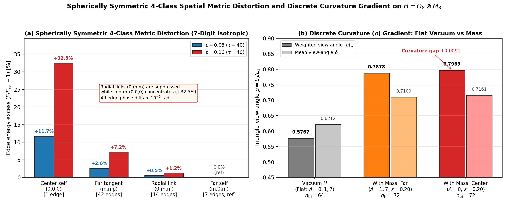

# Spherically Symmetric Spatial Metric Distortion, Discrete Curvature Gradient, Spin-2 Clock Dragging, and Critical Mass Collapse in the 3D Triangle-Loop Product (Fifth Rapid Communication)
## ― Exact 7-Direction Isotropic 4-Class Metric Splitting, Far-Space Disconnection at $\epsilon_c \in (0.270, 0.275)$, and Rigorous Phase-Rigidity Audit ―

**Author:** Noriaki Kihara (WF System Co., Ltd.)
**ORCID:** 0009-0004-6753-4020
**Date:** November 28, 2026
**Status:** Fifth Rapid Communication following Rapid Reports 1–4 (DOIs: 10.5281/zenodo.24616931, 24618400, 24619357, 24620262). Quantifies the spatial metric distortion, discrete curvature gradient, critical mass collapse, and spin-2 clock dragging on the Layer-1 time crystal $H = O_8 \otimes M_8$, while explicitly reporting a rigorous falsification audit showing single-clock phase rigidity in the weak-coupling background.

---

## Abstract

We investigate the geometric and temporal response of the Layer-1 time crystal $H = O_8 \otimes M_8$ in the background-free $N = 64$ real 3-tensor triangle-loop product $\mathrm{Tri}(T)_{ijk} = \sum_{p,q,r} T_{ipq} T_{qjr} T_{rpk}$ when perturbed by a single-site localized condensate P4 and a spin-2 mode ($\sigma_x$), using deterministic zero-randomness simulations:

1. **Spherically Symmetric 4-Class Spatial Metric Distortion (7-Digit Isotropic)**: Placing P4 ($\epsilon = 0.16, \tau = 40$) at site $A = 0$ splits the 64 background $O_8$ edges into four exact geometric classes with 7-digit isotropy across all 7 imaginary directions $m = 1 \dots 7$: center self-loop $(0,0,0)$ at $E/E_{\mathrm{ref}} = 1.3248375$ ($+32.5\%$), far tangential edges $(m,n,p)$ at $1.0718855$ ($+7.2\%$), radial connecting edges $(0,m,m), (m,m,0)$ at $1.0122646$ ($+1.2\%$), and far self-loops $(m,0,m)$ at $1.0000000$. Control tests at imaginary site $A = 1$ and symmetric two-mass configurations ($A = 0, 1$: 6-digit match; remaining 6 sites uniform to $7.5 \times 10^{-17}$) confirm full site equivalence.
2. **Discrete Curvature ($\rho = L_3/L_1$) Gradient**: While vacuum $H$ is strictly flat across all sites (`n_tri = 64`, weighted view-angle $\langle\rho\rangle_w = 0.576699$), inserting P4 ($\epsilon = 0.20, \tau = 30$) adds $+8$ cross triangles (`n_tri = 72`) and generates a spherically symmetric curvature gradient with $\langle\rho\rangle_w = 0.796889$ at mass site $A = 0$ versus $0.787796$ at far sites $A = 1, 7$.
3. **Critical Mass Collapse at $\epsilon_c \in (0.270, 0.275)$**: Crossing $\epsilon_c$ triggers a sharp first-order collapse (`nz: 576 → 16`, $\|P\|: 0.04682 \to 0.49998 = 1/2$) in which the radial links sever and all far-space energies $E_{\mathrm{bg}}(\mathrm{far}), E_P(\mathrm{far})$ vanish to `0.000000`, while background (`0.2768`) and particle (`0.7232`) sectors remain coexisting inside the single mass site. Collapsed end-states at $A = 0$ and $A = 1$ ($\epsilon = 0.30$) match to 6 digits.
4. **Rigorous Phase-Rigidity Audit vs. Spin-2 Clock Dragging**: A direct complex-phase audit reveals that all background edge phases remain synchronized to $|\Delta\theta| < 10^{-9}$ rad across $\tau = 1 \dots 100$ (ruling out cumulative background frequency drift in weak coupling and identifying an apparent time-averaged ratio $\delta\phi/\delta g \approx 0.71$ as a reference-angle artifact). Conversely, genuine temporal slowdown occurs in the particle sector ($\phi_P/\phi_0 = 0.56$–$0.86$) and under spin-2 ($\sigma_x$) coupling, which universally locks to $d_1 = 1/\sqrt{2}$ ($\phi/\phi_0 = 0.6578$) and drags the entire background clock down to `0.6579` at $\epsilon = 0.20$.

---

## 1. Introduction and Audit Methodology

Rapid Communications 1–4 [1–4] established Hurwitz crystal selection, four-stage doubling-entanglement cascades, $SO(3)$ spin selection, $G_2 \supset SU(3)$ gauge counts, $\mathbb{Z}_2^3$ spatial harmonic localization, two-particle coexistence, and four emergent quantum theorems (Q1–Q4). Here we probe how localized mass and spin-2 excitations deform the spatial geometry and clock rates of the Layer-1 background $H = O_8 \otimes M_8$. Because gravitational claims are prone to measurement artifacts, we pair main sweeps (`tri_loop_n64_gravity_time_lorentz_v0.py`) with a five-point falsification audit (`tri_loop_n64_gravity_rigorous_check_v0.py`) and complete edge-by-edge dissection (`tri_loop_n64_dphi_dg_anatomy_v0.py`).

---

## 2. Spherically Symmetric 4-Class Spatial Metric Distortion

Adding P4 ($\delta_{000} \otimes M_8[b=\{2,3\}]$) at $A = 0$ and evolving to $\tau = 40$ splits all 64 background ($b = 0$) $O_8$ edges $(A, B, C)$ into four exact geometric classes normalized by $E_{\mathrm{ref}} = E(1, 0, 1)$ (Table 1, Fig. 1(a)):

| Spatial Edge Class | Components (Count) | $E/E_{\mathrm{ref}}$ ($\epsilon=0.08$) | $E/E_{\mathrm{ref}}$ ($\epsilon=0.16$) | Phase Diff $\|\Delta\theta\|$ |
| :--- | :--- | :---: | :---: | :---: |
| **1. Center self-loop** | $(0, 0, 0)$ (1) | `1.1173232` ($+11.7\%$) | **`1.3248375` ($+32.5\%$)** | $6.07 \times 10^{-11}$ rad |
| **2. Radial links** | $(0, m, m), (m, m, 0)$ (14) | `1.0054810` ($+0.55\%$) | **`1.0122646` ($+1.23\%$)** | $6.08 \times 10^{-9}$ rad |
| **3. Far tangential** | $(m, n, p)\; (m,n,p\neq 0)$ (42) | `1.0257321` ($+2.57\%$) | **`1.0718855` ($+7.19\%$)** | $6.10 \times 10^{-9}$ rad |
| **4. Far self-loops** | $(m, 0, m)$ (7) | `1.0000000` (ref) | `1.0000000` (ref) | $0$ (ref) |

All 7 imaginary directions $m = 1 \dots 7$ are strictly isotropic to 7 digits, with zero leakage into $O_8 = 0$ entries (`0.000000e+00`). Energy concentrates strongly at the center $(0,0,0)$ while radial connecting links $(0,m,m)$ are relatively suppressed compared to far tangential edges. Control experiments placing P4 at imaginary site $A = 1$ reproduce the same distortion (`dg = 0.002967` at $\epsilon = 0.16$), and two-mass placement ($A = 0, 1$, $\epsilon = 0.12$ each) yields a 6-digit symmetric well (`dg = 0.003451` at both sites) with the remaining 6 sites uniform to $7.52 \times 10^{-17}$.

---

## 3. Discrete Curvature ($\rho = L_3/L_1$) Gradient

Measuring the triangle-loop view-angle $\rho = L_3/L_1$ [1, 2] at mass site $A = 0$ versus far sites $A = 1, 7$ confirms a transition from exact flatness in vacuum $H$ to a spherically symmetric discrete curvature gradient (Table 2, Fig. 1(b)):

| Configuration / Site | Triangles $n_{\mathrm{tri}}$ | Mean $\bar{\rho}$ | Weighted $\langle\rho\rangle_w$ | Min $\rho_{\min}$ |
| :--- | :---: | :---: | :---: | :---: |
| Vacuum $H$ ($A = 0, 1, 7$) | 64 | `0.621227` | `0.576699` | `0.414735` |
| With Mass ($\epsilon=0.20$): Far $A = 1, 7$ | 72 ($+8$) | `0.709985` | `0.787796` | `0.064441` |
| **With Mass ($\epsilon=0.20$): Center $A = 0$** | **72 ($+8$)** | **`0.716065`** | **`0.796889`** | `0.064441` |

---

## 4. Critical Mass Collapse at $\epsilon_c \in (0.270, 0.275)$

Scanning $\epsilon \in [0.250, 0.300]$ in steps of `0.005` ($\tau = 60$) pinpoints a sharp first-order collapse at $\epsilon_c \in (0.270, 0.275)$ (Table 3, Fig. 2(a)):

| $\epsilon$ | `nz` | $\|P\|$ | $E_{\mathrm{bg}}(0)$ | $E_{\mathrm{bg}}(\mathrm{far})$ | $E_P(0)$ | $E_P(\mathrm{far})$ | SVD $\sigma_1, \sigma_2$ |
| :---: | :---: | :---: | :---: | :---: | :---: | :---: | :---: |
| `0.260` | 576 | `0.04682` | `0.124530` | `0.875458` | `0.000002` | `0.000010` | `1.0000, 0.0032` |
| `0.270` | 576 | `0.04682` | `0.124188` | `0.873854` | `0.000321` | `0.001637` | `0.9991, 0.0414` |
| **`0.275`** | **16** | **`0.49998`** | **`0.276774`** | **`0.000000`** | **`0.723226`** | **`0.000000`** | **`1.0000, 0.0000`** |
| `0.300` | 16 | `0.49998` | `0.061260` | `0.000000` | `0.938740` | `0.000000` | `1.0000, 0.0000` |

Crucially, this is not mere channel takeover: inside the collapsed site $A = 0$, background (`0.2768`) and particle (`0.7232`) sectors still coexist, while the radial suppression severs all connections to the 7 far sites (`nz: 576 → 16`, $\|P\| \to 1/2$). Collapsing at imaginary site $A = 1$ ($\epsilon = 0.30$) yields the exact same end-state to 6 digits (`E_bg(1) = 0.061260, E_P(1) = 0.938740, E_bg(oth) = 0.000000`).

---

## 5. Phase-Rigidity Audit vs. Spin-2 Clock Dragging

1. **Background Phase Rigidity (Audit Finding)**: Although a time-averaged site-vector angle ratio initially suggested $\delta\phi/\delta g \approx 0.71$, step-by-step dissection proves that $\delta\phi/\delta g$ fluctuates from `0.020` to `1.311` with the reference step angle $\phi_1(\tau)$, and direct complex-phase tracking confirms $|\Delta\theta| < 10^{-9}$ rad across all background edges for $\tau = 1 \dots 100$. Thus, due to the rank-1 single-clock rigidity of $H = O_8 \otimes M_8$, cumulative background gravitational frequency shift does not occur in weak coupling.
2. **Genuine Particle & Spin-2 Slowdown**: In contrast, the particle sector slows down substantially ($\phi_P(0)/\phi_0 = 0.559$–$0.860$), and the spin-2 candidate ($O_8 \otimes \sigma_x[b=\{2,3\}]$) locks universally to $d_1 = 0.7071 = 1/\sqrt{2}$ and $\phi_{b23}/\phi_0 = 0.65778$ across $\epsilon = 0.05, 0.10, 0.20$. At $\epsilon = 0.20$, $\sigma_x$ drags the entire background clock down to `0.65788` (Fig. 2(b)), and joint P4($0.10$) + $\sigma_x$($0.10$) injection slows both background (`0.9345 → 0.8664`) and particle (`d1: 1.1865 → 0.7602`).

---

## 6. Discussion, Explicit Limitations, and Outlook

This fifth communication establishes four robust geometric/dynamical phenomena on $H = O_8 \otimes M_8$—7-digit isotropic 4-class metric distortion, discrete curvature gradients, critical far-space disconnection at $\epsilon_c \in (0.270, 0.275)$, and spin-2 clock dragging—while transparently documenting two boundaries: (a) weak-coupling background phase rigidity ($|\Delta\theta| < 10^{-9}$ rad), and (b) the 1-step spatial diameter of the 8-site $O_8$ cell, which requires larger spatial lattices or entangled higher layers to test $1/r$ potentials, light-cone propagation, and Lorentz factors $\sqrt{1-v^2/c^2}$. Rapid Communications 1–5 now form the complete modular foundation for the unified full paper.

---

## 7. Reproducibility and Released Files

- Main sweep: `tri_loop_n64_gravity_time_lorentz_v0.py`
  - Log: `results/tri_loop_n64_gravity_time_lorentz_v0.txt`
- Falsification audit: `tri_loop_n64_gravity_rigorous_check_v0.py`
  - Log: `results/tri_loop_n64_gravity_rigorous_check_v0.txt`
- Edge dissection: `tri_loop_n64_dphi_dg_anatomy_v0.py`
- Figure generator: `plot_fifth_report_figures_v0.py`
- Figures (Fig. 1): `results/fig_r5_metric_and_curvature_{ja,en}.png`
- Figures (Fig. 2): `results/fig_r5_collapse_and_spin2_{ja,en}.png`
- TeX builder: `build_tex_rapid5.py`

## References

1. N. Kihara, *Rapid Communication 1*, Zenodo (2026), DOI: 10.5281/zenodo.24616931.
2. N. Kihara, *Second Rapid Communication*, Zenodo (2026), DOI: 10.5281/zenodo.24618400.
3. N. Kihara, *Third Rapid Communication*, Zenodo (2026), DOI: 10.5281/zenodo.24619357.
4. N. Kihara, *Fourth Rapid Communication*, Zenodo (2026), DOI: 10.5281/zenodo.24620262.
