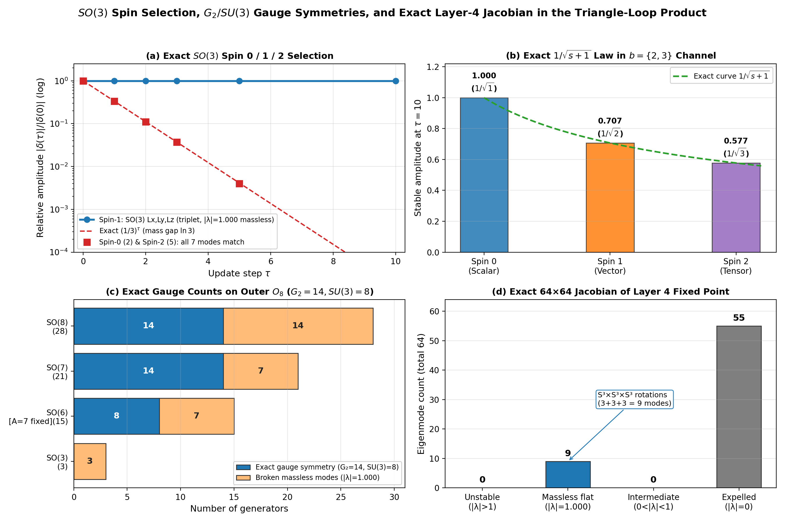
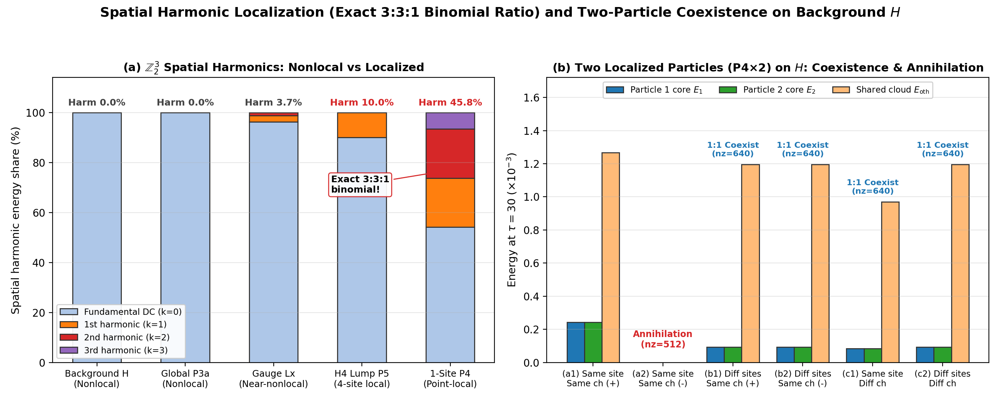

# SO(3) Spin Selection, G2/SU(3) Gauge Symmetries, Spatial Harmonic Localization, and Two-Particle Coexistence in the 3D Triangle-Loop Product (Third Rapid Communication)
## ― Exact Massless/Gapped Split (1 vs 1/3), Discrete 1/√(s+1) Law, 3:3:1 Spatial Harmonic Binomial Ratio, and Coexistence Beyond Winner-Take-All ―

**Author:** Noriaki Kihara (WF System Co., Ltd.)
**ORCID:** 0009-0004-6753-4020
**Date:** November 28, 2026
**Version DOI:** 10.5281/zenodo.24619357
**Previous Rapid Communications:** Zenodo Concept DOI `10.5281/zenodo.24614040` (1st) / `10.5281/zenodo.24618399` (2nd)
**Repository (all scripts, raw data, figures):** https://github.com/WurabeSeiji/ai-chat-logs-open/tree/main/%E6%AC%A1%E5%85%83%E3%81%AE%E7%94%9F%E6%88%90%E6%A7%8B%E9%80%A0/%E4%B8%89%E6%AC%A1%E5%85%83%E6%AD%A3%E6%96%B9%E9%85%8D%E5%88%97%E3%81%AE%E7%A9%8D%E3%81%A8%E8%87%AA%E5%B7%B1%E7%84%A1%E6%92%9E%E7%9D%80_20261127

---

## Abstract

Building on our first and second rapid communications on the background-free **triangle-loop product** $\mathrm{Tri}(T)_{ijk} = \sum_{p,q,r} T_{ipq} T_{qjr} T_{rpk}$ on $N = 64$ ($O_8 \otimes O_8$), we test without adding any new rules whether **spin (spatial rotation representations), exact gauge symmetry counts, harmonic localization, and multi-particle coexistence** can be read out directly from the emergent states. Four exact results are established (zero randomness, full code open):

1. **Exact $SO(3)$ Spin 0 / 1 / 2 Selection (`1` vs `(1/3)^τ`) & Discrete $1/\sqrt{s+1}$ Law**: Testing irreducible $SO(3)$ excitations on the quaternionic 3D subspace $\{1, 2, 3\}$ of the outer $O_8$ skeleton in Layer 1 ($H = O_8 \otimes M_8$), all three **spin-1 antisymmetric rotation modes ($L_x, L_y, L_z$) remain strictly massless ($|\lambda| = 1.000$)**, whereas all seven symmetric modes (**spin-0 isotropic scalings and the 5-component spin-2 metric deformations**) decay exponentially with the exact rational rate **$(1/3)^\tau$ (mass gap $\ln 3$)**. Furthermore, spin $s = 0, 1, 2$ probes placed in the $i, k$-shared channel $b = \{2, 3\}$ settle into exact stable amplitudes **$1/\sqrt{s+1}$** (`1.000`, `0.707`, `0.577`).
2. **Exact Gauge Counts ($G_2 = 14$, $SU(3) = 8$) & Exact 64×64 Layer-4 Jacobian**: Exact SVD kernel counts of rotation generators on outer $O_8$ yield **14 exact gauge symmetries ($G_2$)** inside $SO(8)$ (28) and $SO(7)$ (21), and **8 exact gauge symmetries ($SU(3)$, matching the 8 gluons)** inside $SO(6)$ (15) with one imaginary axis ($A=7$) fixed. For the Layer-4 static fixed point (Case 1, $\tau = 1,000$), full diagonalization of the 64×64 Jacobian yields `0` unstable, **exactly `9` massless flat modes ($|\lambda| = 1.000000$, $S^3\times S^3\times S^3$)**, `0` intermediate, and **`55` immediately expelled modes ($|\lambda| = 0$)**.
3. **Spatial Harmonic Separation of Nonlocal Gauge Waves vs. Localized Condensates**: Applying the exact Walsh–Hadamard transform on outer $O_8 \cong \mathbb{Z}_2^3$ (harmonic orders $k = 0, 1, 2, 3$) reveals that nonlocal states ($H$, global wave P3a) have **`0.00%`** spatial harmonics (100% DC) and the spin-1 gauge wave ($L_x$) has only `3.66%`, whereas the 4-site quaternion lump + cloud (P5) activates strictly the 1st harmonic at **`10.00%` (exact 9:1)**, and the 1-site point-localized lump + cloud (P4) excites all orders $k = 1, 2, 3$ in the **exact binomial ratio `3 : 3 : 1` ($\binom{3}{1}:\binom{3}{2}:\binom{3}{3}$)** totaling **`45.85%`** spatial harmonic energy.
4. **Two-Particle Coexistence Beyond Winner-Take-All**: Whereas independent octonion blocks suffered winner-take-all collapse, placing two localized 1-site condensates (P4) on background $H$ yields **exact 1:1 coexistence (`nz = 640`, $E_1 = E_2 = 0.000094$)** across distinct sites $A = 0, 1$ (both in-phase and anti-phase) and across distinct channels ($b=\{2,3\}, \{6,7\}$), while opposite-phase overlap on the same site and channel cleanly annihilates (`nz = 512`, $E_1 = E_2 = 0$).

---

## 1. Introduction

Without adding any external fields, coordinates, or parameters to the self-updating map
$$P_{ijk} = \mathrm{Tri}(U)_{ijk} = \sum_{p,q,r=0}^{N-1} U_{ipq}\, U_{qjr}\, U_{rpk}, \qquad U^{(\tau+1)} = \frac{\mathrm{Tri}(U^{(\tau)})}{\|\mathrm{Tri}(U^{(\tau)})\|_F},$$
we investigate four structural signatures directly on the emergent Layer-1 ($H = O_8 \otimes M_8$) and Layer-4 ($\tau = 1,000$) states: $SO(3)$ spin selection, $G_2/SU(3)$ gauge dimension counts, $\mathbb{Z}_2^3$ spatial harmonic localization, and two-particle coexistence.

---

## 2. $SO(3)$ Spin Selection, $G_2/SU(3)$ Gauge Counts, and Layer-4 Jacobian

### 2.1 Exact $SO(3)$ Spin 0 / 1 / 2 Selection (`1` vs `(1/3)^τ`) [Verified]

On the quaternionic 3D subspace $\{1, 2, 3\}$ of outer $O_8$ in $H = O_8 \otimes M_8$ (`tri_loop_n64_spin_gauge_higgs_v0.py`, Fig. 1a):

| Spin (Rep) | Excitation Mode ($\epsilon = 10^{-5}$) | Response $\tau = 1 \to 2 \to 3 \to 5 \to 10$ | Regime |
|---|---|---|---|
| **Spin-1** (triplet, antisym.) | $SO(3)$ generators $L_x, L_y, L_z$ (all 3) | **`1.000 → 1.000 → 1.000 → 1.000 → 1.000`** | Exact massless ($|\lambda|=1$) |
| **Spin-0** (singlet, sym.) | 3D isotropic scalings (2 modes) | **`0.333 → 0.111 → 0.037 → 0.004 → 0.000`** | Exact $(1/3)^\tau$ (gap $\ln 3$) |
| **Spin-2** (quintet, sym.) | 3D metric deformations $h_{xx}-h_{yy}, h_{xy}$, etc. (all 5) | **`0.333 → 0.111 → 0.037 → 0.004 → 0.000`** | Exact $(1/3)^\tau$ (gap $\ln 3$) |

In the $i,k$-shared $b=\{2,3\}$ channel, spin $s = 0, 1, 2$ probes settle at $\tau = 10$ to `1.000`, `0.707`, and `0.577` — matching **$1/\sqrt{s+1}$** exactly (Fig. 1b).

### 2.2 Exact $G_2$ (14) / $SU(3)$ (8) Gauge Counts & Layer-4 64×64 Jacobian [Verified]

SVD kernel counts of outer $O_8$ rotation generators (`tri_loop_n64_g2_and_twoparticle_v0.py`, Fig. 1c):
- **$SO(8)$ (28)**: `14` exact gauge ($G_2$) + `14` broken massless ($|\lambda|=1$).
- **$SO(7)$ (imaginary 7D, 21)**: `14` exact gauge ($G_2$) + `7` broken massless (all 7 verified $|\lambda| = 1.000000$).
- **$SO(6)$ ($A=7$ fixed, 15)**: **`8` exact gauge ($SU(3)$)** + `7` broken massless.

Full 64×64 Jacobian diagonalization of the Layer-4 static fixed point ($\tau = 1,000$, Fig. 1d) yields **`0` unstable, `9` exact massless flat ($|\lambda|=1.000000$, $3+3+3$ rotations on $S^3\times S^3\times S^3$), `0` intermediate, and `55` expelled ($|\lambda|=0$)** modes.

---

## 3. Spatial Harmonic Localization and Two-Particle Coexistence

### 3.1 $\mathbb{Z}_2^3$ Spatial Harmonics (Walsh–Hadamard Transform) [Verified]

Evaluating the 1-axis energy distribution $E(A)$ on outer $O_8 \cong \mathbb{Z}_2^3$ at $\tau = 30$ (`tri_loop_n64_harmonic_localization_v0.py`, Fig. 2a):

| State | Localization | DC ($k=0$) | $k=1$ | $k=2$ | $k=3$ | Total Harmonics ($k \ge 1$) |
|---|---|---|---|---|---|---|
| **Background $H$ / Global P3a** | Nonlocal | **`1.0000`** | `0.0000` | `0.0000` | `0.0000` | **`0.00%`** |
| **Spin-1 Gauge Wave ($L_x$)** | Near-nonlocal | **`0.9634`** | `0.0244` | `0.0122` | `0.0000` | **`3.66%`** |
| **Local $H_4$ Lump + Cloud (P5)** | 4-site local | **`0.9000`** | **`0.1000`** | `0.0000` | `0.0000` | **`10.00%`** (exact 9:1) |
| **Local 1-Site Lump + Cloud (P4)** | Point-local | **`0.5415`** | **`0.1965`** | **`0.1965`** | **`0.0655`** | **`45.85%`** (exact 3:3:1) |

By contrast, 256-step temporal FFTs along $\tau$ remain uniformly broadband ($H_\tau \approx 4.35\text{--}4.47$) across all five cases, proving that **spatial harmonics on $\mathbb{Z}_2^3$ are the decisive signature separating nonlocal gauge waves from localized lumps**.

### 3.2 Two-Particle Coexistence & Annihilation on Background $H$ [Verified]

Placing two localized 1-site lumps (P4, $\epsilon = 0.08$) on $H$ for 30 steps (`tri_loop_n64_g2_and_twoparticle_v0.py`, Fig. 2b):
- **Distinct sites $A = 0, 1$, same channel (both in-phase and anti-phase)**: `nz = 640`, **$E_1 = E_2 = 0.000094$** (exact 1:1 coexistence with shared cloud $E_{\mathrm{oth}} = 0.001196$).
- **Distinct channels ($b=\{2,3\}$ and $\{6,7\}$, same or distinct sites)**: `nz = 640`, **$E_1 = E_2 = 0.000084$ (same site) / $0.000094$ (distinct sites)**.
- **Same site, same channel, anti-phase (-)**: `nz = 512`, $E_1 = E_2 = 0$ (complete annihilation).

---

## 4. Working Hypotheses & Reproducibility

As working physical analogies, antisymmetric spin-1 modes ($|\lambda|=1$) and $G_2/SU(3)$ gauge counts correspond to massless gauge bosons (photon / 8 gluons), symmetric spin-0 scaling ($(1/3)^\tau$, gap $\ln 3$) to massive Higgs-like excitations, and coexisting 3:3:1 harmonic-rich lumps to localized matter particles. Fermionic anticommutation and quantitative Standard Model constants remain open problems.

Reproducible deterministically with zero randomness via:
1. `tri_loop_n64_spin_gauge_higgs_v0.py`
2. `tri_loop_n64_harmonic_localization_v0.py`
3. `tri_loop_n64_g2_and_twoparticle_v0.py`
4. `plot_third_report_figures_v0.py`
