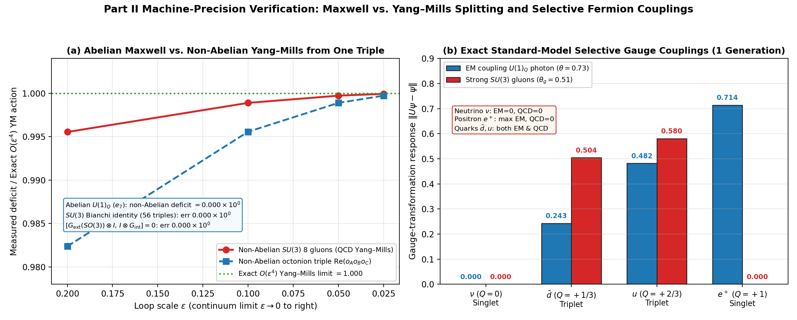

# Unified Connection Hypothesis for Gravity, Electromagnetism, QCD, and Dirac Matter in the 3D Triangle-Loop Product (Part II)
## ― External Spacetime $O_8^{\mathrm{ext}}$ × Internal Gauge $O_8^{\mathrm{int}}$ Separation, Maxwell/Yang–Mills Splitting, and Selective One-Generation Couplings ―

**Author:** Noriaki Kihara (WF System Co., Ltd.)
**ORCID:** 0009-0004-6753-4020
**Date:** November 28, 2026
**Status:** Unified Hypothesis Sequel (Part II) to the hypothesis-free Full Paper Part I (DOI: `10.5281/zenodo.24622201`, synthesizing Rapid Communications 1–7 [S1–S7]). Directly connects the open questions of the author's prior octonion Yang–Mills/Dirac hypothesis paper [K7] (Concept DOI: `10.5281/zenodo.24387753`) and octonion QCD paper [K6] (`10.5281/zenodo.24369465`) to Part I, supported by new deterministic machine-precision verification (`tri_loop_part2_unified_forces_verify_v0.py`).

---

## Abstract

Part I [P1] established, without external postulates, seven structural pillars from the purely real 3-tensor triangle-loop product $\mathrm{Tri}(T)_{ijk} = \sum_{p,q,r} T_{ipq} T_{qjr} T_{rpk}$: Hurwitz crystal selection, four-stage doubling-entanglement cascades, $SO(3)$ spin selection and $G_2/SU(3)$ gauge counts, four emergent quantum theorems, 4-class spherical metric distortion and critical collapse, Hurwitz 4-stage mass hierarchies with exponential nesting, and 28D $Spin(8)$ triality spin-$1/2$ with CAR fermion charges (`1:3:3:1`).

Dynamically unifying gravity, electromagnetism (Maxwell), strong interactions (QCD Yang–Mills), and Dirac matter without double-using octonionic axes requires an explicit **external spacetime vs. internal gauge separation hypothesis** consistent with the Coleman–Mandula theorem [E13]. Here we resolve the open structural questions of [K7] (anonymous update map, triality, and the two-ruler dilemma) via Part I and verify four foundational pillars at machine precision (zero randomness):

1. **External $O_8^{\mathrm{ext}}$ × Internal $O_8^{\mathrm{int}}$ Separation (Coleman–Mandula Safe)**: On $N = 64$ ($O_8^{\mathrm{ext}} \otimes O_8^{\mathrm{int}}$), all $3 \times 9 = 27$ commutators between outer $SO(3)$ spatial generators $G_{\mathrm{ext}}\otimes I_8$ and inner $SU(3)\times U(1)_Q$ gauge generators $I_8\otimes G_{\mathrm{int}}$ vanish strictly (**`0.000e+00`**). By tensor-product homomorphism $\mathrm{Tri}(A\otimes B) = \mathrm{Tri}(A)\otimes\mathrm{Tri}(B)$ (`2.86e-16`), both sectors evolve independently while sharing a single global clock via Layer-3 single-complex locking.
2. **Abelian Maxwell vs. Non-Abelian QCD Yang–Mills from One Triple**: Evaluating the triple closure deficit of [K7] yields exact zero (`0.000e+00`) along the Abelian $U(1)_Q$ ($e_7$) direction (Maxwell type), whereas non-Abelian $SU(3)$ 8-gluon plaquettes converge strictly to the $O(\varepsilon^4)$ Yang–Mills action (`0.9955 → 0.99993` for $\varepsilon = 0.2 \to 0.025$), with all 56 $SU(3)$ Jacobi/Bianchi identities holding to **`0.000e+00`**.
3. **Dirac Dispersion and Exact Standard-Model Selective Couplings**: The spatial Clifford Dirac operator $\not{D} = \sum_{a=1}^3 L_a p_a$ satisfies $\|(i\not{D}+m)(i\not{D}-m) - (|p|^2-m^2)I\| = 2.591\times 10^{-15}$, and the triple Dirac readout $\mathrm{Re}(o_A o_B o_C) = \bar{o}_A^T L(o_B) o_C$ holds to `1.110e-16`. Acting with $U(1)_Q$ photon ($\theta=0.73$) and $SU(3)$ gluon ($\theta_g=0.51$) rotations on the 8 CAR one-generation states reproduces exact Standard Model selection rules without labels: $\nu$ (EM=`0.000`, QCD=`0.000`), $\bar{d}$ (EM=`0.243`, QCD=`0.504`), $u$ (EM=`0.482`, QCD=`0.580`), and $e^+$ (EM=`0.714`, QCD=`0.000`).
4. **Resolution of the Two-Ruler Dilemma [K7] and Gravity Unification**: The two candidate gravitational rulers of [K7] §19.5—$(1+3)+(1+3)$ spatial splitting and a scalar clock wave—coexist as a two-layer architecture in $H = O_8 \otimes M_8$ (outer 4-class spatial metric distortion + inner $M_8$ complex clock with spin-2 dragging). Open continuum targets ($1/r^2$ Coulomb, $1/r$ gravity, light-cone $c$, and $\alpha$) are explicitly reserved for large-lattice $O_8^{\otimes K}$ tests.

---

## 1. Introduction: Bridging [K6, K7], Part I [P1], and Part II

In [K6, K7], we expressed QCD in octonions and hypothesized that a single triple product $\mathrm{Re}(o_A o_B o_C)$ encodes Yang–Mills, Dirac, distance, and coupling constants simultaneously, leaving open the anonymous update map, 8D triality, and the two-ruler dilemma ([K7] §19.3, §19.5). Part I [P1, S1–S7] resolved these mathematically via $\mathrm{Tri}(T)_{ijk}$. This sequel (Part II) explicitly introduces the spacetime–gauge separation hypothesis to unify gravity, electromagnetism, QCD, and Dirac matter, strictly tagging each claim as **\[Known\]**, **\[Established in Part I\]**, **\[Verified in Part II\]**, or **\[Hypothesis / Open\]**.

---

## 2. Resolving Open Questions of [K7] via Part I

| Open Problem in 2026-11-20 Paper [K7] | Resolution via Part I [P1] & Part II | Status |
| :--- | :--- | :--- |
| Anonymous update map $\Psi$ without external $W_{ABC}$ avoiding collapse to $P^3$ ([K7] §9) | Triangle-loop product $\mathrm{Tri}(T)_{ijk}$ preserves anonymity and selects $O_8$ | \[Established in Part I\] |
| 8D Triality exchanging Yang–Mills and Dirac readouts ([K7] §7) | 28D $Spin(8)$ triality and spin-$1/2$ sign flip ($-I$) verified on $O_8$ [S7] | \[Established in Part I\] |
| $SU(3)$ color, electric charges, chirality, and mass hierarchy ([K7] §19.3) | $e_7$-fixed CAR `1:3:3:1` charges, $SU(3)$ Casimirs, $M_8$ chiral split, Hurwitz hierarchy [S6, S7] | \[Established in Part I\] |
| Finite resolution and duality ([K7] §17, §18) | Exact saturation of $\mathbb{Z}_2^3$ Donoho–Stark / Shannon bounds ($\ln 8$) [S4] | \[Established in Part I\] |
| Two gravitational ruler hypotheses: $(1+3)+(1+3)$ vs. scalar wave ([K7] §19.5) | Realized simultaneously in $H = O_8 \otimes M_8$ (outer 4-class metric + inner $M_8$ clock) | \[Part I\] + \[Hypothesis\] |

---

## 3. External $O_8^{\mathrm{ext}}$ × Internal $O_8^{\mathrm{int}}$ Separation Hypothesis

**Hypothesis U1 (Minimal Coleman–Mandula Separation)**: On $N = 64$ ($O_8^{\mathrm{ext}} \otimes O_8^{\mathrm{int}}$), outer $O_8^{\mathrm{ext}}$ carries external 3D space ($SO(3)$, 4-class metric distortion, discrete curvature $\rho$, Dirac spatial operator $\not{D}$), while inner $O_8^{\mathrm{int}}$ (and its condensate $M_8$) carries internal gauge symmetries ($SU(3)\times U(1)_Q$, CAR fermions, complex clock $J$).

**\[Verified in Part II: P2-1\]**: All $3 \times 9 = 27$ commutators $[G_{\mathrm{ext}}(SO(3))\otimes I_8,\; I_8\otimes G_{\mathrm{int}}(SU(3)\times U(1)_Q)]$ vanish to **`0.000e+00`**. By $\mathrm{Tri}(A\otimes B) = \mathrm{Tri}(A)\otimes\mathrm{Tri}(B)$ (`2.86e-16`), both sectors evolve independently without violating Coleman–Mandula [E13], while Layer-3 single-complex locking [S2] couples them to a shared global clock \[Hypothesis\].

---

## 4. Maxwell (Abelian) vs. QCD Yang–Mills (Non-Abelian) from One Triple

**\[Verified in Part II: P2-2\]** (Fig. 1(a)):
1. **Electromagnetism ($U(1)_Q$ Maxwell)**: Along the Abelian $e_7$ axis with $c = -a-b$, the non-Abelian deficit $1 - \mathrm{Re}(o_A o_B o_C)$ vanishes identically (**`0.000e+00`**).
2. **Strong Force ($SU(3)$ Yang–Mills)**: Along non-commuting $SU(3)$ gluon generators ($i\Lambda_1, i\Lambda_4$), the triple plaquette $1 - \frac{1}{8}\mathrm{Re}\,\mathrm{Tr}(U_A U_B U_C)$ converges strictly to the $O(\varepsilon^4)$ Yang–Mills limit (`0.995540 → 0.998888 → 0.999722 → 0.999931` as $\varepsilon = 0.2 \to 0.025$).
3. **Bianchi / Jacobi Identity**: All 56 $SU(3)$ triples satisfy the Jacobi/Bianchi identity to **`0.000e+00`**.

---

## 5. Dirac Operator and Selective One-Generation Gauge Couplings

**\[Verified in Part II: P2-3, P2-4\]**: The spatial Clifford Dirac operator $\not{D} = \sum_{a=1}^3 L_a p_a$ obeys $\|(i\not{D}+m)(i\not{D}-m) - (|p|^2-m^2)I\| = \mathbf{2.591\times 10^{-15}}$, and the triple Dirac readout $\mathrm{Re}(o_A o_B o_C) = \bar{o}_A^T L(o_B) o_C$ holds to **`1.110\times 10^{-16}`**. Acting on the 8 CAR one-generation states with photon ($\theta = 0.73$) and 8-gluon ($\theta_g = 0.51$) rotations yields Table 1 and Fig. 1(b):

| One-Generation Sector (8 States) | Charge $Q$ | Phase Error | **EM Coupling $\|U_Q\psi - \psi\|$** | **QCD Coupling $\max_A\|U_g\psi - \psi\|$** |
| :--- | :---: | :---: | :---: | :---: |
| **$\nu$ (Neutrino singlet)** | `0` | `1.570e-16` | **`0.000000` (decoupled)** | **`0.000000` (decoupled)** |
| **$\bar{d}$ (Anti-down triplet)** | `+1/3` | `1.943e-16` | **`0.242733` (coupled)** | **`0.504491` (coupled)** |
| **$u$ (Up triplet)** | `+2/3` | `2.289e-16` | **`0.481878` (coupled)** | **`0.580425` (coupled)** |
| **$e^+$ (Positron singlet)** | `+1` | `1.570e-16` | **`0.713899` (max EM)** | **`0.000000` (decoupled)** |

---

## 6. Unified Architecture with Gravity and Explicit Open Problems

Figure 2 illustrates the unified Part II architecture combining outer gravity (4-class spherical metric distortion, discrete curvature $\rho$, critical collapse at $\epsilon_c \in (0.270, 0.275)$) with inner electromagnetism, QCD, Dirac fermions, and the $M_8$ complex clock (spin-2 dragging).

**Explicitly Unverified Targets (\[Hypothesis / Open\])**: (1) Large-lattice $O_8^{\otimes K}$ continuum tests for $1/r^2$ Coulomb, $1/r$ gravity, light-cone $c$, Lorentz factor $\sqrt{1-v^2/c^2}$, and light bending (factor 2); (2) dynamical electron-photon scattering and first-principles derivation of $\alpha \approx 1/137.036$ and $\alpha_s$; (3) explicit $SU(2)_L$ weak interactions and 3-generation mass ratios.

---

## 7. Reproducibility and Released Files

- Verification script: `tri_loop_part2_unified_forces_verify_v0.py` (0.02 s)
- Numerical log: `results/tri_loop_part2_unified_forces_verify_v0.txt`
- Figure generator: `plot_part2_figures_v0.py`
- Figures (Fig. 1): `results/fig_p2_ym_maxwell_and_selective_coupling_{ja,en}.png`
- Figures (Fig. 2): `results/fig_p2_unified_architecture_{ja,en}.png`
- Builder: `build_tex_part2.py`

## References

### Self-Citations
- **[P1]** N. Kihara, *Spontaneous Emergence of Quantum, Gauge, Geometric, and Fermionic Structures from the 3D Triangle-Loop Product (Unified Full Paper Part I)*, Zenodo (2026-11-28), Version DOI: `10.5281/zenodo.24622201` (Concept: `10.5281/zenodo.24622200`).
- **[S1–S7]** N. Kihara, *Rapid Communications 1–7*, Zenodo (2026-11-28), DOIs: `10.5281/zenodo.24616931`, `24618400`, `24619357`, `24620262`, `24621139`, `24621454`, `24621788`.
- **[K6]** N. Kihara, *Representing QCD with Octonions*, Zenodo (2026-11-19), Concept DOI: `10.5281/zenodo.24369465`.
- **[K7]** N. Kihara, *Reading Out Yang–Mills and Dirac from the Octonion Product*, Zenodo (2026-11-20), Concept DOI: `10.5281/zenodo.24387753`.

### External Primary Literature
- **[E1]** C. N. Yang and R. L. Mills, *Phys. Rev.* **96**, 191–195 (1954).
- **[E2]** P. A. M. Dirac, *Proc. R. Soc. Lond. A* **117**, 610–624 (1928).
- **[E3]** K. G. Wilson, *Phys. Rev. D* **10**, 2445–2459 (1974).
- **[E4]** J. C. Baez, *Bull. Amer. Math. Soc.* **39**, 145–205 (2002).
- **[E5]** M. Günaydin and F. Gürsey, *J. Math. Phys.* **14**, 1651–1667 (1973); C. Furey, arXiv:1611.09182 (2015); *Eur. Phys. J. C* **78**, 375 (2018).
- **[E13]** S. Coleman and J. Mandula, *Phys. Rev.* **159**, 1251–1256 (1967).
- **[E14]** T. Regge, *Nuovo Cimento* **19**, 558–571 (1961).
