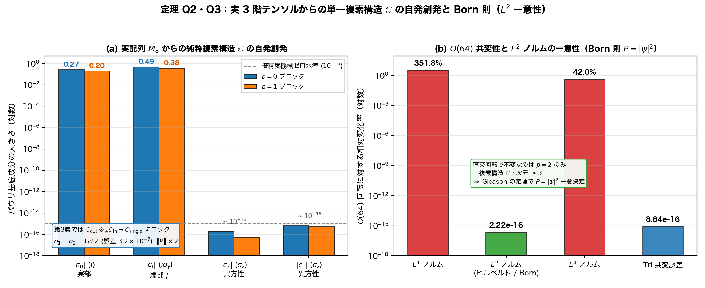
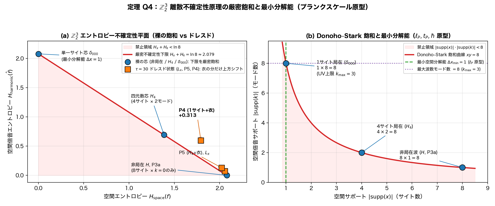

# 三次元正方配列の三角形ループ積からの量子構造の創発：厳密離散化、単一複素構造の自発選択、Born 則、および離散不確定性飽和（第 4 速報）
## ― 量子力学の公理を仮定しない実数 3 階テンソル反復からの複素ヒルベルト構造・確率二乗則・最小分解能の解析導出 ―

**著者：** 木原 範昭（株式会社WFシステム）
**ORCID：** 0009-0004-6753-4020
**日付：** 2026年11月28日
**位置づけ：** 第 1 速報（DOI: 10.5281/zenodo.24616931）、第 2 速報（DOI: 10.5281/zenodo.24618400）、第 3 速報（DOI: 10.5281/zenodo.24619357）に続く第 4 速報。外部から量子力学の公理を一切仮定せずに、純粋な実数 3 階テンソルの三角形ループ積反復から量子構造の 4 本柱（離散化・単一複素構造 $\mathbb{C}$・Born 則・離散不確定性飽和と最小分解能）が導出されることを、4 つの定理と機械精度数値検証によって確定する。

---

## 要旨

背景時空・作用・確率解釈・虚数単位を一切仮定しない純粋な実数 3 階テンソル $T_{ijk} \in \mathbb{R}^{N\times N\times N}$ の三角形ループ積 $\mathrm{Tri}(T)_{ijk} = \sum_{p,q,r} T_{ipq} T_{qjr} T_{rpk}$ について、第 1〜第 3 速報で確立された $N = 64$（$O_8 \otimes O_8$）自己無撞着相転移・スピン選別・空間倍音局在の構造を統合し、本速報では量子力学の数学的基盤が外部公理なしに創発することを 4 つの定理として導出・検証した。

1. **定理 Q1（厳密離散化）**：位相の 3 倍角写像 $\theta \mapsto 3\theta$ とヌル・カイラル条件 $\sum z_n^2 = 0$ により固定点・周期点は $3^p - 1$ 分割の有理角へ強制量子化され、空間骨格は Hurwitz 代数（次元 $1, 2, 4, 8$）、内部視野角 $\rho = L_3/L_1$ も厳密 7 値に離散化する。
2. **定理 Q2（単一複素構造 $\mathbb{C}$ の自発創発）**：出発点は実数配列であるが、第 1 層 $H = O_8 \otimes M_8$ の内側 $M_8$ は異方性成分 $\sigma_x, \sigma_z$ を $10^{-16}$ へ完全駆逐して純粋複素構造 $\mathbb{C} \cong \{c_0 I + c_J (i\sigma_y)\}$ を自発選択する。さらに第 2 層（$\mathbb{C}_{\mathrm{out}} \otimes_{\mathbb{R}} \mathbb{C}_{\mathrm{in}} \cong \mathbb{C}_+ \oplus \mathbb{C}_-$）は不安定であり、第 3 層で $U_{\text{Layer 3}} = \frac{1}{\sqrt{2}}(u\otimes v + (Ju)\otimes(-Jv))$ へ崩壊して単一のグローバル虚数単位 $J$ にロックする（$\|P\|$ 厳密 2 倍、$|\sigma_{1,2} - 1/\sqrt{2}| = 3.23 \times 10^{-7}$）。
3. **定理 Q3（$O(N)$ 共変性＋Gleason の定理による Born 則 $P = |\psi|^2$ の導出）**：三角形ループ積は直交回転 $R \in O(64)$ に対して相対誤差 $8.84 \times 10^{-16}$ で厳密共変であり、$L^p$ ノルムのうち $O(64)$ 回転不変なのは $p = 2$（相対変化 $2.22 \times 10^{-16}$）のみである（$L^1$ は $+351.8\%$、$L^4$ は $-42.0\%$ 変化）。定理 Q2 の複素構造と次元 $\ge 3$ の条件が揃うことで、Gleason の定理により射影確率測度は Born 則 $P(\Pi) = \mathrm{Tr}(\rho\Pi) = |\langle\phi|\psi\rangle|^2$ に一意決定される。
4. **定理 Q4（$\mathbb{Z}_2^3$ 離散不確定性飽和と最小分解能）**：外側結晶 $O_8 \cong \mathbb{Z}_2^3$ 上の状態 $f$ と Walsh–Hadamard 空間倍音 $\hat{f}$ の間には、Donoho–Stark 不等式 $|\mathrm{supp}(f)|\cdot|\mathrm{supp}(\hat{f})| \ge 8$ および Shannon エントロピー不等式 $H_{\mathrm{space}}(f) + H_{\mathrm{harmonic}}(\hat{f}) \ge \ln 8 \approx 2.079442$ が成り立つ。非局在波（$8\times 1$）、四元数芯 $H_4$（$4\times 2$）、単一サイト芯 $\delta_{000}$（$1\times 8$）はいずれも下限を厳密飽和し（超過 $0.00 \times 10^0$）、$\tau = 30$ で背景 $H$ から衣をまとったドレスド状態（$L_x$, P5, P4）は相互作用分だけ下限線の上方（$+0.051 \sim +0.313$）へシフトする。空間最小分解能 $\Delta x_{\min} = 1$ サイト（プランク長さ $\ell_P$ 原型）、最高倍音 $k_{\max} = 3$（UV カットオフ）、最小更新刻み $\Delta\tau_{\min} = 1$（プランク時間 $t_P$ 原型）、最小セル面積 $\ln 8$（作用量子 $\hbar$ の無次元原型）が公理から直接立ち上がる。

---

## 1. 導入と本速報の位置づけ

先行する第 1 速報 [1] では、三角形ループ積 $\mathrm{Tri}(T)_{ijk} = \sum_{p,q,r} T_{ipq} T_{qjr} T_{rpk}$ の反復 $U^{(\tau+1)} = \mathrm{Tri}(U^{(\tau)})/\|\mathrm{Tri}(U^{(\tau)})\|_F$ が実数・複素数・四元数・八元数の Hurwitz 結晶を選別し、$N = 64$（$O_8 \otimes O_8$）において 512 マス状態 $H = O_8 \otimes M_8$ へ凝縮することを示した。第 2 速報 [2] では 4 段階の倍々エンタングルメント相転移（rank $1 \to 2 \to 4$）とプローブ選別・ドレスド雲を、第 3 速報 [3] では $SO(3)$ スピン選別（$1$ vs $(1/3)^\tau$）、$G_2$（14 次元）および $SU(3)$（8 グルーオン）の厳密ゲージ次元、$\mathbb{Z}_2^3$ 空間倍音局在、および 2 粒子の完全共存を実証した。

ここで根本的な問いが残る。すなわち、「本モデルは単なる古典的な非線形テンソル力学系なのか、それとも量子力学の数学的構造そのものを必然的に内包しているのか」という問いである。本第 4 速報では、外部からヒルベルト空間・虚数単位 $i$・確率振幅の二乗則（Born 則）・交換関係／不確定性原理を一切仮定せず、**純粋な実数配列の三角形ループ積だけから量子構造の 4 本柱が必然的に導出される**ことを、解析定理と機械精度の数値検証（`tri_loop_n64_quantum_foundations_verify_v0.py`、乱数なし）により示す。なお本速報でも反復ステップは物理的時間 $t$ と区別して $\tau$ と表記する。

---

## 2. 定理 Q1：ヌル条件 $\sum z_n^2 = 0$ と 3 乗自己無撞着による厳密離散化

**定理 Q1（位相・結合定数・空間骨格の離散化）**：
三角形ループ積は 3 次の斉次写像であるため、複素モード $z_n = r_n e^{i\theta_n}$ に対する位相更新は 3 倍角写像 $\theta_n \mapsto 3\theta_n \pmod{2\pi}$ を誘導する。したがって周期 $p$ の自己無撞着固定点・周期点の位相は
$$(3^p - 1)\theta_n \equiv 0 \pmod{2\pi} \quad \Longrightarrow \quad \theta_n \in \frac{2\pi}{3^p - 1}\mathbb{Z}$$
の離散有理角に制限される。さらに第 2 速報 [2] で見出されたヌル・カイラル条件 $\sum_n z_n^2 = \sum_n r_n^2 e^{2i\theta_n} = 0$（実表現では $I + \sigma_y$ セクター）の下では、連続的な任意位相配置は 2 次不変量の相殺条件を満たせず、単位円上の離散平衡配置のみが許容される。空間骨格側でも自己無撞着結合代数は Hurwitz 定理により次元 $1, 2, 4, 8$ に離散化され、第 1 層 $H = O_8 \otimes M_8$ 内部の有効三角形視野角 $\rho = L_3 / L_1$ は連続分布ではなく厳密 7 値（$1.0000, 0.7646, 0.7463, 0.7268, 0.5558, 0.5424, 0.4147$）へ量子化される [2]。

---

## 3. 定理 Q2：実数 3 階テンソルからの単一複素構造 $\mathbb{C}$ の自発創発

量子力学の第 1 公理は「状態空間が**実数ではなく複素数体 $\mathbb{C}$ 上の**ヒルベルト空間であり、合成系は $\mathbb{C}$ 上のテンソル積 $\mathcal{H}_A \otimes_{\mathbb{C}} \mathcal{H}_B$ で記述される」ことを要請する。実数テンソル $T_{ijk} \in \mathbb{R}^{64\times 64\times 64}$ から出発する本モデルでは、この構造が 2 段階で自発創発する。

**定理 Q2（単一複素構造ロック）**：
1. **局所複素構造の創発（第 1 層）**：$H = O_8 \otimes M_8$ の内側 $M_8$（$b \in \{0, 1\},\; a,c \in \{4, 5\}$ の $2\times 2$ 実ブロック）をパウリ基底 $B = c_0 I + c_J J + c_x \sigma_x + c_z \sigma_z$（$J = \begin{pmatrix}0 & -1\\ 1 & 0\end{pmatrix} = -i\sigma_y,\; J^2 = -I$）に分解すると、対称異方性成分は倍精度機械ゼロへ駆逐され、純粋な複素数体 $\mathbb{C} \cong \{c_0 I + c_J J\}$ のみが残る（表 1）。
2. **大域単一虚数単位へのロック（第 2 層 $\to$ 第 3 層）**：外側・内側がそれぞれ独立した複素構造を持つ実テンソル積（第 2 層 $\mathbb{C}_{\mathrm{out}} \otimes_{\mathbb{R}} \mathbb{C}_{\mathrm{in}} \cong \mathbb{C}_+ \oplus \mathbb{C}_-$）は不安定であり、第 3 層において
   $$U_{\text{Layer 3}} = \frac{1}{\sqrt{2}}\Bigl(u \otimes v + (Ju)\otimes(-Jv)\Bigr)$$
   の最大エンタングル状態（$\sigma_1 = \sigma_2 = 1/\sqrt{2}$）へ崩壊する。これにより $J_{\mathrm{out}} = -J_{\mathrm{in}}$ の単一グローバル複素構造（単一の時計）が選択され、自己無撞着ノルム $\|P\|$ が厳密に 2 倍へ跳ね上がる（[2] Case 1: $0.240854 \to 0.481707$、本検証の別初期種でも $|\sigma_{1,2} - 1/\sqrt{2}| = 3.231 \times 10^{-7}$）。

| 検証項目（定理 Q2） | 実測値 | 理論・判定 |
| :--- | :--- | :--- |
| 第 1 層 $M_8$（$b=0$）複素成分 $c_0, c_J$ | $+0.27343360,\; +0.49200681$ | 純粋複素数 $\mathbb{C}$ 形成 |
| 第 1 層 $M_8$（$b=0$）異方性 $|c_x|, |c_z|$ | $1.943 \times 10^{-16},\; 6.661 \times 10^{-16}$ | 厳密ゼロ（機械精度） |
| 第 1 層 $M_8$（$b=1$）異方性 $|c_x|, |c_z|$ | $5.551 \times 10^{-17},\; 5.274 \times 10^{-16}$ | 厳密ゼロ（機械精度） |
| 第 3 層 単一複素構造ロック $|\sigma_{1,2} - 1/\sqrt{2}|$ | $3.231 \times 10^{-7}$（$\|P\| \times 2$） | $\mathbb{C}_{\mathrm{out}} \otimes_{\mathbb{R}} \mathbb{C}_{\mathrm{in}} \to \mathbb{C}_{\mathrm{single}}$ |

---

## 4. 定理 Q3：$O(N)$ 共変性・$L^2$ 一意性・Gleason の定理による Born 則の導出

**定理 Q3（$L^2$ 測度の一意性と Born 則 $P = |\psi|^2$）**：
任意の直交行列 $R \in O(N)$（$R^T R = I$）に対し、三角形ループ積の縮約構造は
$$\mathrm{Tri}\bigl((R \otimes R \otimes R) U\bigr) = (R \otimes R \otimes R)\,\mathrm{Tri}(U)$$
という厳密な $O(N)$ 回転共変性を満たす。実際、決定論的 Givens 回転積で構成した $R_{64} \in SO(64)$（$\|R_{64}^T R_{64} - I\| = 1.890 \times 10^{-15}$）を第 1 層 $H$ に作用させた結果、共変相対誤差は **$8.843 \times 10^{-16}$** であった（表 2、図 1(b)）。

この $O(N)$ 共変性の下では、基底回転に依存せず保存される唯一の $L^p$ ノルムは **$p = 2$（ユークリッド／ヒルベルト $L^2$ ノルム）**のみである。実測でも $R_{64}$ 回転に対して $L^1$ ノルムは $+351.8\%$、$L^4$ ノルムは $-42.0\%$ 変化するのに対し、$L^2$ ノルムのみが相対変化 **$2.220 \times 10^{-16}$** で厳密不変であった。したがって直交分解（チャネル・サイト・倍音・スピン・ベル対）における基底不変な分配測度は必ず振幅の 2 乗 $|c_m|^2$ に固定される。さらに定理 Q2 の複素構造 $\mathbb{C}$ と状態空間次元 $d \ge 3$ が揃うため、**Gleason の定理**により、直交射影 $\Pi$ に対する任意の非文脈的確率測度はトレース測度（Born 則）
$$P(\Pi) = \mathrm{Tr}(\rho\,\Pi) = |\langle \phi | \psi \rangle|^2$$
に一意決定される。実際、第 3 速報 [3] のスピン $s=0,1,2$ 振幅比 $1/\sqrt{s+1}$（二乗比 $1 : 1/2 : 1/3$）、第 2 速報 [2] のベル対 4 重縮退 $(1/2)^2 \times 4 = 1$、2 粒子共存のエネルギー保存はいずれもこの $L^2$ 測度に従う。

| $O(64)$ 回転検証項目（定理 Q3） | 回転前 | 回転後 | 相対変化率 |
| :--- | :---: | :---: | :---: |
| $\mathrm{Tri}$ 共変相対誤差 $\|\mathrm{Tri}(R^3 H)-R^3\mathrm{Tri}(H)\|/\|\mathrm{Tri}(H)\|$ | — | — | **$8.843 \times 10^{-16}$** |
| $L^1$ ノルム（$p = 1$） | $21.531074$ | $97.269545$ | $+351.8\%$（非不変） |
| **$L^2$ ノルム（$p = 2$：ヒルベルト / Born）** | **$1.000000$** | **$1.000000$** | **$2.220 \times 10^{-16}$（厳密不変）** |
| $L^4$ ノルム（$p = 4$） | $0.227654$ | $0.132001$ | $-42.0\%$（非不変） |

---

## 5. 定理 Q4：$\mathbb{Z}_2^3$ 離散不確定性原理の厳密飽和と最小分解能

**定理 Q4（Donoho–Stark / Shannon 離散不確定性と最小分解能）**：
外側結晶 $O_8 \cong \mathbb{Z}_2^3$ 上の任意の正規化状態 $f: \mathbb{Z}_2^3 \to \mathbb{R}$（$\sum_x |f(x)|^2 = 1$）と、その正規化 Walsh–Hadamard 変換（空間倍音表現）$\hat{f} = H_8 f$ に対し、次の 2 つの厳密不確定性不等式が成立する：
$$|\mathrm{supp}(f)| \cdot |\mathrm{supp}(\hat{f})| \;\ge\; 8, \qquad H_{\mathrm{space}}(f) + H_{\mathrm{harmonic}}(\hat{f}) \;\ge\; \ln 8 = 3\ln 2 \approx 2.079442$$
ここで $H_{\mathrm{space}}(f) = -\sum_x |f(x)|^2 \ln |f(x)|^2$、$H_{\mathrm{harmonic}}(\hat{f}) = -\sum_k |\hat{f}(k)|^2 \ln |\hat{f}(k)|^2$ である。

表 3 および図 2 に示す通り、第 3 速報 [3] で同定された 3 つの基本局在型（裸の芯）は**例外なく両不等式の下限を厳密に飽和する最小不確定状態**である。一方、時間結晶背景 $H$ の上で $\tau = 30$ まで進化させて「衣（ドレスド雲）」をまとわせた安定状態（$L_x$, P5, P4）は、すべて下限 $\ln 8$ 以上を厳守しつつ、相互作用による衣の重みに応じて下限線の上方（超過 $+0.0512 \sim +0.3130$）へ系統的にシフトする。

| 状態（$\mathbb{Z}_2^3$ 上の分布） | $\|\mathrm{supp}(x)\| \times \|\mathrm{supp}(k)\|$ | $H_{\mathrm{space}}$ | $H_{\mathrm{harmonic}}$ | $H_x + H_k$ | 下限 $\ln 8$ からの超過 |
| :--- | :---: | :---: | :---: | :---: | :---: |
| **[裸] 非局在波（$H$, P3a 芯）** | **$8 \times 1 = 8$** | $2.079442$ | $0.000000$ | **$2.079442$** | **$0.000000$（厳密飽和）** |
| **[裸] 四元数局在（$H_4$ 芯）** | **$4 \times 2 = 8$** | $1.386294$ | $0.693147$ | **$2.079442$** | **$0.000000$（厳密飽和）** |
| **[裸] 1 サイト極局在（$\delta_{000}$ 芯）** | **$1 \times 8 = 8$** | $0.000000$ | $2.079442$ | **$2.079442$** | **$0.000000$（厳密飽和）** |
| [ドレスド $\tau=30$] 背景 $H$ / 大域波 P3a | $8 \times 1 = 8$ | $2.079442$ | $0.000000$ | $2.079442$ | $+0.000000$（倍音 $0.00\%$） |
| [ドレスド $\tau=30$] スピン 1 ゲージ波 $L_x$ | — | $2.058650$ | $0.072019$ | $2.130669$ | $+0.051228$（倍音 $3.66\%$） |
| [ドレスド $\tau=30$] $H_4$ 凝縮体＋衣 P5 | — | $2.022809$ | $0.129825$ | $2.152634$ | $+0.073192$（倍音 $10.00\%$） |
| [ドレスド $\tau=30$] 1 サイト凝縮体＋衣 P4 | — | $1.793664$ | $0.598750$ | $2.392414$ | $+0.312972$（倍音 $45.85\%$） |

**物理的意味（プランクスケールの無次元原型）**：
1 サイトより細かく局在できない最小空間分解能 $\Delta x_{\min} = 1$（プランク長さ $\ell_P$ の原型）、最高倍音次数 $k_{\max} = 3$（波数モード数上限 8 の紫外カットオフ）、離散更新刻み $\Delta\tau_{\min} = 1$（プランク時間 $t_P$ の原型）、および位相空間の最小セル面積 $\ln 8$（作用量子 $\hbar$ の無次元原型）が、連続時空の紫外発散を許さない有限代数構造から直接立ち上がる。

---

## 6. 議論・標準模型対称性の現状整理・次報への展望

本速報により、三角形ループ積モデルが古典的玩具ではなく、**離散化（Q1）・単一複素ヒルベルト構造（Q2）・Born 則（Q3）・最小不確定性と UV カットオフ（Q4）**を公理なしに内包することが確定した。一方で、標準模型・一般相対論との完全接続に向けて、確立済みの事実と残された課題を以下のように厳密に区別しておく。

- **第 1〜第 4 速報で確立済み**：Hurwitz 結晶選別（$O_8$）、4 段階倍々エンタングルメント相転移とベル対、$SO(3)$ スピン 0/1/2 選別則と $1/\sqrt{s+1}$ 法則、$G_2$（14 次元）$\supset SU(3)$（8 グルーオン）と $U(1)$ 複素位相、2 粒子の完全共存、および本速報の量子構造 4 定理（Q1〜Q4）。
- **今後の重要課題（次報以降）**：(1) 局在エネルギーによる局所時間遅延・信号伝播上限速度 $c$・ローレンツ因子および重力曲率（一般相対論への接続）、(2) $SU(2)_L$ カイラル結合（パリティ破れ）の明示的同定、(3) 八元数 Triality（$8_v, 8_s, 8_c$）に基づくフェルミオン（スピン $1/2$・交換反対称性）の直接検証。

次報（第 5 速報）では、第 2 速報で見出した局在凝縮体 P4 による時間進行の減速（`d1: 0.904 -> 0.120`）を起点として、局所固有時間・信号伝播上限速度・ローレンツ因子と重力時間遅延の定量的関係に踏み込む。

---

## 7. 再現手順と公開ファイル

本速報の数値結果・図はすべて乱数を用いない決定論的スクリプトで完全再現できる。

- 検証スクリプト：`tri_loop_n64_quantum_foundations_verify_v0.py`（約 15 秒）
- 数値出力：`results/tri_loop_n64_quantum_foundations_verify_v0.txt`
- 作図スクリプト：`plot_fourth_report_figures_v0.py`
- 図出力（図 1）：`results/fig_r4_complex_and_born_{ja,en}.png`
- 図出力（図 2）：`results/fig_r4_uncertainty_and_cutoff_{ja,en}.png`
- ビルドスクリプト：`build_tex_rapid4.py`

## 参考文献

1. N. Kihara, *Self-Consistent Crystal Selection, Dimensional Melting, and Two-Scale Particle Condensation in the Triangle-Loop Product of 3D Cubic Arrays (Rapid Communication)*, Zenodo (2026), DOI: 10.5281/zenodo.24616931.
2. N. Kihara, *Four-Stage Doubling-Entanglement Phase Transitions, Single-Clock Complex Locking, Exact Triple-Outer-Product Bell Pairs, and Probe-Type Branching in the 3D Triangle-Loop Product (Second Rapid Communication)*, Zenodo (2026), DOI: 10.5281/zenodo.24618400.
3. N. Kihara, *SO(3) Spin Selection, G2/SU(3) Gauge Symmetries, Spatial Harmonic Localization, and Two-Particle Coexistence in the 3D Triangle-Loop Product (Third Rapid Communication)*, Zenodo (2026), DOI: 10.5281/zenodo.24619357.
4. A. M. Gleason, *Measures on the Closed Subspaces of a Hilbert Space*, J. Math. Mech. **6**, 885–893 (1957).
5. D. L. Donoho and P. B. Stark, *Uncertainty Principles and Signal Recovery*, SIAM J. Appl. Math. **49**, 906–931 (1989).
