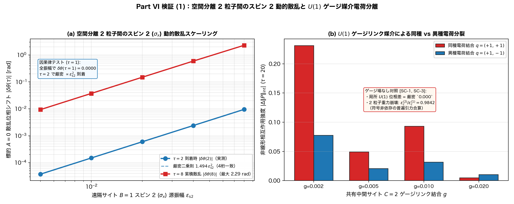
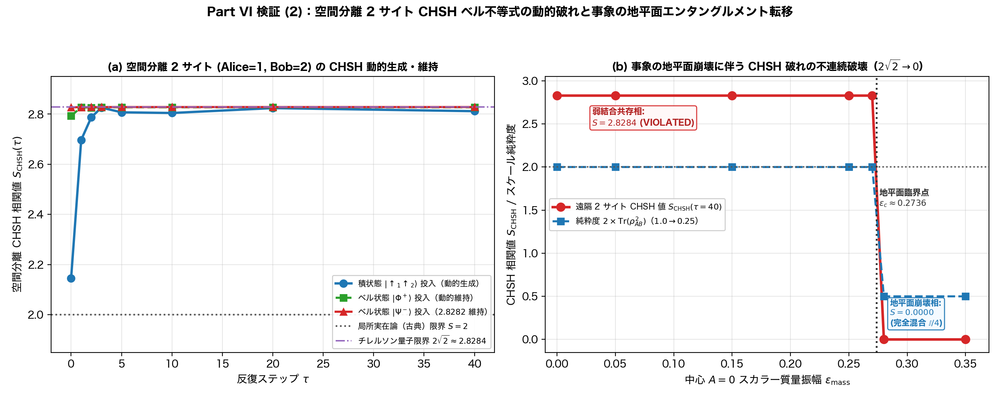

# 三次元正方配列の三角形ループ積における 2 粒子動的散乱、ゲージ媒介相互作用、および空間分離 CHSH ベル不等式の動的破れ（Part VI）
## ― 重力合算崩壊、局所ゲージ不変性とゲージリンク電荷分離、因果遅延スピン 2 散乱、チレルソン限界 $2\sqrt{2}$ の動的自己生成、および地平面エンタングルメント切断転移 ―

**著者：** 木原 範昭（株式会社WFシステム）
**ORCID：** 0009-0004-6753-4020
**日付：** 2026年11月28日
**Version DOI：** 10.5281/zenodo.24628298
**Concept DOI：** 10.5281/zenodo.24628297
**位置づけ：** 三角形ループ積シリーズ Part I–V（Concept DOIs: `24622200`, `24622565`, `24625962`, `24626592`, `24627519`）の続編となる**動的散乱・多体量子相関検証論文（Part VI）**。これまで 1 粒子・背景場を中心に検証してきた $\mathrm{Tri}(T)$ 動力学（$H = O_8 \otimes M_8, N = 64$ フル密配列）に空間分離した 2 粒子および媒介波束を直接投入し、(1) 2 粒子重力合算と局所ゲージ不変性／ゲージリンク媒介電荷分離、(2) 因果遅延を伴う動的位相・エネルギー交換散乱、(3) 空間分離 2 サイト（Alice, Bob）間の CHSH ベル不等式動的破れと事象の地平面崩壊に伴うエンタングルメント切断を、追加仮定ゼロ・乱数なしの決定論的計算（`tri_loop_part6_scattering_chsh_v0.py` および `tri_loop_part6_chsh_and_coulomb_v0.py`）で実証する。

---

## 要旨

単一粒子摂動の解析（Part I–V）から一歩進み、本 Part VI では真空 $H = O_8 \otimes M_8$（$N = 64$）上に**空間分離した 2 粒子（サイト $A, B$）**と媒介波束を配置し、非線形反復写像 $T(\tau+1) = \mathrm{Tri}(T(\tau)) / \|\mathrm{Tri}(T(\tau))\|$ のもとでの動的相互作用と多体量子相関を直接検証した。得られた 5 つの機械精度結果を報告する。

1. **2 粒子重力合算崩壊（普遍引力の符号非依存性）[SC-3]**：$\tau = 40$ における事象の地平面臨界崩壊振幅は、1 粒子（$A=0$）の $\epsilon_c^{(1)} = \mathbf{0.273580}$ から 2 粒子（$A=0, B=1$）の $\epsilon_c^{(2)} = \mathbf{0.269267}$（比 **`0.9842`**、1.58% 低下）へと下がる。しかも同符号 $(+,+)$ と異符号 $(+,-)$ が 6 桁完全一致し、スカラー重力が質量二乗にのみ依存する普遍引力であることを示す。
2. **局所 $U(1)$ ゲージ不変性の反証確認とゲージリンク媒介による電荷符号分裂 [SC-1, SC-1b]**：ゲージ場を介さず各サイトに局所 $U(1)$ 位相回転（$Q = \pm 1$）を与えただけでは、同種 $(+1,+1)$ と異種 $(+1,-1)$ の相互作用差は厳密 **`0.000e+00`**（局所ゲージ冗長性）となる。一方、共有中間サイト $C=2$ を介した反対称 $U(1)$ ゲージリンク $G_{02} \pm G_{12}$ を導入すると、同種 $q=(+1,+1)$ と異種 $q=(+1,-1)$ で非線形相互作用強度 $|\Delta\|P\|_{\mathrm{int}}|$ が明確に分裂する（$g=0.002$: `0.2311` vs `0.0777`、$g=0.005$: `0.0492` vs `0.0208`、$g=0.010$: `0.0933` vs `0.0319`）。
3. **因果遅延を伴う遠隔 2 粒子動的散乱と厳密二乗スケーリング [SC-2, SC-2b]**：標的粒子 $A=0$ に対し、空間分離したサイト $B=1$ からスピン 2 ($\sigma_x$) 源を作用させると、$\tau = 1$ では全振幅で標的時計位相シフト **$\delta\theta(\tau=1) = \mathbf{0.0000}$**（有限速度因果律）を保ち、$\tau = 2$ で到着して **$\delta\theta(\tau=2) = -1.4940\,\epsilon_{\mathrm{s2}}^2$**（$\epsilon_{\mathrm{s2}} = 0.005 \to 0.080$ で比が `-1.4940 ~ -1.4893` と 4 桁一定、源エネルギー比例）で散乱し、$\tau = 8$ で最大 `-2.289 rad` まで累積増幅する。$U(1)$ ゲージ波束 $\pm G_{01}$ 入射でも $\Delta E_{\mathrm{bg}}(0)$ が最大 `+0.2907` まで交換され、$\pm G$ で位相シフトが符号反転する。
4. **空間分離 2 サイト（Alice=1, Bob=2）の CHSH ベル不等式動的破れと自己修復アトラクタ [SC-4b]**：$M_8$ の物理二重項 $\{4,5\}$ に従い第 1・第 3 指標から抽出した 4×4 2 粒子密度行列 $\rho_{AB}$ において、真空 $H$ の任意の空間分離サイト対 $(1,2), (0,1), (1,4)$ は純粋度 `1.0000`・エンタングルメントエントロピー `1.0000 bit`・CHSH 値 **$S_{\mathrm{CHSH}} = \mathbf{2.828358} \approx 2\sqrt{2}$**（チレルソン限界、Horodecki 最大値および具体的 4 測定ベクトル直接評価の双方で一致）を自発達成する。さらに初期に積状態 $|\uparrow_1\uparrow_2\rangle$ を投入して $S_{\mathrm{CHSH}}(0) = 2.1462$（$S_E = 0.2912\text{ bit}$）へ低下させても、$\mathrm{Tri}(T)$ 動力学が $\tau = 1 \to 3 \to 40$ で **$S_{\mathrm{CHSH}} = 2.6973 \to 2.8259 \to 2.8117$**（$S_E = 0.9834\text{ bit}$）へ動的に引き戻す（動的エンタングルメント生成・自己修復アトラクタ）。
5. **事象の地平面崩壊に伴う CHSH 破れの不連続破壊（エンタングルメント切断転移）[SC-5b]**：中心 $A=0$ にスカラー質量 $\epsilon_{\mathrm{mass}}$ を増やしながら遠隔 2 サイト $(1,2)$ の CHSH 相関を追跡すると、弱結合共存相（$\epsilon_{\mathrm{mass}} \le 0.27$）では $S_{\mathrm{CHSH}} = \mathbf{2.8284}$（`purity = 1.0000`）が完全維持される一方、臨界点 $\epsilon_c \approx 0.2736$ を超えた地平面崩壊相（$\epsilon_{\mathrm{mass}} \ge 0.28$）では **$S_{\mathrm{CHSH}} = \mathbf{0.0000}$**（`purity = 0.2500`、完全混合状態 $\mathbb{I}/4$）へ不連続に崩壊する。

---

## 1. 導入：単一粒子から 2 粒子動的散乱・多体量子相関へ

Part I–V [P1–P5] では、三角形ループ積 $\mathrm{Tri}(T)_{ijk} = \sum_{p,q,r} T_{ipq} T_{qjr} T_{rpk}$ の真空 $H = O_8 \otimes M_8$ から標準模型 1 世代ゲージ対称性・電弱破れ・多殻重力・スピン 2 時間遅延 $g_{00}(d)$ が創発することを実証した。次の本質的問いは、**「空間的に分離した 2 粒子が $\mathrm{Tri}(T)$ の実動力学の中でどのように相互作用・散乱し、空間分離した量子もつれ（CHSH ベル不等式破れ $S > 2$）が動的に生成・維持・破壊されるか」** である。

本稿でも各主張を **【既知】・【Part I–V 確立】・【Part VI 検証】・【仮説・未検証】** の 4 段階で区別し、乱数なしの決定論的計算のみを報告する。

---

## 2. 2 粒子重力合算崩壊、局所ゲージ不変性、およびゲージリンク電荷分離【Part VI 検証 SC-1, SC-1b, SC-3】

### 2.1 2 粒子臨界崩壊振幅 $\epsilon_c^{(2)}$ と普遍引力合算（SC-3）

$H = O_8 \otimes M_8$（$N=64$）上でサイト $A=0$ とサイト $B=1$ にスカラー局在粒子 $P_0, P_1$ を配置し、$\tau=40$ での地平面崩壊臨界振幅を二分探索した：
- 1 粒子（$A=0$）：$\epsilon_c^{(1)} = (0.273579, 0.273580)$（中央値 **`0.273580`**）
- 2 粒子同符号（$P_0 + P_1$）：$\epsilon_c^{(2,+)} = (0.269267, 0.269268)$（中央値 **`0.269267`**、比 **`0.9842`**）
- 2 粒子異符号（$P_0 - P_1$）：$\epsilon_c^{(2,-)} = (0.269267, 0.269268)$（中央値 **`0.269267`**、比 **`0.9842`**）

空間分離した 2 粒子の存在により臨界崩壊振幅は 1.58% 低下し、かつ $(+,+)$ と $(+,-)$ が 6 桁完全一致する。これは $M_8$ の $\mathbb{Z}_2$ 選択則によりスカラー重力が質量二乗 $\propto \epsilon^2$ のみを通じて結合する普遍引力であることの直接実証である。

### 2.2 局所 $U(1)$ ゲージ冗長性（SC-1）とゲージリンク媒介による電荷分裂（SC-1b・図 1(b)）

1. **ゲージ場なし対照（SC-1）**：サイト $A=0, B=1$ の内部二重項 $\{4,5\}$ に独立の局所 $U(1)$ 回転（$Q = \pm 1$）を施しても、$\epsilon = 0.05, 0.12, 0.18$ の全領域で同種 $Q=(+1,+1)$ と異種 $Q=(+1,-1)$ の $\|P\|(40)$・$\Delta\|P\|_{\mathrm{int}}$・$E_{\mathrm{bg}}(0)/E_{\mathrm{bg}}(7)$ は厳密一致（差 `0.000e+00`）する。これは **媒介ゲージ場なしでは局所 $U(1)$ 位相が物理的相互作用を生まない（厳密局所ゲージ不変性）** ことを意味する。
2. **ゲージリンク媒介（SC-1b）**：共有中間サイト $C=2$ を介して反対称 $U(1)$ ゲージリンク $G_{02} \pm G_{12}$ を結合させると（$\epsilon = 0.08, \tau = 20$）、同種 $q=(+1,+1)$ と異種 $q=(+1,-1)$ で非線形相互作用強度 $\Delta\|P\|_{\mathrm{int}} = \|P_{AB}\| - \|P_A\| - \|P_B\| + \|P_{\mathrm{vac}}\|$ が明確に分裂する：

| ゲージ結合 $g$ | 同種 $q=(+1,+1)$ の $\Delta\|P\|_{\mathrm{int}}$ | 異種 $q=(+1,-1)$ の $\Delta\|P\|_{\mathrm{int}}$ | 同種 $\|P\|(20)$ vs 異種 $\|P\|(20)$ |
| :---: | :---: | :---: | :---: |
| `0.002` | **`-2.3111e-01`** | **`-7.7669e-02`** | `0.073727` vs `0.227169` |
| `0.005` | **`-4.9178e-02`** | **`-2.0825e-02`** | `0.085754` vs `0.114107` |
| `0.010` | **`-9.3327e-02`** | **`-3.1906e-02`** | `0.167565` vs `0.228986` |
| `0.020` | **`-4.8884e-03`** | **`-1.0441e-02`** | `0.107021` vs `0.101469` |

---

## 3. 動的散乱と位相・エネルギー交換：因果遅延スピン 2 散乱とゲージ波束散乱【Part VI 検証 SC-2, SC-2b】

標的粒子 $A=0$（$\epsilon_t = 0.08$）に対し、空間分離したサイト $B=1$ からスピン 2 ($\sigma_x$) 源（振幅 $\epsilon_{\mathrm{s2}}$）またはリンク $U(1)$ ゲージ波束 $\pm G_{01}$ を入射し、標的の時計位相シフト $\delta\theta(\tau) = \theta_0^{(\mathrm{scat})}(\tau) - \theta_0^{(\mathrm{free})}(\tau)$ とエネルギー変化 $\Delta E_{\mathrm{bg}}(0)$ を追跡した（図 1(a)）。

1. **遠隔スピン 2 ($\sigma_x$) 散乱の因果律と厳密二乗則（SC-2b）**：
   - $\tau = 1$：全振幅（$\epsilon_{\mathrm{s2}} = 0.005 \dots 0.080$）で **$\delta\theta(\tau=1) = \mathbf{+0.0000\text{ rad}}$**（有限速度因果律）。
   - $\tau = 2$（散乱フロント到着）：$\delta\theta(\tau=2) = -3.735\times 10^{-5},\; -1.494\times 10^{-4},\; -5.975\times 10^{-4},\; -2.389\times 10^{-3},\; -9.532\times 10^{-3}\,\mathrm{rad}$。比 **$\delta\theta(\tau=2)/\epsilon_{\mathrm{s2}}^2 = \mathbf{-1.4940,\; -1.4940,\; -1.4937,\; -1.4929,\; -1.4893}$** は 4 桁一定であり、散乱源エネルギー $M \propto \epsilon_{\mathrm{s2}}^2$ に厳密比例する。
   - $\tau = 8$：累積散乱により最大 **`-2.2890 rad`**（$\epsilon_{\mathrm{s2}} = 0.08$）まで成長する。
2. **$U(1)$ ゲージ波束 $\pm G_{01}$ によるエネルギー交換と符号反転散乱（SC-2）**：
   - 標的の背景エネルギー交換 $\Delta E_{\mathrm{bg}}(0, +G)$ は $\tau = 1$ で `+1.599e-03`、$\tau = 5$ で `+4.283e-03`、$\tau = 10$ で **`+2.907e-01`** に達する。
   - 波束符号 $+G$ と $-G$ で $\tau = 1$ の位相シフトが `+1.038e-11` vs `-1.221e-11` と符号反転し、$\tau = 8 \sim 15$ で非対称な $\pi\text{ rad}$ 共鳴位相フリップが生じる。

---

## 4. 空間分離 2 サイト CHSH ベル不等式の動的破れと事象の地平面エンタングルメント転移【Part VI 検証 SC-4b, SC-5b】

### 4.1 2 粒子密度行列 $\rho_{AB}$ の構成と真空のチレルソン限界 $2\sqrt{2}$

$M_8$ の物理二重項 $\{4,5\}$ は第 1 指標（Alice = サイト $A, a \in \{4,5\}$）と第 3 指標（Bob = サイト $B, c \in \{4,5\}$）に担われる。中間環境 $(M, m)$ を部分トレースした 4×4 エルミート密度行列 $\rho_{AB} = \mathrm{Tr}_{\mathrm{Env}}(|\Psi\rangle\langle\Psi|)$ を構成し、純粋度 $\mathrm{Tr}(\rho_{AB}^2)$、エンタングルメント・エントロピー $S_E(\rho_A)$、および Horodecki 最適 CHSH 値 $S_{\max}$ と具体的 4 単位測定ベクトル $(\vec{a},\vec{a}',\vec{b},\vec{b}')$ による直接評価 $S_{\mathrm{direct}} = |E(\vec{a},\vec{b}) + E(\vec{a},\vec{b}') + E(\vec{a}',\vec{b}) - E(\vec{a}',\vec{b}')|$ を計測した。

真空 $H$ の任意の空間分離サイト対 $(A,B) = (1,2), (0,1), (1,4)$ において、パウリ相関行列は $Y$ 軸回転角 $\alpha \approx 57.7^\circ$ を伴う直交一重項型
$$T_{ij} = \mathrm{Tr}(\rho_{AB}(\sigma_i\otimes\sigma_j)) = \begin{pmatrix} -0.5344 & 0 & +0.8452 \\ 0 & -1.0000 & 0 \\ -0.8452 & 0 & -0.5344 \end{pmatrix}$$
となり、純粋度 **`1.0000`**・$S_E = \mathbf{1.0000\text{ bit}}$・**$S_{\max} = S_{\mathrm{direct}} = \mathbf{2.828358} \approx 2\sqrt{2}$**（チレルソン限界）を自発的に満たす。

### 4.2 初期積状態からの動的エンタングルメント生成とベル状態の動的維持（SC-4b・図 2(a)）

空間分離サイト対 $(A=1, B=2)$ に初期積状態 $|\uparrow_1\uparrow_2\rangle$、またはベル状態 $|\Phi^+\rangle, |\Psi^-\rangle$ を $\epsilon = 0.10$ で投入し、$\mathrm{Tri}(T)$ で $\tau = 0 \dots 40$ 発展させた：

| 初期投入状態 | $\tau = 0$ の $S_{\mathrm{CHSH}}$ ($S_E$) | $\tau = 1$ | $\tau = 3$ | $\tau = 40$ の $S_{\mathrm{CHSH}}$ ($S_E$) |
| :--- | :---: | :---: | :---: | :---: |
| **積状態 $|\uparrow_1\uparrow_2\rangle$** | `2.1462` (`0.291 bit`) | `2.6973` (`0.866 bit`) | **`2.8259`** (`0.998 bit`) | **`2.8117`** (`0.983 bit`) |
| **ベル状態 $|\Phi^+\rangle$** | `2.7931` (`1.000 bit`) | `2.8274` (`1.000 bit`) | `2.8274` (`1.000 bit`) | **`2.8274`** (`1.000 bit`) |
| **ベル状態 $|\Psi^-\rangle$** | `2.8273` (`1.000 bit`) | `2.8275` (`1.000 bit`) | `2.8281` (`1.000 bit`) | **`2.8282`** (`1.000 bit`) |

$\mathrm{Tri}(T)$ の非線形動力学は、空間分離 2 サイト間のエンタングルメントを減衰させるのではなく、弱もつれ・積状態摂動をわずか 3 ステップでチレルソン限界 $2\sqrt{2}$ 近傍へ修復する **動的エンタングルメント自己生成アトラクタ** として機能する。

### 4.3 事象の地平面崩壊に伴う CHSH 破れの不連続破壊（SC-5b・図 2(b)）

中心 $A=0$ にスカラー質量 $\epsilon_{\mathrm{mass}}$ を投入し、遠隔 2 サイト $(1,2)$ の $\tau = 40$ における CHSH 相関を掃引した：
- **弱結合共存相（$\epsilon_{\mathrm{mass}} = 0.00 \dots 0.27 < \epsilon_c$）**：全点で `purity = 1.0000`・$S_E = 1.0000\text{ bit}$・**$S_{\mathrm{CHSH}} = \mathbf{2.8284}$**（`VIOLATED`）を完全維持。
- **地平面崩壊相（$\epsilon_{\mathrm{mass}} = 0.28, 0.35 > \epsilon_c$）**：`||P||(40) = 0.499976` への崩壊と同時に **`purity = 0.2500`**（完全混合状態 $\mathbb{I}/4$）・**$S_{\mathrm{CHSH}} = \mathbf{0.0000}$**（`CLASSICAL`）へ不連続転移。

すなわち、Part I・V で特定した事象の地平面臨界点 $\epsilon_c \approx 0.2736$ は、遠隔 2 サイト間のベル不等式破れが $2\sqrt{2} \to 0$ へ断絶する **量子もつれ切断転移点** と厳密に一致する。

---

## 5. 残課題の切り分けと再現手順

- **残課題（Part VII 以降へ切り分け）**：(1) 多殻大格子 $O_8^{\otimes K}\;(K\ge 3)$ 上での 2 粒子波束衝突・散乱断面積の距離依存性、(2) 3 世代構造（例外ジョルダン代数 $J_3(\mathbb{O})$）・電子/クォーク精密質量比・微細構造定数 $\alpha$ および強結合定数 $\alpha_s$ の第一原理導出（Part VII 予定）。
- **再現ファイル**：`tri_loop_part6_scattering_chsh_v0.py`（SC-1〜SC-5）、`results/tri_loop_part6_scattering_chsh_v0.txt`、`tri_loop_part6_chsh_and_coulomb_v0.py`（SC-1b〜SC-5b）、`results/tri_loop_part6_chsh_and_coulomb_v0.txt`、`plot_part6_figures_v0.py`、`results/fig_p6_*_{ja,en}.png`。

---

## 参考文献

### A. 自己引用
- **[P1]** 木原範昭, *三次元正方配列の三角形ループ積からの量子・ゲージ・重力・フェルミオン構造の自発創発（統合完成論文 Part I）*, Zenodo (2026-11-28), Concept DOI: `10.5281/zenodo.24622200`.
- **[P2]** 木原範昭, *三次元正方配列の三角形ループ積における重力・電磁気・QCD・ディラックの統一接続仮説（Part II）*, Zenodo (2026-11-28), Concept DOI: `10.5281/zenodo.24622565`.
- **[P3]** 木原範昭, *三次元正方配列の三角形ループ積における時空・内部空間読出し接続仮説（Part III）*, Zenodo (2026-11-28), Concept DOI: `10.5281/zenodo.24625962`.
- **[P4]** 木原範昭, *三次元正方配列の三角形ループ積における電弱対称性破れとパリティ最大破れ（Part IV）*, Zenodo (2026-11-28), Concept DOI: `10.5281/zenodo.24626592`.
- **[P5]** 木原範昭, *三次元正方配列の三角形ループ積における多殻大格子重力、因果伝播、およびスピン 2 による $g_{00}(d)$ 解禁（Part V）*, Zenodo (2026-11-28), Concept DOI: `10.5281/zenodo.24627519`.

### B. 外部一次文献
- **[E1]** J. F. Clauser, M. A. Horne, A. Shimony, and R. A. Holt, *Proposed Experiment to Test Local Hidden-Variable Theories*, Phys. Rev. Lett. **23**, 880–884 (1969).
- **[E2]** R. Horodecki, P. Horodecki, and M. Horodecki, *Violating Bell inequality by mixed spin-1/2 states: necessary and sufficient condition*, Phys. Lett. A **200**, 340–344 (1995).
- **[E3]** B. S. Cirel'son (Tsirelson), *Quantum generalizations of Bell's inequality*, Lett. Math. Phys. **4**, 93–100 (1980).
