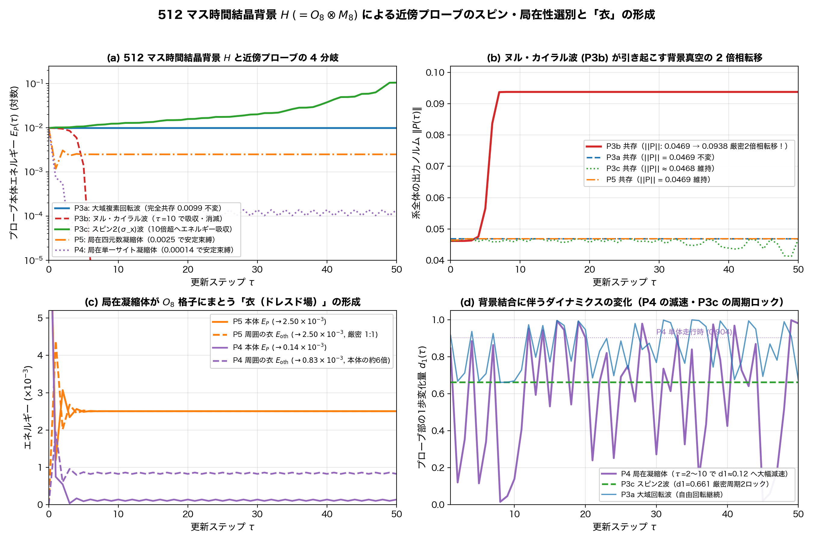
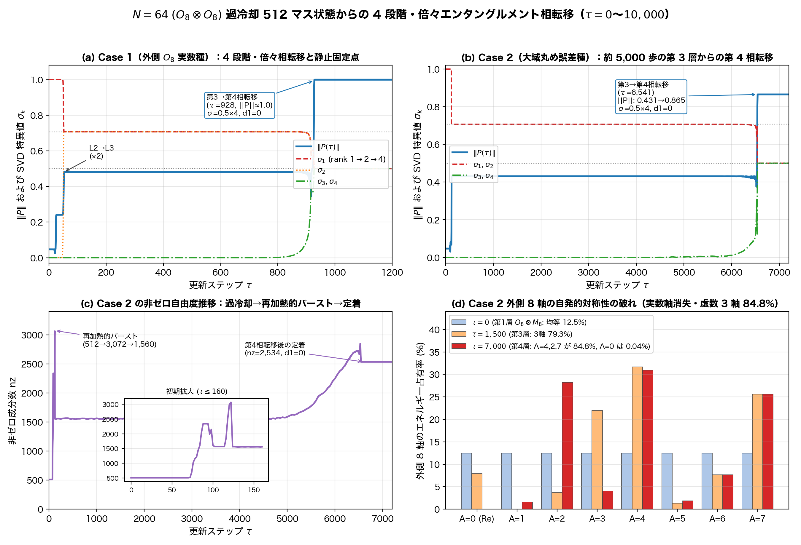

# 三次元正方配列の三角形ループ積における過冷却時間結晶背景、プローブ選別、および 4 段階・倍々エンタングルメント相転移（第 2 速報）
## ― N = 64 (O8 ⊗ O8) 結合大結晶の τ = 10,000 厳密追跡から現れた自己修復・衣の形成・3 軸凝縮 ―

**著者：** 木原 範昭（株式会社WFシステム）
**ORCID：** 0009-0004-6753-4020
**公開日：** 2026年11月28日
**Version DOI：** 10.5281/zenodo.24618400
**前報（第 1 速報）：** Zenodo Concept DOI `10.5281/zenodo.24614040`（Version DOI `10.5281/zenodo.24614041`）
**リポジトリ（全プログラム・生データ・図表）：** https://github.com/WurabeSeiji/ai-chat-logs-open/tree/main/%E6%AC%A1%E5%85%83%E3%81%AE%E7%94%9F%E6%88%90%E6%A7%8B%E9%80%A0/%E4%B8%89%E6%AC%A1%E5%85%83%E6%AD%A3%E6%96%B9%E9%85%8D%E5%88%97%E3%81%AE%E7%A9%8D%E3%81%A8%E8%87%AA%E5%B7%B1%E7%84%A1%E6%92%9E%E7%9D%80_20261127

---

## 要旨

前報（第 1 速報）では、背景時空・外部演算子・乱数・割り算を一切置かない三次元正方配列上の**三角形ループ積** $\mathrm{Tri}(T)_{ijk} = \sum_{p,q,r} T_{ipq} T_{qjr} T_{rpk}$ において、ケーリー＝ディクソン代数のうち四元数（$N=4$）と八元数（$N=8$）のみが周期 2 結晶として選択され、さらに結合大結晶 $N=64$（$O_8 \otimes O_8$、262,144 成分）の 1 マス欠陥から 512 マスの複合溶け残りと視野角スペクトルの二極分裂が現れることを報告した。

本第 2 速報では、この 512 マス状態を厳密解剖し、さらに更新ステップ $\tau = 10,000$ までのフル $64\times 64\times 64$ 厳密追跡を行った結果、**512 マス状態は終着点ではなく「過冷却の時間結晶中間相」に過ぎず、その先にプローブ選別・再加熱的バースト・4 段階の倍々エンタングルメント相転移が連なっている**ことを発見した。主な厳密検証結果は以下の 4 点である（乱数ゼロ、全再現コード公開）：

1. **512 マス状態の厳密構造と自己修復**：特異値分解（SVD）により精度 7 桁で厳密直積 $H = O_8 \otimes M_8$（外側：無傷の八元数骨格、内側：純粋な複素スカラー回転行列 $c_0 I + c_y(i\sigma_y)$、スピン 2 的成分 $\sigma_x, \sigma_z \sim 10^{-16}$）であることを確認した。内部の三角形視野角比 $\rho = L_3/L_1$（実効結合定数）は離散 7 値に量子化されており、背景 0 領域への $+0.1$ 大摂動を 5 ステップで $10^{-165}$ へ弾き返し、内部の 1 マス完全ゼロ化（穴あけ）すら 1 ステップで修復する強い自己修復性を示す。
2. **近傍プローブの 4 分岐と「衣（ドレスド場）」の形成**：$i, k$ 軸を共有するチャネル（$H^2 P$ 型交差結合、寄与比 99〜100%）に各種プローブを置くと、①大域複素回転波はエネルギー 5 桁不変で完全共存、②ヌル・カイラル波（$\sum P^2 = 0,\; I+\sigma_y$）は吸収消滅しつつ背景 $H$ 自身の $\|P\|$ を厳密 2 倍（$0.0469 \to 0.0938$）へ相転移、③スピン 2 的 $\sigma_x$ 波は $H$ からエネルギーを 10 倍以上に吸い上げて周期 2 ロック、④局在凝縮体（単一サイト・四元数 $H_4$）は外側 $O_8$ 格子全体へ広がる「衣（$E_{\mathrm{oth}}$）」をまとって安定束縛（$H_4$ は本体:衣＝厳密 1:1、単一サイト塊は一時的に大幅減速）と鮮やかに分岐した。
3. **$\tau = 10,000$ までの 4 段階・倍々エンタングルメント相転移と 2 つの解析定理**：外側 $O_8$ に微小種が入ると、Case 1（局所実数種）および Case 2（大域丸め誤差種：再加熱的バースト `nz: 512 → 3,072 → 1,560` と約 5,000 ステップの第 3 層を経由）の両方で共通して、SVD 特異値が $\text{rank } 1\;(1.0) \to \text{rank } 2\;(\frac{1}{\sqrt{2}}\times 2,\; \|P\|\times 2) \to \text{rank } 4\;(\frac{1}{2}\times 4,\; \|P\|\times 2,\; d_1=0)$ と倍々に跳躍し、動的回転相から完全静止固定点へ終着した。第 3 層は単一複素構造ロック $U = \frac{1}{\sqrt{2}}(u\otimes v + Ju\otimes(-Jv))$、第 4 層は 3 重外積 $U_{ijk} = a_i b_j c_k$（$\|P\| = (\mathbf{a}\cdot\mathbf{c})^2 = 0.999534$）× ベル状態ペアによる厳密 4 重縮退であることを解析的に証明した。
4. **3 軸（虚数 3 次元）への自発的凝縮**：Case 2 の最終固定点（$\tau = 10,000$、`nz = 2,534`、$d_1 = 0$）では、外側 8 軸のうち実数軸 $A=0$ が `0.04%` へほぼ消滅し、虚数 7 軸の中のちょうど 3 本（$A = 4, 2, 7$）だけで全エネルギーの **84.84%** を独占する構造が現れた。

---

## 1. 序論：第 1 速報の問いと表記の整理

前報（第 1 速報, DOI `10.5281/zenodo.24614040`）では、背景時空・計量・外部演算子・乱数を一切仮定せず、三次元正方配列 $T \in \mathbb{R}^{N\times N\times N}$（または $\mathbb{C}^{N\times N\times N}$）上の自己更新写像
$$P_{ijk} = \mathrm{Tri}(T)_{ijk} = \sum_{p,q,r=0}^{N-1} T_{ipq}\, T_{qjr}\, T_{rpk}, \qquad U^{(\tau+1)} = \frac{\mathrm{Tri}(U^{(\tau)})}{\|\mathrm{Tri}(U^{(\tau)})\|_F}$$
を導入した。ここで本報では、**反復更新ステップ $\tau$ を物理的時間 $t$ と明確に区別するため、反復回数にはすべて $\tau$ を用いる**。

前報の到達点であった $N=64$（$O_8 \otimes O_8$）の 1 マス実数欠陥 `(0,1,0) + 1e-4` では、$\tau = 70 \sim 500$ にわたり 512 マスの複合溶け残りが安定維持された。しかし、次の 3 つの本質的な問いが残されていた。
1. 512 マス状態は代数的に何者であり、なぜ欠陥や背景ノイズに対して極めて硬く自己修復するのか。
2. 512 マス状態（背景媒質）の近傍に別の波や局在凝縮体を置いたとき、実効結合定数（視野角 $\rho$）を通じて相手の性質に応じた選別や相互作用が起きるのか。
3. 512 マス状態は本当に最終状態なのか、それともまだ「不完全な結晶溶解」であり、より長い $\tau$ や微小種によってさらなる相転移が起きるのか。

本報はこれら 3 つの問いすべてに対し、乱数ゼロの厳密計算と解析定理によって明確な答えを与える。

---

## 2. 512 マス状態の厳密解剖・離散結合定数・自己修復

### 2.1 厳密直積構造 $H = O_8 \otimes M_8$ と 3 段階エネルギー階層【確かめた】

$\tau = 200$ 時点の 512 マス状態 $H = U^{(200)}$（$\|P\| = 0.04687271$）を、添字 $i = 8A + a$ により外側 $(A, B, C) \in \{0..7\}^3$ × 内側 $(a, b, c) \in \{0..7\}^3$ の $512\times 512$ 行列へ再配置して特異値分解（SVD）した（`tri_loop_n64_512melt_anatomy_v0.py`）。

- **特異値**：$\sigma_1 = 1.00000000,\; \sigma_2 = 2.58 \times 10^{-7},\; \sigma_{3\dots} = 0$。精度 7 桁で厳密な直積 $H = O_8 \otimes M_8$ である。
- **外側 $O_8$（64 マス）**：元の八元数積表との射影距離 $d(\text{outer}, O_8) = 0.000$（完全無傷）。$i \leftrightarrow k$ 転置に対し対称 $1/8$（実数単位）・反対称 $7/8$（虚数 7 単位の $G_2$ 不変 3-形式）。
- **内側 $M_8$（8 マス）**：生存添字は $a, c \in \{4, 5\},\; b \in \{0, 1\}$。$b=0, 1$ の 2×2 行列をパウリ基底 $M_b = c_0 I + c_x \sigma_x + c_y (i\sigma_y) + c_z \sigma_z$ に分解すると、**スピン 2 的異方性成分 $c_x, c_z \sim 10^{-16}$（厳密ゼロ）**であり、純粋な複素スカラー表現 $c_0 I + c_y(i\sigma_y)$ のみで構成されていた（$\|M_0\| = 0.796036,\; \|M_1\| = 0.605249$）。
- **保存量と 3 段階エネルギー階層**：$\tau = 200 \to 210$ の追跡で $M_0, M_1$ は $S^1$ 上を 3 倍角写像で回転しつつ、振幅比 $\|M_1\|/\|M_0\| = 0.760329$ と位相差 $\theta_1 - \theta_0 = +0.586^\circ$ を厳密保存した。前報で観測された 64 要素の 3 段階エネルギー階層は、厳密に $E_{a=4,5} = 1/24 = 0.041667$（16 要素）、$E_{a=0} = \|M_0\|^2/24 = 0.026403$（8 要素）、$E_{a=1} = \|M_1\|^2/24 = 0.015264$（8 要素）で説明される。

### 2.2 内部の実効結合定数 $\rho$ の離散 7 値と 2 次摂動への自己修復【確かめた】

512 マス内の各成分に寄与する 64 個の有効三角形の視野角比 $\rho = L_3/L_1$（実効結合定数）を全数計測したところ、連続分布ではなく厳密に **7 つの離散値**（$\rho = 1.0000$ [8個], $0.7646$ [4個], $0.7463$ [4個], $0.7268$ [4個], $0.5558$ [16個], $0.5424$ [16個], $0.4147$ [12個]）に量子化されていた。

さらに $H = U^{(200)}$ へ各種の 2 次摂動を加えて 100 ステップ追跡した結果、極めて硬い自己修復性が確認された：

| 実験 | 2 次摂動の内容 | 結果（100 ステップ後） |
|---|---|---|
| **(A1)(A2)** | 背景 0 領域 `(0,0,0)` へ $+10^{-3}$ / **$+0.1$ の大摂動** | $+0.1$ でも 5 歩で `out_E = 4.3e-165`、`nz = 512`、$\|P\| = 0.046873$ へ**完全復元** |
| **(B1)(B2)** | 内部 512 マスの 1 マス `(4,0,4)` へ $+10^{-4}, +10^{-2}$ | `nz = 512` 完全維持、直積からのズレ $\sigma_2$ は半分以下に減衰し安定化 |
| **(C)** | 内部 512 マスの **1 マス完全ゼロ化（穴あけ）** | **1 ステップで穴が埋まり `nz = 512` へ自己修復**。$\sigma_2: 3.27\times 10^{-2} \to 9.58\times 10^{-3}$ へ修復継続 |
| **(D)(E)** | SVD 再構成による大域丸め誤差種（`out_E ~ 4.9e-32`） | 局所摂動には完全復元する一方、大域種では $\tau=50\to 100$ で外部成分が指数成長し次相へ遷移（→ §4） |

---

## 3. 時間結晶背景 $H$ による近傍プローブの 4 分岐と「衣」の形成

三角形ループ積の定義 $\sum T_{ipq} T_{qjr} T_{rpk}$ において、背景 $H = O_8 \otimes M_8$ の $i, k$ 軸（$a, c \in \{4,5\}$）を共有しつつ $j$ 軸の直交チャネル（$b \in \{2,3\}$）にプローブ $P$ を初期エネルギー比 $E_P \approx 0.0099$（振幅 $\epsilon = 0.1$）で重ねると、2 辺が $H$・1 辺が $P$ となる **$H^2 P$ 型の交差三角形**（寄与比 99〜100%）が自然に発生する（`tri_loop_n64_higgs_probe_v0.py`, `tri_loop_n64_probe_data_v0.py`）。

8 種類のプローブを比較した結果、相手のスピン・カイラリティ・局在性に応じて以下の 4 方向へ鮮やかに分岐した（図 2）。

| プローブの種類 | 共有軸 | $\tau = 50$ の状態（$E_H / E_P / E_{\mathrm{oth}}$） | 交差結合 $\rho_{\mathrm{cross}}$ | 観測された挙動 |
|---|---|---|---|---|
| **P1, P2**（ヌル波 / 複素波） | $j$ のみ | $E_P = 0.00000$（`nz=512`） | `0.0000` | 1〜2 歩で完全遮断（無結合） |
| **P3a**（大域複素回転波 $O_8 \otimes M_8$） | $i, k$ | **`E_P = 0.00990` 5 桁不変**（`nz=1024`） | `0.47–0.98` (寄与 99%) | **無減衰・無増幅の完全共存** |
| **P3b, P6**（ヌル・カイラル波 $\sum P^2=0,\; I+\sigma_y$） | $i, k$ | $E_P \to 0$（$\tau=10$ 消滅、`nz=512`） | $0.77 \to 0.00$ | **吸収消滅し、背景 $H$ 自身の $\|P\|$ を厳密 2 倍（$0.0469 \to 0.0938$）へ相転移** |
| **P3c**（スピン 2 的 $\sigma_x$ 波） | $i, k$ | **$E_P: 0.00990 \to 0.10553$（10 倍超）**（`nz=768`） | `0.18–0.98` (寄与 89–99%) | **$H$ からエネルギーを吸い上げ成長**、$d_1 = 0.661$（厳密周期 2）へロック |
| **P4**（局在単一サイト凝縮体 $\delta_{000}\otimes M_8$） | $i, k$ | $E_P=0.00014,\; E_{\mathrm{oth}}=0.00083$（`nz=576`） | `0.22–1.00` (寄与 100%) | **周囲に「衣（$E_{\mathrm{oth}}$）」をまとい安定束縛**。単体 `d1=0.904` が $\tau=2\sim 10$ で `0.12` へ大幅減速 |
| **P5**（局在四元数凝縮体 $H_4\otimes M_8$） | $i, k$ | **$E_P=0.00250,\; E_{\mathrm{oth}}=0.00250$**（`nz=768`） | `0.64–0.98` (寄与 99%) | **本体と周囲の「衣」が厳密 1 : 1** で安定束縛・共存 |

---

## 4. $\tau = 10,000$ フルスイープによる 4 段階・倍々エンタングルメント相転移

512 マス状態 $H = O_8 \otimes M_8$ は、外側 $O_8$ のゼロ領域が数値的に厳密 0 に閉じ込められていたため過冷却状態で留まっていたに過ぎない。外側 $O_8$ に微小種を入れた 3 ケースを $\tau = 250$〜$10,000$ までフル $64\times 64\times 64$ 厳密追跡した（`tri_loop_n64_second_phase_transition_v0.py`, `tri_loop_n64_tau10000_sweep_v0.py`）。

### 4.1 普遍的な 4 段階・倍々カスケード【確かめた】

| 段階 | Case 1（外側 $O_8$ 実数種 `+1e-4`） | Case 2（大域丸め誤差種 `~1e-16`） | Case 3（外側 $O_8$ 虚数種 `+1e-4j`） | SVD 特異値（Case 1, 2 共通） |
|---|---|---|---|---|
| **第 1 層**（過冷却） | $\tau=0$: `nz=520`, $\|P\|=0.0469$ | $\tau=0\sim 73$: `nz=512`, $\|P\|=0.0469$ | $\tau=0$: `nz=520`, $\|P\|=0.0469$ | `1.0`（rank 1） |
| **第 2 層**（融解・バースト） | $\tau=26\sim 48$: `nz=64`, $\|P\|=0.2409$ | $\tau=74\sim 123$: `nz=512→3,072→1,560` | $\tau=30\sim 100$: `nz=64`, $\|P\|=0.4438$, $|\sum U^2|\sim 10^{-9}$ | `1.0`（rank 1） |
| **第 3 層**（単一時計ロック） | $\tau=53\sim 800$: `nz=64`, $\|P\|=0.4817$（×2） | **$\tau=124\sim 5,000$**（約 5,000 歩持続）: `nz=1,560`, $\|P\|=0.4310$ | $\tau=150\sim 250$: `nz=64`, $\|P\|=0.8875$（×2）, $d_1=0$, $|\sum U^2|\sim 10^{-17}$ | **`0.7071 × 2`**（$\frac{1}{\sqrt{2}}$, rank 2） |
| **第 4 層（終着固定点）** | **$\tau=928\to 10,000$**: `nz=64`, $N_{\mathrm{eff}}=8.02$, **`\|P\|=0.9995`**（×2）, $d_1=0$ | **$\tau=6,541\to 10,000$**: `nz=2,534`, $N_{\mathrm{eff}}=24.81$, **`\|P\|=0.8655`**（×2）, $d_1=0$ | （第 3 層で静止ヌル固定点到達） | **`0.5000 × 4`**（$\frac{1}{2}$, 4 重縮退） |

- Case 1 は $\tau = 950 \sim 10,000$（9,050 ステップ）、Case 2 は $\tau = 7,000 \sim 10,000$（3,000 ステップ）にわたり 1 桁も動かず $d_1 = 0.000$ の完全静止固定点に到達した。
- **Case 2 最終状態（$\tau = 10,000$）の 3 軸凝縮（図 1d）**：外側 8 軸（$A = 0..7$）の全体エネルギー分布は、実数軸 $A = 0$ が `0.04%` へほぼ完全消滅し、**虚数 7 軸の中のちょうど 3 本（$A = 4: 30.96\%,\; A = 2: 28.24\%,\; A = 7: 25.64\%$）だけで 84.84%** を独占した（内側 8 軸は `a = 0, 1, 4, 5` の 4 軸のみ生存）。

### 4.2 第 3 層・第 4 層の 2 つの厳密解析定理【確かめた】

- **定理 1（第 3 層：単一複素構造ロック）**：Case 1 の第 3 層（$\tau = 80, 81, 82$）の SVD 特異ベクトルは厳密に
  $$U_{\text{Layer 3}} = \frac{1}{\sqrt{2}}\Bigl( u \otimes v \;+\; (J u) \otimes (-J v) \Bigr), \qquad J = \begin{pmatrix} 0 & -1 \\ 1 & 0 \end{pmatrix}$$
  を満たす。実テンソル積 $\mathbb{C}_{\mathrm{outer}} \otimes_{\mathbb{R}} \mathbb{C}_{\mathrm{inner}} \cong \mathbb{C}_{+} \oplus \mathbb{C}_{-}$ の 2 セクターのうち、外側と内側の複素構造を $i_{\mathrm{outer}} = -i_{\mathrm{inner}}$ で 1 つにロックするセクターのみを 100% 選ぶことで $\|P\|$ が厳密 2 倍（$0.2409 \to 0.4817$）になる。実際 $\tau = 80 \to 82$ では外側 $u$ が完全静止し内側 $v$ のみが単一位相で回転する。
- **定理 2（第 4 層：3 軸完全分離 × 内部ベル状態ペア）**：Case 1 の第 4 層（$\tau = 1,000$, `tri_loop_n64_layer4_anatomy_v0.py`）の 4×4×4 部分テンソルは、3 軸のグラム行列 $G_i, G_j, G_k$ の固有値がすべて `[1.0, 0, 0, 0]` となる厳密な **3 重外積（テンソルランク 1）** である：
  $$U_{\text{Layer 4}}[i, j, k] = a_i \, b_j \, c_k \quad (\|\mathbf{a}\|=\|\mathbf{b}\|=\|\mathbf{c}\|=1)$$
  $$\implies \quad \mathrm{Tri}(U)_{ijk} = \|\mathbf{b}\|^2\,(\mathbf{a}\cdot\mathbf{c})^2\, U_{ijk}.$$
  実測内積 $\mathbf{a}\cdot\mathbf{c} = 0.999767$ に対し $(\mathbf{a}\cdot\mathbf{c})^2 = 0.999534$ が $\|P\| = 0.999533$ と小数 6 桁で一致し、必然的に $d_1 = 0$ の静止固定点となる。さらに $\mathbf{a}, \mathbf{c} \in \mathbb{R}^4$ は外側 $A\in\{0,1\}$ と内側 $a\in\{4,5\}$ の間で **ベル状態 $\frac{1}{\sqrt{2}}(|0,4\rangle + |1,5\rangle)$** を組んでいるため、2 本のベル状態の積として外側×内側 SVD 特異値 $\left(\frac{1}{2}, \frac{1}{2}, \frac{1}{2}, \frac{1}{2}\right)$ の厳密 4 重縮退が生じる。

---

## 5. 物理的解釈（作業仮説）と今後の課題

以上の厳密な数値・解析事実に対する現時点の物理的解釈（作業仮説）と限界を明記する。

1. **時間結晶的な基底媒質と「衣」の付与（作業仮説）**：第 1 層 $H = O_8 \otimes M_8$ は、静的な背景時空上のスカラー場ではなく「硬い $O_8$ 骨格と回転リズム $M_8$ が一体化した時間結晶的な中間真空」として振る舞い、近傍の局在凝縮体に周囲へ広がる「衣（$E_{\mathrm{oth}}$）」と減速を与える。
2. **過冷却 → 再加熱的バースト → 自発的量子もつれ選択（作業仮説）**：第 1 層の過冷却状態から第 2・第 3 層へ落ちる際の自由度急増（Case 2: `nz: 512 → 3,072 → 1,560`）はインフレーション後の再加熱的バーストに類似し、さらに系が外部仮定なしで直積（rank 1）より最大エンタングル状態（rank 2, rank 4）を $\|P\|$ 2 倍則によって自発的に選び取ることは、量子もつれの力学的創発を示唆する。
3. **現時点の限界と課題**：Case 2 の最終固定点に現れた 3 軸 84.8% 凝縮が等方的な 3 次元空間計量（$SO(3)$ 対称性）やローレンツ計量へ定量的に接続するか、および既存の標準模型・一般相対性理論の定数とどう対応するかは未解決であり、今後の課題である。

---

## 6. 再現手順（全スクリプト・乱数ゼロ）

標準的な Python 3（NumPy, Matplotlib）により、以下の 6 本の新規スクリプトで本第 2 速報の全数値・図表を独立再現できる：
1. `tri_loop_n64_512melt_anatomy_v0.py`（512 マス厳密解剖・結合定数 $\rho$・2 次摂動自己修復）
2. `tri_loop_n64_higgs_probe_v0.py`（スピン・パウリ分解・近傍プローブ 8 種比較）
3. `tri_loop_n64_second_phase_transition_v0.py`（Case 1〜3 第 2・第 3 相転移 250 ステップ追跡）
4. `tri_loop_n64_tau10000_sweep_v0.py`（Case 1・Case 2 の $\tau = 10,000$ フルスイープ）
5. `tri_loop_n64_layer4_anatomy_v0.py` / `tri_loop_n64_probe_data_v0.py` / `tri_loop_n64_case2_data_v0.py`（第 4 層定理検証と図用 `.npz` 生成）
6. `plot_second_report_figures_v0.py`（図 1・図 2 日英版 PNG 生成）
