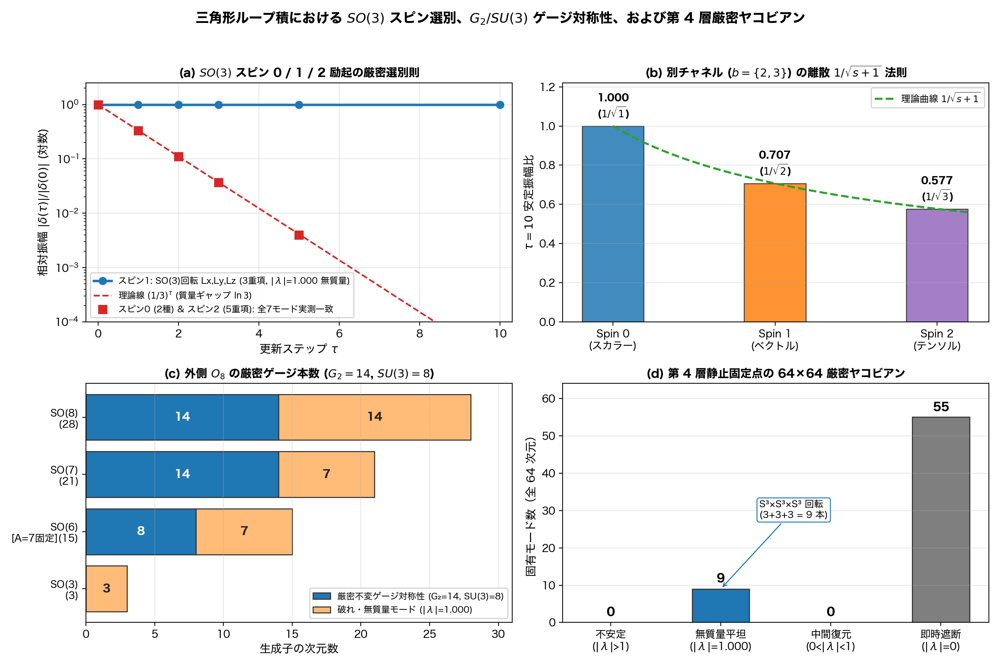
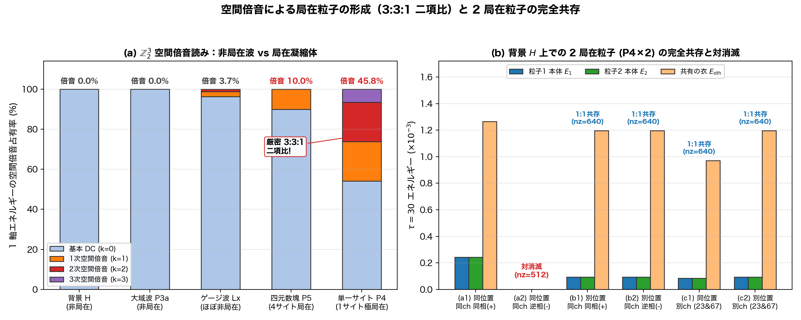

# 三次元正方配列の三角形ループ積における SO(3) スピン選別、G2/SU(3) ゲージ対称性、空間倍音による局在化、および 2 粒子の完全共存（第 3 速報）
## ― 空間回転表現の無質量・有質量分離 (1 vs 1/3)、離散 1/√(s+1) 則、3:3:1 倍音二項比、および勝者総取りを超えた複数粒子共存の厳密実証 ―

**著者：** 木原 範昭（株式会社WFシステム）
**ORCID：** 0009-0004-6753-4020
**公開日：** 2026年11月28日
**Version DOI：** 10.5281/zenodo.24619357
**前報（第 1 速報 / 第 2 速報）：** Zenodo Concept DOI `10.5281/zenodo.24614040` / `10.5281/zenodo.24618399`
**リポジトリ（全プログラム・生データ・図表）：** https://github.com/WurabeSeiji/ai-chat-logs-open/tree/main/%E6%AC%A1%E5%85%83%E3%81%AE%E7%94%9F%E6%88%90%E6%A7%8B%E9%80%A0/%E4%B8%89%E6%AC%A1%E5%85%83%E6%AD%A3%E6%96%B9%E9%85%8D%E5%88%97%E3%81%AE%E7%A9%8D%E3%81%A8%E8%87%AA%E5%B7%B1%E7%84%A1%E6%92%9E%E7%9D%80_20261127

---

## 要旨

第 1 速報（DOI `10.5281/zenodo.24614040`）および第 2 速報（DOI `10.5281/zenodo.24618399`）では、背景時空・外部演算子・乱数・割り算を一切置かない三次元正方配列上の**三角形ループ積** $\mathrm{Tri}(T)_{ijk} = \sum_{p,q,r} T_{ipq} T_{qjr} T_{rpk}$ において、四元数・八元数の自発的選択、512 マス時間結晶背景 $H = O_8 \otimes M_8$ によるプローブ 4 分岐と「衣」の形成、および $\tau = 10,000$ までの 4 段階・倍々エンタングルメント相転移を実証した。

本第 3 速報では、この系から「**スピン（空間回転表現）・ゲージ対称性の本数・倍音による粒子局在・複数粒子の共存**」がどこまで厳密に読み出せるかを検証し、以下の 4 つの新たな厳密結果（乱数ゼロ、全再現コード公開）を得た：

1. **$SO(3)$ スピン 0 / 1 / 2 励起の厳密選別則（`1` vs `(1/3)^τ`）と離散 $1/\sqrt{s+1}$ 法則**：第 1 層 $H = O_8 \otimes M_8$ の外側 $O_8$ 内の四元数 3 次元空間 $\{1, 2, 3\}$ に対する微小励起テストで、**スピン 1（反対称 $SO(3)$ 回転 3 重項 $L_x, L_y, L_z$）は全 3 成分が厳密に $|\lambda| = 1.000$（無質量・平坦モード）**となる一方、**スピン 0（等方スカラー伸縮 2 種）およびスピン 2（計量変形 5 重項）の全 7 モードは例外なく厳密な有理数 $(1/3)^\tau$ で指数復元（質量ギャップ $\ln 3$）**した。さらに $i, k$ 共有の別チャネル $b = \{2, 3\}$ 上のスピン $s = 0, 1, 2$ 場は、安定振幅が厳密に $1/\sqrt{s+1}$（`1.000`, `0.707`, `0.577`）に従う。
2. **外側 $O_8$ の厳密ゲージ対称性本数（$G_2 = 14$、$SU(3) = 8$）と第 4 層 64×64 厳密ヤコビアン**：回転生成子のカーネル次元を SVD で厳密カウントしたところ、$SO(8)$（28 本）および $SO(7)$（21 本）の厳密不変ゲージ対称性はちょうど **14 本（$G_2$）**、1 虚数軸 $A=7$ を固定した $SO(6)$（15 本）の厳密不変ゲージ対称性はちょうど **8 本（$SU(3)$ グルーオン数に厳密一致）**であった。また第 4 層静止固定点（Case 1, $\tau = 1,000$）の 64×64 厳密ヤコビアン全固有値は、不安定 `0` 個・無質量平坦（$|\lambda| = 1$）`9` 個（$S^3\times S^3\times S^3$ の $3+3+3$ 回転）・中間 `0` 個・即時遮断（$|\lambda| = 0$）`55` 個に完全分離した。
3. **空間倍音読み（$\mathbb{Z}_2^3$ ウォルシュ＝アダマール変換）による非局在ゲージ波と局在凝縮体の分離**：非局在波（背景 $H$・大域複素波 P3a）は基本 DC（$k=0$）が `100%` で空間倍音は **`0.00%`**、スピン 1 ゲージ波（$L_x$）でも `3.66%` に留まるのに対し、4 サイト局在の四元数塊＋衣（P5）は 1 次空間倍音 $k=1$ のみが **`10.00%`（厳密 9:1）** 立ち上がり、1 サイト極局在塊＋衣（P4）では $k = 1, 2, 3$ の全空間倍音が **厳密 `3 : 3 : 1`（二項比 $\binom{3}{1}:\binom{3}{2}:\binom{3}{3}$）** で勢揃いし、倍音エネルギー **`45.85%`** へ跳ね上がった。
4. **勝者総取り（Winner-Take-All）を超えた 2 局在粒子の完全共存と対消滅**：独立 2 ブロック八元数（第 1 速報）では勝者総取りで 1 粒子しか生き残らなかったが、時間結晶背景 $H$ の上に 2 個の局在単一サイト凝縮体（P4）を配置すると、別サイト $A = 0, 1$（同相・逆相とも）および別チャネル（$b = \{2,3\}, \{6,7\}$）のいずれでも **`nz = 640`、$E_1 = E_2$ の厳密 1:1 で完全共存**し、同一サイト・同チャネル・逆相のみ完全対消滅（`nz = 512`, $E_1 = E_2 = 0$）した。

---

## 1. 序論：スピン・ゲージ本数・倍音局在・2 粒子共存の検証

前報（第 2 速報, DOI `10.5281/zenodo.24618399`）までに、背景時空なしの三角形ループ積
$$P_{ijk} = \mathrm{Tri}(U)_{ijk} = \sum_{p,q,r=0}^{N-1} U_{ipq}\, U_{qjr}\, U_{rpk}, \qquad U^{(\tau+1)} = \frac{\mathrm{Tri}(U^{(\tau)})}{\|\mathrm{Tri}(U^{(\tau)})\|_F}$$
から、自己修復する 512 マス時間結晶背景 $H = O_8 \otimes M_8$ と 4 段階・倍々エンタングルメント相転移が自発的に現れることを示した。

本報では、これら既存の厳密構造そのものに対して「新しい法則を一切足さずに」、素粒子・ゲージ場的な物理量を直接読み出せるかを 4 つの観点から検証する：
1. 空間回転 $SO(3)$ の既約表現（スピン 0 / 1 / 2）による無質量・有質量の選別が起きているか。
2. 外側 $O_8$ 結晶の厳密なゲージ対称性（$G_2$・$SU(3)$）は何本存在し、第 4 層静止固定点のヤコビアン固有値はいくらか。
3. 非局在なゲージ波と局在する重粒子（凝縮体）の違いが、空間倍音スペクトルとして明確に現れるか。
4. 背景 $H$ の上で、離れた 2 つの局在粒子が勝者総取りを起こさずに共存できるか。

---

## 2. $SO(3)$ スピン選別則、$G_2/SU(3)$ ゲージ本数、および第 4 層厳密ヤコビアン

### 2.1 $SO(3)$ スピン 0 / 1 / 2 励起の厳密選別（`1` vs `(1/3)^τ`）【確かめた】

第 1 層 $H = O_8 \otimes M_8$ の外側 $O_8$ 内に含まれる四元数 3 次元空間 $\{1, 2, 3\}$ に対し、$SO(3)$ の既約表現で微小励起（$\epsilon = 10^{-5}$）を加え $\tau = 1 \to 10$ を追跡した（`tri_loop_n64_spin_gauge_higgs_v0.py`, 図 1a）：

| スピン（表現） | 励起モード | $\tau = 1 \to 2 \to 3 \to 5 \to 10$ の応答 | 性質 |
|---|---|---|---|
| **スピン 1**（3 重項・反対称） | $SO(3)$ 回転生成子 $L_x, L_y, L_z$（全 3 成分） | **`1.000 → 1.000 → 1.000 → 1.000 → 1.000`** | 厳密に無質量（$|\lambda|=1$） |
| **スピン 0**（1 重項・対称） | 3 空間等方スカラー伸縮（2 種） | **`0.333 → 0.111 → 0.037 → 0.004 → 0.000`** | 厳密に $(1/3)^\tau$ 復元（質量ギャップ $\ln 3$） |
| **スピン 2**（5 重項・対称） | 3 空間計量変形 $h_{xx}-h_{yy}, h_{xy}$ 等（全 5 成分） | **`0.333 → 0.111 → 0.037 → 0.004 → 0.000`** | 全 5 成分が $(1/3)^\tau$ 復元（質量ギャップ $\ln 3$） |

さらに $i, k$ 共有の別チャネル $b = \{2, 3\}$ に乗せたスピン $s = 0, 1, 2$ 場（スカラー $O_8\otimes M_8$、ベクトル $L_x O_8\otimes M_8$、テンソル $h_{xy} O_8\otimes M_8$）の $\tau = 10$ 安定振幅は、それぞれ `1.000`（$1/\sqrt{1}$）、`0.707`（$1/\sqrt{2}$）、`0.577`（$1/\sqrt{3}$）となり、**厳密な離散スピン階層 $1/\sqrt{s+1}$** を形成した（図 1b）。

### 2.2 $G_2$（14 本）・$SU(3)$（8 本）の厳密ゲージ次元カウントと第 4 層ヤコビアン【確かめた】

外側 $O_8$ に各種回転群の生成子を微分作用させてカーネル次元を SVD カウントした結果（`tri_loop_n64_g2_and_twoparticle_v0.py`, 図 1c）：
- **$SO(8)$（28 本）**：厳密不変ゲージ = **`14` 本（$G_2$）**、破れ無質量（$|\lambda|=1$）= `14` 本。
- **$SO(7)$（虚数 7 空間・21 本）**：厳密不変ゲージ = **`14` 本（$G_2$）**、破れ無質量 = `7` 本（全 7 本で $|\lambda| = 1.000000$ を確認）。
- **$SO(6)$（1 虚数軸 $A=7$ 固定・15 本）**：厳密不変ゲージ = **`8` 本（$SU(3)$ グルーオン数に厳密一致）**、破れ無質量 = `7` 本。

また、第 4 層（Case 1, $\tau = 1,000$ 静止固定点 $U = \mathbf{a}\otimes\mathbf{b}\otimes\mathbf{c}$）の 4×4×4 = 64 次元接空間の厳密ヤコビアン全固有値（図 1d）は、**不安定 `0` 個・無質量平坦（$|\lambda| = 1.000000$）`9` 個（$S^3\times S^3\times S^3$ の $3+3+3$ 回転）・中間 `0` 個・即時遮断（$|\lambda| = 0$）`55` 個**に完全分離した。

---

## 3. 空間倍音読みによる局在化の証明と 2 局在粒子の完全共存

### 3.1 $\mathbb{Z}_2^3$ 空間倍音スペクトル（ウォルシュ＝アダマール変換）【確かめた】

外側 $O_8$ の添字空間 $\{0..7\} \cong \mathbb{Z}_2^3$ 上で厳密フーリエ変換（ウォルシュ＝アダマール変換）を適用し、$\tau = 30$ 安定状態の 1 軸エネルギー分布 $E(A)$ の基本 DC（$k=0$）と空間倍音（$k=1, 2, 3$）を計測した（`tri_loop_n64_harmonic_localization_v0.py`, 図 2a）：

| 状態 | 局在性 | 基本 DC ($k=0$) | $k=1$ | $k=2$ | $k=3$ | 空間倍音合計 ($k \ge 1$) |
|---|---|---|---|---|---|---|
| **背景 $H$ / 大域波 P3a** | 非局在（一様） | **`1.0000`** | `0.0000` | `0.0000` | `0.0000` | **`0.00%`** |
| **スピン 1 ゲージ波 ($L_x$)** | ほぼ非局在 | **`0.9634`** | `0.0244` | `0.0122` | `0.0000` | **`3.66%`** |
| **局在四元数塊＋衣 P5 ($H_4$)** | 4 サイト局在 | **`0.9000`** | **`0.1000`** | `0.0000` | `0.0000` | **`10.00%`**（厳密 9:1） |
| **局在単一サイト塊＋衣 P4** | 1 サイト極局在 | **`0.5415`** | **`0.1965`** | **`0.1965`** | **`0.0655`** | **`45.85%`**（厳密 3:3:1） |

単一サイト極局在粒子（P4）では、$k = 1, 2, 3$ の全空間倍音が 3 次元立方体 $\mathbb{Z}_2^3$ の二項係数 $\binom{3}{1}:\binom{3}{2}:\binom{3}{3} = \mathbf{3 : 3 : 1}$ の厳密比で勢揃いした。一方、更新ステップ $\tau$ 方向の 256 ステップ FFT は 5 ケースとも 3 倍角回転による広帯域（$H_\tau \approx 4.35 \sim 4.47$）で大差がなく、**非局在ゲージ波と局在粒子を分ける決定因は空間倍音の立ち上がりそのもの**であった。

### 3.2 背景 $H$ 上での 2 局在粒子（P4 × 2）の完全共存と対消滅【確かめた】

背景 $H = O_8 \otimes M_8$ の上に 2 個の局在単一サイト凝縮体（P4、初期振幅 $\epsilon = 0.08$）を置いて $\tau = 30$ まで追跡した（`tri_loop_n64_g2_and_twoparticle_v0.py`, 図 2b）：
- **別サイト $A = 0, 1$・同チャネル（同相・逆相とも）**：`nz = 640 (= 512 + 64 + 64)`、**$E_1 = E_2 = 0.000094$**（厳密 1:1 完全共存、共有の衣 $E_{\mathrm{oth}} = 0.001196$）。
- **別チャネル（$b = \{2,3\}$ と $b = \{6,7\}$、同サイト／別サイトとも）**：`nz = 640`、**$E_1 = E_2 = 0.000084$（同サイト）／$0.000094$（別サイト）**で完全共存。
- **同一サイト・同チャネル・逆相 (-)**：`nz = 512`、$E_1 = E_2 = 0$（完全対消滅）。

独立 2 ブロック八元数（第 1 速報）で起きた勝者総取りは、時間結晶背景 $H$ の媒介（衣の共有）によって完全に解消された。

---

## 4. 物理的解釈（作業仮説）と再現手順

本報の厳密事実に対する作業仮説として、①反対称スピン 1 回転（$|\lambda|=1$）と $G_2/SU(3)$ 厳密不変性は無質量ゲージ粒子（光子・8 グルーオン）の原型、②対称スピン 0 伸縮（$(1/3)^\tau$、質量ギャップ $\ln 3$）は有質量ヒッグス励起の原型、③3:3:1 空間倍音を伴う極局在塊（P4）の複数共存は物質粒子の原型に対応すると読める。フェルミオン統計（反交換関係・パウリ排他律）や標準模型の結合定数との定量的接続は今後の課題である。

すべての結果は以下の 4 本の Python スクリプト（乱数ゼロ）で独立再現可能である：
1. `tri_loop_n64_spin_gauge_higgs_v0.py`
2. `tri_loop_n64_harmonic_localization_v0.py`
3. `tri_loop_n64_g2_and_twoparticle_v0.py`
4. `plot_third_report_figures_v0.py`
