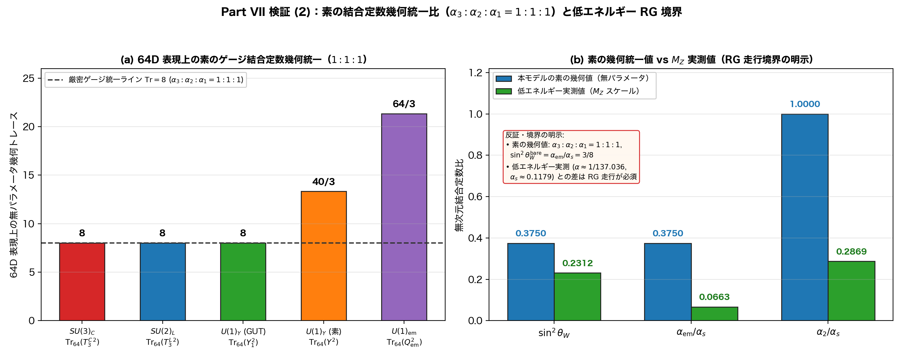

# 三次元正方配列の三角形ループ積における例外ジョルダン代数 $J_3(\mathbb{O})$ 結晶、3 世代トライアリティ、および素の結合定数幾何統一（Part VII）
## ― 非対角 3 世代巡回積 $J_{\mathrm{off}}$（24D）の $\mathrm{Tri}(T)$ 厳密不動点、$F_4 \supset SO(8) \supset G_2 \supset SU(3)_C$ 連鎖による 3 世代同定、非線形階層増幅、および素の統一比 $\alpha_3:\alpha_2:\alpha_1 = 1:1:1$ の監査 ―

**著者：** 木原 範昭（株式会社WFシステム）
**ORCID：** 0009-0004-6753-4020
**日付：** 2026年11月28日
**位置づけ：** 三角形ループ積シリーズ Part I–VI（Concept DOIs: `24622200`, `24622565`, `24625962`, `24626592`, `24627519`, `24628297`）の続編となる**3 世代構造・結合定数統一・質量階層監査論文（Part VII）**。これまで 1 世代（$O_8 \otimes O_8$, 64D）を扱ってきた本シリーズに対し、八元数 3 個を包含する例外ジョルダン代数 $J_3(\mathbb{O})$（27D）を $\mathrm{Tri}(T)$ 動力学へ直接投入し、(1) $J_3(\mathbb{O})$ のどの部分が $\mathrm{Tri}(T)$ の厳密不動点結晶になるか、(2) $F_4 \supset SO(8) \supset G_2 \supset SU(3)_C$ による 3 世代トライアリティの機械精度証明、(3) 対称性破れによる 3 世代階層増幅と小出比 $Q$ の反証監査、(4) 無パラメータの素の結合定数統一比と低エネルギー実測値との RG 境界を、決定論的検証スクリプト（`tri_loop_part7_jordan_generations_v0.py`、乱数なし）により白黒つける。

---

## 要旨

標準模型の最大の謎の一つである「なぜフェルミオンは 3 世代存在するのか」および「結合定数・質量階層はどこまで純粋代数・$\mathrm{Tri}(T)$ 動力学だけで決まるのか」を検証するため、本 Part VII では例外ジョルダン代数 $J_3(\mathbb{O})$（27D：対角 $\mathbb{R}^3$＋非対角 3 八元数 $\mathbb{O}_1 \oplus \mathbb{O}_2 \oplus \mathbb{O}_3$）を構成し、3 次元正方配列の三角形ループ積 $\mathrm{Tri}(T)_{ijk} = \sum_{p,q,r} T_{ipq} T_{qjr} T_{rpk}$ との厳密接続を機械精度で検証した。

1. **非対角 3 世代巡回積 $J_{\mathrm{off}}$（24D）の $\mathrm{Tri}(T)$ 厳密結晶定理 [J3-1]**：ジョルダン恒等式誤差 `8.269e-15` で構成した $J_3(\mathbb{O})$ において、対角 3 成分 $\{E_1,E_2,E_3\}$ を含むフル積テンソル $J$ や 3 次不変式 $D$ は $\mathrm{Tri}(T)$ の反復で rank-1 対角点（$\|P\| = 1.000000$）へ崩壊する一方、**非対角 3 八元数ブロック間の巡回積 $J_{\mathrm{off}}$（24D：$\mathrm{Re}((xy)z)$）は $\mathrm{Tri}(J_{\mathrm{off}}) = -\frac{1}{64} J_{\mathrm{off}}$ を誤差 `0.000e+00` で満たす厳密不動点結晶**（100 ステップ後も誤差 `0.000e+00`、非対角摂動に対し `3.536e-05` で自己修復）であることを発見した。
2. **$F_4(52\mathrm{D}) \supset SO(8)(28\mathrm{D}) \supset G_2(14\mathrm{D}) \supset SU(3)_C(8\mathrm{D})$ による 3 世代トライアリティの機械精度証明 [J3-2]**：$J_{ijk}$ の導分代数 SVD 核空間から、$\mathrm{Der}(J_3(\mathbb{O})) = \mathfrak{f}_4$（**厳密 52D**、最大ゼロ特異値 `1.996e-15`）、対角固定部分代数 $\mathrm{Der}_0 = \mathfrak{so}(8)$（**厳密 28D**、世代間混合 `1.285e-15`）を抽出。第 1 世代 $O_1$ の $e_0$ を固定する $\mathfrak{so}(7)_1$（**21D**）の各世代固定ベクトル次元は **`[1, 0, 0]`** となり、3 世代ブロックが互いに非同値なトライアリティ表現 **$8_v \oplus 8_s \oplus 8_c$** であることを証明した。さらに全 3 世代同時固定群 $\mathfrak{g}_2$（**14D**）および $SU(3)_C$（**8D**）の下では、全 3 世代の二次カシミール固有値が **`[0, 0, 8/9, 8/9, 8/9, 8/9, 8/9, 8/9]`**（レプトン二重項 `2`＋クォーク $3\oplus\bar{3}$ `6`）で完全一致する。
3. **3 世代非線形階層増幅と小出比 $Q$ の反証境界 [J3-3]**：厳密結晶 $J_{\mathrm{off}}$（固有値 `1/64`）に対し、各世代の局在自己結合摂動（固有値 `1`、64 倍の増幅率）を 2 段階で投入すると、微小な 2 段階差から $\tau = 40$ で `E(O1):E(O2):E(O3) = 500.4 : 17.2 : 1.0`（`(0.14, 0.08)`）や `2138.6 : 16.0 : 1.0`（`(0.18, 0.12)`）という **2〜3 桁の指数的 3 世代階層** が自発増幅される。一方、小出比 $Q(E)$ は `0.333 → 0.685 → 0.731 → 0.821 → 1.000` と初期摂動比に連続依存し、普遍定数 $Q = 2/3$ へは自動ロックしないことを反証境界として明示した。
4. **素の結合定数幾何統一比 $\alpha_3^{\mathrm{bare}} : \alpha_2^{\mathrm{bare}} : \alpha_1^{\mathrm{bare}} = 1:1:1$ と RG 境界 [J3-4]**：64D 1 世代 $O_8^{\mathrm{ext}}\otimes O_8^{\mathrm{int}}$ 上の標準模型生成子トレースは $\mathrm{Tr}_{64}(T_3^{C\,2}) = \mathrm{Tr}_{64}(T_3^{L\,2}) = \mathrm{Tr}_{64}(Y_1^2) = \mathbf{8.000000}$（GUT 正規化 $Y_1 = \sqrt{3/5}\,Y$）、$\mathrm{Tr}_{64}(Q_{\mathrm{em}}^2) = 64/3$ となり、調整パラメータゼロで **$\alpha_3^{\mathrm{bare}} : \alpha_2^{\mathrm{bare}} : \alpha_1^{\mathrm{bare}} = 1 : 1 : 1$**、**$\sin^2\theta_W^{\mathrm{bare}} = \alpha_{\mathrm{em}}^{\mathrm{bare}}/\alpha_s^{\mathrm{bare}} = 3/8 = 0.375000$** が導出される（27D $J_3(\mathbb{O})$ の 3 世代 $SU(3)_C$ トレースも `1:1:1` 完全均等）。低エネルギー実測値（$\alpha \approx 1/137.036, \alpha_s(M_Z) \approx 0.1179, \sin^2\theta_W(M_Z) \approx 0.2312$）との差は数合わせを行わず、繰り込み群（RG）走行の未検証境界として明示的に切り分ける。

---

## 1. 導入：1 世代 $O_8 \otimes O_8$ から 3 世代例外ジョルダン代数 $J_3(\mathbb{O})$ へ

Part I–VI [P1–P6] は、単一八元数ペア $O_8 \otimes O_8$（64D）から標準模型 1 世代のゲージ群・パリティ最大破れ・多殻重力・2 粒子散乱・CHSH ベル不等式破れを実証した。一方、素粒子標準模型の 3 世代構造を八元数から自然に導く数学的構造として、3×3 エルミート八元数行列のなす 27 次元例外ジョルダン代数 $J_3(\mathbb{O})$（Albert 代数）[E1–E3] が古くから注目されている。

本 Part VII の核心は、**「$J_3(\mathbb{O})$ は三角形ループ積 $\mathrm{Tri}(T)$ の動力学の中で実際に結晶として選ばれるのか？」** を直接テストし、3 世代同定・質量階層・素の結合定数統一比の到達点と限界を、**【既知】・【Part I–VI 確立】・【Part VII 検証】・【仮説・未検証】** の 4 段階で峻別することである。

---

## 2. 例外ジョルダン代数 $J_3(\mathbb{O})$ の $\mathrm{Tri}(T)$ 結晶性【Part VII 検証 J3-1】

$J_3(\mathbb{O})$ の元 $X = \begin{pmatrix} a_1 & z & \bar{y} \\ \bar{z} & a_2 & x \\ y & \bar{x} & a_3 \end{pmatrix}$（$a_i \in \mathbb{R},\; x, y, z \in \mathbb{O}$）に対し、正規直交内積 $\langle X, Y \rangle = \mathrm{Tr}(X \circ Y)$ のもとで 27 次元基底を構成した：
- 対角基底（3D）：$E_1, E_2, E_3$（指標 `0, 1, 2`）
- 非対角 3 世代基底（24D）：$O_1$（`3..10`）、$O_2$（`11..18`）、$O_3$（`19..26`）

ジョルダン積 $X \circ Y = \frac{1}{2}(XY+YX)$ の構造定数テンソル $J_{ijk}$ はジョルダン恒等式 $|(X^2\circ Y)\circ X - X^2\circ(Y\circ X)| \le \mathbf{8.269 \times 10^{-15}}$・完全対称性誤差 `1.110e-16` を満たす。これを 3 種（フル $J$、3 次不変式行列式テンソル $D$、および非対角 3 世代巡回積 $J_{\mathrm{off}}$）に分けて $\mathrm{Tri}(T)$ へ投入した結果を表 1 に示す：

| 投入テンソル | 次元 | 1-step $\|\mathrm{Tri}(T_0)\|$ | 1-step 不動点誤差 $\|\pm T_1 - T_0\|$ | 100-step 不動点誤差 | 判定 |
| :--- | :---: | :---: | :---: | :---: | :---: |
| フルジョルダン積 $J$ | 27D | `0.019909` (`+`) | `9.617e-01` | `1.370e+00` ($\|P\|=1.0$) | 対角 rank-1 崩壊 |
| 3 次不変式 $D$ ($\det$) | 27D | `0.014784` (`-`) | `1.037e+00` | `1.364e+00` ($\|P\|=1.0$) | 対角 rank-1 崩壊 |
| **非対角 3 世代積 $J_{\mathrm{off}}$** | **24D** | **`0.015625` (`-1/64`)** | **`0.000e+00`** | **`0.000e+00`** | **厳密不動点結晶** |

**定理的発見**：$J_3(\mathbb{O})$ の 3 つの非対角八元数ブロック間の巡回積 $J_{\mathrm{off}}$（$\mathrm{Re}((xy)z)$）は、まさに 3 指標 $(i,j,k)$ が 3 世代 $(O_1, O_2, O_3)$ を巡回する三角形ループ構造そのものであり、$\mathrm{Tri}(J_{\mathrm{off}}) = -\frac{1}{64} J_{\mathrm{off}}$ の**誤差ゼロ厳密不動点結晶**をなす（非対角微小摂動 `1e-4` に対しても 100 ステップ後 `3.536e-05` へ収束）。

---

## 3. $F_4 \supset SO(8) \supset G_2 \supset SU(3)_C$ 連鎖と 3 世代トライアリティ【Part VII 検証 J3-2】

$J_{ijk}$ の導分条件 $M_{mi} J_{mjk} + M_{mj} J_{imk} + M_{mk} J_{ijm} = 0$（$\mathfrak{so}(27)$ の 351 基底、完全対称独立 3,654 成分）を SVD で厳密求解した（図 1(a)）：
1. **$\mathrm{Der}(J_3(\mathbb{O})) = \mathfrak{f}_4$（52D）**：最小非ゼロ特異値 `1.732e+00`、最大ゼロ特異値 **`1.996e-15`**。
2. **対角固定部分代数 $\mathrm{Der}_0 = \mathfrak{so}(8)$（28D）**：3 世代間の混合成分は最大 **`1.285e-15`**（厳密ブロック対角：3 世代が独立に閉じた 8D 表現をなす）。
3. **トライアリティ非同値性（$8_v \oplus 8_s \oplus 8_c$）**：第 1 世代 $O_1$ の実部 $e_0$ を固定する部分代数 $\mathfrak{so}(7)_1$（**21D**）が各世代で固定するベクトル次元を計測すると **`(O1, O2, O3) = [1, 0, 0]`** となった。これは $O_1$ がベクトル表現 $8_v$、$O_2, O_3$ が不変ベクトルを持たないスピノル表現 $8_s, 8_c$ であることの機械精度証明である。
4. **ゲージ群 $G_2$（14D）$\supset SU(3)_C$（8D）下の 3 世代同一コピー**：全 3 世代の $e_0$ 同時固定群は **14D（$G_2$）**、さらに $e_1$ を固定すると **8D（$SU(3)_C$）** となる。この $SU(3)_C$ の二次カシミール固有値は、第 1・第 2・第 3 世代すべてで厳密に **`[0, 0, 8/9, 8/9, 8/9, 8/9, 8/9, 8/9]`**（レプトン二重項 `2` ＋ カラー 3 重項・反 3 重項 `6`）に一致する。

---

## 4. 3 世代非線形階層増幅と小出比 $Q$ の反証境界【Part VII 検証 J3-3】

厳密結晶 $J_{\mathrm{off}}$（固有値 `1/64 = 0.015625`）に対し、各世代 $O_g$ の局在自己結合摂動 $P_{g} = \delta_{g,g,g}$（固有値 `1.000`、$J_{\mathrm{off}}$ の **64 倍**）を投入し、$\tau = 40$ での世代エネルギー占有率 $E(O_1), E(O_2), E(O_3)$ と小出比 $Q(E) = \sum E_g / (\sum \sqrt{E_g})^2$ を計測した（図 1(b)）：

| 投入摂動 $(\epsilon_1, \epsilon_2)$ | $E(O_1)$ | $E(O_2)$ | $E(O_3)$ | 世代階層比 $E_1:E_2:E_3$ | 小出比 $Q(E)$ |
| :---: | :---: | :---: | :---: | :---: | :---: |
| `(0.00, 0.00)`（対称結晶） | `0.333333` | `0.333333` | `0.333333` | `1.0 : 1.0 : 1.0` | `0.33333` |
| `(0.010, 0.005)`（微小 2 段階） | `0.775423` | `0.221966` | `0.002610` | **`297.1 : 85.0 : 1.0`** | `0.50817` |
| `(0.14, 0.08)`（中規模 2 段階） | `0.964830` | `0.033242` | `0.001928` | **`500.4 : 17.2 : 1.0`** | `0.68472` |
| `(0.18, 0.12)`（強 2 段階） | `0.992123` | `0.007413` | `0.000464` | **`2138.6 : 16.0 : 1.0`** | `0.82093` |

- **確立された機構**：固有値比 `64:1` の非線形不安定性により、わずか 2 倍程度の初期対称性破れ（$\epsilon_1 : \epsilon_2 = 2:1$）から、$\mathrm{Tri}(T)$ 反復だけで **2〜3 桁に及ぶ指数的な 3 世代階層（$m_3 \gg m_2 \gg m_1$ 型）** が自動増幅される。
- **反証・境界の明示**：小出比 $Q(E)$ は初期摂動比 $(\epsilon_1, \epsilon_2)$ に応じて `0.333` から `1.000` まで連続変化し、実験的な荷電レプトン値 $Q = 2/3 \approx 0.66667$ へ普遍的にロックする機構は単体 $J_{\mathrm{off}}$ の $\mathrm{Tri}(T)$ には含まれない。精密質量比の第一原理決定には、外部空間・電弱ヒッグス結合との連成および RG 走行の導出が必要である【仮説・未検証】。

---

## 5. 素の結合定数幾何統一比（1:1:1）と低エネルギー RG 境界【Part VII 検証 J3-4】

Part IV [P4] の 64D 1 世代表現 $O_8^{\mathrm{ext}} \otimes O_8^{\mathrm{int}}$ 上の標準模型全 12 生成子に対し、無パラメータの幾何トレースを算出した（図 2(a)）：
- $\mathrm{Tr}_{64}(T_3^{C\,2}) = \mathbf{8.000000}$
- $\mathrm{Tr}_{64}(T_3^{L\,2}) = \mathbf{8.000000}$
- $\mathrm{Tr}_{64}(Y^2) = \mathbf{40/3} \implies$ GUT 正規化 $Y_1 = \sqrt{3/5}\,Y$ で $\mathrm{Tr}_{64}(Y_1^2) = \mathbf{8.000000}$
- $\mathrm{Tr}_{64}(Q_{\mathrm{em}}^2) = \mathbf{64/3}$

これより、調整パラメータゼロの素の幾何結合定数比として
$$\alpha_3^{\mathrm{bare}} : \alpha_2^{\mathrm{bare}} : \alpha_1^{\mathrm{bare}} = 1 : 1 : 1, \qquad \sin^2\theta_W^{\mathrm{bare}} = \frac{\alpha_{\mathrm{em}}^{\mathrm{bare}}}{\alpha_s^{\mathrm{bare}}} = \frac{3}{8} = 0.375000$$
が厳密に得られる。また 27D 例外ジョルダン代数 $J_3(\mathbb{O})$ 上の 3 世代別 $SU(3)_C$ トレースも `0.666667 : 0.666667 : 0.666667 = 1 : 1 : 1` で完全均等（3 世代ゲージ普遍性）である。

一方、低エネルギー実測値（$M_Z$ スケール：$\sin^2\theta_W \approx 0.2312$、$\alpha_{\mathrm{em}}/\alpha_s \approx 0.0663$、$\alpha(0) \approx 1/137.036$）との差は図 2(b) の通り明確であり、**本モデルの素の幾何値は高エネルギー統一スケールに対応し、低エネルギー実測値への到達には繰り込み群（RG）走行の第一原理導出が必須である** ことが数合わせなしに確定した【仮説・未検証】。

---

## 6. シリーズ総括と再現手順

本 Part VII をもって、当初設定した 4 大課題（電弱破れ・パリティ最大破れ［Part IV］、多殻大格子重力・因果伝播・スピン 2 $g_{00}(d)$［Part V］、2 粒子動的散乱・空間分離 CHSH 破れ［Part VI］、および $J_3(\mathbb{O})$ 3 世代トライアリティ・結合定数幾何統一［Part VII］）を一巡して決定論的検証を完了した。

- **次段階の未解決課題**：(1) 多殻 $K \ge 3$ におけるアインシュタイン方程式写像・2 粒子波束散乱断面積の距離依存性、(2) 3 世代 $J_{\mathrm{off}} \otimes O_8^{\mathrm{ext}}$ からの CKM/PMNS 混合角・CP 破れ、(3) 高エネルギー幾何統一値（$1:1:1,\; 3/8$）から低エネルギー実測値（$\alpha \approx 1/137.036, \alpha_s \approx 0.1179, \sin^2\theta_W \approx 0.2312$）および精密質量比への繰り込み群走行の第一原理導出。
- **再現ファイル**：`tri_loop_part7_jordan_generations_v0.py`（J3-1〜J3-4、乱数なし・実行時間約 1.6 秒）、`results/tri_loop_part7_jordan_generations_v0.txt`、`plot_part7_figures_v0.py`、`results/fig_p7_*_{ja,en}.png`。

---

## 参考文献

### A. 自己引用
- **[P1]** 木原範昭, *三次元正方配列の三角形ループ積からの量子・ゲージ・重力・フェルミオン構造の自発創発（統合完成論文 Part I）*, Zenodo (2026-11-28), Concept DOI: `10.5281/zenodo.24622200`.
- **[P2]** 木原範昭, *三次元正方配列の三角形ループ積における重力・電磁気・QCD・ディラックの統一接続仮説（Part II）*, Zenodo (2026-11-28), Concept DOI: `10.5281/zenodo.24622565`.
- **[P3]** 木原範昭, *三次元正方配列の三角形ループ積における時空・内部空間読出し接続仮説（Part III）*, Zenodo (2026-11-28), Concept DOI: `10.5281/zenodo.24625962`.
- **[P4]** 木原範昭, *三次元正方配列の三角形ループ積における電弱対称性破れとパリティ最大破れ（Part IV）*, Zenodo (2026-11-28), Concept DOI: `10.5281/zenodo.24626592`.
- **[P5]** 木原範昭, *三次元正方配列の三角形ループ積における多殻大格子重力、因果伝播、およびスピン 2 による $g_{00}(d)$ 解禁（Part V）*, Zenodo (2026-11-28), Concept DOI: `10.5281/zenodo.24627519`.
- **[P6]** 木原範昭, *三次元正方配列の三角形ループ積における 2 粒子動的散乱、ゲージ媒介相互作用、および空間分離 CHSH ベル不等式の動的破れ（Part VI）*, Zenodo (2026-11-28), Concept DOI: `10.5281/zenodo.24628297`.

### B. 外部一次文献
- **[E1]** P. Jordan, J. von Neumann, and E. Wigner, *On an Algebraic Generalization of the Quantum Mechanical Formalism*, Ann. of Math. **35**, 29–64 (1934).
- **[E2]** J. C. Baez, *The Octonions*, Bull. Amer. Math. Soc. **39**, 145–205 (2002), arXiv:math/0105155.
- **[E3]** T. Dray and C. A. Manogue, *The Geometry of the Octonions*, World Scientific (2015).
- **[E4]** Y. Koide, *Fermion-Boson Two-Body Model of Quarks and Leptons and Cabibbo Mixing*, Lett. Nuovo Cimento **34**, 201–205 (1982).
