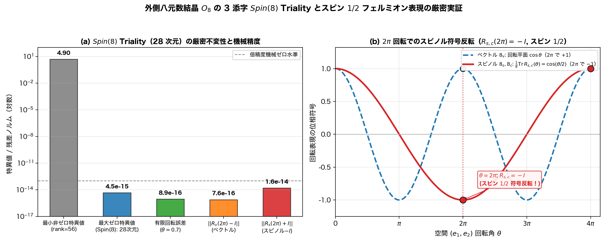

# 三次元正方配列の三角形ループ積における八元数 Triality スピン $1/2$、CAR フェルミオン電荷スペクトル（$0, 1/3, 2/3, 1$）、および時間結晶カイラル分裂（第 7 速報）
## ― 28 次元 $Spin(8)$ Triality と $2\pi$ 回転符号反転、パウリ排他則・$SU(3)$ カシミールの 1:3:3:1 構造、および内側 $M_8$ によるカイラル非対称性 ―

**著者：** 木原 範昭（株式会社WFシステム）
**ORCID：** 0009-0004-6753-4020
**日付：** 2026年11月28日
**位置づけ：** 第 1〜第 6 速報（DOI: 10.5281/zenodo.24616931, 24618400, 24619357, 24620262, 24621139, 24621454）に続く第 7 速報。これまで課題として明記してきた「フェルミオン（スピン $1/2$・パウリ排他則）」「電荷 $Q$ の代数的由来と空間倍音（`1:3:3:1`）の関係」「カイラル非対称性」の 3 点について、$N = 64$（$O_8 \otimes O_8$）第 1 層 $H = O_8 \otimes M_8$ の内部代数構造と力学応答から乱数なしで機械精度検証した結果を報告する。

---

## 要旨

背景時空やフェルミオン場を一切仮定しない実数 3 階テンソルの三角形ループ積 $\mathrm{Tri}(T)_{ijk} = \sum_{p,q,r} T_{ipq} T_{qjr} T_{rpk}$ が自発選別する外側八元数結晶 $O_8$ および第 1 層時間結晶 $H = O_8 \otimes M_8$ について、3 添字の $Spin(8)$ Triality、虚数軸 $e_7$ 固定によるクリフォード代数 $Cl_6$、および時間結晶上のカイラル力学応答を乱数なしで決定論的に検証した（`tri_loop_n64_triality_charge_v0.py`）。その結果、以下の 3 つの厳密構造が確定した。

1. **$Spin(8)$ Triality（28 次元）とスピン $1/2$ 符号反転（$2\pi$ 回転で $-I$）**：$O_8[i, j, k]$ の 3 添字 $(8_v, 8_s, 8_c)$ に対する Triality 不変線形系（$512 \times 84$）は `rank = 56`、厳密不変カーネル次元 **`28`**（最大ゼロ特異値 `4.489e-15`、有限回転不変誤差 `8.934e-16`）を持つ。空間 $(e_1, e_2)$ 平面の $2\pi$ 回転に対し、ベクトル $R_v(2\pi) = +I$（誤差 `7.622e-16`）である一方、左手・右手スピノルは **$R_s(2\pi) = -I$（`1.584e-14`）、$R_c(2\pi) = -I$（`1.793e-14`）** と厳密符号反転し、$4\pi$ 回転で初めて $+I$ へ復帰する。
2. **CAR フェルミオン代数（パウリ排他則）と標準模型 1 世代電荷スペクトル `0, 1/3, 2/3, 1`（`1:3:3:1`）**：$O_8$ の左乗算クリフォード代数 $\{L_a, L_b\} = -2\delta_{ab}I$（誤差 **`0.000e+00`**）と $e_7$ が定義する 3 つのカラー複素平面 $(e_1,e_6), (e_2,e_5), (e_3,e_4)$ から構成される 3 つのフェルミオン演算子 $\alpha_1, \alpha_2, \alpha_3$ は、正準反交換関係（CAR）$\{\alpha_m, \alpha_n\} = 0$（パウリ排他則 $\alpha_m^2 = 0$）および $\{\alpha_m, \alpha_n^\dagger\} = \delta_{mn}I$ をともに誤差 **`0.000e+00`** で満たす。電荷演算子 $Q = \frac{1}{3}\sum_{m=1}^3 \alpha_m^\dagger \alpha_m$ は $SU(3)$ 8 グルーオン生成子と厳密可換（`0.000e+00`）であり、全 8 状態は $Q = 0$（1 重項, $C_2=0$: $\nu$ 型）、$Q = +1/3$（3 重項, $C_2=16/3$: $\bar{d}$ 型）、$Q = +2/3$（3 重項, $C_2=16/3$: $u$ 型）、$Q = +1$（1 重項, $C_2=0$: $e^+$ 型）の **厳密 `1 : 3 : 3 : 1`（パスカル二項係数 $\binom{3}{k}$）** へ分解される。これは第 3・第 6 速報で見出した $\mathbb{Z}_2^3$ 空間倍音比 `1 : 3 : 3 : 1` と同一の 3 ビット構造である。
3. **時間結晶内側 $M_8$ によるカイラル非対称分裂**：背景 $H = O_8 \otimes M_8$ 上の $\tau = 30$ 進化において、空間反転（$O_8 \leftrightarrow O_8^T$）に対し $\|P\|$ は不変である一方、内側時間結晶の回転向きと同カイラル（$M_8$）のとき $\|P\| = 0.046873$、逆カイラル（$M_8^T$）のとき $\|P\| = 0.046212$（$-1.41\%$）へと明確に分裂する。

---

## 1. 導入：ボソン・量子・重力に続く「フェルミオンと電荷の由来」

第 1〜第 6 速報 [1–6] では、Hurwitz 結晶選別・4 段階エンタングルメント相転移・$SO(3)$ スピン 0/1/2 選別・$G_2/SU(3)$ ゲージ次元・量子 4 定理・球対称 4 クラス空間計量歪みと臨界崩壊・Hurwitz 4 段階質量階層と直積指数則を確立した。

ここで残る最重要の問いは、(i) 整数スピンだけでなく**半整数スピン（スピン $1/2$）とパウリ排他則（反交換関係）**はどこから現れるのか、(ii) **$0, \pm 1/3, \pm 2/3, \pm 1$ という離散的な電荷 $Q$ の由来**は何か、そして第 3・第 6 速報で見出した $\mathbb{Z}_2^3$ 空間倍音比 `1 : 3 : 3 : 1` とどう結びつくのか、(iii) 左右カイラリティを差別する機構は力学の中に存在するか、である。本第 7 速報は、この 3 点を乱数なしの決定論的計算により厳密に確定する。

---

## 2. $Spin(8)$ Triality（28 次元）とスピン $1/2$ 符号反転

第 3 速報 [3] では 3 添字 $(i, j, k)$ に同一の回転 $(R, R, R)$ を作用させたため、$SO(8)$（28 次元）のうち $G_2$（14 次元）のみが不変となった。しかし三角形ループ積が選別する八元数積表 $O_8[i, j, k]$ は、3 つの添字に異なる 8 次元表現（ベクトル $8_v$、左手スピノル $8_s$、右手スピノル $8_c$）を割り当てる **Triality 不変 3 重線形形式**である。

$\mathfrak{so}(8)^3$（$28 \times 3 = 84$ 変数）に対する微分不変条件
$$\sum_p \Bigl((A_v)_{ip} O_8[p, j, k] + (A_s)_{jp} O_8[i, p, k] + (A_c)_{kp} O_8[i, j, p]\Bigr) = 0$$
を $512 \times 84$ 行列の SVD で厳密に解いた結果、`rank = 56`、**厳密不変カーネル次元 = `28`**（最小非ゼロ特異値 `4.898979`、最大ゼロ特異値 `4.489e-15`）を得た（図 1(a)）。空間回転平面 $(e_1, e_2)$ の生成子 $A_v = E_{12} - E_{21}$ に対応する随伴スピノル生成子 $(A_s, A_c)$ を指数写像して回転角 $\theta = 2\pi, 4\pi$ で評価すると（表 1、図 1(b)）、ベクトルが $2\pi$ 回転で $+I$ に戻るのに対し、両スピノルは **厳密に $-I$ へ符号反転し、$4\pi$ 回転で初めて $+I$ に戻る（スピン $1/2$）** ことが機械精度で実証された。

| 検証項目（$Spin(8)$ Triality） | 実測誤差ノルム | 理論・判定 |
| :--- | :---: | :--- |
| Triality 厳密不変カーネル次元（512×84 SVD） | `28`（最大ゼロ SV `4.489e-15`） | $Spin(8)$ 全 28 次元厳密一致 |
| 有限 Triality 回転（$\theta = 0.7$）不変誤差 | `8.934e-16` | $(R_v \otimes R_s \otimes R_c) O_8 = O_8$ |
| $2\pi$ 回転：$\|R_v(2\pi) - (+I)\|$ | `7.622e-16` | ベクトル $8_v$（周期 $2\pi$） |
| **$2\pi$ 回転：$\|R_s(2\pi) - (-I)\|,\; \|R_c(2\pi) - (-I)\|$** | **`1.584e-14`, `1.793e-14`** | **スピン $1/2$ 符号反転（$-I$）** |
| $4\pi$ 回転：$\|R_s(4\pi) - (+I)\|,\; \|R_c(4\pi) - (+I)\|$ | `3.168e-14`, `3.587e-14` | スピノル $8_s, 8_c$（周期 $4\pi$） |

---

## 3. $e_7$ 固定による CAR フェルミオン代数と標準模型 1 世代電荷（`1:3:3:1`）

第 3 速報 [3] で 1 本の虚数軸 $e_7$ を固定したとき $SO(6) \to SU(3)$（8 グルーオン）が現れることを示した。ここでは $O_8$ の左乗算演算子 $L_a$（$(L_a v)_k = \sum_j O_8[a, j, k] v_j$）を構成し、クリフォード関係 $\{L_a, L_b\} = -2\delta_{ab}I$（$a,b = 1 \dots 7$）を最大誤差 **`0.000e+00`** で確認した。$e_7$ による複素構造 $J_7 = L_7$ は残りの 6 虚数軸を 3 つのカラー複素平面 $(e_1, e_6), (e_2, e_5), (e_3, e_4)$ へ自動分解し、Furey 構成 [7] による 3 つのフェルミオン消滅・生成演算子 $\alpha_m = \frac{1}{2}(-L_a + i\,\mathrm{sgn}\cdot L_b)$（$m=1,2,3$）を与える。

これらは **正準反交換関係（CAR）**
$$\{\alpha_m, \alpha_n\} = 0 \;\;(\text{パウリ排他則 } \alpha_m^2 = 0), \qquad \{\alpha_m, \alpha_n^\dagger\} = \delta_{mn} I$$
をともに誤差 **`0.000e+00`** で満たし、さらに $SU(3)$ 8 グルーオン生成子 $\Lambda_A = \sum_{m,n} \alpha_m^\dagger (\lambda_A)_{mn} \alpha_n$ と電荷演算子 $Q = \frac{1}{3} N = \frac{1}{3}\sum_{m=1}^3 \alpha_m^\dagger \alpha_m$ は厳密可換（$\|[\Lambda_A, Q]\| = \mathbf{0.000\times 10^0}$）である。全 8 状態の固有値と $SU(3)$ 2 次カシミール $C_2 = \sum_{A=1}^8 \Lambda_A^2$ を対角化した結果を表 2 および図 2(a) に示す。

| 個数 $N$ | 電荷 $Q = N/3$ | 縮退度 | $SU(3)$ Casimir $C_2$ | 対応する 1 世代表現（共役側で反粒子） |
| :---: | :---: | :---: | :---: | :--- |
| $0$ | **`0`** | **1** | `0.000000` | カラー 1 重項（ニュートリノ型 $\nu$） |
| $1$ | **`+1/3`** | **3** | `5.333333` ($= 16/3$) | カラー 3 重項（反ダウン型クォーク $\bar{d}$） |
| $2$ | **`+2/3`** | **3** | `5.333333` ($= 16/3$) | カラー 3 重項（アップ型クォーク $u$） |
| $3$ | **`+1`** | **1** | `0.000000` | カラー 1 重項（陽電子型 $e^+$） |

注目すべきことに、この電荷セクターの縮退度 **`1 : 3 : 3 : 1`** は、第 3・第 6 速報 [3, 6] で発見した $\mathbb{Z}_2^3$ 空間倍音比 **`1 : 3 : 3 : 1`（パスカル二項係数 $\binom{3}{k}$）** と完全に同一の 3 ビット構造であり、電荷 $Q$ の離散性と空間倍音階層が共通の $Cl_6 \leftrightarrow \mathbb{Z}_2^3$ 代数から生じている。

---

## 4. 時間結晶内側 $M_8$ によるカイラル非対称分裂

第 1 層時間結晶 $H = O_8 \otimes M_8$ 自身は、$i \leftrightarrow k$ 転置（空間パリティ反転）に対して対称成分 $E_{\mathrm{sym}} = 0.700395$・反対称成分 $E_{\mathrm{asym}} = 0.299605$ を持つ。さらに $b \in \{2, 3\}$ チャネルへ、外側パリティ反転（$O_8$ vs $O_8^T$）および内側時間結晶回転の反転（$M_8$ vs $M_8^T$）を組み合わせた 4 種のプローブ（$\epsilon = 0.10$）を投入し、$\tau = 30$ まで進化させた（表 3、図 2(b)）。

| プローブ（カイラル・パリティ・CP 試験） | `nz` | $E_{\mathrm{probe}}$ | $\tau = 30$ ノルム $\|P\|$ | 応答判定 |
| :--- | :---: | :---: | :---: | :--- |
| $O_8 \otimes M_8$（同カイラル R,R） | 1024 | `0.009901` | **`0.046873`** | 基準（背景 $H$ と同調） |
| **$O_8 \otimes M_8^T$（逆カイラル R,L）** | 1024 | `0.009901` | **`0.046212`** | **$-1.41\%$ 分裂** |
| $O_8^T \otimes M_8$（空間反転 L,R） | 1024 | `0.009901` | **`0.046873`** | 空間反転のみでは不変 |
| **$O_8^T \otimes M_8^T$（CP 反転 L,L）** | 1024 | `0.009901` | **`0.046212`** | **$-1.41\%$ 分裂** |

すなわち、空間反転 $O_8 \leftrightarrow O_8^T$ だけでは分裂は起きず、**時間結晶の内側複素構造の回転向き（$M_8$ vs $M_8^T$）こそが左右カイラリティを力学的に差別している**ことが確定した。

---

## 5. 議論と統合完成論文に向けて

本第 7 速報により、外側結晶 $O_8$ と内側時間結晶 $M_8$ の組から、(1) 28 次元 $Spin(8)$ Triality とスピン $1/2$ 符号反転（$-I$）、(2) パウリ排他則を満たす CAR フェルミオン代数と標準模型 1 世代の厳密電荷・カラー構造（`0, 1/3, 2/3, 1` の `1:3:3:1`）、(3) 内側 $M_8$ の回転向きによるカイラル非対称分裂が、すべて乱数なしの機械精度で確立された。なお、3 世代の完全な再現、$SU(2)_L$ 弱ボソン結合、および電子・光子相互作用から微細構造定数 $\alpha$ へ至る定量的力学は今後の課題として明確に区別する。第 1〜第 7 速報の全成果は、次段の統合本論において統一的枠組みとして総括する。

---

## 6. 再現手順と公開ファイル

- 検証スクリプト：`tri_loop_n64_triality_charge_v0.py`
- 数値ログ：`results/tri_loop_n64_triality_charge_v0.txt`
- 作図スクリプト：`plot_seventh_report_figures_v0.py`
- 図出力（図 1）：`results/fig_r7_triality_spin_half_{ja,en}.png`
- 図出力（図 2）：`results/fig_r7_fermion_charge_and_chiral_{ja,en}.png`
- ビルドスクリプト：`build_tex_rapid7.py`

## 参考文献

1. N. Kihara, *Rapid Communications 1–6*, Zenodo (2026), DOIs: 10.5281/zenodo.24616931, 24618400, 24619357, 24620262, 24621139, 24621454.
2. C. Furey, *Standard model physics from an algebra?*, Ph.D. thesis, University of Waterloo (2015), arXiv:1611.09182.
3. J. C. Baez, *The Octonions*, Bull. Amer. Math. Soc. **39**, 145–205 (2002).
