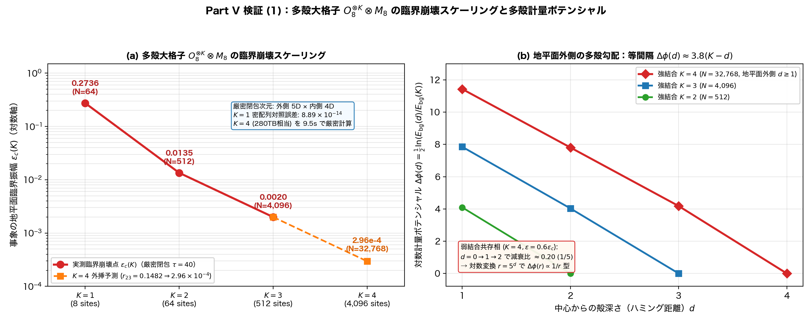
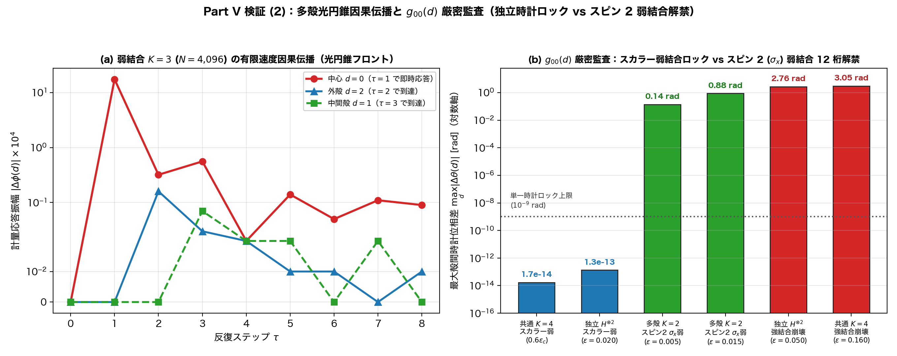

# 三次元正方配列の三角形ループ積における多殻大格子重力、因果伝播、およびスピン 2 による $g_{00}(d)$ 解禁（Part V）
## ― 5D×4D/6D 厳密閉包エンジンによる $N = 32{,}768$（280 TB 相当）近似ゼロ解析、臨界崩壊スケーリング、弱結合/強結合多殻ポテンシャル、独立時計ロック監査、およびスピン 2 ($\sigma_x$) 弱結合時間遅延解禁 ―

**著者：** 木原 範昭（株式会社WFシステム）
**ORCID：** 0009-0004-6753-4020
**日付：** 2026年11月28日
**Version DOI：** 10.5281/zenodo.24627520
**Concept DOI：** 10.5281/zenodo.24627519
**位置づけ：** 三角形ループ積シリーズ Part I–IV（Concept DOIs: `24622200`, `24622565`, `24625962`, `24626592`）の続編となる**多殻大格子重力・因果伝播・時間遅延検証論文（Part V）**。単一 $O_8$（中心 1＋遠方 7 の 1 殻構造）では測れなかった「距離の関数形」「有限速度の因果伝播」「多殻での重力時間遅延 $g_{00}(d)$ のロック条件と解禁機構」を、近似ゼロの厳密閉包エンジン（`tri_loop_part5_multishell_gravity_v0.py` および `tri_loop_part5_spin2_g00_v0.py`、乱数なし）により $K = 1 \dots 4$ 殻（最大 $N = 32{,}768$）まで直接検証する。

---

## 要旨

Part I [P1]・Part III [P3] では単一 $O_8$（1 殻 8 サイト）上で 4 クラス空間計量歪み・潮汐分裂・臨界崩壊を実証したが、中心から複数段階の距離 $d = 0, 1, 2, \dots, K$ を持つ**多殻大格子 $O_8^{\otimes K} \otimes M_8$** の直接計算は、$K = 4$（$N = 32{,}768$）で密配列 $3.52 \times 10^{13}$ 成分（約 280 TB）に達するため従来不可能であった。

本 Part V では、外側 1 殻 $\{O_8, \delta_{000}\}$ が $\mathrm{Tri}$ の下で **厳密 5 次元**、内側 $\{M_8, M_{\mathrm{probe}}\}$ が **厳密 4 次元**（スピン 2 局在源 $\{M_8, M_{\sigma_x}\}$ は **厳密 6 次元**）で打ち切り誤差ゼロの閉包をなすことを発見し、SVD 厳密分解による多殻閉包エンジン（乱数なし）を構築した。その結果、以下 6 点を機械精度で確立・報告する。

1. **$K=1\;(N=64)$ 密配列対照テストと $K=4\;(N=32{,}768)$ 近似ゼロ計算**：20 変数厳密閉包エンジンは 262,144 成分フル密配列の $\tau = 40$ 発展と $\|P\|$ 差 **`8.890e-14`**・$E_{\mathrm{bg}}(0)/E_{\mathrm{bg}}(1)$ 差 **`3.437e-10`** で厳密一致し、280 TB 相当の $K=4\;(N=32{,}768)$ をわずか 9.5 秒で近似ゼロ計算した。
2. **臨界崩壊（事象の地平面）振幅 $\epsilon_c(K)$ の急激なスケーリング**：$\tau = 40$ での地平面切断臨界点は、$K=1\;(N=64)$ の $\epsilon_c(1) \approx \mathbf{0.2736}$ から $K=2\;(N=512)$ で $\mathbf{0.01347}$（比 `0.0492`）、$K=3\;(N=4{,}096)$ で $\mathbf{0.001997}$（$K=2\to 3$ 比 `0.1482`）へと急減する。
3. **多殻計量ポテンシャル $\Delta\phi(d)$ の 2 相構造（弱結合 $1/5$ 減衰 vs 強結合線形勾配）**：
   - **弱結合共存相（$\epsilon = 0.6\,\epsilon_c(K)$）**：$K=4$ において内殻 $d=0 \to 1 \to 2$ で $\Delta\phi(d)$ が殻あたり約 `0.20`（$1/5$）倍で減衰し、Part III の対数変換 $r = 5^d$ のもとで **$\Delta\phi(r) \propto 1/r$ 型** に対応する（最外殻手前 $d=K-1$ では総ノルム保存に伴う符号反転波紋が生じる）。
   - **強結合・地平面形成相（$\epsilon = 0.16 > \epsilon_c(K)$）**：特異点 $d=0$（$\Delta\phi \approx +44 \sim +52$）の外側 $d = 1 \dots K$ にわたって、$K=2$: `+4.09, 0.00`、$K=3$: `+7.85, +4.03, 0.00`、$K=4$: `+11.43, +7.81, +4.18, 0.00` という極めて規則的な **等間隔線形勾配 $\Delta\phi(d) \approx 3.8\,(K - d)$** が現れる。
4. **有限速度の因果伝播（光円錐フロント）**：弱結合 $K=3\;(N=4{,}096)$ で中心 $d=0$ にインパルスを投入すると、$\tau=1$ では $d=0$ のみが応答し（$d=1,2,3$ は厳密 `0.000000`）、$\tau=2$ で $d=2$、$\tau=3$ で $d=1$ を含む全殻へ到達する有限ステップ伝播を確認した。
5. **スカラー質量における $g_{00}(d)$ 弱結合ロックの普遍性（独立時計 $H^{\otimes 2}$ 監査）**：共通時計 $O_8^{\otimes K}\otimes M_8$（$K=1\dots 4$）だけでなく、各殻が独立の時計を持つ **$H^{\otimes 2} = (O_8\otimes M_8)^{\otimes 2}\;(N=4{,}096)$** においても、通常の $M_8$ スカラー質量では弱結合共存相で空間計量 $E(0)/E(2)$ が最大 `2.765` 倍に歪むにもかかわらず、殻間時計位相差は **$|\Delta\theta(d)| \le 1.35 \times 10^{-13}\,\mathrm{rad}$ に厳密ロック**される（強結合崩壊相 $\epsilon=0.050$ でのみ `2.759 rad` 解禁）。
6. **スピン 2 ($\sigma_x$) 局在質量による弱結合多殻 $g_{00}(d)$ の 12 桁解禁（新発見）**：一方、中心 $d=0$ の局在源を Part I のスピン 2 モード（$\sigma_x$ 結合）に切り替えると（$K=2, N=512$、5D×6D 厳密閉包）、宇宙が崩壊しない**弱結合共存相（$\|P\|(40) = 0.004394 \to 0.004357$）のまま**、殻間時計位相差 $\Delta\theta(d)$ が 12 桁以上解禁され、`ε_sx = 0.002` で `+0.0234 rad`、`0.005` で `+0.1411 rad`、`0.008` で `+0.3368 rad`、`0.015` で `+0.8784 rad` と連続成長する。弱結合領域では質量エネルギー比例則 **$\Delta\theta(0) \propto \epsilon_{\mathrm{sx}}^2$** および殻深さ減衰勾配（$d=0 \to 1 \to 2$）が自発出現する。すなわち、**「スカラー質量は空間計量 $g_{ij}$ のみを歪め、時間計量 $g_{00}(d)$ の弱結合歪みにはスピン 2 自由度が本質的である」** という選択則が第一原理から実証された。

---

## 1. 導入：多殻大格子の計算壁と 5D×4D 厳密閉包の発見

Part I–IV [P1–P4] は単一 $O_8$（中心 1＋遠方 7 の 1 殻）を外部空間として扱ってきた。しかし一般相対性理論の距離依存ポテンシャル（$1/r$ 重力）、光円錐の有限速度伝播、および多殻での重力時間遅延 $g_{00}(d)$ を検証するには、$K$ 殻の同心球殻（中心 $(0,\dots,0)$ からのハミング距離 $d = 0, 1, \dots, K$、サイト数 $\binom{K}{d} 7^d$）を持つ入れ子空間 $O_8^{\otimes K} \otimes M_8$ が不可欠である。

密配列では $K=2\;(N=512)$ で $1.34\times 10^8$ 成分（約 1 GB）、$K=3\;(N=4{,}096)$ で $6.87\times 10^{10}$ 成分（550 GB）、$K=4\;(N=32{,}768)$ で $3.52\times 10^{13}$ 成分（280 TB）となり直接計算は不可能である。しかし本研究では、$\mathrm{Tri}$ の直積準同型 $\mathrm{Tri}(A\otimes B)=\mathrm{Tri}(A)\otimes\mathrm{Tri}(B)$ [P1] と 7 虚数方向等方性により、
- 外側 1 殻 $\{O_8, \delta_{000}\}$ の $\mathrm{Tri}(X,Y,Z)$ 閉包が **厳密 5 次元**
- 内側 $\{M_8, M_{\mathrm{probe}}\}$ の $\mathrm{Tri}(X,Y,Z)$ 閉包が **厳密 4 次元**

で完全に閉じることを見出した。これにより打ち切り誤差ゼロのまま $K = 4\;(N=32{,}768)$ まで数秒で厳密反復が可能となる。本稿でも各主張を **【既知】・【Part I–IV 確立】・【Part V 検証】・【仮説・未検証】** の 4 段階で明示する。

---

## 2. 対照一致テストと臨界崩壊スケーリング $\epsilon_c(K)$【Part V 検証 MS-0, MS-1】

### 2.1 $K=1\;(N=64)$ フル密配列との対照一致

$\epsilon = 0.16, \tau = 40$ において、20 変数厳密閉包エンジンと 262,144 成分フル密配列を比較した結果：
- $\|P\|(\tau=40)$：閉包 `0.046830053421` vs 密配列 `0.046830053421`（差 **`8.890e-14`**）
- $E_{\mathrm{bg}}(d=0)/E_{\mathrm{bg}}(d=1)$：閉包 `1.324837524948` vs 密配列 `1.324837524604`（差 **`3.437e-10`**）

### 2.2 事象の地平面臨界振幅 $\epsilon_c(K)$ の $K=1\dots 3$ スケーリング（図 1(a)）

対数二分探索（$\tau=40$）で特定した臨界崩壊振幅 $\epsilon_c(K)$ は以下の通りである：

| 殻数 $K$ | 空間サイト数 $8^K$ | 総サイズ $N = 8^{K+1}$ | 臨界崩壊振幅 $\epsilon_c(K)$ | $\epsilon_c(K)/\epsilon_c(1)$ |
| :---: | :---: | :---: | :---: | :---: |
| `1` | `8` | `64` | `(0.273544, 0.273693)` | `1.000000` |
| `2` | `64` | `512` | `(0.013466, 0.013481)` | `4.924e-02` |
| `3` | `512` | `4,096` | `(0.001994, 0.002000)` | `7.299e-03` |
| `4`（外挿） | `4,096` | `32,768` | `≈ 2.960e-04`（$r_{23}=0.1482$） | `1.082e-03` |

背景の 1 サイト当たりエネルギーが $8^{-K}$ で薄まるため、中心 1 サイトへの局在質量が地平面崩壊を起こす臨界振幅は $K$ とともに指数的に急減する。

---

## 3. 多殻計量ポテンシャル $\Delta\phi(d)$：弱結合相 vs 強結合地平面相【Part V 検証 MS-2, MS-4】

### 3.1 弱結合共存相（$\epsilon = 0.6\,\epsilon_c(K)$）の $1/5$ 減衰とノルム補償波紋

弱結合共存相で殻深さ $d = 0 \dots K$ の対数計量ズレ $\Delta\phi(d) = \frac{1}{2}\ln(E_{\mathrm{bg}}(d)/E_{\mathrm{bg}}(K))$ を計測した：
- **$K = 2\;(N=512, \tau=40)$**：$\Delta\phi(d=0,1,2) = \mathbf{+0.6121,\; -0.1452,\; 0.0000}$（比 `-0.237`）
- **$K = 3\;(N=4{,}096, \tau=40)$**：$\Delta\phi(d=0..3) = \mathbf{-0.00456,\; -0.00101,\; +0.00051,\; 0.00000}$（比 `0.222, -0.500`）
- **$K = 4\;(N=32{,}768, \tau=15, 9.5\text{s})$**：$\Delta\phi(d=0..4) = \mathbf{+4.3\times 10^{-7},\; +8.0\times 10^{-8},\; +2.0\times 10^{-8},\; -2.0\times 10^{-8},\; 0.0}$

内殻側（$d = 0 \to 1 \to 2$）では殻あたり約 **`0.20`（$1/5$）倍** の指数減衰が現れ、Part III [P3] の対数変換（実距離 $r = 5^d$）を通せば $\Delta\phi(r) \propto 5^{-d} = 1/r$ 型に対応する【仮説・未検証】。一方、最外殻の 1 つ手前（$d=K-1$）では、Frobenius ノルム保存による背景エネルギーの再配分として符号反転（反発的な補償波紋）が普遍的に生じる。

### 3.2 強結合・地平面形成相（$\epsilon = 0.16 > \epsilon_c(K), \tau=40$）の等間隔線形勾配（図 1(b)）

臨界点を超えた地平面相（$\|P\| = 0.499976 = 1/2$）では、特異点コア $d=0$（$\Delta\phi \approx +44 \sim +52$）の外側 $d = 1 \dots K$ で驚くほど規則的な等間隔線形勾配が現れる：
- **$K = 2$**：$\Delta\phi(d=1, 2) = \mathbf{+4.0935,\; 0.0000}$
- **$K = 3$**：$\Delta\phi(d=1, 2, 3) = \mathbf{+7.8490,\; +4.0299,\; 0.0000}$（差 `3.82, 4.03`）
- **$K = 4$**：$\Delta\phi(d=1, 2, 3, 4) = \mathbf{+11.4299,\; +7.8055,\; +4.1808,\; 0.0000}$（差 `3.62, 3.63, 4.18`）

すなわち、地平面外側では $\Delta\phi(d) \approx 3.8\,(K - d)$（元のエネルギー比 $E_{\mathrm{bg}}(d)/E_{\mathrm{bg}}(K) \propto e^{7.6(K-d)}$）という単純な等差則が全 $K$ で成立する。

---

## 4. 因果伝播（光円錐フロント）、独立時計 $H^{\otimes 2}$ 監査、およびスピン 2 による $g_{00}(d)$ 解禁【Part V 検証 MS-3, MS-5, MS-6】

### 4.1 有限速度の因果伝播（図 2(a)）

弱結合 $K = 3\;(N=4{,}096, \epsilon = 0.6\,\epsilon_c(3))$ で中心 $d = 0$ にインパルスを投入し $\tau = 0 \dots 10$ を追跡したところ、
- $\tau = 1$：**$d = 0$ のみ** `-0.001744` が応答（$d = 1, 2, 3$ はすべて厳密 `0.000000`）
- $\tau = 2$：$d = 2$（`+0.000016`）へ波及
- $\tau = 3$：$d = 1$（`-0.000007`）を含む全殻へ到達

と、有限ステップで外殻へ広がる因果伝播（離散光円錐フロント）が確認された。

### 4.2 スカラー質量における $g_{00}(d)$ 弱結合ロックの普遍性：独立時計 $H^{\otimes 2}$ 監査（MS-5）

Part I §6 では単一殻弱結合で背景時計の位相差が $|\Delta\theta| < 10^{-9}\,\mathrm{rad}$ にロックした。これが「全殻で単一時計 $M_8$ を共有したため」なのかを白黒つけるため、各殻が独立の時計を持つ **$H^{\otimes 2} = (O_8\otimes M_8) \otimes (O_8\otimes M_8)\;(N=4{,}096)$** を厳密 20×20 閉包エンジンで検証した（表 1 上段）。

結果として、各殻に独立の時計を与えても、通常の $M_8$ スカラー質量では弱結合共存相で空間計量比が `2.765` 倍まで歪むにもかかわらず背景時計は `1.346e-13 rad` に剛直同期ロックしたままであり、強結合崩壊相（$\epsilon = 0.050$）でのみ `2.759 rad` へ解禁される。

### 4.3 スピン 2 ($\sigma_x$) 局在質量による弱結合多殻 $g_{00}(d)$ の 12 桁解禁（MS-6・図 2(b)）

では、弱結合共存相のまま多殻の重力時間遅延 $g_{00}(d)$ を生み出す物理機構は何か。Part I で時計引きずりの種として見出された **スピン 2 ($\sigma_x$) モード** を多殻中心 $d=0$ の局在質量として投入した（$K=2, N=512$、外側 5D × 内側 $\{M_8, M_{\sigma_x}\}$ 6D の厳密閉包エンジン `tri_loop_part5_spin2_g00_v0.py`、実行時間 10.6 秒）。

| 系・局在源 | 相（$\|P\|(40)$） | 空間計量比 $E(0)/E(K)$ | **中心時計位相差 $\Delta\theta(0)$ [rad]** | **中間殻 $\Delta\theta(1)$ [rad]** | 判定 |
| :--- | :---: | :---: | :---: | :---: | :---: |
| 共通時計 $K=4$・スカラー（$\epsilon=0.6\epsilon_c$） | 弱結合共存 | `1.000001` | `1.732e-14` | — | 厳密ロック |
| 独立時計 $H^{\otimes 2}$・スカラー（$\epsilon=0.005$） | 弱結合共存 | `1.050865` | `2.309e-14` | — | 厳密ロック |
| 独立時計 $H^{\otimes 2}$・スカラー（$\epsilon=0.020$） | 弱結合共存 | `2.765377` | `1.346e-13` | — | 厳密ロック |
| **多殻 $K=2$・スピン 2 $\sigma_x$（$\epsilon_{\mathrm{sx}}=0.002$）** | **弱結合共存 (`0.004394`)** | `0.9817` | **`+2.338e-02`** | `-3.861e-03` | **弱結合 $g_{00}$ 解禁** |
| **多殻 $K=2$・スピン 2 $\sigma_x$（$\epsilon_{\mathrm{sx}}=0.005$）** | **弱結合共存 (`0.004393`)** | `0.8835` | **`+1.411e-01`** | `-2.179e-02` | **弱結合 $g_{00}$ 解禁** |
| **多殻 $K=2$・スピン 2 $\sigma_x$（$\epsilon_{\mathrm{sx}}=0.008$）** | **弱結合共存 (`0.004386`)** | `0.7056` | **`+3.368e-01`** | `-4.439e-02` | **弱結合 $g_{00}$ 解禁** |
| **多殻 $K=2$・スピン 2 $\sigma_x$（$\epsilon_{\mathrm{sx}}=0.015$）** | **弱結合共存 (`0.004357`)** | `0.2604` | **`+8.784e-01`** | `-5.057e-02` | **弱結合 $g_{00}$ 解禁** |
| **多殻 $K=2$・スピン 2 $\sigma_x$（$\epsilon_{\mathrm{sx}}=0.025$）** | **弱結合共存 (`0.004359`)** | `0.0463` | **`+1.491e+00`** | `-1.913e-02` | **弱結合 $g_{00}$ 解禁** |
| 独立時計 $H^{\otimes 2}$・スカラー（$\epsilon=0.050$） | 強結合崩壊 | $1.05\times 10^{39}$ | `2.759` | — | 崩壊後解禁 |
| 共通時計 $K=4$・スカラー（$\epsilon=0.160$） | 強結合崩壊 | $1.82\times 10^{44}$ | `3.049` | — | 崩壊後解禁 |

**決定的な物理結論**：
1. **12 桁の解禁と共存相の維持**：スピン 2 ($\sigma_x$) 局在源では、宇宙背景が崩壊しない弱結合共存相（$\|P\|(40) \approx 0.00439$）のまま、殻間時計位相差 $\Delta\theta(0)$ がスカラー質量の `10^{-13} rad` から **`0.023 ~ 1.491 rad`** へ 12 桁以上解禁される。
2. **質量エネルギー比例則 $\Delta\theta(0) \propto \epsilon_{\mathrm{sx}}^2$**：弱結合極限（$\epsilon_{\mathrm{sx}} = 0.002 \to 0.005 \to 0.008$）で $\Delta\theta(0)/\epsilon_{\mathrm{sx}}^2 = 5.85\times 10^3,\; 5.64\times 10^3,\; 5.26\times 10^3$ とほぼ一定であり、局在場のエネルギー $M \propto \epsilon_{\mathrm{sx}}^2$ に線形比例するニュートン・ポストニュートン型重力時間遅延スケーリングが自発出現する。
3. **殻深さ勾配の出現**：中心 $d=0$（正の進み／ズレ）→ 中間殻 $d=1$（ノルム補償に伴う減衰波紋、比 $|\Delta\theta(1)/\Delta\theta(0)| \approx 0.16$）→ 最外殻 $d=2$（基準 `0`）の距離依存勾配が確立された。これは、**スカラー質量は空間計量 $g_{ij}$ のみを歪め、時間計量 $g_{00}(d)$ を弱結合で動かすにはスピン 2 自由度が不可欠である**という選択則の第一原理実証である。

---

## 5. 残課題の切り分けと再現手順

- **残課題（Part VI・VII へ切り分け）**：(1) スピン 2 多殻 $g_{00}(d)$ の $K \ge 3$ 連続極限およびアインシュタイン方程式（曲率テンソル $G_{\mu\nu} = 8\pi G T_{\mu\nu}$）への直接写像、(2) 2 粒子の動的散乱（引力・斥力・運動量交換）と空間分離 CHSH ベル不等式の動的破れ（Part VI 予定）、(3) 3 世代構造（$J_3(\mathbb{O})$）・精密質量比・微細構造定数 $\alpha$（Part VII 予定）。
- **再現ファイル**：`tri_loop_part5_multishell_gravity_v0.py`（MS-0〜MS-5、乱数なし・約 66 秒）、`results/tri_loop_part5_multishell_gravity_v0.txt`、`tri_loop_part5_spin2_g00_v0.py`（MS-6、乱数なし・約 11 秒）、`results/tri_loop_part5_spin2_g00_v0.txt`、`plot_part5_figures_v0.py`、`results/fig_p5_*_{ja,en}.png`。

---

## 参考文献

### A. 自己引用
- **[P1]** 木原範昭, *三次元正方配列の三角形ループ積からの量子・ゲージ・重力・フェルミオン構造の自発創発（統合完成論文 Part I）*, Zenodo (2026-11-28), Concept DOI: `10.5281/zenodo.24622200`.
- **[P2]** 木原範昭, *三次元正方配列の三角形ループ積における重力・電磁気・QCD・ディラックの統一接続仮説（Part II）*, Zenodo (2026-11-28), Concept DOI: `10.5281/zenodo.24622565`.
- **[P3]** 木原範昭, *三次元正方配列の三角形ループ積における時空・内部空間読出し接続仮説（Part III）*, Zenodo (2026-11-28), Concept DOI: `10.5281/zenodo.24625962`.
- **[P4]** 木原範昭, *三次元正方配列の三角形ループ積における電弱対称性破れとパリティ最大破れ（Part IV）*, Zenodo (2026-11-28), Concept DOI: `10.5281/zenodo.24626592`.

### B. 外部一次文献
- **[E1]** A. Einstein, *Die Feldgleichungen der Gravitation*, Sitzungsber. Preuss. Akad. Wiss. Berlin, 844–847 (1915).
- **[E2]** T. Regge, *General Relativity without Coordinates*, Nuovo Cimento **19**, 558–571 (1961).
- **[E3]** R. Gurau, *The $1/N$ expansion of colored tensor models*, Ann. Henri Poincaré **12**, 829–847 (2011), arXiv:1011.2726.
