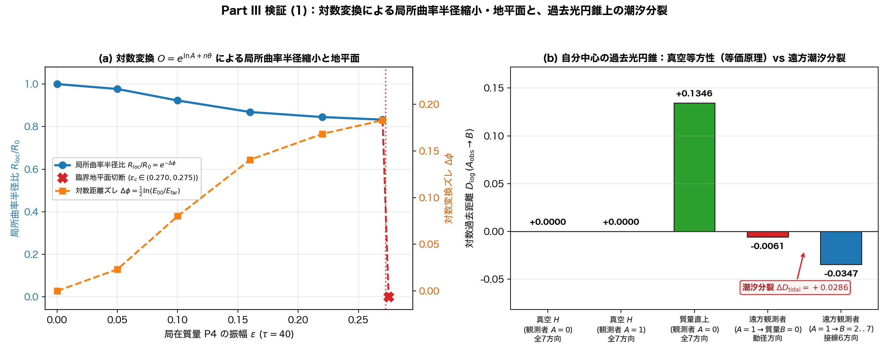
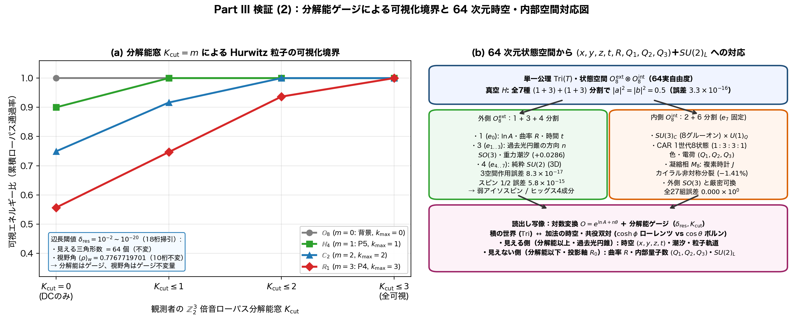

# 三次元正方配列の三角形ループ積における時空・内部空間読出し接続仮説（Part III）
## ― 対数変換 $O = e^{\ln A + n\theta}$、過去光円錐の扇型座標、分解能ゲージ、および $(x, y, z, t, R, Q_1, Q_2, Q_3)$ への対応 ―

**著者：** 木原 範昭（株式会社WFシステム）
**ORCID：** 0009-0004-6753-4020
**日付：** 2026年11月28日
**位置づけ：** 統合完成論文 Part I（Concept DOI: `10.5281/zenodo.24622200`）および統一接続仮説 Part II（Concept DOI: `10.5281/zenodo.24622565`）の続編となる**読出し接続仮説論文（Part III）**。Part I・Part II を書き終えた後に残った「状態空間（位相空間）から時空・内部自由度 $(x, y, z, t, R, Q_1, Q_2, Q_3)$ への写像が締まっていない」「視野角を導入したが、分解能による『見える／見えない』の定義が抜けている」という明確な不満を動機とし、著者の先行思考実験 [K9–K14] で構築した読出し幾何学を $\mathrm{Tri}(T)$ の実発展状態へ直接接続する。

---

## 要旨

Part I [P1] は、背景時空・作用・量子公理を一切仮定しない実数 3 階テンソルの三角形ループ積 $\mathrm{Tri}(T)_{ijk} = \sum_{p,q,r} T_{ipq} T_{qjr} T_{rpk}$ から、Hurwitz 結晶選別・量子 4 定理・4 クラス空間計量歪みと臨界崩壊・Hurwitz 質量階層・$Spin(8)$ Triality スピン $1/2$・CAR `1:3:3:1` 電荷が自発創発することを確立し、Part II [P2] は $O_8^{\mathrm{ext}} \otimes O_8^{\mathrm{int}}$ 分離仮説により重力・電磁気・QCD・ディラックの統一接続を示した。

しかし Part I・Part II には、一般相対性理論と標準模型を本当に締めるための 2 つの本質的欠落が残っていた。第一に、$\mathrm{Tri}(T)$ の状態空間（位相空間）が**なぜ・どの写像によって $(x, y, z, t, R, Q_1, Q_2, Q_3)$ へ対応するのか**が未接続であった点、第二に、視野角 $\rho = L_3/L_1$ を全成分の直接計算（神の視点）で測るにとどまり、**観測者の分解能（ゲージ）による「見える／見えない」の厳密な定義**が抜けていた点である。本 Part III では、先行思考実験（中心投影・分解型八元数ヌル条件 [K9]、複素指数の 2 断面 [K10]、分解能ゲージ [K11]、光円錐・2 つの $R$・投影軸選択 [K12, K13]、コインとコップの可視条件 [K14]）を $\mathrm{Tri}(T)$ 上で乱数なしの決定論的検証（`tri_loop_spacetime_log_resolution_bridge_v0.py`）にかけ、以下 5 点を確立・定式化する。

1. **`1–7` 八元数の `(1+3)+(1+3)` 分割と投影軸共変性**：Part I の真空時間結晶 $H = O_8 \otimes M_8$ は、全 7 通りの四元数部分代数分割 `(1+3)+(1+3)` すべてで厳密に分解型八元数ヌル条件 $|a|^2 = |b|^2 = 0.500000$（最大差 **`3.331e-16`**）を満たし、1D ($\mathbb{R}$)・2D ($\mathbb{C}$)・4D ($\mathbb{H}$) の投影軸選択に対しても全選択間で比率 $d/8$（最大偏差 `5.55e-17 ~ 2.22e-16`）の厳密共変性を示す。
2. **外側 $O_8^{\mathrm{ext}}$ の `1 + 3 + 4` 分割と純粋 $SU(2)$ の発見**：$G_2$（14 次元）の中で 3 空間 $\{e_1,e_2,e_3\}$ と余り 4 空間 $\{e_4,e_5,e_6,e_7\}$ を保存する部分群は 6 次元 $SO(4)$ であり、その中に **3 空間を一切動かさず（最大誤差 `8.327e-17`）4 空間だけをスピン $1/2$（$2\pi$ 回転で $-I$、誤差 `5.778e-15`）として回す厳密 3 次元 $SU(2)$** が存在する。これにより $O_8^{\mathrm{ext}} \otimes O_8^{\mathrm{int}}$（64 実自由度）は重複なく「重力（`1+3`）＋ 電弱 $SU(2)_L$/ヒッグス 4 成分（外側の `4`）＋ $SU(3)_C\times U(1)_Q$（内側）」を収める最小の器となる。
3. **指数表現 $O = e^{\ln A + n\theta}$ と対数変換（積 $\leftrightarrow$ 時空・双対性の起源）**：状態の積（$\mathrm{Tri}$）と時空の加法が対数変換で結ばれるため、$\ln A$ と $n\theta$ が同一指数部に並び、ボルン則 $\cos^2(\theta/2)$ とローレンツ因子 $\cosh\phi$ が 1 式の 2 断面（誤差 `2.220e-16`）となる。Part I §6 の質量振幅スイープを対数変換 $\Delta\phi = \frac{1}{2}\ln(E_{00}/E_{\mathrm{far}})$ と局所曲率半径比 $R_{\mathrm{loc}}/R_0 = e^{-\Delta\phi}$ で読むと、$\epsilon = 0 \to 0.270$ で `1.0000 → 0.8328` へ単調縮小し、$\epsilon = 0.275$ で $R_{\mathrm{loc}}/R_0 \to 0$（事象の地平面切断）へ不連続遷移する。
4. **自分を原点とする過去光円錐（扇型座標系）と潮汐分裂の実証**：虚数単位ベクトル $n$ は共通直交座標 $(x,y,z)$ ではなく、自分自身を頂点とする過去光円錐の視線方向である。対数過去距離 $D_{\log}(A_{\mathrm{obs}}\to B)$ を計測すると、真空 $H$ ではどの観測者からも全 7 方向完全等方（$0.000000 \pm 10^{-16}$＝等価原理）である一方、質量 P4 存在下では遠方観測者（$A_{\mathrm{obs}}=1$）の過去光円錐に質量方向（`-0.006094`）vs 接線 6 方向（`-0.034709 ± 5.27e-16`）の**潮汐分裂 $\Delta D_{\mathrm{tidal}} = +0.028615$** が明瞭に現れる。
5. **分解能（ゲージ）による「見える／見えない」の厳密定義**：(a) $\tau = 75$ 凝縮状態で「見える $\iff L_3 > \delta_{\mathrm{res}}$」と定義し、$\delta_{\mathrm{res}}$ を `1e-2` から `1e-20` まで 18 桁掃引しても、見える集合（64 三角形）と視野角 $\langle\rho\rangle_w = 0.7767719701$ は 10 桁完全不変（分解能＝ゲージ）。(b) $\mathbb{Z}_2^3$ 倍音ローパス窓 $K_{\mathrm{cut}} \in \{0,1,2,3\}$ により、Hurwitz 4 段階粒子 $\mathbb{O}_8, \mathbb{H}_4, \mathbb{C}_2, \mathbb{R}_1$（余次元 $m=0,1,2,3$）の完全可視化に必要な最小分解能が厳密に $K_{\mathrm{cut}} = m$ に一致することを実証した。

最後に第 6 章で、なお残る未解決課題（多殻大格子 $O_8^{\otimes K}$ での $1/r, 1/r^2$・アインシュタイン方程式、例外ジョルダン代数 $J_3(\mathbb{O})$ と 3 世代、動的ヒッグス・パリティ最大破れ、微細構造定数 $\alpha$、2 粒子動的散乱、CHSH 動的破れ）を厳密に切り分けて整理する。

---

## 1. 導入：Part I・Part II に対する 3 つの不満（動機の連鎖）

解釈と写像が主役となる論文では、結論を先置きすると後付けの当てはめに見える。本 Part III の出発点は、Part I [P1]・Part II [P2] を書き終えた直後に残った、以下の 3 つの具体的かつ切実な不満の連鎖である。

1. **不満 1：せっかく一般相対性理論との接続まで示したのに、空間との接続が締まっていない**
   Part I §6 では局在質量 P4 による 4 クラス空間計量歪みと臨界崩壊を、Part II では $O_8^{\mathrm{ext}} \otimes O_8^{\mathrm{int}}$ による重力・電磁気・QCD・ディラックの統一接続を示した。しかし著者は先行研究において、光円錐上のモデルとして中心投影 $\sum z_n^2 = 0 \mapsto \sum z_n^2 = R^2$ [K9, K12] および 8 次元符号ベクトル方程式
   $$x^2 + y^2 + z^2 + (it)^2 = R^2 + Q_1^2 + Q_2^2 + Q_3^2 \tag{1}$$
   を構築してきた [K9, K10, K13]。にもかかわらず Part I・Part II には、**$\mathrm{Tri}(T)$ の状態空間（位相空間）がなぜ・どのように $(x, y, z, t, R, Q_1, Q_2, Q_3)$ へマッピングされるのか**という肝心の橋渡しが欠けていた。

2. **不満 2：視野角は取り入れたが、「見えるか／見えないか」の定義（分解能）が抜けている**
   Part I §2.3 は全 $64^3$ 個の三角形の 3 辺長比 $\rho = L_3/L_1$ を「視野角」として計測した。しかしそれは全成分を外部から直接覗き込む神の視点にとどまり、先行思考実験で問い続けた「あるか／無いかではなく、交差項が分解能を超えるか（見える／見えない）だけが観測である」[K14] および「観測者の分解能はゲージであり、分解能を変えても不変な比が視野角である」[K11] という観点が抜け落ちていた。

3. **不満 3：虚数ベクトル $n$ の誤読と、`1–7` 八元数の役割分担**
   指数表現 $O = e^{\ln A + n\theta}$ における 3 次元単位虚数ベクトル $n$ を、全員に共通の直交座標 $(x, y, z)$ と読むと背景独立性と直ちに矛盾する。光円錐の原点は常に自分自身であり、$n$ は**自分自身を頂点とする扇型座標系（過去光円錐）の視線方向**である。また `1–7` の八元数を `(1+3)+(1+3)` あるいは `1+3+4` と読むとき、Part II の $O_8^{\mathrm{ext}} \otimes O_8^{\mathrm{int}}$（64 自由度）の中で余りの `4` 成分がどの量子数に対応するかを確定する必要がある。

本論文では Part II と同じく、すべての主張の資格を **【既知】・【Part I/II 確立】・【Part III 検証】・【仮説・未検証】** の 4 段階で明示する。

---

## 2. `1–7` 八元数の `(1+3)+(1+3)`／`1+3+4` 読みと 64 次元対応表

### 2.1 真空 $H$ の `(1+3)+(1+3)` ヌル条件と 1, 2, 4 次元投影軸共変性【Part III 検証 P3-1】

先行論文 [K9, K13] では、式 (1) が分解型八元数のヌル条件 $|a|^2 = |b|^2$（時空側四元数 $a$ と内部側四元数 $b$ のノルム一致）であり、さらに $\mathbb{O}$ 内の乗算閉じた部分多元体（1 次元 $\mathbb{R}$・2 次元 $\mathbb{C}$・4 次元 $\mathbb{H}$）のどれを投影軸 $R_0$ に選んでも保存則が共変であることを予言した。

Part I の実発展状態である真空時間結晶 $H = O_8 \otimes M_8$ に対し、外側 $O_8$ の全 7 通りの Fano 四元数部分代数 $H_4$ による `(1+3)+(1+3)` 分割、および 1D・2D・4D 投影軸選択を直接計測した（`tri_loop_spacetime_log_resolution_bridge_v0.py`）：

- **全 7 種 `(1+3)+(1+3)` 分割**：すべての四元数分割で $|a|^2 = |b|^2 = 0.500000$、最大差 **`3.331e-16`**（分解型八元数ヌル条件が機械精度で自動成立）。
- **1, 2, 4 次元投影軸選択の共変性**：1D ($\mathbb{R}$, $1+7$) = `0.125000`（偏差 `5.551e-17`）、2D ($\mathbb{C}$, $2+6$) = `0.250000`（偏差 `2.220e-16`）、4D ($\mathbb{H}$, $4+4$) = `0.500000`（偏差 `2.220e-16`）。
- **質量 P4（$\epsilon=0.16, \tau=40$）導入後**：$|a|^2 = 0.499002$ vs $|b|^2 = 0.499488$（比 `0.999026`, $\Delta\phi_{ab} = -0.000487$）。中心 $(0,0,0)$ は $+32.5\%$ 増えるが遠方接線エッジ $(+7.2\%)$ の本数が多いため 4 サイト和では $|b|^2$ 側がわずかに重くなる。

### 2.2 外側 $O_8^{\mathrm{ext}}$ の `1 + 3 + 4` 分割：純粋 $SU(2)$ の特定【Part III 検証 P3-5】

単一の $O_8$（実 8 次元）では、時空・スピン・弱アイソスピン・色・電荷の全量子数を収めるには自由度が不足する（Dixon・Furey の $\mathbb{C}\otimes\mathbb{H}\otimes\mathbb{O}$ も実 $2\times 4\times 8 = 64$ 次元 [E1, E2]）。Part II の $N = 64$（$O_8^{\mathrm{ext}} \otimes O_8^{\mathrm{int}}$）において、外側 $O_8^{\mathrm{ext}}$ の自己同型群 $G_2$（14 次元）から `3`（$\{e_1,e_2,e_3\}$）と `4`（$\{e_4,e_5,e_6,e_7\}$）を保存する部分群を SVD で抽出した結果：

- **`3+4` 保存部分群**：厳密に **6 次元 $SO(4) \cong SU(2)_{\mathrm{space}} \times SU(2)_{\mathrm{pure4}}$**。
- **純粋 `4` 空間部分群**：**3 次元 $SU(2)_{\mathrm{pure4}}$** が存在し、3 次元空間 $\{e_1,e_2,e_3\}$ への作用は最大誤差 **`8.327e-17`**（完全不変）。
- **スピン $1/2$ 表現**：`4` 空間 $\{e_4,e_5,e_6,e_7\}$ はこの $SU(2)_{\mathrm{pure4}}$ の $2\pi$ 回転で厳密に $-I$ へ符号反転する（$\|\exp(2\pi G) - (-I)\| = \mathbf{5.778 \times 10^{-15}}$）。これは標準模型の**弱アイソスピン $SU(2)_L$（複素 2 重項＝実 4 成分）／ヒッグス 4 成分**の幾何学的器に一致する【仮説・未検証】。

これにより、$O_8^{\mathrm{ext}} \otimes O_8^{\mathrm{int}}$（64 自由度）の全役割分担は重複ゼロで表 1（図 2(b)）のように確定する。

| セクター | 分割 | 厳密対称性 | 対応する物理自由度・座標 | 資格 |
| :--- | :--- | :--- | :--- | :--- |
| **外側 $O_8^{\mathrm{ext}}$** | **`1`**（$e_0$） | スカラー（$\ln A$） | 時間基準 $t$・スケール・局所曲率半径 $R$ | 【Part III 検証】＋【仮説】 |
| | **`3`**（$e_1,e_2,e_3$） | $SO(3)$（3D） | 過去光円錐の視線方向 $n$（$x,y,z$ 読出し）・重力潮汐 | 【Part I/III 検証】 |
| | **`4`**（$e_4,e_5,e_6,e_7$） | **純粋 $SU(2)$（3D）** | **弱アイソスピン $SU(2)_L$・ヒッグス 4 成分・スピン $1/2$** | 【Part III 検証】＋【仮説】 |
| **内側 $O_8^{\mathrm{int}}$** | **`2 + 6`**（$e_7$ 固定） | **$SU(3)_C$（8D）$\times U(1)_Q$** | **強い力・電磁気・CAR `1:3:3:1` 電荷 $(Q_1,Q_2,Q_3)$・時計 $M_8$** | 【Part I/II 確立】 |

---

## 3. 指数表現 $O = e^{\ln A + n\theta}$ と対数変換：双対性の起源と局所曲率半径 $R$

### 3.1 積の世界（$\mathrm{Tri}$）と時空（加法）を結ぶ対数変換【既知】＋【Part III 検証 P3-2】

八元数の元 $O \in \mathbb{O}$ は、実数振幅 $A > 0$（対数 $\phi = \ln A$）と単位虚数ベクトル $n \in S^6$（$n^2 = -1$）および位相角 $\theta$ により
$$O = A\,e^{n\theta} = e^{\ln A + n\theta} \tag{2}$$
と単一の指数へ収まる（厳密往復誤差 `1.665e-16`）。ここで重要なのは、**状態の動力学 $\mathrm{Tri}(T)$ が「掛け算（乗法）」の世界で回っているのに対し、私たちが時空・距離・ラピディティ・エネルギーとして読む量はすべて指数部（対数変換側＝「足し算（加法）」の世界）に乗っている**点である。

1. **双対・共役に見える原因**：対数変換によって倍率 $A$ が $\ln A$ として指数部に降り、位相 $n\theta$ と同一線形空間の実部・虚部に並ぶ。そのため複素指数 $w = \phi + i\theta$ の恒等式 $|\cosh(w/2)|^2 \pm |\sinh(w/2)|^2 = (\cosh\phi,\; \cos\theta)$（誤差 **`2.220e-16`**）[K10] により、$\phi=0$ 断面がボルン則（$\cos^2(\theta/2)$）、$\theta=0$ 断面がローレンツ因子（$\gamma = \cosh\phi$）となり、虚数単位を掛ける 90° 回転だけで両者が入れ替わる。
2. **正規化と有限閉空間の展開**：状態側の Frobenius 正規化（割ること）は指数部では一様シフト（原点の平行移動）に過ぎず、差 $\Delta\phi = \ln(A_2/A_1)$ だけが不変量として残る。また有限・閉じた状態空間 [K14] は、対数変換により $A \to 0$ が $-\infty$（事象の地平面・無限遠）へ引き伸ばされる。

### 3.2 Part I 計量歪みの対数変換読出し：局所曲率半径 $R_{\mathrm{loc}}$ の縮小と地平面【Part III 検証 P3-2】

Part I §6 の質量 P4 振幅スイープ（$\tau = 40$）における中心・遠方エネルギー比 $E_{00}/E_{\mathrm{far}}$ を、対数距離ズレ $\Delta\phi = \frac{1}{2}\ln(E_{00}/E_{\mathrm{far}})$ と、先行論文 [K12] の中心投影における局所曲率半径比 $R_{\mathrm{loc}}/R_0 = e^{-\Delta\phi}$ として読み直した（表 2、図 1(a)）。

| 質量振幅 $\epsilon$ | エネルギー比 $E_{00}/E_{\mathrm{far}}$ | 対数ズレ $\Delta\phi = \frac{1}{2}\ln(E_{00}/E_{\mathrm{far}})$ | **局所曲率半径比 $R_{\mathrm{loc}}/R_0 = e^{-\Delta\phi}$** | $\cosh(\Delta\phi)$ | 遠方背景 $E_{\mathrm{far}}$ |
| :---: | :---: | :---: | :---: | :---: | :---: |
| `0.000` | `1.000000` | `0.000000` | **`1.000000`** | `1.000000` | `0.015625` |
| `0.050` | `1.047528` | `+0.023217` | **`0.977051`** | `1.000270` | `0.015495` |
| `0.100` | `1.174017` | `+0.080216` | **`0.922917`** | `1.003219` | `0.015162` |
| `0.160` | `1.324838` | `+0.140645` | **`0.868798`** | `1.009907` | `0.014789` |
| `0.220` | `1.400375` | `+0.168370` | **`0.845041`** | `1.014208` | `0.014686` |
| `0.270` | `1.441867` | `+0.182969` | **`0.832794`** | `1.016786` | `0.014492` |
| **`0.275`** | **$\infty$（地平面切断）** | **$+\infty$** | **`0.000000`** | **$\infty$** | **`0.000e+00`** |

すなわち、11/16 論文 [K12] で作業仮説として置いた「物質の存在による局所曲率半径 $R$ の縮小と事象の地平面」が、Part I の $\mathrm{Tri}(T)$ 臨界崩壊と対数変換 $e^{-\Delta\phi}$ によって直接接続された。

---

## 4. 自分を原点とする過去光円錐（扇型座標系）と潮汐分裂【Part III 検証 P3-3】

$O = e^{\ln A + n\theta}$ の $n$ を共通の 3 次元直交座標 $(x, y, z)$ と読むのではなく、**観測者サイト $A_{\mathrm{obs}}$ 自身を頂点（原点）とする過去光円錐（扇型座標系）の視線方向**と定義し、自己エッジに対する対数過去距離
$$D_{\log}(A_{\mathrm{obs}} \to B) \equiv -\frac{1}{2}\ln\!\left(\frac{E_{A_{\mathrm{obs}}, B}}{E_{A_{\mathrm{obs}}, A_{\mathrm{obs}}}}\right) \tag{3}$$
を計測した（図 1(b)）。

- **真空 $H$（背景独立・等価原理）**：観測者を $A_{\mathrm{obs}} = 0$ に置いても $A_{\mathrm{obs}} = 1$ に置いても、全 7 方向の対数過去距離は $D_{\log} = 0.000000 \pm 8.32\times 10^{-16}$（$A=1$ では $\pm 2.29\times 10^{-11}$）と完全等方である。一様な曲率は観測者には見えず、局所平坦として読まれる [K9]。
- **質量 P4（$A=0, \epsilon=0.16$）存在下の潮汐分裂**：
  - 質量直上の観測者（$A_{\mathrm{obs}} = 0$）：全 7 方向が $D_{\log} = +0.134551 \pm 7.77\times 10^{-16}$ で完全球対称。
  - **遠方観測者（$A_{\mathrm{obs}} = 1$）**：質量方向（$B = 0$）が `D_log = -0.006094` であるのに対し、接線 6 方向（$B = 2 \dots 7$）は `D_log = -0.034709 ± 5.27e-16` へ分裂し、明確な**潮汐分裂 $\Delta D_{\mathrm{tidal}} = +0.028615$** が現れる。

これは 10/21 論文 [K9] で示した「自分中心の読み出しでは一様な重力場は消えるが、方向による歪み（潮汐＝リーマン曲率）だけは消えずに見える」という一般相対論的等価原理の直接数値実証である。

---

## 5. 分解能（ゲージ）による「見える／見えない」の厳密定義【Part III 検証 P3-4】

Part I で曖昧だった「見える／見えない」を、先行論文 [K11, K14] に基づき 2 種類の分解能フィルターとして $\mathrm{Tri}(T)$ 上に実装した（図 2(a)）。

### 5.1 辺長閾値分解能 $\delta_{\mathrm{res}}$ に対する視野角の 10 桁ゲージ不変性

$\tau = 75$ の粒子凝縮状態（粒子代表成分 $i=4, j=0, k=4$）において、寄与三角形の最小辺長が観測者の読み取り限界を超える条件「**見える $\iff L_3 > \delta_{\mathrm{res}}$**」を定義し、$\delta_{\mathrm{res}}$ を `1e-2` から `1e-20` まで 18 桁掃引した：

- $\delta_{\mathrm{res}} = 10^{-2}, 10^{-5}, 10^{-10}, 10^{-20}$ の全点で、**見える三角形数は厳密に `64` 個**、重み付き視野角は **$\langle\rho\rangle_w = 0.7767719701$（10 桁完全不変）**。
- 背景へ離脱した三角形は分解能の下に完全に隠れ（`null` [K14]）、見える集合と視野角比は観測者の分解能選択に一切依存しない。すなわち**分解能はゲージであり、視野角はゲージ不変量である** [K11]。

### 5.2 $\mathbb{Z}_2^3$ 倍音ローパス窓 $K_{\mathrm{cut}}$ による Hurwitz 粒子の可視化境界

Part I §7 と完全同一の Hurwitz 4 段階プローブ（$\epsilon=0.05, \tau=30$）の 3 軸対称空間分布に対し、観測者のローパス分解能窓 $K_{\mathrm{cut}} \in \{0, 1, 2, 3\}$ を通過する可視エネルギー比を計測した（表 3、図 2(a)）。

| Hurwitz 粒子（余次元 $m$） | $K_{\mathrm{cut}}=0$（DCのみ） | $K_{\mathrm{cut}}\le 1$ | $K_{\mathrm{cut}}\le 2$ | $K_{\mathrm{cut}}\le 3$（全可視） | 完全可視化窓 $k_{\max}$ |
| :--- | :---: | :---: | :---: | :---: | :---: |
| **$\mathbb{O}_8$（$m=0$：背景）** | `1.000000` | `1.000000` | `1.000000` | `1.000000` | **`0`** |
| **$\mathbb{H}_4$（$m=1$：P5）** | `0.900000` | `1.000000` | `1.000000` | `1.000000` | **`1`** |
| **$\mathbb{C}_2$（$m=2$）** | `0.749250` | `0.916417` | `1.000000` | `1.000000` | **`2`** |
| **$\mathbb{R}_1$（$m=3$：P4）** | `0.556705` | `0.746689` | `0.936672` | `1.000000` | **`3`** |

余次元 $m = 0, 1, 2, 3$ が、そのまま粒子構造を完全に分解するために必要な観測者の最小分解能窓 $K_{\mathrm{cut}} = m$ と厳密一致する。$K_{\mathrm{cut}} < m$ の粗い観測者には、高次成分（$k > K_{\mathrm{cut}}$）は硬い結晶の内部（見えない衣）として隠れる [K11]。

---

## 6. 残課題の厳密な切り分け（本論文でまだ主張しないこと）

本 Part III によって「$\mathrm{Tri}(T)$ の状態空間から $(x,y,z,t,R,Q_1,Q_2,Q_3)$ および $SU(2)_L$ への読出し接続」と「分解能ゲージによる見える／見えないの定義」は閉じた。一方で、完全な統一物理理論に至るまでには以下の重要課題が依然として残されており、【仮説・未検証】として明確に切り分ける。

1. **多殻大格子 $O_8^{\otimes K}$ における距離関数と連続極限**：現行の単一 $O_8$ は中心 1＋遠方 7 の 1 殻構造であるため、潮汐分裂までは実証できたが、$1/r$ ニュートン重力・$1/r^2$ クーロン力・遠方光円錐伝播速度 $c$・アインシュタイン方程式および累積重力時間遅延（$g_{00}(r)$）の導出には、入れ子階層 $O_8^{\otimes K}$ を過去光円錐の同心球殻の深さとして読む多殻検証が必要である。
2. **電弱対称性の動的破れとパリティ最大破れ**：外側 `4` 空間の純粋 $SU(2)$ と内側 $M_8$ カイラル分裂（$-1.41\%$）の動的結合、左巻きフェルミオンのみへの弱結合（パリティ最大破れ）、および $W/Z$ ボソン質量獲得の動的追跡。
3. **3 世代構造と精密質量比・結合定数**：例外ジョルダン代数 $J_3(\mathbb{O})$（八元数 3 つの完結結晶 [E3]）や $O_8^{\otimes K}$ 入れ子からの 3 世代同定、電子・クォーク精密質量比、および微細構造定数 $\alpha \approx 1/137.036$・強結合定数 $\alpha_s$ の第一原理導出。
4. **動的散乱と多体量子相関**：2 局在粒子間の引力・斥力・運動量交換・電子–光子散乱の動的シミュレーション、および空間分離 2 粒子間の CHSH ベル不等式の動的破れ検証。

---

## 7. 再現手順と公開ファイル

- 検証スクリプト：`tri_loop_spacetime_log_resolution_bridge_v0.py`（乱数なし・実行時間約 23 秒）
- 数値ログ：`results/tri_loop_spacetime_log_resolution_bridge_v0.txt`
- 作図スクリプト：`plot_part3_figures_v0.py`
- 図出力（図 1・図 2）：`results/fig_p3_log_curvature_and_tidal_{ja,en}.png`, `results/fig_p3_resolution_gauge_and_mapping_{ja,en}.png`

---

## 参考文献

### A. 自己引用（本シリーズおよび接続する先行思考実験）
- **[P1]** 木原範昭, *三次元正方配列の三角形ループ積からの量子・ゲージ・重力・フェルミオン構造の自発創発（統合完成論文 Part I）*, Zenodo (2026-11-28), Concept DOI: `10.5281/zenodo.24622200`.
- **[P2]** 木原範昭, *三次元正方配列の三角形ループ積における重力・電磁気・QCD・ディラックの統一接続仮説（Part II）*, Zenodo (2026-11-28), Concept DOI: `10.5281/zenodo.24622565`.
- **[K9]** 木原範昭, *四元数の関係読み出しと、結晶化としてのインフレーション ― 無名性を保った自律的構造化と部分投射 ―*, Zenodo (2026-10-21), Concept DOI: `10.5281/zenodo.23523237`.
- **[K10]** 木原範昭, *複素数を正しく理解していたか ― 振幅はどこに住むか、虚数読み、$\mathbb{C}\to\mathbb{H}\to\mathbb{O}$ の帰属 ―*, Zenodo (2026-10-23), Concept DOI: `10.5281/zenodo.23585436`.
- **[K11]** 木原範昭, *観測者の分解能はゲージである ― 次数を逆に読む思考実験と、既知の対称性から組み上がる理論の予言 ―*, Zenodo (2026-11-10), Concept DOI: `10.5281/zenodo.24097611`.
- **[K12]** 木原範昭, *有界なヒルベルト空間と八元数による時空・素粒子の創発*, Zenodo (2026-11-16), Concept DOI: `10.5281/zenodo.24267347`.
- **[K13]** 木原範昭, *投影軸の選択と保存則の共変性 ― 全波が乗る「2つの $R$」、1, 2, 4 次元部分多元体の投射非対称性、および最小系への縮約原理 ―*, Zenodo (2026-11-16), Concept DOI: `10.5281/zenodo.24273723`.
- **[K14]** 木原範昭, *コインとコップの思考実験 ― 作用の成立条件から、系の要求仕様を逆算する ―*, Zenodo (2026-11-26), Concept DOI: `10.5281/zenodo.24562867`.

### B. 外部一次文献
- **[E1]** G. M. Dixon, *Division Algebras: Octonions, Quaternions, Complex Numbers and the Algebraic Design of Physics*, Kluwer Academic Publishers (1994).
- **[E2]** C. Furey, *$SU(3)_C \times SU(2)_L \times U(1)_Y (\times U(1)_X)$ as a symmetry of division algebraic ladder operators*, Eur. Phys. J. C **78**, 375 (2018), arXiv:1806.00612.
- **[E3]** J. C. Baez, *The Octonions*, Bull. Amer. Math. Soc. **39**(2), 145–205 (2002), arXiv:math/0105155.
- **[E4]** S. Coleman and J. Mandula, *All Possible Symmetries of the $S$ Matrix*, Phys. Rev. **159**(5), 1251–1256 (1967).
