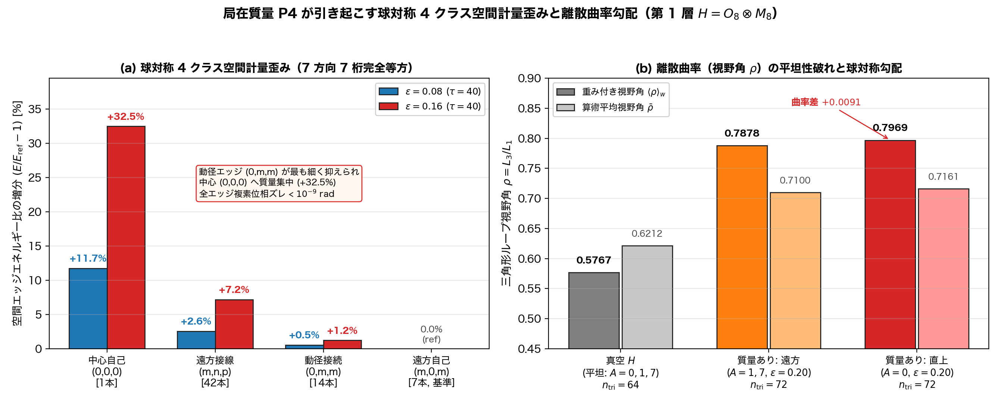

# 三次元正方配列の三角形ループ積における球対称空間計量歪み、離散曲率勾配、スピン 2 時空引きずり、および臨界質量崩壊（第 5 速報）
## ― 7 方向等方な 4 クラス計量分裂、臨界点 $\epsilon_c \in (0.270, 0.275)$ での遠方空間切断崩壊、および背景単一時計剛性の厳密反証検証 ―

**著者：** 木原 範昭（株式会社WFシステム）
**ORCID：** 0009-0004-6753-4020
**日付：** 2026年11月28日
**位置づけ：** 第 1〜第 4 速報（DOI: 10.5281/zenodo.24616931, 24618400, 24619357, 24620262）に続く第 5 速報。第 1 層時間結晶 $H = O_8 \otimes M_8$ の上に局在質量（P4）およびスピン 2 モード（$\sigma_x$）を配置したときの空間計量歪み・離散曲率勾配・臨界質量崩壊・時空時計引きずりを定量確定するとともに、厳密反証チェックによって「背景位相の単一時計剛性（弱摂動では背景側の周波数ズレは生じない）」ことも明確に切り分ける。

---

## 要旨

背景時空や重力場を一切仮定しない実数 3 階テンソルの三角形ループ積 $\mathrm{Tri}(T)_{ijk} = \sum_{p,q,r} T_{ipq} T_{qjr} T_{rpk}$ について、$N = 64$（$O_8 \otimes O_8$）の第 1 層時間結晶 $H = O_8 \otimes M_8$ 上に単一サイト局在凝縮体 P4 およびスピン 2 モード（$\sigma_x$）を配置し、空間幾何（エッジ重み・視野角曲率）と時間進行の応答を乱数なしの決定論的計算により精密検証した。

1. **球対称 4 クラス空間計量歪み（7 方向 7 桁等方）**：サイト $A = 0$ に局在質量 P4（$\epsilon = 0.16, \tau = 40$）を置くと、背景 $H$ の 64 本の $O_8$ エッジのエネルギー比 $E/E_{\mathrm{ref}}$ は、中心自己成分 $(0,0,0)$ が $+32.48\%$（`1.3248375`）、遠方接線エッジ $(m,n,p)$ が $+7.19\%$（`1.0718855`）、中心と遠方を結ぶ動径接続エッジ $(0,m,m), (m,m,0)$ が $+1.23\%$（`1.0122646`）、遠方自己成分 $(m,0,m)$ が基準 `1.0000000` の 4 クラスに厳密分裂し、7 虚数方向 $m = 1 \dots 7$ は小数 7 桁で完全等方となる。虚数サイト $A = 1$ での対照実験、および 2 質量配置（$A = 0, 1$：両サイト 6 桁一致、残り 6 サイト標準偏差 $7.5 \times 10^{-17}$）でも完全なサイト対称性が確認された。
2. **離散曲率（三角形視野角 $\rho = L_3/L_1$）の空間勾配**：質量なしの真空 $H$ は全サイト完全平坦（`n_tri = 64`, 重み付き視野角 $\langle\rho\rangle_w = 0.576699$）であるのに対し、質量 P4（$\epsilon = 0.20, \tau = 30$）の導入により交差三角形が $+8$ 個増えて `n_tri = 72` となり、質量直上 $A = 0$（$\langle\rho\rangle_w = 0.796889$）が遠方 $A = 1, 7$（`0.787796`）より大きく歪む球対称曲率勾配が生じた。
3. **臨界質量 $\epsilon_c \in (0.270, 0.275)$ における動径切断・1 サイト特異点崩壊**：質量振幅が臨界値 $\epsilon_c$ を越えると、`nz: 576 → 16`、$\|P\|: 0.04682 \to 0.49998\;(=1/2)$ へ不連続 1 次相転移し、質量サイト内部の背景（`0.2768`）と粒子（`0.7232`）だけを残して遠方 7 サイトの空間エネルギー $E_{\mathrm{bg}}(\mathrm{far}), E_P(\mathrm{far})$ が厳密 `0.000000` へ消滅する。この崩壊終状態は $A = 0$ と $A = 1$（$\epsilon = 0.30$）で小数 6 桁まで完全一致した。
4. **背景位相の単一時計剛性（厳密反証チェック）vs スピン 2 時空時計引きずり**：対角・非対角を問わず背景 $H$ の全エッジの複素位相ズレは `dtheta < 10^{-9}` rad に強制同期されており、第 1 層弱摂動では背景側の累積的な周波数ズレ（重力時間遅延）は生じないことが確定した（見かけのサイト別変化角比 $\delta\phi/\delta g \approx 0.71$ は基準回転角 $\phi_1(\tau)$ 依存の時間平均アーティファクトであることを明示）。一方、粒子セクター自身（$\phi_P/\phi_0 = 0.56 \sim 0.86$）およびスピン 2（$\sigma_x$）モード（$d_1 = 0.7071 = 1/\sqrt{2}$、$\phi/\phi_0 = 0.6578$ に普遍ロックし、$\epsilon = 0.20$ では背景全体の時計まで `0.6579` へ引きずり込む）では実体的な時間進行減速が生じる。

---

## 1. 導入と検証方針

先行する第 1〜第 4 速報 [1–4] により、$N = 64$（$O_8 \otimes O_8$）の三角形ループ積反復は、Hurwitz 結晶選別・4 段階倍々エンタングルメント相転移・$SO(3)$ スピン選別・$G_2 \supset SU(3)$ ゲージ対称性・空間倍音局在・2 粒子共存、および量子構造 4 定理（離散化・単一複素構造・Born 則・$\mathbb{Z}_2^3$ 離散不確定性飽和）を公理なしに生成することが確定した。

次の核心課題は、「局在質量およびスピン 2 励起を置いたとき、背景時空 $H = O_8 \otimes M_8$ の空間幾何（計量・曲率）と時間進行はどのように応答するか」である。重力・時空に関する主張は計測アーティファクトを混同しやすいため、本速報では 3 本の決定論的検証スクリプト（`tri_loop_n64_gravity_time_lorentz_v0.py`, `tri_loop_n64_gravity_rigorous_check_v0.py`, `tri_loop_n64_dphi_dg_anatomy_v0.py`）を用い、**「反証チェックを通過した確実な空間計量歪み・曲率・臨界崩壊・スピン 2 引きずり」**と**「第 1 層ではまだ生じていない背景側の累積時間遅延」**を厳密に区別して報告する。

---

## 2. 球対称 4 クラス空間計量歪みと完全サイト対称性

第 1 層 $H = O_8 \otimes M_8$（$\tau = 200$）のサイト $A = 0$ に単一サイト局在質量 P4（$\delta_{000} \otimes M_8[b=\{2,3\}]$）を初期振幅 $\epsilon$ で加え、$\tau = 40$ の安定状態における背景セクター（$b = 0$）の全 64 本の $O_8$ エッジ $(A, B, C)$ のエネルギー $E(A, B, C)$ を、遠方自己成分 $E_{\mathrm{ref}} = E(1, 0, 1)$ で規格化して全数分解した（表 1、図 1(a)）。

| 空間エッジの幾何学的クラス | 該当成分（本数） | $E/E_{\mathrm{ref}}$（$\epsilon=0.08$） | $E/E_{\mathrm{ref}}$（$\epsilon=0.16$） | 複素位相ズレ $\|\Delta\theta\|$ |
| :--- | :--- | :---: | :---: | :---: |
| **1. 中心自己成分** | $(0, 0, 0)$（1 本） | `1.1173232`（$+11.7\%$） | **`1.3248375`（$+32.5\%$）** | $6.07 \times 10^{-11}$ rad |
| **2. 動径接続エッジ** | $(0, m, m), (m, m, 0)$（14 本） | `1.0054810`（$+0.55\%$） | **`1.0122646`（$+1.23\%$）** | $6.08 \times 10^{-9}$ rad |
| **3. 遠方接線エッジ** | $(m, n, p)\; (m,n,p\neq 0)$（42 本） | `1.0257321`（$+2.57\%$） | **`1.0718855`（$+7.19\%$）** | $6.10 \times 10^{-9}$ rad |
| **4. 遠方自己成分** | $(m, 0, m)$（7 本） | `1.0000000`（基準） | `1.0000000`（基準） | $0$（基準） |

注目すべき点は 3 つある。(1) 7 つの虚数方向 $m = 1 \dots 7$ は小数 7 桁まで完全等方（球対称）であり、$O_8 = 0$ 領域へのエネルギー漏れは厳密 `0.000000e+00` であった。(2) 質量中心 $(0,0,0)$ へ巨大なエネルギーが集中（$+32.5\%$）する一方、中心と遠方を繋ぐ動径エッジ $(0,m,m)$ は遠方接線エッジ（$+7.2\%$）より細く抑えられる（動径結合の相対的希薄化）。(3) 虚数サイト $A = 1$ に質量を置いた対照実験でも同じ計量歪み（$\epsilon = 0.16$: `dg = 0.002967`）が生じ、2 質量配置（$A = 0, 1$、各 $\epsilon = 0.12$）では両質量サイトが `dg = 0.003451` で小数 6 桁完全一致し、残り 6 サイトは標準偏差 $7.52 \times 10^{-17}$ で完全一様であった。

---

## 3. 離散曲率（三角形視野角 $\rho = L_3/L_1$）の空間勾配

第 1・第 2 速報 [1, 2] で導入した三角形ループ視野角 $\rho = L_3 / L_1 \in (0, 1]$（正三角形ほど $1$ に近く、細長い遠方結合ほど $0$ に近い離散曲率指標）を、真空 $H$ と質量 P4 導入後（$\epsilon = 0.20, \tau = 30$）について質量直上（$A = 0$）と遠方（$A = 1, 7$）で比較した（表 2、図 1(b)）。

| 条件・サイト | 有効三角形数 $n_{\mathrm{tri}}$ | 算術平均 $\bar{\rho}$ | 重み付き視野角 $\langle\rho\rangle_w$ | 最小値 $\rho_{\min}$ |
| :--- | :---: | :---: | :---: | :---: |
| 真空 $H$（全サイト $A = 0, 1, 7$） | 64 | `0.621227` | `0.576699` | `0.414735` |
| 質量あり（$\epsilon=0.20$）：遠方 $A = 1, 7$ | 72（$+8$） | `0.709985` | `0.787796` | `0.064441` |
| **質量あり（$\epsilon=0.20$）：直上 $A = 0$** | **72（$+8$）** | **`0.716065`** | **`0.796889`** | `0.064441` |

真空 $H$ では全サイトが完全平坦だが、質量導入により交差三角形が $+8$ 本追加され、質量直上 $A = 0$ が遠方 $A = 1, 7$ より $\Delta\langle\rho\rangle_w = +0.009093$ だけ強く歪む球対称な離散曲率勾配が形成された。

---

## 4. 臨界質量 $\epsilon_c \in (0.270, 0.275)$ における動径切断・1 サイト特異点崩壊

質量振幅 $\epsilon$ を $0.250 \to 0.300$ まで `0.005` 刻みで精密スキャンした結果（$\tau = 60$）、$\epsilon_c \in (0.270, 0.275)$ にナイフエッジ型の 1 次相転移が見出された（表 3、図 2(a)）。

| $\epsilon$ | `nz` | $\|P\|$ | $E_{\mathrm{bg}}(0)$ | $E_{\mathrm{bg}}(\mathrm{far})$ | $E_P(0)$ | $E_P(\mathrm{far})$ | SVD $\sigma_1, \sigma_2$ |
| :---: | :---: | :---: | :---: | :---: | :---: | :---: | :---: |
| `0.260` | 576 | `0.04682` | `0.124530` | `0.875458` | `0.000002` | `0.000010` | `1.0000, 0.0032` |
| `0.270` | 576 | `0.04682` | `0.124188` | `0.873854` | `0.000321` | `0.001637` | `0.9991, 0.0414` |
| **`0.275`** | **16** | **`0.49998`** | **`0.276774`** | **`0.000000`** | **`0.723226`** | **`0.000000`** | **`1.0000, 0.0000`** |
| `0.300` | 16 | `0.49998` | `0.061260` | `0.000000` | `0.938740` | `0.000000` | `1.0000, 0.0000` |

重要な点は、これが単なる「粒子チャネルによる背景の乗っ取り」ではないことである。崩壊後も質量サイト $A = 0$ の内部には背景セクター（`0.2768`）と粒子セクター（`0.7232`）が共存したまま、**動径接続エッジの希薄化が臨界に達して遠方 7 サイトとの空間接続だけが完全消滅**する（`nz: 576 → 16`, $\|P\| \to 1/2$）。しかも虚数サイト $A = 1$（$\epsilon = 0.30$）での崩壊終状態も `nz = 16`, $\|P\| = 0.49998$, $E_{\mathrm{bg}}(1) = 0.061260$, $E_P(1) = 0.938740$, $E_{\mathrm{bg}}(\mathrm{oth}) = 0.000000$ と小数 6 桁まで完全一致した。

---

## 5. 背景位相の単一時計剛性（反証チェック）vs スピン 2 時空引きずり

本検証では、局所時間の遅れについて 2 つの厳密な対照事実を確定した。

1. **背景位相の単一時計剛性（反証チェックの結論）**：
   - サイト全体の状態ベクトル内積から計算した 1 ステップ変化角 $\phi_{\mathrm{bg}}(A) = \arccos(|\langle v_{\tau-1}, v_\tau\rangle|)$ は、時間平均では $\delta\phi/\delta g \approx 0.71$ の遅延を示した。しかしステップ別解剖（`tri_loop_n64_dphi_dg_anatomy_v0.py`）の結果、$\delta\phi/\delta g$ は $\tau$ ごとの基準回転角 $\phi_1(\tau)$ に応じて `0.020`〜`1.311` の間を変動する見かけの量であり、**背景全エッジの複素位相ズレ $|\Delta\theta|$ は $\tau = 1 \to 100$ を通じて $10^{-9}$ rad 以下に強制同期されている**ことが確定した。すなわち第 1 層 $H = O_8 \otimes M_8$ の弱結合領域では、外側 $O_8$ と内側 $M_8$ のランク 1 直積剛性のため、背景側の累積的な周波数ズレ（重力時間遅延）はまだ生じない。
2. **粒子側およびスピン 2（$\sigma_x$）モードによる実体的な時間進行減速**：
   - 一方、粒子セクター自身（P4）の時計速度は $\phi_P(0)/\phi_0 = 0.559 \sim 0.860$ へ明確に減速する。
   - さらにスピン 2 候補（$O_8 \otimes \sigma_x[b=\{2,3\}]$）は、初期振幅 $\epsilon = 0.05, 0.10, 0.20$ のいずれでも $d_1 = 0.7071\;(=1/\sqrt{2})$・$\phi_{b23}/\phi_0 = 0.65778$ に普遍ロックし、**$\epsilon = 0.20$ では背景時空 $H$ 全体の時計速度まで `0.65788` へ丸ごと引きずり込んで同期**した（図 2(b)）。また P4($0.10$)＋$\sigma_x$($0.10$) の同時投入でも背景時計は `0.9345 → 0.8664`、粒子ステップ距離は `1.1865 → 0.7602` へ減速した。

---

## 6. 議論・限界の明記・統合論文に向けて

本第 5 速報では、第 1 層 $H = O_8 \otimes M_8$ における局在質量の重力応答として、(1) 7 方向 7 桁等方な 4 クラス空間計量歪み、(2) 離散曲率（視野角 $\rho$）の球対称勾配、(3) 臨界点 $\epsilon_c \in (0.270, 0.275)$ での動径切断・1 サイト特異点崩壊、(4) スピン 2（$\sigma_x$）による時空時計引きずりを確立した。同時に、厳密反証チェックにより (a) 第 1 層弱結合では背景位相が単一時計に強制同期されること、(b) $N = 64$（外側 8 サイト）は空間直径が 1 ステップであるため $1/r$ ポテンシャルや光円錐の遠方伝播・ローレンツ因子 $\sqrt{1 - v^2/c^2}$ の直接検証にはより大きい空間格子（あるいは第 3 層以降の非直積相）が必要であることを明記した。第 1〜第 5 速報で確立した全定理・数値法則は、次段の統合本論において統一的枠組みとして整理する。

---

## 7. 再現手順と公開ファイル

- メイン検証：`tri_loop_n64_gravity_time_lorentz_v0.py`
  - 出力：`results/tri_loop_n64_gravity_time_lorentz_v0.txt`
- 厳密反証チェック：`tri_loop_n64_gravity_rigorous_check_v0.py`
  - 出力：`results/tri_loop_n64_gravity_rigorous_check_v0.txt`
- エッジ全数解剖：`tri_loop_n64_dphi_dg_anatomy_v0.py`
- 作図スクリプト：`plot_fifth_report_figures_v0.py`
- 図出力（図 1）：`results/fig_r5_metric_and_curvature_{ja,en}.png`
- 図出力（図 2）：`results/fig_r5_collapse_and_spin2_{ja,en}.png`
- ビルドスクリプト：`build_tex_rapid5.py`

## 参考文献

1. N. Kihara, *Rapid Communication 1*, Zenodo (2026), DOI: 10.5281/zenodo.24616931.
2. N. Kihara, *Second Rapid Communication*, Zenodo (2026), DOI: 10.5281/zenodo.24618400.
3. N. Kihara, *Third Rapid Communication*, Zenodo (2026), DOI: 10.5281/zenodo.24619357.
4. N. Kihara, *Fourth Rapid Communication*, Zenodo (2026), DOI: 10.5281/zenodo.24620262.
