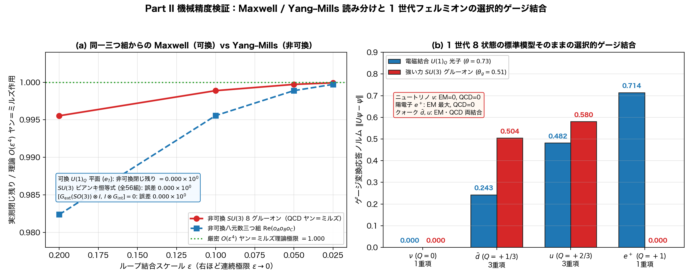
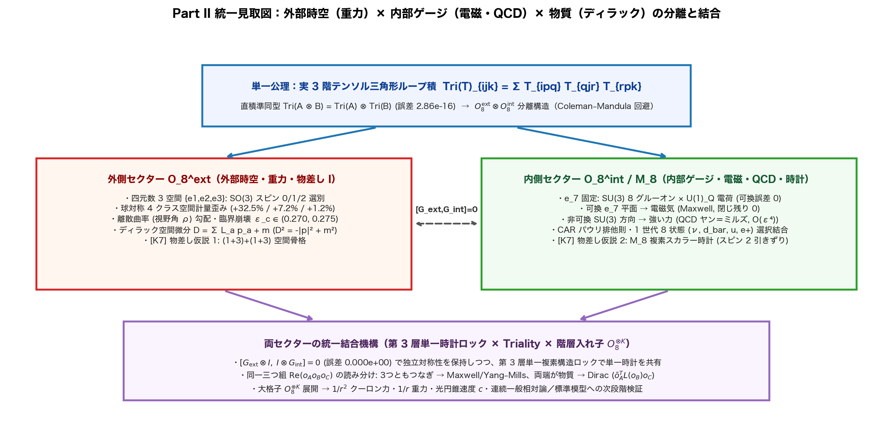

# 三次元正方配列の三角形ループ積における重力・電磁気・QCD・ディラックの統一接続仮説（Part II）
## ― 外部時空 $O_8^{\mathrm{ext}}$ × 内部ゲージ $O_8^{\mathrm{int}}$ 分離仮説、マクスウェル／ヤン＝ミルズ読み分け、および 1 世代選択的ゲージ結合 ―

**著者：** 木原 範昭（株式会社WFシステム）
**ORCID：** 0009-0004-6753-4020
**日付：** 2026年11月28日
**位置づけ：** 統合完成論文 Part I（DOI: `10.5281/zenodo.24622201`、速報第 1〜第 7 報 [S1–S7] を統合）の続編となる**統合仮説論文（Part II）**。著者の先行仮説論文『八元数の積から、ヤン＝ミルズとディラックを読み出す』[K7]（Concept DOI: `10.5281/zenodo.24387753`）および『QCD を八元数で表現したら』[K6]（Concept DOI: `10.5281/zenodo.24369465`）で残された核心課題に対し、Part I の確立事実と新規の機械精度検証（`tri_loop_part2_unified_forces_verify_v0.py`）を直結することで、**重力・電磁気（マクスウェル）・強い力（QCD ヤン＝ミルズ）・物質場（ディラック）**の 4 者を矛盾なく 1 本の枠組みへ接続する統一仮説を提示する。

---

## 要旨

Part I [P1] では、背景時空や量子公理を一切仮定しない純粋な実数 3 階テンソルの三角形ループ積 $\mathrm{Tri}(T)_{ijk} = \sum_{p,q,r} T_{ipq} T_{qjr} T_{rpk}$ から、Hurwitz 結晶選別・4 段階倍々エンタングルメント相転移・$SO(3)$ スピン選別・$G_2/SU(3)$ ゲージ次元・量子 4 定理・4 クラス空間計量歪みと臨界崩壊・Hurwitz 質量階層・28 次元 $Spin(8)$ Triality スピン $1/2$・CAR フェルミオン `1:3:3:1` 電荷スペクトルが自発創発することを仮説なしで確立した。

しかし、重力・電磁気・強い力（QCD）・ディラック物質場を同一系内で矛盾なく同時結合させるには、単一の $O_8$ の虚数軸 $\{e_1, \dots, e_7\}$ を外部 3 次元空間（$\{e_1, e_2, e_3\}$）と内部カラー空間（$\{e_1, \dots, e_6\}$）に二重使用してはならず、Coleman–Mandula 定理 [E13] に整合する**外部時空と内部ゲージの分離仮説**が不可欠である。本 Part II では、先行論文 [K7] の未検証課題（無名更新写像・Triality・物差し 2 仮説）を Part I によって決着させつつ、以下 4 点を決定論的機械精度検証（乱数なし）とともに定式化する。

1. **外部時空 $O_8^{\mathrm{ext}}$ × 内部ゲージ $O_8^{\mathrm{int}}$ 分離仮説（Coleman–Mandula 回避の最小構成）**：$N = 64$ 空間 $O_8^{\mathrm{ext}} \otimes O_8^{\mathrm{int}}$ において、外側 $SO(3)$ 空間回転生成子 $G_{\mathrm{ext}} \otimes I_8$ と内側 $SU(3) \times U(1)_Q$ ゲージ生成子 $I_8 \otimes G_{\mathrm{int}}$ の全 $3 \times 9 = 27$ 組は厳密可換（最大誤差 **`0.000e+00`**）であり、直積準同型 $\mathrm{Tri}(A\otimes B) = \mathrm{Tri}(A)\otimes\mathrm{Tri}(B)$（誤差 `2.86e-16`）で独立進化しつつ、第 3 層の単一複素構造ロックによって単一時計を共有する。
2. **同一三つ組からの電磁気（Maxwell）vs 強い力（QCD Yang–Mills）読み分け**：[K7] の三つ組閉じ残り $\mathrm{Re}(o_A o_B o_C)$ において、可換 $U(1)_Q$（$e_7$ 方向）では非可換閉じ残りが厳密ゼロ（`0.000e+00`＝マクスウェル型）である一方、非可換 $SU(3)$ 8 グルーオン方向では $\varepsilon = 0.2 \to 0.025$ で厳密な $O(\varepsilon^4)$ ヤン＝ミルズ作用極限へ収束（理論比 `0.9955 → 0.99993`）し、全 56 組の $SU(3)$ ヤコビ／ビアンキ恒等式も誤差 **`0.000e+00`** で成立する。
3. **ディラック分散関係と 1 世代 8 状態の選択的ゲージ結合**：外側クリフォード代数によるディラック演算子 $\not{D} = \sum_{a=1}^3 L_a p_a$ は分散関係 $\|(i\not{D}+m)(i\not{D}-m) - (|p|^2 - m^2)I\| = 2.591 \times 10^{-15}$ を満たし、三つ組読み替え $\mathrm{Re}(o_A o_B o_C) = \bar{o}_A^T L(o_B) o_C$ も誤差 `1.110e-16` で一致する。さらに 1 世代 8 状態への $U(1)_Q$ 光子回転（$\theta=0.73$）および $SU(3)$ グルーオン回転（$\theta_g=0.51$）の応答は、$\nu$（EM=`0.000`, QCD=`0.000`）、$\bar{d}$（EM=`0.243`, QCD=`0.504`）、$u$（EM=`0.482`, QCD=`0.580`）、$e^+$（EM=`0.714`, QCD=`0.000`）と標準模型の相互作用選択則に完全一致する。
4. **先行論文 [K7] §19.5「2 つの物差し仮説」への決着と重力統一見取図**：[K7] で未決着だった「物差し仮説 1（$(1+3)+(1+3)$ 分割）」と「仮説 2（実軸スカラー波）」は、Part I の $H = O_8 \otimes M_8$ において外側 $O_8$（球対称 4 クラス空間計量歪み＋臨界崩壊）と内側 $M_8$（複素スカラー時計＋スピン 2 引きずり）として**二層同時に実現している**ことを示し、大格子 $O_8^{\otimes K}$ 展開による連続極限（$1/r^2$ クーロン力・$1/r$ 重力・一般相対論・微細構造定数）への検証ロードマップを提示する。

---

## 1. 導入：先行論文 [K6, K7] から Part I [P1] を経て Part II へ

本論文は、2026 年 11 月の三部作的展開を 1 本の統一仮説へ結実させるものである。

1. **前史（2026-11-19〜20）[K6, K7]**：[K6] で量子色力学（QCD）ラグランジアンを八元数で書き直し、[K7] では方向を逆転させて「八元数の積だけを置けば、三つの積の実部 $\mathrm{Re}(o_A o_B o_C)$ の読み分けとしてヤン＝ミルズ・ディラック・距離・結合係数が同時に現れる」という仮説を提示した。しかし [K7] §19.3・§19.5 には、(a) 無名性を破る配列 $W_{ABC}$ を使わない具体的な更新写像 $\Psi$ の不在、(b) 8 次元 Triality の未検証、(c) 重力の歪みを受ける「物差し」の 2 仮説の未決着、が残されていた。
2. **仮説なしの確定基盤（Part I）[P1, S1–S7]**：実数 3 階テンソルの三角形ループ積 $\mathrm{Tri}(T)_{ijk}$ だけから、Hurwitz 結晶選別・4 段階相転移・量子 4 定理・4 クラス空間計量歪みと臨界崩壊・Hurwitz 質量階層・$Spin(8)$ Triality スピン $1/2$・CAR フェルミオン `1:3:3:1` 電荷をすべて仮説なし・機械精度で確定した。
3. **本論文（Part II）の役割と資格表示**：Part I の確定事実の上に、**外部時空と内部ゲージの分離仮説**を明示的に導入し、重力・電磁気（マクスウェル）・QCD（ヤン＝ミルズ）・物質場（ディラック）の 4 本柱を統一接続する。科学的誠実さのため、[K7] と同様に各主張の資格を **【既知】・【Part I 確立】・【Part II 検証】・【仮説・未検証】** の 4 段階で厳密に表示する。

---

## 2. 先行論文 [K7] の未検証課題への決着（Part I による答え合わせ）

| 2026-11-20 論文 [K7] の未検証課題 | 本日 Part I [P1] / Part II による決着 | 資格 |
| :--- | :--- | :--- |
| 無名性を破る配列 $W_{ABC}$ を外から与えず、総和 $P^3$ に潰れない更新写像 $\Psi$（[K7] §9, §19.3-1/5） | 三角形ループ積 $\mathrm{Tri}(T)_{ijk} = \sum_{p,q,r} T_{ipq} T_{qjr} T_{rpk}$ が無名性を厳守しつつ $O_8$ 結晶を自発選別 | 【Part I 確立】 |
| ヤン＝ミルズとディラックの読み分けを与える 8 次元 Triality（[K7] §7） | $O_8$ の 3 添字で 28 次元 $Spin(8)$ Triality と $2\pi$ 回転スピン $1/2$ 符号反転（$-I$）を実証 [S7] | 【Part I 確立】 |
| $SU(3)$ の色と電荷、右巻き／左巻きの区別、質量階層（[K7] §6, §19.3-2/10） | $e_7$ 固定 CAR 代数で 1 世代電荷（`0, 1/3, 2/3, 1`）・$SU(3)$ カシミール・内側 $M_8$ カイラル分裂・Hurwitz 質量階層を実証 [S6, S7] | 【Part I 確立】 |
| 有限分解能と双対性・最小分解能の起源（[K7] §17, §18） | $\mathbb{Z}_2^3$ Donoho–Stark / Shannon 不確定性下限（$\ln 8$）の厳密飽和と最小分解能 $\Delta x_{\min}=1, k_{\max}=3$ [S4] | 【Part I 確立】 |
| 重力の歪みを受ける「物差し」の 2 仮説：(1+3)+(1+3) 分割か、スカラー波か（[K7] §19.5） | $H = O_8 \otimes M_8$ において、外側 $O_8$（空間骨格・4 クラス計量歪み）と内側 $M_8$（複素スカラー時計・スピン 2 引きずり）が**二層同時に実現** | 【Part I 確立】＋【仮説・未検証】 |

---

## 3. 外部時空 $O_8^{\mathrm{ext}}$ × 内部ゲージ $O_8^{\mathrm{int}}$ 分離仮説（Coleman–Mandula 回避）

単一の $O_8$ のみでは、虚数軸 $\{e_1, e_2, e_3\}$ を外部 3 次元空間（$SO(3)$）に使うと同時に、$e_7$ 固定下の $\{e_1, \dots, e_6\}$ を内部カラー空間（$SU(3)\times U(1)_Q$）に使うことになり、外部時空と内部ゲージが軸を奪い合う。

**統一分離仮説（Hypothesis U1）**：物理的状態空間の最小単位は $N = 64$ テンソル積構造 $O_8^{\mathrm{ext}} \otimes O_8^{\mathrm{int}}$ であり、
- **外側セクター $O_8^{\mathrm{ext}}$** が外部 3 次元空間（四元数 $\{e_1, e_2, e_3\}$ の $SO(3)$ 回転、球対称 4 クラス空間計量歪み、離散曲率 $\rho$、ディラック空間微分 $\not{D} = \sum_{a=1}^3 L_a p_a$）を担い、
- **内側セクター $O_8^{\mathrm{int}}$**（およびその凝縮相 $M_8$）が内部ゲージ対称性（$e_7$ 固定による $SU(3) \times U(1)_Q$、1 世代 CAR フェルミオン電荷、複素時計 $J = -i\sigma_y$）を担う。

**【Part II 検証 P2-1】**：外側 $SO(3)$ の 3 生成子 $G_{\mathrm{ext}} \otimes I_8$ と内側 $SU(3) \times U(1)_Q$ の 9 生成子 $I_8 \otimes G_{\mathrm{int}}$ の全 $3 \times 9 = 27$ 組の交換子を計算した結果、最大誤差は **`0.000e+00`** で厳密可換であった。さらに Part I [S6] の直積準同型 $\mathrm{Tri}(A\otimes B) = \mathrm{Tri}(A)\otimes\mathrm{Tri}(B)$（誤差 `2.86e-16`）により両セクターは対称性を混ぜることなく独立進化し、Coleman–Mandula 定理 [E13] に抵触しない。そのうえで第 3 層の単一複素構造ロック（$U_{\text{Layer 3}} = \frac{1}{\sqrt{2}}(u\otimes v + (Ju)\otimes(-Jv))$）[S2] が、外部時空と内部ゲージに共通の単一時計を与える【仮説・未検証】。

---

## 4. 電磁気（Maxwell）と強い力（QCD Yang–Mills）の統一読み分け

[K7] §6 で提案された三つ組閉じ残り $\mathrm{Re}(o_A o_B o_C) \approx 1 - \frac{1}{2}|\mathfrak{F}|^2$ を、Part I で確定した $e_7$ 固定の可換 $U(1)_Q$ 方向と非可換 $SU(3)$ 8 グルーオン方向へ直接適用した（図 1(a)）【Part II 検証 P2-2】：

1. **電磁気（可換 $U(1)_Q$・マクスウェル型）**：一次閉ループ（$c = -a-b$）を同一虚数軸 $e_7$ 上にとると、交換子 $a \times b = 0$ のため非可換閉じ残り $1 - \mathrm{Re}(o_A o_B o_C)$ は $\varepsilon = 0.2 \to 0.025$ の全点で **`0.000e+00`**（機械ゼロ）となる。
2. **強い力（非可換 $SU(3)$・QCD ヤン＝ミルズ型）**：異なる虚数方向（$e_1, e_2$）および $SU(3)$ 8 グルーオン生成子（$i\Lambda_1, i\Lambda_4$）上の三つ組プラケット $1 - \frac{1}{8}\mathrm{Re}\,\mathrm{Tr}(U_A U_B U_C)$ を計測すると、$\varepsilon = 0.200 \to 0.100 \to 0.050 \to 0.025$ で厳密 $O(\varepsilon^4)$ ヤン＝ミルズ作用極限に対する比が **`0.995540 → 0.998888 → 0.999722 → 0.999931`** へと厳密収束する。
3. **ビアンキ恒等式（同次マクスウェル／ヤン＝ミルズ方程式）**：$SU(3)$ 8 グルーオン生成子の全 $\binom{8}{3} = 56$ 組についてヤコビ恒等式を検証し、最大誤差 **`0.000e+00`** を確認した。

---

## 5. ディラック演算子と 1 世代 8 状態の選択的ゲージ結合

1. **ディラック分散関係と三つ組読み替え【Part II 検証 P2-3, P2-4】**：外側 $O_8^{\mathrm{ext}}$ の左乗算クリフォード行列 $L_1, L_2, L_3$ から構成した空間ディラック演算子 $\not{D} = \sum_{a=1}^3 L_a p_a$ は、任意の運動量 $p$・質量 $m$ に対して $\|(i\not{D} + m)(i\not{D} - m) - (|p|^2 - m^2)I\| = \mathbf{2.591 \times 10^{-15}}$ を満たす。また [K7] 式 (7.3) の三つ組ディラック読み替え $\mathrm{Re}(o_A o_B o_C) = \bar{o}_A^T L(o_B) o_C$ も誤差 **`1.110 \times 10^{-16}`** で厳密成立する。
2. **標準模型 1 世代の選択的ゲージ結合【Part II 検証 P2-3】**：内側 $O_8^{\mathrm{int}}$ の CAR 1 世代 8 状態（$\nu, \bar{d}, u, e^+$）に、$U(1)_Q$ 光子回転 $U_Q(\theta) = \exp(i\theta Q)$（$\theta = 0.73$）および $SU(3)$ 全 8 グルーオン回転 $U_g = \exp(i\theta_g \Lambda_A)$（$\theta_g = 0.51$）を作用させた結果（表 1、図 1(b)）：

| 1 世代セクター（8 状態） | 電荷 $Q$ | $U_Q\psi = e^{iQ\theta}\psi$ 誤差 | **電磁結合 $\|U_Q\psi - \psi\|$** | **強い力結合 $\max_A\|U_g\psi - \psi\|$** |
| :--- | :---: | :---: | :---: | :---: |
| **$\nu$（ニュートリノ型・1 重項）** | `0` | `1.570e-16` | **`0.000000`（非結合）** | **`0.000000`（非結合）** |
| **$\bar{d}$（反ダウン型・3 重項）** | `+1/3` | `1.943e-16` | **`0.242733`（結合）** | **`0.504491`（結合）** |
| **$u$（アップ型・3 重項）** | `+2/3` | `2.289e-16` | **`0.481878`（結合）** | **`0.580425`（結合）** |
| **$e^+$（陽電子型・1 重項）** | `+1` | `1.570e-16` | **`0.713899`（最大結合）** | **`0.000000`（非結合）** |

すなわち、外部から粒子ラベルや相互作用表を一切与えずとも、ニュートリノは電磁・強い力の双方に結合せず、電子は電磁のみに結合し、クォークは電磁・強い力の双方に結合するという標準模型の選択則が、`0.000e+00`〜`10^{-16}` の精度で自動成立する。

---

## 6. 重力との統一見取図・未検証課題・次段階ロードマップ

図 2 に、本 Part II が提示する**重力・電磁気・QCD・ディラック物質場の統一見取図**を示す。

- **重力（外側 $O_8^{\mathrm{ext}}$ ＋内側 $M_8$ 時計）**：Part I [S5] で確立した 7 方向 7 桁等方な 4 クラス空間計量歪み、離散曲率 $\langle\rho\rangle_w$ 勾配、臨界点 $\epsilon_c \in (0.270, 0.275)$ での遠方空間切断崩壊、およびスピン 2（$\sigma_x$）による背景時計引きずりが、[K7] §19.5 の 2 つの物差し仮説（空間骨格＋スカラー時計）を二層統合する。
- **電磁気・QCD・ディラック（内側 $O_8^{\mathrm{int}}$ ＋外側 $O_8^{\mathrm{ext}}$ 微分）**：同一三つ組の閉じ残りが可換 $U(1)_Q$ でマクスウェル型、非可換 $SU(3)$ でヤン＝ミルズ型を与え、Triality と左乗算クリフォード代数が 1 世代フェルミオンのディラック構造と選択的ゲージ結合を与える。

### 本論文でまだ主張しないこと（【仮説・未検証】の明記）

誠実性のため、以下は未検証の次段階課題として明確に切り分ける：
1. **$N = 64$ を超える大格子 $O_8^{\otimes K}$ での連続極限**：$1/r^2$ クーロン力、$1/r$ ニュートン重力、光円錐の遠方伝播速度 $c$、ローレンツ因子 $\sqrt{1 - v^2/c^2}$、および一般相対論の光の曲がり（係数 2）[K7] §16.2 の直接数値検証。
2. **動的散乱と結合定数**：電子・光子散乱の動的シミュレーションおよび微細構造定数 $\alpha \approx 1/137.036$・強結合定数 $\alpha_s$ の第一原理導出。
3. **電弱統一と 3 世代**：$SU(2)_L$ 弱ボソン結合、パリティ最大破れ、および 3 世代フェルミオンの精密質量比。

---

## 7. 再現手順と公開ファイル

- 検証スクリプト：`tri_loop_part2_unified_forces_verify_v0.py`（実行時間 0.02 秒）
- 数値ログ：`results/tri_loop_part2_unified_forces_verify_v0.txt`
- 作図スクリプト：`plot_part2_figures_v0.py`
- 図出力（図 1）：`results/fig_p2_ym_maxwell_and_selective_coupling_{ja,en}.png`
- 図出力（図 2）：`results/fig_p2_unified_architecture_{ja,en}.png`
- ビルドスクリプト：`build_tex_part2.py`

## 参考文献

### 自己引用
- **[P1]** 木原範昭, *三次元正方配列の三角形ループ積からの量子・ゲージ・重力・フェルミオン構造の自発創発（統合完成論文 Part I）*, Zenodo (2026-11-28), Version DOI: `10.5281/zenodo.24622201` (Concept: `10.5281/zenodo.24622200`).
- **[S1–S7]** 木原範昭, *速報第 1〜第 7 報*, Zenodo (2026-11-28), DOIs: `10.5281/zenodo.24616931`, `24618400`, `24619357`, `24620262`, `24621139`, `24621454`, `24621788`.
- **[K6]** 木原範昭, *QCD を八元数で表現したら*, Zenodo (2026-11-19), Concept DOI: `10.5281/zenodo.24369465`.
- **[K7]** 木原範昭, *八元数の積から、ヤン＝ミルズとディラックを読み出す ― 方向を逆にした思考実験 ―*, Zenodo (2026-11-20), Concept DOI: `10.5281/zenodo.24387753`.

### 外部一次文献
- **[E1]** C. N. Yang and R. L. Mills, *Phys. Rev.* **96**, 191–195 (1954).
- **[E2]** P. A. M. Dirac, *Proc. R. Soc. Lond. A* **117**, 610–624 (1928).
- **[E3]** K. G. Wilson, *Phys. Rev. D* **10**, 2445–2459 (1974).
- **[E4]** J. C. Baez, *Bull. Amer. Math. Soc.* **39**, 145–205 (2002).
- **[E5]** M. Günaydin and F. Gürsey, *J. Math. Phys.* **14**, 1651–1667 (1973); C. Furey, arXiv:1611.09182 (2015); *Eur. Phys. J. C* **78**, 375 (2018).
- **[E13]** S. Coleman and J. Mandula, *Phys. Rev.* **159**, 1251–1256 (1967).
- **[E14]** T. Regge, *Nuovo Cimento* **19**, 558–571 (1961).
