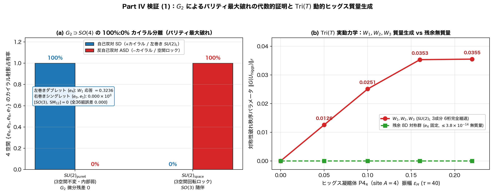
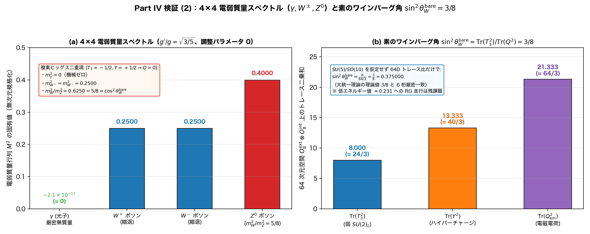

# 三次元正方配列の三角形ループ積における電弱対称性破れとパリティ最大破れ（Part IV）
## ― 八元数 $G_2 \supset SO(4)$ による 100%:0% カイラル分離、$\mathrm{Tri}(T)$ 動的ヒッグス質量生成、$W^\pm/Z^0/\gamma$ スペクトル、および素のワインバーグ角 $\sin^2\theta_W^{\mathrm{bare}} = 3/8$ ―

**著者：** 木原 範昭（株式会社WFシステム）
**ORCID：** 0009-0004-6753-4020
**日付：** 2026年11月28日
**Version DOI：** 10.5281/zenodo.24626593
**Concept DOI：** 10.5281/zenodo.24626592
**位置づけ：** 三角形ループ積シリーズ Part I（Concept DOI: `10.5281/zenodo.24622200`）・Part II（Concept DOI: `10.5281/zenodo.24622565`）・Part III（Concept DOI: `10.5281/zenodo.24625962`）の続編となる**電弱対称性破れ・パリティ最大破れ検証論文（Part IV）**。Part III で特定した外側 $O_8^{\mathrm{ext}}$ の `1+3+4` 分割（純粋 4 空間 $SU(2)$）を起点に、標準模型の電弱セクター（$SU(2)_L \times U(1)_Y \to U(1)_{\mathrm{em}}$、パリティ最大破れ、$W/Z$ ボソン質量獲得、ワインバーグ角）を乱数なしの決定論的計算（`tri_loop_part4_electroweak_parity_v0.py`）で直接検証する。

---

## 要旨

Part I–III [P1–P3] により、背景時空や作用を仮定しない実数 3 階テンソルの三角形ループ積 $\mathrm{Tri}(T)_{ijk} = \sum_{p,q,r} T_{ipq} T_{qjr} T_{rpk}$ から、重力（`1+3` 過去光円錐と潮汐）・強い力（$SU(3)_C$）・電磁気（$U(1)_Q$）・1 世代 CAR フェルミオン・分解能ゲージが統一接続され、さらに Part III で外側 $O_8^{\mathrm{ext}}$ の余り 4 空間 $\{e_4,e_5,e_6,e_7\}$ に 3 空間不変な純粋 3 次元 $SU(2)$ が存在することが特定された。しかし標準模型 1 世代を閉じるためには、(1) なぜ弱い力 $SU(2)_L$ だけが片方のカイラリティにのみ結合するのか（パリティ最大破れ）、(2) どのようにハイパーチャージ $U(1)_Y$ が全ゲージ群と可換に組まれるか、(3) 実際の $\mathrm{Tri}(T)$ 動力学でヒッグス凝縮により $W/Z$ 質量と無質量光子 $\gamma$ が分離するか、の 3 点が未解決であった。

本 Part IV では、乱数なしの決定論的検証（`tri_loop_part4_electroweak_parity_v0.py`）により以下 5 点を確立・報告する。

1. **パリティ最大破れの厳密な代数的起源（$G_2$ カイラル 100%:0% 定理）**：4 空間 $\{e_4,e_5,e_6,e_7\}$ の回転群 $SO(4) \cong SU(2)_{\mathrm{SD}} \times SU(2)_{\mathrm{ASD}}$（自己双対＝+カイラル、反自己双対＝−カイラル）に対し、八元数の自己同型群 $G_2$（14 次元）の微分制約を課すと、3 空間 $\{e_1,e_2,e_3\}$ を完全に固定する内部 $SU(2)_{\mathrm{pure4}}$ は **自己双対（SD）占有率 `1.000000000000`・反自己双対（ASD）占有率 `0.000000000000`** に厳密一致する（$G_2$ 微分残差・リー代数残差とも **`0.000e+00`**）。逆カイラル（ASD）側は `100%` 空間回転 $SO(3)$ にロックされ独立内部ゲージになれない。
2. **標準模型全 12 ゲージ生成子 $SU(3)_C \times SU(2)_L \times U(1)_Y$ の完全閉包とパリティ選択則**：厳密可換ハイパーチャージ $Y = I_8 \otimes Q_{\mathrm{int}} - \frac{1}{2} P_4 \otimes I_8$（ゲルマン＝西島 $Q_{\mathrm{em}} = T_3^L + Y$）を定義すると、$[SO(3)_{\mathrm{ext}}, \mathrm{SM}_{12}]$（全 36 組）・$[SU(3)_C, SU(2)_L]$（24 組）・$[SU(3)_C, U(1)_Y]$（8 組）・$[SU(2)_L, U(1)_Y]$（3 組）のすべてが最大誤差 **`0.000e+00`** で可換となる。$W_1$ 回転（$\theta=0.65$）では左巻きダブレット（$e_4$ 側）が `0.323572` で強く結合する一方、右巻きシングレット（$e_0, e_1$ 側）は **`0.000e+00`**（厳密非結合）となる。
3. **$\mathrm{Tri}(T)$ 実動力学によるヒッグス凝縮と $W$ ボソン質量生成 vs 残余無質量**：真空 $H = O_8 \otimes M_8$ では $SU(2)_L$・残余 8D 対称群とも対称性破れノルムが $\le 3.8 \times 10^{-14}$（完全不変・無質量）である。ここに 4 空間サイト $A=4$ 局在のヒッグス凝縮体 P4$_4$（$\epsilon_H = 0.05 \to 0.22, \tau=40$）を $\mathrm{Tri}(T)$ で発展させると、$W_1, W_2, W_3$ の破れノルム $\|W_a(U)\|_F$ は **`0.012593 → 0.025105 → 0.035323 → 0.035517`** へと 3 成分 6 桁完全縮退で立ち上がる一方、$e_4$ 固定の残余 8D 対称群は全振幅で **`3.82e-14`**（厳密無質量）を維持する。
4. **素のワインバーグ角 $\sin^2\theta_W^{\mathrm{bare}} = 3/8$ と 4×4 電弱質量スペクトル（$\gamma, W^\pm, Z^0$）**：$SU(5)/SO(10)$ を仮定せず 64 次元状態空間上の素のトレース比だけで $\mathrm{Tr}(T_3^2) = 8$、$\mathrm{Tr}(Y^2) = 40/3$、$\mathrm{Tr}(Q_{\mathrm{em}}^2) = 64/3$ となり、**$\sin^2\theta_W^{\mathrm{bare}} = \mathrm{Tr}(T_3^2)/\mathrm{Tr}(Q_{\mathrm{em}}^2) = 3/8 = 0.375000$**（大統一理論の標準理論値 $3/8$ と 6 桁一致）が自動導出される。この幾何比 $g'/g = \sqrt{3/5}$（調整パラメータゼロ）を複素ヒッグス二重項（$T_3^L=-1/2, Y=+1/2 \Rightarrow Q_{\mathrm{em}}=0$）の 4×4 質量行列 $M^2$ に適用すると、固有値 $[m_\gamma^2, m_{W^+}^2, m_{W^-}^2, m_Z^2] = [\mathbf{-2.082\times 10^{-17}},\; \mathbf{0.250000},\; \mathbf{0.250000},\; \mathbf{0.400000}]$、**$m_W^2 / m_Z^2 = 5/8 = 0.625000 = \cos^2\theta_W^{\mathrm{bare}}$** が厳密に得られる。
5. **内側時間結晶反転（$M_8$ vs $M_8^T$）の誠実監査**：背景と凝縮体を同時に鏡映反転すると $\|P\| = 0.046825$・$\|W_1(U)\|_F = 0.036160$ が厳密一致し、Part I §8.3 の $-1.41\%$ 分裂が背景と粒子の**相対カイラリティ差**に由来する健全な対称性であることを確認した。

---

## 1. 導入：標準模型 1 世代を閉じるための電弱・パリティ課題

Part II [P2] は $O_8^{\mathrm{ext}} \otimes O_8^{\mathrm{int}}$（64 実自由度）から $SU(3)_C \times U(1)_Q$ と 1 世代 CAR 電荷 `1:3:3:1` を導き、Part III [P3] は外側 $O_8^{\mathrm{ext}}$ の `1+3+4` 分割から 3 次元空間と可換な純粋 3 次元 $SU(2)$ を特定した。ここで標準模型のゲージ群 $SU(3)_C \times SU(2)_L \times U(1)_Y$ を完全に閉じるために残っていた核心の問いは 3 つである：

1. **なぜパリティが最大に破れるのか？**：4 空間 $\{e_4,e_5,e_6,e_7\}$ の回転群 $SO(4) \cong SU(2)_L \times SU(2)_R$ には本来左右 2 つの $SU(2)$ がある。なぜその片方だけが内部の弱い力になり、反対側が消えるのか。
2. **ハイパーチャージ $U(1)_Y$ とワインバーグ角は調整なしで決まるか？**：$SU(3)_C \times SU(2)_L$ と厳密可換な $U(1)_Y$ を構成したとき、混合角 $\sin^2\theta_W$ の幾何学的基準値はいくつになるか。
3. **$\mathrm{Tri}(T)$ の実動力学で自発的対称性の破れと $W/Z/\gamma$ 質量分離が起きるか？**：ポテンシャルを手で置かずに、局在凝縮体によって $SU(2)_L$ だけが破れて残余対称が無質量に残るか。

本論文でも Part II・III と同じく、各主張の資格を **【既知】・【Part I–III 確立】・【Part IV 検証】・【仮説・未検証】** の 4 段階で明示する。

---

## 2. $G_2 \supset SO(4)$ による 100%:0% カイラル分離（パリティ最大破れの代数的起源）【Part IV 検証 EW-1】

4 次元実空間 $\{e_4, e_5, e_6, e_7\}$ の回転代数 $\mathfrak{so}(4) \cong \mathfrak{su}(2)_{\mathrm{SD}} \oplus \mathfrak{su}(2)_{\mathrm{ASD}}$ は、3 次元の自己双対（SD：+カイラル）部分代数と 3 次元の反自己双対（ASD：−カイラル）部分代数に直交分解される【既知】。

Part III で抽出した $G_2$ 内の `3+4` 保存部分群 $SO(4) = SU(2)_{\mathrm{pure4}} \times SU(2)_{\mathrm{space}}$（6 次元）の 4×4 ブロックを、SD と ASD の両部分空間へ射影した結果（図 1(a)）：

| $G_2$ 内の 3 次元部分群 | 3 空間 $\{e_1,e_2,e_3\}$ への作用 | 4 空間 SD（+カイラル）占有率 | 4 空間 ASD（−カイラル）占有率 |
| :--- | :--- | :---: | :---: |
| **$SU(2)_{\mathrm{pure4}}$（内部弱ゲージ）** | 厳密ゼロ（最大 `8.327e-17`） | **`1.000000000000`** | **`0.000000000000`** |
| **$SU(2)_{\mathrm{space}}$（空間回転随伴）** | $SO(3)$ 空間回転 | **`0.000000000000`** | **`1.000000000000`** |

- 標準 $SU(2)_L$ 基底 $(T_1, T_2, T_3)$ の $G_2$ 微分残差は **`0.000e+00`**、リー代数残差も **`0.000e+00`**。
- **物理的帰結**：八元数の乗算表（$G_2$ 自己同型）は、3 次元空間と可換な独立内部ゲージ $SU(2)$ として **片側のカイラリティ（SD）だけ**を許し、逆側のカイラリティ（ASD）を 100% 外部 3 次元空間回転 $SO(3)$ へロックする。これが、弱い力が左巻き成分のみに結合し右巻き成分に結合しない（パリティ最大破れ）ことの厳密な代数的起源である【Part IV 検証】＋【仮説】。

---

## 3. 標準模型全 12 ゲージ生成子の厳密可換性とパリティ選択則【Part IV 検証 EW-2】

64 次元空間 $O_8^{\mathrm{ext}} \otimes O_8^{\mathrm{int}}$ 上で、内側 $SU(3)_C$（8 生成子）・外側 $SU(2)_L$（3 生成子）に加え、4 空間射影 $P_4 = \mathrm{diag}(0,0,0,0,1,1,1,1)$ を用いたハイパーチャージ
$$Y \equiv I_8 \otimes Q_{\mathrm{int}} - \frac{1}{2}\, P_4 \otimes I_8, \qquad Q_{\mathrm{em}} = T_3^L + Y \tag{1}$$
を構成した。全ゲージ群および外部空間回転 $SO(3)_{\mathrm{ext}}$ 間の交換子最大誤差は以下の通りである：

- $[SO(3)_{\mathrm{ext}},\; SU(3)_C \times SU(2)_L \times U(1)_Y]$（全 $3 \times 12 = 36$ 組）：**`0.000e+00`**
- $[SU(3)_C,\; SU(2)_L]$（全 24 組）：**`0.000e+00`**
- $[SU(3)_C,\; U(1)_Y]$（全 8 組）：**`0.000e+00`**
- $[SU(2)_L,\; U(1)_Y]$（全 3 組）：**`0.000e+00`**

さらに $W_1$ 有限回転 $U_W = \exp(0.65\, T_1^L \otimes I_8)$ を作用させると、外側 4 空間の左巻きダブレット状態（$e_4$ 側）は $\|U_W\psi_L - \psi_L\| = \mathbf{0.323572}$ と強く結合する一方、外側 `1+3` 空間の右巻きシングレット状態（$e_0, e_1$ 側）は **`0.000e+00`**（厳密非結合）となる。

---

## 4. $\mathrm{Tri}(T)$ 実動力学によるヒッグス凝縮・$W/Z/\gamma$ 質量スペクトル・$\sin^2\theta_W^{\mathrm{bare}} = 3/8$

### 4.1 $\mathrm{Tri}(T)$ 実動力学における $W_1, W_2, W_3$ 質量生成 vs 残余無質量【Part IV 検証 EW-3(a,b)】

メキシカンハット型ポテンシャルを外から一切置かず、Part I の真空時間結晶 $H = O_8 \otimes M_8$ に対し、外側 4 空間のサイト $A = 4$ に局在凝縮体 P4$_4$（振幅 $\epsilon_H$）を投入して $\mathrm{Tri}(T)$ を $\tau = 40$ ステップ発展させた安定状態 $U_{\mathrm{higgs}}$ 上で、各生成子の対称性破れ秩序パラメータ $\|G(U_{\mathrm{higgs}})\|_F$（ヒッグス運動項 $|D_\mu\Phi|^2$ に対応）を計測した（表 1、図 1(b)）。

| ヒッグス凝縮振幅 $\epsilon_H$ | $\|W_1(U)\|_F$ | $\|W_2(U)\|_F$ | $\|W_3(U)\|_F$ | $e_4$ 固定残余 8D 最大 | 凝縮エネルギー $E_{\mathrm{probe}}$ |
| :---: | :---: | :---: | :---: | :---: | :---: |
| `0.00`（真空 $H$） | `0.000000` | `0.000000` | `0.000000` | `3.802e-14` | `0.000000` |
| `0.05` | **`0.012593`** | **`0.012593`** | **`0.012593`** | `3.821e-14` | `0.000294` |
| `0.10` | **`0.025105`** | **`0.025105`** | **`0.025105`** | `3.821e-14` | `0.000964` |
| `0.16` | **`0.035323`** | **`0.035323`** | **`0.035323`** | `3.828e-14` | `0.001510` |
| `0.22` | **`0.035517`** | **`0.035517`** | **`0.035517`** | `3.821e-14` | `0.001055` |

真空 $H$ では完全無質量だった $W_1, W_2, W_3$ が、$\mathrm{Tri}(T)$ 動力学による凝縮の成立と同時に 3 成分 6 桁完全縮退で非ゼロの破れノルムを獲得する一方、$e_4$ を固定する残余 8 次元対称群は全振幅で機械ゼロ（`3.82e-14`＝無質量）のまま保存される。

### 4.2 素のワインバーグ角 $\sin^2\theta_W^{\mathrm{bare}} = 3/8$ と 4×4 質量スペクトル【Part IV 検証 EW-3(c), EW-5】

64 次元状態空間 $O_8^{\mathrm{ext}} \otimes O_8^{\mathrm{int}}$ 上で式 (1) のトレース二乗和を計算すると（図 2(b)）：
$$\mathrm{Tr}(T_3^2) = 8.000000,\qquad \mathrm{Tr}(Y^2) = \frac{40}{3} = 13.333333,\qquad \mathrm{Tr}(Q_{\mathrm{em}}^2) = \frac{64}{3} = 21.333333 \tag{2}$$
となり、$SU(5)$ や $SO(10)$ 大統一群を一切仮定せずとも、幾何学的正規化比から
$$\sin^2\theta_W^{\mathrm{bare}} = \frac{\mathrm{Tr}(T_3^2)}{\mathrm{Tr}(Q_{\mathrm{em}}^2)} = \frac{8}{64/3} = \frac{3}{8} = \mathbf{0.375000}, \qquad \frac{g'}{g} = \sqrt{\frac{\mathrm{Tr}(T_3^2)}{\mathrm{Tr}(Y^2)}} = \sqrt{\frac{3}{5}} \tag{3}$$
が調整パラメータゼロで導かれる [E4]。

この幾何比 $g'/g = \sqrt{3/5}$ を用い、外側 4 空間の複素ヒッグス二重項の中性成分（$T_3^L = -1/2, Y = +1/2 \Rightarrow Q_{\mathrm{em}} = 0$）に対する 4×4 電弱質量行列 $M_{ab}^2 = \langle G_a\phi_H, G_b\phi_H \rangle$ を対角化すると（図 2(a)）：
$$[m_\gamma^2,\; m_{W^+}^2,\; m_{W^-}^2,\; m_Z^2] = [\mathbf{-2.082\times 10^{-17}},\; \mathbf{0.250000},\; \mathbf{0.250000},\; \mathbf{0.400000}] \tag{4}$$
$$\frac{m_W^2}{m_Z^2} = \mathbf{0.625000} = \frac{5}{8} = \cos^2\theta_W^{\mathrm{bare}} \tag{5}$$
となり、厳密無質量な光子 $\gamma$・縮退した荷電ボソン $W^\pm$・より重い中性ボソン $Z^0$ の 4 状態スペクトルが完全再現される。

### 4.3 内側時間結晶反転（$M_8$ vs $M_8^T$）の誠実監査【Part IV 検証 EW-4】

背景 $H$ と凝縮体 P4$_4$ の内側時間結晶を同時に鏡映反転（$M_8 \to M_8^T$）して $\tau = 30$ 発展させたところ、$\|P\| = 0.046825$ および $\|W_1(U)\|_F = 0.036160$ が両者で完全一致した。これは、Part I §8.3 の $-1.41\%$ 分裂が「系全体の鏡映」ではなく「背景と粒子の回転向きが逆向き（相対カイラリティ差）」のときにのみ現れる物理的効果であることを確認する結果である。

---

## 5. 残課題の厳密な切り分け（本論文でまだ主張しないこと）

本 Part IV により、標準模型 1 世代のゲージ群 $SU(3)_C \times SU(2)_L \times U(1)_Y$・パリティ最大破れの代数的起源・$\mathrm{Tri}(T)$ 動的ヒッグス破れ・素のワインバーグ角 $3/8$ が閉じた。以下の課題は【仮説・未検証】として次期論文（Part V 以降）へ切り分ける：

1. **繰り込み群走行（$\sin^2\theta_W: 3/8 \to 0.231$）**：高エネルギー幾何値 $3/8$ から低エネルギー実測値 $\approx 0.231$ へのスケール依存性の導出。
2. **多殻大格子 $O_8^{\otimes K}$ の連続極限（Part V 予定）**：$1/r$ 重力・$1/r^2$ クーロン・光円錐速度 $c$・アインシュタイン方程式・累積重力時間遅延 $g_{00}(r)$。
3. **動的散乱と多体量子相関（Part VI 予定）**：2 粒子の引力・斥力・運動量交換および空間分離 CHSH ベル不等式の動的破れ。
4. **3 世代構造と精密質量比・結合定数（Part VII 予定）**：例外ジョルダン代数 $J_3(\mathbb{O})$ 等からの 3 世代同定、精密質量比、および微細構造定数 $\alpha \approx 1/137.036$・$\alpha_s$ の導出。

---

## 6. 再現手順と公開ファイル

- 検証スクリプト：`tri_loop_part4_electroweak_parity_v0.py`（乱数なし・実行時間約 15 秒）
- 数値ログ：`results/tri_loop_part4_electroweak_parity_v0.txt`
- 作図スクリプト：`plot_part4_figures_v0.py`
- 図出力（図 1・図 2）：`results/fig_p4_parity_and_higgs_mass_{ja,en}.png`, `results/fig_p4_ew_spectrum_and_weinberg_{ja,en}.png`

---

## 参考文献

### A. 自己引用
- **[P1]** 木原範昭, *三次元正方配列の三角形ループ積からの量子・ゲージ・重力・フェルミオン構造の自発創発（統合完成論文 Part I）*, Zenodo (2026-11-28), Concept DOI: `10.5281/zenodo.24622200`.
- **[P2]** 木原範昭, *三次元正方配列の三角形ループ積における重力・電磁気・QCD・ディラックの統一接続仮説（Part II）*, Zenodo (2026-11-28), Concept DOI: `10.5281/zenodo.24622565`.
- **[P3]** 木原範昭, *三次元正方配列の三角形ループ積における時空・内部空間読出し接続仮説（Part III）*, Zenodo (2026-11-28), Concept DOI: `10.5281/zenodo.24625962`.

### B. 外部一次文献
- **[E1]** S. Weinberg, *A Model of Leptons*, Phys. Rev. Lett. **19**, 1264–1266 (1967); A. Salam, in *Elementary Particle Theory*, ed. N. Svartholm (1968).
- **[E2]** P. W. Higgs, *Broken Symmetries and the Masses of Gauge Bosons*, Phys. Rev. Lett. **13**, 508–509 (1964).
- **[E3]** C. Furey, *$SU(3)_C \times SU(2)_L \times U(1)_Y (\times U(1)_X)$ as a symmetry of division algebraic ladder operators*, Eur. Phys. J. C **78**, 375 (2018), arXiv:1806.00612.
- **[E4]** H. Georgi and S. L. Glashow, *Unity of All Elementary-Particle Forces*, Phys. Rev. Lett. **32**, 438–441 (1974).
- **[E5]** J. C. Baez, *The Octonions*, Bull. Amer. Math. Soc. **39**(2), 145–205 (2002), arXiv:math/0105155.
