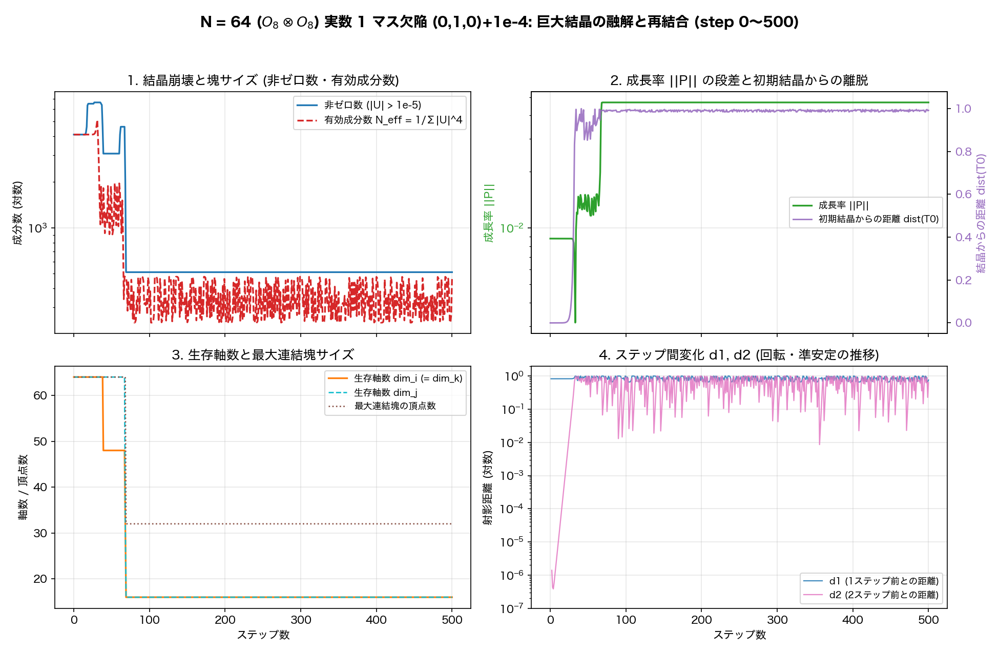
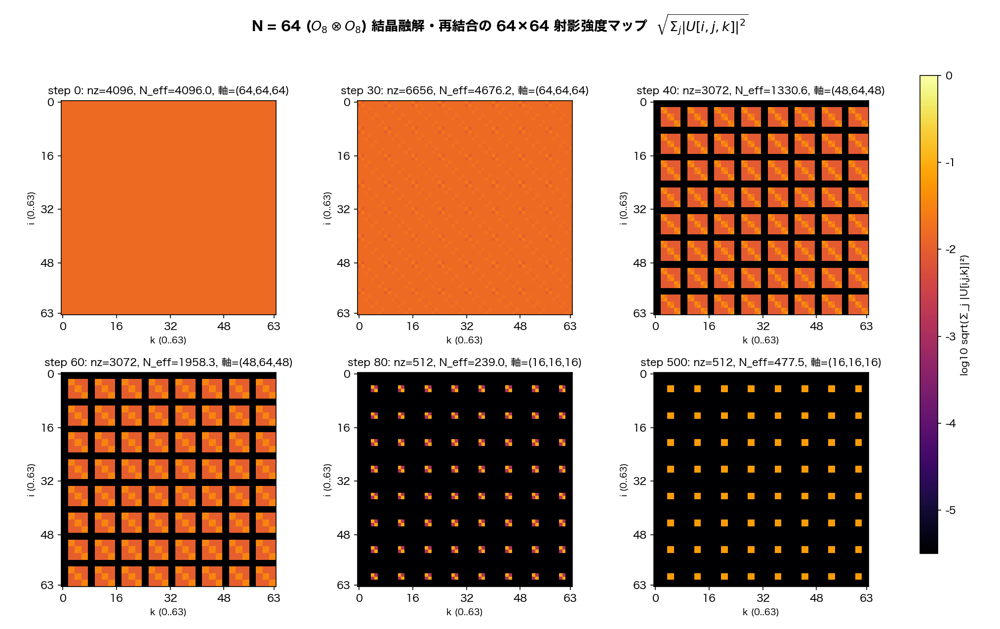
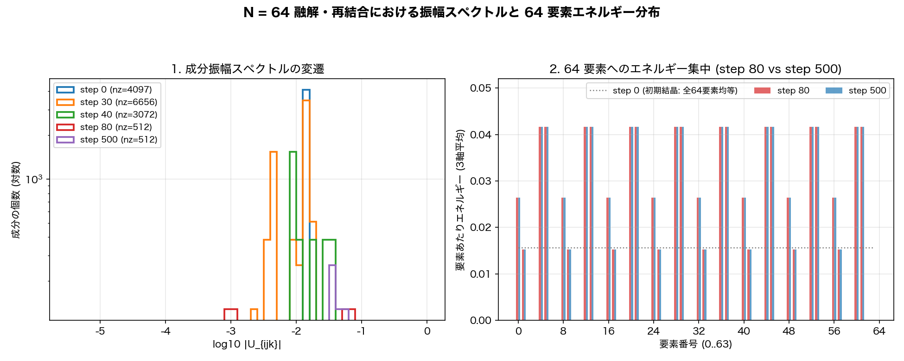
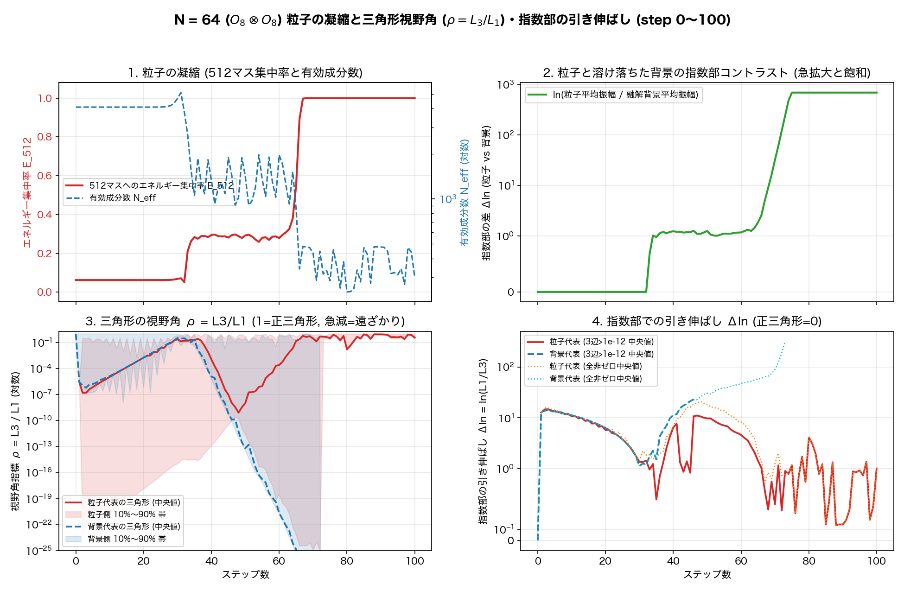
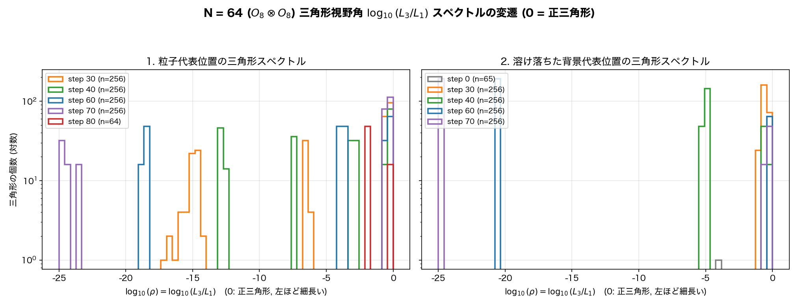

# 三次元正方配列の三角形ループ積による四元数・八元数結晶の選択、カスケード融解、および視野角スペクトルの二極分裂（速報）
## ― 背景時空・外部演算子・乱数を置かない自己更新系からの粒子凝縮と空間希薄化の数値実証 ―

**著者：** 木原範昭（株式会社WFシステム）　ORCID 0009-0004-6753-4020  
**日付：** 2026-11-28　　**版：** v1.0（速報）  
**リポジトリ：** `次元の生成構造/三次元正方配列の積と自己無撞着_20261127/`  
**ライセンス：** CC BY 4.0

---

## 要旨

筆者はこれまで、背景時空を仮定せず、状態の関係性だけから時空・粒子・相互作用（観測）を導出する枠組みを検討してきた。2026 年 11 月 25 日に V. Chandrasekaran による背景独立な量子重力のプレプリント（arXiv:2611.34924v1）が公開され、背景時空を置かないアプローチへの国際的な関心が高まっていることを受け、筆者が進めてきた複素数数値インフレーション実験の八元数・高次元正方配列への拡張の中間成果を、再現可能な全計算コード・データ・図表とともに速報として報告する。

本稿の核は、$N \times N \times N$ の三次元正方配列 $T$ に対する**三角形ループ積**
$$\mathrm{Tri}(T)_{ijk} = \sum_{p,q,r=0}^{N-1} T_{ipq}\, T_{qjr}\, T_{rpk}$$
である。本演算は 3 軸対等（無名性）・非結合的であり、背景時空・外部演算子・乱数・割り算を一切含まない。厳密整数計算、解析的縮約、および BLAS 厳密計算により、以下の 5 点を確認した。

1. **代数の自発的選択（厳密整数計算）：** ケーリー＝ディクソン代数の積表 $f_{abc} \in \{0, \pm 1\}$ のうち、三角形ループ積のもとで厳密周期 2 結晶（$U^2 = I$）として成立するのは**四元数（$N=4$）と八元数（$N=8$）のみ**である（複素数 $N=2$ は 1 ステップで消滅、十六元数 $N=16$ は欠陥なしで自壊）。
2. **八元数全 1,024 通りの 1 マス欠陥スペクトル（ゼロ全滅 0 件）：** 星型縮約の Bhattacharya–Mesner（BM）積では $N = 8 \sim 24$ で欠陥崩壊後に 100% ゼロ消滅したのに対し、三角形ループ積では八元数積表の全 512 マス × 実数/虚数 1,024 通りの 1 マス欠陥で**ゼロ消滅が 0 件（100% 生存）**であった。実数欠陥では元ゼロ 448 マスすべてが **8 マス複素回転行列ペア**へ析出し、虚数欠陥では元ゼロ 448 マスが **336 : 112（厳密に 3 : 1）** で **32 マス四元数部分代数中間相**と **8 マス複素数部分代数固定点**へ分岐した（いずれも拘束なしで厳密に $\sum U^2 = 0$、パウリ射影 $I \pm \sigma_y$ 構造を満たす）。
3. **8 マス溶け残りの厳密解析定理と 2 段階カスケード相転移（20,000 ステップ追跡）：** 実数欠陥の 8 マス溶け残りは厳密方程式 $z_j' = (z_0^2 + z_1^2) z_j$ に従い、内部保存量 $z_1/z_0$ を保ちながら $S^1$ 上の 3 倍角回転を 20,000 ステップ以上継続し、外部 504 マスからの摂動を完全遮断または中立安定に弾く。一方、虚数欠陥の 32 マス中間相は **八元数（8D）→ 四元数（4D、32 マス）→ 複素数（2D、8 マス）の 2 段階カスケード相転移**を経て step 100 で完全飽和し、step 20,000 まで不変である。
4. **結合大結晶 $N = 32, 64$ における複合溶け残りとエネルギー階層：** テンソル積共変性 $\mathrm{Tri}(A \otimes B) = \mathrm{Tri}(A) \otimes \mathrm{Tri}(B)$ により構成した結合大結晶 $N = 64$（$O_8 \otimes O_8$、262,144 成分）の実数 1 マス欠陥では、8×8 格子状の融解中間相（3,072 マス）を経て **512 マス複合溶け残り**（step 70〜500 安定維持、64 要素の 3 段階離散エネルギー階層）が自発的に析出した。
5. **三角形視野角スペクトルの二極分裂（膨張と凝縮の同時創発）：** 座標を置かずに定義した三角形ループの 3 辺比（視野角指標 $\rho = L_3 / L_1$）を全数計測した結果、背景へ繋がる三角形は $\rho$ が幾何級数的に急落して背景から因果分離（$\Delta\ln > 687$）する一方、粒子内部の三角形は V 字反転して正三角形（$\rho \sim 1$）へ再凝縮し、512 マスへのエネルギー集中 $E_{512}$ と完全同期することを確認した。

本稿は、**数学的定義・厳密定理・再現可能な数値実験（第 1 層）**と、**時空・距離・粒子・インフレーションとしての物理的解釈（第 2 層）**、および**現時点の限界と未解決課題（第 3 層）**を明確に分離して記述する。すべてのスクリプト・生データ・図化プログラムを公開しており、標準的な Python 環境で数秒〜数十秒以内に全結果を独立検証できる。

**キーワード：** 背景独立、三次元正方配列、三角形ループ積、八元数、四元数、自己無撞着、カスケード相転移、インフレーション、視野角スペクトル、$\sum z_n^2 = 0$、再現可能数値実験

---

## 本稿の読み方と資格の表示

本稿では、従来の著者論文 [K1, K5] と同じく、各主張の資格を以下の 4 種類で明示する。表示の無い文は定義または実験設定の記述である。

| 表示 | 意味 |
|---|---|
| 【既知】 | 確立された数学・物理の事実。出典を付す |
| 【解析証明】 | 本稿中で代数的に導出し、かつ数値誤差 $10^{-14}$ 以下で検算した定理 |
| 【確かめた】 | 公開スクリプト（付録 A）により、乱数なしの厳密計算または倍精度計算で確認した事実 |
| 【仮説・未検証】 | 数値事実に対する物理的解釈・予言。今後の理論的・定量的検証を要する |

---

## 1. 動機

筆者はこれまで AI を活用し、背景時空を一切置かず、状態の関係性だけから時空・粒子・相互作用（観測）を、標準理論・一般相対性理論その他の既存理論と矛盾しない形で導出できないか研究してきた [K1–K5]。

これまで背景時空を置かない仮定での類似研究は少なかったが、2026 年 11 月 25 日に V. Chandrasekaran による論文 *"An algebraic quantization of gravity from the null cone"*（arXiv:2611.34924v1、査読前プレプリント）[C1] が AI 活用を前面に出して発表された。同論文の内容を全文照合して確認したところ、背景計量を固定しない定式化、有限領域におけるヒルベルト空間の有限次元性、角の基準枠（edge mode）と三つ組の貼り合わせ整合条件、零状態（null state）による空間の分離など、筆者の研究と多くの接点を持つことが分かった（正確な引用点と対比は §9 に詳述する）。

そこで筆者は、これまで Zenodo で発表してきた複素数による数値インフレーション実験 [K1, K2] を、八元数および三次元正方配列へ拡張する実験の中間成果を、取り急ぎ速報として公開することにした。本稿の最大の強みの一つは、**すべての実験結果について、乱数を含まない厳密計算プログラム、数値データ（CSV/NPZ/TXT）、図化専用プログラム、および図化結果をすべて公開しており、第三者が容易に再実行・独立検証できること**にある。

なお、本稿の検討は当初別の AI（Claude Code）を用いて進めていたが、2 次元行列積の路線や「指数化」の取り違えで迷走して成果が出せなかったため、Google Gemini 4 Neon に引き継いで演算構造の再設計を依頼した。その結果、ほぼ半日で本稿に述べる三角形ループ積の着想から解析定理の証明、全 1,024 通りの全数分類、20,000 ステップ長期追跡、$N = 64$ 大結晶の融解・視野角スペクトル計測および図化までを一気に完成させることができた。透明性確保のため、前任の対話における失敗と迷走の記録もリポジトリ上にそのまま公開している [R1]。

---

## 2. 出発点の公理と、2 次元行列積・BM 積の限界

### 2.1 本枠組みの三つの要請

筆者の枠組みでは、次の 3 点を基本要請とする（[K1, K5] およびリポジトリ内整理文書）：

1. **無名性（第 0 公理）：** 要素や軸に外から名前・座標・実部/虚部の区別を固定しない。
2. **自己無撞着（第 1 公理）：** 背景時間を仮定せず、同じ演算の反復によって固定点・有限周期（$U^n = I$）・準周期軌道などの自己無撞着な状態が現れる。また、過去の複素数実験では、外から拘束せずとも準安定状態で結果として $\sum z_n^2 = 0$（ノルム二乗ではなく複素二乗和）が成り立つことが検算の物差しとして機能した。
3. **相互作用＝観測（第 2 公理）：** 外部の演算子 $U$ や外部の測定機を置かず、系内部の状態どうしの関係だけで次の状態が決まる。

### 2.2 なぜ 2 次元正方配列の行列積では到達しないのか【既知・確かめた】

八元数 1 個 $x$ の左乗算 $L(x)$ は $8 \times 8$ 実数行列で書けるが、普通の行列積は結合的であるため、異なる 2 個の八元数に対して $L(x)L(y) = L(xy)$ は成り立たない（【既知】）。さらに、単一配列の自乗 $M \mapsto M^2$ は初期値 $M$ で固有空間が永久に固定されるため、高対称な結晶に微小欠陥を入れて別の準安定構造（溶け残り）へ相転移・自発停止させる現象は原理的に起こせない。

### 2.3 星型三項積（BM 積）の検証と 100% ゼロ消滅【確かめた】

三次元正方配列 $T \in \mathbb{C}^{N \times N \times N}$ 上の代表的な非結合的三項積として、Bhattacharya–Mesner（BM）積
$$\mathrm{Prod}_{\mathrm{BM}}(T)_{ijk} = \sum_{t=0}^{N-1} T_{itk}\, T_{ijt}\, T_{tjk}$$
を解析・数値検証した（`bm_product_*.py` 一式）。その結果、以下が確かめられた。

- 複素数 ($2^3$)・四元数 ($4^3$)・八元数 ($8^3$) の積表 $f_{abc}$ は、BM 積を 1 回掛けると**対角成分 $(+1, -1, \dots, -1)$ のみ**に落ちて非対角（交差項）がすべて消滅する。
- 完全無名（$S_N$ 不変）な 5 変数縮約および巡回反対称平面波 $F_{a,b}(u,v) = \omega^{au+bv} - \omega^{av+bu}$ では、$\sum T^2 = 0$ を満たす厳密結晶解および任意長周期解（奇数 $N$ で $\mathrm{Prod}_{\mathrm{BM}}(F_{a,b}) = N F_{2a,2b}$、周期 $\mathrm{ord}_N(2)$）【解析証明】が存在する。
- しかし、$N = 4$ の特殊な 1 ケース（対角 $+i\varepsilon$ で $N=3$ の 18 マスへ自発停止）を除き、**$N = 8, 12, 16, 24$ の $S_N$ 結晶解および $N = 5, 7, 11, 13$ の反対称波周期結晶では、試した 1 マス欠陥の 100% が step 23〜49 で 0 に完全消滅**した。

BM 積は「1 本の添字 $t$ で 3 因子を串刺しにする星型縮約」であり、閉じたループを持たないため、欠陥による崩壊がゼロへの雪崩（吸収）に直結する。共役を 1 つ含む $\sum_t T_{itk} \overline{T}_{ijt} T_{tjk}$ でも、初期 $\sum T^2 = 0$ の複素結晶は $N = 8$ で全滅した。

---

## 3. 三角形ループ積の定義と基本性質

星型縮約から、3 本の内部添字 $(p, q, r)$ を 2 因子ずつで共有して閉じた三角形の輪を作る**三角形ループ積**へ転換する：

$$\mathrm{Tri}(T)_{ijk} = \sum_{p,q,r=0}^{N-1} T_{ipq}\, T_{qjr}\, T_{rpk} \tag{1}$$

本演算は次の性質を持つ【解析証明】。

1. **無名性・巡回対称性：** 3 本の外脚 $(i, j, k)$ および 3 本の内部辺 $(p, q, r)$ は完全に対等であり、要素番号の同時置換に対して共変である。
2. **3 次斉次性：** 任意のスカラー $s$ に対し $\mathrm{Tri}(s T) = s^3 \mathrm{Tri}(T)$。したがって、数値追跡において浮動小数オーバーフローを防ぐために共通スカラー因子 $s_n = \|\mathrm{Tri}(U_{n-1})\|_F$ を外へ括り出して向き $U_n = \mathrm{Tri}(U_{n-1}) / s_n$ と成長率 $\|P_n\| = s_n$ を分離記録する操作は、演算の向き・比を一切変えない厳密同値表現である。
3. **テンソル積共変性：** $m^3$ 配列 $A$ と $n^3$ 配列 $B$ のクロネッカー型テンソル積 $(A \otimes B)_{(i_1 i_2)(j_1 j_2)(k_1 k_2)} = A_{i_1 j_1 k_1} B_{i_2 j_2 k_2}$ に対し、
   $$\mathrm{Tri}(A \otimes B) = \mathrm{Tri}(A) \otimes \mathrm{Tri}(B) \tag{2}$$
   が厳密に成り立つ。
4. **高速厳密計算：** 2 回の BLAS 行列積（$X_{ipjr} = \sum_q T_{ipq} T_{qjr}$、$R_{ijk} = \sum_{r,p} X_{ijrp} T_{rpk}$）に厳密分解でき（計算量 $O(N^5)$）、$N = 64$ でも 1 ステップ約 64 ms で厳密計算できる（$N = 8$ で直接 `einsum` 版と誤差 $< 10^{-13}$ を検算済み）。

---

## 4. 結果 1：ケーリー＝ディクソン代数の自発的選択（厳密整数計算）

ケーリー＝ディクソン構成 $(a,b)(c,d) = (ac - \bar{d}b,\, da + b\bar{c})$ により生成した複素数 ($N=2$)・四元数 ($N=4$)・八元数 ($N=8$)・十六元数 ($N=16$) の積表 $f_{abc} \in \{0, +1, -1\}$ そのものを初期配列 $T^{(0)}$ とし、割り算なし・浮動小数なしの厳密整数計算（$N=16$ は倍精度）で $\mathrm{Tri}$ を反復した（`tri_loop_product_v0.py`, `tri_loop_sedenion_and_multi_v0.py`）【確かめた】。

| 代数体系 | 次元 $N$ | 初期非ゼロ数 | step 1（$P_1$） | step 2（$P_2$） | 欠陥なし長期挙動 | 2 成分組 $\sum z^2$（$P_1$） |
|---|---|---|---|---|---|---|
| 複素数 $\mathbb{C}$ | 2 | 4 / 8 | **0 に完全消滅**（6 軸順すべて） | — | 消滅 | — |
| **四元数 $\mathbb{H}$** | **4** | **16 / 64** | **全 16 マス生存**（値 $\pm 2$） | **$P_2 = 16\, P_0$（厳密周期 2）** | **厳密周期 2 結晶** | **全 6 組で 0** |
| **八元数 $\mathbb{O}$** | **8** | **64 / 512** | **全 64 マス生存**（値 $\pm 6$、4 軸順） | **$P_2 = 1296\, P_0$（厳密周期 2）** | **厳密周期 2 結晶** | **全 28 組で 0** |
| 十六元数 $\mathbb{S}$ | 16 | 256 / 4,096 | 値が $\{-14,-6,6,14\}$ に分裂 | $P_0$ から離脱（`dist=0.427`） | **step 36 で 4 マスへ自壊** | — |

**要点：** 三角形ループ積のもとで、全非ゼロ成分を丸ごと保ったまま厳密周期 2 結晶（$U^2 = I$）として成立するケーリー＝ディクソン代数は、**四元数（$N=4$）と八元数（$N=8$）のみ**である。なお八元数の残り 2 通りの軸順 `perm=(0,2,1), (1,2,0)` では値が $\{-6, -2, 2, 6\}$ に分裂し、結合的な四元数（全 6 軸順で周期 2）との非結合性の差が直接現れた。

---

## 5. 結果 2：八元数全 512 マス × 実虚 1,024 通りの 1 マス欠陥スペクトルと厳密解析定理

八元数積表 $O_8$（$8^3 = 512$ マス＝元非ゼロ 64 マス＋元ゼロ 448 マス）の**全 512 マス**それぞれに実数欠陥 $+\varepsilon$（$\varepsilon = 10^{-4}$）および虚数欠陥 $+i\varepsilon$ を加えた**全 1,024 通り**を 150 ステップ追跡した（`tri_loop_octonion_spectrum_v0.py`, `tri_loop_32cell_analysis_v0.py`）【確かめた】。

### 5.1 全 1,024 通りの完全分類（ゼロ消滅 0 件）

| 欠陥の種類 | 元の位置 | 150 step 時点の分類 | 非ゼロ数 | $\|P\|$ | 件数 |
|---|---|---|---|---|---|
| 実数 $+\varepsilon$ | 元非ゼロ（64） | 元の八元数結晶へ**完全自己修復**（周期 2：62、周期 4：2） | 64 / 512 | 0.0937 | **64** |
| 実数 $+\varepsilon$ | 元ゼロ（448） | **8 マス複素回転行列ペア**（$S^1$ 上の 3 倍角回転） | **8 / 512** | **0.5000** | **448** |
| 虚数 $+i\varepsilon$ | 元非ゼロ（64） | 元の八元数結晶へ**完全自己修復**（周期 2：54、周期 4：10） | 64 / 512 | 0.0937 | **64** |
| 虚数 $+i\varepsilon$ | 元ゼロ（448） | **32 マス四元数部分代数中間相**（$\sum U^2 = 0$） | **32 / 512** | **0.2500** | **336** |
| 虚数 $+i\varepsilon$ | 元ゼロ（448） | **8 マス複素数部分代数固定点**（$\sum U^2 = 0$） | **8 / 512** | **0.8140** | **112** |

1,024 通りすべてでゼロ消滅は **0 件（100% 生存）**であった。さらに、虚数欠陥における元ゼロ 448 マスの **336 : 112（厳密に 3 : 1）** の分岐条件は完全に特定された：
- **8 マス固定点（112 件）：** $j = 0$ または $i = k$（欠陥が 2 次元複素部分代数 $\mathbb{C} \subset \mathbb{O}$ の中で閉じる場合）。2 枚の 2×2 スライスはパウリ行列 $\sigma_y$ の直交射影 $a(I - \sigma_y)$ と $ib(I + \sigma_y)$ をなし、**拘束なしで厳密に $|\sum U^2| / \sum |U|^2 = 0.000000$**、内部摂動は中立安定、完全外部摂動は 1 ステップで厳密に 0 遮断される。
- **32 マス中間相（336 件）：** $j \neq 0$ かつ $i \neq k$（欠陥が 4 次元四元数部分代数 $\mathbb{H} \subset \mathbb{O}$ を張る場合）。こちらも拘束なしで厳密に $\sum U^2 = 0$ を満たすパウリ射影ブロック構造をとる。

### 5.2 実数 8 マス溶け残りの厳密解析定理【解析証明・確かめた】

実数欠陥の元ゼロ 448 件すべてが落ちる 8 マス溶け残り（2 つの 2 要素集合 $I = \{i_0, i_1\},\; J = \{j_0, j_1\}$ 上の 2 枚の 2×2 複素回転行列 $M_j = \begin{pmatrix} a_j & b_j \\ -b_j & a_j \end{pmatrix} \leftrightarrow z_j = a_j + i b_j$）に対し、三角形ループ積はこの 8 マス部分空間を厳密に保ち（検算誤差 $1.39 \times 10^{-17}$、8 マス外は厳密に 0）、次の方程式に従う（`tri_loop_8cell_analysis_v0.py`）：

$$M_j' = \bigl(M_{j_0}^2 + M_{j_1}^2\bigr)\, M_j \quad \Longleftrightarrow \quad z_j' = \bigl(z_0^2 + z_1^2\bigr)\, z_j \qquad (j = 0, 1) \tag{3}$$

ここから以下が厳密に導かれ、実測とも一致した：
1. **内部保存量：** 比 $z_1 / z_0$（振幅比と位相差 $\Delta = \theta_1 - \theta_0$）が厳密に保存される。
2. **共通位相の 3 倍角回転：** $\theta_{n+1} = 3\theta_n + \delta \pmod{2\pi}$（$\delta = \arg(r_0^2 + r_1^2 e^{2i\Delta})$ は定数）。軌道は厳密な円周 $S^1$ 上から外れない（角度方向の 1 ステップ伸び率は厳密に 3.0000、リャプノフ指数 $\ln 3$）。
3. **外部摂動の遮断：** 残り 504 マスへの微小摂動 $10^{-6}$ は、完全外部・1 軸共有位置で 1 ステップで 0 に消滅（完全遮断）、2 軸共有位置でも成長せず中立安定である。

---

## 6. 結果 3：20,000 ステップ長期追跡 — 2 段階カスケード相転移 ($8 \to 4 \to 2$ 次元)

32 マス四元数中間相の代表 3 パターンおよび比較 2 パターンを **20,000 ステップ**まで追跡した（`tri_loop_32cell_long_v0.py`）【確かめた】。

- **虚数 32 マス型（3 パターンすべて）：**
  - step 1〜20：八元数結晶（8D、64〜112 マス、$\|P\| \approx 0.09375$）
  - step 30〜50：**四元数中間相（4D、32 マス、$\|P\| = 0.2500$、$\sum U^2 \sim 10^{-14}$）** に一時滞在
  - step 60〜80：2 段目の相転移が発生
  - step 100〜20,000：**複素数固定点（2D、8 マス、$\sum U^2 \sim 10^{-13} \sim 10^{-11}$）** へ完全飽和し、step 20,000 まで $d_1 = d_2 = 0.00 \times 10^0$ で完全不変であった。
- **実数 8 マス回転粒子 `(0,1,0)+ε`：** step 80 で 8 マス複素回転行列ペアに入って以降、**step 20,000 まで 1 度も崩壊せず** $\|P\| = 0.499999$ で $S^1$ 上の回転を継続した。

---

## 7. 結果 4：結合大結晶 $N = 32, 64$ における 512 マス複合溶け残りと格子結晶化

独立した 2 ブロック八元数（$16^3$）では、僅かに大きさの異なる 2 欠陥（`1.00e-4` vs `1.01e-4`）に対して成長率の高い 1 ブロック（8 マス）だけが生き残る**勝者総取り（Winner-Take-All）**が起きた（`tri_loop_sedenion_and_multi_v0.py`）。

そこで式 (2) を用い、全体が結合した大結晶 $N = 32$（$H_4 \otimes O_8$、初期非ゼロ 1,024）および $N = 64$（$O_8 \otimes O_8$、262,144 成分、初期非ゼロ 4,096、厳密周期 2）を構成し、欠陥発展を調べた（`tri_loop_large_crystal_v0.py`, `tri_loop_n64_512melt_run_v0.py`, `plot_tri_loop_n64_512melt_v0.py`）【確かめた】。

- **$N = 64$ 実数 1 マス欠陥 `(0,1,0)+1e-4`（step 0〜500 全追跡）：**
  - step 0〜20：均一な巨大結晶（4,096 マス、64×64×64、$\|P\| = 0.008789$）
  - step 30：全面に波紋が広がり一時膨張（6,656 マス、有効成分数 $N_{\mathrm{eff}} = 1/\sum|U|^4 = 4,676$）
  - step 40〜60：64×64 射影強度マップ上に 8×8 の黒い融解の溝が入り、64 個の 6×6 ブロック（3,072 マス、48×64×48）へ格子分裂
  - **step 70〜500：512 マス複合溶け残り**（生存軸 16×16×16、連結頂点 32 個、$\|P\| = 0.046873 = 0.09375 \times 0.5$ が 6 桁一定）へ再結晶化し、8 マス 1 個へ落ちることなく step 500 まで安定維持された（図 1・図 2）。
- **64 要素の 3 段階離散エネルギー階層（図 3）：** 初期には全 64 要素が均等（$1/64 = 0.015625$）だったエネルギーが、step 80 以降は 8 周期の厳密な 3 段階（約 $0.0417 \times 16$ 要素、$0.0264 \times 8$ 要素、$0.0152 \times 8$ 要素、$0.0000 \times 32$ 要素）に分離し、step 80 と step 500 で完全に一致した。
- **$N = 64$ 虚数 1 マス欠陥：** 64D（4,096 マス）→ 32D（2,048 マス、$\sum U^2 \sim 10^{-12}$）→ 2D（8 マス、$\sum U^2 \sim 10^{-9} \sim 10^{-7}$）の大規模カスケード崩壊が起きた。

---

## 8. 結果 5：三角形視野角スペクトルの二極分裂（背景の遠ざかりと粒子凝縮の同時創発）

無名な系内部だけで「距離」を測るため、出力成分 $(i, j, k)$ に寄与する全 $64^3 = 262,144$ 個の三角形ループ $(p, q, r)$ の 3 辺 $(|U_{ipq}|, |U_{qjr}|, |U_{rpk}|)$ を降順に $L_1 \ge L_2 \ge L_3 > 0$ とし、**視野角指標 $\rho = L_3 / L_1 \in (0, 1]$**（$1$ が正三角形、小さいほど細長い＝遠方）および**指数部の引き伸ばし $\Delta\ln = \ln(L_1 / L_3)$** を、粒子代表位置 `(5, 16, 20)`（512 マス内最大成分）と背景代表位置 `(0, 0, 0)`（初期 4,096 マスから溶け落ちた 3,840 マスの代表）について step 0〜100 で全数計測した（`tri_loop_n64_triangle_viewangle_run_v0.py`, `plot_tri_loop_n64_viewangle_v0.py`）【確かめた】。

1. **背景方向の幾何級数的急落と、粒子内部の V 字再凝縮（図 4 パネル 3）：**
   - 背景代表の三角形では、step 35〜70 にかけて $\rho = L_3/L_1$ が対数軸で一直線に急降下した（$\Delta\ln = 1.5 \to 11.3 \to 30.4 \to 47.6 \to 89.6$）。step 75 で `float64` 下限 $10^{-300}$ を突き抜けて背景から完全に因果分離した。
   - 粒子代表の三角形は step 35〜48 に一時 $\rho \sim 10^{-9}$ まで引き伸ばされたのち、**step 50〜68 で V 字反転して $\rho \sim 0.1 \sim 1.0$（正三角形近傍）へ再凝縮**し、step 75 以降は粒子内部の 64 個の三角形だけが残って強い結合（$\Delta\ln \approx 0.14 \sim 4.1$）を保った。
2. **スペクトルの二極分裂（図 5 左）：**
   - 粒子代表位置の三角形 256 個は、step 30→40→60→70 にかけて、**背景へ繋がる 192 個のピーク（$\log_{10}\rho \approx -6 \to -13 \to -19 \to -25$ と等間隔で左＝遠方へ離脱し step 75 で消滅）**と、**粒子内部の 64 個のピーク（$\log_{10}\rho \approx 0$ の正三角形近傍に凝縮）**に明確に分裂した。
3. **粒子凝縮と指数部コントラストの完全同期（図 4 パネル 1・2）：**
   - step 65〜75 における 512 マスへのエネルギー集中（$E_{512}: 0.28 \to 1.00$）と全く同じタイミングで、粒子と溶け落ちた背景の指数部差 $\ln(\langle|U_{512}|\rangle / \langle|U_{\text{melt}}|\rangle)$ が $1.85 \to 31.8 \to 687.5$（下限 $10^{-300}$ での飽和）へ二重指数的に急拡大した。

---

## 9. 物理的解釈と関連研究（Chandrasekaran 論文 arXiv:2611.34924）との比較

### 9.1 物理的解釈【仮説・未検証】

- 三角形ループ積 $\sum_{p,q,r} T_{ipq} T_{qjr} T_{rpk}$ の閉ループ構造は、幾何学におけるホロノミー（立体角・視野角）に対応し、3 辺比 $\rho = L_3 / L_1$ の急落は「座標を置かない空間膨張（距離の急拡大＝インフレーション）」、粒子内部の $\rho \sim 1$ への V 字反転は「溶け残りとしての粒子凝縮」と解釈できる。
- 四元数（4D）と八元数（8D）だけが厳密結晶として選ばれ、虚数欠陥で $8 \to 4 \to 2$ 次元の 2 段階カスケードと $\sum U^2 = 0$ のパウリ射影構造が拘束なしに出ることは、高対称結晶の融解による時空・粒子階層の創発仮説 [K1, K3, K4] と構造的に整合する。

### 9.2 Chandrasekaran 論文（arXiv:2611.34924v1）[C1] との厳密な対比

Chandrasekaran（2026-11-25、査読前）は、真空の 4 次元一般相対性理論を出発点として、光円錐上の還元位相空間から背景計量を固定しない量子重力を定式化した。本稿との正確な引用点・相違点は次のとおりである。

1. **正しい引用点（原文の主張の強さと前提の明記）：**
   - **背景独立な定式化（[C1] 1 章・3.1〜3.2 節）：** 固定背景計量は置かないが、4 次元・ローレンツ符号 $(-,+,+,+)$・真空・一次形式一般相対性理論の作用（式 3.2）・滑らかで大域的双曲な解・蓋の規則 $\varepsilon$ は前提に置く。
   - **角の基準枠（edge mode）と三つ組の貼り合わせ整合条件（3.3〜3.6 節）：** 基準枠を系内部に置く姿勢と三つ組の整合は、本稿の無名な三角形ループ積と方向を共有する。
   - **因果ダイヤモンドのヒルベルト空間の有限次元性（5.1〜5.2 節、付録 D.2〜D.3）：** 状態の存在（5.1 節）は原文で "strong evidence" / "heuristic"（脚注 18）、背理法（5.2 節）の一部は滑らかな解のまわりの 1 ループ評価に依存し、数値実験は含まない。
   - **展開前の和による非摂動的有限性（4.4 節）と、分離成分の差が零状態になる構造（5.4 節）：** 本稿の非線形反復による自発的飽和および背景の因果分離（$\rho < 10^{-300}$）と構造的に響き合う。
2. **本稿側で追加導出できている関連点と強み：**
   - **検証可能な厳密計算コードと全データの公開：** [C1] に数値実験・コードが無い一方、本稿は全 18 本のスクリプト・CSV/NPZ データ・図化スクリプトを公開し、第三者による即時検証を可能にしている。
   - **次元・代数構造の自発的選択：** 4 次元や重力作用を仮定せず、三角形ループ積だけから四元数 ($N=4$)・八元数 ($N=8$) だけが厳密結晶として選ばれることを厳密整数計算で示した。
   - **粒子様構造・カスケード融解・視野角二極分裂：** [C1] が対象外とする物質・粒子構造およびインフレーション（全文で Standard Model, fermion, Higgs, inflation は 0 件）に対し、本稿はインフラトン場なしで $8 \to 4 \to 2$ 次元のカスケード融解、パウリ射影溶け残り（$\sum U^2 = 0$）、および視野角スペクトルの二極分裂を数値実証した。
   - **外部の時計・測定機を持ち込まない自己更新：** 堀田昌寛氏の講評 [H1] で [C1] の課題として指摘された「古典レイチャウデューリ方程式を通じた時間概念・外部測定機の持ち込み」に対し、本稿は外部演算子 $U$ も外部時計も置かない最小構成を提示している。

---

## 10. 現時点の限界と今後の課題

誠実性のため、現時点で未解決の限界を明記する。

1. **多粒子共存と勝者総取り：** 独立 2 ブロック八元数では非対称欠陥で 1 ブロックのみが残る勝者総取りが起きた。結合大結晶 $N = 64$ では 512 マス複合溶け残り（8×8 格子上の 64 個の 2×2 輝点）が step 500 まで安定維持されたが、離れた複数の独立粒子が空間内で相互作用・散乱する系の構成は今後の課題である。
2. **実数 8 マス回転粒子の角度方向リャプノフ指数：** 式 (3) の 3 倍角回転は $S^1$ 上から外れない一方、角度方向にリャプノフ指数 $\ln 3 > 0$ を持つ。厳密な準周期軌道（リャプノフ指数 $0$）がより大きな系や修正演算から出るかは未確認である。
3. **既存物理理論との定量的接続：** 一般相対性理論の半古典極限（[C1] 6 章が到達している領域）や、標準模型の粒子質量比・結合定数の定量的導出は本速報の範囲外であり、今後の課題である。

---

## 付録 A：再現性・公開プログラムとデータ一覧

すべてのファイルはリポジトリの `次元の生成構造/三次元正方配列の積と自己無撞着_20261127/` 以下に格納されている。実行環境は macOS、Python 3.9.6（`/usr/bin/python3`）、NumPy 2.0.2、Matplotlib 3.9.4。乱数は一切使用していない。

| 節 | スクリプト | 主な出力データ・図 | 内容 |
|---|---|---|---|
| §2.3 | `bm_product_algebra_tables_v0.py`〜`bm_product_conj_v0.py`（10 本） | `results/bm_product_*.txt`（10 本） | BM 積・共役 BM 積の厳密検証（$N=2 \sim 24$） |
| §4 | `tri_loop_product_v0.py` | `results/tri_loop_product_v0.txt` | $\mathbb{C}, \mathbb{H}, \mathbb{O}$ 積表の厳密整数計算 |
| §4, §7 | `tri_loop_sedenion_and_multi_v0.py` | `results/tri_loop_sedenion_and_multi_v0.txt` | $\mathbb{S}$ ($N=16$) 自壊と 2 ブロック八元数検証 |
| §5.1 | `tri_loop_octonion_spectrum_v0.py` | `results/tri_loop_octonion_spectrum_v0.txt` | 八元数全 512 マス × 実虚 1,024 通り全数分類 |
| §5.1 | `tri_loop_32cell_analysis_v0.py` | `results/tri_loop_32cell_analysis_v0.txt` | 32 マス・8 マス虚数欠陥構造と 3:1 分岐条件 |
| §5.2 | `tri_loop_octonion_survivor_v0.py`, `tri_loop_8cell_analysis_v0.py` | `results/tri_loop_*_v0.txt` | 8 マス回転粒子の 500 step 追跡と厳密解析定理 |
| §6 | `tri_loop_32cell_long_v0.py` | `results/tri_loop_32cell_long_v0.txt` | 20,000 ステップ長期追跡（$8 \to 4 \to 2$ 相転移） |
| §7 | `tri_loop_large_crystal_v0.py` | `results/tri_loop_large_crystal_v0.txt` | $N=32, 64$ 結合大結晶 80 step テスト |
| §7 | `tri_loop_n64_512melt_run_v0.py`, `plot_tri_loop_n64_512melt_v0.py` | `tri_loop_n64_512melt_{timeseries.csv,snapshots.npz}`, `fig_n64_512melt_*.png`（3 枚） | $N=64$ 512 マス 500 step 融解追跡・図化 |
| §8 | `tri_loop_n64_triangle_viewangle_run_v0.py`, `plot_tri_loop_n64_viewangle_v0.py` | `tri_loop_n64_viewangle_{timeseries.csv,snapshots.npz}`, `fig_n64_viewangle_*.png`（2 枚） | 三角形視野角スペクトル・粒子凝縮対比・図化 |

---

## 参考文献

- **[C1]** V. Chandrasekaran, *"An algebraic quantization of gravity from the null cone,"* arXiv:2611.34924v1 (2026-11-25, preprint).
- **[H1]** 堀田昌寛, X 連続投稿（arXiv:2611.34924 に関する講評）, 2026-11-27, https://x.com/hottaqu/status/2126098332707930567 （骨子記録：`関連研究/Chandrasekaran_Venkatesa/講評/堀田先生のコメント_20261127.md`）.
- **[K1]** 木原範昭, *自己無撞着な関係波閉鎖系の力学——90°相対平衡の局所不安定性からインフレーション、自発的対称性の破れ、Grassmann 幾何、終端普遍性・関係主義まで*, Zenodo Concept DOI: `10.5281/zenodo.22729146` (2026-09-12).
- **[K2]** 木原範昭, *インフレーション曲線は床の線形不安定モードの指数増幅である*, Zenodo Concept DOI: `10.5281/zenodo.22729095` (2026-09-12).
- **[K3]** 木原範昭, *QCD を八元数で表現したら*, Zenodo Concept DOI: `10.5281/zenodo.24369465` (2026-11-19).
- **[K4]** 木原範昭, *八元数の積から、ヤン＝ミルズとディラックを読み出す*, Zenodo Concept DOI: `10.5281/zenodo.24387753` (2026-11-20).
- **[K5]** 木原範昭, *コインとコップの思考実験 ― 作用の成立条件から、系の要求仕様を逆算する ―*, Zenodo Concept DOI: `10.5281/zenodo.24562867` (2026-11-26).
- **[R1]** 思考実験・失敗の記録：`次元の生成構造/八元数インフレーション実験_準備_20261127/失敗の記録_指数化の偽り_20261127.md` および `次元の生成構造/三次元正方配列の積と自己無撞着_20261127/思考実験.md`.
