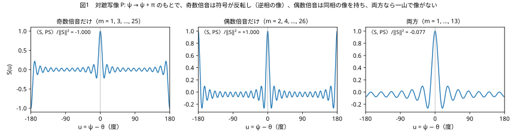
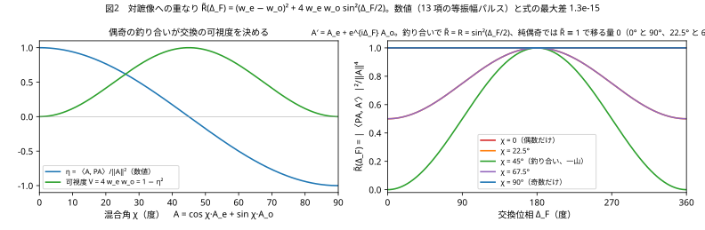
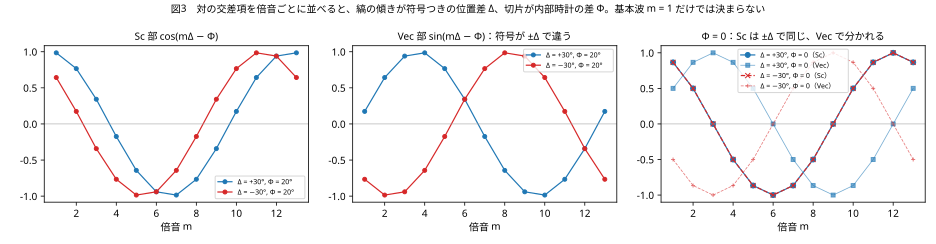
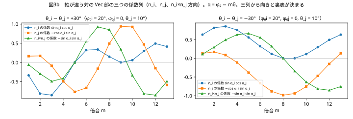
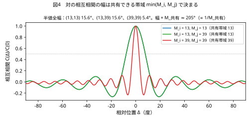
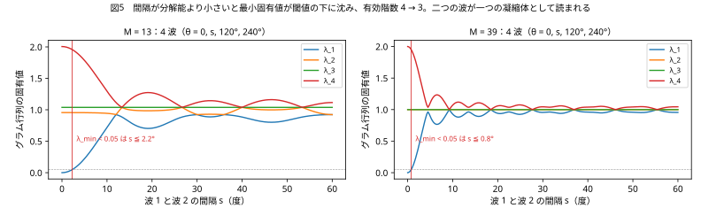

# 倍音の偶奇が決める反射と、局在が与える方向
## ― 閉じた弦の上の読出し規則：対蹠写像、交換の可視度、縞の傾き、共有帯域 ―

**著者：** 木原範昭（株式会社WFシステム）　ORCID 0009-0004-6753-4020
**日付：** 2026-11-07　　**版：** 草稿 v0.1
**Version DOI：** 未付与　　**Concept DOI：** 未付与

---

## 要旨

観測を放射と吸収の同時成立、すなわち二つの波の交差項の読出しとして置くと [S1]、基本波だけの交差項は一つの数 $\cos\varphi_i\cos\varphi_j+(n_i\!\cdot\!n_j)\sin\varphi_i\sin\varphi_j$ にしかならず、位相差と軸の角が混ざり、符号も方向も読めない。本稿は、閉じた弦の上の局在した波を倍音の有限和として置き、次の三つを数式と数値で示す。(1) 対蹠写像 $P:\psi\to\psi+\pi$ のもとで倍音 $m$ は $(-1)^m$ 倍になる。対蹠対に対しては二体の交換が $P$ に一致するので、交換の対称・反対称チャネルは偶数・奇数倍音に一致し、二チャネル交換写像 $A\to A_e+e^{i\Delta_F}A_o$ の反射率は $R=(w_e-w_o)^2+4w_ew_o\sin^2(\Delta_F/2)$ になる。偶奇が釣り合った一山の波だけが二つの位置を区別でき $R=\sin^2(\Delta_F/2)$ [S2] を満たす。奇数だけ・偶数だけの波は自分自身の像であり、交換の固有状態（逆相・同相）であって反射も透過もしない。奇数倍音の波は逆相核 $\Delta_F=\pi$ を倍音の構造として内蔵する。(2) 交差項を倍音ごとに並べると縞の位相 $m\Delta-\Phi$ の傾きが符号つきの位置差 $\Delta$、切片が内部時計の差 $\Phi$ になり、基本波では決まらなかった方向が決まる。軸が違う対では積のベクトル部の三つの係数列が向きと裏表を決める。局在が視野角に方向を与え、その方向に距離が乗る。(3) 対の相互相関の幅は共有できる帯域 $\min(M_i,M_j)$ で決まり、$\propto 1/M_{\text{共有}}$ である。分解能より小さい関係の集まりはグラム行列の階数が落ちて一つの波として読まれ、これが凝縮体である。13 項の等振幅パルスによる数値検証で、反射率の式は $10^{-15}$ の精度で成り立ち、縞の傾きと切片からの位置差・内部時計の差の復元は符号を含めて厳密であった。

---

## 1. はじめに：基本波だけでは何が読めないか

先行論文 [S1] では、観測の本体を二者の内部位相差の干渉の読出しに置き、距離は共有された視野角と相手の大きさの比で決まるとした。干渉とは交差項である。二つの単位四元数 $q_i=\cos\varphi_i+n_i\sin\varphi_i$、$q_j=\cos\varphi_j+n_j\sin\varphi_j$ の交差項のスカラー部は

$$
\mathrm{Sc}(q_i\bar q_j)=\cos\varphi_i\cos\varphi_j+(n_i\!\cdot\!n_j)\sin\varphi_i\sin\varphi_j
$$

である。これは一つの数であり、位相差と軸どうしの角 $n_i\!\cdot\!n_j$ が混ざっている。しかも余弦は偶関数なので、角の大きさは分かってもどちら側かは分からない。視野角は「その角の円錐のどこか」に留まり、方向を持たない。基本波だけの系では、観測は相手の位置の符号も方向も読めない。

方向を与えるのは局在である。局在した波は倍音の和であり、倍音 $m$ の交差項は $\cos m\varphi_i\cos m\varphi_j+(n_i\!\cdot\!n_j)\sin m\varphi_i\sin m\varphi_j$ となって、$m$ を変えると二つの項の重みが変わる。倍音を並べれば位相差と軸の角が分かれ、倍音どうしの位相の進み遅れから向きが出る。本稿はこの一点を出発点に、閉じた弦の上の局在波について、偶奇が決める反射特性（第 3 節）、局在が与える方向（第 4 節）、帯域が決める分解能と凝縮体（第 5 節）を、数式と有限和の数値で示す。

---

## 2. 設定：閉じた弦、倍音、対蹠写像

閉じた弦の位相を $\psi\in[0,2\pi)$ とし、中心 $\theta$ の実数パルスを倍音の有限和

$$
S(\psi)=\sum_{m}c_m\cos m(\psi-\theta)
$$

で置く。以下の数値では等振幅 $c_m=1/13$ の 13 項を用いる。奇数だけなら $m=1,3,\dots,25$、偶数だけなら $m=2,4,\dots,26$、両方なら $m=1,\dots,13$ である。

対蹠写像を $(PS)(\psi)=S(\psi+\pi)$ とする。倍音 $m$ に対して

$$
P\,e^{im\psi}=(-1)^m e^{im\psi}
$$

なので、任意のパルスは $S=S_e+S_o$（偶数倍音部と奇数倍音部）に分かれ、$PS=S_e-S_o$ である。内積を $\langle f,g\rangle=\int_0^{2\pi}\bar f g\,d\psi$ とし、重みを $w_e=\|S_e\|^2/\|S\|^2$、$w_o=\|S_o\|^2/\|S\|^2$ と置くと、自分と自分の対蹠像の重なりは

$$
\eta=\frac{\langle S,PS\rangle}{\|S\|^2}=w_e-w_o
$$

である。奇数だけなら $\eta=-1$（対蹠点に逆相の像）、偶数だけなら $\eta=+1$（同相の像）、両方なら $|\eta|<1$ で一山になる（図1）。13 項の数値では $\eta$ はそれぞれ $-1.000$、$+1.000$、$-0.077$ であった。

---

## 3. 偶奇と交換

### 3.1 対蹠対では交換が対蹠写像に一致する

二つの位置 $\theta$ と $\theta+\pi$ を二つのチャネルとする。波 $A$ が位置 $\theta$ にあるとき、二つの位置を入れ替える交換 $X$ は波の中身に対して $P$ として働く。したがって交換の対称チャネルと反対称チャネルへの射影は

$$
P_S A=\frac{A+PA}{2}=A_e,\qquad P_D A=\frac{A-PA}{2}=A_o
$$

であり、偶数倍音が対称チャネル、奇数倍音が反対称チャネルである。

### 3.2 二チャネル交換写像

先行論文 [S2] は、二局所波の直接経路と交換経路を偶・奇チャネルに分解し、内部核の位相差 $\Delta_F$ を奇チャネルだけに転写して再合成する写像 $U(\Delta_F)=P_S+e^{i\Delta_F}P_D$ を置き、反射率 $R=\sin^2(\Delta_F/2)$、透過率 $T=\cos^2(\Delta_F/2)$ を得た。[S4][S5] はこの写像が交換対称なユニタリ作用素であり、反対称固有位相が有限位数 $\tilde U^n=I$ を持つときに厳密再帰が起こることを示した。本稿ではこの写像を対蹠対の波の中身に対して書く。

$$
A'=U(\Delta_F)A=A_e+e^{i\Delta_F}A_o
$$

### 3.3 定理：偶奇の釣り合いが交換の可視度を決める

反射率を、交換後の波の対蹠像への重なりで定義する。

$$
R(\Delta_F)=\frac{|\langle PA,A'\rangle|^2}{\|A\|^4}
$$

$PA=A_e-A_o$ と $A'=A_e+e^{i\Delta_F}A_o$ の内積は $\|A_e\|^2-e^{i\Delta_F}\|A_o\|^2$ なので

$$
R(\Delta_F)=\left|w_e-e^{i\Delta_F}w_o\right|^2=(w_e-w_o)^2+4w_ew_o\sin^2\frac{\Delta_F}{2}
$$

である。帰結は三つある。

- 偶奇が釣り合う $w_e=w_o=1/2$ のとき $R=\sin^2(\Delta_F/2)$。[S2] の反射則はこの場合である。釣り合ったパルスは $\eta=0$、すなわち自分の対蹠像と直交する一山で、二つの位置を区別できる
- 奇数だけ（$w_o=1$）または偶数だけ（$w_e=1$）のとき $R\equiv1$。$PA=\mp A$ なので波は最初から自分の像であり、交換は $A\to e^{i\Delta_F}A$ または $A\to A$ の位相だけを与える。反射も透過も起こらない。これらは交換の固有状態で、奇数が逆相（フェルミオン的）、偶数が同相（ボゾン的）である
- 一般には可視度 $V=4w_ew_o=1-\eta^2$ で、$R(\Delta_F)-R(0)=V\sin^2(\Delta_F/2)$。反射の縞の深さは偶奇の釣り合いが決める

奇数倍音の波は、[S2] が二成分の内部核として外から与えた逆相 $\Delta_F=\pi$ を、倍音の偶奇として内蔵している。$\eta=-1$ と $\Delta_F=\pi$ は同じことである。

図2 は 13 項のパルスを $A=\cos\chi\,A_e+\sin\chi\,A_o$ と混ぜ、$\eta$ と $R(\Delta_F)$ を格子上の内積で直接計算したものである。$\eta=\cos2\chi$ との最大差 $1.1\times10^{-15}$、$R$ の式との最大差 $1.3\times10^{-15}$ で、式は厳密に成り立つ。

### 3.4 読み

反射は奇数（反対称）チャネルの振る舞い、透過は偶数（対称）チャネルの振る舞いである。局在した一山の波だけが二つの位置を持ち、反射と透過が意味を持つ。奇数だけの波の対蹠点にある逆相の像は、放射に対して必ず存在する吸収体 [X1][S1] を、倍音の偶奇として波の中に最初から持っている。放射と吸収は一つの波の偶奇の中で同時に成立している。

---

## 4. 局在が方向を与える

### 4.1 縞の傾きと切片

対 $(i,j)$ の交差項を倍音ごとに書く。軸を共有する場合、倍音 $m$ の寄与は

$$
\mathrm{Sc}_m=c_m^2\cos(m\Delta-\Phi),\qquad \mathrm{Vec}_m=c_m^2\sin(m\Delta-\Phi)
$$

である。$\Delta=\theta_i-\theta_j$ は位置差、$\Phi=\varphi_{0i}-\varphi_{0j}$ は内部時計の差である。縞の位相 $m\Delta-\Phi$ は $m$ に比例する部分と比例しない部分に分かれるので、倍音にわたって並べれば傾きが $\Delta$、切片が $\Phi$ になる。基本波 $m=1$ だけでは $\Delta$ と $\Phi$ が一つの数に混ざる。$\Phi=0$ のとき $\mathrm{Sc}_1=\cos\Delta$ は $\pm\Delta$ で同じで、位置差の符号は決まらない。符号は $\mathrm{Vec}_m=\sin(m\Delta-\Phi)$ の列が与える。

図3 は $(\Delta,\Phi)=(+30^\circ,20^\circ)$ と $(-30^\circ,20^\circ)$ の列である。位相 $\arctan(\mathrm{Vec}_m/\mathrm{Sc}_m)$ を展開して直線を当てると、$\Delta=+30.000^\circ,\ \Phi=20.000^\circ$ と $\Delta=-30.000^\circ,\ \Phi=20.000^\circ$ が復元される。符号を含めて厳密である。

### 4.2 軸が違う対：積のベクトル部

四元数では軸が違う二つの波の倍音の積は

$$
e^{n_i\alpha_i}e^{-n_j\alpha_j}=\left[\cos\alpha_i\cos\alpha_j+(n_i\!\cdot\!n_j)\sin\alpha_i\sin\alpha_j\right]+\sin\alpha_i\cos\alpha_j\,n_i-\cos\alpha_i\sin\alpha_j\,n_j-\sin\alpha_i\sin\alpha_j\,(n_i\times n_j)
$$

である（$\alpha=\varphi_0-m\theta$、[S6]）。スカラー部は 3 節の交差項であり、ベクトル部は $n_i$、$n_j$、$n_i\times n_j$ の三方向の係数列を持つ。三つの係数列は $m$ にわたって別々に変化するので、$\alpha_{i,m}$ と $\alpha_{j,m}$、したがって $\Delta$ と $\Phi$ に加えて、$n_i\times n_j$ の係数の符号から裏表が決まる（図3b）。一つの倍音のベクトル部だけでは裏表の二価性が残る。

### 4.3 距離に方向が乗る

以上で視野角はベクトルになる。向きは倍音にわたるベクトル部から、大きさはスカラー部の包絡から読む。対の変位は

$$
\vec\Delta_{ij}=\Delta_{ij}\,n_{ij}
$$

であり、位置差 $\Delta_{ij}$ はこの方向に乗る。局在していない相手には位相差しかなく、それはどの方向にも向いていない。局在した相手は点であり、そこまでの距離がその点への方向を持つ。

関係は差だけなので、$N$ 体で独立な差は $N-1$ である。三つの方向を読むには $N=4$ が要る。距離で数えても、三体の関係は三辺で平面に収まり、四体で初めて四面体になる。四体の六本の距離は三次元配置の六自由度にちょうど一致し、鏡像の向きだけが距離には入らない。

---

## 5. 分解能と凝縮体

### 5.1 共有できる帯域

対の相互相関は、両方が持つ倍音だけから作られる。

$$
C_{ij}(\Delta)=\sum_{m\le\min(M_i,M_j)}c_{i,m}c_{j,m}\cos m\Delta
$$

図4 は $(M_i,M_j)=(13,13),(13,39),(39,39)$ の相互相関である。半値全幅は $15.6^\circ$、$15.6^\circ$、$5.4^\circ$ で、$(13,39)$ は $(13,13)$ と同じである。幅は共有できる帯域 $M_{\text{共有}}=\min(M_i,M_j)$ で決まり、半値全幅 $\times M_{\text{共有}}$ は $203^\circ$ と $211^\circ$ で $\propto1/M_{\text{共有}}$ である。細い相手でも、自分の帯域より細かくは読めない。交換される波は一つなので、この帯域は通路の性質であり、どちらから見ても同じである。

これは標本化の限界である [X2]。読み手の最細波長を画素とすれば、画素の二倍より短い波長は折り返して区別できない。倍音番号で言えば $m\le M_i/2$ である。

### 5.2 凝縮体はグラム行列の階数が落ちること

$N$ 体の対の内積を並べた行列がグラム行列である。図5 は四つの波を $\theta=0,\ s,\ 120^\circ,\ 240^\circ$ に置き、帯域 $M$ の相互相関で作ったグラム行列の固有値を、間隔 $s$ に対して描いたものである。$s$ が小さくなると最小固有値が $s^2$ で消え、階数が 4 から 3 に落ちる。閾値 $0.05$ で見ると、$M=13$ では $s\le2.25^\circ$、$M=39$ では $s\le0.75^\circ$ で、やはり $\propto1/M$ である。

階数が落ちた二つの波は、読み手には一つの波として現れる。これが凝縮体である。凝縮体は系の状態ではなく、読み手の帯域が決める読みである。読めるのはその和の明るさ、方向、幅、有効倍音次数だけであり、構成員の個別の位相、軸、個数、そして距離は読めない。遠くて大きいものと近くて小さいものは同じ角を張るので同じ凝縮体である。固有値の分解で区別できる波源の数を読む操作は、アレイ信号処理で共分散行列の信号部分空間の次元を読む操作 [X3] と同じである。

---

## 6. 数値検証のまとめ

| 検証 | 条件 | 結果 |
|---|---|---|
| $\eta=w_e-w_o$ | 13 項等振幅、$\chi\in[0,\pi/2]$ を 181 点 | $\cos2\chi$ との最大差 $1.1\times10^{-15}$ |
| $R(\Delta_F)=(w_e-w_o)^2+4w_ew_o\sin^2(\Delta_F/2)$ | $\chi=0,22.5^\circ,45^\circ,67.5^\circ,90^\circ$、$\Delta_F\in[0,2\pi]$ を 361 点 | 式との最大差 $1.3\times10^{-15}$ |
| 純偶奇で $R\equiv1$、釣り合いで $R=\sin^2(\Delta_F/2)$ | 同上 | 成立 |
| 縞の傾きと切片 | $(\Delta,\Phi)=(\pm30^\circ,20^\circ)$、$m=1..13$ | $\Delta=\pm30.000^\circ$、$\Phi=20.000^\circ$ を復元 |
| 相互相関の半値全幅 | $(13,13),(13,39),(39,39)$ | $15.6^\circ,15.6^\circ,5.4^\circ$。$\min(M_i,M_j)$ で決まる |
| グラム行列の階数 | 4 波、閾値 $0.05$ | $M=13$ で $s\le2.25^\circ$、$M=39$ で $s\le0.75^\circ$ |

図と数値は `make_figures.py` で再生成でき、値は `results/values.json` にある。

---

## 7. 議論

[S2] は逆相核を二成分の内部核として外から与えた。本稿の結果は、同じ逆相が奇数倍音の偶奇として波の中にあることを示す。局在した一山の波は偶数と奇数を同じ重みで持ち、だからこそ二つの位置を区別でき、反射と透過を持つ。偶奇の釣り合いが崩れると縞の深さが落ち、純偶奇では反射という概念が消える。

[S3] が見た局在性の移乗は、偶奇の釣り合った波どうしの交換である。移乗で高次倍音が相手に移っても偶奇の釣り合いは保たれ、$R=\sin^2(\Delta_F/2)$ は変わらない。[S4][S5] の有限位数再帰 $\tilde U^n=I$ は反対称固有位相だけで決まり、偶奇はチャネルの重みを決めるだけで位数には触れない。

[S1] の前提 (P1)「距離は視野角と大きさの比」は、本稿で視野角が方向を持つベクトルになったことで、距離がその方向に乗る変位になる。(P2)「放射と吸収の同時成立」は、奇数倍音の波が対蹠点に逆相の像を持つことに対応する。(P3)「関係の位相は倍音次数を持つ」は、本稿の縞の傾きと切片の分離そのものである。

本稿は四元数の読出しに留まる。四元数の実部は時間・質量・電荷を一つのノルムに潰すので、これらの区別は本稿の範囲で読めない [S7]。偶奇が決めるのは交換のチャネルであり、質量ではない。

---

## 8. まとめ

- 対蹠写像で奇数倍音は符号が反転し、偶数倍音は反転しない。対蹠対では交換が対蹠写像に一致するので、交換の反対称チャネルは奇数倍音、対称チャネルは偶数倍音である
- 二チャネル交換写像の反射率は $R=(w_e-w_o)^2+4w_ew_o\sin^2(\Delta_F/2)$。釣り合いで $\sin^2(\Delta_F/2)$、純偶奇で $R\equiv1$。奇数倍音の波は逆相核を内蔵する
- 倍音ごとの交差項の縞の傾きが符号つきの位置差、切片が内部時計の差。軸が違う対ではベクトル部の三つの係数列が向きと裏表を決める。局在が視野角に方向を与え、距離がその方向に乗る
- 相互相関の幅は共有できる帯域で決まり $\propto1/M_{\text{共有}}$。分解能より小さい関係の集まりはグラム行列の階数が落ちて一つの波として読まれる。これが凝縮体である

---

## 参考文献

### 自己引用（Concept DOI、10.5281/zenodo.〔番号〕）

[S1] 木原範昭「観測は放射と吸収の同時成立である ― 視野角と大きさの読出し規則からボルン則・ベル相関・ツィレルソン限界を導く ―」2026-11-01. Concept DOI 10.5281/zenodo.23857884.
[S2] 木原範昭「フェルミオン的逆相核による完全反射写像の干渉構成 v2」2026-07-10. Concept DOI 10.5281/zenodo.21295479.
[S3] 木原範昭「交換干渉散乱行列フェルミオン的衝突における加速度基底と局在性交換予備実験総括 v1」2026-07-13. Concept DOI 10.5281/zenodo.21333766.
[S4] 木原範昭「反復交換散乱における有限位数共鳴の発見」2026-07-18. Concept DOI 10.5281/zenodo.21421366.
[S5] 木原範昭「反復二チャネル交換系における離散Born型重みの出現」2026-07-18. Concept DOI 10.5281/zenodo.21422470.
[S6] 木原範昭「複素数の集合から時空 (1＋3) への写像 ― 四元数による読み出しと部分投射 ―」2026-10-18. Concept DOI 10.5281/zenodo.23451494.
[S7] 木原範昭「複素数を正しく理解していたか ― 振幅はどこに住むか、虚数読み、ℂ → ℍ → 𝕆 の帰属 ―」2026-10-23. Concept DOI 10.5281/zenodo.23585436.

### 外部文献

[X1] J. A. Wheeler, R. P. Feynman, "Interaction with the Absorber as the Mechanism of Radiation," Rev. Mod. Phys. 17, 157–181 (1945). DOI 10.1103/RevModPhys.17.157
[X2] C. E. Shannon, "Communication in the Presence of Noise," Proc. IRE 37, 10–21 (1949). DOI 10.1109/JRPROC.1949.232969
[X3] R. O. Schmidt, "Multiple emitter location and signal parameter estimation," IEEE Trans. Antennas Propag. 34, 276–280 (1986). DOI 10.1109/TAP.1986.1143830
