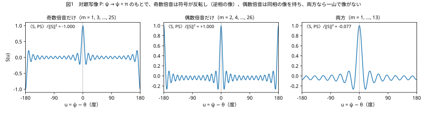
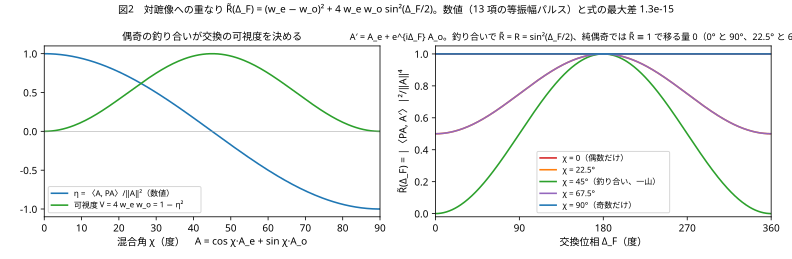
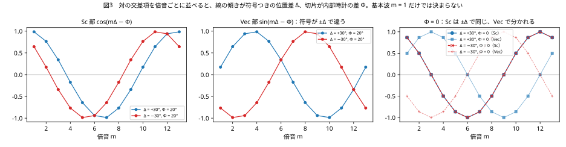
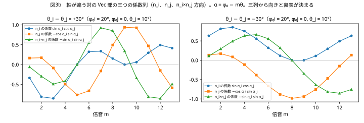
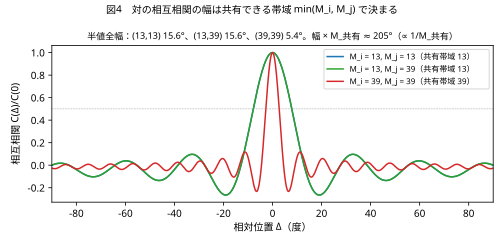
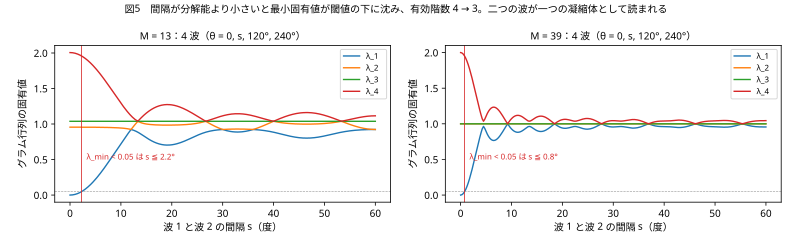

# 倍音の偶奇が決める反射と、局在が与える方向
## ― 閉じた弦の上の読出し規則：対蹠写像、交換の可視度、縞の傾き、共有帯域 ―

**著者：** 木原範昭（株式会社WFシステム）　ORCID 0009-0004-6753-4020
**日付：** 2026-11-07　　**版：** 草稿 v0.7（第 II 部 実装篇を追加：理論の量と数値実験のコードの対応、4 波・16 関係での確認 K1〜K5）
**Version DOI：** 未付与　　**Concept DOI：** 未付与

---

## 要旨

観測を放射と吸収の同時成立、すなわち二つの波の交差項の読出しとして置くと [S1]、基本波だけの交差項は一つの数 $\cos\varphi_i\cos\varphi_j+(n_i\!\cdot\!n_j)\sin\varphi_i\sin\varphi_j$ にしかならず、位相差と軸の角が混ざり、符号も方向も読めない。本稿は、閉じた弦の上の局在した波を倍音の有限和として置き、次の三つを数式と数値で示す。(1) 対蹠写像 $P:\psi\to\psi+\pi$ のもとで倍音 $m$ は $(-1)^m$ 倍になる。対蹠対に対しては二体の交換が $P$ に一致するので、交換の対称・反対称チャネルは偶数・奇数倍音に一致し、二チャネル交換写像 $A\to A_e+e^{i\Delta_F}A_o$ による対蹠像への重なりは $\tilde R=(w_e-w_o)^2+4w_ew_o\sin^2(\Delta_F/2)$ になり、交換で移った量は $\tilde R(\Delta_F)-\tilde R(0)=4w_ew_o\sin^2(\Delta_F/2)$ である。$0<w_e,w_o<1$ なら対蹠像は元の波に比例せず二つの位置は区別できるが、重なり $\tilde R(0)=(w_e-w_o)^2$ が残る。偶奇が釣り合った一山の波は対蹠像と完全に直交し、二つの位置が完全に区別できるチャネルになって、反射確率が $R=\sin^2(\Delta_F/2)$ [S2] になる。奇数だけ・偶数だけの波は最初から自分自身の像であり、交換作用素 $U(\pi)=P$ の固有状態（固有値 $-1$ と $+1$）であって、移る量は零で反射確率が定義されない。[S2] が内部核として外から与えた逆相 $\Delta_F=\pi$ を、奇数倍音の波は $U(\pi)$ の固有値 $-1$ として持つ。(2) 交差項を倍音ごとに並べると縞の位相 $\Phi-m\Delta$ の傾きが符号つきの位置差 $-\Delta$、切片が内部時計の差 $\Phi$ になり、基本波では決まらなかった方向が決まる。軸が違う対では積のベクトル部の三つの係数列が向きと裏表を決める。局在が視野角に方向を与え、その方向に距離が乗る。(3) 対の相互相関の幅は共有できる帯域 $\min(M_i,M_j)$ で決まり、$\propto 1/M_{\text{共有}}$ である。分解能より小さい関係の集まりはグラム行列の最小固有値が閾値の下に沈み、有効階数が落ちて一つの波として読まれる。これが凝縮体であり、閾値は読み手の分解能の表現である。13 項の等振幅パルスによる数値検証で、重なりの式は $10^{-15}$ の精度で成り立ち、縞の傾きと切片からの位置差・内部時計の差の復元は符号を含めて厳密であった。

---

## 1. はじめに：基本波だけでは何が読めないか

先行論文 [S1] では、観測の本体を二者の内部位相差の干渉の読出しに置き、距離は共有された視野角と相手の大きさの比で決まるとした。干渉とは交差項である。二つの単位四元数 $q_i=\cos\varphi_i+n_i\sin\varphi_i$、$q_j=\cos\varphi_j+n_j\sin\varphi_j$ の交差項のスカラー部は

$$
\mathrm{Sc}(q_i\bar q_j)=\cos\varphi_i\cos\varphi_j+(n_i\!\cdot\!n_j)\sin\varphi_i\sin\varphi_j
$$

である。これは一つの数であり、位相差と軸どうしの角 $n_i\!\cdot\!n_j$ が混ざっている。しかも余弦は偶関数なので、角の大きさは分かってもどちら側かは分からない。視野角は「その角の円錐のどこか」に留まり、方向を持たない。基本波だけの系では、観測は相手の位置の符号も方向も読めない。

方向を与えるのは局在である。局在した波は倍音の和であり、倍音 $m$ の交差項は $\cos m\varphi_i\cos m\varphi_j+(n_i\!\cdot\!n_j)\sin m\varphi_i\sin m\varphi_j$ となって、$m$ を変えると二つの項の重みが変わる。倍音を並べれば位相差と軸の角が分かれ、倍音どうしの位相の進み遅れから向きが出る。本稿はこの一点を出発点に、閉じた弦の上の局在波について、偶奇が決める反射特性（第 3 節）、局在が与える方向（第 4 節）、帯域が決める分解能と凝縮体（第 5 節）を、数式と有限和の数値で示す。

---

## 2. 設定：閉じた弦、倍音、対蹠写像

閉じた弦の位相を $\psi\in[0,2\pi)$ とし、中心 $\theta$ の実数パルスを倍音の有限和

$$
S(\psi)=\sum_{m}c_m\cos m(\psi-\theta)
$$

で置く。以下の数値では等振幅 $c_m=1/13$ の 13 項を用いる。奇数だけなら $m=1,3,\dots,25$、偶数だけなら $m=2,4,\dots,26$、両方なら $m=1,\dots,13$ である。

対蹠写像を $(PS)(\psi)=S(\psi+\pi)$ とする。倍音 $m$ に対して

$$
P\,e^{im\psi}=(-1)^m e^{im\psi}
$$

なので、任意のパルスは $S=S_e+S_o$（偶数倍音部と奇数倍音部）に分かれ、$PS=S_e-S_o$ である。内積を $\langle f,g\rangle=\int_0^{2\pi}\bar f g\,d\psi$ とし、重みを $w_e=\|S_e\|^2/\|S\|^2$、$w_o=\|S_o\|^2/\|S\|^2$ と置くと、自分と自分の対蹠像の重なりは

$$
\eta=\frac{\langle S,PS\rangle}{\|S\|^2}=w_e-w_o
$$

である。奇数だけなら $\eta=-1$（対蹠点に逆相の像）、偶数だけなら $\eta=+1$（同相の像）、両方なら $|\eta|<1$ で一山になる（図1）。13 項の数値では $\eta$ はそれぞれ $-1.000$、$+1.000$、$-0.077$ であった。両方の場合は $m=1,\dots,13$ に奇数が 7 項、偶数が 6 項あるので $w_e=6/13$、$w_o=7/13$、$\eta=-1/13=-0.077$ であり、一山に局在していても偶奇は釣り合っていない。局在と偶奇の釣り合いは別の性質である。



---

## 3. 偶奇と交換

### 3.1 対蹠対では交換が対蹠写像に一致する

二つの位置 $\theta$ と $\theta+\pi$ を二つのチャネルとする。波 $A$ が位置 $\theta$ にあるとき、二つの位置を入れ替える交換 $X$ は波の中身に対して $P$ として働く。したがって交換の対称チャネルと反対称チャネルへの射影は

$$
P_S A=\frac{A+PA}{2}=A_e,\qquad P_D A=\frac{A-PA}{2}=A_o
$$

であり、偶数倍音が対称チャネル、奇数倍音が反対称チャネルである。

### 3.2 二チャネル交換写像

先行論文 [S2] は、二局所波の直接経路と交換経路を偶・奇チャネルに分解し、内部核の位相差 $\Delta_F$ を奇チャネルだけに転写して再合成する写像 $U(\Delta_F)=P_S+e^{i\Delta_F}P_D$ を置き、反射率 $R=\sin^2(\Delta_F/2)$、透過率 $T=\cos^2(\Delta_F/2)$ を得た。[S4][S5] はこの写像が交換対称なユニタリ作用素であり、反対称固有位相が有限位数 $\tilde U^n=I$ を持つときに厳密再帰が起こることを示した。本稿ではこの写像を対蹠対の波の中身に対して書く。

$$
A'=U(\Delta_F)A=A_e+e^{i\Delta_F}A_o
$$

$\Delta_F=\pi$ では $U(\pi)=P_S-P_D=P$ であり、交換作用素は対蹠写像そのものになる。$\eta$ は状態の偶奇を表す量、$\Delta_F$ は交換作用素の位相を指定する量で、別の量である。両者をつなぐのはこの恒等式だけである。

### 3.3 定理：偶奇の釣り合いが交換の可視度を決める

交換後の波の、対蹠像への規格化した重なりを

$$
\tilde R(\Delta_F)=\frac{|\langle PA,A'\rangle|^2}{\|A\|^4}
$$

と定義する。これは反射確率そのものではなく、交換の前後で波がどれだけ対蹠像に重なっているかである。交換で移った量は $\tilde R(\Delta_F)-\tilde R(0)$ で読む。

$PA=A_e-A_o$ と $A'=A_e+e^{i\Delta_F}A_o$ の内積は $\|A_e\|^2-e^{i\Delta_F}\|A_o\|^2$ なので

$$
\tilde R(\Delta_F)=\left|w_e-e^{i\Delta_F}w_o\right|^2=(w_e-w_o)^2+4w_ew_o\sin^2\frac{\Delta_F}{2},\qquad \tilde R(\Delta_F)-\tilde R(0)=4w_ew_o\sin^2\frac{\Delta_F}{2}
$$

である。帰結は四つある。

- $0<w_e,w_o<1$ なら $PA$ は $A$ に比例しないので二つの位置は区別できる。ただし交換前から重なり $\tilde R(0)=(w_e-w_o)^2$ があり、交換で移る量は $4w_ew_o\sin^2(\Delta_F/2)$ に留まる
- 偶奇が釣り合う $w_e=w_o=1/2$ のとき $\eta=0$、すなわち $\langle A,PA\rangle=0$ で対蹠像と完全に直交する。$\tilde R(0)=0$ なので $\tilde R=\sin^2(\Delta_F/2)$ がそのまま反射確率 $R$ になる。[S2] の反射則はこの場合である。区別できることと完全に直交して区別できることは別で、反射確率が $\tilde R$ に一致するのは後者だけである
- 奇数だけ（$w_o=1$）または偶数だけ（$w_e=1$）のとき $\tilde R\equiv1$ で、移った量は $\tilde R(\Delta_F)-\tilde R(0)\equiv0$。$PA=\mp A$ なので波は最初から自分の像であり、交換は $A\to e^{i\Delta_F}A$ または $A\to A$ の位相だけを与える。二つの位置は区別できるチャネルではなく、反射確率は定義されない。これらは $U(\pi)=P$ の固有状態で、奇数が固有値 $-1$（逆相、フェルミオン的）、偶数が固有値 $+1$（同相、ボゾン的）である
- 一般には可視度 $V=4w_ew_o=1-\eta^2$ で、移った量は $V\sin^2(\Delta_F/2)$。交換の縞の深さは偶奇の釣り合いが決める

[S2] は逆相 $\Delta_F=\pi$ を二成分の内部核として外から与えた。奇数倍音の波はその逆相を、交換作用素 $U(\pi)=P$ に対する固有値 $-1$ として持つ。$\eta=-1$ は状態の性質、$\Delta_F=\pi$ は作用素の位相であり、同じ条件ではない。奇数倍音の波に $U(\pi)$ を作用させると $-A$ になる、という一つの事実を、状態の側から言えば $\eta=-1$、作用素の側から言えば $\Delta_F=\pi$ である。

図2 は 13 項のパルスを $A=\cos\chi\,A_e+\sin\chi\,A_o$ と混ぜ、$\eta$ と $\tilde R(\Delta_F)$ を格子上の内積で直接計算したものである。$\eta=\cos2\chi$ との最大差 $1.1\times10^{-15}$、$\tilde R$ の式との最大差 $1.3\times10^{-15}$ で、式は厳密に成り立つ。



### 3.4 読み

反射は奇数（反対称）チャネルの振る舞い、透過は偶数（対称）チャネルの振る舞いである。偶奇を両方持つ波は二つの位置を区別でき、釣り合った一山の波では二つの位置が完全に直交して、反射確率と透過確率がそのまま意味を持つ。奇数だけの波の対蹠点にある逆相の像は、放射に対して必ず存在する吸収体 [X1][S1] を、倍音の偶奇として波の中に最初から持っている。放射と吸収は一つの波の偶奇の中で同時に成立している。

---

## 4. 局在が方向を与える

### 4.1 縞の傾きと切片

対 $(i,j)$ の交差項を倍音ごとに書く。軸を共有する場合、倍音 $m$ の寄与は

$$
\mathrm{Sc}_m=c_m^2\cos(\Phi-m\Delta),\qquad \mathrm{Vec}_m=c_m^2\sin(\Phi-m\Delta)
$$

である。積は $q_i\bar q_j$ の順、$\alpha_{i,m}=\varphi_{0i}-m\theta_i$ で、$\alpha_{i,m}-\alpha_{j,m}=\Phi-m\Delta$。$\Delta=\theta_i-\theta_j$ は位置差、$\Phi=\varphi_{0i}-\varphi_{0j}$ は内部時計の差である。縞の位相 $\vartheta_m=\Phi-m\Delta$ は $m$ に比例する部分と比例しない部分に分かれるので、倍音にわたって並べれば傾きが $-\Delta$、切片が $\Phi$ になる。基本波 $m=1$ だけでは $\Delta$ と $\Phi$ が一つの数に混ざる。$\Phi=0$ のとき $\mathrm{Sc}_1=\cos\Delta$ は $\pm\Delta$ で同じで、位置差の符号は決まらない。符号は $\mathrm{Vec}_m=\sin(\Phi-m\Delta)$ の列が与える。

図3 は $(\Delta,\Phi)=(+30^\circ,20^\circ)$ と $(-30^\circ,20^\circ)$ の列である。位相 $\vartheta_m=\arctan(\mathrm{Vec}_m/\mathrm{Sc}_m)$ を展開して直線を当て、傾きの符号を反転すると、$\Delta=+30.000^\circ,\ \Phi=20.000^\circ$ と $\Delta=-30.000^\circ,\ \Phi=20.000^\circ$ が復元される。符号を含めて厳密である。



### 4.2 軸が違う対：積のベクトル部

四元数では軸が違う二つの波の倍音の積は

$$
e^{n_i\alpha_i}e^{-n_j\alpha_j}=\left[\cos\alpha_i\cos\alpha_j+(n_i\!\cdot\!n_j)\sin\alpha_i\sin\alpha_j\right]+\sin\alpha_i\cos\alpha_j\,n_i-\cos\alpha_i\sin\alpha_j\,n_j-\sin\alpha_i\sin\alpha_j\,(n_i\times n_j)
$$

である（$\alpha=\varphi_0-m\theta$、[S6]）。スカラー部は 3 節の交差項であり、ベクトル部は $n_i$、$n_j$、$n_i\times n_j$ の三方向の係数列を持つ。三つの係数列は $m$ にわたって別々に変化するので、$\alpha_{i,m}$ と $\alpha_{j,m}$、したがって $\Delta$ と $\Phi$ に加えて、$n_i\times n_j$ の係数の符号から裏表が決まる（図3b）。一つの倍音のベクトル部だけでは裏表の二価性が残る。



### 4.3 距離に方向が乗る

以上で視野角はベクトルになる。向きは倍音にわたるベクトル部から、大きさはスカラー部の包絡から読む。対の変位は

$$
\vec\Delta_{ij}=\Delta_{ij}\,n_{ij}
$$

であり、位置差 $\Delta_{ij}$ はこの方向に乗る。局在していない相手には位相差しかなく、それはどの方向にも向いていない。局在した相手は点であり、そこまでの距離がその点への方向を持つ。

関係は差だけなので、$N$ 体で独立な差は $N-1$ である。三つの方向を読むには $N=4$ が要る。距離で数えても、三体の関係は三辺で平面に収まり、四体で初めて四面体になる。四体の六本の距離は三次元配置の六自由度にちょうど一致し、鏡像の向きだけが距離には入らない。

---

## 5. 分解能と凝縮体

### 5.1 共有できる帯域

対の相互相関は、両方が持つ倍音だけから作られる。

$$
C_{ij}(\Delta)=\sum_{m\le\min(M_i,M_j)}c_{i,m}c_{j,m}\cos m\Delta
$$

図4 は $(M_i,M_j)=(13,13),(13,39),(39,39)$ の相互相関である。半値全幅は $15.6^\circ$、$15.6^\circ$、$5.4^\circ$ で、$(13,39)$ は $(13,13)$ と同じである。幅は共有できる帯域 $M_{\text{共有}}=\min(M_i,M_j)$ で決まり、半値全幅 $\times M_{\text{共有}}$ は $203^\circ$ と $211^\circ$ で $\propto1/M_{\text{共有}}$ である。細い相手でも、自分の帯域より細かくは読めない。交換される波は一つなので、この帯域は通路の性質であり、どちらから見ても同じである。



標本化の条件はこれとは別の量で書く [X2]。読み手が相手を等間隔の $N_s$ 点で標本化するなら、画素は $2\pi/N_s$ で、画素の二倍より短い波長は折り返して区別できない。表せる倍音は $m\le(N_s-1)/2$ であり、帯域 $M_i$ の波を表すには $N_s\ge2M_i+1$ が要る。$M_i$ は最大倍音番号、$N_s$ は標本点数で、本稿の相互相関の幅を決めるのは前者の共有帯域 $\min(M_i,M_j)$ である。

### 5.2 凝縮体はグラム行列の有効階数が落ちること

$N$ 体の対の内積を並べた行列がグラム行列である。図5 は四つの波を $\theta=0,\ s,\ 120^\circ,\ 240^\circ$ に置き、帯域 $M$ の相互相関で作ったグラム行列の固有値を、間隔 $s$ に対して描いたものである。$s$ が小さくなると最小固有値が $s^2$ で $0$ に近づく。$s>0$ では四つの波は一次独立なので厳密な階数は 4 のままであり、落ちるのは閾値で見た有効階数である。閾値 $0.05$ で見ると、$M=13$ では $s\le2.25^\circ$、$M=39$ では $s\le0.75^\circ$ で有効階数が 3 になり、やはり $\propto1/M$ である。閾値は読み手が区別できない下限、すなわち分解能の表現であり、凝縮体が読み手の側で決まることを閾値が明示する。



有効階数が落ちた二つの波は、読み手には一つの波として現れる。これが凝縮体である。凝縮体は系の状態ではなく、読み手の帯域が決める読みである。読めるのはその和の明るさ、方向、幅、有効倍音次数だけであり、構成員の個別の位相、軸、個数、そして距離は読めない。遠くて大きいものと近くて小さいものは同じ角を張るので同じ凝縮体である。固有値の分解で区別できる波源の数を読む操作は、アレイ信号処理で共分散行列の信号部分空間の次元を読む操作 [X3] と同じである。

---

## 6. 数値検証のまとめ

| 検証 | 条件 | 結果 |
|---|---|---|
| $\eta=w_e-w_o$ | 13 項等振幅、$\chi\in[0,\pi/2]$ を 181 点 | $\cos2\chi$ との最大差 $1.1\times10^{-15}$ |
| $\tilde R(\Delta_F)=(w_e-w_o)^2+4w_ew_o\sin^2(\Delta_F/2)$ | $\chi=0,22.5^\circ,45^\circ,67.5^\circ,90^\circ$、$\Delta_F\in[0,2\pi]$ を 361 点 | 式との最大差 $1.3\times10^{-15}$ |
| 純偶奇で $\tilde R\equiv1$（移る量 0）、釣り合いで $\tilde R=R=\sin^2(\Delta_F/2)$ | 同上 | 成立 |
| 縞の傾きと切片 | $(\Delta,\Phi)=(\pm30^\circ,20^\circ)$、$m=1..13$ | $\Delta=\pm30.000^\circ$、$\Phi=20.000^\circ$ を復元 |
| 相互相関の半値全幅 | $(13,13),(13,39),(39,39)$ | $15.6^\circ,15.6^\circ,5.4^\circ$。$\min(M_i,M_j)$ で決まる |
| グラム行列の有効階数 | 4 波、閾値 $0.05$ | $M=13$ で $s\le2.25^\circ$、$M=39$ で $s\le0.75^\circ$ で 3 |

図と数値は `make_figures.py` で再生成でき、値は `results/values.json` にある。これらの検証が示すのは、置いた模型の内部整合性である。不確定性原理や粒子の統計性を実証したものではない。

---

## 7. 議論

[S2] は逆相核を二成分の内部核として外から与えた。本稿の結果は、同じ逆相を奇数倍音の波が $U(\pi)=P$ の固有値 $-1$ として持つことを示す。局在した波のうち、偶奇が釣り合ったものだけが対蹠像と完全に直交し、反射確率と透過確率をそのまま持つ。局在と釣り合いは同値ではなく、本稿の 13 項パルスも $\eta=-1/13$ で釣り合っていない。釣り合いから外れるほど位置は区別できても重なりが残って縞の深さが落ち、純偶奇では反射確率が定義されなくなる。

[S3] が見た局在性の移乗は、偶奇の釣り合った波どうしの交換である。移乗で高次倍音が相手に移っても偶奇の釣り合いは保たれ、$R=\sin^2(\Delta_F/2)$ は変わらない。[S4][S5] の有限位数再帰 $\tilde U^n=I$ は反対称固有位相だけで決まり、偶奇はチャネルの重みを決めるだけで位数には触れない。

[S1] の前提 (P1)「距離は視野角と大きさの比」は、本稿で視野角が方向を持つベクトルになったことで、距離がその方向に乗る変位になる。(P2)「放射と吸収の同時成立」は、奇数倍音の波が対蹠点に逆相の像を持つことに対応する。(P3)「関係の位相は倍音次数を持つ」は、本稿の縞の傾きと切片の分離そのものである。

本稿は四元数の読出しに留まる。先行論文 [S7] で採った合成半径への投射 $(t,R,Q_1,Q_2,Q_3)\mapsto\rho$ は、時間・質量・電荷を一つのノルムに潰す。これは四元数一般の性質ではなく、この投射の性質であり、本稿の範囲ではこれらを区別して読めない。偶奇が決めるのは交換のチャネルであり、質量ではない。

読出し不能性は二種類ある。第一は内部自由度の投射によるもので、異なる内部状態が同じ $\rho$ に写る。第二は空間的な関係の分離によるもので、基本波だけでは位置差・内部時計の差・方向が分かれず、倍音による局在が要る。二つは同じではないが、どちらも情報が存在しないのではなく、採った読出し操作では区別できないという構造である。二つが共通の射影構造として扱えるかは、次の問いである。

代数の帰属も同じ向きで決まる。四元数を先に置いてその中の軸を読むのではない。局在した相手が複数あり、倍音のベクトル部の三つの係数列が別々に動くという関係が成立しているとき、それを四元数として読む。軸が読めなければ残るのは位相の回転とその共役の対であり、それも読めなければ複素数の位相差である。ℂ、ℍ、𝕆 の帰属は数の体系の選択ではなく、どこまでの関係が読めているかの記録であり、その間、無名性は一度も破られない。

---

## 8. まとめ

- 対蹠写像で奇数倍音は符号が反転し、偶数倍音は反転しない。対蹠対では交換が対蹠写像に一致するので、交換の反対称チャネルは奇数倍音、対称チャネルは偶数倍音である
- 二チャネル交換写像による対蹠像への重なりは $\tilde R=(w_e-w_o)^2+4w_ew_o\sin^2(\Delta_F/2)$、移る量は $4w_ew_o\sin^2(\Delta_F/2)$。偶奇を両方持てば二つの位置は区別でき、釣り合い（完全直交）で反射確率 $\sin^2(\Delta_F/2)$、純偶奇では移る量が零で反射確率が定義されない。奇数倍音の波は $U(\pi)=P$ の固有値 $-1$ の固有状態である
- 倍音ごとの交差項の縞の傾きが符号つきの位置差、切片が内部時計の差。軸が違う対ではベクトル部の三つの係数列が向きと裏表を決める。局在が視野角に方向を与え、距離がその方向に乗る
- 相互相関の幅は共有できる帯域で決まり $\propto1/M_{\text{共有}}$。分解能より小さい関係の集まりはグラム行列の有効階数が閾値の下で落ちて一つの波として読まれる。これが凝縮体であり、閾値が読み手の分解能である

---

---

# 第 II 部　実装篇：理論の量と数値実験のコードの対応

本篇は、第 I 部の読出し規則と、7/10・7/13・7/18 の二チャネル交換写像 [S2][S3][S4][S5] を、四元数 4 波の数値実験にどう写すかを、式とコードを並べて示す。コードブロックは `exchange_core_v11.py` の関数本文をそのまま載せている。実験の走行は本篇に含めない。確認（K1〜K5）は `check_core_v11.py` で、4 波・16 の関係に対して行った。

## 9. 対応表

11/7 に決めた計画の七項目と、本篇の節・関数の対応である。

| 計画 | 本篇 | 関数 |
|---|---|---|
| 作用は 7/13 プログラムの忠実コピーから、R 掃引の表の再現を対照に | 14 節。二チャネル交換写像を射影形で書き、4 波の同時作用素に拡張する。原本の表の再現は別フォルダの `control_original_v1.py`（5 行一致） | `generator`、`simultaneous_unitary` |
| 交換は自己を含む全員対全員で右乗 | 11・14 節。関係は N × N ＝ 16 の行列。生成子の対角が自己の項、U ＝ exp(A) を一度に掛ける。順序はない | `relation_matrix`、`generator` |
| Δ_F,ij は対の内部時計の差を倍音ごとの交差項の切片から読み R_ij ＝ sin²(Φ_ij/2) | 13 節。縞の位相 ϑ_m ＝ Φ − mΔ の切片 | `read_pair` |
| 軸 n_ij は倍音にわたるベクトル部の係数列から | 13 節。Vec_m の列が張る面から û ∝ n_i ＋ n_j、ŵ ∝ n_i × n_j、軸の角 c を読む。波ごとの軸は使わない | `pair_frame`、`orient_axes` |
| 読出しは観測者の交換前後の差とグラム行列の固有値 | 15 節と 12 節 | `rotation_measured`、`handshake_prediction`、`gram_eigs` |
| 各パルスの w_e・w_o・η と可視度の照合 | 12 節。自己関係から読む。可視度 4 w_e w_o は対蹠対（第 3 節）の量で、別位置の 4 波には第 15 節の握手の式が対応する | `read_self` |
| 実装前に照合表を出す | 本篇そのもの | — |

## 10. 状態と初期値

状態は閉じた弦 ψ ∈ [0, 2π) の格子 NG ＝ 2048 点の上の四元数波形 q_i(ψ) ＝ W ＋ V_i i ＋ V_j j ＋ V_k k、N ＝ 4 である。初期値は index_v9q4 のパルス

$$
q_i(\psi)=A_i\Big[c_0 e^{n_i\varphi_{0i}}+\sum_m c_m e^{n_i(\varphi_{0i}+m(\psi-\theta_i))}\Big],\qquad c_m=\frac{2}{\pi}\frac{\sin(m\pi\varphi/360)}{m},\ c_0=\frac{\varphi}{360}
$$

で、θ ＝ (97, 194, 58, 300)°、位相幅 φ ＝ 1°、M ＝ 100、奇偶、A ＝ 1、n ＝ i, j, k, (1, 1, 1)/√3、内部位相 φ₀ ＝ (0, 60, 120, 180)° を確認に使った。共通の格子 ψ と倍音番号 m は、第 I 部の議論のとおり名前である。本篇では初期値として置く（10/20 の規則：塊は初期値で与える）。作用と読出しは名前を使わない。

```python
def coefficients(phi_deg, M, odd=True, even=True):
    ms = [m for m in range(1, M + 1) if (m % 2 == 1 and odd) or (m % 2 == 0 and even)]
    cs = [(2.0 / math.pi) * math.sin(m * math.pi * phi_deg / 360.0) / m for m in ms]
    return np.array(ms), np.array(cs), phi_deg / 360.0
def make_pulse(psi, theta_deg, phi0_deg, phi_deg, M, A, n, odd=True, even=True):
    """q_i(ψ) = A [c₀ e^{n φ₀} + Σ_m c_m e^{n(φ₀ + m(ψ − θ))}]、n は単位純虚四元数（index_v9q4 と同じ式）"""
    ms, cs, c0 = coefficients(phi_deg, M, odd, even)
    beta = phi0_deg * DEG + np.outer(ms, psi - theta_deg * DEG)
    re = c0 * math.cos(phi0_deg * DEG) + np.sum(cs[:, None] * np.cos(beta), axis=0)
    im = c0 * math.sin(phi0_deg * DEG) + np.sum(cs[:, None] * np.sin(beta), axis=0)
    q = np.zeros((len(psi), 4)); q[:, 0] = A * re; q[:, 1:] = A * np.outer(im, unit(n))
    return q
```


## 11. 十六の関係

関係は N × N の行列で、i ＝ j の自己関係を含む。左だけの無名性（全体を左から単位四元数 g で掛ける）のもとで 4 成分とも不変なのは左共役の積なので、

$$
Y_{ij,m}=\langle \bar q_{i,m}\,q_{j,m}\rangle_\psi=\tfrac12\big(\bar a_{i,m}a_{j,m}+\bar b_{i,m}b_{j,m}\big),\qquad q_{i,m}(\psi)=a_{i,m}\cos m\psi+b_{i,m}\sin m\psi
$$

を関係とする。a_m、b_m は各成分の実フーリエ係数（四元数）、m ＝ 0 は直流で ψ 平均に 1/2 が付かない。Y_ji ＝ conj(Y_ij) で、16 本のうち独立な実数は対角 4 本と非対角 6 本 × 4 成分である。確認 K1：エルミート性の最大誤差 2.1e-21。

```python
def harmonic_coeffs(q):
    """各成分の実フーリエ係数。q_m(ψ) = a_m cos mψ + b_m sin mψ（a_m, b_m は四元数、形 (NG/2+1, 4)）"""
    NG = q.shape[0]; F = np.fft.rfft(q, axis=0) / NG
    a = 2 * F.real; b = -2 * F.imag; a[0] /= 2
    return a, b
def relation_matrix(Q, Mmax):
    """Y[i, j, m] = ⟨q̄_{i,m} q_{j,m}⟩_ψ = (ā_{i,m} a_{j,m} + b̄_{i,m} b_{j,m})/2。形 (N, N, Mmax+1, 4)。i = j を含む 16 本。Y_ji = conj(Y_ij)"""
    N = len(Q); ab = [harmonic_coeffs(q) for q in Q]
    Y = np.zeros((N, N, Mmax + 1, 4))
    for i in range(N):
        ai, bi = ab[i]
        for j in range(N):
            aj, bj = ab[j]
            Y[i, j] = ((qmul(qconj(ai), aj) + qmul(qconj(bi), bj)) / 2)[:Mmax + 1]
            Y[i, j, 0] *= 2                                   # m = 0（直流）は ψ 平均が ā₀ a₀ で 1/2 が付かない
    return Y
```


## 12. 自己関係から読むもの

対角 Y_ii,m のスカラー部は倍音 m のパワーで、その和が R_i²、分布が N_eff。偶奇の重みは対蹠像との重なり η ＝ ⟨q, Pq⟩/‖q‖² から w_e ＝ (1 ＋ η)/2、w_o ＝ (1 − η)/2（第 2 節）。局在 L ＝ Σ p²。

```python
def read_self(Yii, q, dpsi):
    """自己関係から読むもの：R² = Σ_m |X_ii,m|、偶奇の重み（対蹠像との重なり）、局在 L、有効倍音次数 N_eff"""
    pw = Yii[:, 0].copy(); R2 = float(pw.sum())
    dist = pw / R2 if R2 > 0 else pw
    n_eff = float(np.sum(np.arange(len(dist)) * dist))
    P = np.roll(q, q.shape[0] // 2, axis=0)
    eta = float(np.sum(qmul(qconj(q), P)[:, 0]) * dpsi / (np.sum(q * q) * dpsi))
    p = np.sum(q * q, axis=1); p = p / p.sum(); L = float(np.sum(p * p))
    return {"R2": R2, "N_eff": n_eff, "w_e": (1 + eta) / 2, "w_o": (1 - eta) / 2, "eta": eta, "L": L}
```


## 13. 非対角の関係から読むもの：対の枠と縞

### 13.1 式

軸が違う二波の倍音 m の左共役の積を ψ で平均すると、α ＝ φ₀ − mθ、ϑ_m ＝ α_{i,m} − α_{j,m} ＝ Φ − mΔ、c ＝ n_i·n_j として

$$
Y_m=\frac{c_ic_j}{2}\Big[(1+c)\cos\vartheta_m\;-\;\sin\vartheta_m\,(n_i+n_j)\;-\;\cos\vartheta_m\,(n_i\times n_j)\Big]
$$

である。第 4.2 節の三つの係数列のうち n_i − n_j の方向は ψ 平均で消え、残る二方向 (n_i ＋ n_j) と (n_i × n_j) が対の枠になる。ここから読めるものは次である。

- 面：Vec_m の列は (n_i ＋ n_j) と (n_i × n_j) の張る面にある。平面性（上位 2 固有値の割合）が 1 なら式どおり
- ŵ ∝ n_i × n_j：Vec_m·ŵ ＝ −tan(γ/2) Sc_m が全 m で成り立つ唯一の方向（γ は軸の角、cos γ ＝ c）。最小二乗 w ＝ argmin Σ_m (Vec_m·w ＋ Sc_m)² の向きが ŵ、|w| ＝ 1/tan(γ/2) から c が出る
- û ∝ n_i ＋ n_j：面の中で ŵ に直交する方向。符号は線としてしか決まらない
- 縞：tan ϑ_m ＝ −s (Vec_m·û)/Sc_m、s ＝ √((1 ＋ c)/2)。ϑ_m を m にわたって直線に当て、切片 Φ_ij、傾き −Δ_ij

û の符号を反転すると Φ と Δ の符号が反転する。対の向きと時計の向きは一組で、二波だけでは決まらない（第 4.2 節の二価性）。4 波では全対の û ûᵀ の和（符号によらない）の主固有ベクトル r̂ を基準に û·r̂ ＞ 0 と取れば、順序 i↔j で同じ û になり、Φ_ji ＝ −Φ_ij、Δ_ji ＝ −Δ_ij が自動的に成り立つ。r̂ 自体の符号だけが残る。これは 4 体で決まらない唯一の離散量、全体の鏡像である（第 4.3 節）。

### 13.2 コード

```python
def pair_frame(Yij):
    """非対角関係のベクトル部の列 Vec_m（m ≥ 1）から対の枠を読む。
    Y_m = (c_i c_j/2)[(1 + c) cos ϑ_m − sin ϑ_m (n_i + n_j) − cos ϑ_m (n_i × n_j)]、c = n_i·n_j、ϑ_m = Φ − mΔ なので、
    列は (n_i + n_j) と (n_i × n_j) の張る面にある。主成分の第 1 軸 û ∝ n_i + n_j（符号は未定、orient_axes で全体の向きから決める）、
    第 2 軸 ŵ ∝ n_i × n_j。ŵ の向きは Vec·ŵ と Sc の符号が逆になるように取る（cos ϑ が両方に入る）。
    軸の角 c は (Vec·ŵ)/Sc = −√((1 − c)/(1 + c)) から読める（m によらない）。平面性 = 上位 2 固有値の割合（1 なら式どおり）"""
    V = Yij[1:, 1:]; Sc = Yij[1:, 0]
    C = V.T @ V; w, U = np.linalg.eigh(C)
    planarity = float((w[-1] + w[-2]) / max(np.trace(C), 1e-300))
    # ŵ：Vec_m·ŵ = −tan(γ/2) Sc_m が全 m で成り立つ唯一の方向。w_vec = argmin Σ_m (V_m·w + Sc_m)² = −C⁺ Σ_m Sc_m V_m は ŵ/tan(γ/2) なので
    # |w_vec| = 1/tan(γ/2)、c = cos γ = cos(2 arctan(1/|w_vec|))
    wvec = -np.linalg.pinv(C, rcond=1e-10) @ (V.T @ Sc)
    k = float(np.linalg.norm(wvec))
    if k > 1e-12:
        wv = wvec / k; c = float(np.cos(2 * math.atan(1.0 / k)))
        u = U[:, -1] - np.dot(U[:, -1], wv) * wv            # 面の中で ŵ に直交する方向が û（符号は未定）
        if np.linalg.norm(u) < 1e-9: u = U[:, -2] - np.dot(U[:, -2], wv) * wv
    else:                                                     # 軸共有：Vec_m ∝ sin ϑ_m n の一本線、ŵ なし、c = 1
        wv = np.zeros(3); c = 1.0; u = U[:, -1]
    return unit(u), (unit(wv) if k > 1e-12 else wv), c, planarity
def orient_axes(Uax):
    """対の軸 û_ij の符号を全体の向きで揃える。û は線（±）としてしか読めないので、全対の û ûᵀ の和（符号によらない）の主固有ベクトル r̂ を基準にし、
    û·r̂ > 0 に取る。r̂ 自体の符号は全体の鏡像の約束（4 体で決まらない唯一の離散量）。順序 i↔j で同じ û になる"""
    N = len(Uax); T = np.zeros((3, 3))
    for i in range(N):
        for j in range(N):
            if i != j and Uax[i][j] is not None: T += np.outer(Uax[i][j], Uax[i][j])
    r = np.linalg.eigh(T)[1][:, -1]
    if r[np.argmax(np.abs(r))] < 0: r = -r
    out = [[None] * N for _ in range(N)]
    for i in range(N):
        for j in range(N):
            if i != j and Uax[i][j] is not None: out[i][j] = Uax[i][j] if np.dot(Uax[i][j], r) >= 0 else -Uax[i][j]
    return out, r
def read_pair(Yij, u, c):
    """縞の位相 ϑ_m = Φ − mΔ を m にわたって直線に当て、切片 Φ_ij と傾き −Δ_ij を読む。左共役の関係では tan ϑ = −s (Vec·û)/Sc、s = √((1 + c)/2)。
    û の符号を反転すると Φ, Δ の符号が反転する（対の向きと時計の向きは一組）"""
    Mmax = Yij.shape[0] - 1; ms = np.arange(1, Mmax + 1)
    Sc = Yij[1:, 0]; Vu = Yij[1:, 1:] @ u; s = math.sqrt(max((1 + c) / 2, 1e-12))
    th = np.unwrap(np.arctan2(-s * Vu, Sc)); w = np.sqrt(Sc * Sc + Vu * Vu); w = w / (w.sum() + 1e-300)
    keep = w > 1e-3 * w.max(); A_ = np.vstack([ms[keep], np.ones(int(keep.sum()))]).T; W = np.sqrt(w[keep])
    slope, icpt = np.linalg.lstsq(A_ * W[:, None], th[keep] * W, rcond=None)[0]
    resid = float(np.sqrt(np.sum(w[keep] * (th[keep] - (slope * ms[keep] + icpt)) ** 2)))
    Phi = (icpt + math.pi) % (2 * math.pi) - math.pi
    return {"Phi": float(Phi), "Delta": float(-slope), "resid": resid}
```


### 13.3 確認 K2：12 本の順序つき非対角関係

初期値（既知の θ、φ₀、n）から読んだ値と真値。û は r̂ で向きを揃えた後、真値 unit(n_i ＋ n_j) も同じ向きに揃えて比べた。

| ij | Φ 読み（度） | Φ 真 | Δ 読み（度） | Δ 真 | c 読み | c 真 | \|û − 真\| | 当てはめ残差 |
|---|---|---|---|---|---|---|---|---|
| 12 | -60.000 | -60.0 | -97.000 | -97.0 | -0.0000 | +0.0000 | 9.1e-16 | 2.6e-14 |
| 13 | -120.000 | -120.0 | 39.000 | 39.0 | +0.0000 | +0.0000 | 9.0e-16 | 6.9e-15 |
| 14 | -180.000 | -180.0 | 157.000 | 157.0 | +0.5774 | +0.5774 | 5.0e-16 | 8.8e-14 |
| 21 | 60.000 | 60.0 | 97.000 | 97.0 | -0.0000 | +0.0000 | 9.1e-16 | 2.6e-14 |
| 23 | -60.000 | -60.0 | 136.000 | 136.0 | +0.0000 | +0.0000 | 5.0e-16 | 4.8e-14 |
| 24 | -120.000 | -120.0 | -106.000 | -106.0 | +0.5774 | +0.5774 | 1.2e-16 | 6.3e-14 |
| 31 | 120.000 | 120.0 | -39.000 | -39.0 | +0.0000 | +0.0000 | 9.0e-16 | 6.9e-15 |
| 32 | 60.000 | 60.0 | -136.000 | -136.0 | +0.0000 | +0.0000 | 5.0e-16 | 4.8e-14 |
| 34 | -60.000 | -60.0 | 118.000 | 118.0 | +0.5774 | +0.5774 | 1.8e-16 | 2.0e-14 |
| 41 | 180.000 | -180.0 | -157.000 | -157.0 | +0.5774 | +0.5774 | 5.0e-16 | 8.8e-14 |
| 42 | 120.000 | 120.0 | 106.000 | 106.0 | +0.5774 | +0.5774 | 1.2e-16 | 6.3e-14 |
| 43 | 60.000 | 60.0 | -118.000 | -118.0 | +0.5774 | +0.5774 | 1.8e-16 | 2.0e-14 |

順序の一致：max |Φ_ji ＋ Φ_ij| ＝ 5.7e-14 度、max |û_ji − û_ij| ＝ 0.0。基準 r̂ ＝ (0.5774, 0.5774, 0.5774)。

## 14. 作用：十六の関係から生成子、同時ユニタリ

### 14.1 式

7/13 の二チャネル交換写像は、射影形 [S5] で U ＝ P_S ＋ e^{iφ_a} P_D、φ_a ＝ π ＋ Δ_F である（Δ_F ＝ π で U ＝ I、Δ_F ＝ 0 で入替）。P_D は射影なので U ＝ exp(φ_a P_D) と書ける。四元数では位相 e^{iφ} を単位四元数 e^{ûφ} の右乗に置き換える。右乗は左だけの無名性（全体を左から g 倍）と可換で、右乗の 4 × 4 実表現を R(h) とすると、対 (i, j) の生成子は

$$
G_{ij}=\phi_{ij}\;P_D^{(ij)}\otimes R(\hat u_{ij}),\qquad P_D^{(ij)}=\tfrac12(|i\rangle-|j\rangle)(\langle i|-\langle j|),\qquad \phi_{ij}=\pi+|\Phi_{ij}|
$$

である。P_D^{(ij)} の対角 (i, i)、(j, j) が自己の項、非対角 (i, j)、(j, i) が相手の項で、4 × 4 の関係行列のすべての成分が生成子に入る。全員対全員の同時作用素は生成子の和の指数

$$
U=\exp\Big(\sum_{i<j}G_{ij}\Big)
$$

で、順序に依らない。G_ij は（対称）⊗（反対称）なので反対称実行列、したがって U は直交行列で全ノルムを保つ。対が一組だけなら U ＝ P_S ⊗ I ＋ P_D ⊗ R(e^{ûφ}) に戻る。

Δ_F,ij に |Φ_ij| を使うのは次の理由による。順序 i↔j で û は同じ、Φ は符号が反転する（13 節）。生成子が反エルミート（A_ji ＝ A_ij、û 型の成分）であるためには φ_ij が i↔j で同じでなければならず、符号つきの Φ では π ＋ Φ と π − Φ が一致しない。7/13 でも Δ_F は対のパラメータで順序を持たない。R ＝ sin²(Δ_F/2) は偶関数なので R は変わらない。Φ の符号（どちらの時計が進んでいるか）は読出しとして残り、作用の大きさには入らない。

### 14.2 コード

```python
def Rmat(h):
    """右乗の 4×4 実行列：vec(q h) = Rmat(h) @ vec(q)。列 k は e_k h"""
    E = np.eye(4)
    return np.stack([qmul(E[k], np.asarray(h, float)) for k in range(4)], axis=1)
def generator(N, Phi, U_axis):
    """A_ij = −(π + |Φ_ij|) û_ij/2（i ≠ j）、A_ii = −Σ_{j≠i} A_ij。|Φ| を使うのは順序 i↔j で A_ji = A_ij となるため（名前を使わない）。
    右乗の実表現で 4N×4N の反対称実行列 G を返す。各対の生成子は φ P_D^{(ij)} ⊗ R(û)、P_D^{(ij)} = (|i⟩−|j⟩)(⟨i|−⟨j|)/2 で、
    exp(φ P_D ⊗ R(û)) = P_S ⊗ I + P_D ⊗ R(e^{ûφ})、φ = π + Δ_F が 7/13・7/18 の二チャネル交換写像"""
    G = np.zeros((4 * N, 4 * N))
    for i in range(N):
        for j in range(i + 1, N):
            phi = math.pi + abs(Phi[i][j]); Ru = Rmat(np.concatenate([[0.0], U_axis[i][j]]))
            PD = np.zeros((N, N)); PD[i, i] = PD[j, j] = 0.5; PD[i, j] = PD[j, i] = -0.5
            G += phi * np.kron(PD, Ru)
    return G
def simultaneous_unitary(G):
    """U = exp(G)。G が反対称実行列なので U は直交（全ノルム保存）。順序は入らない"""
    return expm(G)
def apply_unitary(U, Q):
    """標本ごとに 4N ベクトルへ U を掛ける（ψ に依らない一つの作用素）"""
    N = len(Q); V = np.concatenate(Q, axis=1)           # (NG, 4N)
    W = V @ U.T
    return [W[:, 4 * i:4 * i + 4].copy() for i in range(N)]
```


### 14.3 確認 K3

G の反対称性 0.0e+00、UᵀU − I の最大 1.1e-15、U のブロックが右乗であることの最大誤差 7.5e-16、一回の作用での全ノルムの相対ずれ 1.9e-16。

## 15. 位相の回転に視野角が入ること

U の (i, j) ブロックは右乗 R(h_ij) になる（右乗の和と積は右乗）。したがって作用後の波は q_i′ ＝ Σ_j q_j h_ij で、観測者 i の位相の回転は

$$
\langle q_i,q_i'\rangle=\int\bar q_i\,q_i'=\sum_j\Big(\int\bar q_i\,q_j\Big)h_{ij}=\sum_j Y_{ij}\,h_{ij}
$$

である。Y_ii ＝ R_i² は実数、j ≠ i の項は |Y_ij|/R_i² の大きさで入る。|Y_ij|/R_i² は相手の大きさと重なりの積、すなわち視野角の大きさで、その四元数の向きが視野角の向きである。回転角は arg、軸は Vec の向き。この式は 16 の関係と作用素だけで書けるので、「距離の読みが状態の相互作用にどう入るか」がここで読める。

```python
def blocks_as_quaternions(U, N):
    """U の (i, j) ブロックは右乗 R(h_ij) になる（右乗の和と積は右乗）。h_ij = ブロックの第 1 列。検査用に残差も返す"""
    H = np.zeros((N, N, 4)); err = 0.0
    for i in range(N):
        for j in range(N):
            B = U[4 * i:4 * i + 4, 4 * j:4 * j + 4]; h = B[:, 0]; H[i, j] = h
            err = max(err, float(np.max(np.abs(B - Rmat(h)))))
    return H, err
def handshake_prediction(Ytot, H, i):
    """観測者 i の位相の回転の予測：⟨q_i, q_i′⟩ = ∫ q̄_i q_i′ = Σ_j ∫ q̄_i (q_j h_ij) = Σ_j Y_ij h_ij。
    Y_ii = R_i² は実数、Y_ij（j ≠ i）の大きさ |Y_ij|/R_i² が視野角（相手の大きさ × 重なり）。回転角は arg、軸は Vec の向き。
    16 の関係と作用素だけから書けるので、視野角が位相の回転にどう入るかがこの式で読める"""
    acc = np.zeros(4)
    for j in range(Ytot.shape[1]): acc += qmul(Ytot[i, j], H[i, j])
    ang = math.atan2(float(np.linalg.norm(acc[1:])), float(acc[0]))
    return ang, unit(acc[1:]) if np.linalg.norm(acc[1:]) > 1e-15 else np.zeros(3)
def rotation_measured(q0, q1, dpsi):
    ip = np.sum(qmul(qconj(q0), q1), axis=0) * dpsi
    ang = math.atan2(float(np.linalg.norm(ip[1:])), float(ip[0]))
    return ang, unit(ip[1:]) if np.linalg.norm(ip[1:]) > 1e-15 else np.zeros(3)
```


確認 K4：一回の作用の前後で測った回転と、16 の関係からの予測。

| 観測者 i | δ_i 実測（度） | δ_i 予測（度） | 軸の差 | 視野角項 \|Y_ij\|/R_i² |
|---|---|---|---|---|
| 1 | 113.250012 | 113.250012 | 1.3e-15 | 1: 1.0000、2: 0.0019、3: 0.0090、4: 0.0059 |
| 2 | 98.231693 | 98.231693 | 7.0e-16 | 1: 0.0019、2: 1.0000、3: 0.0036、4: 0.0091 |
| 3 | 91.304467 | 91.304467 | 1.4e-15 | 1: 0.0090、2: 0.0036、3: 1.0000、4: 0.0043 |
| 4 | 143.841024 | 143.841024 | 7.3e-16 | 1: 0.0059、2: 0.0091、3: 0.0043、4: 1.0000 |

最大差 1.4e-14 度。

## 16. 一回の作用の帰結（この設定で理論どおりに作ると何が起こるか）

初期値 φ₀ ＝ (0, 60, 120, 180)° では |Φ_ij| ＝ 60°、120°、180° で R_ij ＝ 0.25、0.75、1.00 になる。別の位置にあるパルスでも、作用の大きさは |Φ_ij| だけで決まり、視野角の大きさ |Y_ij|/R_i²（ここでは 0.001〜0.01）は位相の回転 δ_i にしか入らない。その結果、一回の作用で各波は相手の位置に山を持つ重ね合わせになり、局在が落ちる。

| 波 | R² | L（前 → 後） | N_eff（前 → 後） | η（前 → 後） |
|---|---|---|---|---|
| 1 | 0.00284 | 0.03296 → 0.01167 | 48.23 → 48.16 | +0.0015 → +0.0110 |
| 2 | 0.00284 | 0.03296 → 0.01255 | 48.23 → 48.10 | +0.0015 → -0.0155 |
| 3 | 0.00284 | 0.03296 → 0.00948 | 48.23 → 48.32 | +0.0015 → +0.0087 |
| 4 | 0.00284 | 0.03296 → 0.00959 | 48.23 → 48.34 | +0.0015 → +0.0015 |

グラム行列の固有値は前 (0.9913, 0.9993, 0.9999, 1.0094)、後 (0.9946, 0.9985, 1.0013, 1.0056)。これは計画どおりに作ったときの帰結であり、隠さない。

## 17. 理論が決めていない点

次は第 I 部にも 7/10・7/13 にも書かれていない選択で、本篇では上記のとおり置いたが、著者の判断を要する。

1. 作用の位相 Δ_F,ij に、縞の切片 Φ_ij（内部時計の差）を使うか、倍音ごとの縞の位相 ϑ_m ＝ Φ − mΔ（位置差を含む）を使うか。7/13 は二波が同位置（Δ ＝ 0）なので両者は同じだった。別位置の波では違う
2. 作用の大きさが |Φ| だけで決まり、視野角の大きさ（重なり）が位相の回転にしか入らないこと。16 節の帰結はここから出る
3. Δ_F に |Φ| を使うこと（順序を持たない対の量にするため）。符号つきで使うには、対の向きの約束が要る
4. 作用を波形全体に掛けるか、共有できる帯域だけに掛けるか（第 5.1 節）
5. 運動学 θ ← θ ＋ φ を置かないこと（11/7 の決定）。並進は位相の回転の累積 Θ_i n_i として読む
6. 全体の鏡像 r̂ の符号
7. 共通の格子 ψ と倍音番号 m を初期値として置くこと。倍音が再帰の回数として生じる仕組みは本篇にない

## 18. 確認の一覧とファイル

| 確認 | 内容 | 結果 |
|---|---|---|
| K1 | 関係行列のエルミート性 Y_ji ＝ conj(Y_ij) | 2.1e-21 |
| K2 | 12 本の順序つき非対角関係の Φ・Δ・c・û・ŵ の読みと順序の一致 | Φ 2.8e-12 度、Δ 2.0e-13 度、c 7.3e-16、û 9.1e-16、ŵ 1.0e-15 |
| K3 | 生成子の反対称、U の直交、ブロックが右乗、ノルム保存 | 0.0e+00、1.1e-15、7.5e-16、1.9e-16 |
| K4 | 位相の回転の実測と 16 の関係からの予測 | 1.4e-14 度 |
| K5 | 自己関係の読み（R²、L、N_eff、偶奇） | 16 節の表 |

`exchange_core_v11.py`（中核関数、本篇のコードブロックの出典）、`check_core_v11.py`（K1〜K5）、`results/check_core_v11.json`（値）。

## 参考文献

### 自己引用（Concept DOI、10.5281/zenodo.〔番号〕）

[S1] 木原範昭「観測は放射と吸収の同時成立である ― 視野角と大きさの読出し規則からボルン則・ベル相関・ツィレルソン限界を導く ―」2026-11-01. Concept DOI 10.5281/zenodo.23857884.
[S2] 木原範昭「フェルミオン的逆相核による完全反射写像の干渉構成 v2」2026-07-10. Concept DOI 10.5281/zenodo.21295479.
[S3] 木原範昭「交換干渉散乱行列フェルミオン的衝突における加速度基底と局在性交換予備実験総括 v1」2026-07-13. Concept DOI 10.5281/zenodo.21333766.
[S4] 木原範昭「反復交換散乱における有限位数共鳴の発見」2026-07-18. Concept DOI 10.5281/zenodo.21421366.
[S5] 木原範昭「反復二チャネル交換系における離散Born型重みの出現」2026-07-18. Concept DOI 10.5281/zenodo.21422470.
[S6] 木原範昭「複素数の集合から時空 (1＋3) への写像 ― 四元数による読み出しと部分投射 ―」2026-10-18. Concept DOI 10.5281/zenodo.23451494.
[S7] 木原範昭「複素数を正しく理解していたか ― 振幅はどこに住むか、虚数読み、ℂ → ℍ → 𝕆 の帰属 ―」2026-10-23. Concept DOI 10.5281/zenodo.23585436.

### 外部文献

[X1] J. A. Wheeler, R. P. Feynman, "Interaction with the Absorber as the Mechanism of Radiation," Rev. Mod. Phys. 17, 157–181 (1945). DOI 10.1103/RevModPhys.17.157
[X2] C. E. Shannon, "Communication in the Presence of Noise," Proc. IRE 37, 10–21 (1949). DOI 10.1109/JRPROC.1949.232969
[X3] R. O. Schmidt, "Multiple emitter location and signal parameter estimation," IEEE Trans. Antennas Propag. 34, 276–280 (1986). DOI 10.1109/TAP.1986.1143830
