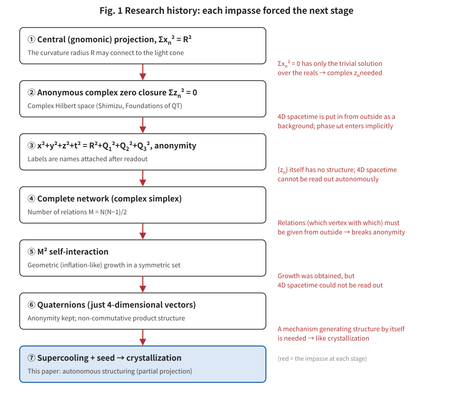
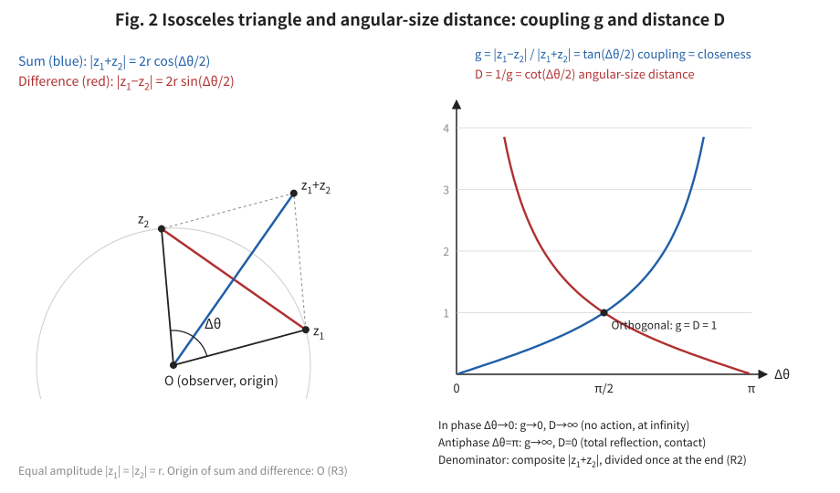
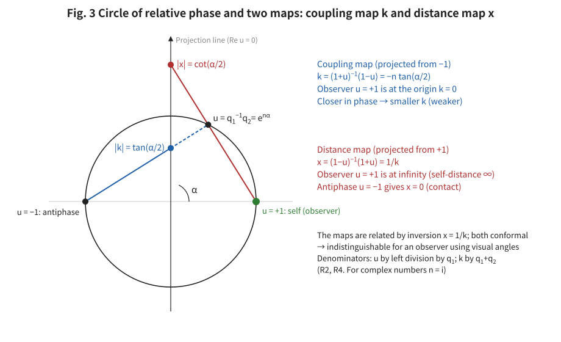
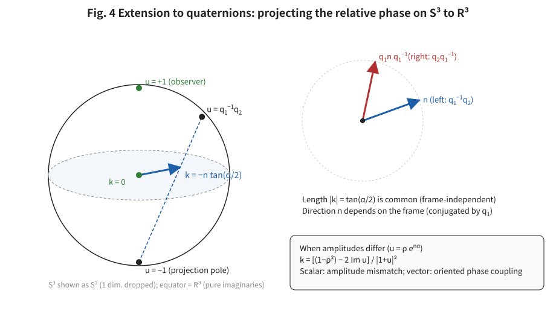
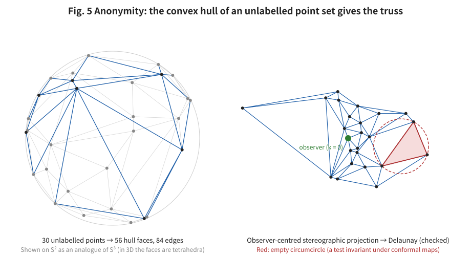
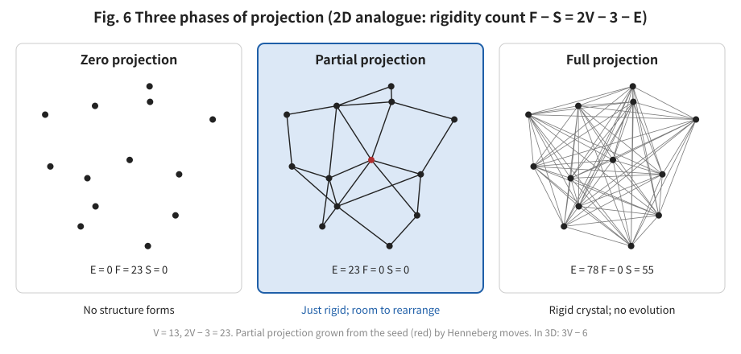
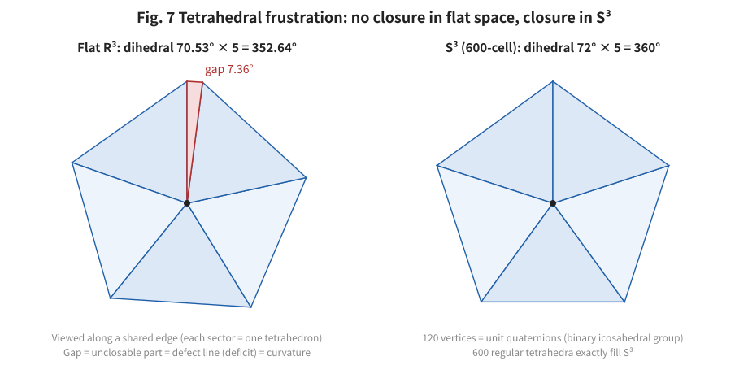
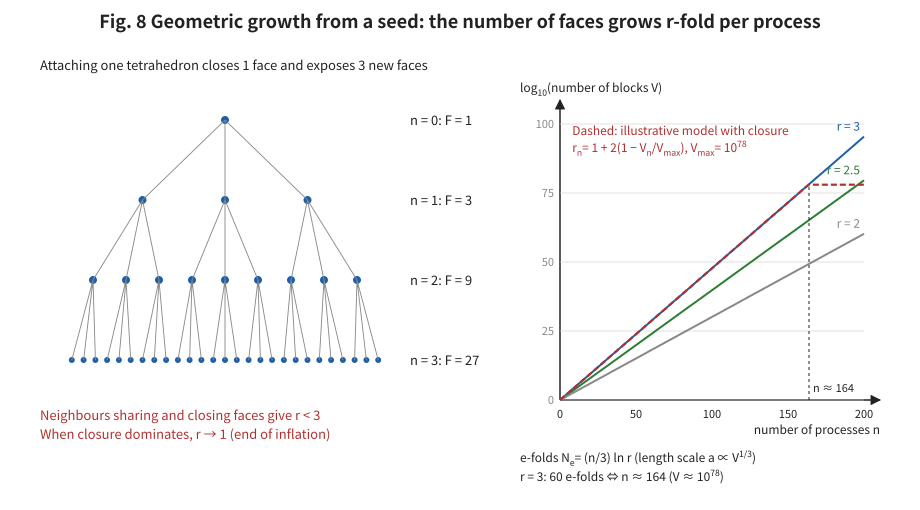
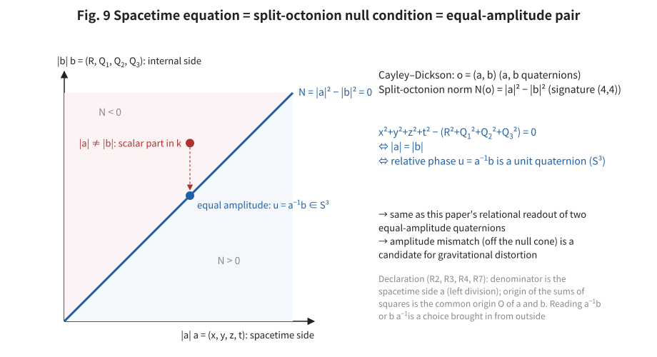

# Relational Readout of Quaternions and Crystallization as Inflation
## ― Anonymity-Preserving Autonomous Structuring and Partial Projection ―

**Author:** Noriaki Kihara (WF System Co., Ltd.)　ORCID 0009-0004-6753-4020
**Date:** 2026-10-21　　**Version:** v1.1
**Version DOI:** 10.5281/zenodo.23523238　　**Concept DOI:** 10.5281/zenodo.23523237
**Same folder:** figures fig01–fig09 (SVG; English-label versions in `図表/en/`), figure-generation programs `make_figures_quaternion_crystallization_20261021.py` and `make_figures_quaternion_crystallization_20261021_v1.1.py`
**Note:** The Japanese version (`quaternion_crystallization_inflation_ja_v1.1.md`) is the authoritative text; this English version is a translation.

---

## Abstract

The author's research programme aims to read out spacetime and particles only from the relations within an anonymous set of complex numbers {zₙ}, without placing a background spacetime, a ruler, or particle species from outside, and to connect this to the fact that general relativity and the Standard Model hold locally with extremely high accuracy. The previous paper [S6] combined two complex numbers into a quaternion q = z₁ + z₂ j and, since its polar form is exactly the central projection onto the tangent hyperplane at the north pole, constructed the map {zₙ} → {qₙ} → (1+3) as a partial projection. However, an anonymous set of quaternions has no structure by itself, and a mechanism by which structure arises autonomously, without supplying from outside which quaternion relates to which, remained open.

This paper proposes the hypothesis that this mechanism is crystallization in the sense of condensed-matter physics. The main contents are as follows.

1. From the relation between two states, a readout that takes the visual angle as distance is defined. For two equal-amplitude complex numbers we obtain the coupling coefficient g = |z₁ − z₂| / |z₁ + z₂| = tan(Δθ/2) and the angular-size distance D = 1/g = cot(Δθ/2). In phase is at infinity (no action); antiphase is contact (total reflection).
2. For quaternions, the coupling coefficient k = (q₁ + q₂)⁻¹(q₁ − q₂) = −n tan(α/2) becomes a three-dimensional vector. k is the stereographic projection of the relative phase u = q₁⁻¹q₂ as seen from the observer, and at the same time the central projection of the square root of the relative phase e^(nα/2). A relation with coupling strength 1 (orthogonality) corresponds, in the language of the previous paper, to a relation on the light cone.
3. Since this readout preserves angles, a localized observer cannot distinguish uniform curvature, global scale, the choice of map, or the choice of left/right frame. Local flatness is not an approximation but a property of the readout. What is observable is only direction-dependent distortion (tides).
4. As a way of not supplying connectivity from outside, the convex hull of an anonymous point set is used. Unit quaternions are points on S³ ⊂ ℝ⁴, so their convex hull gives a truss of tetrahedra, which becomes a Delaunay triangulation under observer-centred stereographic projection. The test is invariant under conformal maps.
5. The non-uniqueness of the triangulation is taken not as a defect but as a principle. Under the rigidity count F − S = 3V − 6 − E, only partial projection, between zero projection (no structure forms) and full projection (rigid crystal, no evolution), combines a skeleton with room for rearrangement.
6. Since the structure is not unique, the composition assumption itself requires a process (evolution). When a seed enters a supercooled, highly symmetric state, the number of bondable faces multiplies by r (r ≤ 3) per process, and geometric crystallization occurs. For the length scale a ∝ V^(1/3), the number of e-folds is N_e = (n/3) ln r; for r = 3, the number of processes needed for 60 e-folds is n ≈ 164. The end is given structurally as faces close and r approaches 1.
7. Regular tetrahedra cannot fill flat space (gap 7.36°), but in S³ the 600-cell fills it completely, and its 120 vertices are unit quaternions. In a locally flat readout, the part that cannot close necessarily remains as defect lines, and partial projection is enforced without external parameters. The deficit angles of the defect lines carry curvature.
8. The author's spacetime equation x² + y² + z² + t² = R² + Q₁² + Q₂² + Q₃² is the condition that the norm of a split octonion vanishes, and is equivalent to the two quaternions of the spacetime side and the internal side having equal amplitude.

This is a hypothesis paper; the verification plan and falsification conditions are given in §13.

**Keywords:** quaternions, anonymity, partial projection, stereographic projection, Delaunay triangulation, rigidity, geometrical frustration, 600-cell, supercooling, inflation, split octonions

---

## 1. Research motivation

### 1.1 The starting question

General relativity and the Standard Model cannot be unified well, yet when a locally flat approximation is made they hold with extremely high accuracy. Why? Is there a way to explain this without introducing many arbitrary parameters? This is the starting point of this research.

### 1.2 History: each impasse forced the next stage

The research proceeded in such a way that each impasse forced the next stage (Figure 1).

**Figure 1** History of the research. Red text marks the impasse at each stage, which forced the next stage.

- **Stage ①** Drawing on experience in CG and 3D modelling, the author studied the nonlinear map of central (gnomonic) projection and noticed that, with the map Σxₙ² = R², the curvature radius R of the central projection may be connected to the light cone [S1]. However, Σxₙ² = 0 has only the trivial solution over the reals.
- **Stage ②** Therefore xₙ was taken to be complex, zₙ, and Σzₙ² = 0 was imposed. The foundations of theoretical physics are built on complex Hilbert spaces and their mapping operations, but how to read them out as four-dimensional spacetime is not clear, and a background four-dimensional spacetime is assumed from the start. Also, a pure complex number can be read directly as a wave in exponential form, but as it stands it cannot represent a travelling wave, and the phase ωt is brought in implicitly. A question remained: where in a complex wave with only two degrees of freedom does the capacity to store information lie?
- **Stage ③** From research on the light cone and the conjugacy of λν, the author noticed that spacetime can be written as x² + y² + z² − t² = R² + Q², that putting t as it gives x² + y² + z² + t² = R² + Q², and that the Lorentz transformation and the Wick rotation are problems of reading out t; the author now considers it likely that x² + y² + z² + t² = R² + Q₁² + Q₂² + Q₃². At the same time, the author realized that anonymity is extremely important. The zₙ in Σzₙ² = 0 are anonymous, and the labels x, y, z, t, R, Q₁, Q₂, Q₃ are names attached afterwards to quantities that can be read as such when read out [S2, S3]. However, the set of complex numbers {zₙ} itself has no structure.
- **Stage ④** The complex numbers were considered as a complete network, and a method of reading out structure from the M = N(N−1)/2 relations for N vertices was examined [S4]. However, which vertex relates to which must be supplied from outside, which violates anonymity.
- **Stage ⑤** Considering that the M waves cause M² actions including self-interaction, the author found that repeating this self-interaction in a set of complex numbers with very high symmetry produces inflation-like geometric growth [S5]. However, four-dimensional spacetime could not be read out of that process.
- **Stage ⑥** Two complex numbers make a quaternion, and four make an octonion (counting from the reals, 1 → 2 → 4 → 8). A complex number is originally just a two-dimensional vector, and the names real part and imaginary part were also attached afterwards; it looked as if it would violate anonymity but did not. Likewise, a quaternion is just a four-dimensional vector and an octonion an eight-dimensional vector; they have structure (a product) but do not violate anonymity [S6]. Why physics chooses octonions is not asked in this paper; it is placed as an axiom.
- **Stage ⑦ (this paper)** Can quaternions be used to elucidate a mechanism by which structure arises autonomously while preserving anonymity and without supplying relations from outside? The clue is crystallization in condensed-matter physics. When a slight seed is given to a supercooled structure of high symmetry, a crystal or a glass is constructed geometrically.

Quaternions and crystallization are not a whim; they were selected by the constraint "obtain structure while preserving anonymity."

### 1.3 Structure of this paper

§2 sets the conventions. §3–§4 read out distance from the relation between two states (complex numbers, quaternions), and §5 discusses the localized observer and local flatness. §6 is a hypothesis about standing waves and mass. §7 reads out connectivity from an anonymous point set, and §8 expresses partial projection by the rigidity count. §9 discusses frustration and defects, and §10 the correspondence between geometric growth and inflation. §11 is a bridge to octonions, §12 compares with previous research, and §13 gives the verification plan and falsification conditions.

---

## 2. Conventions

### 2.1 What is inherited from the previous paper

The axioms and definitions of the previous paper [S6] and the catalogue [S3] are used as they are: anonymity (elements carry no labels, and there is no special origin, coordinate, distance, sign, or species), self-consistency (the system takes itself as the reference), indistinguishability (a readout cannot distinguish which layer a value belongs to), the linear closure Σq = 0 and the true-square closure Σq² = 0. The notation for quaternions (q = s + v, polar form q = |q| e^(nθ), conjugate q̄, true square q² = (s² − |v|²) + 2s v) also follows the previous paper.

### 2.2 Declaration of division, origin and observer

This system is a system of products. Division is an implicit normalization, so it is performed only once at the end of the readout, and each time the denominator is declared. Addition inside products moves the origin, so each time addition is used the origin is declared. Every value carries the observer whose value it is. For the main quantities of this paper, the declarations are as follows.

| Quantity | Denominator | Origin | Observer |
|---|---|---|---|
| Relative phase u = q₁⁻¹q₂ | q₁ (left division) | — | q₁ |
| Coupling coefficient k = (q₁ + q₂)⁻¹(q₁ − q₂) | the composite q₁ + q₂ | the origin O of the sum and difference (the barycentre fixed by Σq = 0) | q₁ |
| Distance x = k⁻¹ | k | same as above | q₁ |
| Amplitude ratio ρ = \|q₂\| / \|q₁\| | \|q₁\| | — | q₁ |
| Relative phase of a split octonion u = a⁻¹b (§11) | the spacetime side a (left division) | the common origin O of a and b | a |

Whether one reads with left division or right division is a choice that enters from outside. This paper states it explicitly as the choice of left or right, and describes how the results depend on that choice.

---

## 3. Reading out distance from the relation between two states: complex numbers

### 3.1 Visual angle and the isosceles triangle

When two complex numbers z₁, z₂ have equal amplitude |z₁| = |z₂| = r and phase difference Δθ, the origin O and z₁, z₂ form an isosceles triangle. Its shape is fixed by the two diagonals (Figure 2).

- Difference: |z₁ − z₂| = 2r sin(Δθ/2)
- Sum: |z₁ + z₂| = 2r cos(Δθ/2)

When something of size A is seen at visual angle Δθ, the height of the isosceles triangle with it as base and the observer at the apex is the distance D_A = (A/2) cot(Δθ/2), in the same sense as the angular-diameter distance of astronomy. The smaller the visual angle, the farther; the larger the size, the farther.

**Figure 2** The isosceles triangle formed by two equal-amplitude complex numbers (left), and the coupling coefficient g and the angular-size distance D (right).

### 3.2 Coupling coefficient and angular-size distance

From the ratio of the sum and the difference we define the dimensionless quantities

g = |z₁ − z₂| / |z₁ + z₂| = tan(Δθ/2),　D = 1/g = cot(Δθ/2).

D is the angular-size distance in units of the size A. g and D do not change when both are multiplied by the same complex number (common magnification and common phase rotation). The global scale and the origin of phase cannot be read, so these quantities extract only the relation.

- In phase (Δθ → 0): g → 0, D → ∞. The two appear superposed, have no action, and are at infinity.
- Orthogonal (Δθ = π/2): g = D = 1. The sum and the difference balance.
- Antiphase (Δθ = π): g → ∞, D = 0. With equal amplitude z₁ + z₂ = 0, and the cancellation corresponds exactly to contact.

If distance is read as the weakness of the coupling of action, this behaviour is natural. Taking k = (z₁ − z₂)/(z₁ + z₂) as a complex number, it has the same form as the reflection coefficient of a transmission line Γ = (Z − Z₀)/(Z + Z₀): identical things are matched with no reflection (no action), and antiphase is total reflection (maximal action). It may also be read as the ratio of the differential component (z₁ − z₂)/2 to the common-mode component (z₁ + z₂)/2.

### 3.3 Two maps

The relative phase u = z₂/z₁ = e^(iΔθ) is a point on the unit circle, and k = (1 − u)/(1 + u) = −i tan(Δθ/2). This is the coordinate obtained by projecting the unit circle from the point u = −1 onto the imaginary axis (the Cayley transform, stereographic projection), and the observer itself, u = +1, comes to the origin k = 0 (Figure 3).

Conversely, the coordinate projected from the point u = +1, x = (1 + u)/(1 − u) = 1/k, is the map of distances with magnitude cot(Δθ/2) = D. The observer itself is sent to infinity. The self-distance is infinite, and one's self is not a reference for distance.

The two maps are related by the inversion x = 1/k, and both preserve angles.

**Figure 3** The circle of relative phase and the two maps. Projecting from −1 gives the coupling map k; projecting from +1 gives the distance map x.

### 3.4 Composition law

Chaining relative phases in the same plane, t = tan(Δθ/2) composes as

t₁₂ = (t₁ + t₂) / (1 − t₁t₂).

This is of the same type as the relativistic velocity addition and the cascade connection of reflection coefficients. What is additive is the phase difference Δθ; the coupling coefficient is not a quantity to be added.

---

## 4. Extension to quaternions

### 4.1 The coupling coefficient becomes a three-dimensional vector

For two quaternions q₁, q₂, let the relative phase be u = q₁⁻¹q₂ and define the coupling coefficient

k = (q₁ + q₂)⁻¹(q₁ − q₂) = (1 + u)⁻¹(1 − u).

Since q₁ + q₂ = q₁(1 + u) and q₁ − q₂ = q₁(1 − u), and 1 and u commute, this expression is determined unambiguously as a function of u.

With equal amplitude, u = e^(nα) (n a unit pure imaginary quaternion), and the computation with the complex i replaced by n gives

k = −n tan(α/2)

(Figure 4). k is a pure imaginary quaternion, that is, a three-dimensional vector.

- Magnitude: |k| = |q₁ − q₂| / |q₁ + q₂| = tan(α/2). Since the norm is multiplicative, this is the same formula as for complex numbers.
- Direction: n is the axis representing in which direction the two states are displaced.

The distance map is x = k⁻¹ = n cot(α/2). From the relation between two states, a three-dimensional point with direction and distance is read out.

**Figure 4** Extension to quaternions. Projecting the relative phase u on S³ from the antipode of the observer gives the three-dimensional vector k (left; S³ is shown as S² with one dimension suppressed). In the left and right frames the length is common and the direction differs (right).

### 4.2 Relation to the central projection of the previous paper

The previous paper [S6] showed that the polar form of a quaternion q = |q|(cos θ + n sin θ) is exactly the central projection onto the tangent hyperplane at the north pole, u_g = v/q₀ = n tan θ. Applying this to the square root of the relative phase p = e^(nα/2) (u = p²), its image is n tan(α/2) = −k.

**Proposition 1.** The coupling map k is the stereographic projection of the relative phase u and, at the same time, the central projection of the square root of the relative phase p = e^(nα/2).

The coupling strength becomes |k| = 1 when α = π/2 (orthogonal), and then p = e^(nπ/4) lies on the light cone in the sense of the previous paper (θ = 45°, the real part of p² is 0).

**Corollary.** A relation with coupling coefficient 1 is a relation whose square root of the relative phase lies on the light cone. In the most symmetric configuration of the previous paper, q = ±e^(πn/4), each element sits exactly at this position.

### 4.3 Left and right frames

If the relative phase is defined by right division v = q₂q₁⁻¹, then v = q₁ u q₁⁻¹, and the coupling coefficient becomes k_R = q₁ k_L q₁⁻¹. The magnitude |k| is common, and the direction is only rotated by conjugation with q₁. The strength of the coupling does not depend on the observing frame; the direction depends on the frame. This is the same structure as, in the visual angle of the triangle in the previous paper, n_L and n_R being rotated separately by left and right multiplication.

### 4.4 When the amplitudes differ: the 1+3 decomposition

Writing u = ρ e^(nα), and using that (1 + u)⁻¹ = (1 + ū)/|1 + u|² commutes with (1 − u),

k = [(1 − ρ²) − 2 Im u] / |1 + u|².

The scalar part is the amplitude mismatch, and the vector part is the phase coupling with an orientation. The complex "real part = mismatch, imaginary part = phase" extends directly to a 1+3 decomposition.

### 4.5 Invariance and composition law

|k| is invariant under q ↦ a q b (four-dimensional rotations, a, b unit quaternions) and a common real factor. k itself is invariant under common multiplication from the left, and rotates as a vector under common multiplication from the right. If the axes are aligned, the composition law is the same as in §3.4, but if the axes are misaligned, the composition depends on the order of multiplication and cross terms of cross-product type appear.

---

## 5. The localized observer and local flatness

### 5.1 What cannot be distinguished

A localized observer q_o reads only the relative phases u_j = q_o⁻¹q_j with itself as reference. Itself is u = 1, so in the coupling map it comes to the origin. The coupling map is the stereographic projection centred on the observer, and stereographic projection preserves angles. Therefore an observer who measures only by visual angles cannot distinguish the following.

1. The uniform curvature of S³ and flat ℝ³ (S³ is also locally flat)
2. The coupling map k and the distance map x = 1/k (inversion preserves angles)
3. The choice of left or right frame (the observer has only its own frame)
4. The global scale (distance is obtained only as a ratio to a size)

What the observer obtains are the directions n_j to other states, the angles between directions, and ratios of distances; this is complete as the information of a three-dimensional space identified up to angle-preserving maps.

### 5.2 What is visible: tides

What cannot be distinguished is only the uniform part of curvature. Direction-dependent distortion, that is, the component by which the shape of the set of states in the observer's field of view is squeezed or stretched in one direction, is visible as a deformation of ratios between angles. This is the same structure as the equivalence principle: a uniform gravitational field can be removed locally, but tides cannot.

### 5.3 Local flatness is a property of the readout

To the question of §1.1, this paper answers as follows.

**Local flatness is not an approximation but a property of the observer-centred conformal readout. Curvature appears only as defects (deficit angles at the seams, §9).**

In the equal-amplitude case, the basis of the readout is the round S³ projected stereographically, so however the states are distributed, the geometry of the field of view is conformally flat and tides do not appear in principle. Equal amplitude corresponds to a uniform state without gravity. Tides appear when the amplitudes are not uniform, and the scalar part of §4.4 enters the readout as a factor that stretches and shrinks distances direction by direction (§6.3).

---

## 6. Standing waves and mass (hypothesis)

### 6.1 No travelling phase

We consider that quaternions have no travelling phase and that states are standing waves. Under this premise, the relative phase α of two states does not flow in time, and the readout of distance is statically fixed.

### 6.2 Mass is the norm

For a single quaternion, the only quantity invariant under the four-dimensional rotations q ↦ a q b is the norm |q|². This is the Euclidean version of the structure in which the Lorentz-invariant norm of the four-momentum gives the rest mass. What reaches the observer is only the amplitude ratio ρ = |q_j| / |q_o|, and the global scale cannot be read.

A standing wave is a state in which counter-propagating components balance and the net momentum is zero, that is, the rest frame itself. Just as a box enclosing light has inertial mass as a whole, the energy of a standing wave is proportional to the square of the amplitude. We therefore place the following hypothesis.

**Hypothesis 1.** Mass is proportional to the squared norm |q|², and is read out statically from the observer as the amplitude ratio ρ.

Since gravitational mass and inertial mass come from the same quantity, the equivalence principle is built into the premise. Reading out a mass ratio requires no clock; it requires only the state that serves as the reference for the ratio. Mass is the value obtained by reading out the internal state from outside, and the conversion ratio between the internal and external scales is not derived in this paper.

### 6.3 The source of gravity is the non-uniformity of the norm

Since the global scale is not visible, what produces gravity is not |q| itself but its non-uniformity. Regarding Φ ∝ ln |q| as a potential, the mass density corresponds to its Laplacian, and the mass in an enclosed region to the flux of its gradient. In gravitational lensing, the isotropic magnification (convergence) is proportional to the projected mass density, which is consistent with the scalar part of k producing isotropic distortion.

### 6.4 Motion is a left–right imbalance

Four-dimensional rotations divide into rotations from the left and rotations from the right. The previous paper [S6] showed that what preserves the true-square closure Σq² = 0 is only the rotation q ↦ u q u⁻¹ multiplying the same unit from both sides, and real scaling, and that one-sided multiplication breaks the closure.

**Hypothesis 2.** Rest is the state in which left and right are balanced (rotating with the same unit from both sides, preserving the closure), and motion is the breaking of the left–right balance (one-sided multiplication, breaking the closure). The travelling phase is not "absent"; it is balanced to zero in the rest state and appears with motion.

Under this hypothesis, instead of the equivalence principle holding automatically, it is replaced by the dynamical question "does the gradient of the norm (gravity) cause a left–right imbalance (motion)?" If this holds, free fall can be read as a phenomenon in which the non-uniformity of amplitude tilts a standing wave toward the travelling-wave side.

---

## 7. Anonymity: reading out connectivity from an anonymous point set

### 7.1 The problem with simplicial methods

In a simplicial method that builds structure from a complete network of vertices and edges, vertices have identities, and the connectivity information of which vertex is joined to which is supplied from outside. This is contrary to anonymity. What may be given is only a collection of anonymous states, and connectivity must be read out from it.

### 7.2 Readout by the convex hull

Equal-amplitude quaternions are points on S³ ⊂ ℝ⁴. Taking the convex hull of a collection of anonymous points, its faces are tetrahedra, and a truss filling S³ with tetrahedra is obtained. The convex hull does not depend at all on the ordering or numbering of the points.

When projected stereographically from the antipode of the observer q_o, the faces of the convex hull whose caps do not contain the pole of the projection coincide with the Delaunay triangulation of the projected points (the correspondence between the convex hull of a point set on a sphere and the Delaunay triangulation [X6]). Figure 5 confirms numerically, for 30 anonymous points on S² as a one-dimension-lower analogue of S³, that the projections of the faces of the convex hull coincide with the Delaunay triangulation of the projected points (53 triangles).

**Figure 5** The convex hull of an anonymous point set (left) and the Delaunay triangulation by observer-centred stereographic projection (right). Red is an example with no other point inside the circumcircle.

### 7.3 Consistency with the readouts so far

1. **Independent of the choice of map.** The Delaunay test (no other point inside the circumsphere of a tetrahedron) is invariant under maps that take spheres to spheres. Whichever of the maps k and x, indistinguishable for a localized observer, is used for the test, the same truss is obtained.
2. **Amplitude enters as a weight.** When amplitudes differ, the points are displaced radially from S³, and their convex hull generalizes to a weighted Delaunay triangulation (regular triangulation) [X7]. Points with larger amplitude (mass, Hypothesis 1) change the surrounding connectivity more. The specific correspondence between amplitude and weight is not derived in this paper.
3. **Can be assembled by local rules.** The circumsphere test can be performed with nearby points only, and places that do not satisfy the condition can be repaired by local rearrangements (flips) [X7]. Without an eye that surveys the whole, the truss is assembled and rearranged by local operations alone.

### 7.4 Degeneracy arising from anonymity

When five or more points lie on the same sphere, the triangulation is not determined uniquely. Also, there are point sets with different structures even though their sets of unlabelled distances are the same. Giving names from outside would resolve this degeneracy, but that would break anonymity. This paper does not regard this degeneracy as a defect to be eliminated, and places it as the principle of the next section.

---

## 8. Partial projection and indeterminacy

### 8.1 The rigidity count

For a three-dimensional truss joining V points with E members, Maxwell's count and Calladine's relation [X8, X9]

F − S = 3V − 6 − E

hold. F is the number of degrees of freedom of deformation excluding rigid-body motion (soft modes), and S is the number of internal stresses the members hold by constraining one another (self-stresses).

### 8.2 Three phases of projection

| Phase | Members | Result |
|---|---|---|
| Zero projection | E = 0 | F is maximal. No constraint; no structure forms |
| Partial projection | E ≈ 3V − 6 | Both F and S remain moderately. Skeleton and room for rearrangement coexist |
| Full projection | E = V(V−1)/2 | F = 0, S is huge. It becomes a rigid crystal and does not evolve |

Figure 6 shows the three phases in a two-dimensional analogue (2V − 3). The example of partial projection is an isostatic truss grown from a seed by Henneberg-type operations (joining a new point to two existing points) [X10].

**Figure 6** Three phases of projection. From the left: zero projection, partial projection, full projection.

The previous paper and the catalogue [S3, S6] stated that, as long as spacetime is read stably, the map must be at least a partial projection: with zero projection spacetime does not appear, and with full projection no unreadable interior, indeterminacy or discreteness remains. This section makes this concrete in the language of trusses.

### 8.3 Indeterminacy and time

- **Indeterminacy:** The soft modes F and the non-uniqueness of the Delaunay triangulation (§7.4) carry the indeterminacy of the structure.
- **Time:** It appears as a sequence of local rearrangements (flips). Since standing waves have no travelling phase (§6.1), time arises not from the advance of phase but from the rearrangement of structure.
- **Complementarity:** F − S is fixed by the numbers of points and members alone. Increasing freedom reduces constraint, increasing constraint reduces freedom, and both cannot be fixed at the same time.

### 8.4 Composition requires a process

Since the structure is not determined uniquely, composition is not "solve the equations and obtain one answer"; it can only be defined as a process with a procedure and a history. The result depends on where, and in what order, the degeneracy was resolved. Among the many possible structures, the actual history selects one. This history dependence can be the origin of the arrow of time.

In glass science, it is known that network glasses form most easily near the isostatic point where the number of constraints balances the degrees of freedom [X11, X12]. The proportion of partial projection must also be decided not from outside but by the structure itself. The mechanism is described in the next section.

---

## 9. Supercooling, frustration and defects

### 9.1 Supercooling and seeds

- **Supercooled state:** A highly symmetric, degenerate metastable state in which all relations exist potentially but none has yet been fixed as a member.
- **Seed:** The first local block (one tetrahedron) in which the degeneracy is resolved. To preserve anonymity, it is not placed from outside but arises spontaneously from fluctuations of the configuration.
- **Crystallization:** A fixed tetrahedron resolves the degeneracy of neighbouring faces, and the front of fixing spreads (§10).

This is the same structure as supercooling by icosahedral local order [X13].

### 9.2 Tetrahedral frustration

The dihedral angle of the regular tetrahedron is arccos(1/3) ≈ 70.53°; placing five around one edge gives 5 × 70.53° = 352.64°, leaving a gap of 7.36°. Regular tetrahedra cannot fill flat three-dimensional space without gaps (Figure 7, left).

In S³, however, there exists a regular polytope that 600 regular tetrahedra fill completely (the 600-cell). Five cells surround each edge, and the dihedral angle of the cells is exactly 72°. Its 120 vertices are unit quaternions and form the binary icosahedral group [X3, X5] (Figure 7, right).

**Figure 7** View along a shared edge. In flat space a gap remains (left); in S³ it closes (right).

### 9.3 Partial projection is enforced geometrically

This is exactly the structure known in the physics of supercooled liquids [X14, X15]. Perfect icosahedral order is realized only in the curved space S³, and mapping it to flat space necessarily introduces defect lines (disclinations). In the context of this paper:

1. On S³ (the space of unit quaternions), crystallization tends toward perfect order.
2. Since the map of a localized observer is locally flat (§5), that order cannot be mapped completely, and defect lines necessarily remain.
3. Defect lines have deficit angles and become the carriers of curvature (tides).
4. When the number of states greatly exceeds 120, complete filling is impossible even on S³, so frustration is essentially unavoidable.

**Proposition 2 (hypothesis).** The proportion of partial projection is not given by an external parameter but is enforced geometrically by tetrahedral frustration. The system cannot become a fully projected rigid crystal, and room for defects and rearrangement always remains.

In the methods of condensed-matter physics, curved space is introduced as a tool to describe order. In this paper, the state space itself is S³, and curved space is the starting point.

---

## 10. Geometric growth and inflation

### 10.1 Counting by the number of processes

Since space is not presupposed, growth is counted not as a front advancing at constant speed in an existing space but by the number of processes. In one process, tetrahedra attach simultaneously to all exposed faces. When one tetrahedron attaches, one face is closed and three new faces are exposed. Letting r (r ≤ 3) be the factor per process after subtracting the part closed by new tetrahedra sharing faces with one another, after n processes the number of bondable faces and the number of blocks are both proportional to rⁿ (Figure 8, left).

Geometric growth is the default behaviour of this process; what is special is not the growth but the decrease of the factor as faces close.

**Figure 8** The tree of faces (left), and the growth of the number of blocks for each factor r (right). The dashed line is an illustrative model including closure and is not derived.

### 10.2 Number of e-folds

Taking one block as the unit volume, V ∝ rⁿ, and the length scale is a ∝ V^(1/3), so the number of e-folds is

N_e = (n/3) ln r.

For r = 3, the number of processes needed for 60 e-folds is n = 180/ln 3 ≈ 164, and then V ≈ 10⁷⁸. In standard inflation theory the expansion rate is tuned by the inflaton potential; here the factor is fixed by geometry, namely the number of faces of a tetrahedron.

### 10.3 How it ends, and how it looks to the observer

- **End:** When faces begin to close through the resolution of degeneracy or the curvature of S³, r approaches 1 and growth stops. The end of inflation is given structurally as a change of topology.
- **Appearance:** In the growth stage, the number of faces and the number of blocks both increase as rⁿ, so the ratio of surface area to volume is kept constant. This is a characteristic not of flat space (where the ratio is inversely proportional to the radius) but of hyperbolic geometry. Since the global scale is not visible to a localized observer (§5.1), the increase of the number of blocks around it by a constant factor should be read out as exponential expansion (hypothesis).

### 10.4 Correspondence with standard theory

| | Standard inflation | This paper |
|---|---|---|
| What grows exponentially | The scale of existing space | The number of fixed relations (blocks) |
| Driver | The potential of the inflaton field | Resolution of degeneracy (default behaviour) |
| End | The field rolls down the potential | Closure of faces, filling of S³, frustration |
| Reheating | Decay of the inflaton | Release of the latent heat of crystallization |
| Uniformity | Stretching of a causally connected small region | A chain from a single seed |
| Flatness | Flattening by stretching | Uniform curvature is invisible to a localized observer |
| Primordial fluctuations | Quantum fluctuations of the inflaton | Frozen defect lines and non-uniqueness of rearrangement |

Guth's original inflationary theory [X17] was a picture of a supercooled false vacuum and nucleation of bubbles, but it had the problem that the expansion of space was faster than the growth of bubbles, so bubbles did not connect and inflation could not end [X18], and it was replaced by the slow-roll type [X19]. In the picture of this paper, space itself is not presupposed and what expands is the amount of fixed structure, so this problem is avoided structurally in the form "it stops when faces close."

Topological defects produced at phase transitions are connected, as the Kibble mechanism [X20] and its condensed-matter version the Kibble–Zurek mechanism [X21], by a scaling law in which the defect density is determined by the speed of the phase transition, and this has been verified experimentally [X22]. It provides a foothold for checking the correspondence between the defect lines of this paper and primordial fluctuations.

### 10.5 Relation to task 3 of the previous paper

Task 3 of the previous paper [S6] was the dynamical question of whether the all-to-all self-interaction of highly symmetric quaternions produces inflation-like expansion. This paper answers it from the side of structure (the counting of faces), as a stage before writing down the self-interaction. Whether the two are different expressions of the same phenomenon remains a task to be checked after implementing the self-interaction.

---

## 11. A bridge to octonions: the spacetime equation is the null condition of split octonions

### 11.1 Correspondence

Take the spacetime-side quaternion a = t + x i + y j + z k and the internal-side quaternion b = R + Q₁ i + Q₂ j + Q₃ k, and consider the Cayley–Dickson construction o = (a, b) with product (a, b)(c, d) = (ac + γ d̄ b, da + b c̄) and conjugate (a, b)* = (ā, −b). The norm is N(o) = |a|² − γ|b|²; γ = −1 gives the ordinary octonions and γ = +1 the split octonions (signature (4,4)) [X4]. For the split octonions

x² + y² + z² + t² − (R² + Q₁² + Q₂² + Q₃²) = 0　⇔　N(o) = 0　⇔　|a| = |b|,

and if a ≠ 0 the relative phase u = a⁻¹b is a unit quaternion (a point on S³) (Figure 9).

**Figure 9** The spacetime equation is the null condition of split octonions and is equivalent to a pair of equal-amplitude quaternions.

### 11.2 What can be read

1. **The spacetime equation is a pair of equal-amplitude quaternions.** The structure of this paper, "reading out relations from the relative phase of two equal-amplitude quaternions," is the spacetime equation itself.
2. **The deviation from null is the amplitude mismatch.** When |a| ≠ |b|, a scalar part appears in the coupling coefficient (§4.4) and becomes a candidate for gravitational distortion (§6.3).
3. **Zero closure requires the split form.** The norm of the ordinary octonions is positive definite and has no nontrivial null elements. Requiring nontrivial solutions selects the split form. This is the same logic by which Σxₙ² = 0 has only the trivial solution over the reals and requires complex numbers (Stage ①).
4. **The internal side appears only through the relative phase and the norm ratio.** What is visible from the spacetime side is only u and the norm ratio; the state of the internal side itself is not read out.

The previous paper [S6] showed that the true square of an octonion repeats the same form o² = (q² − |p|²) + 2q₀ p ℓ. The norm of the split form in this section is of the form on the side of the norm using conjugation, and its relation to the side of the true square remains a task. How non-associativity appears in chains of relations (the closure of triangles) is also unresolved.

---

## 12. Comparison with previous research

### 12.1 The closest previous research

- **Quantum Graphity** [X1] placed degrees of freedom on a complete graph and considered, from a model invariant under permutations of points, the process by which geometry arises through a phase transition by cooling (geometrogenesis). Starting from a complete graph and imposing permutation invariance is shared with this paper. On the other hand, the vertices carry labels, and the phase transition requires an external heat bath. This paper gives no names to vertices, places neither a heat bath nor a Hamiltonian, and reads out connectivity from the convex hull of an anonymous point set.
- **The Selection–Stitch Model** [X2] attempts to explain inflation and reheating as a process in which the tensor network of a discrete vacuum crystallizes through a frustrated tetrahedral foam. The combination of tetrahedral frustration and inflation by crystallization is shared with this paper. On the other hand, it presupposes a network and a coordination number, and selects phases by energy minimization. This paper starts from the fact that the state space itself is S³ (unit quaternions), does not supply connectivity from outside, and counts the growth factor by the number of faces.

### 12.2 Condensed-matter physics and glass science

The method of placing a template of perfect order in curved space and introducing defects by flattening [X14, X15], constraint theory and rigidity percolation [X11, X12], and the kinetics of nucleation and growth [X16] are direct precedents for the structure of §8–§10 of this paper. The novelty of this paper lies in placing these in the problem of reading out spacetime and treating curved space not as a tool but as the state space.

### 12.3 Discrete spacetimes that supply connectivity from outside

Curvature as a deficit angle [X23] and causal dynamical triangulations, in which four dimensions emerge from gluing simplices [X24], share with this paper the point that curvature concentrates at seams, but they supply the rules of connectivity from outside.

### 12.4 Novelty of this paper

1. Coupling and distance are read out from the relative phase of quaternions as an observer-centred stereographic projection (§3–§4). The coupling map is the central projection of the square root of the relative phase, and coupling coefficient 1 corresponds to the light cone (Proposition 1).
2. Connectivity is read out from the convex hull of an anonymous point set (§7).
3. Non-uniqueness is placed as a principle, partial projection = indeterminacy, and composition is defined as a process (§8).
4. Without a heat bath or a Hamiltonian, geometric growth and the number of e-folds are fixed by the factor of faces, and the end is given structurally (§10).
5. The state space itself is S³, and curved space is the starting point (§9).
6. The spacetime equation is the null condition of split octonions and is equivalent to a pair of equal-amplitude quaternions (§11).

---

## 13. Verification plan and falsification conditions

The claims of this paper divide into mathematically identical ones, structural analogies, and hypotheses. The classification is as follows.

| Claim | Category |
|---|---|
| Angular-size distance and coupling coefficient (§3), the quaternion coupling coefficient and Proposition 1 (§4), the correspondence between convex hull and Delaunay triangulation (§7.2), the rigidity count (§8.1), the tetrahedral gap and the 600-cell (§9.2), the null condition of split octonions (§11.1) | Mathematically identical |
| Correspondence with the reflection coefficient (§3.2), correspondence between supercooling and inflation (§10.4) | Structural analogy |
| Hypotheses 1 and 2 (§6), the source of tides (§5.2, §6.3), Proposition 2 (§9.3), readout as exponential expansion (§10.3) | Hypothesis |

Numerical experiments to test the hypotheses are planned as follows.

- **V1 Four-dimensional version of the convex-hull readout:** Take the convex hull in ℝ⁴ of N anonymous unit quaternions, and confirm that the observer-centred stereographic projection coincides with the three-dimensional Delaunay triangulation. Record the distributions of the number of edges per vertex and the number of tetrahedra per edge.
- **V2 Proportion of partial projection:** Project members with a degeneracy criterion (making members only where the triangulation is determined uniquely), and measure F, S and E/(3V − 6) while varying N.
- **V3 Supercooling and seeds:** Take as the supercooled state a highly symmetric configuration (the vertices of the 600-cell, the most symmetric configuration of the previous paper, etc.) with a small disorder added, and in the process of attaching tetrahedra by local circumsphere tests, measure the factor r_n per process and N_e.
- **V4 Defects:** Measure the number of tetrahedra surrounding an edge (ideally 5) and the distribution of deficit angles in the observer's map.
- **V5 Source of tides:** Compare the deviation (shear) of the observer's field-of-view map from conformal flatness between equal-amplitude configurations and configurations with non-uniform amplitude.

The falsification conditions are as follows.

1. If no stage in which the factor r_n clearly exceeds 1 appears in V3, the claim of geometric growth in §10 is rejected.
2. If E/(3V − 6) does not settle to a value independent of N in V2, Proposition 2 (the proportion of partial projection is determined geometrically) is rejected.
3. If shear appears in equal-amplitude configurations in V5, "with equal amplitude, tides do not appear in principle" in §5.3 is wrong.
4. If defect lines do not remain after flattening in V4, §9.3 is rejected.

---

## 14. Conclusion

A readout that takes the visual angle as distance was defined from the relation between two states. For equal-amplitude complex numbers we obtained the coupling coefficient g = tan(Δθ/2) and the angular-size distance D = cot(Δθ/2); in phase is at infinity and antiphase is contact. For quaternions the coupling coefficient becomes the three-dimensional vector k = −n tan(α/2), and a three-dimensional point with direction and distance is read out from the relation between two states alone. k is the stereographic projection of the relative phase and also the central projection of the square root of the relative phase, and coupling coefficient 1 corresponds to the light cone.

Since this readout preserves angles, a localized observer cannot distinguish uniform curvature, scale, map, or left/right frame, and local flatness is a property of the readout. Only tides are visible, and we consider their source to be the non-uniformity of amplitude.

Connectivity is read out from the convex hull of an anonymous point set. Placing the non-uniqueness of the triangulation as a principle, only partial projection, between zero projection and full projection, combines a skeleton with room for rearrangement, and composition requires a process. When a seed enters a supercooled, highly symmetric state, geometric crystallization in which the number of faces multiplies by r per process occurs, giving the number of e-folds N_e = (n/3) ln r, and it ends when faces close. Regular tetrahedra cannot fill flat space but close in S³, so defect lines necessarily remain in a locally flat readout, and partial projection is enforced without external parameters.

Finally, it was shown that the author's spacetime equation is the null condition of split octonions and is equivalent to the quaternions of the spacetime side and the internal side having equal amplitude. The relational readout of quaternions in this paper is a bridge to the stage of octonions.

---

## References

### Self-citations (Concept DOI)

[S1] N. Kihara, "Geometric Formulation of 4-Dimensional Space via Central Projection," 2026-04-05. Concept DOI 10.5281/zenodo.19427779.
[S2] N. Kihara, "Anonymous Equal-Amplitude Composite-Wave Model: Basic Axiom System v9," 2026-07-24. Concept DOI 10.5281/zenodo.21315735.
[S3] N. Kihara, "A Catalogue of Symmetries and Magic Numbers for Reading Out Spacetime from a State Space: The Answer-Check Standard of a Research Programme Taking Anonymity and Self-Consistency as Axioms," 2026-10-18. Concept DOI 10.5281/zenodo.23444451.
[S4] N. Kihara, "Reading Out Time, Space, Mass, Charge, Translational Velocity and Spin from the Relations and Interference of Complex Waves without a Background Spacetime: An Integrated Hypothesis in the Order of the Thought Experiment, from Residents of a Closed Circle to Residents of a Four-Dimensional Spherical Shell, and on to α, the Four-Dimensional Lattice and E8," 2026-10-15. Concept DOI 10.5281/zenodo.23384928.
[S5] N. Kihara, "Dynamics of a Self-Consistent Relational-Wave Closed System: From the Local Instability of the 90-Degree Relative Equilibrium to Inflation, Spontaneous Symmetry Breaking, Grassmann Geometry, Terminal Universality and Relationalism," 2026-09-12. Concept DOI 10.5281/zenodo.22729146.
[S6] N. Kihara, "A Map from a Set of Complex Numbers to Spacetime (1+3): Readout by Quaternions and Partial Projection," 2026-10-18. Concept DOI 10.5281/zenodo.23451494.

### External references

[X1] T. Konopka, F. Markopoulou, S. Severini, "Quantum graphity: a model of emergent locality," Phys. Rev. D 77, 104029 (2008); the original is T. Konopka, F. Markopoulou, L. Smolin, "Quantum Graphity," arXiv:hep-th/0611197 (2006).
[X2] R. Kulkarni, "Emergence of cosmic flatness, inflation, and reheating from topological phase transitions in a discrete vacuum," Zenodo (2026). Concept DOI 10.5281/zenodo.18727238 (the first version of 2026-02-21 was titled "Geometric Phase Transitions in a Discrete Vacuum: Deriving Cosmic Flatness, Inflation, and Reheating from Tensor Network Topology").
[X3] J. H. Conway, D. A. Smith, *On Quaternions and Octonions: Their Geometry, Arithmetic, and Symmetry* (A K Peters, Natick, 2003).
[X4] J. C. Baez, "The Octonions," Bull. Amer. Math. Soc. 39, 145–205 (2002).
[X5] H. S. M. Coxeter, *Regular Polytopes*, 3rd ed. (Dover, New York, 1973).
[X6] K. Q. Brown, "Voronoi diagrams from convex hulls," Inf. Process. Lett. 9, 223–228 (1979).
[X7] H. Edelsbrunner, *Geometry and Topology for Mesh Generation* (Cambridge University Press, 2001).
[X8] J. C. Maxwell, "On the calculation of the equilibrium and stiffness of frames," Phil. Mag. 27, 294–299 (1864).
[X9] C. R. Calladine, "Buckminster Fuller's 'tensegrity' structures and Clerk Maxwell's rules for the construction of stiff frames," Int. J. Solids Struct. 14, 161–172 (1978).
[X10] G. Laman, "On graphs and rigidity of plane skeletal structures," J. Eng. Math. 4, 331–340 (1970).
[X11] J. C. Phillips, "Topology of covalent non-crystalline solids I: Short-range order in chalcogenide alloys," J. Non-Cryst. Solids 34, 153–181 (1979).
[X12] M. F. Thorpe, "Continuous deformations in random networks," J. Non-Cryst. Solids 57, 355–370 (1983).
[X13] F. C. Frank, "Supercooling of liquids," Proc. R. Soc. Lond. A 215, 43–46 (1952).
[X14] J.-F. Sadoc, R. Mosseri, *Geometrical Frustration* (Cambridge University Press, 1999).
[X15] D. R. Nelson, "Order, frustration, and defects in liquids and glasses," Phys. Rev. B 28, 5515–5535 (1983).
[X16] M. Avrami, "Kinetics of phase change. I. General theory," J. Chem. Phys. 7, 1103–1112 (1939).
[X17] A. H. Guth, "Inflationary universe: A possible solution to the horizon and flatness problems," Phys. Rev. D 23, 347–356 (1981).
[X18] A. H. Guth, E. J. Weinberg, "Could the universe have recovered from a slow first-order phase transition?," Nucl. Phys. B 212, 321–364 (1983).
[X19] A. D. Linde, "A new inflationary universe scenario: A possible solution of the horizon, flatness, homogeneity, isotropy and primordial monopole problems," Phys. Lett. B 108, 389–393 (1982).
[X20] T. W. B. Kibble, "Topology of cosmic domains and strings," J. Phys. A 9, 1387–1398 (1976).
[X21] W. H. Zurek, "Cosmological experiments in superfluid helium?," Nature 317, 505–508 (1985).
[X22] A. del Campo, W. H. Zurek, "Universality of phase transition dynamics: Topological defects from symmetry breaking," Int. J. Mod. Phys. A 29, 1430018 (2014).
[X23] T. Regge, "General relativity without coordinates," Nuovo Cimento 19, 558–571 (1961).
[X24] J. Ambjørn, J. Jurkiewicz, R. Loll, "Emergence of a 4D world from causal quantum gravity," Phys. Rev. Lett. 93, 131301 (2004).

---

## Appendix A　Reproducing the figures

Figures 1–9 were generated by `make_figures_quaternion_crystallization_20261021.py` in the same folder as this paper. Run `python make_figures_quaternion_crystallization_20261021.py out`; dependencies are numpy and scipy (ConvexHull, Delaunay), and cairosvg only for PNG conversion. The random seeds are 20261021 for Figure 5 (30 points) and 7 for Figure 6 (13 points). When run, Figure 5 checks and prints the agreement between the projections of the faces of the convex hull and the Delaunay triangulation of the projected points (agreement on the run of 2026-10-21, 53 triangles). The closure model of Figure 8 (r_n = 1 + 2(1 − V_n/V_max), V_max = 10⁷⁸) is illustrative and not derived. The English-label figures were generated by `make_figures_quaternion_crystallization_20261021_v1.1.py` in the same folder with the argument `en` (`図表/en/`). This program switches only the text of the figures between Japanese and English, and its Japanese output is byte-for-byte identical to that of the program above (the reproduction record is `図表/README.md`).

## Appendix B　Dialogue record

The content of this paper arose from a dialogue between the author and Claude on 2026-10-21. The insights obtained in the dialogue, and the points corrected or withdrawn, are summarized in `追記_対話での気づき_研究動機と分解型八元数_20261021.md` (in Japanese) in the same folder.

## Version history

- v1 (2026-10-21): First draft (pre-publication draft; not published on Zenodo).
- v1.1 (2026-10-21): The external reference Planck 2018 (v1's [X22]), which was not cited in the text, was removed from the references. The review del Campo–Zurek (2014) was added as [X22] as the basis for "has been verified experimentally" in §10.4, and Regge and Ambjørn et al. (v1's [X23] and [X24]) were kept with the same numbers. The titles of the self-citations [S1]–[S6] in the Japanese version were made the same Japanese titles as in the Japanese version of the previous paper [S6] ([S4] with its full title), and the Concept DOIs were confirmed against the published Zenodo records. The bibliographic data of the external references were checked against the originals (Crossref, Zenodo); [X2] was changed to its Zenodo Concept DOI and the title of the latest version, and the description of [X2] in §12.1 was corrected, following the original, from "free-energy minimization" to "energy minimization." The claims of the text are unchanged. This is the first version published on Zenodo (Version DOI 10.5281/zenodo.23523238, Concept DOI 10.5281/zenodo.23523237).
