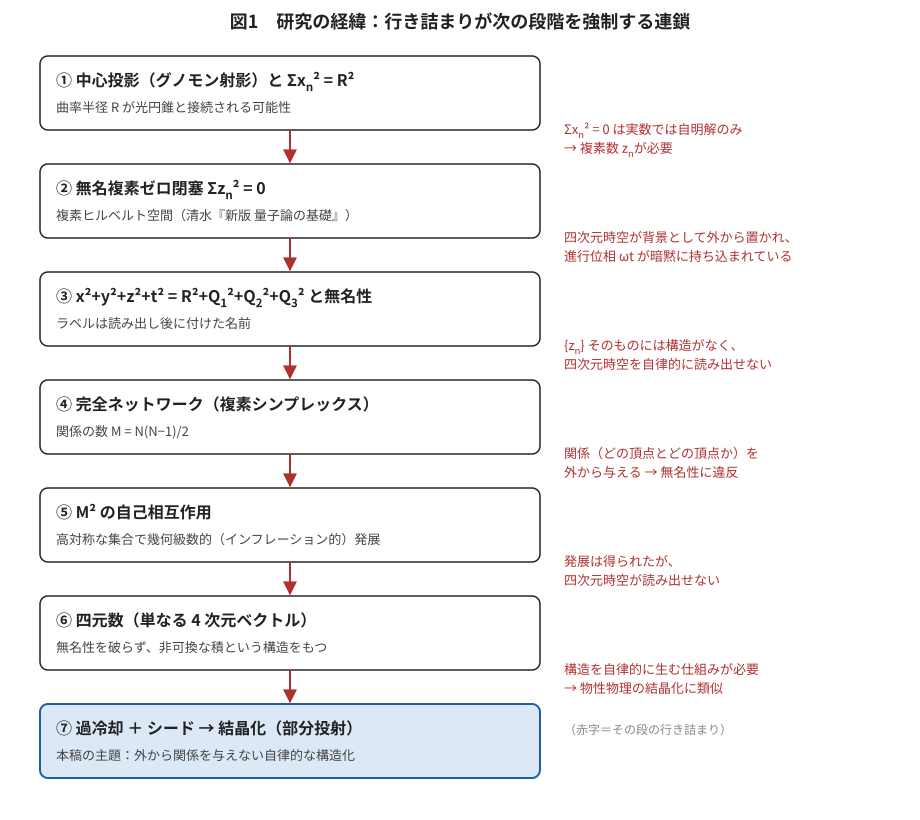
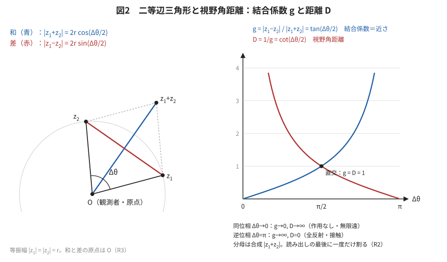
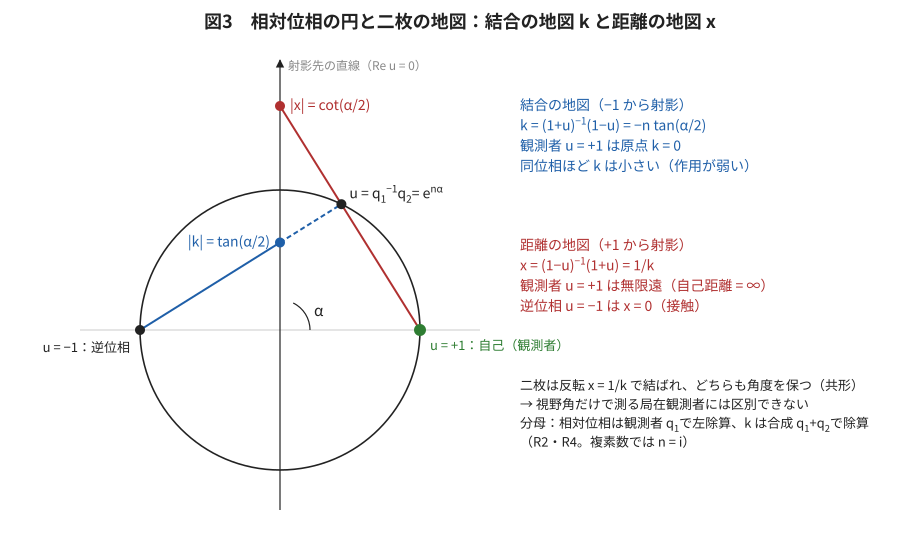
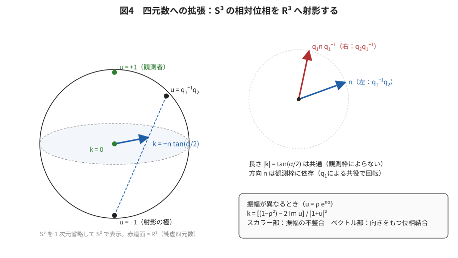
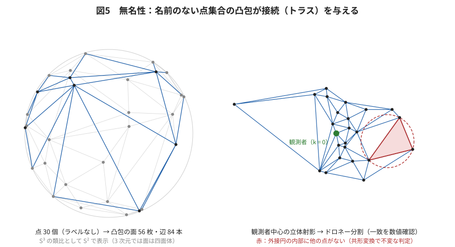
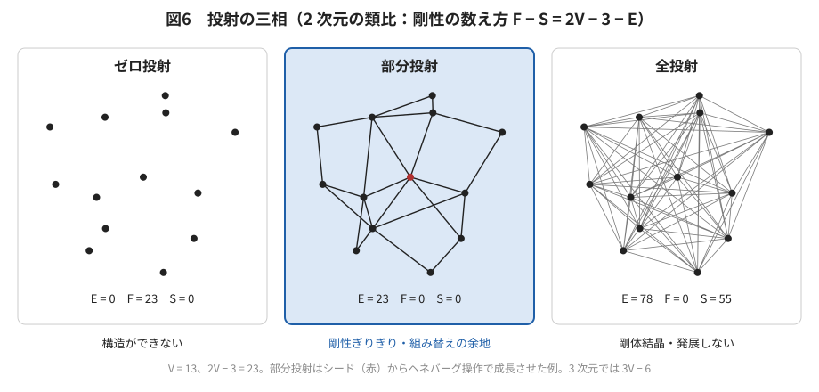
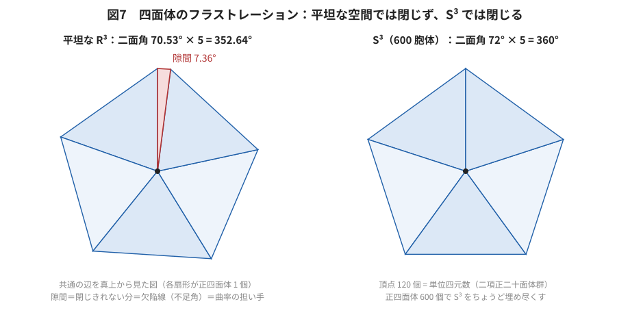
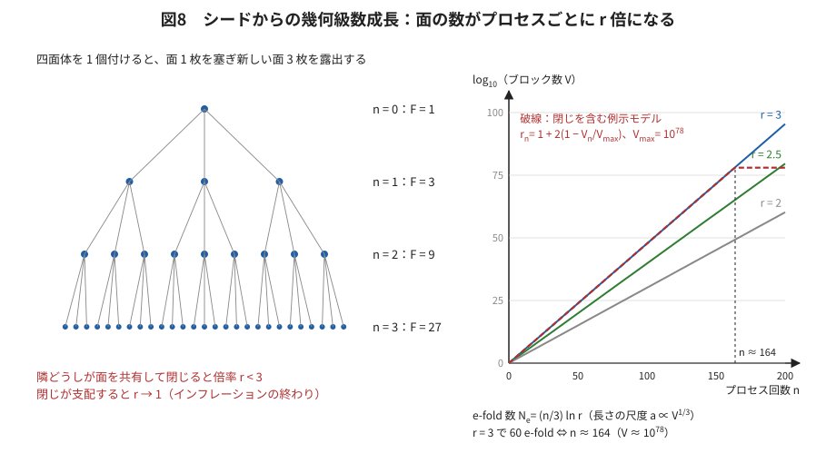
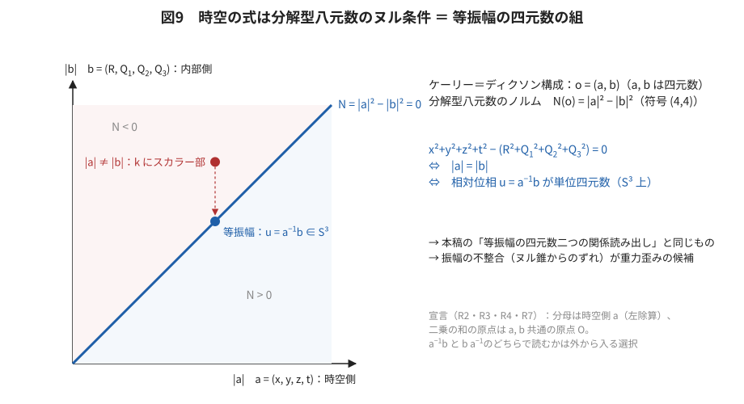

# 四元数の関係読み出しと、結晶化としてのインフレーション
## ― 無名性を保った自律的構造化と部分投射 ―

**著者：** 木原範昭（株式会社WFシステム）　ORCID 0009-0004-6753-4020
**日付：** 2026-10-21　　**版：** v1（公開前稿、DOI 未記入）
**同じフォルダ：** 図版 fig01〜fig09（SVG）、図版生成プログラム `make_figures_quaternion_crystallization_20261021.py`

---

## 要旨

著者の研究計画は、背景時空も物差しも粒子の種類も外から置かず、名前のない複素数の集合 {zₙ} の関係だけから時空と粒子を読み出し、一般相対性理論と標準理論が局所的に極めて高い精度で成立する事実に接続することを目指している。前稿 [S6] は、二つの複素数を四元数 q = z₁ + z₂ j に組み、その極形式が北極の接超平面への中心投影そのものであることから、{zₙ} → {qₙ} → (1+3) の写像を部分投射として構成した。しかし、名前のない四元数の集合そのものには構造がなく、どの四元数とどの四元数が関係を持つかを外から与えずに、自律的に構造が生まれる仕組みは残されていた。

本稿は、この仕組みを物性物理の結晶化に求める仮説を提示する。主な内容は次のとおりである。

1. 二つの状態の関係から、視野角を距離とする読み出しを定義する。等振幅の二つの複素数について、結合係数 g = |z₁ − z₂| / |z₁ + z₂| = tan(Δθ/2) と視野角距離 D = 1/g = cot(Δθ/2) を得る。同位相は無限遠（作用なし）、逆位相は接触（全反射）になる。
2. 四元数では、結合係数 k = (q₁ + q₂)⁻¹(q₁ − q₂) = −n tan(α/2) が三次元のベクトルになる。k は相対位相 u = q₁⁻¹q₂ を観測者から見た立体射影であり、同時に相対位相の平方根 e^(nα/2) の中心投影でもある。結合の強さが 1 になる関係（直交）は、前稿の言葉で光円錐上の関係に当たる。
3. この読み出しは角度を保つので、局在する観測者には一様な曲率、全体の尺度、地図の選択、左右の枠の選択が区別できない。局所平坦は近似ではなく、読み出しの性質である。観測にかかるのは方向に依存する歪み（潮汐）だけである。
4. 接続を外から与えない方法として、名前のない点集合の凸包を用いる。単位四元数は S³ ⊂ ℝ⁴ 上の点なので、その凸包は四面体のトラスを与え、観測者中心の立体射影でドロネー分割になる。判定は共形変換で不変である。
5. 分割が一意に決まらないことを、欠陥ではなく原理として置く。剛性の数え方 F − S = 3V − 6 − E のもとで、ゼロ投射（構造ができない）と全投射（剛体結晶、発展しない）の間の部分投射だけが、骨格と組み替えの余地を両立させる。
6. 一意に決まらない以上、合成の仮定そのものに過程（発展）が要る。過冷却した高対称な状態にシードが入ると、一回の過程で結合可能な面の数が r 倍（r ≤ 3）になり、幾何級数的な結晶化が起こる。長さの尺度 a ∝ V^(1/3) について e-fold 数は N_e = (n/3) ln r となり、r = 3 なら 60 e-fold に必要な過程の回数は n ≈ 164 である。終わりは、面が閉じて r が 1 に近づくことで構造的に与えられる。
7. 正四面体は平坦な空間を埋められない（隙間 7.36°）が、S³ では 600 胞体が埋め尽くし、その頂点 120 個は単位四元数である。局所的に平坦な読み出しでは閉じきれない分が欠陥線として必ず残り、部分投射は外部パラメータなしに強制される。欠陥線の不足角が曲率の担い手になる。
8. 著者の時空の式 x² + y² + z² + t² = R² + Q₁² + Q₂² + Q₃² は、分解型八元数のノルムがゼロになる条件であり、時空側と内部側の二つの四元数が等振幅であることと同値である。

本稿は仮説論文であり、検証計画と反証条件を §13 に置く。

**キーワード：** 四元数、無名性、部分投射、立体射影、ドロネー分割、剛性、幾何学的フラストレーション、600 胞体、過冷却、インフレーション、分解型八元数

---

## 1. 研究動機

### 1.1 出発点の問い

一般相対性理論と標準理論はうまく統合できないのに、局所的に平坦な近似を行うと極めて高い精度で成立する。なぜか。多くの任意パラメータを置かずに、これを説明できる方法はないか。これが本研究の出発点である。

### 1.2 経緯：行き詰まりが次の段を強制した

研究は、行き詰まりが次の段を強制する形で進んだ（図 1）。

**図 1** 研究の経緯。赤字は各段の行き詰まりで、それが次の段を強制した。

- **段①** CG と 3D モデリングの経験から中心投影（グノモン射影）という非線型写像を調べ、Σxₙ² = R² という写像で、中心投影の曲率半径 R が光円錐と接続される可能性に気づいた [S1]。しかし Σxₙ² = 0 は実数では自明解しか持たない。
- **段②** そこで xₙ を複素数 zₙ とし、Σzₙ² = 0 を置いた。理論物理学の基礎は複素ヒルベルト空間とその写像演算で組み立てられているが、それを四次元時空としてどう読み出すかは明確でなく、背景の四次元時空が最初から仮定として置かれている。また、純粋な複素数は指数表現でそのまま波として読めるが、そのままでは進行波を表現できず、暗黙に位相 ωt が持ち込まれている。自由度が二つしかない複素波のどこに情報を保存する能力があるのか、という疑問が残った。
- **段③** 光円錐と λν の共役性の研究から、時空を x² + y² + z² − t² = R² + Q² と表し、t を it と置けば x² + y² + z² + t² = R² + Q² となること、ローレンツ変換やウィック回転が t の読み出し問題であることに気づき、現在は x² + y² + z² + t² = R² + Q₁² + Q₂² + Q₃² である可能性が高いと考えている。同時に、無名性が極めて重要であることに気づいた。Σzₙ² = 0 の zₙ は無名で、x, y, z, t, R, Q₁, Q₂, Q₃ というラベルも、読み出したときにそう読める量に後から付けた名前である [S2, S3]。しかし、複素数の集合 {zₙ} そのものには構造がない。
- **段④** 複素数を完全ネットワークと考え、頂点数 N に対して M = N(N−1)/2 個の関係から構造を読み出す方法を検討した [S4]。しかし、どの頂点とどの頂点が関係を持つかを外から与える必要があり、無名性に違反する。
- **段⑤** M 個の波が自己相互作用も含めて M² の作用を起こすと考え、極めて対称性の高い複素数の集合でこの自己相互作用を繰り返すと、インフレーション的な幾何級数的発展が起こることを見いだした [S5]。しかし、その過程から四次元時空を読み出すことはできなかった。
- **段⑥** 複素数 2 つで四元数、4 つで八元数ができる（実数から数えて 1 → 2 → 4 → 8）。複素数はもともと 2 次元のベクトルにすぎず、実部・虚部という名前も後から付けたもので、無名性に違反しそうで違反していなかった。同様に、四元数は 4 次元、八元数は 8 次元のベクトルにすぎず、構造（積）はあるが無名性には違反しない [S6]。なぜ物理が八元数を選ぶのかは本稿では問わず、公理として置く。
- **段⑦（本稿）** 四元数を使って、無名性を守り、外から関係を与えなくても自律的に構造が生まれる仕組みを解明できないか。手がかりは物性物理の結晶化である。過冷却した対称性の高い構造にわずかなシードを与えると、幾何級数的に結晶またはガラスが構成される。

四元数と結晶化は思いつきではなく、「無名性を守ったまま構造を得る」という制約から選ばれたものである。

### 1.3 本稿の構成

§2 で約束を置く。§3〜§4 で二つの状態の関係から距離を読み出し（複素数、四元数）、§5 で局在観測者と局所平坦を論じる。§6 は定常波と質量についての仮説である。§7 で接続を名前のない点集合から読み出し、§8 で部分投射を剛性の数え方で表す。§9 でフラストレーションと欠陥、§10 で幾何級数的成長とインフレーションの対応を論じる。§11 は八元数への橋、§12 は先行研究との比較、§13 は検証計画と反証条件である。

---

## 2. 約束

### 2.1 前稿から引き継ぐもの

前稿 [S6] と目録 [S3] の公理と定義をそのまま用いる。無名性（要素に名札がなく、特別な原点・座標・距離・符号・種類がない）、自己無撞着（系は自分自身を基準にする）、区別不能性（読み出しは値がどの層のものかを区別できない）、線形閉塞 Σq = 0 と真の自乗の閉塞 Σq² = 0 である。四元数の記法（q = s + v、極形式 q = |q| e^(nθ)、共役 q̄、真の自乗 q² = (s² − |v|²) + 2s v）も前稿に従う。

### 2.2 割り算・原点・観測者の宣言

この系は積の系である。割り算は暗黙の正規化なので、読み出しの最後に一度だけ行い、そのたびに分母を宣言する。積の中の加法は原点を動かすので、加法を使うたびに原点を宣言する。すべての値に、どの観測者の値かを付ける。本稿の主な量について、次のように宣言する。

| 量 | 分母 | 原点 | 観測者 |
|---|---|---|---|
| 相対位相 u = q₁⁻¹q₂ | q₁（左除算） | — | q₁ |
| 結合係数 k = (q₁ + q₂)⁻¹(q₁ − q₂) | 合成 q₁ + q₂ | 和と差の原点 O（Σq = 0 が定める重心） | q₁ |
| 距離 x = k⁻¹ | k | 同上 | q₁ |
| 振幅比 ρ = \|q₂\| / \|q₁\| | \|q₁\| | — | q₁ |
| 分解型八元数の相対位相 u = a⁻¹b（§11） | 時空側 a（左除算） | a, b 共通の原点 O | a |

左除算と右除算のどちらで読むかは外から入る選択である。本稿ではこれを左右の選択として明示し、結果がその選択にどう依存するかを述べる。

---

## 3. 二つの状態の関係から距離を読み出す：複素数

### 3.1 視野角と二等辺三角形

二つの複素数 z₁, z₂ が等振幅 |z₁| = |z₂| = r で、位相差が Δθ のとき、原点 O と z₁, z₂ は二等辺三角形をなす。その形は二本の対角線で決まる（図 2）。

- 差：|z₁ − z₂| = 2r sin(Δθ/2)
- 和：|z₁ + z₂| = 2r cos(Δθ/2)

大きさ A のものが視野角 Δθ に見えるとき、それを底辺とし観測者を頂点とする二等辺三角形の高さが、天文学の角径距離と同じ意味での距離 D_A = (A/2) cot(Δθ/2) になる。視野角が小さいほど遠く、大きさが大きいほど遠い。

**図 2** 等振幅の二つの複素数がなす二等辺三角形（左）と、結合係数 g と視野角距離 D（右）。

### 3.2 結合係数と視野角距離

和と差の比から、無次元の量

g = |z₁ − z₂| / |z₁ + z₂| = tan(Δθ/2)、　D = 1/g = cot(Δθ/2)

を定める。D は大きさ A を単位とした視野角距離である。g と D は、両方に同じ複素数を掛けても（共通の拡大と共通の位相回転）変わらない。全体の尺度と位相の原点は読めないので、これは関係だけを取り出した量である。

- 同位相（Δθ → 0）：g → 0、D → ∞。二つは重なって見え、作用がなく、無限遠にある。
- 直交（Δθ = π/2）：g = D = 1。和と差が釣り合う。
- 逆位相（Δθ = π）：g → ∞、D = 0。等振幅なら z₁ + z₂ = 0 で、打ち消し合いがちょうど接触に当たる。

距離を作用の結合の弱さと読むと、この振る舞いは自然である。複素数のまま k = (z₁ − z₂)/(z₁ + z₂) をとると、これは伝送線路の反射係数 Γ = (Z − Z₀)/(Z + Z₀) と同じ形をしており、同じものどうしは整合して反射がなく（作用がない）、逆相は全反射（作用が最大）になる。作動成分 (z₁ − z₂)/2 と同相成分 (z₁ + z₂)/2 の比として読んでもよい。

### 3.3 二枚の地図

相対位相 u = z₂/z₁ = e^(iΔθ) は単位円上の点で、k = (1 − u)/(1 + u) = −i tan(Δθ/2) である。これは単位円を点 u = −1 から虚軸へ射影した座標（ケーリー変換、立体射影）であり、観測者自身 u = +1 は原点 k = 0 に来る（図 3）。

逆に、点 u = +1 から射影した座標 x = (1 + u)/(1 − u) = 1/k は、大きさが cot(Δθ/2) = D の距離の地図である。観測者自身は無限遠に送られる。自己距離は無限大であり、自分自身は距離の基準にならない。

二枚の地図は反転 x = 1/k で結ばれ、どちらも角度を保つ。

**図 3** 相対位相の円と二枚の地図。−1 から射影すると結合の地図 k、+1 から射影すると距離の地図 x になる。

### 3.4 合成則

同じ平面内の相対位相を連鎖させると、t = tan(Δθ/2) は

t₁₂ = (t₁ + t₂) / (1 − t₁t₂)

で合成される。これは相対論の速度合成や反射係数の縦続接続と同じ型である。加法的なのは位相差 Δθ のほうで、結合係数は足し合わせる量ではない。

---

## 4. 四元数への拡張

### 4.1 結合係数は三次元のベクトルになる

二つの四元数 q₁, q₂ について、相対位相を u = q₁⁻¹q₂ とし、結合係数を

k = (q₁ + q₂)⁻¹(q₁ − q₂) = (1 + u)⁻¹(1 − u)

と定める。q₁ + q₂ = q₁(1 + u)、q₁ − q₂ = q₁(1 − u) であり、1 と u は可換なので、この式は u の関数として曖昧さなく決まる。

等振幅なら u = e^(nα)（n は単位純虚四元数）で、複素数の i を n に置き換えた計算から

k = −n tan(α/2)

を得る（図 4）。k は純虚四元数、つまり三次元のベクトルである。

- 大きさ：|k| = |q₁ − q₂| / |q₁ + q₂| = tan(α/2)。ノルムは乗法的なので、複素数と同じ式になる。
- 向き：n は、二つの状態がどの方向にずれているかを表す軸である。

距離の地図は x = k⁻¹ = n cot(α/2) である。二つの状態の関係から、方向と距離を持つ三次元の点が読み出される。

**図 4** 四元数への拡張。S³ 上の相対位相 u を観測者の対蹠点から射影すると、三次元のベクトル k が得られる（左、S³ を一次元省略して S² で表示）。左右の枠では長さが共通で方向が異なる（右）。

### 4.2 前稿の中心投影との関係

前稿 [S6] は、四元数の極形式 q = |q|(cos θ + n sin θ) が北極の接超平面への中心投影 u_g = v/q₀ = n tan θ そのものであることを示した。相対位相の平方根 p = e^(nα/2)（u = p²）にこれを当てはめると、その像は n tan(α/2) = −k である。

**命題 1.** 結合の地図 k は、相対位相 u の立体射影であると同時に、相対位相の平方根 p = e^(nα/2) の中心投影である。

結合の強さが |k| = 1 になるのは α = π/2（直交）のときで、そのとき p = e^(nπ/4) は前稿の意味で光円錐上にある（θ = 45°、p² の実部が 0）。

**系.** 結合係数が 1 になる関係は、相対位相の平方根が光円錐上にある関係である。前稿の最も対称な配置 q = ±e^(πn/4) は、各要素がまさにこの位置にある。

### 4.3 左右の枠

相対位相を右除算 v = q₂q₁⁻¹ で定めると、v = q₁ u q₁⁻¹ であり、結合係数は k_R = q₁ k_L q₁⁻¹ となる。大きさ |k| は共通で、向きは q₁ による共役だけ回転する。結合の強さは観測枠によらず、方向は枠に依存する。これは、前稿の三角形の視野角で n_L と n_R が左右の掛け算でそれぞれ別に回されることと同じ構造である。

### 4.4 振幅が異なるとき：1＋3 の分解

u = ρ e^(nα) とすると、(1 + u)⁻¹ = (1 + ū)/|1 + u|² が (1 − u) と可換であることから、

k = [(1 − ρ²) − 2 Im u] / |1 + u|²

となる。スカラー部は振幅の不整合、ベクトル部は向きを持つ位相結合である。複素数の「実部＝不整合、虚部＝位相」が、そのまま 1＋3 の分解に拡張される。

### 4.5 不変性と合成則

|k| は q ↦ a q b（四次元回転、a, b は単位四元数）と共通の実数倍で不変である。k そのものは左からの共通の掛け算で不変で、右からの共通の掛け算ではベクトルとして回転する。軸が揃っていれば合成則は §3.4 と同じであるが、軸がずれると合成は掛ける順序に依存し、外積型の交差項が現れる。

---

## 5. 局在する観測者と局所平坦

### 5.1 区別できないもの

局在する観測者 q_o は、自分を基準にした相対位相 u_j = q_o⁻¹q_j だけを読む。自分自身は u = 1 なので、結合の地図では原点に来る。結合の地図は観測者を中心とした立体射影であり、立体射影は角度を保つ。したがって、視野角だけで測る観測者には次の違いが区別できない。

1. S³ の一様な曲率と平坦な ℝ³（S³ も局所的には平坦である）
2. 結合の地図 k と距離の地図 x = 1/k（反転は角度を保つ）
3. 左右の枠の選択（観測者は自分の枠しか持たない）
4. 全体の尺度（距離は大きさとの比としてしか得られない）

観測者が得るのは、他の状態への方向 n_j、方向どうしの角度、距離の比であり、これは角度を保つ変換で同一視した三次元空間の情報として完結している。

### 5.2 見えるもの：潮汐

区別できないのは曲率の一様な部分だけである。方向によって違う歪み、すなわち観測者の視野で状態の集まりの形が一方向に潰れたり伸びたりする成分は、角度どうしの比の変形として見える。これは等価原理と同じ構図である。一様な重力場は局所的に消せるが、潮汐は消せない。

### 5.3 局所平坦は読み出しの性質である

§1.1 の問いに対して、本稿は次のように答える。

**局所平坦は近似ではなく、観測者中心の共形な読み出しの性質である。曲率は欠陥（継ぎ目の不足角、§9）としてしか現れない。**

等振幅の場合、読み出しの土台は丸い S³ を立体射影したものなので、状態がどう分布していても視野の幾何は共形平坦で、潮汐は原理的に現れない。等振幅は重力のない一様な状態に対応する。潮汐が現れるのは振幅が一様でない場合で、§4.4 のスカラー部が方向ごとに距離を伸び縮みさせる因子として読み出しに入る（§6.3）。

---

## 6. 定常波と質量（仮説）

### 6.1 進行位相を持たない

四元数は進行位相を持たず、状態は定常波であると考える。この前提では、二つの状態の相対位相 α は時間とともに流れず、距離の読み出しは静的に固定される。

### 6.2 質量はノルムである

単独の四元数で四次元回転 q ↦ a q b のもとで不変な量はノルム |q|² だけである。これは、四元運動量のローレンツ不変ノルムが静止質量を与える構図のユークリッド版に当たる。観測者に届くのは振幅比 ρ = |q_j| / |q_o| だけであり、全体の尺度は読めない。

定常波は、逆向きに進む成分が釣り合って正味の運動量がゼロになった状態、すなわち静止系そのものである。光を閉じ込めた箱が全体として慣性質量を持つのと同じく、定常波のエネルギーは振幅の二乗に比例する。そこで次の仮説を置く。

**仮説 1.** 質量はノルムの二乗 |q|² に比例し、観測者からは振幅比 ρ として静的に読み出される。

重力質量と慣性質量が同じ量から出るので、等価原理は前提に組み込まれる。質量比の読み出しに時計は要らず、比をとる基準となる状態だけが要る。なお、質量は内部の状態を外から読み出した値であり、内部と外部の目盛りの換算比は本稿では導かない。

### 6.3 重力の源はノルムの非一様さ

全体の尺度は見えないので、重力を生むのは |q| そのものではなく、その非一様さである。Φ ∝ ln |q| をポテンシャルとみなすと、質量密度はそのラプラシアンに、囲んだ領域の質量はその勾配の流束に当たる。重力レンズでは等方的な拡大率（収束）が投影された質量密度に比例するので、k のスカラー部が等方的な歪みを生むことと整合する。

### 6.4 運動は左右の不均衡

四次元回転は左からの回転と右からの回転に分かれる。前稿 [S6] は、真の自乗の閉塞 Σq² = 0 を保つのは同じ単位を両側から掛ける回転 q ↦ u q u⁻¹ と実数倍だけで、片側だけの掛け算は閉塞を破ることを示した。

**仮説 2.** 静止は左右が釣り合った状態（両側から同じ単位で回す、閉塞を保つ）であり、運動は左右の釣り合いの崩れ（片側の掛け算、閉塞を破る）である。進行位相は「ない」のではなく、静止状態ではゼロに釣り合い、運動とともに現れる。

この仮説のもとで、等価原理は自動的に成り立つ代わりに、「ノルムの勾配（重力）が左右の不均衡（運動）を引き起こすか」という動力学の問いに置き換わる。これが成り立てば、自由落下は振幅の非一様さが定常波を進行波の側へ傾ける現象として読める。

---

## 7. 無名性：接続を名前のない点集合から読み出す

### 7.1 単体的方法の問題

頂点と辺の完全ネットワークから構造を作る単体的な方法では、頂点に身元があり、どの頂点とどの頂点が結ばれるかという接続情報が外から与えられる。これは無名性に反する。与えてよいのは名前のない状態の集まりだけであり、接続はそこから読み出されなければならない。

### 7.2 凸包による読み出し

等振幅の四元数は S³ ⊂ ℝ⁴ 上の点である。名前のない点の集まりの凸包をとると、その面は四面体になり、S³ を四面体で埋め尽くすトラスが得られる。凸包は点の並べ方や番号付けに一切依存しない。

観測者 q_o の対蹠点から立体射影すると、凸包の面のうち射影の極を含むキャップを持たないものが、射影した点のドロネー分割と一致する（球面上の点集合の凸包とドロネー分割の対応 [X6]）。図 5 は、S³ の一次元低い類比として S² 上の名前のない点 30 個について、凸包の面の射影と射影した点のドロネー分割が一致する（三角形 53 個）ことを数値で確かめたものである。

**図 5** 名前のない点集合の凸包（左）と、観測者中心の立体射影によるドロネー分割（右）。赤は外接円の内部に他の点がない例。

### 7.3 これまでの読み出しとの整合

1. **地図の選び方に依存しない。** ドロネー分割の判定（四面体の外接球の内部に他の点がない）は球を球に移す変換で不変である。局在観測者が区別できない k と x のどちらの地図で判定しても、同じトラスが得られる。
2. **振幅は重みとして入る。** 振幅が異なると点は S³ から半径方向にずれ、その凸包は重み付きドロネー分割（正則分割）に一般化される [X7]。振幅（質量、仮説 1）が大きい点ほど周囲の接続を変える。振幅と重みの具体的な対応は本稿では導かない。
3. **局所的な規則で組める。** 外接球の判定は近くの点だけで行え、条件を満たさない箇所は局所的な組み替え（フリップ）で直せる [X7]。全体を見渡す目がなくても、局所操作だけでトラスが組み上がり、組み替わる。

### 7.4 無名性から来る縮退

五つ以上の点が同じ球面上に乗るとき、分割は一意に決まらない。また、ラベルのない距離の集合が同じでも構造が異なる点集合がある。外から名前を与えればこの縮退は解消するが、それは無名性を破ることである。本稿はこの縮退を消すべき欠陥とは考えず、次節の原理として置く。

---

## 8. 部分投射と不確定性

### 8.1 剛性の数え方

V 個の点を E 本の部材で結んだ三次元のトラスについて、マクスウェルの数え方とカラディンの関係 [X8, X9]

F − S = 3V − 6 − E

が成り立つ。F は剛体運動を除いた変形の自由度（柔らかいモード）、S は部材が互いに拘束し合って抱える内部応力の数（自己応力）である。

### 8.2 投射の三相

| 相 | 部材 | 結果 |
|---|---|---|
| ゼロ投射 | E = 0 | F が最大。拘束がなく、構造ができない |
| 部分投射 | E ≈ 3V − 6 | F と S がともに適度に残る。骨格と組み替えの余地が両立する |
| 全投射 | E = V(V−1)/2 | F = 0、S が巨大。剛体結晶になり、発展しない |

図 6 は、2 次元の類比（2V − 3）で三相を示したものである。部分投射の例は、シードからヘネバーグ型の操作（新しい点を既存の二点に結ぶ）で成長させた等静的なトラスである [X10]。

**図 6** 投射の三相。左からゼロ投射、部分投射、全投射。

前稿と目録 [S3, S6] は、時空が安定に読まれる以上、写像は少なくとも部分投射でなければならず、ゼロ投射なら時空が現れず、全投射なら読めない内部も不確定性も離散性も残らないことを述べた。本節は、それをトラスの言葉で具体化したものである。

### 8.3 不確定性と時間

- **不確定性：** 柔らかいモード F と、ドロネー分割の非一意性（§7.4）が、構造の決まらなさを担う。
- **時間：** 局所的な組み替え（フリップ）の連なりとして現れる。定常波には進行位相がないので（§6.1）、時間は位相の進みからではなく構造の組み替えから生じる。
- **相補性：** F − S は点と部材の数だけで決まる。自由さを増やせば拘束が減り、拘束を増やせば自由さが減り、両方を同時に確定させることはできない。

### 8.4 合成には過程が要る

構造が一意に決まらない以上、合成は「方程式を解いて答えが一つ出る」ものではなく、手順と履歴を持つ過程として定義するしかない。結果は、縮退がどこから、どの順序で解けたかに依存する。可能な多数の構造のうち、実際の履歴が一つを選ぶ。この履歴依存性が時間の矢の起源になりうる。

ガラス科学では、網目構造のガラスは拘束の数と自由度が釣り合う等静的点の近くで最もガラスになりやすいことが知られている [X11, X12]。部分投射の割合も外から与えるのではなく、構造自身が決めなければならない。その仕組みを次節で述べる。

---

## 9. 過冷却・フラストレーション・欠陥

### 9.1 過冷却とシード

- **過冷却状態：** 関係はすべて潜在的に存在するが、どれもまだ部材として確定していない、高対称で縮退した準安定状態。
- **シード：** 縮退が解けた最初の局所ブロック（四面体一つ）。無名性を保つため、外から置くのではなく配置の揺らぎから自発的に生じる。
- **結晶化：** 確定した四面体は隣の面の縮退を解き、確定の前線が広がる（§10）。

これは、正二十面体的な局所秩序による過冷却 [X13] と同じ構図である。

### 9.2 四面体のフラストレーション

正四面体の二面角は arccos(1/3) ≈ 70.53° で、一本の辺の周りに五つ並べると 5 × 70.53° = 352.64° となり、7.36° の隙間が残る。正四面体は平坦な三次元空間を隙間なく埋められない（図 7 左）。

ところが S³ では、正四面体 600 個が隙間なく埋め尽くす正多胞体（600 胞体）が存在する。各辺を五つの胞が囲み、胞の二面角はちょうど 72° である。その頂点 120 個は単位四元数で、二項正二十面体群をなす [X3, X5]（図 7 右）。

**図 7** 共通の辺を真上から見た図。平坦な空間では隙間が残り（左）、S³ では閉じる（右）。

### 9.3 部分投射は幾何学的に強制される

これは過冷却液体の物理で知られている構図そのものである [X14, X15]。完全な正二十面体的秩序は曲がった空間 S³ でだけ実現し、それを平坦な空間に写すと欠陥線（ディスクリネーション）が必ず入る。本稿の文脈では次のようになる。

1. S³（単位四元数の空間）の上では、結晶化は完全な秩序へ向かおうとする。
2. 局在観測者の地図は局所的に平坦なので（§5）、その秩序は写し切れず、欠陥線が必ず残る。
3. 欠陥線は不足角を持ち、曲率（潮汐）の担い手になる。
4. 状態の数が 120 を大きく超えると、S³ の上でも完全な充填はできないので、フラストレーションは本質的に避けられない。

**命題 2（仮説）.** 部分投射の割合は外部パラメータで与えられるのではなく、四面体のフラストレーションによって幾何学的に強制される。系は全投射の剛体結晶にはなれず、欠陥と組み替えの余地が必ず残る。

物性物理の手法では、曲がった空間は秩序を記述するための道具として導入される。本稿では、状態空間そのものが S³ であり、曲がった空間は出発点である。

---

## 10. 幾何級数的成長とインフレーション

### 10.1 過程の回数で数える

空間を前提にしないので、成長は既存の空間の中を一定の速さで進む前線としてではなく、過程の回数で数える。一回の過程で、露出しているすべての面に同時に四面体が付くとする。四面体が一つ付くと、面が一枚塞がり、新しい面が三枚露出する。新しい四面体どうしが面を共有して閉じる分を差し引いた一回あたりの倍率を r（r ≤ 3）とすると、n 回の過程の後、結合可能な面の数とブロックの数はともに rⁿ に比例する（図 8 左）。

幾何級数的な成長はこの過程の既定の振る舞いであり、特別なのは成長ではなく、面が閉じて倍率が下がることのほうである。

**図 8** 面の木（左）と、倍率 r ごとのブロック数の増え方（右）。破線は閉じを含む例示モデルで、導出したものではない。

### 10.2 e-fold 数

ブロック一つを単位体積とすると V ∝ rⁿ、長さの尺度は a ∝ V^(1/3) なので、e-fold 数は

N_e = (n/3) ln r

となる。r = 3 のとき、60 e-fold に必要な過程の回数は n = 180/ln 3 ≈ 164 であり、そのとき V ≈ 10⁷⁸ である。標準のインフレーション理論では膨張率をインフラトンのポテンシャルで調整するが、ここでは倍率が四面体の面の数という幾何で決まる。

### 10.3 終わり方と、観測者からの見え方

- **終わり：** 縮退の解消や S³ の曲率によって面が閉じ始めると、r は 1 に近づき、成長は止まる。インフレーションの終わりはトポロジーの変化として構造的に与えられる。
- **見え方：** 成長段階では面の数とブロックの数がともに rⁿ で増えるので、表面積と体積の比が一定に保たれる。これは平坦な空間（比は半径に反比例する）ではなく双曲型の幾何の特徴である。局在観測者には全体の尺度が見えないので（§5.1）、自分の周りのブロック数が一定の倍率で増えることは、指数的な膨張として読み出されるはずである（仮説）。

### 10.4 標準理論との対応

| | 標準インフレーション | 本稿 |
|---|---|---|
| 指数的に増えるもの | 既存の空間の尺度 | 確定した関係（ブロック）の数 |
| 駆動 | インフラトン場のポテンシャル | 縮退の解消（既定の振る舞い） |
| 終わり | 場がポテンシャルを転がり落ちる | 面の閉じ、S³ の充填、フラストレーション |
| 再加熱 | インフラトンの崩壊 | 結晶化の潜熱の放出 |
| 一様性 | 因果的につながった小領域の引き伸ばし | 一つのシードからの連鎖 |
| 平坦性 | 引き伸ばしによる平坦化 | 局在観測者には一様な曲率が見えない |
| 原始ゆらぎ | インフラトンの量子ゆらぎ | 凍結した欠陥線と組み替えの非一意性 |

Guth の最初のインフレーション理論 [X17] は、過冷却した偽真空と泡の核生成という描像であったが、空間の膨張が泡の成長より速く、泡がつながらずに終われない問題 [X18] があり、スローロール型 [X19] に置き換えられた。本稿の描像では、空間そのものを前提にせず、膨張するのは確定した構造の量であるので、この問題は「面が閉じると止まる」という形で構造的に回避される。

相転移で生じる位相欠陥は Kibble 機構 [X20] として、その凝縮系版は Kibble–Zurek 機構 [X21] として、欠陥密度が相転移の速さで決まるスケーリング則で結ばれ、実験で検証されている。本稿の欠陥線と原始ゆらぎの対応を確かめる足場になる。

### 10.5 前稿の課題 3 との関係

前稿 [S6] の課題 3 は、高対称な四元数の全員対全員の自己相互作用がインフレーション的膨張を生むかという動力学の問いであった。本稿はこれに、自己相互作用を書き下す前の段階として、構造の側（面の数え方）から答える。両者が同じ現象の別の表現であるかどうかは、自己相互作用を実装したうえで確かめる課題として残る。

---

## 11. 八元数への橋：時空の式は分解型八元数のヌル条件である

### 11.1 対応

時空側の四元数 a = t + x i + y j + z k と内部側の四元数 b = R + Q₁ i + Q₂ j + Q₃ k をとり、ケーリー＝ディクソン構成 o = (a, b)、積 (a, b)(c, d) = (ac + γ d̄ b, da + b c̄)、共役 (a, b)* = (ā, −b) を考える。ノルムは N(o) = |a|² − γ|b|² で、γ = −1 が通常の八元数、γ = +1 が分解型八元数（符号 (4,4)）である [X4]。分解型では

x² + y² + z² + t² − (R² + Q₁² + Q₂² + Q₃²) = 0　⇔　N(o) = 0　⇔　|a| = |b|

であり、a ≠ 0 なら相対位相 u = a⁻¹b は単位四元数（S³ 上の点）である（図 9）。

**図 9** 時空の式は分解型八元数のヌル条件であり、等振幅の四元数の組と同値である。

### 11.2 読み取れること

1. **時空の式は等振幅の四元数の組である。** 本稿の「等振幅の二つの四元数の相対位相から関係を読み出す」構図は、時空の式そのものである。
2. **ヌルからのずれは振幅の不整合である。** |a| ≠ |b| のとき、結合係数にスカラー部が現れ（§4.4）、重力歪みの候補になる（§6.3）。
3. **ゼロ閉塞が分解型を要求する。** 通常の八元数のノルムは正定値で、非自明なヌルを持たない。非自明解を要求すると分解型が選ばれる。これは Σxₙ² = 0 が実数では自明解しか持たず複素数を要求したこと（段①）と同じ論理である。
4. **内部側は相対位相とノルム比を通じてしか現れない。** 時空側から見えるのは u とノルム比だけで、内部側の状態そのものは読み出されない。

前稿 [S6] は、八元数の真の自乗が o² = (q² − |p|²) + 2q₀ p ℓ という同じ形を繰り返すことを示した。本節の分解型のノルムは共役を使うノルムの側の形であり、真の自乗の側との関係は課題として残る。また、非結合性が関係の連鎖（三角形の閉合）にどう現れるかも未解決である。

---

## 12. 先行研究との比較

### 12.1 最も近い先行研究

- **Quantum Graphity** [X1] は、完全グラフの上に自由度を置き、点の置換で不変な模型から、冷却による相転移で幾何が生じる過程（geometrogenesis）を考えた。完全グラフから出発し置換不変を課す点は本稿と共通する。一方、頂点にはラベルがあり、相転移には外部の熱浴が必要とされる。本稿は頂点に名前を与えず、熱浴もハミルトニアンも置かず、名前のない点集合の凸包から接続を読み出す。
- **Selection-Stitch Model** [X2] は、離散的な真空のテンソルネットワークが、フラストレートした四面体フォームを経て結晶化する過程として、インフレーションと再加熱を説明しようとしている。四面体のフラストレーションと結晶化によるインフレーションという組み合わせは本稿と共通する。一方、ネットワークと配位数を前提にし、自由エネルギーの最小化で相を選ぶ。本稿は、状態空間そのものが S³（単位四元数）であることから出発し、接続を外から与えず、成長の倍率を面の数で数える。

### 12.2 物性物理・ガラス科学

曲がった空間に完全な秩序の雛形を置き、平坦化で欠陥を入れる手法 [X14, X15]、拘束理論と剛性浸透 [X11, X12]、核生成と成長の速度論 [X16] は、本稿の §8〜§10 の構図の直接の先例である。本稿の新しさは、これらを時空の読み出しの問題に置き、曲がった空間を道具ではなく状態空間として扱う点にある。

### 12.3 接続を外から与える離散時空

不足角としての曲率 [X23] や、単体の貼り合わせから四次元が現れる因果的動的三角分割 [X24] は、曲率が継ぎ目に集中するという点で本稿と共通するが、接続の規則を外から与える。

### 12.4 本稿の新規性

1. 四元数の相対位相から、観測者中心の立体射影として結合と距離を読み出す（§3〜§4）。結合の地図が相対位相の平方根の中心投影であり、結合係数 1 が光円錐に当たる（命題 1）。
2. 接続を名前のない点集合の凸包から読み出す（§7）。
3. 非一意性を部分投射＝不確定性として原理に置き、合成を過程として定義する（§8）。
4. 熱浴もハミルトニアンもなく、面の倍率で幾何級数的成長と e-fold 数が決まり、終わりが構造的に与えられる（§10）。
5. 状態空間そのものが S³ であり、曲がった空間が出発点である（§9）。
6. 時空の式が分解型八元数のヌル条件であり、等振幅の四元数の組と同値である（§11）。

---

## 13. 検証計画と反証条件

本稿の主張は、数学的に同一のもの、構造的な類比、仮説に分かれる。区分は次のとおりである。

| 主張 | 区分 |
|---|---|
| 視野角距離と結合係数（§3）、四元数の結合係数と命題 1（§4）、凸包とドロネー分割の対応（§7.2）、剛性の数え方（§8.1）、四面体の隙間と 600 胞体（§9.2）、分解型八元数のヌル条件（§11.1） | 数学的に同一 |
| 反射係数との対応（§3.2）、過冷却とインフレーションの対応（§10.4） | 構造的な類比 |
| 仮説 1・2（§6）、潮汐の源（§5.2・§6.3）、命題 2（§9.3）、指数的膨張としての読み出し（§10.3） | 仮説 |

仮説を確かめる数値実験を次のように計画する。

- **V1　凸包読み出しの四次元版：** 名前のない単位四元数 N 個の凸包を ℝ⁴ でとり、観測者中心の立体射影が三次元のドロネー分割と一致することを確かめる。頂点あたりの辺数、辺あたりの四面体数の分布を記録する。
- **V2　部分投射の割合：** 縮退基準（分割が一意に決まる箇所だけを部材にする）で部材を投射し、F、S、E/(3V − 6) を N を変えて測る。
- **V3　過冷却とシード：** 高対称な配置（600 胞体の頂点、前稿の最も対称な配置など）に小さな乱れを加えた状態を過冷却状態とし、局所的な外接球判定で四面体を付けていく過程で、一回あたりの倍率 r_n と N_e を測る。
- **V4　欠陥：** 辺を囲む四面体の数（理想は 5）と、観測者の地図での不足角の分布を測る。
- **V5　潮汐の源：** 等振幅の配置と振幅が一様でない配置で、観測者の視野地図の共形平坦からのずれ（シア）を比べる。

反証条件を次のように置く。

1. V3 で倍率 r_n が 1 を明確に超える段階が現れなければ、§10 の幾何級数的成長の主張は退ける。
2. V2 で E/(3V − 6) が N によらない値に落ち着かなければ、命題 2（部分投射の割合が幾何学的に決まる）は退ける。
3. V5 で等振幅の配置にシアが現れれば、§5.3 の「等振幅では潮汐は原理的に現れない」は誤りである。
4. V4 で欠陥線が平坦化の後にも残らなければ、§9.3 は退ける。

---

## 14. 結論

二つの状態の関係から、視野角を距離とする読み出しを定義した。等振幅の複素数では結合係数 g = tan(Δθ/2)、視野角距離 D = cot(Δθ/2) を得、同位相は無限遠、逆位相は接触になる。四元数では結合係数が三次元のベクトル k = −n tan(α/2) になり、二つの状態の関係だけから方向と距離を持つ三次元の点が読み出される。k は相対位相の立体射影であり、相対位相の平方根の中心投影でもあって、結合係数 1 は光円錐に当たる。

この読み出しは角度を保つので、局在観測者には一様な曲率、尺度、地図、左右の枠が区別できず、局所平坦は読み出しの性質である。見えるのは潮汐だけで、その源は振幅の非一様さであると考える。

接続は、名前のない点集合の凸包から読み出される。分割の非一意性を原理として置くと、ゼロ投射と全投射の間の部分投射だけが骨格と組み替えの余地を両立させ、合成には過程が要る。過冷却した高対称な状態にシードが入ると、面の数が過程ごとに r 倍になる幾何級数的な結晶化が起こり、N_e = (n/3) ln r の e-fold 数を与え、面が閉じると終わる。正四面体は平坦な空間を埋められず S³ では閉じるので、局所平坦な読み出しには欠陥線が必ず残り、部分投射は外部パラメータなしに強制される。

最後に、著者の時空の式が分解型八元数のヌル条件であり、時空側と内部側の四元数が等振幅であることと同値であることを示した。本稿の四元数の関係読み出しは、八元数の段への橋になっている。

---

## 参考文献

### 自己引用（Concept DOI）

[S1] N. Kihara, "Geometric Formulation of 4-Dimensional Space via Central Projection," 2026-04-05. Concept DOI 10.5281/zenodo.19427779.
[S2] N. Kihara, "Anonymous Equal-Amplitude Composite-Wave Model: Basic Axiom System v9," 2026-07-24. Concept DOI 10.5281/zenodo.21315735.
[S3] N. Kihara, "A Catalogue of Symmetries and Magic Numbers for Reading Out Spacetime from a State Space: The Answer-Check Standard of a Research Programme Taking Anonymity and Self-Consistency as Axioms," 2026-10-18. Concept DOI 10.5281/zenodo.23444451.
[S4] N. Kihara, "Reading Out Time, Space, Mass, Charge, Translational Velocity and Spin from the Relations and Interference of Complex Waves without a Background Spacetime: An Integrated Hypothesis …," 2026-10-15. Concept DOI 10.5281/zenodo.23384928.
[S5] N. Kihara, "Dynamics of a Self-Consistent Relational-Wave Closed System: From the Local Instability of the 90-Degree Relative Equilibrium to Inflation, Spontaneous Symmetry Breaking, Grassmann Geometry, Terminal Universality and Relationalism," 2026-09-12. Concept DOI 10.5281/zenodo.22729146.
[S6] N. Kihara, "A Map from a Set of Complex Numbers to Spacetime (1+3): Readout by Quaternions and Partial Projection," 2026-10-18. Concept DOI 10.5281/zenodo.23451494.

### 外部文献

[X1] T. Konopka, F. Markopoulou, S. Severini, "Quantum graphity: a model of emergent locality," Phys. Rev. D 77, 104029 (2008); 原型は T. Konopka, F. Markopoulou, L. Smolin, "Quantum Graphity," arXiv:hep-th/0611197 (2006).
[X2] R. Kulkarni, "Geometric Phase Transitions in a Discrete Vacuum: Deriving Cosmic Flatness, Inflation, and Reheating from Tensor Network Topology," 2026-02-22, https://www.idrive.com/ssmtheory/geometric-phase-transitions.
[X3] J. H. Conway, D. A. Smith, *On Quaternions and Octonions: Their Geometry, Arithmetic, and Symmetry* (A K Peters, Natick, 2003).
[X4] J. C. Baez, "The Octonions," Bull. Amer. Math. Soc. 39, 145–205 (2002).
[X5] H. S. M. Coxeter, *Regular Polytopes*, 3rd ed. (Dover, New York, 1973).
[X6] K. Q. Brown, "Voronoi diagrams from convex hulls," Inf. Process. Lett. 9, 223–228 (1979).
[X7] H. Edelsbrunner, *Geometry and Topology for Mesh Generation* (Cambridge University Press, 2001).
[X8] J. C. Maxwell, "On the calculation of the equilibrium and stiffness of frames," Phil. Mag. 27, 294–299 (1864).
[X9] C. R. Calladine, "Buckminster Fuller's 'tensegrity' structures and Clerk Maxwell's rules for the construction of stiff frames," Int. J. Solids Struct. 14, 161–172 (1978).
[X10] G. Laman, "On graphs and rigidity of plane skeletal structures," J. Eng. Math. 4, 331–340 (1970).
[X11] J. C. Phillips, "Topology of covalent non-crystalline solids I: Short-range order in chalcogenide alloys," J. Non-Cryst. Solids 34, 153–181 (1979).
[X12] M. F. Thorpe, "Continuous deformations in random networks," J. Non-Cryst. Solids 57, 355–370 (1983).
[X13] F. C. Frank, "Supercooling of liquids," Proc. R. Soc. Lond. A 215, 43–46 (1952).
[X14] J.-F. Sadoc, R. Mosseri, *Geometrical Frustration* (Cambridge University Press, 1999).
[X15] D. R. Nelson, "Order, frustration, and defects in liquids and glasses," Phys. Rev. B 28, 5515–5535 (1983).
[X16] M. Avrami, "Kinetics of phase change. I. General theory," J. Chem. Phys. 7, 1103–1112 (1939).
[X17] A. H. Guth, "Inflationary universe: A possible solution to the horizon and flatness problems," Phys. Rev. D 23, 347–356 (1981).
[X18] A. H. Guth, E. J. Weinberg, "Could the universe have recovered from a slow first-order phase transition?," Nucl. Phys. B 212, 321–364 (1983).
[X19] A. D. Linde, "A new inflationary universe scenario: A possible solution of the horizon, flatness, homogeneity, isotropy and primordial monopole problems," Phys. Lett. B 108, 389–393 (1982).
[X20] T. W. B. Kibble, "Topology of cosmic domains and strings," J. Phys. A 9, 1387–1398 (1976).
[X21] W. H. Zurek, "Cosmological experiments in superfluid helium?," Nature 317, 505–508 (1985).
[X22] Planck Collaboration, "Planck 2018 results. X. Constraints on inflation," Astron. Astrophys. 641, A10 (2020).
[X23] T. Regge, "General relativity without coordinates," Nuovo Cimento 19, 558–571 (1961).
[X24] J. Ambjørn, J. Jurkiewicz, R. Loll, "Emergence of a 4D world from causal quantum gravity," Phys. Rev. Lett. 93, 131301 (2004).

---

## 付録 A　図の再現

図 1〜9 は、本稿と同じフォルダの `make_figures_quaternion_crystallization_20261021.py` で生成した。実行は `python make_figures_quaternion_crystallization_20261021.py out` で、依存は numpy と scipy（ConvexHull、Delaunay）、PNG 変換のみ cairosvg である。乱数シードは図 5 が 20261021（点 30 個）、図 6 が 7（点 13 個）。図 5 は実行時に、凸包の面の射影と射影した点のドロネー分割の一致を確認して出力する（2026-10-21 の実行で一致、三角形 53 個）。図 8 の閉じのモデル（r_n = 1 + 2(1 − V_n/V_max)、V_max = 10⁷⁸）は例示であり、導出したものではない。

## 付録 B　対話記録

本稿の内容は、2026-10-21 の著者と Claude の対話から生まれた。対話で得た気づきと、修正・撤回した点は、同じフォルダの `追記_対話での気づき_研究動機と分解型八元数_20261021.md` にまとめてある。

## 版の履歴

- v1（2026-10-21）：初稿。DOI 未記入。
