# The Coin and Cup Thought Experiment
## ― Reverse-Deriving the Requirement Specification of a System from the Conditions under Which an Action Holds ―

**Author:** Noriaki Kihara (WF System Co., Ltd.)  ORCID 0009-0004-6753-4020
**Date:** 2026-11-26    **Version:** v1.0
**Version DOI:** 10.5281/zenodo.24562868    **Concept DOI:** 10.5281/zenodo.24562867
**License:** CC BY 4.0

---

## Abstract

An article on note by Professor Masahiro Hotta [X1] builds the formalism of linear algebra used in quantum mechanics from a classical stochastic process: a coin inside a cup. Reading this article, I became interested in something apart from its subject, namely the setting of the cup and the coin itself. The knowledge before the cup is lifted is not zero; it is nothing at all (null). Then how can one distinguish that it is not null? This paper is a record, in the order in which it was carried out, of the thought experiment that began from this question.

The line of argument is as follows. To say that something is not null, there is no way but to decide a resolution. A resolution is not an absolute value but a ratio to the whole. If the span from putting the cup down to lifting it, or the diameter of the cup, is read as a half-wavelength (a window), the relation between the cup and the coin can be written as a relation between two waves. The condition for observation to hold is not that the two waves are coherent, but that the cross term (the product of the two waves, the AND of information) can be read. Three assumptions are placed. The action can be defined uniquely and read uniquely. The window is stationary. The system has no special direction and no origin. From these three it is required that the system be finite, closed, without ends, and without dents or vertices. This is because, in a flat system with ends, the cup cannot be moved while remaining the same cup. No background time is placed in this system. Since there is no time, there are no traveling waves, and only standing waves exist. That the window is stationary does not mean that it is constant with respect to an outside clock. It means that the partner that maintains the window (a wave shifted by a quarter wavelength) exists on the system itself. From this requirement, the system is narrowed down to the circle $S^1$ or the three-sphere $S^3$.

The thought experiment came to a standstill once. If both the coin and the cup are drawn as convex peaks, the cross term takes the same value when the two are interchanged, and the asymmetric relation "the cup hides the coin" does not come out. The next day, when the cup was replaced by a well-shaped waveform (amplitude 0 at the place it covers, constant elsewhere), the cross term alone gave: hidden when overlaid, partly visible when the rim falls on the coin, visible when shifted away. At this point the question was replaced, from whether the coin "is there or is absent" to whether the coin "is visible or not visible". I gave up distinguishing "not visible" from "absent". Since null cannot be read directly, both absent (null) and not visible are read as: the amplitude of the cross term is at or below the resolution of amplitude. What is known when the cup is put over the coin is only that the coin has become not visible; whether there is a coin inside the cup is not known. There was no need to add a background, an observer, or an order of operations. That the radius $R$ of the circle is placed by hand in the figures is also not a problem, because the residents on the circle cannot read $R$.

Of these, the calculations of the waveforms and the cross term were checked with the attached programs. The mathematics used (Fourier series, the Fejér weights, the theorem on vector fields on the two-sphere, the classification of parallelizable spheres) is known. Reading an act as a wave, taking the readability of the cross term as the condition for observation, the requirement on the shape of the system from the three assumptions, and in particular the narrowing down to $S^1$ or $S^3$, are hypotheses, and verification is required.

This paper is a hypothesis paper and an interpretation paper. It contains no new theorem. What this paper states is that, when the conditions for the familiar act of putting the cup down and lifting it to hold are traced backward, the requirement specification of the system that carries that act is determined this far.

**Keywords:** thought experiment, coin and cup, null, resolution, window, half-wavelength, cross term, AND of information, standing wave, harmonics, closed system, circle, three-sphere, requirement specification, hypothesis

---

## How to Read This Paper

**Order.** This paper is written not from the conclusion but in the order in which the thought experiment was carried out. If only the conclusion is shown first, it becomes a paper from which nothing can be read. Each step along the way is small, and each is either a known fact or a simple calculation. At each step the reader can check for themselves whether that step is right. §1 is the motivation, §2–§8 are the dialogue with ChatGPT, §9–§15 are the dialogue with Claude (the morning of November 24, 2026), §16–§22 are the figures and calculations (the night of the same day), §23–§24 are the dialogue of the next day, November 25, and §25 is the summary.

**Premise.** This paper places no background spacetime. It places no time either. Since there is no time, there are no traveling waves, and the only waves that exist in this system are standing waves. When this paper says "stationary", it does not mean constant with respect to an outside clock. What has a resolution is not time but the act. If one reads without this premise, one makes the same misreadings that actually occurred in §5, §6, and §11.

**The four stages of the argument.** (1) Separate null from zero, and decide the resolution (§2–§5). (2) From the fact that the act holds, trace backward the requirements on the system (§6–§15). (3) Build the waveforms, and compare the circle with an open system (§16–§21). (4) Replace the question "is it there or absent" by "is it visible or not visible", and write "hidden" with the cross term (§22–§24).

**Record of misreadings.** In the course of the thought experiment, misreadings and errors of interpretation occurred many times. They are written, as they are, at the places where they occurred, because many readers will make the same misreading at the same place.

**Speakers.** The thought experiment was carried out as a dialogue. [Kihara] is the author. [ChatGPT] is ChatGPT, and [Claude] is Claude Code (Claude Fable 5.2). In §5, §6, §11, and §20, the criticisms of [Gemini], to which the manuscript was given to read, are quoted in their gist. The author's statements are quoted with only typographical errors and punctuation tidied. The locations of the original statements are given in Appendix B.

**Marking of status.** Claims and hypotheses are written as plain assertions. The status of each claim is then marked by one of the following four. A sentence without a mark is a definition of a word or an explanation of the setting.

| Mark | Meaning |
|---|---|
| [Known] | Known mathematics or physics. A source is given. Not proved in this paper |
| [Checked] | Checked numerically with the attached programs (Appendix A) |
| [Hypothesis, unverified] | The author's hypothesis. Verification is required |
| [Juxtaposed] | A point that the author has not decided at present. Both are placed side by side without choosing one |

**Scope.** This paper deals with only two things: the window and its counterpart. That is, the cup and the coin. It does not touch the resolution of the tools an observer holds (a magnifying glass or a telescope) (§12).

**Colors and units in the figures.** In the figures, the table (the circle) is drawn in black, the coin in red, the cup in green, and the cross term in blue. Lengths are in units of the radius $R$ of the circle. Waveforms are drawn by adding the amplitude in the radial direction. This is a convenience of drawing, and does not mean that the amplitude and the radius are quantities in the same direction (§24).

---

## 1. Motivation

The starting point of this paper is the article on note by Professor Masahiro Hotta, "量子力学の線形代数は確率の単なる表記" (The Linear Algebra of Quantum Mechanics Is Merely a Notation for Probability) [X1].

The article proceeds with familiar tools only. Inside an opaque cup, one coin is placed, with "+" written on its front and "−" on its back. While the cup is over it, the coin remains front-up with probability $q$ and is flipped with probability $1-q$. The cup is removed, and one looks at whether it is front or back. From this classical stochastic process, the article builds, in order, the density matrix, the Bloch representation, CPTP maps, projection matrices, the Born rule, and state reduction, and shows that the linear algebra used in quantum mechanics can be introduced as a notation for probability.

After finishing the article, something apart from its subject began to occupy me. It is not a doubt about the article's conclusion. It is a question about the setting of the cup and the coin itself, which the article places as a matter of course.

- Does this experiment hold with a single coin?
- Before that, why can it be observed at all?
- With only the coin and the cup, is this system not unclosed?

While thinking about these questions, I noticed that there is an important clue within the setting of the article. It is the act of "lifting the cup". Without this act, one cannot distinguish before the observation from after the observation. The article places what separates before and after the observation not as an outside clock but as a single act.

From there, the question took the following form.
Before the cup is lifted, there is no knowledge at all about the inside. How many there are, whether front or back, even whether there is anything or not, is not known.
To distinguish this state from zero, I will call it "null".
What is first known when the cup is lifted is that "it is no longer null".
"How can one distinguish that it is not null?" This was the first question I had.

In Professor Hotta's article there is the sentence, "In quantum mechanics, too, there is no measurement problem."
The question of this paper is not the measurement problem in that sense.
It is not a question about the interpretation of quantum mechanics, but a question of what is needed for the act of putting the cup down and lifting it to hold. This paper does not object to the article's conclusion, and does not use the development of the article's formulas. What I gratefully borrow is only the setting of the cup and the coin.

The greatest teaching I received from Professor Hotta's article is that "physical waves are not the only waves".
The article shows that the classical stochastic process of a coin can be written in the same formalism as quantum mechanics.
When I pursued, in my own way, why it can be so written, I noticed: "Is it not because the act of placing the coin and the act of putting the cup down and lifting it stand in a relation in which they can interfere?"
"Can the act of lifting the cup also be interpreted as a wave capable of interference?"
"Can the relation between the cup and the coin be written as a relation between two waves?"
These two questions are the motivation for which this paper was written.

This does not mean that Professor Hotta's article claims so. It is an idea that I received on reading the article.

This paper records, in the order in which it was carried out, the thought experiment that began from this idea. It traces one by one "the conditions for the act of putting the cup down and lifting it to hold", and from them works backward to the conditions that the system carrying that act must satisfy. A background spacetime is not placed at the start. The formalisms of quantum mechanics and general relativity are not brought in either.

---

## 2. The Knowledge Before Lifting Is Null, Not Zero

The first half of the thought experiment is a dialogue with ChatGPT. The three questions written in §1, and the point that the act of lifting the cup is the clue, came out at the beginning of this dialogue. The text starts from what followed.

[ChatGPT] organized the act of lifting the cup as a physical change that separates before and after the observation: before lifting, the coin is covered, and when the cup is lifted, it becomes identifiable from outside.

**A misreading that occurred here.** What I meant was not that the state of a thing changes. It is a matter on the side of knowledge.

> [Kihara] No. Thinking in terms of information, before lifting, the knowledge about the inside is, in this case, null. It is not zero. One does not even know that there is nothing. What becomes known as knowledge when it is lifted? Only whether it is null or not null. How many there are, and whether front or back, are not known unless observed separately.

Two words are fixed here.

- **null**: the state in which there is no information. It does not mean that there is no coin. It does not mean that there are zero coins either. One does not even know whether there is anything or not.
- **zero**: the state in which there is information and its value is zero.

Professor Hotta's article places at the start that there is one coin and that there are two states, front and back. What this paper asks is one step before that.

---

## 3. What Is "Not Null"? There Is No Way but to Decide a Resolution

> [Kihara] Here is the point. What is "not null"? In fact, a definition of resolution is needed. How can one distinguish that it is not null? It is difficult.

To say that there is something, the difference between an empty cup and a cup with something in it must be readable. Even if there is a difference, if it is smaller than the limit of what can be read, the two cannot be distinguished. That they cannot be distinguished does not mean that there is nothing.

> [Kihara] Here an absolute axiom or assumption is needed, and there is a limit that cannot be proved. That it is null cannot be proved, but where the distinction was made can be defined by the resolution of the act. In fact, the definition of the distinction descends infinitely, so there is no way but to decide a resolution. In this system, one can also interpret it as having been distinguished at the resolution of the act of lifting the cup. But going further back, if the cup could be placed, then if the resolution is lowered to span from before that until the lifting, one cannot distinguish whether it was there from the start or was born while the cup was in place.

Three things are determined from this.

1. That it is null cannot be proved. What can be known is only whether a distinction was made.
2. Where the distinction was made can be defined by the resolution of the act.
3. The definition of the distinction can be traced back as finely as one likes. To stop, there is no way but to decide a resolution.

If the span from before the cup is placed until it is lifted is taken as one division, what happened inside it cannot be read at that resolution. Whether the coin was there from the start, or was born while the cup was in place, cannot be distinguished. [Hypothesis, unverified]

---

## 4. The Wave of the Cup and the Wave of the Coin. From Putting Down to Lifting Is a Half-Wavelength

[ChatGPT] summarized the discussion of §3 as an epistemological argument that separates three things: existence, distinguishability, and the observed event.

**A misreading that occurred here.** I was not talking about philosophy.

> [Kihara] This is not philosophy. I am using as a metaphor the possibility of interference between the wave that represents the state of the cup and the wave that represents the state of the coin inside. From putting the cup over until lifting it is a half-wavelength.

> [Kihara] Do you still not notice? The greatest teaching I received from Professor Hotta is the teaching that physical waves are not the only waves, and that acts, too, can be interpreted as waves capable of interference.

> [Kihara] It is because, when I pursued why the professor's coin can also be interpreted as a probability wave, I noticed that it is the interference between the act of placing the coin and the act of putting the cup down and lifting it.

Here the reading that becomes the center of this paper came out.

- The state of the cup is represented by one wave. The state of the coin is represented by another wave.
- From putting the cup over until lifting it is a half-wavelength.
- Observation can be written as a relation between these two waves.

It is a reading in which an act is read as a wave. It does not assume a physical vibration or a field. [Hypothesis, unverified]

What happened inside the half-wavelength cannot be read with that wave. The statement of §3, "if the span from before the cup is placed until it is lifted is taken as one division, the inside of it cannot be read", is, in the language of waves, this half-wavelength.

---

## 5. Even Without Time, the Act Holds. The Resolution of Space

> [Kihara] Furthermore, a definition of time evolution exists here, does it not?

Placing the coin, putting the cup down, lifting the cup. This sequence of acts has an order even without placing an outside clock. It is not that time exists first and acts occur in it. Even without time, the act holds. Time evolution is something defined afterward, from the sequence of acts that hold.

What has a resolution is not time. It is the act (§3). The half-wavelength from putting down to lifting is the resolution of the act, not the resolution of time.

**A misreading that occurred here (after the manuscript was written).** [Claude] wrote in the manuscript of this section, "the half-wavelength from putting down to lifting is the resolution on the side of time", and titled the section "The resolution of time and the resolution of space". Gemini, which read this manuscript, made a remark to the following effect.

> [Gemini] The paper says that there is no time in this system. On the other hand, it defines a resolution of time from the sequence of acts. The reader stops and asks why there is a resolution of time when there is no time.

[Claude], too, took this as a remark that hits the mark.

> [Kihara] You are misreading. I am not saying that time has a resolution. I am saying that an act, or an action, also has a resolution. I am saying that even without time, the act holds.

If one reads it as time having a resolution, one has placed time first. What this paper places is the act.

> [Kihara] Thinking further, the spatial resolution is also defined. Do you see?

[ChatGPT] listed items: the position where the cup is placed, the position where the coin is placed, their relative position, the identifiable range.

**A misreading that occurred here.** The matter was simpler.

> [Kihara] It is simpler. If the diameter of the cup is taken as a half-wavelength, the coin cannot be hidden unless its radius is no more than that, and if it is larger, it is visible before the cup is lifted. The spatial resolution is defined.

Take the diameter of the cup as a half-wavelength. If the coin fits within the cup, it is hidden. If the coin sticks out of the cup, it is visible before the cup is lifted. The size of the cup determines, as it is, the resolution on the side of space.

Whether this "hidden" and "visible if it sticks out" can actually be written as a relation of waves had not been checked at this point. In trying to check it, the thought experiment came to a standstill once (§22). The answer came the next day (§23).

---

## 6. There Is One Cup in the System. The Size of the Table Is Needed

> [Kihara] Thinking still more deeply, there is the assumption that there is only one coin and one cup in the system. There may be several coins, but there is at least the assumption that there is only one cup in the system and that the state of lifting and closing can be defined as one. Do you see? That is, the size of the game table also needs to be defined. The resolution of the size of the cup is determined only by its ratio to the size of the table. That is, in this way of thinking, the system needs to be bounded and finite.

Two things have come out.

- **There is one cup.** If there were several cups, another question would arise, namely which cup was lifted, and lifting and closing would not be determined as one.
- **A resolution is not an absolute value but a ratio.** With the diameter of the cup alone, it is not determined whether it is fine or coarse. It is determined for the first time as a ratio to the whole, that is, to the size of the table.

The reason why the system must be bounded and finite does not lie in the ratio. In §4, both the cup and the coin were read as waves. In this system there is no background time. Since there is no time, there are no traveling waves, and only standing waves exist. For standing waves to exist in a system without ends, the system must be finite and closed. This paper traces this, in order, in the following sections. That the whole is an integer multiple of the window (§10). That the system is limited to the circle $S^1$ or the three-sphere $S^3$ (§11). That being closed and without ends follows from the three assumptions (§14). That, whether in a system with ends or in an infinitely wide flat system, putting the cup down and lifting it does not hold (§20). [Hypothesis, unverified]

**A misreading that occurred here (after the manuscript was written).** [Claude] wrote in the manuscript of this section, "for a ratio to be taken, the size of the whole must be finite. Therefore, the system is bounded and finite." When this manuscript was given to Gemini to read, there was a criticism to the following effect.

> [Gemini] At the moment the resolution is defined as "a ratio to the whole", finiteness is already included. Finiteness has not been derived; it has been placed inside the definition. Is this not circular?

[Claude], too, took this criticism as reasonable.

> [Kihara] The ratio has nothing to do with it. For standing waves to exist without a boundary, only a finite closed system, and moreover only the circle or the three-sphere, holds. You are ignoring entirely that this is derived at length.

This criticism reads a single sentence of this section taken out by itself. What requires finiteness is not the ratio. It is the standing wave. There is no time in this system, and only standing waves exist. For standing waves to exist in a system without ends, the system must be finite and closed. This paper traces that in §10, §11, §14, and §20. That the resolution is a ratio is not the reason for finiteness. It is on the side of the result: on a finite closed system, the size of the window can be stated as a ratio to the whole.

If one reads it as "the system becomes finite because the resolution was defined as a ratio", it looks circular. Many readers will make the same misreading at the same place.

---

## 7. The Causality Is Reversed. From the Fact That the Act Can Be Defined, the Specification of the System Is Determined

> [Kihara] That is, the fact that the act can be defined means that, even without assuming a background spacetime, the approximate size and resolution of the background spacetime are determined by working backward, as a result. The causal relation is reversed.

Ordinarily one thinks that a background spacetime exists first, and things and acts occur in it. Here it is traced in reverse. The act of putting the cup down and lifting it can be defined. From that fact, the size and resolution of the system that carries that act are determined by working backward.

[ChatGPT] took this as a matter of assuming a finite system.

**A misreading that occurred here.**

> [Kihara] No. The accumulation of these assumptions requires that it can be read uniquely. That is, it is required that the table have no trick holes or dents. Otherwise, one cannot define that there is one cup.

If the table had holes or dents, the cup could hide there, and that there is one cup, and whether it is lifted or closed, could no longer be read uniquely from the top of the table. That there are no holes or dents is not chosen by a preference for shape. It is required in order to keep the definition that there is one cup.

> [Kihara] By this reasoning alone, it is required that the universe be convex, bounded, finite, and without holes.

[ChatGPT] next proposed narrowing down whether the shapes satisfying these conditions are limited to the sphere or include ellipsoids.

> [Kihara] That is not my job. I am only deciding the requirement specification of the system from the requirements of the action; the detailed design is the job of other specialists.

The position of this paper is as in this statement. What this paper decides goes as far as the requirement specification that the system must satisfy for the act to hold. Concretely constructing a geometry or a metric that satisfies that specification is outside the scope of this paper.

Up to here, four things have come out: convex, bounded, finite, without holes. From which assumption each of them follows is organized in §14. [Hypothesis, unverified]

---

## 8. Studies That Pose Nearby Questions

After the dialogue up to here, I asked ChatGPT whether there are studies making the same examination. Of those that were raised, I list the ones whose bibliographic data I checked afterward. The column of content is based on the abstract of each work.

| Study | Content (based on the abstract) |
|---|---|
| Rovelli, relational quantum mechanics [X2] | Treats the state of a system as relative to its relation with another system |
| Hardy, quantum theory from five axioms [X3] | Rebuilds the formalism of quantum theory from axioms, without assuming it |
| Chiribella, D'Ariano, Perinotti [X4] | Derives the structure of quantum theory from conditions on information processing |
| Adlam [X5] | Asks how relational observables are observed in a theory such as general relativity |
| Dall'Olio, Zapata [X6] | Starts from the postulate of relational quantum mechanics that the information an observer can extract by measurement is finite, and argues that for systems on spacetime a concept of "scale of measurement" is needed |

These are studies that posed nearby questions before this paper. In particular, [X6] is close to §3 and §6 of this paper in placing at the starting point the finiteness of the information that can be extracted and the scale of measurement. The author has been able to read these only within the range of their abstracts. The thought experiment of this paper was carried out without knowing them, and the common points and the differences are things I need to learn from now on.

At this point I thought that this dialogue could be written as a paper of a thought experiment. What follows is the dialogue in which I examined it with Claude Code.

---

## 9. The Condition Is Not Coherence. It Is That the Cross Term Can Be Read

I handed the record of the dialogue with ChatGPT to Claude and asked whether it could be made into a paper.

**A misreading that occurred here.** [Claude] raised as a weakness the point that Professor Hotta's coin is a classical stochastic process and has no off-diagonal components of the density matrix, so that it cannot be written as an interference of waves. It was reading interference as adding amplitudes and superposing them.

> [Kihara] It is more fundamental. Think of whether there is a cross term.

When two quantities $a$ and $b$ are added and squared,
$$
(a+b)^2 = a^2 + b^2 + 2ab \tag{9.1}
$$
results. $a^2$ is a term of the coin alone, and $b^2$ is a term of the cup alone. Neither says anything about the counterpart. Knowledge about the counterpart is only in the cross term $2ab$. The cross term stands only when both are there. It is the AND of information.

> [Kihara] This is a hypothesis, but until now we may have misread coherence as the condition for observation. It is because, if there is coherence, the cross term can be read; the causality is different. The condition is that the cross term, that is, the AND of information, can be read; I have begun to think that, even without coherence, it is enough if the cross term can be read.

**The condition for observation to hold is that the cross term can be read. Coherence is a sufficient condition for that, not a necessary condition.** [Hypothesis, unverified]

Professor Hotta's coin is classical and is not coherent. Even so, the observation holds. It is because the AND between the act of lifting the cup and the state of the coin is read. That there are no off-diagonal components is not a weakness.

There is a corresponding known fact. [Known] The intensity interference of Hanbury Brown and Twiss reads a correlation by coincidence counting of intensities at two detectors, without superposing amplitudes [X7][X8]. This paper cites it not as a proof of the hypothesis but as an actual example in which a product can be read without superposing amplitudes.

The words of §2 are restated in terms of the cross term.

- **null**: the state in which the cross term does not stand in the first place.
- **zero**: the state in which the cross term stands and its value is zero.

---

## 10. The Window. The Whole Is an Integer Multiple of the Window

> [Kihara] Rather, since "half-wavelength" gets misread, shall we call it the size of the window? The ratio of the size of the window to the size of the whole system becomes the resolution, does it not?

Hereafter, the range occupied by the cup or the coin is called a window. The resolution is the ratio obtained by dividing the size of the window by the size of the whole. (Whether the word half-wavelength may be discarded becomes a question once more in §15.)

> [Kihara] But with this alone, does it become a condition that the whole system must be finite, bounded, and closed? If it is a wave, can it be defined clearly by the condition for standing waves? This is what troubles me.

[Claude] restated it as follows. A shift smaller than the window cannot be distinguished. Therefore the number of distinguishable places to put something is the whole divided by the window. If this number is not an integer, a remainder smaller than the window is left. Since what is smaller than the window cannot be read, the remainder is null. If no remainder of null is allowed, the whole must be exactly an integer multiple of the window. This has the same form as the condition for standing waves (the length of the whole is an integer multiple of the half-wavelength).

> [Kihara] With this, it can certainly be said as far as being an integer multiple, but it cannot be said that it closes without a boundary. For that, it is needed that there be no absolute origin, or that the window can come to any position. If there is a boundary, and it is bounded with ends, the position of the window can ride only on integer phases. But even with integer phases, if it is closed there is no origin, so in practice it can be rotated. The origin of the gauge can be moved freely. This is the hypothesis that boundaryless means closed, but I cannot express it well.

Here I separate what was understood from what was not.

- That the whole is an integer multiple of the window. This follows from "no remainder of null is allowed". [Hypothesis, unverified]
- That the system is closed and without ends. This does not follow from being an integer multiple. What is needed is that there be no absolute origin and that the window can come to any position. If there are ends, the place from which the windows begin to be lined up is fixed at an end, and the end becomes the origin. If it is closed there is no origin, and the whole can be rotated.

At this point there were no words to express this second item well. The words were found after the figures were drawn (§20).

---

## 11. That the Window Is Stationary. The Circle or the Three-Sphere

**A misreading that occurred here.** [Claude] treated the closedness of the system as if it were a new requirement, separate from "convex, bounded, finite, and without holes" of the dialogue with ChatGPT (§7).

> [Kihara] No. At that point it is already required to be closed, is it not? There is no contradiction. The condition for standing waves is placed there, so at that point it becomes the circle or the three-sphere. What is difficult is whether one can assert that it is the three-sphere if it is not a wave. The circle is fine, though.

> [Kihara] You are misreading. Have you forgotten the algebraic condition that the conditions under which standing waves can exist in a closed system are extremely strict, limited to the circle in two dimensions or the three-dimensional spherical shell in four dimensions?

(In this dialogue the author called the circle in the two-dimensional plane by the dimension of the plane in which it is placed. [Claude] took it as the two-sphere. This, too, was a misreading. In this paper the circle is written $S^1$, the three-sphere $S^3$, and the two-sphere $S^2$.)

The author previously argued, using Huygens' principle and the Frobenius theorem, that standing waves on closed spheres select the dimension [S1]. In this paper I do not take that conclusion as a premise, and try to restate it in the language of the cup.

> [Kihara] That is, at the point where one thinks not of a stationary wave but that a localized stationary state can be defined, are there only the circle and the three-sphere? Is it seen at once by taking the Fourier transform? To define a localized rectangular window, conversely standing waves are needed. It seems a little circular, but do you see the intent?

The window and the standing wave are not separate assumptions. On a finite closed whole, a localized window can be written as a superposition of harmonics, and a harmonic can be written as a superposition of windows. [Known] (Fourier series.) This is not circularity but duality. Shifting the window corresponds to rotating the phase of the $m$-th harmonic.

The mere fact that a localized window can be placed does not narrow down the shape of the system. A real wave with its phase fixed exists on any sphere. The narrowing takes effect when it is required that **the window be stationary**. The cup continues to be there with the same size from being put down until being lifted. A real wave with its phase fixed passes through zero amplitude as it swings. To continue to be localized with its magnitude constant, a partner shifted by exactly a quarter wavelength is needed for every harmonic.

- On the circle $S^1$ there is such a partner. It is $\sin m\psi$ for $\cos m\psi$.
- [Known] A continuous tangent vector field on the two-sphere $S^2$ necessarily becomes zero somewhere [X9][X10]. The partner necessarily vanishes somewhere. The magnitude cannot be kept constant.
- [Known] The spheres that have nowhere-vanishing tangent vector fields, independent and as many as the dimension, are limited to $S^1$, $S^3$, and $S^7$ [X11][X12].
- [Known] The algebras that have a norm-preserving product are limited to dimensions 1, 2, 4, and 8 [X13], and of these the 8-dimensional product (the octonions) does not satisfy the associative law. $S^7$ is not a group.

If one requires that the window be stationary, and that the three relations among the cup, the coin, and the whole close independently of the bracketing of the order of multiplication, what remains is $S^1$ and $S^3$. [Hypothesis, unverified]

**A misreading that occurred here (after the manuscript was written).** When the manuscript of this section was given to Gemini to read, there was a criticism to the following effect.

> [Gemini] Being stationary in time (the amplitude not passing through zero) and the space being parallelizable (there being a nowhere-vanishing tangent vector field) are different concepts. On the two-sphere, too, a complex standing wave whose norm is constant in time can be made. The two-sphere cannot be excluded from stationarity alone.

If an eigenfunction on the two-sphere is multiplied by the time phase $e^{-i\omega t}$, the magnitude at every point becomes constant regardless of time. This is what the criticism is saying. [Claude], too, took this as a correct counterexample.

> [Kihara] What are you misreading? No time is assumed in the background. A wave that is constant regardless of time, when no time is assumed?

> [Kihara] Gemini is placing the assumption that a wave has time from the start and is a traveling wave. There is no time in this system. That is, you are forgetting the simple fact that only standing waves can exist.

This criticism presupposes, without saying so, that a time $t$ flows outside the wave and that the wave can be rotated by that $t$. This paper places no time in the background (§1). The time phase $e^{-i\omega t}$ multiplied from outside does not exist in this system. Since there is no time, there are no traveling waves, and only standing waves exist.

Therefore, when it was written above that the wave "passes through zero amplitude as it swings", what advances is not an outside time. It is the phase on the system. The partner that keeps the magnitude constant cannot be borrowed from an outside time. The partner can only exist on the system itself, in a form shifted by a quarter wavelength. On the circle, that is $\sin m\psi$. On the two-sphere, it necessarily becomes zero somewhere.

If "stationary" is read as stationary with respect to an outside time, it looks as if it could be satisfied on any sphere. Many readers will make the same misreading at the same place. "The window is stationary" in this paper (Assumption 2) is stationarity within a system in which no outside time is placed.

> [Kihara] That is, if this point is vague, one can no longer assert that the limitation of spacetime to the circle or the three-sphere is required from the action of putting the cup down alone. Do you see?

That is so. In the line of argument above, the known theorems are the four marked [Known]. That the requirement "the window is stationary" demands a nowhere-vanishing partner for all directions, and that it demands closure independent of bracketing: these two connections have not yet been derived in the language of the cup alone. This paper asserts them as a hypothesis, and states explicitly that verification is required.

The reason why the two-sphere drops out (the partner necessarily becomes zero somewhere) and the reason why a system with ends drops out (there is no partner in the first place; §20) are two appearances of one and the same condition. [Hypothesis, unverified]

---

## 12. What Is a System? Resolution Descends Without End and Ascends Without End

> [Kihara] This is conceptually difficult. Resolution is not an absolute value; it always assumes an outer system. In this case the system may be the table, or the room, or the whole Earth, or the solar system, and, enlarging further, it may be the whole universe. Do you see? If all the relations that concern the action are contained, that is the system.

> [Kihara] So this hypothesis necessarily has an infinite descent and an infinite ascent. Resolution can, in a sense, be lowered as far as one likes and, at the same time, raised as far as one likes. Can it then be raised without end? It can, but one merely ceases to know that it has been raised. Even if one assumes a resolution larger than the universe, the partner with which the AND is taken (the partner of the cross term) is a universe of finite extent, so any further resolution gives no information. That becomes a kind of upper limit. It rises without end, but there is a condition under which the information does not increase. The infinite descent is the same. In current theory, even if one assumes a state smaller than the localization of the smallest states such as the photon, that is, in the present understanding, a resolution below the Planck length, it cannot be read out, so the information does not increase.

**A system is that in which all the relations that concern the action are contained.** In other words, it is the range within which changing the resolution changes the information that can be read. The question of whether it may be the table, the room, or the universe disappears with this definition.

Resolution can be moved upward and downward as far as one likes. What stops is not the resolution but the increase of information.

- Even if the window is made larger than the extent of the partner, the partner with which the AND is taken has only a finite extent, so what can be read does not increase.
- Even if the window is made smaller than the smallest localization of the partner, there is no further distinction on the side of the partner, so what can be read does not increase.

The upper limit and the lower limit are not on the side of the resolution but on the side of the partner with which the AND is taken. Above and below have the same form. [Hypothesis, unverified]

> [Kihara] To treat this in an integrated way, resolution alone is in fact meaningless; the resolution of the magnifying glass or the astronomical telescope that one holds also has meaning, but this time I do not touch on that. Once the discussion turns to what resolution is, it necessarily depends on the observer, but that becomes too complicated, so for now I separate them.

The resolution on the side of the observer is placed outside the scope of this paper. In another paper the author has recorded a thought experiment that reads the observer's resolution as the graduation of a ruler (a gauge) [S2]. What this paper treats is only two things: the window and its partner.

---

## 13. The Shift Needs No Observer

**A misreading that occurred here.** When restating the narrowing of §11, [Claude] wrote "the shift must be readable from whatever place one looks". It had brought in someone who looks.

> [Kihara] No observer is needed here. It is enough merely to make it possible for the cup and the coin to shift relative to each other.

> [Kihara] That is, each has its size defined as a ratio to the size of the whole, but the origin of the relative position is free; all that needs to be defined is the ratio of the distance between the centers of the windows to the size of the whole.

Only three ratios are fixed.

- Size of the cup ÷ size of the whole
- Size of the coin ÷ size of the whole
- Distance between the centers of the two windows ÷ size of the whole

The origin of the relative position is free.

**A misreading that occurred here.** [Claude] then tried to distinguish the direction of the shift and the number of turns by which it had shifted.

> [Kihara] The shift has no direction. The winding number cannot be read either.

The cross term is a function only of the distance between the centers of the two windows. Changing the sign of the distance, or adding one full turn of the whole, does not change the value. [Checked] (The formula on the circle is (17.2) in §17.)

What is said here to be unnecessary is a third observer for fixing the shift between the two windows. It is not being said that observation as such needs no observer. The resolution on the side of the observer is placed outside the scope of this paper (§12).

---

## 14. There Are Three Assumptions

I counted again the assumptions placed so far.

> [Kihara] That is right. That is why it is the assumption of a standing wave. In addition, there is a hidden assumption: that even if the size of the system changes, at least the ratio of the center phases does not change.

> [Kihara] That is equivalent to the system having no special direction and no origin. From this too, it is required that the system be closed and boundaryless.

The assumptions placed are three.

1. **The action can be defined uniquely and can be read uniquely.** (That one can say there is one cup. §6, §7)
2. **The window is stationary.** (From putting the cup down to lifting it, the window continues to exist with the same size. §11)
3. **The system has no special direction and no origin.**

The other conditions that appeared follow from these three.

- "No remainder of null is allowed" (§10) follows from 1 and 3. If a place that cannot be read remains, the reading is not unique, and that place becomes a special place.
- "Even if the size of the whole changes, the ratio of the center phases does not change" is the same thing as 3. If one enlarges about some center, that center becomes a special point.
- "Closed and without ends" follows from 3. An end is in itself a special place.

> [Kihara] The most difficult thing here is the requirement that there may be convexity but no concavity. I think there is no hole without a concavity, so "no concavity" is enough. And can the absence of vertices and edges also be required without an additional assumption?

No additional assumption is needed. It follows from Assumption 3 alone.

- **Vertex**: it is a special point itself. If windows are arranged around it, they go around in a smaller number than at other places.
- **Dent**: the number of windows arranged around it differs from that at other places. It is a special place.
- **Edge**: an edge made merely by folding a surface cannot be distinguished as long as one reads ratios of distances within the surface. Since it cannot be read, it cannot be said to exist. If there is an edge that can be read, it is excluded by Assumption 3 in the same way as a vertex.

Since there is no hole without a dent, "no concavity" suffices. The four conditions of §7 (convex, bounded, finite, no hole) all follow from the three assumptions. [Hypothesis, unverified]

The correspondence between the requirements and the assumptions is summarized in a table.

| Requirement | Assumption it comes from | Section |
|---|---|---|
| No remainder of null is allowed (the whole is an integer multiple of the window) | 1 and 3 | §10 |
| Bounded and finite | 2 and 3 (the condition for a standing wave to exist on a system without ends) | §6, §10, §11 |
| Closed and without ends | 3 | §10, §14, §20 |
| No hole and no dent | 1 and 3 | §7, §14 |
| No vertex. No readable edge | 3 | §14 |
| The partner that maintains the window exists on the system itself | 2 | §11, §20 |
| The window exists at only one place (both odd and even harmonics) | 1 | §15, §19 |

---

## 15. The Diametrically Opposite Point. Why It Is Called a Half-Wavelength

> [Kihara] The diametrically opposite point of the spherical shell. This is clear for standing waves: with odd harmonics only, or with even harmonics only, a peak also forms at the 180-degree position. Only when both are present is it canceled, and the peak at 180 degrees disappears.

On the circle, add harmonics to make one peak.

- If only even harmonics are added, a peak of the same direction also stands at the 180° position.
- If only odd harmonics are added, a dip of the opposite direction stands at the 180° position.
- Only when both are added do they cancel at 180°, and the peak becomes one.

[Checked] (The figures and numbers are in §19.)

For the window to exist at only one place, both odd and even harmonics are needed. Here Assumption 1 (there is one cup) is at work as it stands.

> [Kihara] At last you understand. Why I say half-wavelength.

In §10, the half-wavelength was rephrased as "the size of the window". But if one writes only "the size of the window", something drops out: that the unit in which the whole is counted is the half-wavelength, that is, that both odd and even harmonics exist. If this drops out, the partner at the 180° position cannot be excluded.

**A misreading that occurred here.** [Claude] wrote that even if the half-wavelength is replaced by the size of the window, the meaning of "half" remains. It does not remain.

In this paper the word window is used. However, the following definition is attached. **A window is one peak from zero to zero, that is, a half-wavelength.** Putting the cup down and lifting it correspond to its two ends.

The shape in which diametrically opposite points of a sphere are regarded as the same point corresponds to a world of even harmonics only, and is excluded by Assumption 1. [Hypothesis, unverified]

---

## 16. Drawing the Coin and the Cup on the Circle

The dialogue up to here proceeded in words only. On the night of the same day, I made it into figures. Of $S^1$ and $S^3$, the one that can be drawn in a figure is the circle $S^1$.

First, I made two schematic figures. The table is black, the coin red, and the cup green.

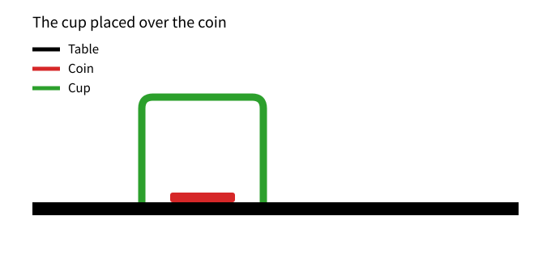

**Figure 1**  Schematic figure. The cup placed over the coin.

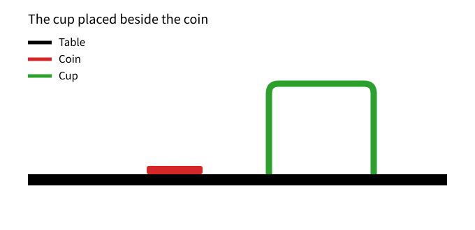

**Figure 2**  Schematic figure. The cup placed beside the coin.

Next, I drew the same thing as waves on the circle. The table is represented by a circle of radius $R$. Let the angle on the circle be $\psi$. Both the coin and the cup are peaks made by adding harmonics.
$$
f(\psi) = a\,R\sum_{m=1}^{N} w_m \cos m(\psi-\theta) \tag{16.1}
$$
$\theta$ is the angle of the center of the peak (the center phase), $N$ is the number of harmonics, $a$ is the amplitude per harmonic divided by $R$, and $w_m$ is the weight. The constant term ($m=0$) is not included.

The settings were decided in the following order.

1. At first, all harmonics were given the same amplitude. The coin has 18 harmonics and the cup has 12.
2. The peak of the coin stuck out of the cup.

   > [Kihara] Let us halve the amplitude of the coin. It is unnatural for it to stick out.

3. Small waves (sidelobes) remained beside the peak.

   > [Kihara] The sidelobes bother me. There was a way of lowering the amplitudes that reduces the sidelobes, wasn't there? But the width broadens, so didn't we need to raise the number of harmonics?

   [Known] If one uses weights that lower the amplitude more for higher harmonics, $w_m = 1 - m/(N+1)$ (the Fejér weights [X14]), the waves at the side become smaller. In exchange, the width of the peak broadens by a factor of 2. So the harmonics were increased to 35 and 23.

The settings decided, and the values of their waveforms, are as follows. [Checked]

| | Harmonics | $a$ | Center | Width of the peak (base to base) | Height of the peak | Dip outside the peak |
|---|---|---|---|---|---|---|
| Coin | 1–35 | 1/72 | 90° | 20.000° | $0.2431\,R$ | $-0.0069\,R$ |
| Cup | 1–23 | 1/36 | specified for each figure | 30.000° | $0.3194\,R$ | $-0.0139\,R$ |

The width of the peak is $720°/(N+1)$, and the height of the peak is $aRN/2$. The waveform dips slightly inside the circle outside the peak because the constant term is not included.

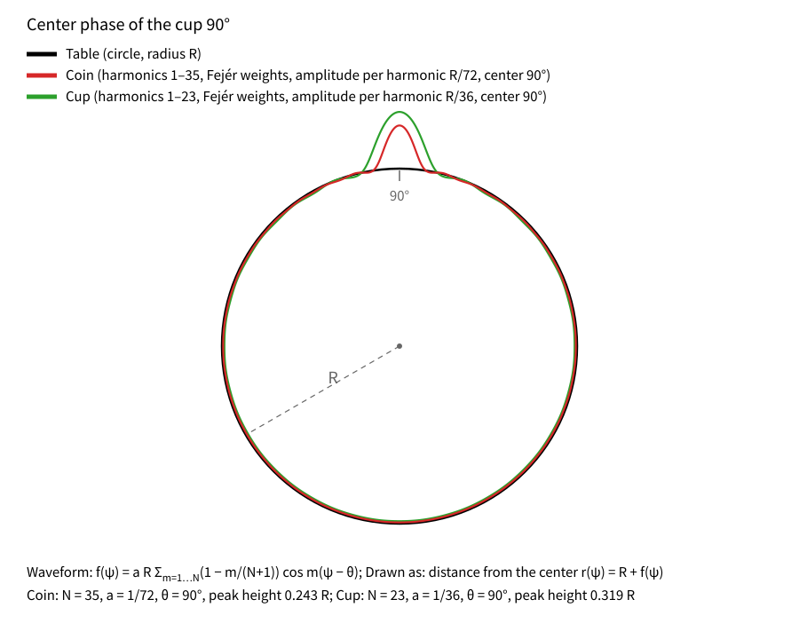

**Figure 3**  The coin (red, center 90°) and the cup (green, center 90°) on the circle. The overlapped state. The distance from the center is drawn as $r(\psi)=R+f(\psi)$. No magnification for display is applied.

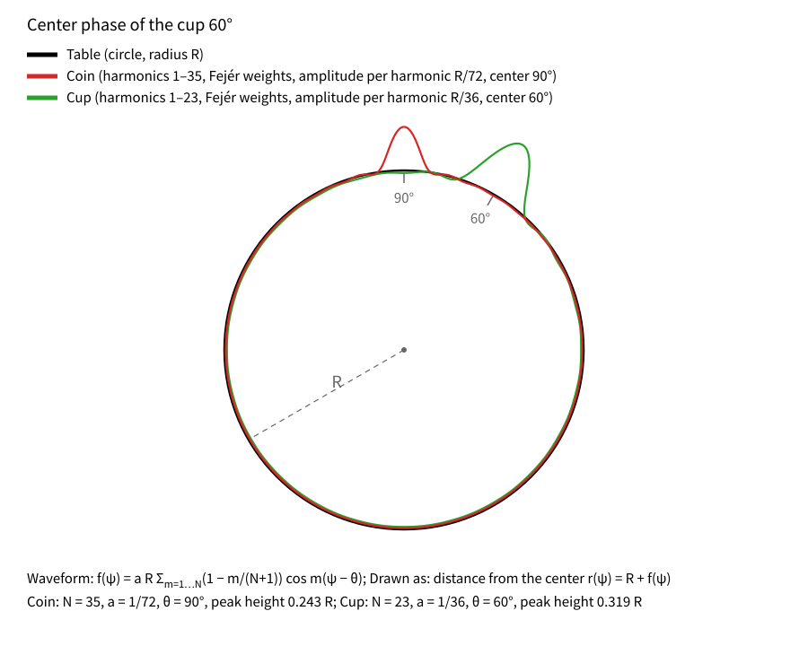

**Figure 4**  The state with the center of the cup shifted to 60°. Drawn in the same way as Figure 3.

These two figures merely draw the two waveforms on top of each other. The cross term has not yet been calculated.

---

## 17. Drawing the Cross Term

As stated in §9, the condition for observation is that the cross term can be read. So I calculated the cross term and drew it. The cross term at each point on the circle is twice the product of the two waveforms.
$$
c(\psi) = 2\,f_{\rm coin}(\psi)\,f_{\rm cup}(\psi) \tag{17.1}
$$
Let the value summed over the whole circle be $C=\int_0^{2\pi}c\,d\psi$. Since the harmonics are mutually orthogonal, $C$ becomes a function only of the difference $\Delta$ of the two center phases.
$$
C(\Delta) = 2\pi\sum_{m} A_m B_m \cos m\Delta \tag{17.2}
$$
$A_m$ and $B_m$ are the amplitudes of the $m$-th harmonics of the coin and the cup, and the sum is taken over the harmonics common to the two. $\cos$ is an even function, and its period is one turn. The statement of §13, "the shift has no direction, and the winding number cannot be read", is the form of this formula. [Checked] (The difference between the numerical integration and (17.2) is of order $10^{-16}$.)

The cross term has the dimension $R^2$. To draw it in the same figure as the waveforms, it was divided by $R$ just once and drawn as $r(\psi)=R+c(\psi)/R$. This is a division to match the dimension; no operation of equalizing the height from figure to figure is applied.

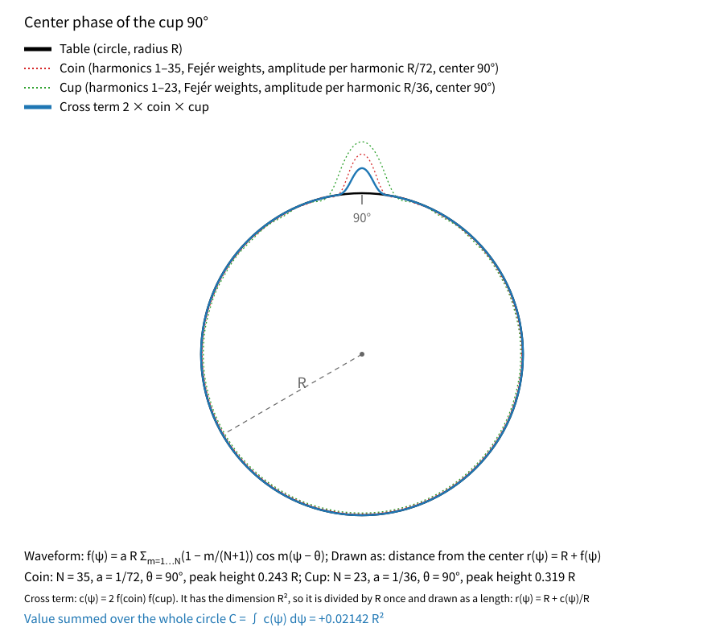

**Figure 5**  The cross term (blue) when the center of the cup is at 90°. The coin and the cup are thin dotted lines. One of 24 figures in which the cup is moved in steps of 15°.

| Center of the cup | $C$ |
|---|---|
| 90° (overlapping) | $+0.02142\,R^2$ |
| 75°, 105° (the rim lies over) | $+0.00076\,R^2$ |
| 60°, 120° | $-0.00071\,R^2$ |
| Apart | $-0.0011\,R^2$ to $-0.0012\,R^2$ |

[Checked] When they overlap, the peak of the cross term is $0.155\,R^2$ and fits inside the peak of the coin. When they are apart, $C$ does not become zero but approaches a small negative value $-\pi a_{\rm coin}a_{\rm cup}R^2=-0.00121\,R^2$. This comes from not including the constant term.

In this figure, the cross term stands when the cup overlaps the coin and does not stand when they are apart. At this point I took this as a figure in which "the cross term is being read". It was later that I noticed there is a problem with this figure (§22).

---

## 18. Amplitude, Too, Has a Resolution

> [Kihara] What we just discussed made me notice: it is strange to think that only the phase has a resolution. I feel that the amplitude also has a resolution. Sidelobes and ripples become invisible, don't they?

**A misreading that occurred here.** As to what the amplitude resolution should be measured against as a ratio, [Claude] set up two candidates: the ratio to the height of the peak, and the ratio to the whole.

> [Kihara] That is wrong, surely. Isn't it the ratio to R?

Resolution exists both on the side of the phase and on the side of the amplitude.

- **Phase resolution**: width of the window ÷ circumference.
- **Amplitude resolution**: smallest readable height ÷ $R$.

To say "not null", the amplitude resolution is needed first. Only when the peak exceeds the smallest readable height can one say it is not null. The small negative cross term of §17 when the two are apart cannot be read if the amplitude has a resolution. What cannot be read is not zero but null.

> [Kihara] Can't the amplitude resolution be calculated? In the case of harmonics, it is roughly $2\pi R/N$ multiplied by a coefficient, isn't it? How about multiplying $A/N$ by the same coefficient? $A$ is the maximum amplitude. At least if the coefficient is dimensionless, the resolution has the dimension of length.

The phase resolution (the width of the peak) is roughly $k\times2\pi R/N$. $k$ is a dimensionless coefficient determined by the weights: 1 for equal amplitudes, and 2 for the Fejér weights. Using the same coefficient, we set
$$
\text{amplitude resolution} = k\,\frac{A_{\max}}{N} \tag{18.1}
$$
$A_{\max}$ is the height of the peak.

> [Kihara] I am not sure. How about placing it as a hypothesis? Perhaps it is better than "I somehow set it to 0.03".

(18.1) is not a formula whose grounds have been derived. [Hypothesis, unverified]

When this formula is applied to the waveforms of §16, the value agrees exactly with the amplitude per harmonic $aR$. [Checked]

| | $N$ | $k$ | Height of the peak | $k A_{\max}/N$ | Amplitude per harmonic |
|---|---|---|---|---|---|
| Coin (Fejér) | 35 | 2 | $0.2431\,R$ | $0.01389\,R$ | $R/72$ |
| Cup (Fejér) | 23 | 2 | $0.3194\,R$ | $0.02778\,R$ | $R/36$ |
| Coin (equal amplitudes) | 18 | 1 | $0.2500\,R$ | $0.01389\,R$ | $R/72$ |
| Cup (equal amplitudes) | 12 | 1 | $0.3333\,R$ | $0.02778\,R$ | $R/36$ |

With the Fejér weights, both the waves outside the peak and the dip outside the peak are at most half of this resolution and cannot be read. With equal amplitudes, the waves at the side are several times the resolution and can be read. [Checked]

Once the number of harmonics is fixed, the fineness of the phase and the cleanness of the amplitude cannot both be improved at the same time. It becomes an allocation of the same number of harmonics to one or the other. The phase resolution and the amplitude resolution are not independent. [Hypothesis, unverified]

(The way of setting "the amplitude resolution is a ratio to $R$" becomes a question once more in §24.)

---

## 19. Even Harmonics and Odd Harmonics

I made the discussion of §15 into figures. The window is the single cup, and its center is at 90°. The weights and the amplitude per harmonic are the same in all three figures. Only the harmonics to be added were selected.

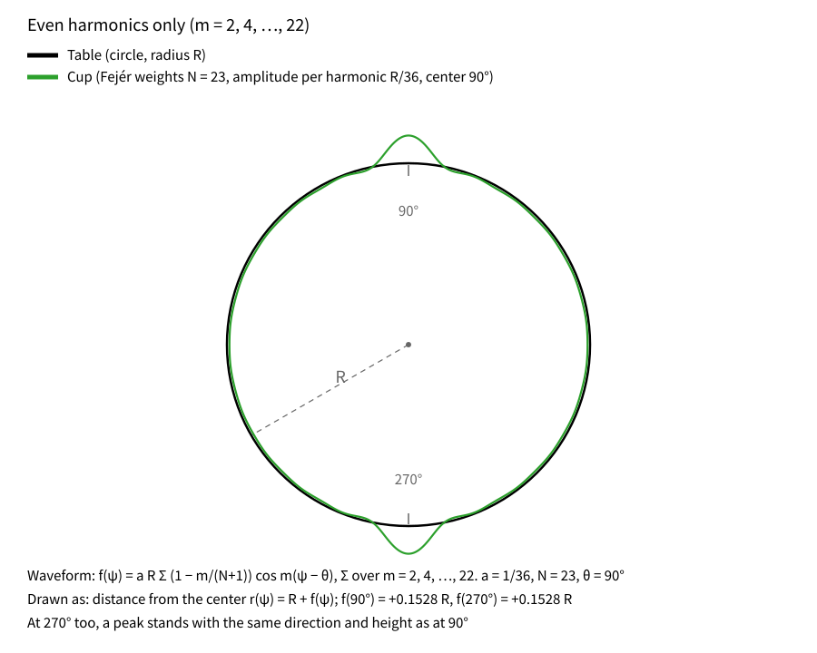

**Figure 6**  Even harmonics only (the 11 harmonics 2, 4, …, 22). At 270°, 180° away, a peak of the same direction also stands.

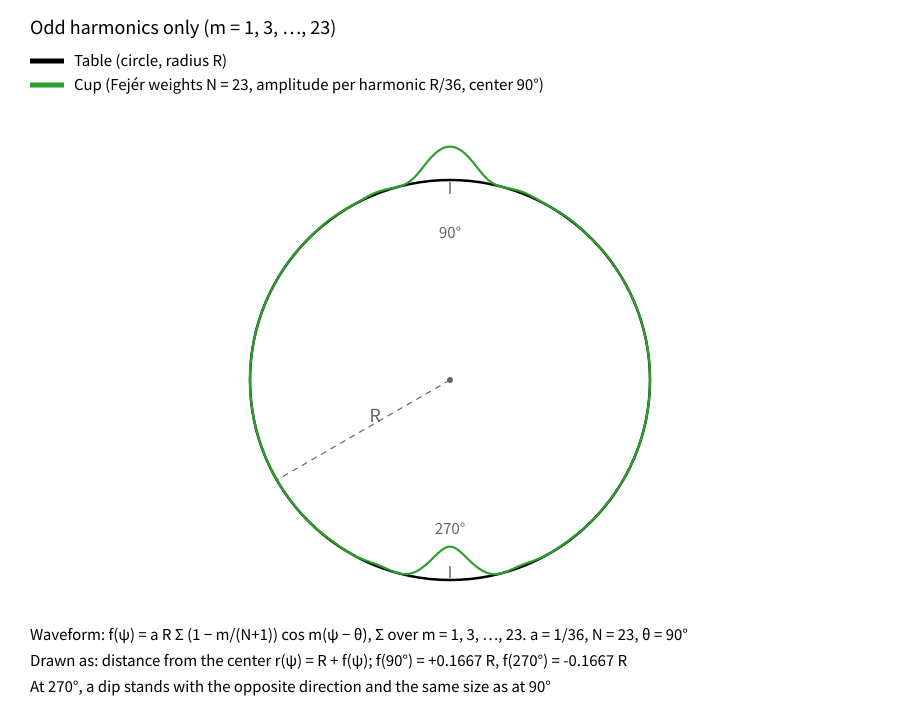

**Figure 7**  Odd harmonics only (the 12 harmonics 1, 3, …, 23). At 270°, a dip of the opposite direction stands.

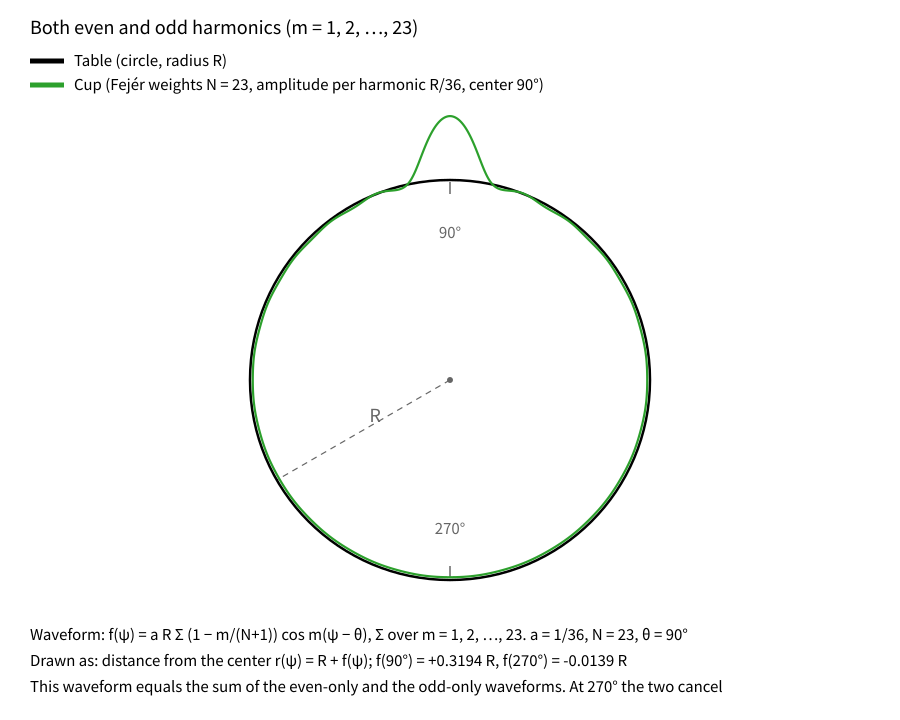

**Figure 8**  Both (the 23 harmonics 1–23). They cancel at 270°, and the peak becomes one.

| | Harmonics added | Value at 90° | Value at 270° |
|---|---|---|---|
| Even only | 11 | $+0.1528\,R$ | $+0.1528\,R$ |
| Odd only | 12 | $+0.1667\,R$ | $-0.1667\,R$ |
| Both | 23 | $+0.3194\,R$ | $-0.0139\,R$ |

[Checked] "Both" equals the sum of "even only" and "odd only" (the difference is of order $10^{-16}$).

---

## 20. In an Open System the Cup Cannot Be Moved

I tried to explain with figures what could not be put into words in §10, namely, why the system is closed and without ends.

> [Kihara] If I were to explain why an open system will not do, I would first show, with dotted lines and without omitting any, all the harmonics of the present figure of the cup at the 90-degree position. Then I would show the figure cut open at the 270-degree position and laid out as a straight line. At this point one sees that, in fact, at the 270-degree position, when there are odd and even harmonics, not all of them become nodes, do they? That is, it should not be possible to cut it open. Am I mistaken?

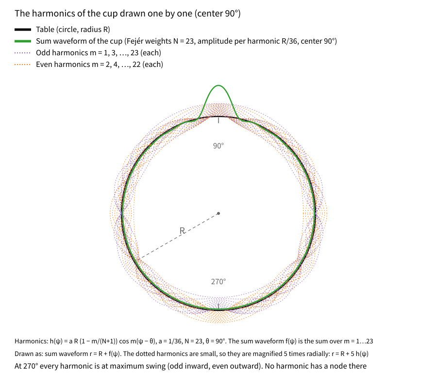

**Figure 9**  The 23 harmonics of the cup (center 90°), each drawn as a dotted line. Since each harmonic is too small to be seen, only the dotted lines in this figure are drawn magnified 5 times in the radial direction. The sum waveform (green solid line) is not magnified.

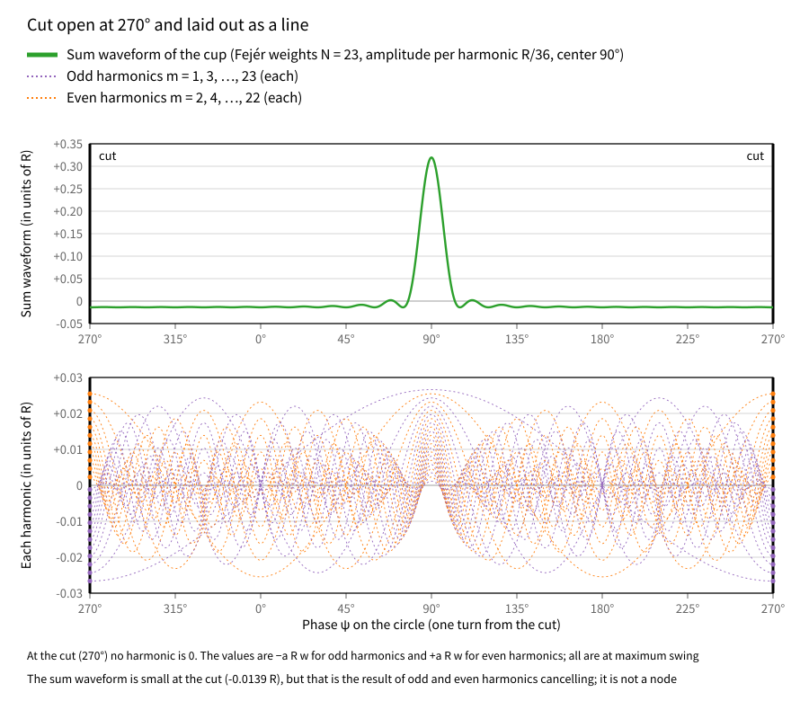

**Figure 10**  The same thing cut open at 270° and laid out as a straight line.

It was not a mistake. When the center of the cup is placed at 90°, at 270° all 23 harmonics are at the position of maximum swing. The odd harmonics are at maximum inward, and the even harmonics are at maximum outward. Not a single harmonic has a node there. That the sum waveform is small at 270° ($-0.0139\,R$) is the result of the odd and the even canceling each other; it is not a node. There is no place anywhere on the circle where all the harmonics are zero at the same time. [Checked]

**A misreading that occurred here (after the manuscript was written).** Gemini, having read the manuscript, stated that on the two-sphere the points where the partner becomes zero (the north and south poles when lines of longitude are drawn) become special points. In response to this, [Claude] wrote "at a place where the value becomes zero, the cross term does not stand, and null remains".

> [Kihara] Have you forgotten that you yourself did the experiment that denies that? We took the trouble to explain the harmonics, didn't we? Certainly, a peak stands on the opposite side, which is in a 180-degree phase relation. But it can be made not to stand. Even harmonics only, odd harmonics only, and what happens when both are added: why do you ignore what was carefully explained?

Whether a peak stands at the diametrically opposite point is determined by the harmonics that are added. If both are added, it does not stand (§19). And a place where the value is small is not a place where there is nothing. As checked above, at 270° all the harmonics exist, still at maximum swing. That a value is zero and that it is null are different things (§2, §9). To read a place where the value appears to be zero as a special point, or as a remainder of null, is a misreading.

Therefore, wherever it is cut open, it cannot be turned into an open system with nodes at both ends.

**An anticipated objection.** At 270° the value does not become zero, but the slope is zero for all the harmonics. As an open system whose ends swing freely, the conditions would be met. What rejects this is moving the cup. If the center of the cup is shifted from 90°, neither the value nor the slope at the cut is zero any longer, and it fits neither a fixed end nor a free end. In a system with ends, the conditions are met only when the window is exactly in the middle.

> [Kihara] What happens if we consider standing waves on a straight line of length $L=2\pi R$? If both ends are fixed ends, they are necessarily nodes, aren't they? If we synthesize all the harmonics, even and odd, with the same amplitude up to the 16th order, what waveform do we get?

The standing waves on a straight line of length $L=2\pi R$ with both ends fixed are of only one kind, $\sin(k\pi x/L)$. Add these from $k=1$ to 16.
$$
g(x) = a\,R\sum_{k=1}^{16} w_k \sin\frac{k\pi x}{L},\qquad a=\frac{1}{36} \tag{20.1}
$$

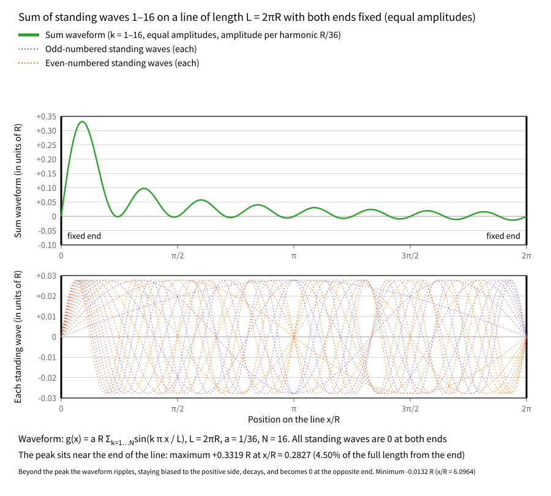

**Figure 11**  The waveform obtained by adding standing waves 1–16 with the same amplitude on a straight line with both ends fixed.

> [Kihara] Can the amplitudes be controlled here so that the sidelobes are reduced?

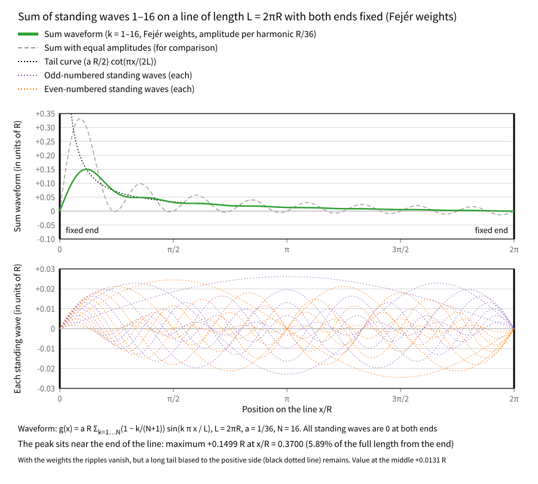

**Figure 12**  The waveform of the same sum multiplied by the Fejér weights. The waveform with equal amplitudes and the tail curve $(aR/2)\cot(\pi x/2L)$ are overlaid.

| | Height of the peak | Position of the peak (relative to the full length) | Ripples beyond the peak | Value at the middle |
|---|---|---|---|---|
| Equal amplitudes | $0.332\,R$ | 4.5% | present | 0 |
| Fejér weights | $0.150\,R$ | 5.9% | vanish | $+0.013\,R$ |

[Checked] The peak sits near the end of the line. It is not left–right symmetric. With the weights the ripples vanish, but a long tail biased to the positive side remains. What control of the amplitudes can fix is only the ripples. "Sitting near the end" and "the tail extending over the whole" come from the very fact that there are ends.

> [Kihara] Well done. Do you see? There is no way to move the position of the peak.

On the circle, shifting the peak is rotating the phase of each harmonic. Not a single amplitude changes. On a straight line with both ends fixed, there is no phase to rotate. To make a peak at another place $x_0$, there is no way but to change the amplitude of the $k$-th wave to $\sin(k\pi x_0/L)$. This is not a movement but the remaking of a different wave. The remade peak changes even in size from place to place.

| Position of the peak (relative to the full length) | Sum of squared amplitudes |
|---|---|
| 0 (end) | 0 |
| 0.01 | 1.40 |
| 0.02 | 4.76 |
| 0.045 | 10.02 |
| 0.1 | 8.90 |
| 0.25 | 8.00 |
| 0.5 (middle) | 8.00 |

[Checked] On the circle, this value is constant regardless of place. On the straight line, one cannot even have a window of the same size at another place.

> [Kihara] Isn't this the easiest explanation to understand? That is, on a table that is an open system, the cup cannot be moved.

**In a flat system with ends, the cup cannot be moved while remaining the same cup. If it cannot be moved, it can neither be put down nor lifted, and observation does not hold.** [Hypothesis, unverified] (The table and figures above are [Checked]. The reading that this means observation does not hold is the hypothesis.)

**A misreading that occurred here.** [Claude] wrote that the reason the cup can be moved on a real table is "because the table is part of a larger system".

> [Kihara] That will not do. It will be misread as saying that on a flat surface extending infinitely the cup could be moved. The truth is that the table is curved, and we merely fail to notice because R is large.

The cup can be moved on a real table because the table is in truth curved and closed. Because $R$ is large, it merely looks flat.

| System | Reason it is excluded |
|---|---|
| Flat system with ends | The cup cannot be moved while remaining the same cup |
| Infinitely wide flat system | The condition for a standing wave to exist (the whole is an integer multiple of the window) does not hold (§6, §10) |
| Closed system without ends | Not excluded. When $R$ is large, it looks flat |

The rim of a real table is not an end of the system. It is the outline of another thing resting on the closed whole.

---

## 21. A Side Path. The Shape of the Tail

> [Kihara] By the way, the shape of this wave that does not move looks exactly like the potential curve of an electron orbital.

If the left end is read as one's own position and the right end as infinity, the waveform of Figure 12 looks like a potential curve. It is zero at one's own position, has a peak very near, decreases monotonically from there toward the distance, and becomes zero at infinity.

**A misreading that occurred here.** [Claude] took this as a remark that the tail has the form $1/x$. What I spoke of was the overall shape.

What is known as calculation is only the following two things. The tail takes the form $1/x$ near the end. This waveform corresponds to the partner, shifted by a quarter wavelength, of a peak set up at the single point of the end. [Checked] It has not been derived that this is a potential.

> [Kihara] Well, let us think about it later. What matters is that making harmonics with both ends fixed gives a curve like this, and that a hat-shaped decay curve can be made; I feel this can be used somewhere.

This is kept on record as an observation about shape. It is not used in the argument of this paper. [Juxtaposed]

---

## 22. The Cross Term Is the Same When the Two Are Exchanged. "Hidden" Cannot Be Written

When the figures and calculations were more or less complete and I had begun arranging the literature to be cited, I noticed a problem.

> [Kihara] By the way, I just noticed: the cross term is in trouble, isn't it? Even if the coin is the larger one, the AND returns the same value.

The cross term is the product of the coin and the cup. Even if the sizes of the coin and the cup are exchanged entirely, the product is the same. The value summed over the whole circle is $0.021424\,R^2$ in both cases. [Checked]

In §5, I determined the spatial resolution from "if the coin fits within the cup it is hidden, and if it sticks out it is visible". This is a relation that does not permit exchange: which is the covering side. Yet all that the cross term of Figure 5 says is "they overlap". It does not say "the cup covers the coin".

> [Kihara] That is, for the map of being hidden by the cup, don't we need a cross term that depends on the order of operation and has the relation of the hiding side and the hidden side? Or is that wrong? Is it an operation of not being hidden? In any case, unless the result changes with the order of operation, the expression "hidden" cannot be made, can it?

[Known] On the circle, shift operations are the same when their order is exchanged. Operations that have no special origin all become multiplications harmonic by harmonic, and their order can be exchanged with one another. Therefore, as long as Assumption 3 is kept, every operation that can be assembled from the cup and the coin on the circle is independent of order.

> [Kihara] It seems deeper than I thought. In the thought experiment I had in mind (the circle), the operation of being hidden may be impossible. If so, the three-sphere seems to become necessary.

[Known] On $S^3$, when two shift operations are performed in succession, the result changes with the order.

On this day, I came to a dead end here. The ideas that came up are listed as they are. None of them was checked at this point.

- **Idea A: $S^3$ is needed.** On the circle, "hidden" cannot be written. On $S^3$, the result changes with the order.
- **Idea B: there is no need to be hidden.**

  > [Kihara] Perhaps there is no need to be hidden. If it can be distinguished that they exist separately, then it is not hidden, is it?

- **Idea C: an observer and a distance are needed.**

  > [Kihara] But it is difficult. Without a cross term, one cannot read that the partner exists. That is, it cannot be distinguished from null. If so, make it a three-body operation instead of a two-body one, and if the observer can judge that the two bodies exist at the same time, the cup is open. When they are read overlapped as one body ... no, that is wrong. With this, they intersect even if the coin is the larger one.

  > [Kihara] On the three-sphere, could distance be read in addition to the fact that they intersect? But no. As to which is in front and which is larger, unless there is, after all, a separate observer, there is no criterion for distinguishing what is near. Does it fail unless there is an observer and distance can also be read?

[Claude] arranged Idea C as: seen from the observer, the cup is in front of the coin; and they are compared by apparent size (viewing angle). Then "the shift needs no observer" of §13 would have to be revised.

All three ideas go in the direction of adding something. Raising the space to $S^3$. Adding an observer. Adding distance. The next day, it turned out that none of them was needed.

---

## 23. Making the Cup Well-Shaped

The next day, November 25, I noticed another direction.

> [Kihara] I have thought it over. I have noticed a way to think without making the model of the cup complicated. Can the waveform of the cup not be reversed? If, instead of making only the position of the cup convex, we can make it concave, can being hidden not be expressed by interference alone?

**A misreading that occurred here.** This is the largest misreading in this thought experiment. [Claude] read "interference" as the addition of the amplitudes of the coin and the cup. Then, without computing the cross term, it made three sets of figures in which the added waveform was the main subject. None of the three sets could be used. It is a repetition of the misreading corrected in §9 (reading interference as adding amplitudes and superposing them).

In this research, interference, cross term, and AND mean the multiplication $2ab$. They do not mean the addition $a+b$.

One more thing: [Claude] tried to deal with "making it concave" merely by reversing the sign of the peak of the previous day.

> [Kihara] Have you forgotten that any waveform can be Fourier-synthesized? Naturally, a rectangular wave with only one pulse can also be made. Can its inverted waveform not be Fourier-synthesized? In other words, it is enough to Fourier-transform a well-shaped waveform.

> [Kihara] That is, a waveform arises where amplitude exists on both sides (AND), does it not.

The cross term stands only where both have amplitude. Then the cup should be written as a waveform "whose amplitude is zero at the place it covers and which has amplitude at the other places". It is well-shaped.

When I thought of the well-shaped cup, I reconsidered the question itself. It is not to judge whether the coin and the cup "are there or not". I reconsidered it as a way to judge whether the coin "is visible or not".

At this point there is an observation that I gave up. It is to distinguish "not visible" from "absent". Null is the state in which there is no information, and a way to read null directly cannot be defined (§2, §3). So I decided to treat absent (null) and not visible by one and the same reading. It is that the cross term is zero, or precisely, that the amplitude of the cross term is at or below the amplitude resolution (§18).

- **Visible**: the amplitude of the cross term is larger than the amplitude resolution.
- **Not visible**: the amplitude of the cross term is at or below the amplitude resolution. Absent (null) also falls here.

When the cup covers the coin, the amplitude of the cross term becomes almost zero. What is known is only that the coin has become not visible. Whether there is a coin inside the cup is not known.

Here I restate the way the earlier sections were written.

- In §2 and §9, null and zero were separated. That these two are different things does not change. What was changed is the way of reading. Since null cannot be read, it is put into the same reading as not visible (zero). "The cross term does not stand in the first place" and "the cross term stands and its value is zero" of §9 are not distinguished in the reading.
- In §18, I wrote "what cannot be read is not zero but null". I restate it. Whether what cannot be read is absent (null), or is there but not visible, cannot be distinguished. Both are read as "not visible".

The coin is as in §16. The cup is made a well of width $W=30°$ and depth $h$.
$$
g(\psi) = h\Bigl(1-\frac{W}{2\pi}\Bigr) - \sum_{m=1}^{N} w_m\,\frac{2h}{m\pi}\,\sin\frac{mW}{2}\,\cos m(\psi-\theta) \tag{23.1}
$$
The first term is the constant term ($m=0$). Unlike the peak of §16, the well shape needs a constant term. The cross term is computed as a product, as in (17.1).
$$
c(\psi) = 2\,f_{\rm coin}(\psi)\,g(\psi) \tag{23.2}
$$

The depth of the well was set to $h=23/72=0.3194$ (the height of the peak of the cup of the previous day), and the upper limit of the harmonics to $N=71$. With the Fejér weights, the width of the wall of the well becomes $720°/72=10°$, and the flat bottom is $30°-10°=20°$, the same as the width of the coin. These two values are choices for drawing the figures, not quantities of the theory.

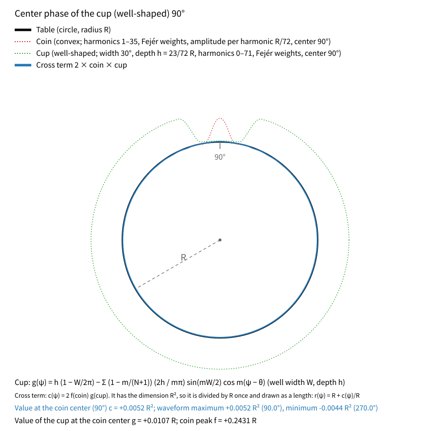

**Figure 13**  The center of the cup (green, well-shaped) is at 90°. It is placed over the coin (red). No peak stands in the cross term (blue). The coin is hidden.

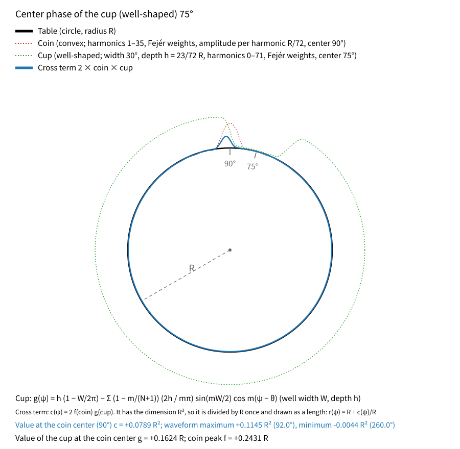

**Figure 14**  The center of the cup is at 75°. The rim of the cup lies over the coin. A peak of the cross term stands only on the side that is not covered. Only a part is visible.

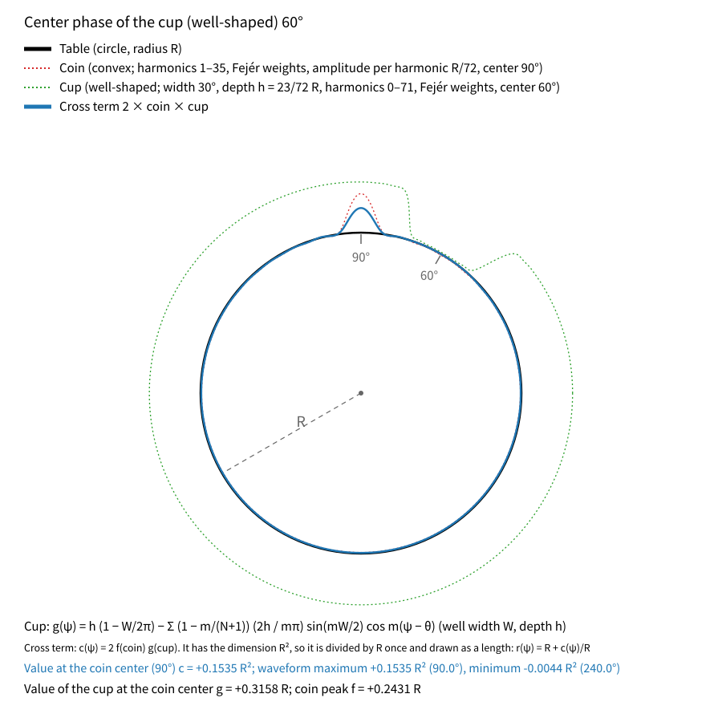

**Figure 15**  The center of the cup is at 60°. It is off the coin. The peak of the coin stands as it is in the cross term. The coin is visible.

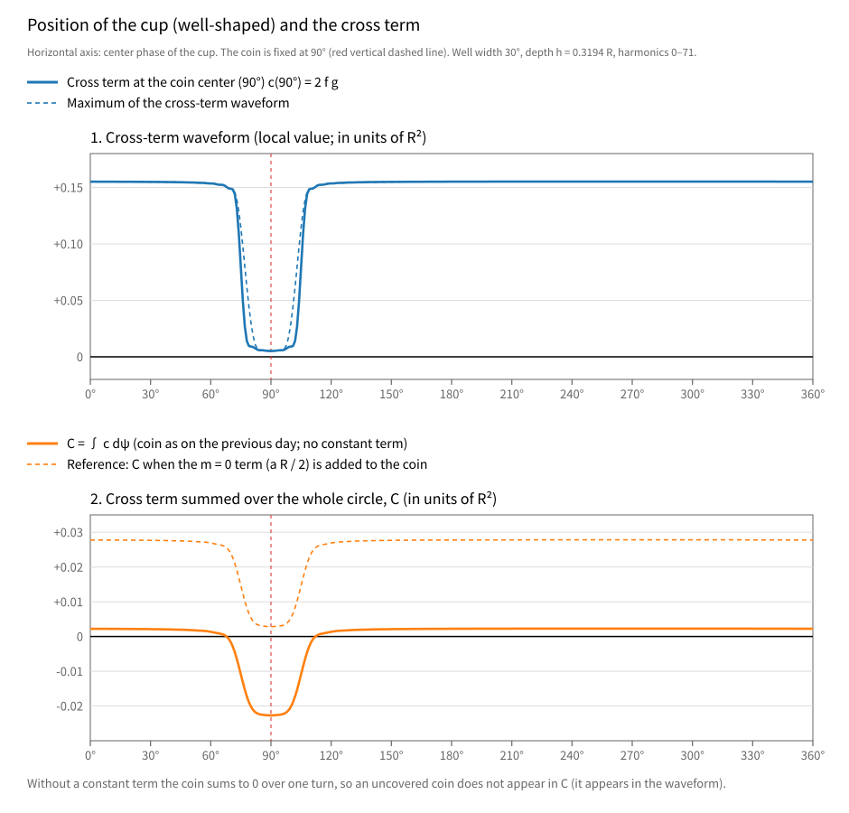

**Figure 16**  The relation between the position of the cup and the cross term at the center of the coin (90°).

| Position of the cup | Amplitude of the cup at the center of the coin | Cross term at the center of the coin | Maximum of the cross-term waveform (position) |
|---|---|---|---|
| 90° (placed over) | 0.0107 | 0.0052 | 0.0052 (90.0°) |
| 75° (the rim lies over) | 0.162 | 0.0789 | 0.1145 (91.95°) |
| 60° (shifted) | 0.3158 | 0.1535 | 0.1535 (90.0°) |
| 270° (opposite side) | 0.3194 | 0.1552 | 0.1552 (90.0°) |

[Checked] (The unit is $R$ for the amplitude and $R^2$ for the cross term.) The reference value when the coin is not covered is $2\times0.2431\times0.3194=0.1553$, and the cross term when the cup is placed over is about 3% of it. It is not exactly zero because, the harmonics being truncated at 71, the bottom of the well floats by 0.0107. It becomes smaller when the harmonics are increased (0.0026 at 143, 0.0010 at 359). The cross term at the center of the coin becomes half when the cup is at 75.04° and 104.96°, which is when the center of the coin comes to the rim of the well.

This is applied to the definitions of "visible" and "not visible" above. Since the cross term has the dimension $R^2$, it is divided by $R$ once, as in the figures, and compared with the amplitude resolution of §18 ($0.0139\,R$ for the coin, $0.0278\,R$ for the cup).

| Case | Amplitude of the cross term | Comparison with the resolution | Reading |
|---|---|---|---|
| The cup is placed over (90°). Center of the coin | 0.0052 | below | not visible |
| The rim lies over (75°). Maximum of the waveform | 0.1145 | above | visible (a part) |
| Shifted (60°). Center of the coin | 0.1535 | above | visible |
| Outside the peak of the coin (independent of the position of the cup) | −0.0044 | below | not visible |

[Checked] Whichever of the two resolutions is used, this reading does not change. The standard of the amplitude resolution itself has not been decided (§24), but this judgment does not depend on how it is decided.

The value at the center of the coin when the cup is placed over (0.0052) and the value at a place where there is no coin (−0.0044) are of the same size. Both are below the resolution. Whether a coin is hidden under the cup, or there is no coin there, cannot be distinguished from the cross term. This is the content of having given up the distinction between "not visible" and "absent".

There is one more thing to note. This paper, by adding harmonics, made a state in which there is only one coin on the circle and a state in which there is only one cup (§15, §19). However, neither the coin, nor the cup, nor an observer looking at them from outside has a way to know that the coin is one and that the cup is one. We know it because we have the knowledge of the composition of the harmonics and are looking, so to speak, from a God's-eye view.

> [Kihara] With this, it is hidden at 90 degrees and visible at 60 degrees, is it not. That is, the cup is expressed without any complicated expression.

> [Kihara] This is visible enough, is it not. When it is partly covered, only a part is visible.

> [Kihara] If the well-shaped waveform is used for the cup and the peak-shaped waveform for the coin, the coin thought experiment can be made, as it is, from the relation of waveforms alone, without placing a background.

This is the answer to the problem of §22.

- The problem of the previous day arose because the cup was made the same convex peak as the coin. If both are peaks, the difference between the side that hides and the side that is hidden is not in the waveforms. At the moment the cup is made well-shaped, the difference of roles enters the shape of the waveform.
- The operation may remain the product. An operation that changes with order is not needed. There is no need to add $S^3$, an observer, or distance. "No observer is needed for the shift" of §13 holds as it is.
- There is no need to place a background called the table separately, either. The well-shaped waveform has, outside the well, a constant amplitude over the whole circle. The waveform of the cup itself plays the role of "the place where the coin is visible".
- "If the coin is large, it is visible before the cup is lifted" of §5 need only be restated as "if the coin sticks out of the cup, it is visible". Where it sticks out, the cross term stands. Figure 14 shows that.

**If the cup is a well-shaped waveform and the coin is a peak-shaped waveform, the thought experiment of putting the cup down and lifting it can be written with only two waveforms on the circle and their product.** [Checked] (For the values of the waveforms and the cross term. The reading that this expresses "hidden" and "visible" is the interpretation of this paper.)

---

## 24. May the Radius R of the Circle Be Put In by Hand?

> [Kihara] Now, what is unnatural about this experiment is that R is put in by hand, is it not.

In all the figures, a circle of radius $R$ is drawn first, and the waves are placed on it. $R$ did not come out of the waves; it was put in by hand.

> [Kihara] As for this, I have examined in the past the direction of determining R from the waves alone.

The author has examined, for a pulse on a closed string, reading $R$ from the size of the harmonics (an examination before publication; Appendix B). Its definition is, for one wave,
$$
R^2 = \sum_{m\ge1} A_m^2 \tag{24.1}
$$
(the constant term is not included), and, for the sum of two waves,
$$
R^2(\Delta) = R_1^2 + R_2^2 + 2\sum_m A_m B_m\cos m\Delta \tag{24.2}
$$
The third term is equal to the cross term of (17.2) divided by $\pi$. This was applied to the coin and the well-shaped cup. [Checked]

| Quantity | Value |
|---|---|
| $R_1$ of the coin | 0.0471 |
| $R_2$ of the cup | 0.1148 |
| $\sqrt{R_1^2+R_2^2}$ | 0.1241 |
| $R$ of the sum (cup at 90°, placed over) | 0.0904 |
| $R$ of the sum (cup at 75°) | 0.1092 |
| $R$ of the sum (cup at 60°, shifted) | 0.1258 |

(The unit is the length with the $R$ put in by hand in the figures taken as 1.)

> [Kihara] With the R computed in this way, the radius becomes quite small and the figure becomes hard to see. Please do it as it is.

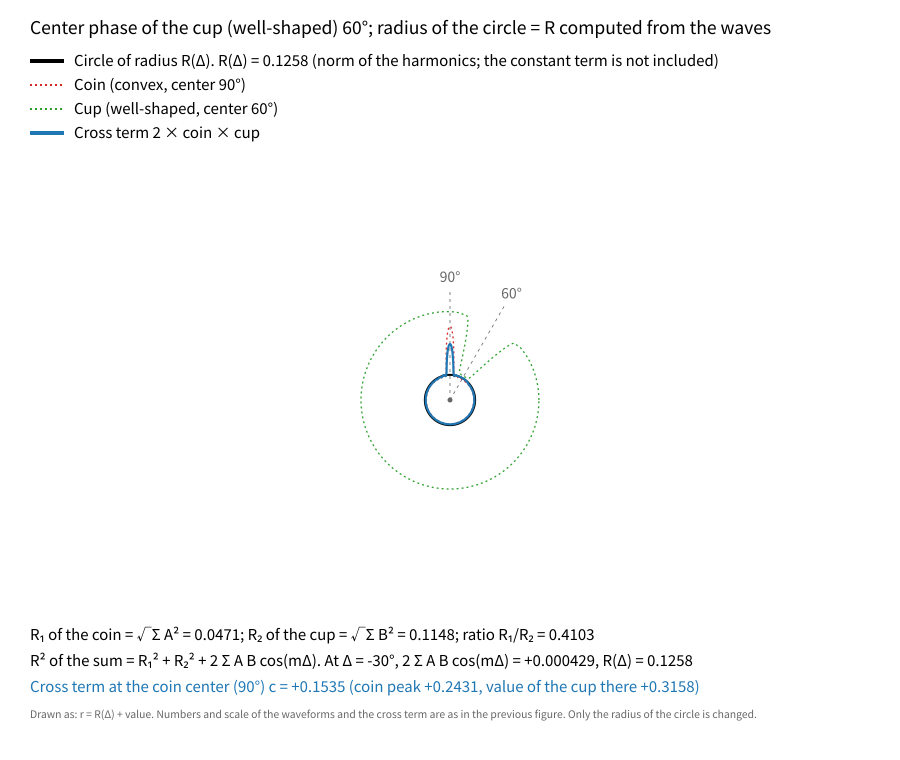

**Figure 17**  The same thing as Figure 15 (center of the cup at 60°), drawn with the radius of the circle set to the $R$ of (24.2). The numbers and the scale of the waveforms and the cross term are the same as in Figure 15. Only the radius of the circle was changed.

The circle becomes about one eighth of the one put in by hand.

> [Kihara] I know that it turns out this way. But it is not the essence. Do you see what it means? We are residents living in the subjective space on the circle. We observe the circle as a great circle, as a straight line. So, from the beginning, the radius of curvature cannot be read on the circle.

**A misreading that occurred here.** [Claude] compared the amplitude with the length of $R$, saying "the peak of the coin is 5.16 times $R$". And it wrote $R$ as a quantity of the same kind as the amplitude.

> [Kihara] R and the amplitude are in different directions; in a sense, they are orthogonal.

> [Kihara] It is simple. So, even if R is scaled, as long as it is a circle, the residents on the circle cannot tell the difference.

> [Kihara] So this figure, too, can be used as it is when writing the paper.

[Known] From the lengths measured on it alone, it cannot be known whether a one-dimensional curve is bent. If a circle is cut at one place and stretched out, it becomes a straight line without any change of length. The author has computed this as the distortion of a unit cell on a space of positive constant curvature, and has confirmed that in one dimension the distortion is zero for any $R$, and that curvature first appears in the area spanned by two directions [S3][S4].

The experiment of the coin and the cup is closed with only the phase on the circle and the amplitude orthogonal to it. An area spanned by two directions is nowhere. Therefore, however $R$ is taken, the residents on the circle cannot tell the difference. Figures 3 to 16, in which $R$ was put in by hand, can be used as they are.

From this, some of the ways the earlier sections were written need to be reviewed.

- All the figures are drawn with $r=R+f$, adding the amplitude in the direction of the radius. The amplitude is in a direction different from the radius. This is a convenience of drawing. A comparison of the amplitude with the length of $R$, such as "the peak of the coin is so many times $R$", has no meaning.
- In §18, the amplitude resolution was set as "the smallest readable height ÷ $R$". If the amplitude and $R$ are in different directions, it has to be rebuilt, starting from what is taken as the standard. This has not been decided. [Juxtaposed]
- "The table is curved, but because $R$ is large we do not notice" of §20 is another way of saying the same fact, that the residents on the circle have no means of noticing whether $R$ is large or small.

---

## 25. Summary

### 25.1 What Was Understood in the Thought Experiment

The answers that the thought experiment gave to the questions of §1 and to the questions that arose on the way are listed.

| Question | Answer | Status |
|---|---|---|
| How can it be distinguished that something is not null? | It cannot be proved. One can only decide a resolution and say whether a distinction was made (§3). Since null cannot be read directly, "whether it is there or not" is replaced by "whether it is visible or not", and it is read by whether the amplitude of the cross term is at or below the amplitude resolution. The distinction between "not visible" and "absent" is given up (§23) | [Hypothesis, unverified] |
| Can the act of lifting the cup be interpreted as a wave? | It can. From putting the cup down to lifting it, or the diameter of the cup, is read as a half-wavelength (window) (§4, §5) | [Hypothesis, unverified] |
| Can the relation between the cup and the coin be written as a relation between two waves? | It can. It is the product of a peak-shaped waveform and a well-shaped waveform (§23) | Waveforms and values [Checked] |
| What is the condition for observation to hold? | It is not being coherent. It is that the cross term (the product, the AND of information) can be read (§9) | [Hypothesis, unverified] |
| What is resolution? | It is not an absolute value but a ratio to the whole. It exists both in phase and in amplitude (§6, §18) | [Hypothesis, unverified] |
| What is a system? | It is that in which all the relations relevant to the action are contained. The resolution can be moved both up and down, but there is a point where information no longer increases (§12) | [Hypothesis, unverified] |
| Why is the system closed and without ends? | There is no time in the background, and what exists is only standing waves. It is because, in a system with ends, the cup cannot be moved while remaining the same cup (§6, §20) | Figures and values [Checked] |
| How far is the shape of the system narrowed down? | To the circle $S^1$ or the three-sphere $S^3$ (§11) | The parts are [Known]; the connection is [Hypothesis, unverified] |
| Why is the window called a half-wavelength? | Because only when both odd and even harmonics are present does the peak become one (§15, §19) | Figures and values [Checked] |
| Can "hidden" be written with the product alone? | It can. It is enough to make the cup well-shaped. Neither an operation that changes with order, nor $S^3$, nor an observer is needed (§22, §23) | Waveforms and values [Checked] |
| May the radius $R$ of the circle be put in by hand? | It may. The residents on the circle cannot distinguish $R$ (§24) | [Known] |

[Checked] in the table refers to the waveforms and numerical values that support the answers. The reading that they are answers to the questions is the interpretation of this paper.

The assumptions placed are three (§14). That the action can be defined uniquely and read uniquely. That the window is stationary. That the system has no special direction and no origin. Bounded, finite, closed, without ends, without dents, without vertices: these follow from the three.

### 25.2 What Was Checked

What was checked with the attached programs (Appendix A) is the following.

- The width and height of the peaks, and the dip outside the peaks, of the waveforms of the coin and the cup (§16).
- That the value of the cross term summed over the whole circle agrees between the numerical integration and the sum over harmonics (17.2). That it is an even function of the difference of the center phases alone (§17).
- That the value of formula (18.1) agrees with the amplitude per harmonic (§18).
- The values at 90° and 270° of the waveforms with even harmonics only, odd harmonics only, and both (§19).
- That at 270° all the harmonics are at the position of maximum swing. That there is no place where all the harmonics are zero at the same time (§20).
- The position of the peak, the tail, and the sum of squared amplitudes at each place, of the waveform on a line with both ends fixed (§20).
- The values, for each position of the cup, of the cross term of the well-shaped cup and the coin. The value outside the peak of the coin. Which is larger, these or the amplitude resolution (§23).
- The values of $R$ computed from the waves (§24).

### 25.3 What Is Hypothesis and an Unverified Task

1. Reading an act as a wave capable of interference (§4).
2. That the condition for observation to hold is that the cross term can be read, and that being coherent is no more than a sufficient condition (§9).
3. That bounded, finite, closed and without ends, and without dents or vertices follow from the three assumptions (§6, §7, §10, §14).
4. That, from the window being stationary, the system is narrowed down to $S^1$ or $S^3$ (§11). In particular, that "the window is stationary" requires, for every direction, a partner that is zero nowhere, and that it requires the three relations to close independently of the bracketing. These two connections have not yet been derived in the language of the cup alone.
5. That the upper and lower limits of the resolution lie not on the side of the resolution but on the side of the partner with which the AND is taken (§12).
6. The formula (18.1) for the amplitude resolution. That the phase resolution and the amplitude resolution are not independent (§18).
7. That the cup's not being movable in a flat system with ends means that observation does not hold (§20).
8. The meaning of arranging windows without gaps in two or more dimensions. The argument of this paper, of arranging windows and shifting them, is for the case of a line and a ring.

### 25.4 What the Author Has Not Decided at Present and Has Placed Side by Side

1. The standard of the amplitude resolution. If the amplitude and $R$ are in different directions, a ratio to what is it to be (§18, §24)? The judgment of "visible" and "not visible" in §23 does not change whichever of the two values of §18 is used.
2. That the waveform on a line with both ends fixed looks like a potential curve (§21).

### 25.5 Conclusion

The cup and the coin of Professor Hotta's article can be written with two waveforms on the circle. The coin is a peak-shaped waveform, and the cup is a well-shaped waveform. The product of the two (the cross term) does not stand when the cup is placed over the coin, stands only in part when the rim lies over it, and stands when the cup is shifted. Not standing means that the amplitude of the cross term is at or below the amplitude resolution. What is known when the cup is placed over is only that the coin has become not visible. Whether there is a coin inside the cup is not known. Distinguishing "not visible" from "absent" was given up. No background, no observer, and no order of operations was added.

Tracing backward the conditions for the act of putting the cup down and lifting it to hold, the system that carries that act is finite, closed, without ends, and without dents or vertices. If the window is required to be stationary, it is $S^1$ or $S^3$. This is the requirement specification that this paper has produced. It is a hypothesis, and verification is required.

The next task is item 4 of §25.3. It is to derive the narrowing to $S^1$ or $S^3$ in the language of the cup alone. And it is to draw on $S^3$ the coin and the cup that this paper drew on the circle.

---

## What Is Not Claimed

- This paper does not object to the conclusion of Professor Hotta's article. It borrows the setting of the article and considers a different question.
- It does not claim to have derived quantum mechanics. The formalism of quantum mechanics does not appear in this paper.
- It does not claim to have derived, from the cup thought experiment alone, that spacetime is $S^1$ or $S^3$. The place where the known theorems are connected is a hypothesis.
- It does not claim that the parts (Fourier series, the Fejér weights, the theorem on vector fields on the two-sphere, the classification of parallelizable spheres, intensity interference) are new. All are known.
- It claims nothing about the resolution of the instruments an observer has. That is outside the scope of this paper.
- It does not claim to have given a concrete geometry or metric of the system. What this paper states goes only as far as the requirement specification.

---

## Acknowledgments

What prompted this paper is the note article [X1] by Professor Masahiro Hotta. I am deeply grateful that he explained how the formalism of quantum mechanics comes about with the setting of a cup and a coin, which anyone can picture. The content of this paper is the author's own attempt, borrowing that setting, and the responsibility for any errors lies entirely with the author.

---

## References

### Self-Citations (Concept DOI, 10.5281/zenodo.<number>)

[S1] N. Kihara, "Shape-Invariant Standing Waves on Closed Spheres: Stability per Dimension and the Geometric Necessity of 3+1 Spacetime" (in Japanese and English), 2026-04-24. Concept DOI 10.5281/zenodo.19731593.  
[S2] N. Kihara, "The Observer's Resolution Is a Gauge: A Thought Experiment That Reads the Harmonic Order in Reverse, and the Prediction of a Theory Assembled from Known Symmetries" (in Japanese and English), 2026-11-10. Concept DOI 10.5281/zenodo.24097611.  
[S3] N. Kihara, "Paper 0: Distortion of the Geodesic Unit Cell in Positively-Curved Constant-Curvature Space — Exact Evaluation of Edge, Angle, Area, and Volume" (in Japanese and English), 2026-07-11. Concept DOI 10.5281/zenodo.20680269.  
[S4] N. Kihara, "Linear Simplexification by Square-Quantity Readout and a Dimension-wise Organization of Curvature-Correction Candidates" (in Japanese and English), 2026-06-21. Concept DOI 10.5281/zenodo.20785539.

### External References

[X1] M. Hotta, "Ryoshi rikigaku no senkei daisu wa kakuritsu no tan naru hyoki" (The Linear Algebra of Quantum Mechanics Is Merely a Notation for Probability; in Japanese), note, 1 March 2025. https://note.com/quantumuniverse/n/n897cf1fca3e9  
[X2] C. Rovelli, "Relational quantum mechanics," Int. J. Theor. Phys. 35, 1637–1678 (1996). DOI 10.1007/BF02302261  
[X3] L. Hardy, "Quantum Theory From Five Reasonable Axioms," arXiv:quant-ph/0101012 (2001).  
[X4] G. Chiribella, G. M. D'Ariano, P. Perinotti, "Informational derivation of quantum theory," Phys. Rev. A 84, 012311 (2011). DOI 10.1103/PhysRevA.84.012311  
[X5] E. Adlam, "How Do We Observe Relational Observables?," J. Gen. Philos. Sci. 57, 285–309 (2026). DOI 10.1007/s10838-024-09703-7  
[X6] P. Dall'Olio, J. A. Zapata, "Towards Relational Foundations for Spacetime Quantum Physics," Universe 11(8), 250 (2025). DOI 10.3390/universe11080250  
[X7] R. Hanbury Brown, R. Q. Twiss, "Correlation between Photons in two Coherent Beams of Light," Nature 177, 27–29 (1956). DOI 10.1038/177027a0  
[X8] R. Hanbury Brown, R. Q. Twiss, "A Test of a New Type of Stellar Interferometer on Sirius," Nature 178, 1046–1048 (1956). DOI 10.1038/1781046a0  
[X9] H. Poincaré, "Sur les courbes définies par les équations différentielles (troisième partie)," J. Math. Pures Appl. (4) 1, 167–244 (1885).  
[X10] L. E. J. Brouwer, "Über Abbildung von Mannigfaltigkeiten," Math. Ann. 71, 97–115 (1912). DOI 10.1007/BF01456931  
[X11] R. Bott, J. Milnor, "On the parallelizability of the spheres," Bull. Amer. Math. Soc. 64, 87–89 (1958). DOI 10.1090/S0002-9904-1958-10166-4  
[X12] M. A. Kervaire, "Non-parallelizability of the n-sphere for n > 7," Proc. Natl. Acad. Sci. USA 44, 280–283 (1958). DOI 10.1073/pnas.44.3.280  
[X13] A. Hurwitz, "Ueber die Composition der quadratischen Formen von beliebig vielen Variablen," Nachr. Ges. Wiss. Göttingen, Math.-Phys. Kl. 1898, 309–316.  
[X14] L. Fejér, "Untersuchungen über Fouriersche Reihen," Math. Ann. 58, 51–69 (1904). DOI 10.1007/BF01447779

---

## Appendix A: Programs for the Figures and the Checks

There are three programs that compute the figures and the numerical values (Python 3; no external libraries are used). All the figures are computed directly from the formulas and output as SVG. No random numbers are used. The numerical values were saved in `results/`.

| Program | Figures | Numerical values |
|---|---|---|
| `fig_cup_coin_table.py` | Figures 1–12 | `results/fig_cup_coin_table.txt`, `fig_cup_coin_cross_term.txt`, `fig_cup_parity.txt`, `fig_cup_open_system.txt`, `fig_line_fixed_ends_equal.txt`, `fig_line_fixed_ends_fejer.txt` |
| `fig_cup_well_cross.py` | Figures 13–16 | `results/fig_cup_well_cross.txt` |
| `fig_cup_well_cross_derived_R.py` | Figure 17 | `results/fig_cup_well_cross_derived_R.txt` |

The figures were drawn as follows.

- The waveforms were drawn with the distance from the center as $r(\psi)=R+f(\psi)$. No magnification for display was applied. The only exception is the dotted lines of the harmonics in Figure 9, which are magnified 5 times in the direction of the radius.
- Since the cross term has the dimension $R^2$, it was divided by $R$ just once and drawn as $r(\psi)=R+c(\psi)/R$. No operation of equalizing the heights from figure to figure was applied.
- In Figure 17, only the radius of the circle was set to the value of (24.2). The numbers and the scale of the waveforms and the cross term are the same as in Figure 15.

The figures of the English version were made with `make_figures_en.py`, by replacing only the character strings in the figures of the Japanese version (`figures/`) with English (`figures_en/`). The shapes and the numerical values are the same.

These programs only compute the waveforms and numerical values of the text. They are not numerical experiments that evolve a state in time.

## Appendix B: Record of the Thought Experiment

The records are in the public repository https://github.com/WurabeSeiji/ai-chat-logs-open, in `次元の生成構造/堀田先生のnoteとコインとコップの思考実験_20261124/` (the folder of this paper; the records are in Japanese).

- `対話記録_ChatGPT_堀田先生のnoteとコインとコップの思考実験_20261124.md` (dialogue record with ChatGPT): the dialogue with ChatGPT (Nos. 01–23). The statements are contained as they are, in order.
- `分析記録_コインとコップの思考実験_窓と交差項と閉じた系_20261124.md` (analysis record): the record of the analysis, the calculations, and the misreadings carried forward in the dialogue with Claude.

The correspondence between the sections of the text and the records is as follows.

| Section of the text | Dialogue record with ChatGPT | Section of the text | Analysis record |
|---|---|---|---|
| §1 | 01–06, 11, 12 | §9 | Sections 2.2, 3.1 |
| §2 | 07 | §10 | Chapter 1, Section 2.3 |
| §3 | 08, 09 | §11 | Section 3.7 |
| §4 | 10–12 | §12 | Sections 3.2, 3.3 |
| §5 | 13–15 | §13 | Section 3.4 |
| §6 | 16 | §14 | Chapter 1, Section 3.9 |
| §7 | 17–20 | §15 | Sections 2.3, 3.8 |
| §8 | 22, 23 | §16–§21 | Chapters 4, 5, 6 |
| | | §22 | Chapter 8 |
| | | §23, §24 | Chapter 9 |
| | | Record of misreadings | Chapters 7, 10 |

The definitions (24.1)(24.2) used in §24, which read $R$ from the size of the harmonics, are from an examination, not yet published as a paper, in `次元の生成構造/有界な定常波の再検討_閉じた弦のパルス_フーリエ級数_20261028/` (re-examination of bounded standing waves: pulses on a closed string and Fourier series) in the same repository.

---

## Classification

| Class | Content |
|---|---|
| Known mathematics and physics | Fourier series, orthogonality of harmonics / the Fejér weights [X14] / intensity interference [X7][X8] / a tangent vector field on the two-sphere necessarily has a zero [X9][X10] / the parallelizable spheres are limited to $S^1$, $S^3$, $S^7$ [X11][X12] / algebras with a norm-preserving product are limited to dimensions 1, 2, 4, 8 [X13] / on the circle, shift operations do not depend on their order / on a one-dimensional curve, bending cannot be read |
| Formulas and numerical values checked in this paper | The values of the waveforms of (16.1) / (17.1)(17.2) / the values of (18.1) / the table of §19 / the tables of §20 and the absence of a common node / (23.1)(23.2) and the tables of §23 / (24.1)(24.2) and the table of §24 |
| Interpretation (the claims of this paper) | Reading the cup and the coin as two waves / reading the window as a half-wavelength / reading the cross term as the AND of information / that the product of the well shape and the peak shape expresses "hidden" and "visible" (§25.1) / replacing "whether it is there or not" by "whether it is visible or not", and giving up the distinction between "not visible" and "absent" (§23) |
| Hypothesis, unverified | The 8 items of §25.3. In particular, that the condition for observation is that the cross term can be read, that the shape of the system is required by the three assumptions, and the narrowing to $S^1$ or $S^3$ |
| Juxtaposed | The 2 items of §25.4 |
| Record of the misreadings that occurred in the thought experiment | "A misreading that occurred here" in §2, §4, §5, §6, §7, §9, §11, §13, §15, §18, §20, §21, §23, §24 |

---

## Version History

- **v1.0 (2026-11-26):** First version. The thought experiment of November 24 to 25, 2026 was arranged, in the order in which it was carried out, into the form of a paper. Professor Hotta's article was written into the motivation as what prompted the work, and was put into the references (the author's decision, the same day).
- On the same day, the manuscript was given to Gemini to read. The criticism of §11 (that stationarity alone cannot exclude the two-sphere) came from the premise of placing time in the background. The criticism and the answer to it were added to §11 as a record of a misreading. The reason for finiteness in §6 was corrected from the ratio to the condition of standing waves (pointed out by the author). "Resolution of time" in §5 was corrected to the resolution of the act (pointed out by the author). A record of the misreading of reading a place where the value is zero as null was added to §20. The paragraph on the value $C$ summed over the whole circle was removed from §23 (what this paper reads is the cross term itself, which stands where both have amplitude).
- On the same day, with reference to a full revision draft by ChatGPT (`coin_and_cup_thought_experiment_v02.md`, up to §14), the subtitle, the explanation of "stationary" in the abstract, "Premise" and "The four stages of the argument" in How to Read This Paper, the note on how the figures are drawn, the limitation in §13, and the correspondence table in §14 were added. The form of writing the dialogue and the record of misreadings in the order in which they occurred was not changed.
- On the same day, it was added to §23 that, when the well-shaped cup was thought of, the question was reconsidered from "whether it is there or not" to "whether it is visible or not", and that the distinction between "not visible" and "absent" was given up (the author's instruction). In accordance with this, the restatement of the way §9 and §18 were written, the table applying the judgment to the numerical values, the value of the cross term outside the peak of the coin, and the fact that only we know the composition of the harmonics were added to §23. The abstract, How to Read This Paper, §25.1, §25.2, §25.4, §25.5, and the Classification were also brought into line.
- Environment for arrangement and verification: the partner of the first half of the thought experiment was ChatGPT; the partner of the second half, and the figures, calculations, and arrangement, were with Claude Code (Claude Fable 5.2). The bibliographic data of the external references were checked on November 26, 2026.
