# コインとコップの思考実験
## ― 作用の成立条件から、系の要求仕様を逆算する ―

**著者：** 木原範昭（株式会社WFシステム）　ORCID 0009-0004-6753-4020
**日付：** 2026-11-26　　**版：** v0.1（原案）

---

## 要旨

堀田昌寛先生の note の記事 [X1] は、コップの中のコインという古典的な確率過程から、量子力学で使われる線形代数の形式を組み立てている。私はこの記事を読んで、記事の主題とは別の所、すなわちコップとコインという設定そのものが気になった。コップを開ける前の知識は、ゼロではなく、何も無い（null）。では、null でないことは、どうしたら区別できるのか。本稿は、この問いから始めた思考実験を、行った順に記録したものである。

筋は次のとおりである。null でないと言うには、分解能を決めるしかない。分解能は絶対値ではなく、全体に対する比である。コップを伏せてから開けるまで、あるいはコップの直径を、半波長（窓）と読むと、コップとコインの関係は二つの波の関係として書ける。観測が成り立つ条件は、二つの波が可干渉であることではなく、交差項（二つの波の積、情報の AND）が読めることである。置く仮定は三つである。作用が一意に定義でき、一意に読めること。窓が定常であること。系に特別な方向も原点もないこと。この三つから、系は有限で、閉じていて、端が無く、凹みも頂点も無いことが要請される。端のある平らな系では、コップを同じコップのまま動かすことができないからである。この系には、背景の時間を置かない。時間が無いのだから、進む波は無く、在るのは定常波だけである。窓が定常であるとは、外の時計について一定である、という意味ではない。窓を保つ相方（四分の一波長ずれた波）が、系そのものの上に在る、という意味である。この要請から、系は円周 $S^1$ か三次元球面 $S^3$ に絞られる。

思考実験は一度行き詰まった。コインもコップも凸の山として描くと、交差項は二つを入れ替えても同じ値になり、「コップがコインを隠す」という非対称な関係が出ない。翌日、コップを井戸型の波形（覆う場所で振幅が 0、ほかの場所で一定）に替えると、交差項だけで、重ねると隠れ、縁がかかると一部だけ見え、ずらすと見える、が出た。このとき、問いを、コインが「あるか、無いか」から、コインが「見えるか、見えないか」に置き換えた。「見えない」と「無い」を区別することは、諦めた。null は直接には読めないので、無い（null）も、見えないも、交差項の振幅が振幅の分解能以下であること、として読む。コップを被せたときに分かるのは、コインが見えなくなったことだけであり、コップの中にコインがあるかどうかは分からない。背景も、観測者も、演算の順序も、足す必要はなかった。円周の半径 $R$ を図に手で置いていることも、円周の上の住民には $R$ が読めないので、問題にならない。

このうち、波形と交差項の計算は付属のプログラムで確かめた。使った数学（フーリエ級数、フェイエールの重み、二次元球面の上のベクトル場の定理、平行化可能な球面の分類）は既知である。行為を波として読むこと、交差項が読めることを観測の条件とすること、三つの仮定から系の形が要請されること、とくに $S^1$ か $S^3$ への絞り込みは、仮説であり、検証が必要である。

本稿は仮説論文であり、解釈論文である。新しい定理を含まない。本稿が述べるのは、コップを伏せて開けるという身近な行為が成り立つための条件を逆にたどると、その行為を載せている系の要求仕様がここまで決まる、ということである。

**キーワード：** 思考実験、コインとコップ、null、分解能、窓、半波長、交差項、情報の AND、定常波、倍音、閉じた系、円周、三次元球面、要求仕様、仮説

---

## 本稿の読み方

**順序。** 本稿は、結論からではなく、思考実験を行った順に書く。結論だけを先に示すと、何も読めない論文になる。途中の一歩ずつは小さく、どれも既知の事実か単純な計算である。読者は、一歩ごとに、その一歩が正しいかどうかを自分で確かめられる。§1 は動機、§2〜§8 は ChatGPT との問答、§9〜§15 は Claude との問答（2026年11月24日の午前）、§16〜§22 は図と計算（同日の夜）、§23〜§24 は翌 11月25日の問答、§25 はまとめである。

**前提。** 本稿は、背景となる時空を置かない。時間も置かない。時間が無いのだから、進む波は無く、この系に在る波は定常波だけである。本稿で「定常」と言うとき、外の時計について一定である、という意味ではない。分解能を持つのは、時間ではなく、行為である。この前提を外して読むと、§5、§6、§11 で実際に起きた誤読と、同じ誤読になる。

**筋の四つの段。** (1) null とゼロを分け、分解能を決める（§2〜§5）。(2) 行為が成り立つことから、系への要求を逆にたどる（§6〜§15）。(3) 波形を作り、円周と開いた系を比べる（§16〜§21）。(4) 問いを「あるか、無いか」から「見えるか、見えないか」に置き換え、交差項で「隠れる」を書く（§22〜§24）。

**誤読の記録。** 思考実験の途中で、何度も誤読と解釈の誤りが起きた。それらを、起きた場所にそのまま書く。同じ所で、多くの読者も同じ誤読をするはずだからである。

**発言者。** 思考実験は対話の形で行った。【木原】は著者である。【ChatGPT】は ChatGPT、【Claude】は Claude Code（Claude Fable 5.2）である。§5、§6、§11、§20 には、原稿を読ませた【Gemini】の批判を、その趣旨のまま引く。著者の発言は、誤字と句読点だけを整えて引用する。発言の原文の場所は付録 B に示す。

**資格の表示。** 主張と仮説は言い切りの形で書く。その上で、各主張の資格を次の四つで示す。表示の無い文は、言葉の定義か、設定の説明である。

| 表示 | 意味 |
|---|---|
| 【既知】 | 知られている数学・物理。出典を示す。本稿では証明しない |
| 【確かめた】 | 付属のプログラムで数値的に確かめた（付録 A） |
| 【仮説・未検証】 | 著者の仮説。検証が必要である |
| 【併記】 | 著者も現時点では決めていない点。片方に決めずに並べる |

**範囲。** 本稿が扱うのは、窓と、その相手の二つだけである。すなわちコップとコインである。観測者が持つ道具（虫眼鏡や望遠鏡）の分解能には触れない（§12）。

**図の色と単位。** 図では、テーブル（円周）を黒、コインを赤、コップを緑、交差項を青で描く。長さは、円周の半径 $R$ を単位にする。波形は、振幅を半径の向きに足して描く。これは描き方の都合であり、振幅と半径が同じ向きの量である、という意味ではない（§24）。

---

## 1. 動機

本稿の出発点は、堀田昌寛先生の note の記事「量子力学の線形代数は確率の単なる表記」[X1] である。

記事は、身近な道具だけで話を進める。不透明なコップの中に、表に「＋」、裏に「－」と書いたコインを一枚入れる。コップを被せているあいだに、コインは確率 $q$ で表のまま残り、確率 $1-q$ で裏返る。コップを外して、表か裏かを見る。記事は、この古典的な確率過程から、密度行列、ブロッホ表示、CPTP 写像、射影行列、ボルン則、状態収縮を順に組み立て、量子力学で使われる線形代数が確率の表記として導入できることを示している。

読み終えてから、記事の主題とは別の所が気になり始めた。記事の結論についての疑問ではない。記事が当然のこととして置いている、コップとコインという設定そのものについての問いである。

- コイン一枚で、この実験は成り立つのか。
- それ以前に、どうして観測できているのか。
- コインとコップだけでは、この系は閉じていないのではないか。

この問いを考えるうちに、記事の設定の中に、重要な手がかりがあることに気づいた。「コップを開ける」という行為である。この行為が無ければ、観測の前と観測の後を区別することができない。記事は、観測の前後を分けるものを、外の時計ではなく、一つの行為として置いている。

そこから、問いは次の形になった。
コップを開ける前、中についての知識はなにもない。何枚あるかも、表か裏かも、あるかないかさえも、分からない。
この状態を、ゼロと区別するために、「null」と呼ぶことにする。
開けたときに最初に分かるのは、「null でなくなった」ということである。
「null でないことは、どうしたら区別できるのか？」これが最初に抱いた疑問だった。

堀田先生の記事には「量子力学にも、観測問題は存在しないのです。」という一文がある。
本稿の問いは、その意味での観測問題ではない。
量子力学の解釈についての問いではなく、コップを伏せて開けるという行為が成り立つために、何が要るかという問いである。本稿は、記事の結論に異を唱えるものではなく、記事の式の展開も使わない。使わせていただくのは、コップとコインという設定だけである。

堀田先生の記事から私が受け取った最大の教えは、「物理的な波だけが波ではない」ということである。
記事は、古典的なコインの確率過程が、量子力学と同じ形式で書けることを示している。
なぜ書けるのかを自分なりに突き詰めると、「コインを置く行為と、コップを伏せて開ける行為とが、干渉できる関係にあるからではないか？」と気づいた。
「コップを開けるという行為も、干渉可能な波として解釈できるのではないか？」
「コップとコインの関係は、二つの波の関係として書けるのではないか？」
この二つの問いが、本論文を作成した動機である。

これは、堀田先生の記事がそう主張しているという意味ではない。記事を読んで、私が受け取った着想である。

本稿は、この着想から始めた思考実験を、行った順に記録する。「コップを伏せて開けるという行為が成り立つための条件」を一つずつたどり、そこから、その行為を載せている系が満たすべき条件を逆算する。背景となる時空は、最初には置かない。量子力学や一般相対論の形式も、持ち込まない。

---

## 2. 開ける前の知識は null であって、ゼロではない

思考実験の前半は、ChatGPT との問答である。§1 に書いた三つの問いと、コップを開けるという行為が手がかりになることまでは、この問答の初めに出た。本文は、その次から始める。

【ChatGPT】は、コップを開ける行為を、観測の前と後を分ける物理的な変化として整理した。開ける前はコインが覆われていて、開けると外から識別できるようになる、という整理である。

**ここで起きた誤読。** 私が言おうとしたのは、物の状態が変わることではなかった。知識の側の話である。

> 【木原】違います。情報的に考えると、開ける前は、中に関しての知識は、この場合は null です。ゼロではありません。無いことも分からないのです。開けたときに何が知識として分かるか。null か、null でないかだけが分かります。数が何枚あるかも、表か裏かも、別に観測しないと分かりません。

言葉を二つ決めておく。

- **null**：情報が無い状態。コインが無い、という意味ではない。ゼロ枚である、という意味でもない。あるかないかさえ分からない。
- **ゼロ**：情報があり、その値がゼロである状態。

堀田先生の記事は、コイン一枚があることと、表と裏という二つの状態があることを、最初に置いている。本稿が問うのは、その一つ手前である。

---

## 3. null でないとは何か。分解能を決めるしかない

> 【木原】ここでポイントがあります。null でないとは何か。実は、分解能の定義が必要です。どうしたら null でないと区別できるのか。難しいですよ。

何かがある、と言うためには、空のコップと、何かが入ったコップとの違いが、読めなければならない。違いがあっても、読める限界より小さければ、二つは区別できない。区別できないことは、無いことを意味しない。

> 【木原】ここで、絶対的な公理または仮定が必要で、証明できない限界があります。null であることは証明不能ですが、行為の分解能によって、どこで区別がついたかは定義可能です。実は、区別の定義は無限降下するので、分解能を決めるしかないのです。この系では、コップを開けるという行為の分解能で区別できた、とも解釈可能です。しかし、もっと遡って、コップを置けたのなら、その前から開けるまで分解能を下げれば、最初からあったのか、コップを置いている間に生まれたのか、区別できません。

ここから三つのことが決まる。

1. null であることは、証明できない。分かるのは、区別がついたかどうかだけである。
2. どこで区別がついたかは、行為の分解能で定義できる。
3. 区別の定義は、いくらでも細かく遡れる。止めるには、分解能を決めるしかない。

コップを置く前から開けるまでを一つの区切りとすれば、その内側で何が起きたかは、その分解能では読めない。コインが最初からあったのか、コップを置いている間に生まれたのかは、区別できない。【仮説・未検証】

---

## 4. コップの波と、コインの波。伏せてから開けるまでが半波長である

【ChatGPT】は、§3 の話を、存在と、区別できることと、観測された出来事の三つを分ける、という認識の議論としてまとめた。

**ここで起きた誤読。** 私は哲学の話をしていたのではなかった。

> 【木原】これは哲学論ではないですよ。コップという状態を表す波と、中のコインの状態を表す波の、干渉可能性をメタファーにしているのですよ。コップを被せてから開けるまでが、半波長です。

> 【木原】まだ気づきませんか。堀田先生からいただいた最大の教えは、物理学的な波だけが波ではなく、行為も干渉可能な波で解釈できる、という教えですよ。

> 【木原】先生のコインも確率波として解釈できるのはなぜか、を突き詰めると、コインを置く行為と、コップを伏せて開ける行為の干渉だと気づいたからですよ。

ここで、本稿の中心になる読みが出た。

- コップという状態を、一つの波で表す。コインという状態を、もう一つの波で表す。
- コップを被せてから開けるまでが、半波長である。
- 観測は、この二つの波の関係として書ける。

行為を波として読む、という読み方である。物理的な振動や場を仮定しているのではない。【仮説・未検証】

半波長の内側で起きたことは、その波では読めない。§3 の「コップを置く前から開けるまでを一つの区切りとすれば、その内側は読めない」は、波の言葉では、この半波長のことである。

---

## 5. 時間が無くても、行為は成り立つ。空間の分解能

> 【木原】さらに、ここで時間発展の定義が存在していますよね。

コインを置く、コップを伏せる、コップを開ける。この行為の並びは、外の時計を置かなくても、順序を持っている。時間が先に在って、その中で行為が起きるのではない。時間が無くても、行為は成り立つ。時間発展は、成り立っている行為の並びから、後で定義されるものである。

分解能を持っているのは、時間ではない。行為である（§3）。伏せてから開けるまでの半波長は、行為の分解能であって、時間の分解能ではない。

**ここで起きた誤読（原稿を書いた後）。** 【Claude】は、この節の原稿に、「伏せてから開けるまでの半波長が、時間の側の分解能である」と書き、節の題を「時間の分解能と、空間の分解能」とした。この原稿を読んだ Gemini から、次の趣旨の指摘があった。

> 【Gemini】この系には時間が無い、と言っている。一方で、行為の並びから時間の分解能を定義している。読者は、時間が無いのに、なぜ時間の分解能があるのか、と立ち止まる。

【Claude】も、これを当たっている指摘として受け取った。

> 【木原】誤読していますよ。時間に分解能があるとは言っていませんよ。行為、または作用にも分解能がある、と言っているのですよ。時間が無くても、行為が成立する、と言っているのですよ。

時間に分解能がある、と読むと、時間を先に置いたことになる。本稿が置いているのは、行為である。

> 【木原】さらによく考えると、空間分解能も定義していますよ。分かりますか。

【ChatGPT】は、コップを置く位置、コインを置く位置、その相対的な位置、識別できる範囲、と項目を並べた。

**ここで起きた誤読。** 話はもっと単純だった。

> 【木原】もっとシンプルです。コップの直径を半波長とすると、コインの半径はそれ以下でないと隠せませんし、大きいと、開ける前から見えてしまいます。空間分解能が定義されますよ。

コップの直径を半波長とする。コインがコップに収まっていれば、隠れる。コインがコップからはみ出していれば、開ける前から見えてしまう。コップの大きさが、そのまま空間の側の分解能を決めている。

この「隠れる」と「はみ出していたら見える」を、波の関係として実際に書けるかどうかは、この時点では確かめていなかった。それを確かめようとして、思考実験は一度行き詰まった（§22）。答えが出たのは翌日である（§23）。

---

## 6. コップは系に一つである。テーブルの大きさが要る

> 【木原】さらに深く考えると、コインとコップが系に一つしかない、という仮定があります。コインは複数でもよいですが、少なくともコップは系に一つしかなく、開ける、閉じる、という状態が一つに定義できる、という仮定があるのが分かりますか。つまり、ゲームテーブルの大きさも定義が必要ですよ。コップの大きさの分解能は、テーブルの大きさとの比でしか決まりません。つまり、この考え方では、系は有界で有限である必要があります。

二つのことが出ている。

- **コップは一つである。** コップが複数あれば、どのコップを開けたのかという別の問いが生じ、開ける、閉じる、が一つに決まらない。
- **分解能は、絶対値ではなく、比である。** コップの直径だけでは、細かいのか粗いのかが決まらない。全体、すなわちテーブルの大きさに対する比として、初めて決まる。

系が有界で有限でなければならない理由は、比にあるのではない。§4 で、コップもコインも波として読んだ。この系には、背景の時間が無い。時間が無いのだから、進む波は無く、在るのは定常波だけである。端の無い系に定常波が在るためには、系は有限で、閉じていなければならない。本稿は、このことを、以下の節で順にたどる。全体が窓の整数倍であること（§10）。系が円周 $S^1$ か三次元球面 $S^3$ に限られること（§11）。閉じていて端が無いことが、三つの仮定から出ること（§14）。端のある系でも、無限に広い平らな系でも、コップを伏せて開けることが成り立たないこと（§20）。【仮説・未検証】

**ここで起きた誤読（原稿を書いた後）。** 【Claude】は、この節の原稿に、「比が取れるためには、全体の大きさが有限でなければならない。したがって、系は有界で有限である」と書いた。この原稿を Gemini に読ませたところ、次の趣旨の批判があった。

> 【Gemini】分解能を「全体との比」と定義した時点で、有限であることが入っている。有限であることを導いたのではなく、定義の中に置いている。循環ではないか。

【Claude】も、この批判を、筋が通っていると受け取った。

> 【木原】比率は関係ないですよ。無境界で、定常波が存在するためには、有限で閉じた系、それも、円周か三次元球面しか成立しないのです。それを延々と導出しているのを、まるまま無視していますよ。

この批判は、この節の一文だけを取り出して読んでいる。有限であることを要請しているのは、比ではない。定常波である。この系には時間が無く、在るのは定常波だけである。端の無い系に定常波が在るためには、系は有限で、閉じていなければならない。本稿は、それを §10、§11、§14、§20 でたどっている。分解能が比であることは、有限であることの理由ではない。有限で閉じた系の上では、窓の大きさを全体との比として言える、という結果の側である。

分解能を比で定義したから有限になる、と読むと、循環に見える。同じ所で、多くの読者が同じ誤読をするはずである。

---

## 7. 因果が逆である。行為が定義できることから、系の仕様が決まる

> 【木原】つまり、行為が定義できているということは、背景時空を仮定しなくても、結果として、背景時空のおおよその大きさと分解能が逆算で決まりますよ。因果の関係が逆です。

ふつうは、背景となる時空が先にあり、その中で物と行為が起きる、と考える。ここでは逆にたどる。コップを伏せて開けるという行為が定義できている。そのことから、その行為を載せている系の大きさと分解能が、逆算で決まる。

【ChatGPT】は、これを、有限な系を仮定する話として受け取った。

**ここで起きた誤読。**

> 【木原】違います。この仮定の積み重ねが、一意に読めることを要請するのですよ。つまり、テーブルにトリックの穴や凹みが無いことが要請されます。でないと、コップが一つであると定義できません。

テーブルに穴や凹みがあれば、コップがそこに隠れることができ、コップが一つであること、開いているか閉じているかが、テーブルの上から一意に読めなくなる。穴や凹みが無いことは、形の好みで選ぶのではない。コップが一つである、という定義を保つために要請される。

> 【木原】この推論だけで、宇宙は凸で、有界で、有限で、穴が無いことが要請されます。

【ChatGPT】は、次に、その条件を満たす形は球に限られるのか、楕円体も含むのか、を絞り込むことを提案した。

> 【木原】それは私の仕事ではありません。作用の要件から、システムの要求仕様を決めているだけで、詳細設計は別の専門家の仕事です。

本稿の立場は、この発言のとおりである。本稿が決めるのは、行為が成り立つために系が満たすべき要求仕様までである。その仕様を満たす幾何や計量を具体的に作ることは、本稿の範囲ではない。

ここまでで、凸、有界、有限、穴が無い、の四つが出た。それぞれが、どの仮定から出るのかは、§14 で整理する。【仮説・未検証】

---

## 8. 近い問いを立てている研究

ここまでの問答のあと、私は ChatGPT に、同じ検討をしている研究があるかを尋ねた。挙がったもののうち、後で書誌を確かめたものを並べる。内容の欄は、各文献の要旨による。

| 研究 | 内容（要旨による） |
|---|---|
| ロヴェッリ、関係的量子力学 [X2] | 系の状態を、別の系との関係に相対的なものとして扱う |
| ハーディ、五つの公理からの量子論 [X3] | 量子論の形式を仮定せず、公理から組み立て直す |
| キリベッラ、ダリアーノ、ペリノッティ [X4] | 情報処理についての条件から、量子論の構造を導く |
| アドラム [X5] | 一般相対論のような理論で、関係的な観測量をどう観測するかを問う |
| ダッローリオ、サパタ [X6] | 観測者が測定で取り出せる情報は有限である、という関係的量子力学の公準から出発し、時空の上の系では「測定のスケール」という概念が要ると論じる |

これらは、本稿より先に、近い問いを立てている研究である。とくに [X6] は、取り出せる情報が有限であることと、測定のスケールを出発点に置く点で、本稿の §3 と §6 に近い。著者はこれらを、要旨の範囲でしか読めていない。本稿の思考実験は、これらを知らずに行ったものであり、共通する点と違う点は、これから学ぶ必要がある。

私はここで、この問答を、思考実験の論文として書けると考えた。以下は、それを Claude Code と検討した問答である。

---

## 9. 条件は、可干渉であることではない。交差項が読めることである

ChatGPT との問答の記録を Claude に渡し、論文にできるかを尋ねた。

**ここで起きた誤読。** 【Claude】は、堀田先生のコインは古典的な確率過程であり、密度行列の非対角成分を持たないので、波の干渉としては書けない、という点を弱点として挙げた。干渉を、振幅どうしを足して重ねること、と読んでいた。

> 【木原】より根本的です。交差項があるかどうか、と考えてください。

二つの量 $a$、$b$ を足して二乗すると、
$$
(a+b)^2 = a^2 + b^2 + 2ab \tag{9.1}
$$
となる。$a^2$ はコインだけの項、$b^2$ はコップだけの項である。どちらも、相手については何も言わない。相手についての知識は、交差項 $2ab$ にしかない。交差項は、両方があるときにだけ立つ。情報の AND である。

> 【木原】これは仮説ですが、これまで、可干渉であることが観測の条件だと誤読していたかもしれません。可干渉であれば交差項が読めるからであって、因果が違います。交差項、つまり情報の AND が読めることが条件であって、可干渉でなくても、交差項が読めればよいのではないか、と考え始めています。

**観測が成り立つ条件は、交差項が読めることである。可干渉であることは、そのための十分条件であって、必要条件ではない。**【仮説・未検証】

堀田先生のコインは古典的で、可干渉ではない。それでも観測は成り立っている。コップを開ける行為と、コインの状態との AND が読めているからである。非対角成分が無いことは、弱点にならない。

対応する既知の事実がある。【既知】ハンブリー・ブラウンとトゥイスの強度干渉は、二つの検出器で振幅どうしを重ねずに、強度の同時計数で相関を読む [X7][X8]。本稿はこれを、仮説の証明としてではなく、振幅を重ねなくても積が読める実例として挙げる。

§2 の言葉を、交差項で言い直しておく。

- **null**：交差項が、そもそも立たない状態。
- **ゼロ**：交差項が立ったうえで、その値がゼロである状態。

---

## 10. 窓。全体は窓の整数倍である

> 【木原】むしろ、半波長は誤読されますので、窓の大きさにしましょうか。窓の大きさと、系全体の大きさの比率が、分解能になりますよね。

以下、コップやコインが占める範囲を、窓と呼ぶ。分解能は、窓の大きさを全体の大きさで割った比である。（半波長という言葉を捨ててよいかどうかは、§15 でもう一度問題になる。）

> 【木原】ただ、これだけだと、系全体が有限で、有界で、閉じていないといけない、という条件になりますか。波なら、定常波の条件で明確に定義できますか。ここが悩みです。

【Claude】は、次のように言い直した。窓より小さいずれは区別できない。したがって、区別できる置き場所の数は、全体を窓で割った数である。この数が整数でなければ、窓より小さい余りが残る。窓より小さいものは読めないので、余りは null である。null の残りを許さないなら、全体は窓のちょうど整数倍でなければならない。これは、定常波の条件（全体の長さが半波長の整数倍）と同じ形である。

> 【木原】これで、確かに、整数倍であることまでは言えますが、無境界で閉じることが言えないのです。これには、絶対的な原点が無い、または、窓がどの位置にでも来られる、ということが要ります。境界があって、有界で端があると、窓の位置が整数位相にしか乗れません。ただ、整数位相でも、閉じていれば原点が無いので、実際には回転できます。ゲージの原点が自由に動かせます。これが、無境界なら閉じている、という仮説なのですが、うまく表現できません。

ここで分かったことと、分からなかったことを分ける。

- 全体が窓の整数倍であること。これは「null の残りを許さない」から出る。【仮説・未検証】
- 系が閉じていて、端が無いこと。これは整数倍であることからは出ない。要るのは、絶対的な原点が無いこと、窓がどの位置にでも来られることである。端があれば、窓を並べ始める場所が端に決まり、端が原点になる。閉じていれば原点が無く、全体を回すことができる。

この二つ目を、うまく言い表す言葉が、この時点では無かった。言葉が見つかったのは、図を描いてからである（§20）。

---

## 11. 窓が定常であること。円周か、三次元球面か

**ここで起きた誤読。** 【Claude】は、系が閉じていることは、ChatGPT との問答（§7）の「凸で、有界で、有限で、穴が無い」とは別の、新しい要請であるかのように扱った。

> 【木原】違います。あの時点で、すでに閉じていることを要請していますよね。矛盾はしません。あそこでは定常波の条件を置いていますので、この時点で、円周か、三次元球面になります。難しいのは、波でないと、三次元球面だと言い切れるかどうかですよ。円周は大丈夫ですが。

> 【木原】誤読していますよ。閉じた系で定常波が存在できる条件は極めて厳しく、二次元の中の円周の上か、四次元の中の三次元球殻の上に限定される、という代数条件を忘れていませんか。

（著者は、この問答の中で、二次元の平面の中の円周を、それが置かれる平面の次元で呼んだ。【Claude】はそれを二次元球面と取った。これも誤読であった。本稿では、円周を $S^1$、三次元球面を $S^3$、二次元球面を $S^2$ と書く。）

著者は以前に、閉じた球面の上の定常波が次元を選ぶことを、ホイヘンスの原理とフロベニウスの定理を使って論じた [S1]。本稿では、その結論を前提にせず、コップの言葉で言い直すことを試みる。

> 【木原】つまり、定常な波ではなく、局在した定常状態が定義できる、と考えた時点で、円周と三次元球面しかないのですかね。フーリエ変換するとすぐに分かりますか。局在する矩形の窓を定義するには、逆に定常波が必要になりますが。少し循環するようですが、意図は分かりますか。

窓と定常波は、別々の仮定ではない。有限で閉じた全体の上では、局在した窓は倍音の重ね合わせとして書け、倍音は窓の重ね合わせとして書ける。【既知】（フーリエ級数。）これは循環ではなく、双対である。窓をずらすことは、$m$ 番目の倍音の位相を回すことに当たる。

局在した窓が置けるだけでは、系の形は絞れない。位相を止めた実数の波なら、どの球面の上にもある。絞り込みが効くのは、**窓が定常である**、と要請したときである。コップは、伏せてから開けるまで、同じ大きさでそこに在り続ける。位相を止めた実数の波は、振れながら振幅がゼロを通る。大きさが一定のまま局在し続けるには、四分の一波長だけずれた相方が、全ての倍音について要る。

- 円周 $S^1$ の上には、その相方がある。$\cos m\psi$ に対する $\sin m\psi$ である。
- 【既知】二次元球面 $S^2$ の上の連続な接ベクトル場は、必ずどこかでゼロになる [X9][X10]。相方が、どこかで必ず消える。大きさを一定に保てない。
- 【既知】どこでもゼロにならない接ベクトル場を、次元の数だけ独立に持つ球面は、$S^1$、$S^3$、$S^7$ に限られる [X11][X12]。
- 【既知】ノルムを保つ積を持つ代数は、1、2、4、8 次元に限られ [X13]、このうち 8 次元の積（八元数）は結合律を満たさない。$S^7$ は群にならない。

窓が定常であること、そして、コップとコインと全体という三つの関係が、掛ける順序の括弧によらずに閉じることを要請すると、残るのは $S^1$ と $S^3$ である。【仮説・未検証】

**ここで起きた誤読（原稿を書いた後）。** この節の原稿を Gemini に読ませたところ、次の趣旨の批判があった。

> 【Gemini】時間的に定常であること（振幅がゼロを通らないこと）と、空間が平行化可能であること（どこでもゼロにならない接ベクトル場があること）は、別の概念である。二次元球面の上でも、時間的にノルムが一定の複素数の定常波は作れる。定常性だけから二次元球面を排除することはできない。

二次元球面の上の固有関数に、時間の位相 $e^{-i\omega t}$ を掛ければ、どの点でも、大きさが時間によらず一定になる。批判が言っているのは、このことである。【Claude】も、これを反例として正しいと受け取った。

> 【木原】何を誤読していますか。背景に時間を仮定していないのですよ。時間を仮定していないのに、時間によらず一定の波になる、とは。

> 【木原】Gemini は、波には最初から時間があり、進行波である、という仮定を置いています。この系には、時間がありません。つまり、存在できるのは定常波だけだ、というシンプルな事実を忘れていますよ。

この批判は、波の外に時間 $t$ が流れていて、その $t$ で波を回せることを、断らずに前提にしている。本稿は、背景に時間を置いていない（§1）。外から掛ける時間の位相 $e^{-i\omega t}$ は、この系には無い。時間が無いのだから、進む波は無く、在るのは定常波だけである。

したがって、上で「振れながら振幅がゼロを通る」と書いたとき、進んでいるのは外の時間ではない。系の上の位相である。大きさを一定に保つ相方を、外の時間から借りてくることはできない。相方は、系そのものの上に、四分の一波長ずれた形で在るしかない。円周の上では、それが $\sin m\psi$ である。二次元球面の上では、それがどこかで必ずゼロになる。

「定常」を、外の時間についての定常と読むと、どの球面でも満たせるように見える。同じ所で、多くの読者が同じ誤読をするはずである。本稿の「窓は定常である」（仮定 2）は、外の時間を置かない系の中での定常である。

> 【木原】つまり、ここが曖昧だと、時空が円周か三次元球面に限定される、ということが、コップを伏せるという作用だけから要請される、と言い切れなくなりますが、分かりますか。

そのとおりである。上の筋のうち、既知の定理は【既知】と書いた四つである。「窓が定常である」という要請が、どこでもゼロにならない相方を全ての方向について要求すること、および、括弧によらずに閉じることを要求すること、この二つのつなぎは、コップの言葉だけではまだ導けていない。本稿はこれを仮説として言い切り、検証が必要であると明記する。

二次元球面が落ちる理由（相方が、どこかで必ずゼロになる）と、端のある系が落ちる理由（相方が、そもそも無い。§20）は、同じ一つの条件の、二つの現れ方である。【仮説・未検証】

---

## 12. 系とは何か。分解能は無限に降下し、無限に上昇する

> 【木原】ここが概念的に難しいのです。分解能は絶対値ではなく、必ず外側の系を仮定します。この場合、系は、テーブルでもよいですし、部屋でもよいですし、地球全体でも、太陽系でも、と拡大して、宇宙全体でもよくなります。分かりますか。作用に関係する関係が、すべて包含されていれば、それが系です。

> 【木原】なので、この仮説は、必ず無限降下と、無限上昇をします。分解能は、ある意味、いくらでも下げられ、同時に、いくらでも上げられます。では無限に上げられるのか。上げられますが、上がったことが分からなくなるだけです。宇宙より大きな分解能を仮定しても、AND を取る相手（交差項の相手）は有限な広がりを持つ宇宙なので、それ以上の分解能は何も情報を与えません。それが、ある種の上限になります。無限に上がりますが、情報が増えない条件があります。無限降下も同じです。現在の理論では、最小の状態の光子などの局在よりも小さい状態、つまり現状の理解ではプランク長さより下の分解能を仮定しても、読み出せないので、情報は増えません。

**系とは、その作用に関係する関係が、すべて包含されたものである。** 言い換えると、分解能を変えると、読める情報が変わる範囲である。テーブルでも、部屋でも、宇宙でもよい、という問題は、この定義で消える。

分解能は、上にも下にも、いくらでも動かせる。止まるのは分解能ではなく、情報の増え方である。

- 窓を、相手の広がりより大きくしても、AND を取る相手は有限の広がりしか持たないので、読めるものは増えない。
- 窓を、相手の最小の局在より小さくしても、相手の側にそれ以上の区別が無いので、読めるものは増えない。

上限と下限は、分解能の側ではなく、AND を取る相手の側にある。上も下も同じ形である。【仮説・未検証】

> 【木原】これを統合的に扱うには、実は分解能だけでは無意味で、自身の持っている虫眼鏡や天体望遠鏡の分解能も意味がありますが、今回はそこには触れていません。分解能とは、の議論になると、必ず観測者に依存するのですが、複雑になりすぎるので、一旦分けています。

観測者の側の分解能は、本稿の範囲の外に置く。著者は別の稿で、観測者の分解能を物差しの刻み（ゲージ）として読む思考実験を記録している [S2]。本稿が扱うのは、窓と、その相手の二つだけである。

---

## 13. ずれに、観測者は要らない

**ここで起きた誤読。** 【Claude】は、§11 の絞り込みを言い直すときに、「どの場所から見ても、ずれが読めなければならない」と書いた。見る者を入れていた。

> 【木原】これは、観測者は不要ですよ。コップとコインのあいだで、ずれることを可能にするだけで十分ですよ。

> 【木原】つまり、それぞれは、全体の大きさに対しての比で大きさを定義していますが、相対位置の原点は自由で、あくまで、窓の中央のあいだの距離の、全体の大きさに対しての比だけが、定義で済みますよ。

決まっているのは、三つの比だけである。

- コップの大きさ ÷ 全体の大きさ
- コインの大きさ ÷ 全体の大きさ
- 二つの窓の中央のあいだの距離 ÷ 全体の大きさ

相対位置の原点は、自由である。

**ここで起きた誤読。** 【Claude】は続けて、ずれの向きと、何周ずれたかを区別しようとした。

> 【木原】ずれに、向きなどないですよ。巻き数も読めませんよ。

交差項は、二つの窓の中央のあいだの距離だけの関数である。距離の符号を変えても、全体を一周ぶん足しても、値は変わらない。【確かめた】（円周の上の式は §17 の (17.2)。）

ここで要らないと言っているのは、二つの窓のずれを決めるための、第三の観測者である。観測というものに観測者が要らない、と言っているのではない。観測者の側の分解能は、本稿の範囲の外に置いている（§12）。

---

## 14. 仮定は三つである

ここまでに置いた仮定を数え直した。

> 【木原】合っていますよ。だから、定常波の仮定なのですよ。さらに、隠れた仮定で、系の大きさが変わっても、少なくとも中心位相の比は変わらない、という仮定が入っています。

> 【木原】それは、系に特別な方向も原点も無いことと同義ですよ。ここからも、系が閉じていて無境界であることが要請されます。

置いている仮定は、三つである。

1. **作用が一意に定義でき、一意に読める。**（コップは一つである、と言えること。§6、§7）
2. **窓は定常である。**（伏せてから開けるまで、窓が同じ大きさで在り続ける。§11）
3. **系に、特別な方向も、原点も無い。**

ほかに出てきた条件は、この三つから出る。

- 「null の残りを許さない」（§10）は、1 と 3 から出る。読めない場所が残れば一意に読めず、その場所は特別な場所になる。
- 「全体の大きさが変わっても、中心位相の比は変わらない」は、3 と同じことである。どこかを中心にして広げれば、その中心が特別な点になる。
- 「閉じていて、端が無い」は、3 から出る。端は、それ自体が特別な場所である。

> 【木原】ここで一番難しいのが、凸はあっても凹が無いことの要請です。凹の無い穴は無いと思いますので、凹が無い、で十分ですが。また、頂点と辺も無いことは、追加の仮定なしに要請できますか。

追加の仮定は要らない。仮定 3 だけで出る。

- **頂点**：特別な点そのものである。まわりに窓を並べると、ほかの場所より少ない数で一周する。
- **凹み**：まわりに並ぶ窓の数が、ほかの場所と違う。特別な場所である。
- **辺**：面を折っただけの辺は、面の中で距離の比を読むかぎり、区別がつかない。読めないので、在るとは言えない。読める辺があるなら、頂点と同じく仮定 3 で落ちる。

凹みの無い穴は無いので、凹が無い、で足りる。§7 の四つの条件（凸、有界、有限、穴が無い）は、三つの仮定からすべて出る。【仮説・未検証】

要請と仮定の対応を、表にまとめる。

| 要請 | 出どころの仮定 | 節 |
|---|---|---|
| null の残りを許さない（全体は窓の整数倍） | 1 と 3 | §10 |
| 有界で、有限である | 2 と 3（端の無い系に、定常波が在るための条件） | §6、§10、§11 |
| 閉じていて、端が無い | 3 | §10、§14、§20 |
| 穴も凹みも無い | 1 と 3 | §7、§14 |
| 頂点が無い。読める辺が無い | 3 | §14 |
| 窓を保つ相方が、系そのものの上に在る | 2 | §11、§20 |
| 窓が一か所にだけ在る（奇数倍音と偶数倍音の両方） | 1 | §15、§19 |

---

## 15. 正反対の点。なぜ半波長と呼ぶのか

> 【木原】球殻の正反対の点。これは定常波では明確で、奇数倍音だけ、偶数倍音だけだと、180 度の位置にもピークができます。両方ある場合だけ、打ち消されて、180 度のピークが消えます。

円周の上に、倍音を足して山を一つ作る。

- 偶数倍音だけを足すと、180° の位置にも、同じ向きの山が立つ。
- 奇数倍音だけを足すと、180° の位置に、逆向きの凹みが立つ。
- 両方を足したときだけ、180° で打ち消し合い、山は一つになる。

【確かめた】（図と数値は §19。）

窓が一か所にだけ在るためには、奇数と偶数の両方の倍音が要る。これは、仮定 1（コップは一つ）が、そのまま効いている。

> 【木原】やっと分かりましたね。なぜ私が半波長と言っているか。

§10 で、半波長を「窓の大きさ」と言い換えた。しかし、窓の大きさ、とだけ書くと、落ちるものがある。全体を数える単位が半波長であること、つまり、奇数倍音と偶数倍音の両方が在ることである。これが落ちると、180° の位置の相方を排除できない。

**ここで起きた誤読。** 【Claude】は、半波長を窓の大きさに置き換えても「半」の意味は残る、と書いた。残らない。

本稿では、窓という言葉を使う。ただし、次の定義を添える。**窓とは、ゼロからゼロまでの山一つ、すなわち半波長である。** 伏せると開けるは、その両端に当たる。

球面の正反対の点どうしを同じ点とみなした形は、偶数倍音だけの世界に当たり、仮定 1 で落ちる。【仮説・未検証】

---

## 16. 円周の上に、コインとコップを描く

ここまでの問答は、言葉だけで進めた。同じ日の夜、これを図にした。$S^1$ と $S^3$ のうち、図に描けるのは円周 $S^1$ である。

まず、模式図を二枚作った。テーブルを黒、コインを赤、コップを緑にした。

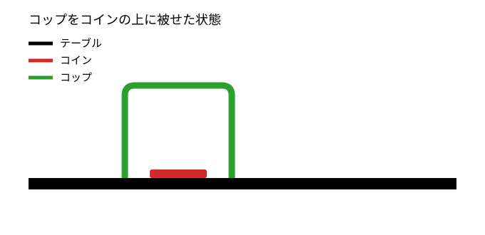

**図 1**　模式図。コップをコインの上に被せた状態。

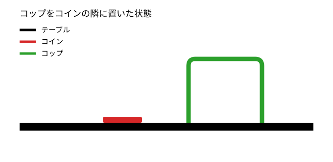

**図 2**　模式図。コップをコインの隣に置いた状態。

次に、同じものを、円周の上の波として描いた。テーブルを、半径 $R$ の円周で表す。円周の上の角を $\psi$ とする。コインもコップも、倍音を足して作った山である。
$$
f(\psi) = a\,R\sum_{m=1}^{N} w_m \cos m(\psi-\theta) \tag{16.1}
$$
$\theta$ は山の中心の角（中心位相）、$N$ は倍音の数、$a$ は倍音一本あたりの振幅を $R$ で割った数、$w_m$ は重みである。定数の項（$m=0$）は入れていない。

設定は、次の順に決まった。

1. 初めは、全ての倍音を同じ振幅にした。コインは 18 本、コップは 12 本である。
2. コインの山がコップからはみ出した。

   > 【木原】コインの振幅を半分にしましょう。はみ出すのは不自然です。

3. 山の脇に、小さな波（側波帯）が残った。

   > 【木原】側波帯が気になりますね。側波帯が減る、振幅の下げ方がありましたよね。ただ、幅が広がるので、倍音を上げる必要がなかったでしたっけ。

   【既知】高い倍音ほど振幅を下げる重み $w_m = 1 - m/(N+1)$（フェイエールの重み [X14]）を使うと、脇の波が小さくなる。そのかわり、山の幅が 2 倍に広がる。そこで倍音を 35 本と 23 本に増やした。

決まった設定と、その波形の値は、次のとおりである。【確かめた】

| | 倍音 | $a$ | 中心 | 山の幅（底から底） | 山の高さ | 山の外の沈み |
|---|---|---|---|---|---|---|
| コイン | 1〜35 | 1/72 | 90° | 20.000° | $0.2431\,R$ | $-0.0069\,R$ |
| コップ | 1〜23 | 1/36 | 図ごとに指定 | 30.000° | $0.3194\,R$ | $-0.0139\,R$ |

山の幅は $720°/(N+1)$、山の高さは $aRN/2$ である。山の外で波形が円周よりわずかに内側に沈むのは、定数の項を入れていないためである。

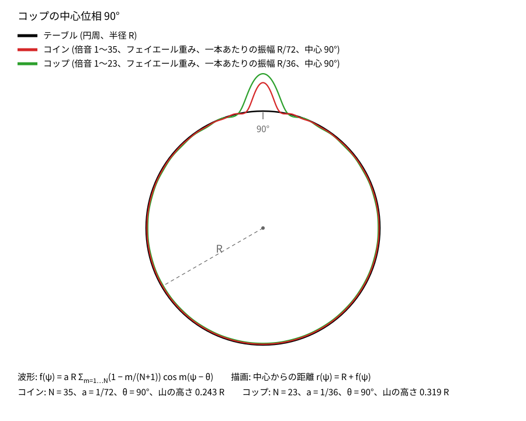

**図 3**　円周の上のコイン（赤、中心 90°）と、コップ（緑、中心 90°）。重なった状態。中心からの距離を $r(\psi)=R+f(\psi)$ として描いた。表示のための拡大はしていない。

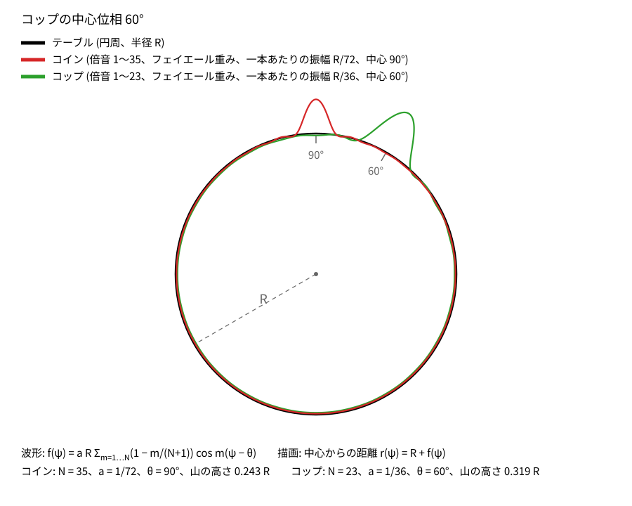

**図 4**　コップの中心を 60° にずらした状態。描き方は図 3 と同じ。

この二枚は、二つの波形を重ねて描いただけである。交差項は、まだ計算していない。

---

## 17. 交差項を描く

§9 のとおり、観測の条件は交差項が読めることである。そこで、交差項を計算して描いた。円周の上の各点での交差項は、二つの波形の積の 2 倍である。
$$
c(\psi) = 2\,f_{\rm coin}(\psi)\,f_{\rm cup}(\psi) \tag{17.1}
$$
円周全体で足した値を $C=\int_0^{2\pi}c\,d\psi$ とする。倍音どうしは直交するので、$C$ は、二つの中心位相の差 $\Delta$ だけの関数になる。
$$
C(\Delta) = 2\pi\sum_{m} A_m B_m \cos m\Delta \tag{17.2}
$$
$A_m$、$B_m$ は、コインとコップの $m$ 番目の倍音の振幅で、和は二つに共通する倍音について取る。$\cos$ は偶関数で、周期は一周である。§13 の「ずれに向きは無く、巻き数も読めない」は、この式の形である。【確かめた】（数値積分と (17.2) の差は $10^{-16}$ の桁。）

交差項は $R^2$ の次元を持つ。波形と同じ図に描くために、$R$ で一度だけ割って、$r(\psi)=R+c(\psi)/R$ として描いた。これは次元を合わせるための割り算であり、図ごとに高さを揃える操作はしていない。

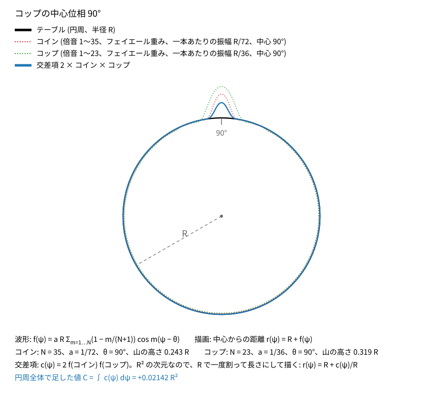

**図 5**　コップの中心が 90° のときの交差項（青）。コインとコップは細い点線。コップを 15° ずつ動かした 24 枚のうちの一枚。

| コップの中心 | $C$ |
|---|---|
| 90°（重なる） | $+0.02142\,R^2$ |
| 75°、105°（縁がかかる） | $+0.00076\,R^2$ |
| 60°、120° | $-0.00071\,R^2$ |
| 離れている | $-0.0011\,R^2$ 〜 $-0.0012\,R^2$ |

【確かめた】重なったとき、交差項の山は $0.155\,R^2$ で、コインの山の内側に収まる。離れているとき、$C$ はゼロにならず、小さな負の値 $-\pi a_{\rm coin}a_{\rm cup}R^2=-0.00121\,R^2$ に近づく。定数の項を入れていないことから来る。

この図では、コップがコインに重なると交差項が立ち、離れると立たない。この時点で、私はこれを「交差項が読めている」図として受け取った。この図に問題があることに気づいたのは、後である（§22）。

---

## 18. 振幅にも、分解能がある

> 【木原】今の話で気づきましたが、分解能があるのが位相だけだと考えるのは変ですよね。振幅にも分解能がある気がします。側波帯やリップルは、見えなくなりますよね。

**ここで起きた誤読。** 【Claude】は、振幅の分解能を何に対する比で測るかについて、山の高さに対する比と、全体に対する比の、二つの候補を立てた。

> 【木原】違うでしょう。R に対しての比率では。

分解能は、位相の側にも、振幅の側にもある。

- **位相の分解能**：窓の幅 ÷ 円周。
- **振幅の分解能**：読める最小の高さ ÷ $R$。

null でない、と言うには、振幅の分解能が先に要る。山が、読める最小の高さを超えて初めて、null でないと言える。§17 の、離れているときの小さな負の交差項は、振幅に分解能があれば読めない。読めないものは、ゼロではなく null である。

> 【木原】振幅の分解能は、計算できませんかね。倍音の場合は、おおよそ、$2\pi R/N$ に係数を掛けたものになりますよね。$A/N$ に、同じ係数を掛けては。$A$ は最大振幅です。少なくとも係数が無次元なら、分解能は長さの次元になりますが。

位相の分解能（山の幅）は、おおよそ $k\times2\pi R/N$ である。$k$ は重みで決まる無次元の係数で、等しい振幅で 1、フェイエールの重みで 2 である。同じ係数を使って、
$$
\text{振幅の分解能} = k\,\frac{A_{\max}}{N} \tag{18.1}
$$
と置く。$A_{\max}$ は山の高さである。

> 【木原】よく分かりません。仮説として置いておいては。なんとなく 0.03 にしました、よりはましかな。

(18.1) は、根拠を導いた式ではない。【仮説・未検証】

この式を §16 の波形に当てると、値は、倍音一本あたりの振幅 $aR$ にちょうど一致する。【確かめた】

| | $N$ | $k$ | 山の高さ | $k A_{\max}/N$ | 一本あたりの振幅 |
|---|---|---|---|---|---|
| コイン（フェイエール） | 35 | 2 | $0.2431\,R$ | $0.01389\,R$ | $R/72$ |
| コップ（フェイエール） | 23 | 2 | $0.3194\,R$ | $0.02778\,R$ | $R/36$ |
| コイン（等しい振幅） | 18 | 1 | $0.2500\,R$ | $0.01389\,R$ | $R/72$ |
| コップ（等しい振幅） | 12 | 1 | $0.3333\,R$ | $0.02778\,R$ | $R/36$ |

フェイエールの重みでは、山の外の波も、山の外の沈みも、この分解能の半分以下で、読めない。等しい振幅では、脇の波が分解能の数倍あり、読める。【確かめた】

倍音の数を決めると、位相の細かさと、振幅のきれいさを、同時に良くすることはできない。同じ数の倍音を、どちらに使うかの配分になる。位相の分解能と振幅の分解能は、独立ではない。【仮説・未検証】

（「振幅の分解能は $R$ に対する比である」という置き方は、§24 でもう一度問題になる。）

---

## 19. 偶数倍音と、奇数倍音

§15 の話を図にした。窓はコップ一つで、中心は 90° である。重みと、一本あたりの振幅は、三枚とも同じである。足す倍音を選んだだけである。

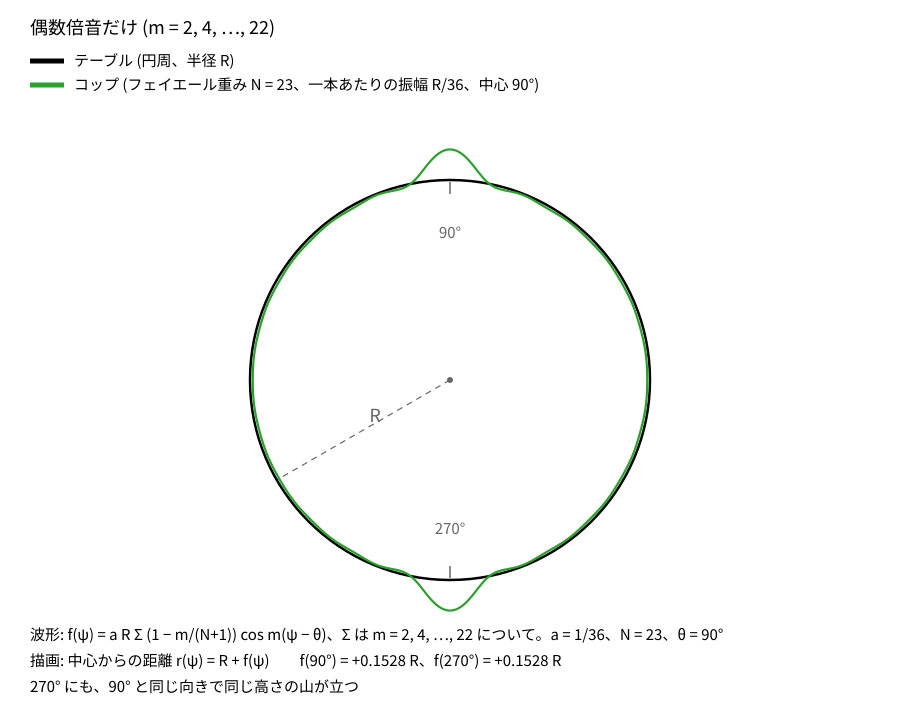

**図 6**　偶数倍音だけ（2、4、…、22 の 11 本）。180° 離れた 270° にも、同じ向きの山が立つ。

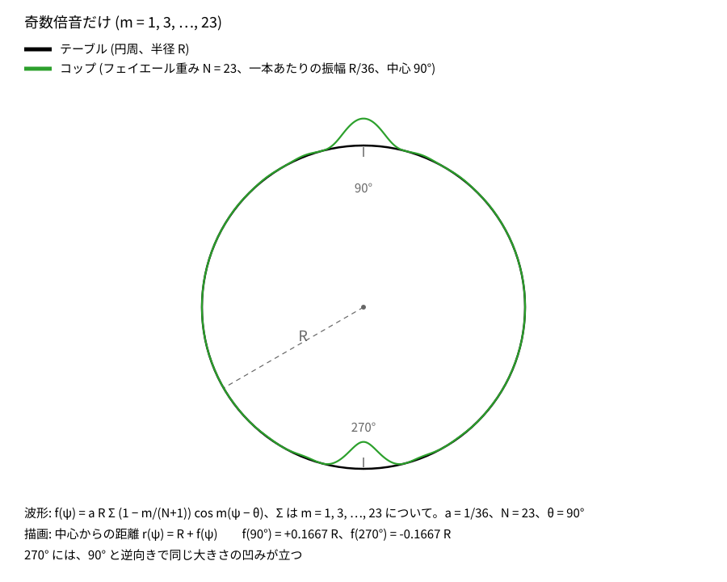

**図 7**　奇数倍音だけ（1、3、…、23 の 12 本）。270° に、逆向きの凹みが立つ。

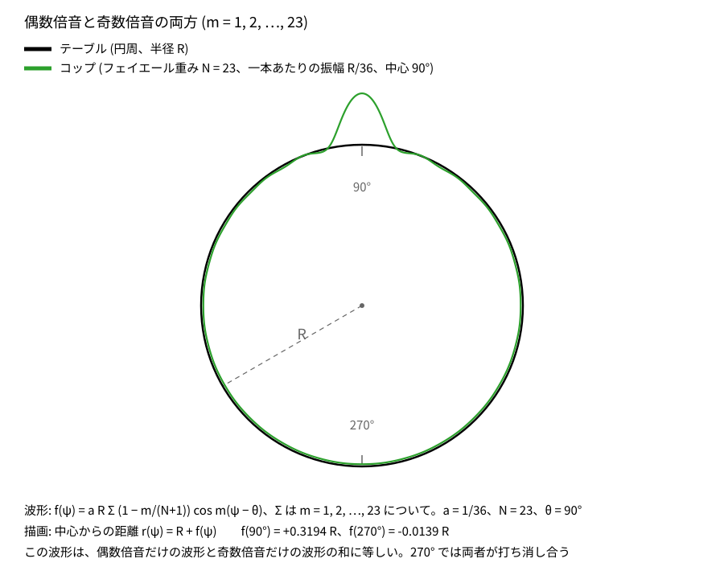

**図 8**　両方（1〜23 の 23 本）。270° で打ち消し合い、山は一つになる。

| | 足した倍音 | 90° での値 | 270° での値 |
|---|---|---|---|
| 偶数だけ | 11 本 | $+0.1528\,R$ | $+0.1528\,R$ |
| 奇数だけ | 12 本 | $+0.1667\,R$ | $-0.1667\,R$ |
| 両方 | 23 本 | $+0.3194\,R$ | $-0.0139\,R$ |

【確かめた】「両方」は、「偶数だけ」と「奇数だけ」の和に等しい（差は $10^{-16}$ の桁）。

---

## 20. 開いた系では、コップを動かせない

§10 で言葉にできなかったこと、すなわち、なぜ系は閉じていて端が無いのか、を図で説明しようとした。

> 【木原】私が、開いた系ではだめな理由を説明するなら、まず、今の 90 度の位置のコップの図の倍音を、全て省略しないで点線で示します。そして、270 度の位置で切り開いて、直線にした図を示します。この時点で分かりますが、実は、270 度の位置は、奇数倍音と偶数倍音があると、全てが節にはならないのでは。つまり、切り開くことができないはずですが。勘違いですかね。

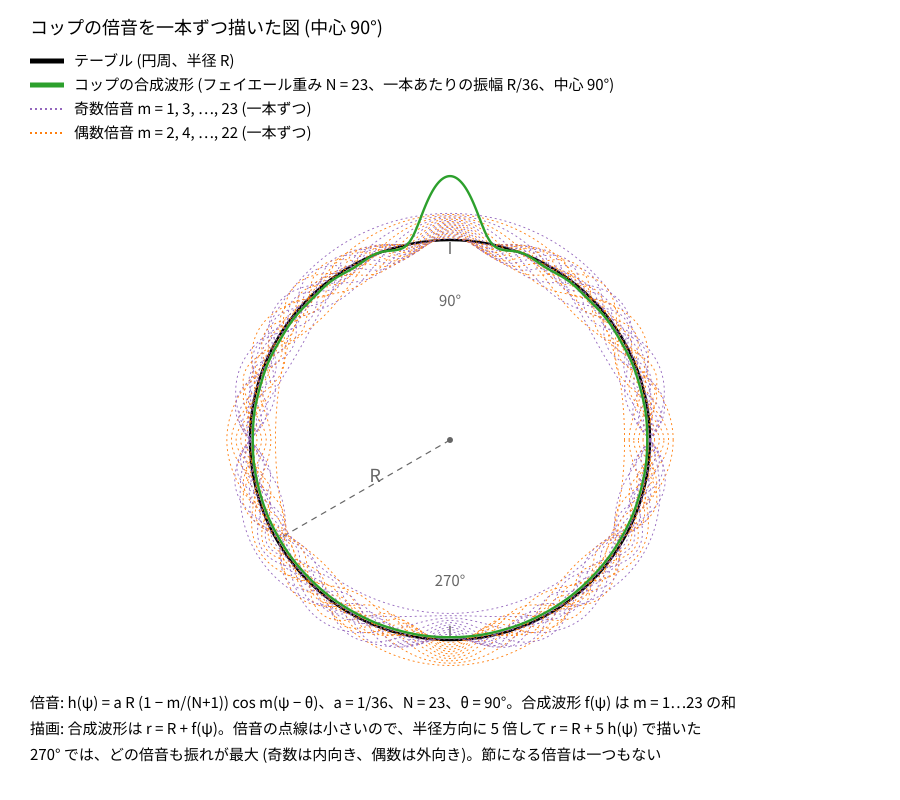

**図 9**　コップ（中心 90°）の倍音 23 本を、一本ずつ点線で描いた。倍音一本ずつは小さくて見えないので、この図の点線だけ、半径の向きに 5 倍して描いている。合成した波形（緑の実線）は拡大していない。

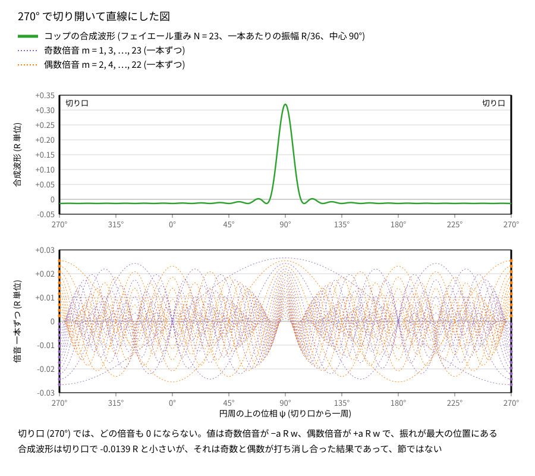

**図 10**　同じものを、270° で切り開いて直線にした図。

勘違いではなかった。コップの中心を 90° に置くと、270° では、23 本の倍音のすべてが、振れが最大の位置にある。奇数倍音は内向きに最大、偶数倍音は外向きに最大である。節になる倍音は、一本も無い。合成した波形が 270° で小さい（$-0.0139\,R$）のは、奇数と偶数が打ち消し合った結果であって、節ではない。全ての倍音が同時にゼロになる場所は、円周のどこにも無い。【確かめた】

**ここで起きた誤読（原稿を書いた後）。** 原稿を読んだ Gemini は、二次元球面の上では、相方がゼロになる点（経度を引いたときの北極と南極）が特別な点になる、と述べた。【Claude】はこれを受けて、「値がゼロになる場所には交差項が立たず、null が残る」と書いた。

> 【木原】自分がそれを否定する実験をしたのを、忘れましたか。わざわざ倍音を説明していますよね。確かに、180 度の位相関係のある反対側に、ピークが立ちます。でも、立たなくできますよ。偶数倍音だけ、奇数倍音だけ、両方足したら、と丁寧に説明しているのを、なぜ無視しますか。

正反対の点に山が立つかどうかは、足す倍音で決まる。両方を足せば、立たない（§19）。そして、値が小さい場所は、何も無い場所ではない。上で確かめたとおり、270° には全ての倍音が、振れが最大のまま在る。値がゼロであることと、null であることは違う（§2、§9）。値がゼロに見える場所を、特別な点や、null の残りと読むのは、誤読である。

したがって、両端を節とする開いた系には、どこで切り開いても、直せない。

**想定される反論。** 270° では、値はゼロにならないが、傾きは全ての倍音でゼロである。端が自由に振れる開いた系としてなら、条件は合ってしまう。これを退けるのは、コップを動かしたときである。コップの中心を 90° からずらすと、切り口での値も傾きもゼロでなくなり、固定端にも自由端にも合わなくなる。端のある系で条件が合うのは、窓がちょうど真ん中にあるときだけである。

> 【木原】$L=2\pi R$ の長さの直線に乗る定常波を考えてみたら、どうなりますか。両端が固定端だとすると、必ず節ですよね。16 次まで同じ振幅で、偶数、奇数の倍音をすべて合成してみたら、どんな波形になりますか。

両端を固定した長さ $L=2\pi R$ の直線の上の定常波は、$\sin(k\pi x/L)$ の一種類しかない。これを $k=1$ から 16 まで足す。
$$
g(x) = a\,R\sum_{k=1}^{16} w_k \sin\frac{k\pi x}{L},\qquad a=\frac{1}{36} \tag{20.1}
$$

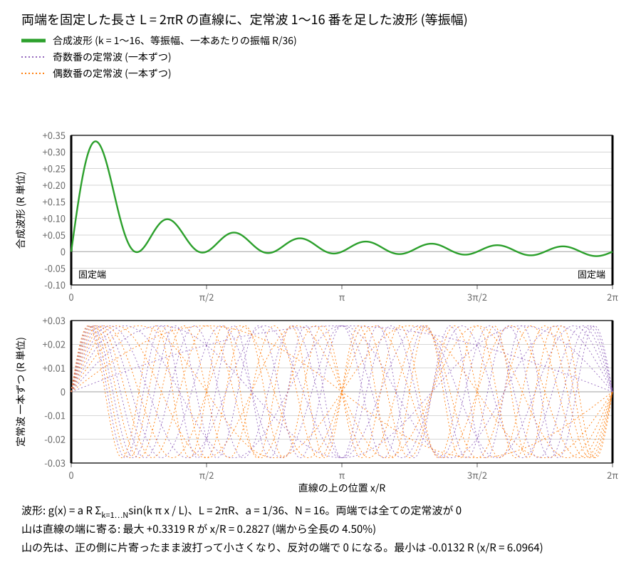

**図 11**　両端を固定した直線に、定常波 1〜16 番を同じ振幅で足した波形。

> 【木原】これは、側波帯が減るように振幅を制御できますか。

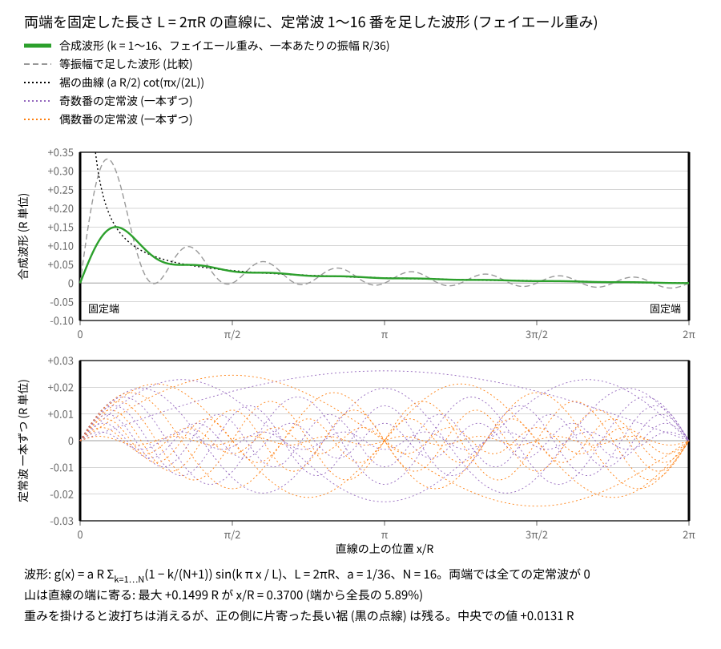

**図 12**　同じ和に、フェイエールの重みを掛けた波形。等しい振幅の波形と、裾の曲線 $(aR/2)\cot(\pi x/2L)$ を重ねてある。

| | 山の高さ | 山の位置（全長に対して） | 山の先の波打ち | 中央での値 |
|---|---|---|---|---|
| 等しい振幅 | $0.332\,R$ | 4.5% | ある | 0 |
| フェイエールの重み | $0.150\,R$ | 5.9% | 消える | $+0.013\,R$ |

【確かめた】山は、直線の端に寄る。左右対称にならない。重みを掛けると波打ちは消えるが、正の側に片寄った長い裾が残る。振幅の制御で直せるのは、波打ちだけである。「端に寄る」ことと、「裾が全体に伸びる」ことは、端があることそのものから来ている。

> 【木原】よくできました。分かりますか。ピークの位置を移動させる方法が、無いですが。

円周の上では、山をずらすことは、各倍音の位相を回すことである。振幅は一本も変わらない。両端を固定した直線の上では、回す位相が無い。別の場所 $x_0$ に山を作るには、$k$ 番の振幅を $\sin(k\pi x_0/L)$ に変えるしかない。これは移動ではなく、別の波の作り直しである。作り直した山は、場所ごとに、大きさまで変わる。

| 山の位置（全長に対して） | 振幅の二乗和 |
|---|---|
| 0（端） | 0 |
| 0.01 | 1.40 |
| 0.02 | 4.76 |
| 0.045 | 10.02 |
| 0.1 | 8.90 |
| 0.25 | 8.00 |
| 0.5（中央） | 8.00 |

【確かめた】円周なら、この値は場所によらず一定である。直線の上では、同じ大きさの窓を、別の場所に持つことさえできない。

> 【木原】これが、一番分かりやすい説明では。つまり、開いた系のテーブルでは、コップを移動させられません。

**端のある平らな系では、コップを、同じコップのまま動かすことができない。動かせなければ、伏せることも、開けることもできず、観測が成り立たない。**【仮説・未検証】（上の表と図は【確かめた】。それが観測の成り立たないことを意味する、という読みが仮説である。）

**ここで起きた誤読。** 【Claude】は、現実のテーブルでコップが動かせる理由を、「テーブルが、より大きな系の一部だからである」と書いた。

> 【木原】それは、だめですよ。無限に広がった平坦な面なら移動できる、と誤読されますよ。本当は、テーブルは曲がっているが、R が大きいので気づかないだけですよ。

現実のテーブルでコップが動かせるのは、テーブルが本当は曲がっていて、閉じているからである。$R$ が大きいので、平らに見えているだけである。

| 系 | 落ちる理由 |
|---|---|
| 端のある平らな系 | コップを、同じコップのまま動かせない |
| 無限に広い平らな系 | 定常波が在るための条件（全体が窓の整数倍）が立たない（§6、§10） |
| 閉じていて、端の無い系 | 落ちない。$R$ が大きいと、平らに見える |

現実のテーブルの縁は、系の端ではない。閉じた全体の上に載っている、別の物の輪郭である。

---

## 21. 横道。裾の形

> 【木原】ところで、この移動しない波の形は、まさに、電子軌道のポテンシャルカーブに見えますね。

図 12 の波形は、左端を自分の位置、右端を無限遠と読むと、ポテンシャルの曲線に見える。自分の位置でゼロ、すぐ近くに山があり、そこから遠くへ向かって単調に小さくなり、無限遠でゼロになる。

**ここで起きた誤読。** 【Claude】は、これを、裾が $1/x$ の形であることの指摘として受け取った。私が言ったのは、全体の形のことである。

計算として分かっているのは、次の二つだけである。裾は、端の近くで $1/x$ の形になる。この波形は、端の一点に立てた山の、四分の一波長ずれた相方に当たる。【確かめた】ポテンシャルであることを導いたものではない。

> 【木原】まあ、後で考えましょう。両端固定で倍音を作ると、こんなカーブになるのだ、というのが重要で、ハット型の減衰曲線が作れるのだ、というのが、どこかで使える気がします。

これは、形についての気づきとして、記録にとどめる。本稿の筋には使わない。【併記】

---

## 22. 交差項は、入れ替えても同じである。「隠れる」が書けない

図と計算がひととおり揃い、引用する文献の整理を始めたところで、私は問題に気づいた。

> 【木原】ところで、今気づきましたが、交差項はまずいですよね。コインのほうが大きくても、AND は同じ値を返しますよね。

交差項は、コインとコップの積である。コインとコップの大きさをそっくり入れ替えても、積は同じである。円周全体で足した値は、どちらも $0.021424\,R^2$ になる。【確かめた】

§5 で私は、「コインがコップに収まっていれば隠れ、はみ出していれば見えてしまう」ことから、空間の分解能を決めた。これは、どちらが覆う側かという、入れ替えのきかない関係である。ところが図 5 の交差項が言っているのは、「重なっている」ことだけである。「コップがコインを覆っている」ことは、言っていない。

> 【木原】つまり、コップで隠れるという写像のためには、演算順に依存する、隠すほうと隠されるほうの関係のある交差項が必要では。違うか。隠れないという演算なのかな。いずれにしても、演算順で結果が変わらないと、隠れるという表現ができないのでは。

【既知】円周の上では、ずらす操作どうしは、順序を入れ替えても同じである。特別な原点を持たない操作は、すべて倍音ごとの掛け算になり、互いに順序を入れ替えられる。したがって、仮定 3 を守るかぎり、円周の上でコップとコインから組み立てられる演算は、どれも順序によらない。

> 【木原】思ったより深そうですね。私の想定していた思考実験（円周）では、隠れるという演算ができないのかも。だとすると、三次元球面が必要になりそうですね。

【既知】$S^3$ の上では、ずらす操作を二つ続けると、順序で結果が変わる。

この日は、ここで行き詰まった。出た考えを、そのまま並べる。どれも、この時点では確かめていない。

- **考え A：$S^3$ が要る。** 円周では「隠れる」が書けない。$S^3$ なら、順序で結果が変わる。
- **考え B：隠れる必要は無い。**

  > 【木原】隠れる必要はないのかも。別々にあることが区別できれば、隠れていないですよね。

- **考え C：観測者と距離が要る。**

  > 【木原】でも、難しいですよね。交差項が無いと、相手があるとは読めません。つまり、null と区別ができないです。だとすると、二体ではなく三体の演算にして、観測者から、二体が同時にあると判断できれば、コップは開いている。一体として重なって読める場合は……違うな。これだと、コインのほうが大きくても、交差するな。

  > 【木原】三次元球面なら、交差している以外に、距離が読めるのかな。でも違うな。どちらが手前で、どちらが大きいかは、やはり観測者が別にいないと、近いと区別する基準が無いな。観測者がいて、距離も読めないと、だめなのかな。

【Claude】は、考え C を、観測者から見てコップがコインの手前にあること、見かけの大きさ（視野角）で比べること、として整理した。そうすると、§13 の「ずれに観測者は要らない」を見直すことになる。

三つの考えは、どれも、何かを足す方向である。空間を $S^3$ に上げる。観測者を足す。距離を足す。翌日、どれも要らなかったことが分かった。

---

## 23. コップを、井戸型にする

翌 11月25日、私は別の方向に気づいた。

> 【木原】考え直しました。コップのモデルを複雑にしないで考える方法に気づきました。コップの波形を逆にできませんか。コップの位置だけ凸にしないで、逆に凹にできれば、干渉だけで隠れる表現ができませんか。

**ここで起きた誤読。** これは、この思考実験の中で、いちばん大きな誤読である。【Claude】は、「干渉」を、コインとコップの振幅の足し算と読んだ。そして、交差項を計算しないまま、足した波形を主役にした図を三組作った。三組とも、使えなかった。§9 で直された誤読（干渉を、振幅を足して重ねることと読む）の、繰り返しである。

この研究で、干渉、交差項、AND と言えば、掛け算 $2ab$ のことである。足し算 $a+b$ のことではない。

もう一つ、【Claude】は、「凹にする」を、前日の山の符号を逆にすることだけで済ませようとした。

> 【木原】任意の波形が、フーリエ合成できるのを忘れていませんか。当たり前ですが、ワンパルスだけの矩形波も作れますよね。その反転波形を、フーリエ合成できないのですか。言ってみれば、井戸型の波形を、フーリエ変換すればよいのですが。

> 【木原】つまり、両方に振幅が存在するところ（AND）に、波形ができるのですよね。

交差項は、両方に振幅がある場所にだけ立つ。それなら、コップを、「覆う場所で振幅がゼロ、ほかの場所で振幅がある」波形として書けばよい。井戸型である。

井戸型のコップを考えたところで、私は、問いそのものを考え直した。コインとコップが「あるか、無いか」を判断するのではない。コインが「見えるか、見えないか」を判断する方法として、考え直した。

このとき、諦めた観測がある。「見えない」と「無い」を区別することである。null は情報が無い状態であり、null を直接読む方法は定義できない（§2、§3）。そこで、無い（null）も、見えないも、同じ一つの読みで扱うことにした。交差項がゼロであること、正確には、交差項の振幅が振幅の分解能以下であること（§18）である。

- **見える**：交差項の振幅が、振幅の分解能より大きい。
- **見えない**：交差項の振幅が、振幅の分解能以下である。無い（null）も、ここに入る。

コップがコインに被さると、交差項の振幅はほぼゼロになる。分かるのは、コインが見えなくなった、ということだけである。コップの中にコインがあるかどうかは、分からない。

前の節の書き方を、ここで受け直しておく。

- §2 と §9 で、null とゼロを分けた。この二つが違うものであることは、変わらない。変えたのは、読み方である。null は読めないので、見えない（ゼロ）と同じ読みに入れる。§9 の「交差項がそもそも立たない」と「立ったうえで値がゼロである」は、読みの上では区別しない。
- §18 で、「読めないものは、ゼロではなく null である」と書いた。言い直す。読めないものが、無い（null）のか、在るのに見えないのかは、区別できない。どちらも「見えない」と読む。

コインは §16 のままである。コップを、幅 $W=30°$、深さ $h$ の井戸にする。
$$
g(\psi) = h\Bigl(1-\frac{W}{2\pi}\Bigr) - \sum_{m=1}^{N} w_m\,\frac{2h}{m\pi}\,\sin\frac{mW}{2}\,\cos m(\psi-\theta) \tag{23.1}
$$
第一項は定数の項（$m=0$）である。§16 の山と違い、井戸型には定数の項が要る。交差項は、(17.1) と同じく、積で計算する。
$$
c(\psi) = 2\,f_{\rm coin}(\psi)\,g(\psi) \tag{23.2}
$$

井戸の深さは $h=23/72=0.3194$（前日のコップの山の高さ）、倍音の上限は $N=71$ とした。フェイエールの重みでは、井戸の壁の幅が $720°/72=10°$ になり、平らな底が $30°-10°=20°$ で、コインの幅と同じになる。この二つの値は、図を描くための選択であり、理論の量ではない。

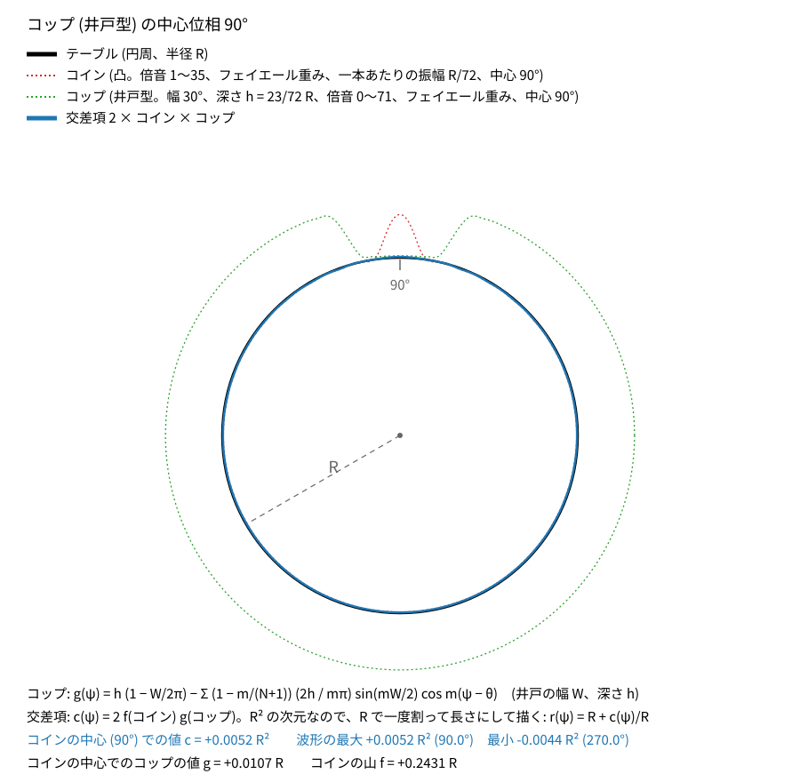

**図 13**　コップ（緑、井戸型）の中心が 90°。コイン（赤）に重なっている。交差項（青）に、山が立たない。隠れている。

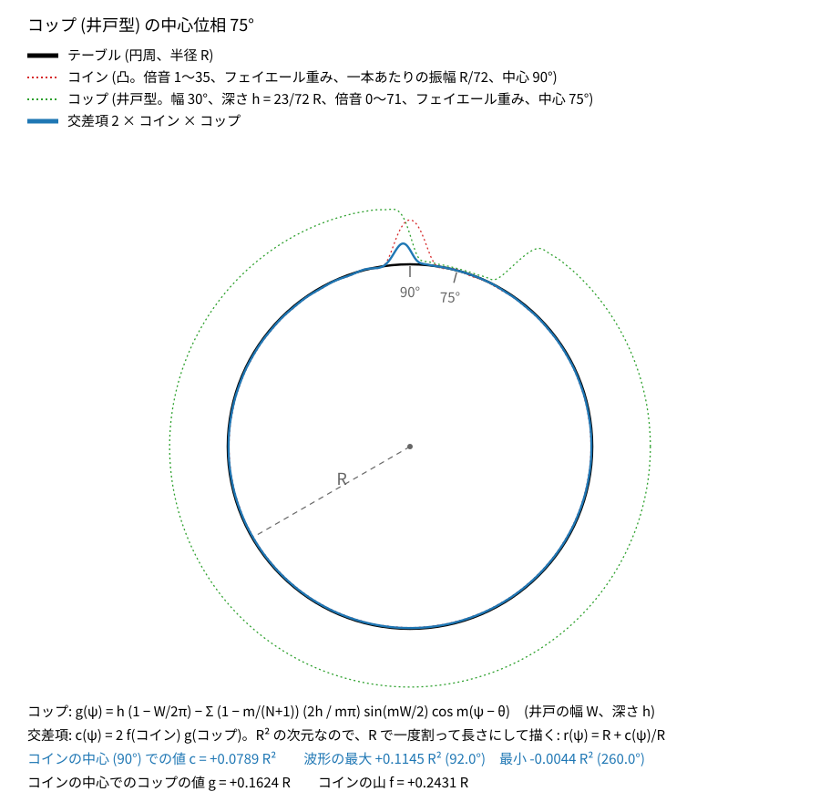

**図 14**　コップの中心が 75°。コップの縁が、コインにかかっている。かかっていない側にだけ、交差項の山が立つ。一部だけ、見えている。

**図 15**　コップの中心が 60°。コインから外れている。交差項に、コインの山がそのまま立つ。見えている。

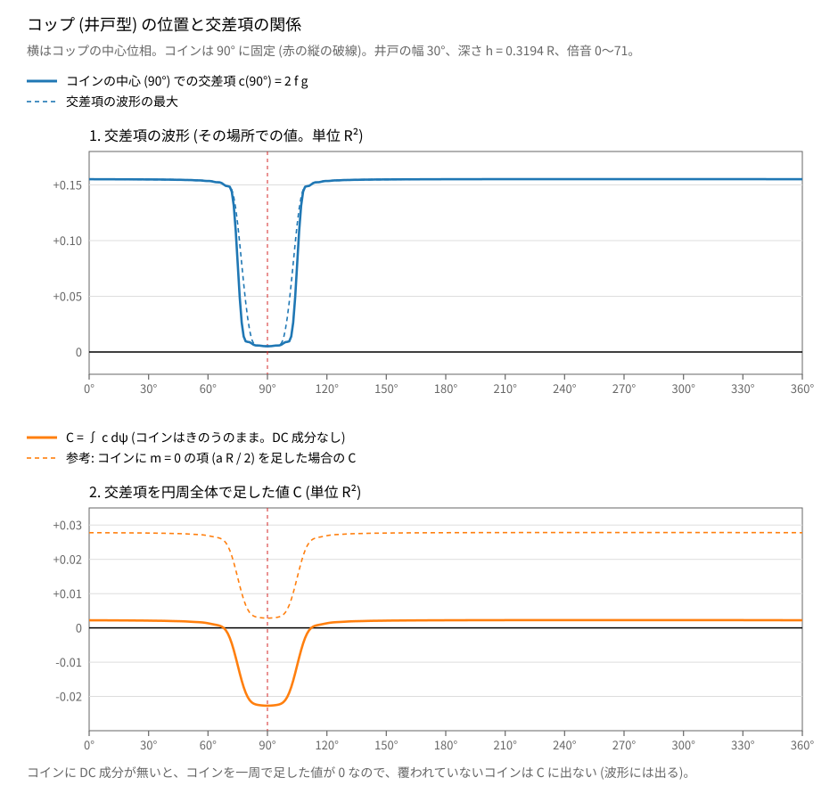

**図 16**　コップの位置と、コインの中心（90°）での交差項の関係。

| コップの位置 | コインの中心でのコップの振幅 | コインの中心での交差項 | 交差項の波形の最大（位置） |
|---|---|---|---|
| 90°（重ねる） | 0.0107 | 0.0052 | 0.0052（90.0°） |
| 75°（縁がかかる） | 0.162 | 0.0789 | 0.1145（91.95°） |
| 60°（ずらす） | 0.3158 | 0.1535 | 0.1535（90.0°） |
| 270°（反対側） | 0.3194 | 0.1552 | 0.1552（90.0°） |

【確かめた】（単位は、振幅が $R$、交差項が $R^2$。）覆わないときの目安は $2\times0.2431\times0.3194=0.1553$ で、重ねたときの交差項は、その約 3% である。厳密なゼロでないのは、倍音を 71 で打ち切ったために、井戸の底が 0.0107 だけ浮いているからである。倍音を増やすと小さくなる（143 で 0.0026、359 で 0.0010）。コインの中心での交差項が半分になるのは、コップが 75.04° と 104.96° のときで、コインの中心が井戸の縁に来たときである。

これを、上の「見える」「見えない」の定義に当てる。交差項は $R^2$ の次元を持つので、図と同じく $R$ で一度割って、§18 の振幅の分解能（コインで $0.0139\,R$、コップで $0.0278\,R$）と比べる。

| 場合 | 交差項の振幅 | 分解能との比較 | 読み |
|---|---|---|---|
| コップを重ねる（90°）。コインの中心 | 0.0052 | 下 | 見えない |
| 縁がかかる（75°）。波形の最大 | 0.1145 | 上 | 見える（一部） |
| ずらす（60°）。コインの中心 | 0.1535 | 上 | 見える |
| コインの山の外（コップの位置によらない） | −0.0044 | 下 | 見えない |

【確かめた】二つの分解能のどちらを使っても、この読みは変わらない。振幅の分解能の基準そのものは決めていない（§24）が、この判定は、その決め方によらない。

コップを重ねたときの、コインの中心での値（0.0052）と、コインが無い場所での値（−0.0044）は、同じ大きさである。どちらも分解能の下にある。コップの下にコインが隠れているのか、そこにコインが無いのかは、交差項からは区別できない。これが、「見えない」と「無い」の区別を諦めた、ということの中身である。

もう一つ、断っておくことがある。本稿は、倍音を足して、円周の上にコインが一つだけ在る状態と、コップが一つだけ在る状態を作った（§15、§19）。しかし、コインが一つであること、コップが一つであることを知る方法は、コインにも、コップにも、それを外から見ている観測者にも、無い。私たちがそれを知っているのは、倍音の構成という知識を持って、いわば神の目線で見ているからである。

> 【木原】これで、90 度で隠れて、60 度で見えていますよね。つまり、複雑な表現をしなくても、コップが表現できていますよ。

> 【木原】これで十分、見えていますよね。一部かかると、一部だけ見えていますよ。

> 【木原】井戸型の波形をコップに、山形の波形をコインに使えば、コインの思考実験が、そのまま、背景を置かない、波形の関係だけから作れますね。

これが、§22 の問題への答えである。

- 前日の問題は、コップもコインと同じ凸の山にしていたために起きた。どちらも山なら、隠す側と隠される側の違いが、波形に入っていない。コップを井戸型にした時点で、役割の違いが、波形の形に入る。
- 演算は、積のままでよい。順序で変わる演算は要らない。$S^3$ も、観測者も、距離も、足す必要が無い。§13 の「ずれに観測者は要らない」は、そのまま成り立つ。
- テーブルという背景を、別に置く必要も無い。井戸型の波形は、井戸の外では、円周全体に一定の振幅を持つ。「コインが見える場所」の役を、コップの波形そのものがしている。
- §5 の「コインが大きければ、開ける前から見えてしまう」は、「コインがコップからはみ出していたら、見えてしまう」と言い直せば足りる。はみ出した所には、交差項が立つ。それは図 14 が示している。

**コップを井戸型の波形、コインを山形の波形とすれば、コップを伏せて開けるという思考実験は、円周の上の二つの波形と、その積だけで書ける。**【確かめた】（波形と交差項の値について。これが「隠れる」「見える」を表している、という読みは、本稿の解釈である。）

---

## 24. 円周の半径 R を、手で置いてよいか

> 【木原】さて、この実験が不自然なのは、R を手で置いていますよね。

図はすべて、半径 $R$ の円を先に描き、その上に波を載せている。$R$ は、波から出たものではなく、手で置いたものである。

> 【木原】これは、波だけから R を決める方向を、過去に検討していますよ。

著者は、閉じた弦の上のパルスについて、$R$ を倍音の大きさから読む検討をしている（公開前の検討。付録 B）。その定義は、一つの波について
$$
R^2 = \sum_{m\ge1} A_m^2 \tag{24.1}
$$
（定数の項は含めない）、二つの波の和について
$$
R^2(\Delta) = R_1^2 + R_2^2 + 2\sum_m A_m B_m\cos m\Delta \tag{24.2}
$$
である。第三項は、(17.2) の交差項を $\pi$ で割ったものに等しい。これを、コインと井戸型のコップに当てた。【確かめた】

| 量 | 値 |
|---|---|
| コインの $R_1$ | 0.0471 |
| コップの $R_2$ | 0.1148 |
| $\sqrt{R_1^2+R_2^2}$ | 0.1241 |
| 和の $R$（コップ 90°、重ねる） | 0.0904 |
| 和の $R$（コップ 75°） | 0.1092 |
| 和の $R$（コップ 60°、ずらす） | 0.1258 |

（単位は、図に手で置いた $R$ を 1 とした長さ。）

> 【木原】これで計算した R にすると、かなり小さな半径になって、見にくくなります。そのままやってみてください。

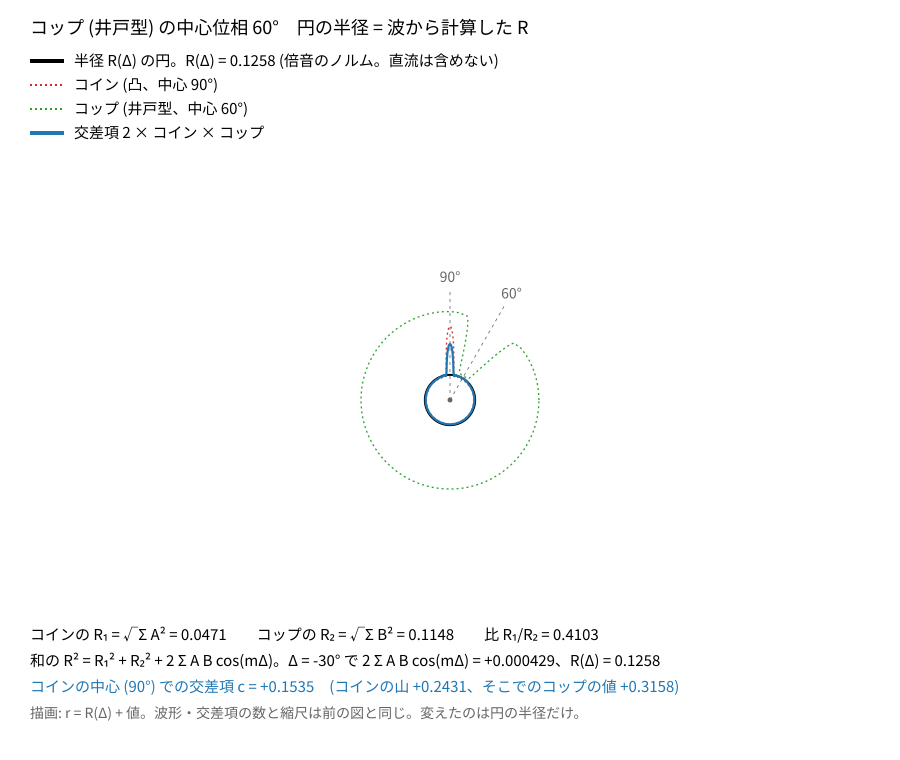

**図 17**　図 15 と同じもの（コップの中心 60°）を、円の半径を (24.2) の $R$ にして描いた。波形と交差項の数、縮尺は、図 15 と同じである。変えたのは、円の半径だけである。

円は、手で置いたものの約 8 分の 1 になる。

> 【木原】こうなるのは、分かっています。ただ、本質ではないのです。意味が分かりますか。我々は、円周の上の主観空間に住んでいる住民です。円周が大円で、直線だと観測しています。なので、もともと、曲率半径は、円周では読めません。

**ここで起きた誤読。** 【Claude】は、「コインの山は $R$ の 5.16 倍である」と、振幅と $R$ の長さを比べた。そして、$R$ を振幅と同じ種類の量として書いた。

> 【木原】R と振幅は別の方向で、ある意味、直交していますよ。

> 【木原】簡単です。ですから、R をスケールしても、円周である以上、円周の上の住民は区別できないのですよ。

> 【木原】なので、この図も、そのまま、論文に書くときに使えますよ。

【既知】一次元の曲線は、その上で測った長さだけからは、曲がっているかどうかが分からない。円周を一か所で切って伸ばせば、長さを変えずに、直線になる。著者はこれを、正の定曲率の空間の上の単位の格子の歪みとして計算し、一次元では任意の $R$ で歪みがゼロであること、曲率が最初に現れるのは、二つの方向が張る面積であることを確かめている [S3][S4]。

コインとコップの実験は、円周の上の位相と、それに直交する振幅だけで閉じている。二つの方向が張る面積は、どこにも無い。したがって、$R$ をどう取っても、円周の上の住民には区別ができない。$R$ を手で置いた図 3〜図 16 は、そのまま使える。

ここから、前の節の書き方のうち、見直しが要るものが出る。

- 図はすべて、$r=R+f$ として、振幅を半径の向きに足して描いている。振幅は、半径とは別の向きにある。これは、描き方の都合である。「コインの山は $R$ の何倍」のような、振幅と $R$ の長さの比較には、意味が無い。
- §18 で、振幅の分解能を「読める最小の高さ ÷ $R$」と置いた。振幅と $R$ が別の向きにあるなら、何を基準にするかから、立て直す必要がある。これは決めていない。【併記】
- §20 の「テーブルは曲がっているが、$R$ が大きいので気づかない」は、円周の上の住民は、$R$ が大きくても小さくても気づく手段を持たない、という同じ事実の、別の言い方である。

---

## 25. まとめ

### 25.1 思考実験で分かったこと

§1 の問いと、途中で出た問いに、思考実験が出した答えを並べる。

| 問い | 答え | 資格 |
|---|---|---|
| null でないことは、どうしたら区別できるのか | 証明はできない。分解能を決めて、区別がついたかどうかを言うしかない（§3）。null は直接には読めないので、「あるか、無いか」を「見えるか、見えないか」に置き換え、交差項の振幅が振幅の分解能以下かどうかで読む。「見えない」と「無い」の区別は諦める（§23） | 【仮説・未検証】 |
| コップを開けるという行為は、波として解釈できるか | できる。伏せてから開けるまで、あるいはコップの直径を、半波長（窓）と読む（§4、§5） | 【仮説・未検証】 |
| コップとコインの関係は、二つの波の関係として書けるか | 書ける。山形の波形と井戸型の波形の、積である（§23） | 波形と値を【確かめた】 |
| 観測が成り立つ条件は何か | 可干渉であることではない。交差項（積、情報の AND）が読めることである（§9） | 【仮説・未検証】 |
| 分解能とは何か | 絶対値ではなく、全体に対する比である。位相にも、振幅にもある（§6、§18） | 【仮説・未検証】 |
| 系とは何か | 作用に関係する関係が、すべて包含されたものである。分解能は上にも下にも動かせるが、情報が増えなくなる所がある（§12） | 【仮説・未検証】 |
| なぜ、系は閉じていて端が無いのか | 背景に時間が無く、在るのは定常波だけである。端のある系では、コップを同じコップのまま動かせないからである（§6、§20） | 図と値を【確かめた】 |
| 系の形は、どこまで絞られるか | 円周 $S^1$ か、三次元球面 $S^3$ である（§11） | 部品は【既知】、つなぎは【仮説・未検証】 |
| なぜ、窓を半波長と呼ぶのか | 奇数倍音と偶数倍音の両方があって、初めて山が一つになるからである（§15、§19） | 図と値を【確かめた】 |
| 「隠れる」は、積だけで書けるか | 書ける。コップを井戸型にすればよい。順序で変わる演算も、$S^3$ も、観測者も、要らない（§22、§23） | 波形と値を【確かめた】 |
| 円周の半径 $R$ を手で置いてよいか | よい。円周の上の住民は、$R$ を区別できない（§24） | 【既知】 |

表の【確かめた】は、答えを支える波形と数値について、である。それが問いへの答えになっている、という読みは、本稿の解釈である。

置いた仮定は三つである（§14）。作用が一意に定義でき、一意に読めること。窓が定常であること。系に特別な方向も原点も無いこと。有界、有限、閉じている、端が無い、凹みが無い、頂点が無い、は、この三つから出る。

### 25.2 確かめたこと

付属のプログラム（付録 A）で確かめたのは、次のことである。

- コインとコップの波形の、山の幅、高さ、山の外の沈み（§16）。
- 交差項を円周全体で足した値が、数値積分と倍音の和 (17.2) で一致すること。中心位相の差だけの偶関数であること（§17）。
- 式 (18.1) の値が、倍音一本あたりの振幅に一致すること（§18）。
- 偶数倍音だけ、奇数倍音だけ、両方の波形の、90° と 270° での値（§19）。
- 270° で、全ての倍音が、振れが最大の位置にあること。全ての倍音が同時にゼロになる場所が無いこと（§20）。
- 両端を固定した直線の上の波形の、山の位置、裾、場所ごとの振幅の二乗和（§20）。
- 井戸型のコップとコインの交差項の、コップの位置ごとの値。コインの山の外での値。振幅の分解能との大小（§23）。
- 波から計算した $R$ の値（§24）。

### 25.3 仮説であり、未検証の課題であるもの

1. 行為を、干渉可能な波として読むこと（§4）。
2. 観測が成り立つ条件は、交差項が読めることであり、可干渉であることは十分条件にすぎないこと（§9）。
3. 三つの仮定から、有界、有限、閉じていて端が無い、凹みも頂点も無い、が出ること（§6、§7、§10、§14）。
4. 窓が定常であることから、系が $S^1$ か $S^3$ に絞られること（§11）。とくに、「窓が定常である」ことが、どこでもゼロにならない相方を全ての方向について要求すること、および、三つの関係が括弧によらずに閉じることを要求すること。この二つのつなぎは、コップの言葉だけでは、まだ導けていない。
5. 分解能の上限と下限は、分解能の側ではなく、AND を取る相手の側にあること（§12）。
6. 振幅の分解能の式 (18.1)。位相の分解能と振幅の分解能が独立でないこと（§18）。
7. 端のある平らな系ではコップを動かせないことが、観測が成り立たないことを意味すること（§20）。
8. 二次元以上で、窓を隙間なく並べることの意味。本稿の、窓を並べてずらす議論は、線と輪の場合のものである。

### 25.4 著者も現時点では決めておらず、併記したもの

1. 振幅の分解能の基準。振幅と $R$ が別の向きにあるなら、何に対する比とするのか（§18、§24）。§23 の「見える」「見えない」の判定は、§18 の二つの値のどちらを使っても変わらない。
2. 両端を固定した直線の上の波形が、ポテンシャルの曲線に見えること（§21）。

### 25.5 結論

堀田先生の記事のコップとコインは、円周の上の二つの波形で書ける。コインは山形の波形、コップは井戸型の波形である。二つの積（交差項）は、コップをコインに重ねると立たず、縁がかかると一部だけ立ち、ずらすと立つ。立たないとは、交差項の振幅が、振幅の分解能以下であることである。コップを重ねたときに分かるのは、コインが見えなくなったことだけである。コップの中にコインがあるかどうかは、分からない。「見えない」と「無い」を区別することは、諦めた。背景も、観測者も、演算の順序も、足していない。

コップを伏せて開けるという行為が成り立つための条件を逆にたどると、その行為を載せている系は、有限で、閉じていて、端が無く、凹みも頂点も無い。窓が定常であることを要請すると、$S^1$ か $S^3$ である。これが、本稿が出した要求仕様である。仮説であり、検証が必要である。

次の課題は、§25.3 の 4 である。$S^1$ か $S^3$ への絞り込みを、コップの言葉だけで導くこと。そして、本稿で円周の上に描いたコインとコップを、$S^3$ の上に描くことである。

---

## 主張しないこと

- 堀田先生の記事の結論に、異を唱えるものではない。本稿は、記事の設定を借りて、別の問いを考えたものである。
- 量子力学を導いた、とは主張しない。本稿に、量子力学の形式は出てこない。
- 時空が $S^1$ か $S^3$ であることを、コップの思考実験だけから導いた、とは主張しない。既知の定理をつなぐ所が、仮説である。
- 部品（フーリエ級数、フェイエールの重み、二次元球面の上のベクトル場の定理、平行化可能な球面の分類、強度干渉）が新しい、とは主張しない。どれも既知である。
- 観測者の持つ道具の分解能については、何も主張しない。本稿の範囲の外である。
- 系の具体的な幾何や計量を与えた、とは主張しない。本稿が述べるのは、要求仕様までである。

---

## 謝辞

本稿のきっかけは、堀田昌寛先生の note の記事 [X1] である。コップとコインという、誰にでも思い描ける設定で、量子力学の形式の成り立ちをご説明いただいたことに、深く感謝する。本稿の内容は、その設定を借りて著者が独自に試みたものであり、誤りの責任はすべて著者にある。

---

## 参考文献

### 自己引用（Concept DOI、10.5281/zenodo.〔番号〕）

[S1] 木原範昭「閉じた球面上の形不変定常波——次元ごとの安定性と3+1時空の幾何学的必然性」2026-04-24. Concept DOI 10.5281/zenodo.19731593.  
[S2] 木原範昭「観測者の分解能はゲージである ― 次数を逆に読む思考実験と、既知の対称性から組み上がる理論の予言 ―」2026-11-10. Concept DOI 10.5281/zenodo.24097611.  
[S3] 木原範昭「論文0:正曲率定曲率空間における測地的単位セルの歪み — 一辺・角・面積・体積の厳密評価」2026-07-11. Concept DOI 10.5281/zenodo.20680269.  
[S4] 木原範昭「平方量読出しによる線形単体化と曲率補正候補の次元別整理」2026-06-21. Concept DOI 10.5281/zenodo.20785539.

### 外部文献

[X1] 堀田昌寛「量子力学の線形代数は確率の単なる表記」note、2025年3月1日. https://note.com/quantumuniverse/n/n897cf1fca3e9  
[X2] C. Rovelli, "Relational quantum mechanics," Int. J. Theor. Phys. 35, 1637–1678 (1996). DOI 10.1007/BF02302261  
[X3] L. Hardy, "Quantum Theory From Five Reasonable Axioms," arXiv:quant-ph/0101012 (2001).  
[X4] G. Chiribella, G. M. D'Ariano, P. Perinotti, "Informational derivation of quantum theory," Phys. Rev. A 84, 012311 (2011). DOI 10.1103/PhysRevA.84.012311  
[X5] E. Adlam, "How Do We Observe Relational Observables?," J. Gen. Philos. Sci. 57, 285–309 (2026). DOI 10.1007/s10838-024-09703-7  
[X6] P. Dall'Olio, J. A. Zapata, "Towards Relational Foundations for Spacetime Quantum Physics," Universe 11(8), 250 (2025). DOI 10.3390/universe11080250  
[X7] R. Hanbury Brown, R. Q. Twiss, "Correlation between Photons in two Coherent Beams of Light," Nature 177, 27–29 (1956). DOI 10.1038/177027a0  
[X8] R. Hanbury Brown, R. Q. Twiss, "A Test of a New Type of Stellar Interferometer on Sirius," Nature 178, 1046–1048 (1956). DOI 10.1038/1781046a0  
[X9] H. Poincaré, "Sur les courbes définies par les équations différentielles (troisième partie)," J. Math. Pures Appl. (4) 1, 167–244 (1885).  
[X10] L. E. J. Brouwer, "Über Abbildung von Mannigfaltigkeiten," Math. Ann. 71, 97–115 (1912). DOI 10.1007/BF01456931  
[X11] R. Bott, J. Milnor, "On the parallelizability of the spheres," Bull. Amer. Math. Soc. 64, 87–89 (1958). DOI 10.1090/S0002-9904-1958-10166-4  
[X12] M. A. Kervaire, "Non-parallelizability of the n-sphere for n > 7," Proc. Natl. Acad. Sci. USA 44, 280–283 (1958). DOI 10.1073/pnas.44.3.280  
[X13] A. Hurwitz, "Ueber die Composition der quadratischen Formen von beliebig vielen Variablen," Nachr. Ges. Wiss. Göttingen, Math.-Phys. Kl. 1898, 309–316.  
[X14] L. Fejér, "Untersuchungen über Fouriersche Reihen," Math. Ann. 58, 51–69 (1904). DOI 10.1007/BF01447779

---

## 付録 A：図と検算のプログラム

プログラムは三本である（Python 3。外部のライブラリは使わない）。図はすべて、式から直接計算して SVG で出力する。乱数は使わない。数値は `results/` に保存した。

| プログラム | 図 | 数値 |
|---|---|---|
| `fig_cup_coin_table.py` | 図 1〜図 12 | `results/fig_cup_coin_table.txt`、`fig_cup_coin_cross_term.txt`、`fig_cup_parity.txt`、`fig_cup_open_system.txt`、`fig_line_fixed_ends_equal.txt`、`fig_line_fixed_ends_fejer.txt` |
| `fig_cup_well_cross.py` | 図 13〜図 16 | `results/fig_cup_well_cross.txt` |
| `fig_cup_well_cross_derived_R.py` | 図 17 | `results/fig_cup_well_cross_derived_R.txt` |

図の描き方は、次のとおりである。

- 波形は、中心からの距離を $r(\psi)=R+f(\psi)$ として描いた。表示のための拡大はしていない。例外は図 9 の倍音の点線だけで、半径の向きに 5 倍してある。
- 交差項は $R^2$ の次元を持つので、$R$ で一度だけ割って、$r(\psi)=R+c(\psi)/R$ として描いた。図ごとに高さを揃える操作はしていない。
- 図 17 は、円の半径だけを (24.2) の値にした。波形と交差項の数、縮尺は、図 15 と同じである。

これらのプログラムは、本文の波形と数値を計算するだけである。状態を時間発展させる数値実験ではない。

## 付録 B：思考実験の記録

記録は、公開リポジトリ https://github.com/WurabeSeiji/ai-chat-logs-open の `次元の生成構造/堀田先生のnoteとコインとコップの思考実験_20261124/` にある。

- `対話記録_ChatGPT_堀田先生のnoteとコインとコップの思考実験_20261124.md`：ChatGPT との問答（01〜23 番）。発言を、順番どおりに、そのまま収めた。
- `分析記録_コインとコップの思考実験_窓と交差項と閉じた系_20261124.md`：Claude との問答で進めた分析、計算、誤読の記録。

本文の節と、記録の対応は、次のとおりである。

| 本文の節 | ChatGPT との対話記録 | 本文の節 | 分析記録 |
|---|---|---|---|
| §1 | 01〜06、11、12 | §9 | 2.2 節、3.1 節 |
| §2 | 07 | §10 | 1 章、2.3 節 |
| §3 | 08、09 | §11 | 3.7 節 |
| §4 | 10〜12 | §12 | 3.2 節、3.3 節 |
| §5 | 13〜15 | §13 | 3.4 節 |
| §6 | 16 | §14 | 1 章、3.9 節 |
| §7 | 17〜20 | §15 | 2.3 節、3.8 節 |
| §8 | 22、23 | §16〜§21 | 4 章、5 章、6 章 |
| | | §22 | 8 章 |
| | | §23、§24 | 9 章 |
| | | 誤読の記録 | 7 章、10 章 |

§24 で使った、$R$ を倍音の大きさから読む定義 (24.1)(24.2) は、同じリポジトリの `次元の生成構造/有界な定常波の再検討_閉じた弦のパルス_フーリエ級数_20261028/` にある、論文としては公開前の検討による。

---

## 区分

| 区分 | 内容 |
|---|---|
| 既知の数学・物理 | フーリエ級数、倍音の直交性／フェイエールの重み [X14]／強度干渉 [X7][X8]／二次元球面の上の接ベクトル場は必ずゼロを持つ [X9][X10]／平行化可能な球面は $S^1$、$S^3$、$S^7$ に限る [X11][X12]／ノルムを保つ積を持つ代数は 1、2、4、8 次元に限る [X13]／円周の上で、ずらす操作どうしは順序によらない／一次元の曲線の上では、曲がりが読めない |
| 本稿で確かめた式と数値 | (16.1) の波形の値／(17.1)(17.2)／(18.1) の値／§19 の表／§20 の表と、共通の節が無いこと／(23.1)(23.2) と §23 の表／(24.1)(24.2) と §24 の表 |
| 解釈（本稿の主張） | コップとコインを、二つの波として読むこと／窓を半波長と読むこと／交差項を、情報の AND として読むこと／井戸型と山形の積が「隠れる」「見える」を表していること（§25.1）／「あるか、無いか」を「見えるか、見えないか」に置き換え、「見えない」と「無い」の区別を諦めること（§23） |
| 仮説・未検証 | §25.3 の 8 項目。とくに、観測の条件は交差項が読めることであること、三つの仮定から系の形が要請されること、$S^1$ か $S^3$ への絞り込み |
| 併記 | §25.4 の 2 項目 |
| 思考実験で起きた誤読の記録 | §2、§4、§5、§6、§7、§9、§11、§13、§15、§18、§20、§21、§23、§24 の「ここで起きた誤読」 |

---

## 版の履歴

- v0.1（2026-11-26）：原案。2026年11月24日から 25日にかけての思考実験を、行った順に、論文の形に整理した。堀田先生の記事を、きっかけとして動機に書き、参考文献に入れた（著者の判断、同日）。
- 同日、原稿を Gemini に読ませた。§11 への批判（定常性だけからは二次元球面を排除できない）は、背景に時間を置く前提からのものであった。批判と、それへの答えを、誤読の記録として §11 に足した。§6 の、有限であることの理由を、比ではなく定常波の条件に直した（著者の指摘）。§5 の「時間の分解能」を、行為の分解能に直した（著者の指摘）。§20 に、値がゼロの場所を null と読む誤読の記録を足した。§23 から、円周全体で足した値 $C$ についての段落を除いた（本稿が読むのは、両方に振幅がある場所に立つ交差項そのものである）。
- 同日、ChatGPT による全面改稿案（`coin_and_cup_thought_experiment_v02.md`、§14 まで）を参考にして、副題、要旨の「定常」の説明、本稿の読み方の「前提」と「筋の四つの段」、図の描き方の断り、§13 の限定、§14 の対応表を足した。問答と誤読の記録を、行った順に書く形は変えていない。
- 同日、§23 に、井戸型のコップを考えたところで問いを「あるか、無いか」から「見えるか、見えないか」に考え直したこと、「見えない」と「無い」の区別を諦めたことを足した（著者の指示）。これに合わせて、§23 に、§9 と §18 の書き方の受け直し、判定を数値に当てた表、コインの山の外での交差項の値、倍音の構成を知っているのは私たちだけであること、を足した。要旨、本稿の読み方、§25.1、§25.2、§25.4、§25.5、区分も合わせた。
- 整理・検算環境：思考実験の前半の相手は ChatGPT、後半の相手と、図・計算・整理は Claude Code（Claude Fable 5.2）である。外部文献の書誌は、2026年11月26日に照合した。
