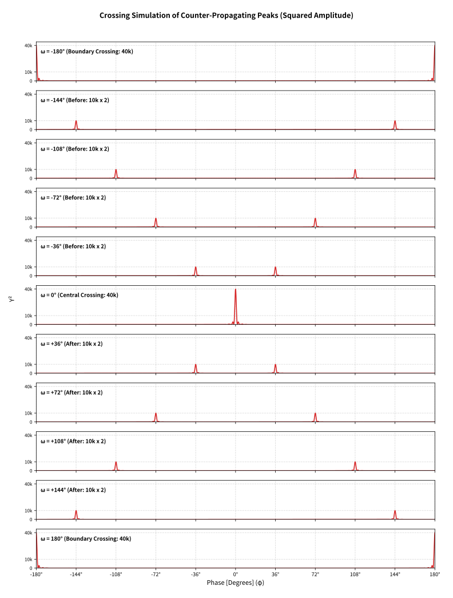
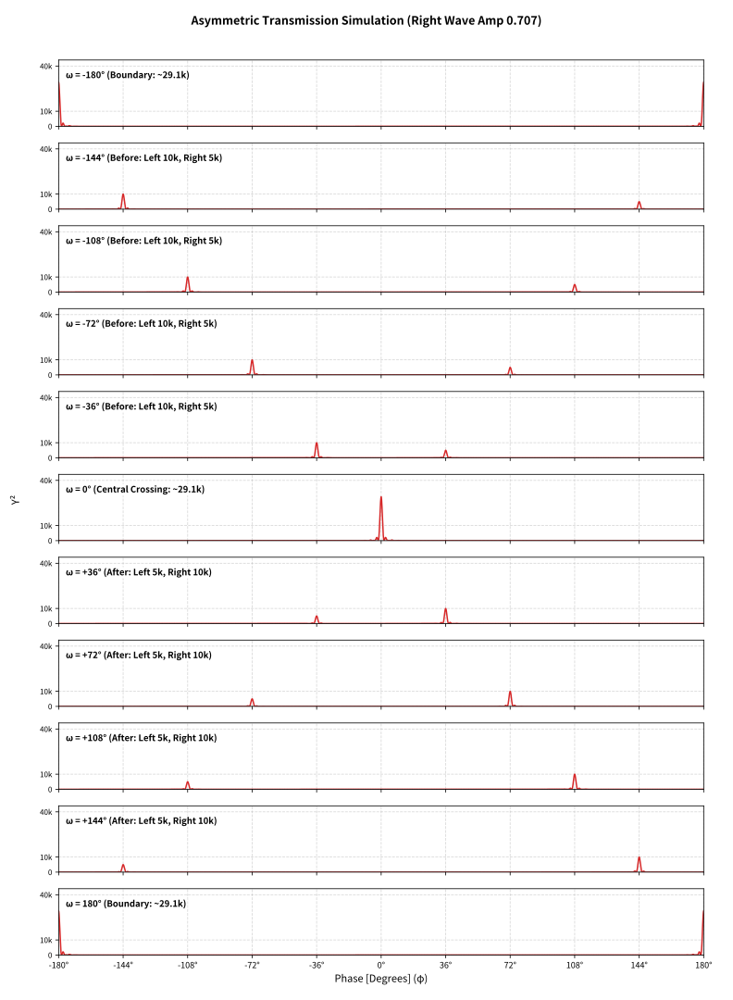

# 波動の位相相互作用と八元数非結合性による、背景独立な時空・ゲージ対称性の創発モデル
**Emergent Spacetime and Gauge Symmetries from Wave Phase Interactions and Octonionic Non-associativity**

## 概要 (Abstract)
現代物理学における最大の課題は、あらかじめ仮定された背景時空（Background Spacetime）に依存せず、量子論と一般相対性理論、および標準理論のゲージ構造を統一的に記述することである。本稿では、純粋な波動の「位相の積（相互作用）」のみを第一原理とする完全な背景独立モデルを提案する。
単純なスカラー整数倍音の干渉モデルから出発し、宇宙の基礎パラメータである「巻き数 $N \sim 10^{60}$」が空間のプランク分解能とマクロな曲率を同時に決定することを示す。さらに、この位相構造を高次元空間へ拡張することで、等式 $x^2 + y^2 + z^2 + (it)^2 = R^2 + Q_1^2 + Q_2^2 + Q_3^2$ を導出し、計量符号のマイナスやローレンツ対称性がピタゴラス幾何学から自然に創発することを証明する。最終的に、状態空間を四元数から八元数ヒルベルト空間へと引き上げることで、八元数の「非結合性」が物理的な因果律（時間の矢）と非線形相互作用の源泉となり、整数倍音の構造がそのまま最大例外リー群 $E_8$ 対称性へと直結するメカニズムを提示する。

---

## 1. 導入：背景時空の不在と「関係性」としての宇宙
従来の場の量子論や弦理論は、舞台となる時空座標をあらかじめ設定した上で定式化される。しかし、本モデルでは「空間の広がり」や「外部の時計」を一切仮定しない。存在するものは、閉じた位相空間上を巡る波動とその「積（相互作用）」のみである。
観測可能な時空の距離や時間は、波の干渉ピーク間のステップ数（関係性）および位相遷移の順序として事後的に創発する概念として扱われる。

## 2. 倍音による局在と、基礎パラメータ「巻き数 $N$」
### 2.1 スカラー倍音の積による局在（トイモデル）
宇宙を満たす最も基礎的な相互作用を、基本波と高次倍音の和 $S_N(\phi) = \sum_{n=1}^N \cos(n\phi)$ の積として定式化する。空間を一様に満たすベース波（第1倍音）に対して、高次倍音が重なり合うことで、特定の位相 $\phi$ においてのみデルタ関数的なピーク（粒子の局在）が形成される。

### 2.2 空間分解能とマクロな曲率の同時決定
この背景場が、閉じた位相に対して巨大な整数である**巻き数 $N \sim 10^{60}$** を持つと仮定する。
この $N$ は本モデルにおける唯一のフリーパラメータである。巻き数 $N$ によって、相互作用が可能な空間の最小位相ステップ（分解能）が $\Delta\phi = 2\pi/N$ に固定される。この最小単位をプランク長 $\ell_P$ と同一視することで、宇宙の全周長 $L = N\ell_P$、すなわち宇宙のマクロな曲率 $\kappa = 1/R = 2\pi / (N\ell_P)$ が、極微のトポロジーから内発的に決定される。

### 2.3 観測限界と「内部位相」への折りたたみ
分解能 $N$ を超える高次倍音（$n > N$）は、もはや空間的な広がり（位置の移動）として観測できず、1つの空間グリッドの内部で回転する「内部位相」として振る舞う。これが素粒子のスピン、電荷、世代などの内部量子数（ゲージ自由度）の起源となる。

---

## 3. 拡張光円錐と対称性の創発
外部時空の自由度と、折りたたまれた内部自由度を幾何学的に統合すると、以下の**拡張光円錐方程式**が得られる。

$$x^2 + y^2 + z^2 + (it)^2 = R^2 + Q_1^2 + Q_2^2 + Q_3^2$$

### 3.1 符号問題とローレンツ変換の解消
本モデルでは、時間は外部のパラメータではなく「空間と直交する位相回転（虚数軸 $it$）」として定義される。この純粋なユークリッド的2乗和を展開するだけで、$(it)^2 = -t^2$ となり、ミンコフスキー計量 $\text{diag}(+, +, +, -)$ が必然的に導かれる。さらに、特殊相対論におけるローレンツ変換（ブースト）は、この $+(it)^2$ を含む複素平面上での単なる回転操作へと還元される。

### 3.2 視点の移動による標準理論の対称性の導出
この8次元の等式は、項のグルーピングを変えるだけで標準理論の多様な対称性を説明する。
* **$3 + 1 = 1 + 3$ の対称性:** 外部の「空間3次元＋時間1次元」と、内部の「ゲージ空間3次元＋ヒッグス/曲率基準1次元」の完全な鏡像関係。
* **$3 = 1 + 4$ の対称性:** 虚数時間を右辺に移項した $x^2 + y^2 + z^2 = t^2 + R^2 + Q_1^2 + Q_2^2 + Q_3^2$ の形。右辺の「4」は標準理論のヒッグス場（実4成分）と完全に一致し、電弱統一理論の自発的対称性の破れの幾何学的基盤となる。

---

## 4. 四元数から八元数ヒルベルト空間への跳躍
### 4.1 $1+3$ 構造の四元数化
トイモデルにおけるスカラー $\cos$ 波は、波動の実部（射影）のみを見ていた近似である。これを複素数、さらには「$1 (\text{スカラー}) + 3 (\text{ベクトル})$」の構造を持つ**四元数（Quaternion, $\mathbb{H}$）**へと拡張する。
* **外部時空四元数:** $q_{\text{ext}} = it + x\mathbf{i} + y\mathbf{j} + z\mathbf{k}$
* **内部状態四元数:** $q_{\text{int}} = R + Q_1\mathbf{i} + Q_2\mathbf{j} + Q_3\mathbf{k}$

### 4.2 八元数の非結合性と「因果律」の創発
これら2つの四元数をケーリー＝ディクソン構成により統合し、状態空間を**八元数（Octonion, $\mathbb{O}$）**のヒルベルト空間へと引き上げる。
八元数空間における最大の数学的特異性は、積の結合法則が破れること（$[A, B, C] = (AB)C - A(BC) \neq 0$）である。本モデルにおいて、この「非結合性」は単なる代数の性質ではなく、以下の物理的実体として振る舞う。
1. **時間の矢（因果律）の創発:** 演算の順序（括弧のくくり方）によって結果が変わるため、背景時間がなくとも「どちらの相互作用が先に起きたか」という不可逆な履歴（因果の半順序）が代数的に定まる。
2. **非線形相互作用の源泉:** 結合子 $[A, B, C]$ がゼロにならない余剰項（トーション）として働くことで、外部からアドホックな非線形項を仮定することなく、ヤン＝ミルズゲージ場の自己結合や重力的な非線形性が自動的に生成される。

---

## 5. 極大対称性 $E_8$ への到達
八元数の非結合性が生み出す幾何学は、究極的に最大例外リー群 $E_8$ へと帰着する。
本モデルの出発点である「整数次倍音」と「巻き数 $N$ の量子化」は、八元数空間の座標を整数（ケイリー整数）に制限することと同義である。ケイリー整数の成す格子は、数学的に $E_8$ ルート格子と完全に同型であることが知られている。
すなわち、スカラー波の整数倍音モデルから出発し、位相の相互作用を保存する最大の代数（八元数）へと拡張した結果、宇宙の対称性は必然的に $E_8$ に到達する。標準理論の $SU(3) \times SU(2) \times U(1)$ やフェルミオンの3世代構造は、この八元数 $E_8$ 構造の特定の射影として自然に内包されている。

## 6. 結論 (Conclusion)
本稿で提示したモデルは、「整数倍音の位相干渉」という極めてシンプルなトイモデルから、四元数・八元数という代数的な必然性のみをガイドとして、背景時空、ローレンツ対称性、電弱対称性、因果律、そして $E_8$ ゲージ構造をすべて演繹的に導き出すことができる。これは、時空と物質を事前に分離して扱う従来の物理学パラダイムに対する、純粋な関係論的・代数幾何学的な新たな統合の提案である。

---

## 補遺 (Appendix): スカラー倍音による波動交差の数値実験

ここでは、論文の出発点となった1次元スカラー倍音モデルにおける波動の交差と透過に関する数値シミュレーションの結果を補足する。

### A. 同振幅2波の交差シミュレーション（不可弁別性）
逆方向に走査する2波の和と、基本背景場 $S_{10}(10\phi)$ の積による交差シミュレーション。交差前と交差後で波形が完全に一致するため、反射と透過の区別がつかない「不可弁別な対称写像」となる。

- **生成プログラム (Python):** `./sim_symmetric_crossing.py`

### B. 非対称振幅の透過シミュレーション
右側から接近する波の振幅を $0.707$ 倍（二乗してエネルギー半分）に設定した非対称交差シミュレーション。これにより波形に履歴が残り、交差後に透過していく様子（マクロな因果律・進行方向）が観測可能となる。

- **生成プログラム (Python):** `./sim_asymmetric_transmission.py`

