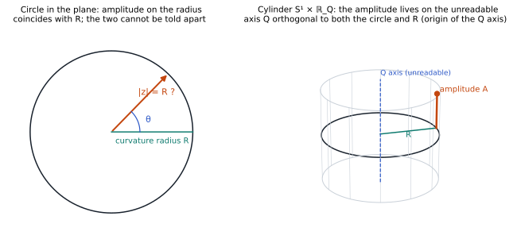
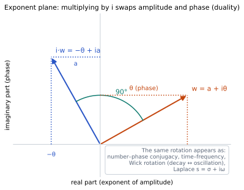
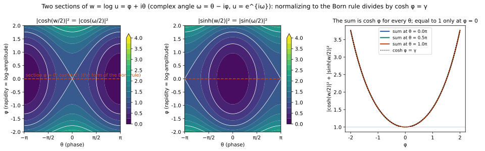
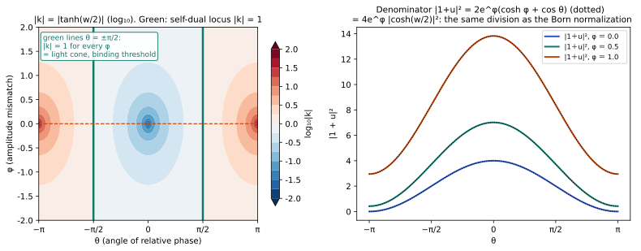
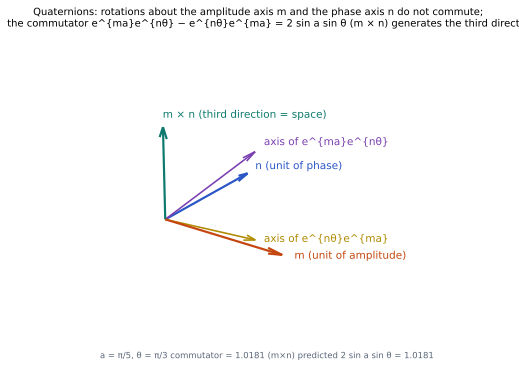
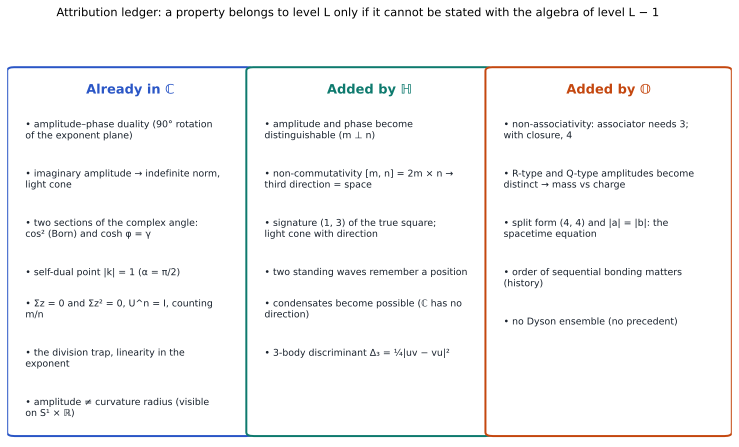

# Did We Understand Complex Numbers Correctly?
## ― Where the Amplitude Lives, the Imaginary Reading, and Attribution across ℂ → ℍ → 𝕆 ―

**Author:** Noriaki Kihara (WF System Co., Ltd.)　ORCID 0009-0004-6753-4020
**Date:** 2026-10-23　　**Version:** v1
**Version DOI:** 10.5281/zenodo.23585437　　**Concept DOI:** 10.5281/zenodo.23585436
**Same folder:** figures and identity checks in `図表/` (`make_figures.py`, `verify_identities.py`, `results/checks.txt`; English-label figures `fig*_en`), citation tables `自己引用の対応表_20261023.md` and `外部引用の対応表_20261023.md`, list of issues `課題の整理_20261023.md`
**Note:** The Japanese version (`complex_revisited_amplitude_imaginary_ja_v1.md`) is the authoritative text; this English version is a translation.

---

## Abstract

The author's research programme aims to read out spacetime and particles from the relations alone of an anonymous set of complex numbers {zₙ}, and has used the structured number systems ℝ → ℂ → ℍ → 𝕆 in turn. This paper pauses midway and checks whether a symmetry already present at the stage of complex numbers has been overlooked. Without this check, a property found with quaternions or octonions is misattributed as first appearing at that stage. One rule is set for the check. **A property may be said to belong to stage L only when it has been shown that it cannot be stated with the algebra of stage L − 1 alone.**

The check starts from one naive question. When a state lies on a circle (or a spherical shell), where does the amplitude live? The main contents are as follows.

1. On a circle in the plane the amplitude |z| and the radius of curvature R are the same number, so one does not notice that they are different things. The radius of curvature R is invisible under translation along a geodesic and can be read only by a closed loop that sweeps an area (holonomy). If the amplitude is placed on the radial direction, a change of amplitude becomes a change of curvature.
2. The amplitude therefore lives in an unreadable direction orthogonal both to the circle and to R. This is the origin of the Q axis of the author's spacetime equation x² ＋ y² ＋ z² ＋ (it)² ＋ (iR)² ＋ (iQ)² ＝ 0. The three tangential directions are space, the three normal directions (t, R, Q) are unreadable, and unreadable directions are written with imaginary units.
3. The amplitude in the unreadable direction is read as imaginary. For the logarithm w ＝ log u ＝ φ ＋ iθ of the relation u (φ ＝ log-amplitude, θ ＝ phase), |cosh(w/2)|² ＝ (cosh φ ＋ cos θ)/2 and |sinh(w/2)|² ＝ (cosh φ − cos θ)/2, and their sum is not 1 but cosh φ ＝ γ (the Lorentz factor). Only on the section φ ＝ 0 does cos²(θ/2) ＋ sin²(θ/2) ＝ 1 hold, and this is the form of the Born rule. The normalization that makes it look like a probability is division by γ, and the one dimension discarded there is the rapidity.
4. The denominator of the coupling coefficient k ＝ (1 − u)/(1 ＋ u) ＝ −tanh(w/2) of the previous paper is |1 ＋ u|² ＝ 2e^φ(cosh φ ＋ cos θ) ＝ 4e^φ |cosh(w/2)|², the same division as the Born-rule normalization. |k| ＝ 1 holds when cos θ ＝ 0, independently of the amplitude mismatch φ. The point that the previous paper identified as a relation on the light cone is the self-dual point of coupling and distance.
5. Amplitude and phase are conjugate and dual, and the duality is the 90° rotation of the exponent plane by multiplication with i. Number–phase conjugacy, time and frequency, Wick rotation and the Laplace variable are appearances of the same rotation. Which axis is read as the imaginary part, and where one divides to normalize, cannot be derived from dynamics (self-reference) and is placed as an axiom. The Born rule and the invariance of the speed of light are two sections of this single axiom.
6. In complex numbers an amplitude read as imaginary cannot be distinguished from the phase (there is only one unit). In quaternions the amplitude can be given a separate unit m ⊥ n, so amplitude and phase are distinguished. Moreover they do not commute: the commutator [e^{ma}, e^{nθ}] ＝ 2 sin a sin θ (m × n) generates a third direction. The three fill the three-dimensional imaginary part, that is, space. This is the root of the previous paper's k being a three-dimensional vector, and k is the sign-reversed modified Rodrigues parameter.
7. In octonions, when the units of amplitude are two (m for R and l for Q) and form a triple with the phase unit n, the associator first becomes non-zero, and an R-type amplitude and a Q-type amplitude become algebraically different things. With the spacetime-side quaternion a ＝ t ＋ xi ＋ yj ＋ zk and the internal-side quaternion b ＝ R ＋ Q₁i ＋ Q₂j ＋ Q₃k, the same 1 ＋ 3 split repeats. Reading B: mass ＝ spacetime curvature R (the scalar part of the internal side), charge ＝ internal curvature Q (the vector part of the internal side). Amplitude ＝ |b|. Hypothesis 1 of the previous paper (mass ∝ norm) is refined by this reading.
8. All of this is collected in an attribution ledger: what ℂ already has (duality, imaginary amplitude and the light cone, cos² and γ, the self-dual point, U^n ＝ I and m/n, the division trap, amplitude ≠ radius of curvature), what ℍ adds (the distinction of amplitude and phase, the third direction, the light cone with an orientation, memory of position, the possibility of condensates), and what 𝕆 adds (the associator, the distinction of mass-type and charge-type, the split form and |a| ＝ |b|, the order of binding).

All identities used in this paper were checked numerically (11 items, `図表/results/checks.txt`). The classification of claims and the form of falsification are in §9.

**Keywords:** complex numbers, quaternions, octonions, amplitude and phase, conjugacy, duality, imaginary reading, rapidity, Born rule, Lorentz factor, modified Rodrigues parameters, associator, anonymity, partial projection, attribution

---

## 1. Research motivation

### 1.1 The starting question

General relativity and the Standard Model cannot be unified, yet when approximated as locally flat both hold to extremely high precision. Why? Is there a way to explain this without introducing arbitrary parameters? This is the starting point of the author's research programme, and the series of papers up to the previous paper [S30] has approached this question by the method of reading out spacetime and particles from the relations alone of an anonymous set of complex numbers {zₙ} [S1] [S3] [S18] [S27] [S30].

### 1.2 Why return to complex numbers

The research has used the structured number systems ℝ → ℂ → ℍ → 𝕆 in turn. Starting from the geometric formulation of four-dimensional space by central projection [S29], it considered the closure Σzₙ² ＝ 0 with complex numbers [S4] [S28], built a quaternion from two complex numbers to read out (1 ＋ 3) [S27], proposed inflation as crystallization from the relations of quaternions [S30], and wrote the spacetime equation with split octonions [S30 §11].

Here a doubt arose. Had the symmetry already present at the stage of complex numbers been understood correctly? If a symmetry present from the stage of complex numbers has been overlooked, a property found with quaternions or octonions is misattributed as one that first appeared at that stage. If the attribution is wrong, the answers to the questions "why quaternions?" and "why octonions?" are wrong too.

This paper therefore goes back and checks before going on. One rule is set for the check.

> **Decision rule.** A property may be said to belong to stage L (ℂ, ℍ, 𝕆) only when it has been shown that it cannot be stated with the algebra of stage L − 1 alone. For each claim, first try to write it one stage down; if it can be written there, attribute it to the lower stage.

### 1.3 One naive question

The entrance to the check is a naive question. When a complex number z ＝ a ＋ ib is read as a circle in the complex plane, the amplitude is simply the real radius. We have come this far without finding that strange. But if the state is taken to lie on a circle of radius R (for quaternions, the four-dimensional spherical shell S³), then R is the radius of curvature of that circle and should be a quantity different from the amplitude. Where does the amplitude live?

This paper proceeds along this question. §3 decides where the amplitude lives; §4 examines what comes out at the stage of complex numbers when the amplitude is read as imaginary; §5 examines what quaternions add and §6 what octonions add, checking with the decision rule as we go. §7 gives the attribution ledger, §8 the comparison with prior work, §9 the classification of claims and the form of falsification, and §10 the conclusion.

In each section, **what is mathematically trivial (identities)** and **what is chosen as a physical reading (which section to read, where to divide)** are written separately.

---

## 2. Conventions

### 2.1 Inherited from the previous paper

The axioms and definitions are those of the previous paper [S30] and the catalogue [S3], used as they are. Anonymity (elements have no names; there is no special origin, coordinate, distance, sign or kind) [S1]; self-consistency (the system takes itself as its own reference) [S2]; distinguishability (a readout cannot tell to which layer a value belongs) [S3]; partial projection [S4] [S15]. The linear closure Σq ＝ 0 and the true-square closure Σq² ＝ 0 are treated as results, not conditions [S2] [S28].

The quaternion notation (q ＝ s ＋ v, polar form q ＝ |q| e^{nθ}, conjugate q̄, true square q² ＝ (s² − |v|²) ＋ 2sv), the relative phase u ＝ q₁⁻¹q₂, the coupling coefficient k ＝ (q₁ ＋ q₂)⁻¹(q₁ − q₂) and the distance x ＝ k⁻¹ are as in the previous papers [S27] [S30].

### 2.2 Notation, and the declarations of division, origin and observer

This system is a system of products. Division is an implicit normalization, so it is done once only, at the end of a readout, and its denominator is declared each time. Addition inside a product moves the origin, so the origin is declared whenever addition is used. Every value carries an observer, that is, whose value it is [S5] [S6]. The declarations for the quantities used in this paper are as follows.

| Quantity | Definition | Denominator | Origin | Observer |
|---|---|---|---|---|
| Relative phase u | u ＝ q₁⁻¹q₂ (left division) | q₁ | — | q₁ |
| Logarithm w | w ＝ log u ＝ φ ＋ iθ (complex case). φ ＝ log-amplitude ＝ rapidity, θ ＝ phase | — | — | q₁ |
| Complex angle ω | ω ＝ θ − iφ, u ＝ e^{iω}, w ＝ iω | — | — | q₁ |
| Coupling coefficient k | k ＝ (1 ＋ u)⁻¹(1 − u) ＝ (q₁ ＋ q₂)⁻¹(q₁ − q₂) | the composite 1 ＋ u (＝ q₁ ＋ q₂) | the origin O of sum and difference (the centroid fixed by Σq ＝ 0) | q₁ |
| Distance D | D ＝ 1/\|k\| | k | as above | q₁ |
| Quaternion exponentials | e^{ma}, e^{nθ} (m, n unit pure imaginary, m ⊥ n). The compositions e^{ma} e^{nθ} and e^{nθ} e^{ma} are distinguished, and both are distinguished from e^{ma＋nθ} (§5.2) | — | — | declared by the order of multiplication |

Written in w, cosh(w/2) ＝ cos(ω/2) and sinh(w/2) ＝ i sin(ω/2). This paper mainly uses w ＝ log u; the complex angle ω is used only to show the correspondence.

### 2.3 Notation for attribution

At the end of each claim, the attribution by the decision rule is marked 【ℂ】, 【ℂ × ℝ】, 【ℍ】 or 【𝕆】. 【ℂ × ℝ】 means something that becomes visible once a single unreadable axis is added to the complex numbers (no quaternions are needed).

---

## 3. Where does the amplitude live?

### 3.1 Invisible on a circle in the plane

Put the complex number z ＝ R e^{iθ} on a circle of radius R; the amplitude is |z| ＝ R. Because the amplitude and the radius of the circle are the same number, one does not notice that they are different quantities. Reading the amplitude as "the radial component" produces no contradiction (Fig. 2, left).

### 3.2 The radius of curvature R can be read only by the area of a closed loop

Suppose the state lies on a spherical shell S³ of radius R. The local coordinates are three-dimensional, and R itself is not visible. Translation along a geodesic (a great circle) shows zero effect of curvature; only a two-dimensional motion that sweeps an area, that is, going once round a closed loop, makes it observable as rotation ＝ swept area / R² (holonomy, Gauss–Bonnet [X3], geometric phase [X2]). In the author's system the c ＝ 1 area sweep is the clock [S7] [S8], and curvature oscillations are read out from the area cross-term of complex rotating waves [S9]. The distortion of the geodesic unit cell in positively curved space also appears as an evaluation of areas and volumes [S10]. §5 of the previous paper [S30] stated that a localized observer cannot see a uniform curvature and sees only tides. This is the same thing in other words.

### 3.3 Why the amplitude cannot be placed on the radial direction

If the amplitude is placed radially, the amplitude is a quantity on the same axis as R. But R is a bending that can be read only by closed loops, and a change of amplitude would then be a change of curvature. If Hypothesis 1 of the previous paper [S30] (mass ∝ |q|²) is read radially, two states of different mass lie on shells of different radius of curvature and cannot share a common curvature scale inside the same condensate. The limits of the radius of curvature [S11], the degeneracy at R ＝ 0 [S12] and the self-consistent determination of R [S13] all presuppose that R is a quantity determined independently of the amplitude. At the time of the previous paper it was already understood that the radius of curvature R and the amplitude |q| of a state must not be identified (the caution in [S30] §9), but where the amplitude lives had not been decided.

[S14], which discussed the stage for amplitudes and the choice of the time direction, and the readout hierarchy of [S15], which showed that position had never been read, were also asking where in the hierarchy of readouts the amplitude is placed.

### 3.4 The direction orthogonal both to the circle and to R: the origin of the Q axis

If the amplitude cannot live radially, the remaining place is the direction orthogonal both to the circle and to R, an axis standing out of the plane of the circle. The circle becomes a cylinder S¹ × ℝ, and S³ becomes S³ × ℝ_Q (Fig. 2, right). This axis cannot be read from the tangential directions (which are readable as space). By the convention of writing unreadable directions with imaginary units [S27], (iQ)² ＝ −Q².

This is the origin of the Q axis of the author's spacetime equation

x² ＋ y² ＋ z² ＋ (it)² ＋ (iR)² ＋ (iQ)² ＝ 0.

The six terms split into 3 tangential (readable, space) ＋ 3 normal (unreadable: time t, curvature R, amplitude direction Q). The radial-projection framework ℝ⁶ → S⁵ [S42] and the internal-side quaternion b ＝ R ＋ Q₁i ＋ Q₂j ＋ Q₃k of §11 of the previous paper [S30] had placed this Q axis first. What this paper adds is the origin: Q is the direction of the amplitude. With three Q's the normal directions are five, t, R, Q₁, Q₂, Q₃, eight components in all: octonions.

**Figure 2** Where the amplitude lives. Left: on a circle in the plane, an amplitude placed radially is the same number as the radius of curvature R and cannot be distinguished from it. Right: on the cylinder S¹ × ℝ_Q the amplitude lives in the unreadable direction Q, orthogonal both to the circle and to R.

**Attribution.** That amplitude ≠ radius of curvature, and that the amplitude lives on an orthogonal axis, become visible once a single unreadable axis is added to the complex numbers. The four-dimensional shell only made this easier to see. 【ℂ × ℝ】

---

## 4. Reading the amplitude as imaginary: the stage of complex numbers

### 4.1 Reading in the exponent

Read the relation u ＝ q₁⁻¹q₂ in its exponent. With w ＝ log u ＝ φ ＋ iθ, φ is the log-amplitude (amplitude ratio ρ ＝ e^φ) and θ is the phase. Evolution is a chain of multiplications, so in the exponent it becomes addition and is linear. If amplitude and phase are written separately as ψ ＝ A e^{iθ}, the amplitude is treated by multiplication and the phase inside the exponent, a different treatment, and nonlinearity enters there. Madelung's hydrodynamic form [X11] and Bohm's quantum potential ∇²A/A [X12] diverge at the nodes of the wave function because amplitude and phase are separated midway and one divides by the amplitude; as long as the evolution is carried out in the exponent alone, e^w never vanishes for finite w. Nodes arise only when the sum is taken at the moment of readout. Conserved quantities as phase-space area and Wick rotation are treated in [S16], and linear simplexification by square-quantity readout in [S26].

**Attribution.** Linearity in the exponent, and divergence when a logarithm is taken midway, are properties of complex numbers. 【ℂ】

### 4.2 The duality of amplitude and phase: multiplication by i exchanges them

In the exponent plane, multiplying w ＝ a ＋ iθ by i gives i·w ＝ −θ ＋ ia, and the amplitude exponent a and the phase θ are exchanged (Fig. 1). Amplitude and phase are conjugate, and the duality is a 90° rotation of the exponent space.

This one rotation appears in many places in physics under different names. The conjugacy of number (amplitude²) and phase [X19] [X20] [X21]. Time and frequency, position and wavenumber. The Wick rotation connecting real decay e^{−βH} and imaginary oscillation e^{−iHt} [X17] [X18], and the Laplace variable s ＝ σ ＋ iω of electric circuits. In the author's system, the symplectic symmetry and Wick rotation obtained when conserved quantities are read as phase-space area [S16] correspond to this.

Which axis is read as "the imaginary part" is the choice of where to stop the axis in this rotation, and is not fixed on the side of the components [S3]. Even the integer winding number of the phase is a product of readout that arises only when an axis is chosen and divided by 2π (wound onto a circle).

**Figure 1** The exponent plane w ＝ a ＋ iθ. Multiplication by i gives i·w ＝ −θ ＋ ia and exchanges the amplitude exponent and the phase. Number–phase conjugacy, time and frequency, Wick rotation and the Laplace variable s ＝ σ ＋ iω are appearances of the same rotation.

**Attribution.** The duality itself is a property of complex numbers. 【ℂ】

### 4.3 Consequences of the imaginary reading (identities)

To read the amplitude exponent as imaginary is to place the amplitude inside the same exponent as the phase, with an imaginary unit attached. The consequences come in two steps.

**Indefinite metric.** If the amplitude A is read as iA, then (iA)² ＝ −A² and the squared norm can be negative. It was because only positive real amplitudes were admitted that the norm was positive definite and readable as a probability; once imaginary amplitudes are admitted, the norm becomes an indefinite metric that is positive, negative or zero. This is the same structure as the light cone, and the nodes ψ ＝ 0 correspond to null points.

**Two sections of the complex angle.** For w ＝ φ ＋ iθ the following hold (`verify_identities.py` C0–C2).

|cosh(w/2)|² ＝ (cosh φ ＋ cos θ)/2,　|sinh(w/2)|² ＝ (cosh φ − cos θ)/2

|cosh(w/2)|² ＋ |sinh(w/2)|² ＝ cosh φ,　|cosh(w/2)|² − |sinh(w/2)|² ＝ cos θ

Written with the complex angle ω ＝ θ − iφ (u ＝ e^{iω}), cosh(w/2) ＝ cos(ω/2) and sinh(w/2) ＝ i sin(ω/2), so the same formulas can be written with cos and sin. Three things can be read from this (Fig. 3).

1. **The section φ ＝ 0 is cos²(θ/2) and sin²(θ/2), with sum 1.** This is the form of the Born rule. That the projection weights of a discrete system with U² ＝ I are cos² and sin² (the same geometry as Malus's law), and that repeating a rotation by the angle θ ＝ πm/n closes the orbit with period n so that the fraction of one period spent on either projection side is the integer ratio m/n, have already been obtained in the author's system by [S19] [S20] [S21] from the equidistribution of the observer–system beat and the reproducing kernel. This paper rereads them as "the φ ＝ 0 section of the complex angle."
2. **The section θ ＝ 0 is cosh²(φ/2) and sinh²(φ/2), with sum cosh φ.** This is the Lorentz factor γ. That a boost is a rotation by an imaginary angle and that rapidities add has been the reading since Minkowski [X4], and unifying rotations and boosts by a complex angle is standard in the spinor calculus of SL(2, ℂ) [X5].
3. **Nodes appear only on the section φ ＝ 0.** Even at θ ＝ π, |cosh(w/2)|² ＝ sinh²(φ/2), which does not vanish for φ ≠ 0. A node of zero amplitude appears only when one reads the single section φ ＝ 0.

**Figure 3** The two sections |cosh(w/2)|² and |sinh(w/2)|² of w ＝ log u ＝ φ ＋ iθ. The section φ ＝ 0 is cos²(θ/2) (the form of the Born rule). The sum is cosh φ ＝ γ independently of θ, and equals 1 only at φ ＝ 0.

Since cosh x ＝ cos(ix), the circular and hyperbolic functions are the same function read after a rotation by i. The cos² of quantum mechanics and the γ of relativity are the real and the imaginary section of one complex exponential; in terms of groups, SL(2, ℂ) is the complexification of SU(2). It is not strange that either appears; it is natural that both appear.

**Attribution.** The above are identities, and all lie at the stage of complex numbers. 【ℂ】

### 4.4 The Born-rule normalization and the denominator of the previous paper

To make a general relation with φ ≠ 0 look like a probability, one must divide by the sum cosh φ. **The one dimension discarded by that division is the rapidity φ.** After the division the difference is cos θ / cosh φ, and the swing of the interference shrinks to 1/cosh φ ＝ √(1 − v²). The moment one normalizes, the cause of that dilution becomes unreadable.

The denominator of the previous paper's coupling coefficient k ＝ (1 − u)/(1 ＋ u) is, with u ＝ e^w (`verify_identities.py` C3–C5),

|1 ＋ u|² ＝ 1 ＋ 2e^φ cos θ ＋ e^{2φ} ＝ 2e^φ(cosh φ ＋ cos θ) ＝ 4e^φ |cosh(w/2)|²,

with k ＝ −tanh(w/2) and |k|² ＝ (cosh φ − cos θ)/(cosh φ ＋ cos θ). **The denominator declared in §2.2 of the previous paper as "the composite q₁ ＋ q₂" is the same division as the Born-rule normalization.** Here appears the reason why the previous paper demanded that division be done once, at the end, with the denominator declared. If one divides midway, one cannot notice that the information φ has disappeared.

And |k| ＝ 1 holds when cos θ ＝ 0, that is, at θ ＝ ±π/2, **independently of the amplitude mismatch φ** (Fig. 4, left). The previous papers [S27] [S30] identified the relation |k| ＝ 1 with a relation on the light cone. This is also the point where the map of coupling k and the map of distance 1/k exchange and coincide (C10). The light cone is the self-dual point of coupling and distance.

**Figure 4** Left: |k| ＝ |tanh(w/2)| (log₁₀). The self-dual point |k| ＝ 1 lies at θ ＝ ±π/2, independently of φ. Right: the denominator |1 ＋ u|² ＝ 2e^φ(cosh φ ＋ cos θ) ＝ 4e^φ|cosh(w/2)|².

**Attribution.** The identity for the denominator and the self-dual point lie at the stage of complex numbers. 【ℂ】

### 4.5 In complex numbers, amplitude and phase cannot be distinguished

Now apply the decision rule. If in complex numbers the amplitude exponent is read as imaginary, one gets e^{i(a ＋ θ)}: a is added to θ and the modulus stays 1 (C9). An amplitude read as imaginary cannot be told from a shift of the phase by π/2. There is only one imaginary unit. What remains of the imaginary reading at the stage of complex numbers is only the sign reversal of the square (the sign of the Wick rotation).

**Attribution.** That "amplitude and phase cannot be distinguished" is itself a property of the stage of complex numbers. The distinction first arises at the next stage. 【ℂ】

### 4.6 Which section to read, and where to divide

Of the two sections of §4.3, quantum mechanics chooses φ ＝ 0 and calls it "probability," and relativity looks at θ ＝ 0 and calls it "the upper limit of velocity." Up to here it is a result of algebra, not physics. What enters as physics is only the choice: which section to read, and where to divide in order to normalize.

If one tries to derive this choice from dynamics, the dynamics itself is already written on some section, so one would be explaining the choice by presupposing it. As long as the observer is a part of the system and the readout is included in what is read out, this self-reference cannot be avoided. Therefore **which axis is read as the imaginary part, and where one divides, are placed as axioms.** Existing physics places the Born rule and the invariance of the speed of light as two separate axioms, but in the organization of this section both come from a single choice, namely which section of the same complex exponential to read and where to divide. It cannot be derived, but the two axioms are unified into one.

The view that the choice of imaginary unit selects the kind of mechanics is closest to Kisil [X16], who divided the representations of the Heisenberg group into elliptic (i² ＝ −1, quantum mechanics), parabolic (ε² ＝ 0, classical mechanics) and hyperbolic (j² ＝ ＋1, hyperbolic mechanics). A quantum mechanics that reads the amplitude in split form was proposed by Khrennikov [X13] [X14], with the criticism that negative probabilities appear [X15]. The standpoint of reading probabilities as a counting of rational numbers m/n is found in Palmer's invariant set theory [X22] [X23] and 't Hooft's cellular automaton interpretation [X24]; in the author's system, the finite order U^n ＝ I [S2] [S22] and rational locking [S23] [S24] correspond to it.

**Attribution.** That the choice is an axiom is common to all stages. 【ℂ】

---

## 5. The stage of quaternions: amplitude and phase are distinguished, and space is born

### 5.1 Giving a separate unit

In quaternions the amplitude can be given an imaginary unit m (m ⊥ n) different from that of the phase. Since the exponent of q ＝ e^{ma ＋ nθ} is pure imaginary, |q| ＝ 1 stays, and everything is a rotation on S³. The amplitude moves, but the norm does not. "The overall scale cannot be read" [S3] becomes a structure rather than an axiom. Since m and n are different, orthogonal directions, amplitude and phase can be distinguished.

**Attribution.** In complex numbers there was only one unit and no distinction (§4.5). That they can be distinguished is what quaternions add. 【ℍ】

### 5.2 Non-commutativity generates a third direction

The rotations by m and by n do not commute. For unit pure imaginary m ⊥ n (`verify_identities.py` C7),

e^{ma} e^{nθ} − e^{nθ} e^{ma} ＝ 2 sin a sin θ (m × n).

The two imaginary readings, of amplitude and of phase, generate through the order of multiplication a third direction m × n, and the three fill the three-dimensional imaginary part, that is, space (Fig. 5). The axis of the composite rotation reverses the sign of its m × n component with the order of multiplication. This difference of order is the left and right division of the previous paper [S27], the choice of the observer's frame. Moreover e^{ma ＋ nθ} and e^{ma} e^{nθ} are different things (the Baker–Campbell–Hausdorff correction, C8), so which of them is called "the state combining amplitude and phase" also requires a declaration of order (§2.2).

Viewed in quaternions, the duality of amplitude and phase (§4.2), the rotation that exchanges the amplitude axis m and the phase axis n, is a 90° spatial rotation about the third axis m × n. The duality that was "a rotation of the exponent plane" at the stage of complex numbers becomes, in quaternions, the same thing as one rotation of space.

**Figure 5** Quaternions: the rotations about the amplitude axis m and the phase axis n do not commute, and the commutator e^{ma}e^{nθ} − e^{nθ}e^{ma} ＝ 2 sin a sin θ (m × n) generates a third direction. The axis of the composite rotation reverses the sign of its m × n component with the order.

**Attribution.** The third direction comes from non-commutativity. Complex numbers do not have it. 【ℍ】

### 5.3 The k of the previous paper is the modified Rodrigues parameter

The coupling coefficient of the previous paper is, for a unit quaternion u ＝ e^{nα}, k ＝ (1 ＋ u)⁻¹(1 − u) ＝ −n tan(α/2) ＝ −Im u / (1 ＋ Re u) (C6). This is the **modified Rodrigues parameter** (MRP) with its sign reversed. The MRP is the stereographic coordinate of a unit quaternion, long used in attitude dynamics in aerospace [X29] [X30], and introduced to computer graphics and vision by Terzakis et al. [X28]. What the previous paper called "the central projection of the square root of the relative phase" is this known map.

The existing MRP is used to represent a rotational attitude within three-dimensional space. The previous paper used the same map to read the relation between states as a position, without placing a background space. The rediscovery of the map and its positioning as a readout principle are written separately. The classical maps from two complex numbers to a three-dimensional vector (the Kustaanheimo–Stiefel transformation [X31], the Hopf map [X32]) contain the choice of a special direction in their definition and differ in respect of anonymity.

The root of k being a three-dimensional vector lies in the third direction of §5.2. The core of the previous paper [S27], that two standing waves can intrinsically memorize a three-dimensional position, can be read as a consequence of the non-commutativity of the two imaginary readings, of amplitude and of phase.

**Attribution.** k as a three-dimensional vector lies at the stage of quaternions. 【ℍ】

### 5.4 (1, 3), and the light cone with an orientation

The previous paper [S27] showed that the scalar part q₀² − |v|² of the true square, taken without the conjugate, has signature (1, 3), and that θ ＝ 45° is the light cone [S28]. In the light of §4.3, the sign reversal (the light cone of 1 ＋ 1) is already at the stage of complex numbers, and what quaternions add is that the light cone is not a pair of points but **a cone with an orientation n**. The attribution "the light cone comes from the true square," written in the previous paper, is refined in this way. That |k| ＝ 1 is a relation on the light cone is itself at the stage of complex numbers, as in §4.4; quaternions give it an orientation.

**Attribution.** The sign is 【ℂ】; the oriented cone is 【ℍ】.

### 5.5 Why condensates cannot be made with complex numbers and can be made with quaternions

The author was stuck for a long time on the problem of making a local binding structure (a condensate) from an anonymous set of complex numbers without supplying a background or connectivity. The complex relative phase u ＝ e^{i(θ_b − θ_a)} is a single angle, and the product is commutative. It is not determined in which direction several relations spread and how they combine to make a three-dimensional local structure. In quaternions the relative phase u ＝ e^{nα} has a direction n, and for the directions of two relations there is the non-commutative structure ab − ba ＝ 2a × b, so the distinction of directions, parallelism, and the construction of triangles and tetrahedra can be considered. The convex hull and the tetrahedral crystallization of the previous paper [S30] come from here.

That three quaternions q₁, q₂, q₃ do not fit into a single complex phase plane can be tested with the normalization pᵢ ＝ qᵢ/|qᵢ|, gᵢⱼ ＝ Re(p̄ᵢpⱼ) and the discriminant Δ₃ ＝ det[gᵢⱼ] ＝ ¼|uv − vu|² (u ＝ q₁⁻¹q₂, v ＝ q₁⁻¹q₃). If Δ₃ ＝ 0 the directions of the relative phases are collinear and the configuration is complex-like; if Δ₃ > 0 there are two independent directions and it is quaternionic. The definition of a condensate (a common curvature scale, locking) is treated in the next paper.

A distinction is made here. Reading out localized condensates, a centre of mass and a mass-like measure from a vacuum of complex standing waves has been done in [S31] [S32]. What is said here to be impossible is not readout but **autonomous binding** (which state binds to which being decided without being given from outside). That the birth conditions of space, matter and the clock do not coincide [S33] is related to this distinction.

**Attribution.** Relations with a direction, and the possibility of condensates, lie at the stage of quaternions. 【ℍ】

---

## 6. The stage of octonions: mass-type and charge-type amplitudes are distinguished

### 6.1 Two elements are associative; the associator stands with three

The subalgebra generated by any two octonions is associative (Artin's theorem [X36]). However much two elements are multiplied, one cannot get out of the quaternions. The associator [a, b, c] ＝ (ab)c − a(bc) can first be tested with three elements, and when the true-square closure is also imposed, the smallest set that closes as octonions is four (five if the linear closure is imposed as well) [S30] [S4]. Together with the fact that number systems with division are limited to 1, 2, 4 and 8 dimensions (Hurwitz [X37], Baez [X27]), the octonions are the stage that can first be described only when the order of products of triples is included.

### 6.2 The type of amplitude splits in two

When the imaginary units of amplitude are two (m in the direction of R and l in the direction of Q) and, together with the phase unit n, form three independent imaginary directions, the associator first becomes non-zero here. In quaternions, even if R and Q are given separate units, two imaginary units always fall within an associative subalgebra, and which one is called mass is only a renaming. In octonions the triple R, Q, phase becomes non-associative, and **the R-type amplitude and the Q-type amplitude become algebraically different things.**

This gives the question "why can mass and charge be measured as distinct; are they separate entities, or different readouts of the same thing?" the algebraic answer "because the associator first stands with the third imaginary reading." The very fact that they are distinguishable is the non-associativity of three imaginary directions.

**Attribution.** The distinction of two kinds of amplitude lies at the stage of octonions. 【𝕆】

### 6.3 The split form and |a| ＝ |b|

Reading all the internal-side amplitudes (R, Q₁, Q₂, Q₃) as imaginary is exactly choosing the split octonions of §11 of the previous paper [S30] (γ ＝ ＋1, signature (4, 4)). With the Cayley–Dickson construction (a, b), a the spacetime-side and b the internal-side quaternion, the null condition N(o) ＝ |a|² − |b|² ＝ 0 is |a| ＝ |b|, that is,

x² ＋ y² ＋ z² ＋ t² ＝ R² ＋ Q₁² ＋ Q₂² ＋ Q₃².

Since the norm of the ordinary octonions is positive definite and has no non-trivial null elements, the split form is required for the closure to be non-trivial. This is the same logic as Σxₙ² ＝ 0 having only the trivial solution over the reals and requiring complex numbers [S4] [S28].

### 6.4 Reading B: mass ＝ spacetime curvature R, charge ＝ internal curvature Q

In §3.4 the amplitude was placed on the Q axis. Here two readings stand side by side.

- **Reading A.** The amplitude lives in Q; mass ＝ amplitude, charge ＝ its direction.
- **Reading B.** Mass ＝ the spacetime curvature R itself; charge ＝ the internal curvature Q itself. Charge does not affect the spacetime curvature and affects only the internal curvature.

This paper adopts B, for three reasons. First, that mass curves spacetime is general relativity itself, and "the source of gravity is the non-uniformity of the norm" of §6.3 of the previous paper [S30] holds as it is when reread as "the non-uniformity of R." Second, charge as internal geometry is the Kaluza–Klein type of reading. Third, it agrees with the author's internal records: the kind of a particle is read by the sign vector of tRQ₁Q₂Q₃, and the charge comes from the signs of Q [S34] [S35] [S36]; the structure of generations [S37]; the hierarchy of masses appears as a phase of R; and changing the normalization reference from mass to charge does not change the generation of states [S25].

The dictionary of Reading B repeats the same 1 ＋ 3 on the spacetime side and on the internal side (Table 1).

**Table 1** Dictionary of the spacetime side and the internal side (Reading B).

| Side | Quaternion | Scalar part | Vector part |
|---|---|---|---|
| Spacetime side | a ＝ t ＋ xi ＋ yj ＋ zk | t ＝ time | (x, y, z) ＝ space |
| Internal side | b ＝ R ＋ Q₁i ＋ Q₂j ＋ Q₃k | R ＝ mass (spacetime curvature) | (Q₁, Q₂, Q₃) ＝ charge (internal curvature) |

The amplitude is the norm of the internal side, |b| ＝ √(R² ＋ ΣQ²), and the null condition |a| ＝ |b| is "the inventory of the spacetime side ＝ the inventory of the internal side." Hypothesis 1 of the previous paper, "mass ∝ |q|²," is refined in Reading B to "mass ∝ the scalar part R of the internal side," and the Q part of the amplitude is read not as mass but as charge. This paper states this explicitly as a correction of §6 of the previous paper.

Two readings follow from Reading B (not yet checked). Charge is the **direction and sign** of the internal 3-vector; the sign vector is discrete (16 for one generation [S34] [S36]), so it is quantized. Mass is the **magnitude** of a scalar and can take continuous values. This agrees with charge appearing only in integer multiples of e while mass has a hierarchy but no visible rule of quantization. Also, the elementary charge read as a transmittance, 1 − R ＝ sin²θ ＝ √(4πα) ＝ e_HL [S17] [S18] [S38] [S39] [S40] [S41], says that the **magnitude** of charge is universal (the length of the internal vector is fixed), and this is read separately from the sign and direction being the choice of Q.

The k of the previous paper is built from the spacetime side a, so its vector part is the direction of space, not charge. To read charge one needs the relative phase u_b ＝ b₁⁻¹b₂ of the internal side b and k_internal ＝ (1 ＋ u_b)⁻¹(1 − u_b). How its scalar part (the ratio of R ＝ the mass ratio) and its vector part (the difference of the directions of Q ＝ the relation of charges) are connected with the spacetime-side k and with |a| ＝ |b| is what decides between Readings A and B, and is the next task (§9).

**Attribution.** Which normal direction receives the name mass and which the name charge is a choice of readout; the components carry no colour. What decides is whether a general-relativity-type readout on the R side and a gauge-type readout on the Q side come out without contradiction. That this distinction holds algebraically is at the stage of octonions. 【𝕆】

### 6.5 A stage without precedent

By Dyson's threefold way [X41], the ensembles of matrices (the symmetry classes of random matrices) are only three, ℝ, ℂ and ℍ; there is none for the octonions. Up to quaternions there are precedents of exactly solvable many-body systems, the log gas, Dyson's Brownian motion and the Sutherland model, but there is no precedent for the many-body dynamics of octonions. The correspondence between octonions and the Standard Model has a lineage since Gürsey–Tze [X38] [X39] [X40]; this paper stands in the position of adding to it the reading of two types of amplitude. Dynamics is outside the scope of this paper and is treated in the next paper (§9).

---

## 7. The attribution ledger

Sorting the claims by the decision rule gives Table 2 (Fig. 6).

**Table 2** The attribution ledger.

| Already in ℂ | Added by ℍ | Added by 𝕆 |
|---|---|---|
| Duality of amplitude and phase (90° rotation of the exponent plane) §4.2 | Amplitude and phase distinguishable (m ⊥ n) §5.1 | Non-associativity: the associator stands with 3 elements, and with closure imposed, 4 §6.1 |
| Imaginary amplitude → indefinite metric, light cone §4.3 | Non-commutativity [m, n] ＝ 2m × n → third direction ＝ space §5.2 | R-type and Q-type amplitudes algebraically distinct → distinction of mass and charge §6.2 |
| Two sections of the complex angle: cos² (Born rule) and cosh φ ＝ γ §4.3 | Sign (1, 3) of the true square, light cone with an orientation §5.4 | Split form (4, 4) and \|a\| ＝ \|b\|: the spacetime equation §6.3 |
| Self-dual point \|k\| ＝ 1 (θ ＝ ±π/2, independent of φ) §4.4 | Two standing waves memorize a position §5.3 | The order of sequential binding changes the result (history) §6.1 |
| Σz ＝ 0 and Σz² ＝ 0, U^n ＝ I, counting of m/n §4.6 | Condensates can be made (complex numbers have no direction) §5.5 | No Dyson ensemble exists (no precedent) §6.5 |
| The division trap, linearity in the exponent §4.1, §4.4 | Three-body discriminant Δ₃ ＝ ¼\|uv − vu\|² §5.5 | |
| Amplitude ≠ radius of curvature (visible on the cylinder S¹ × ℝ) §3 | | |

**Figure 6** The attribution ledger: already in ℂ / added by ℍ / added by 𝕆.

Three examples in which the author nearly misattributed during the check are recorded. First, the orthogonality of amplitude and curvature was about to be written as a property of the four-dimensional shell, but it is visible on the cylinder S¹ × ℝ. Second, one is tempted to read γ as a consequence of the quaternionic signature (1, 3), but it lies in the complex angle; what quaternions add is not the sign but the three directions of space. Third, the previous paper [S27] wrote that the light cone "comes from the true square," but the relation |k| ＝ 1 is in the complex numbers, and what quaternions added is the orientation of the cone.

---

## 8. Comparison with prior work

Each of the parts of this paper has prior work that gave it a physical interpretation. The position of this paper is to have put them together into one line, and in the right-hand columns of the ledger.

| Part | Prior work | Difference from this paper |
|---|---|---|
| Phase ＝ rotation in a plane of space | Hestenes' real Dirac theory [X6] [X7] [X8]: the i of the Dirac equation is the generator of rotation in the spatial plane corresponding to the spin direction. β (Yvon [X9], Takabayasi [X10]) is the angle of the duality rotation | Keeps the amplitude ρ real and separate from the phase. No imaginary reading of the amplitude |
| Boost ＝ rotation by an imaginary angle, γ ＝ cosh θ | Minkowski [X4], Penrose–Rindler [X5] | No identification with the Born-rule normalization |
| Which imaginary unit is read selects the mechanics | Kisil [X16] (elliptic, parabolic, hyperbolic), Khrennikov [X13] [X14], criticism [X15] | The unit is chosen per theory; not two sections of one and the same object |
| Real exponent ↔ imaginary exponent ＝ temperature ↔ time | KMS, Connes–Rovelli [X17], imaginary time [X18] | Limited to the exchange of statistics and quantum theory |
| Number–phase conjugacy | Dirac [X19], Susskind–Glogower [X20], Pegg–Barnett [X21] | Conjugacy of operators; no reading as a rotation of the exponent space |
| cos² ＝ counting of m/n, Bell by discreteness | Palmer [X22] [X23], 't Hooft [X24] | From fractal invariant sets and non-computability, not from the finite order U^n ＝ I |
| The map k ＝ −n tan(α/2) | Modified Rodrigues parameters [X28] [X29] [X30] | Representation of a rotational attitude, not a readout of position |
| Reconstructing geometry from relations | The Penrose–Szabados line [X33] [X34] [X35]: three-space and Minkowski spacetime reconstructed from the symmetries and observables of quantum systems, without a background physical space and without using an evolution equation | Starts from known symmetry groups (SU(2), E(3), Poincaré) and the observables momentum and angular momentum. Not a construction from the relative relations of anonymous stationary states |
| Octonions and the Standard Model | Singh [X40] (matrix dynamics, the exceptional Jordan algebra, 1/137), Furey [X38] [X39] (the Standard Model groups from the agreement of the action of symmetry transformations) | Not the minimal construction from stationary states in which not even a progressing phase is placed. This paper adds the two types of amplitude |
| Three-dimensional space does not emerge uniquely from the quantum structure | Stoica [X1] | This paper takes the same standpoint (a choice of reading enters). Definition and geometry of quaternions: [X25] [X26] |

Only this paper has the following four points. That cosh φ ＝ γ is the one dimension discarded by the Born-rule normalization, and that the Born rule and the invariance of the speed of light are two sections of one axiom (§4.4, §4.6). That the self-dual point of the amplitude–phase duality is the light cone (§4.4). That raising the imaginary reading through ℂ → ℍ → 𝕆 produces first the distinction from the phase and then the distinction of mass-type and charge-type by the associator (§5, §6). That the amplitude is housed in the normal direction Q of S³ (§3.4).

The literature on dynamics (the Kuramoto model [X42], the Kuramoto model with complexified phase [X43] [X44], the author's Kuramoto-type phase coupling [S43], the linear instability of inflation [S44] [S45] [S46] [S47]) is only cited in this paper; its results are not used.

---

## 9. Classification of claims, verification, and falsification conditions

### 9.1 Classification of claims

| Claim | Class |
|---|---|
| The identities of §4.3 (two sections, sum ＝ cosh φ, difference ＝ cos θ), the denominator and the formula for \|k\|² of §4.4, the commutator of §5.2, the agreement with the MRP of §5.3, the merging of §4.5, Artin's theorem of §6.1 | Mathematically identical (checked numerically by `verify_identities.py` C0–C10) |
| The amplitude cannot live radially and lives in the orthogonal imaginary direction (§3); which section to read and where to divide is an axiom (§4.6); Reading B (§6.4); the attribution ledger (§7) | Choice of reading |
| Why charge is quantized and mass looks continuous (§6.4); that k_internal settles Reading B (§6.4) | Hypothesis |

### 9.2 What was checked

`図表/verify_identities.py` checks 11 identities on a fixed grid (θ ∈ [−π, π] × φ ∈ [−3, 3], 721 × 301 points), and all agree to within 10⁻¹⁰ (`results/checks.txt`). No random numbers are used. The quaternion identities (C6–C8) were computed directly from products of unit quaternions.

### 9.3 Falsification of the attribution

The application of the decision rule itself has the form of a falsification.

1. If a readout of 3 directions can be built with complex numbers alone, "the third direction is added by quaternions" (§5.2) is wrong.
2. If the distinction of mass and charge comes out algebraically with quaternions alone, "the distinction of two kinds of amplitude is added by octonions" (§6.2) is wrong.
3. If a reading can be built that places the amplitude radially and keeps a common curvature scale inside the same condensate, §3.3 falls.
4. If, on computing the internal-side k_internal, Reading A gives a general-relativity-type readout on the R side and a gauge-type readout on the Q side without contradiction, Reading B falls.

### 9.4 Next tasks

1. Write the internal-side k_internal ＝ (1 ＋ u_b)⁻¹(1 − u_b) and check how its scalar part and vector part are connected with the spacetime-side k and with |a| ＝ |b| (settling Reading B).
2. The definition of a condensate (Δ₃, a common curvature scale, dynamical locking).
3. The declaration of whether the state combining amplitude and phase in the complex angle is written as e^{ma ＋ nθ} or as e^{ma} e^{nθ}; left and right division; the order of brackets in octonions.
4. Dynamics: the base family (the complexified Kuramoto model [X43] [X44], the author's Kuramoto-type coupling [S43]); the form of the function of the relative phase (the first harmonic (u − u⁻¹)/2, or the all-odd-harmonic (1 − u)/(1 ＋ u)); the minimal system (octonions need 4, 5 if linear closure is imposed as well, 8 or more if isotropy is imposed); two-body reactions with the observer as a distant absorber [S48], the exchange of harmonics of localized waves [S49], and the discrimination of pairs that are close but do not lock [S50].
5. The numerical experiments V1–V5 of §13 of the previous paper [S30]. They were not run in this paper.

---

## 10. Conclusion

We began from the naive question of where the amplitude lives. On a circle in the plane the amplitude and the radius of curvature are the same number and cannot be distinguished, but the radius of curvature is a quantity that can be read only by the area of a closed loop, and the amplitude cannot live there. The amplitude lives in an unreadable direction orthogonal both to the circle and to the radius of curvature, and that is the origin of the Q axis of the author's spacetime equation.

Reading the amplitude in the unreadable direction as imaginary, there appear already at the stage of complex numbers the duality of amplitude and phase (the 90° rotation of the exponent plane), the indefinite metric and the light cone, the two sections cos² (the form of the Born rule) and cosh φ ＝ γ (the Lorentz factor) of the same complex exponential, the self-dual point |k| ＝ 1 ＝ light cone of coupling and distance, and the fact that the denominator |1 ＋ u|² of the previous paper is the same division as the Born-rule normalization. Which section to read and where to divide is an axiom, and the Born rule and the invariance of the speed of light are two sections of that one axiom.

In complex numbers, an amplitude read as imaginary and the phase cannot be distinguished. Quaternions distinguish them with a separate unit m ⊥ n, and the non-commutativity [m, n] ＝ 2m × n generates a third direction, that is, space. The k of the previous paper is the modified Rodrigues parameter, and the root of two standing waves being able to memorize a position lies here. Octonions split the type of amplitude into two, R and Q, and by the associator of triples make mass-type and charge-type amplitudes algebraically different things. The same 1 ＋ 3 repeats on the spacetime side a ＝ t ＋ xyz and the internal side b ＝ R ＋ Q₁Q₂Q₃, and they are read as mass ＝ spacetime curvature R and charge ＝ internal curvature Q.

The attribution ledger puts what each stage adds into a form falsifiable one stage down. The answer to the question whether we understood complex numbers correctly is this: "What lies at the stage of complex numbers is more than we thought; what quaternions and octonions add is more limited than we thought; and that limited part is space, and the distinction of mass and charge."

---

## References

### Self-citations (Concept DOI, 10.5281/zenodo.〔number〕)

[S1] N. Kihara, "Anonymous Equal-Amplitude Composite-Wave Model: Basic Axiom System v9," 2026-07-24. Concept DOI 10.5281/zenodo.21315735.
[S2] N. Kihara, "Symmetry Generation from Zero Closure, Finite Order, and Self-Consistent Geometry: The Single External Parameter N and the Remaining Tasks of Generalization and Dynamics," 2026-08-20. Concept DOI 10.5281/zenodo.22028072.
[S3] N. Kihara, "A Catalogue of Symmetries and Magic Numbers for Reading Out Spacetime from a State Space: The Answer-Check Standard of a Research Programme Taking Anonymity and Self-Consistency as Axioms," 2026-10-18. Concept DOI 10.5281/zenodo.23444451.
[S4] N. Kihara, "An Axiomatic Framework for Physical Symmetry Selection by Anonymous Partial Projection: Conditional Identification of E8 in an Eight-Component Two-Quartet Branch," 2026-07-24. Concept DOI 10.5281/zenodo.21521899.
[S5] N. Kihara, "A Thought Experiment on a Model Particle (Continued) — The Fifth Frequency and the Composite Curvature Radius Seen from a Zero-Sum Condition," 2026-06-04. Concept DOI 10.5281/zenodo.20535894.
[S6] N. Kihara, "A Thought Experiment on a Model Particle — From the Phase-Area Floor to the Admissibility Condition for Dimension," 2026-06-03. Concept DOI 10.5281/zenodo.20528511.
[S7] N. Kihara, "Preliminary Summary of Harmonic Readout and c=1 Area Sweep in an AB Two-Body Closed Phase System," 2026-07-15. Concept DOI 10.5281/zenodo.21318696.
[S8] N. Kihara, "The Second Thought Experiment: Deriving the Coulomb-Type Inverse-Square Force from a Product Readout and an Area Clock - Keeping Two Values and a Linear Law, Obtaining the Focus, Attraction, Repulsion and Neutrality, and Fixing What Two Values Cannot Write," 2026-09-21. Concept DOI 10.5281/zenodo.22867336.
[S9] N. Kihara, "Complex Rotating Wave's Area Cross-Term Curvature Oscillation Readout: Minimal Application to Gravitational Waves," 2026-09-01. Concept DOI 10.5281/zenodo.22230940.
[S10] N. Kihara, "Paper 0: Distortion of the Geodesic Unit Cell in Positively-Curved Constant-Curvature Space — Exact Evaluation of Edge, Angle, Area, and Volume," 2026-07-11. Concept DOI 10.5281/zenodo.20680269.
[S11] N. Kihara, "On the Limits of the Curvature Radius in Central Projection — The Cases R → ∞ and R → 0," 2026-04-12. Concept DOI 10.5281/zenodo.19526548.
[S12] N. Kihara, "Regularity of Interspherical Central Projection: Formulation without Tangent Hyperplanes and Degeneracy at R=0," 2026-04-22. Concept DOI 10.5281/zenodo.19692191.
[S13] N. Kihara, "Self-consistent Determination of the Curvature Radius and Recovery of the Tangherlini Evaporation Scaling (Paper 5)," 2026-04-28. Concept DOI 10.5281/zenodo.19837595.
[S14] N. Kihara, "The Choice of Time Direction and the Stage for Amplitudes: the Marking Theorem, Derived Z4 Phases, Inversion Holonomy, and the Canonical Counting Theorem (Dual Geometry of Wavelength and Frequency Spaces, Paper 14)," 2026-06-14. Concept DOI 10.5281/zenodo.20665661.
[S15] N. Kihara, "Position Had Never Been Read: Sign Sectors, Duality Theorems, the Readout Hierarchy, and the Derived Clock (Dual Geometry of Wavelength and Frequency Spaces, Paper 13)," 2026-06-14. Concept DOI 10.5281/zenodo.20665633.
[S16] N. Kihara, "Conserved Quantities and Uncertainty as Phase-Space Area: A Unified Viewpoint of Symplectic Symmetry, Wick Rotation, and Stone's Theorem," 2026-06-03. Concept DOI 10.5281/zenodo.20521566.
[S17] N. Kihara, "The Twelfth Thought Experiment: From the Fine-Structure Constant to Observation Maps and Gauge Symmetry - Starting from the Fine-Structure Constant, Rereading Spacetime, Mass, Charge, Color Charge and Gauge Symmetry from the Light-Cone Equation and the Choice of Observable Axes," 2026-10-08. Concept DOI 10.5281/zenodo.23226258.
[S18] N. Kihara, "Reading Out Time, Space, Mass, Charge, Translational Velocity and Spin from the Relations and Interference of Complex Waves without a Background Spacetime: An Integrated Hypothesis in the Order of the Thought Experiment, from Residents of a Closed Circle to Residents of a Four-Dimensional Spherical Shell, and on to α, the Four-Dimensional Lattice and E8," 2026-10-15. Concept DOI 10.5281/zenodo.23384928.
[S19] N. Kihara, "Emergence of Born Statistics from the Equidistribution of the Observer-System Beat: A Conjecture on the Localized-Kernel Model," 2026-06-28. Concept DOI 10.5281/zenodo.20967081.
[S20] N. Kihara, "Deriving the Form of the Born Distribution from the Reproducing-Kernel Property of a Localized Odd-Harmonic Wave: Reducing the Remaining Postulates to the Squaring Rule and Randomness," 2026-06-27. Concept DOI 10.5281/zenodo.20965526.
[S21] N. Kihara, "A Survey of Related Prior Work for the Observer-System Beat Conjecture: Relation to Prior Programs and the Locus of the Testable Regime (Supplement)," 2026-06-28. Concept DOI 10.5281/zenodo.20985749.
[S22] N. Kihara, "Discovery of Finite-Order Resonance in Iterated Exchange Scattering: Identifying Sharp Peaks near Fine-Structure-Constant Inverse Values 137 and 128 with a Reproducible Wave-Packet Model," 2026-07-18. Concept DOI 10.5281/zenodo.21421366.
[S23] N. Kihara, "Lock Dynamics in an Anonymous Two-Channel Closed Wave System," 2026-08-02. Concept DOI 10.5281/zenodo.21763999.
[S24] N. Kihara, "Post-Lock Geometry: Double Rotation and the 4-Dimensional Span, and that Plane Switching Is Not an Aggregation Artifact of Long-Window SVD," 2026-09-12. Concept DOI 10.5281/zenodo.22729107.
[S25] N. Kihara, "Supplement to the Sixth Thought Experiment: Does the State Generation Change When the Normalization Reference Is Changed from Mass to a Charge Unit? - A Restricted Renormalization from G = M = c = 1 to G = q_0 = c = 1, and an Exact-Match Verification of the Initial States of the Five Stored Conditions," 2026-09-27. Concept DOI 10.5281/zenodo.22985299.
[S26] N. Kihara, "Linear Simplexification by Square-Quantity Readout and a Dimension-wise Organization of Curvature-Correction Candidates," 2026-06-21. Concept DOI 10.5281/zenodo.20785539.
[S27] N. Kihara, "A Map from a Set of Complex Numbers to Spacetime (1+3): Readout by Quaternions and Partial Projection," 2026-10-18. Concept DOI 10.5281/zenodo.23451494.
[S28] N. Kihara, "Zero Closure Was Four-Dimensional: An Interpretive Note on the Geometry and Algebra of Sum x_n^2 = 0," 2026-08-12. Concept DOI 10.5281/zenodo.21902805.
[S29] N. Kihara, "Geometric Formulation of 4-Dimensional Space via Central Projection," 2026-04-05. Concept DOI 10.5281/zenodo.19427779.
[S30] N. Kihara, "Relational Readout of Quaternions and Crystallization as Inflation: Anonymity-Preserving Autonomous Structuring and Partial Projection," 2026-10-21. Concept DOI 10.5281/zenodo.23523237.
[S31] N. Kihara, "Emergent Condensate, Center of Mass, and Mass-Like Measure from an Anonymous Complex Standing-Wave Vacuum: An Anonymous Fourier-Mellin Readout of Condensation Strength, Finite Extent, and Vacuum-State Gauge Distortion," 2026-09-03. Concept DOI 10.5281/zenodo.22282689.
[S32] N. Kihara, "Genesis of the Three Spatial Axes and Proper Time: Re-Derivation of Readouts from the Condensate, and the Uniquely Unreadable Coordinate Time," 2026-08-06. Concept DOI 10.5281/zenodo.21816651.
[S33] N. Kihara, "Space, Matter and the Clock Do Not Share a Common Birth Condition — What a Seed Must Be to Make a Particle, and the Lower Bound of Resolution," 2026-08-10. Concept DOI 10.5281/zenodo.21874481.
[S34] N. Kihara, "Considerations on Mass Structure: A Framework for Mass Analysis via Axis Scale Values and Signed Areas," 2026-04-26. Concept DOI 10.5281/zenodo.19731609.
[S35] N. Kihara, "Formulation of Signed Area: Derivation of Charge Structure and Consequences of Spin-2 Configurations," 2026-04-26. Concept DOI 10.5281/zenodo.19731599.
[S36] N. Kihara, "Mass Structure of Gauge Bosons: Higgs Non-Involvement Indicated by Sign Vectors," 2026-04-24. Concept DOI 10.5281/zenodo.19731607.
[S37] N. Kihara, "Geometric Structure of Generation Mixing: Qualitative Derivation of CKM and PMNS Matrices," 2026-04-26. Concept DOI 10.5281/zenodo.19731601.
[S38] N. Kihara, "A Geometric Identity for the Fine-Structure Constant: From the 4D Unit Ball Volume and its Cube-Packing Deficit (Paper 7, v3)," 2026-04-29. Concept DOI 10.5281/zenodo.19869266.
[S39] N. Kihara, "Chain Complex Structure on the 4D Hypercubic Lattice: Structural Correspondence between Kihara Cube-Packing and Wilson Lattice Gauge Theory (Paper 8, v2)," 2026-04-29. Concept DOI 10.5281/zenodo.19880467.
[S40] N. Kihara, "Geometric Origin of the 0.036 Drift in the α Self-Consistency Equation: Physical Interpretation via 2D Surface Vibration Modes in a 4D Hyperball," 2026-05-21. Concept DOI 10.5281/zenodo.20319436.
[S41] N. Kihara, "Selection of the State-Exchange Weight G_R = 1 - R and Candidate Correspondence with the Fine-Structure Constant: A Numerical Experiment," 2026-07-16. Concept DOI 10.5281/zenodo.21396760.
[S42] N. Kihara, "Radial Projection: Definition and Relation to Central Projection," 2026-06-06. Concept DOI 10.5281/zenodo.20462569.
[S43] N. Kihara, "The Equation of Motion of a Single Wave in a Relational-Wave Closed System: Kuramoto-Type Phase Coupling on L(K_N) and the Condition for a Self-Consistent Floor on the 90-Degree Phase-Difference Skeleton," 2026-09-12. Concept DOI 10.5281/zenodo.22728760.
[S44] N. Kihara, "The Inflation Curve Is the Exponential Amplification of the Linearly Unstable Mode of the Floor: The Largest Eigenvalue of the Floor Jacobian and Non-Normal, Time-Varying Corrections," 2026-09-12. Concept DOI 10.5281/zenodo.22729095.
[S45] N. Kihara, "Spontaneous Symmetry Breaking and Degenerate Vacua from the 90-Degree Floor: Symmetry Breaking by an Infinitesimal Seed and the Delta=-2pi/N Lock (Exhaustive N=6,...,40)," 2026-09-12. Concept DOI 10.5281/zenodo.22729088.
[S46] N. Kihara, "Geometric Rapid Expansion Is Specific to Unstable Self-Consistent Closures: Causal Discrimination of Onset Modes via Generic Zero-Closure Initial States," 2026-08-05. Concept DOI 10.5281/zenodo.21798854.
[S47] N. Kihara, "Mechanism of Inflation-like Rapid Expansion in Self-Consistent Closed Relational-Wave Systems — Second Edition: Correction of Computational Conditions and Re-examination for N = 3–16," 2026-08-30. Concept DOI 10.5281/zenodo.22112008.
[S48] N. Kihara, "The Eleventh Thought Experiment: Emission Records of Two-Body Systems without a Background Spacetime - Computing Standard Theory (Dirac-Coulomb Bound States, 1PN Two-Body Gravity, Einstein A Coefficients) Referenced Only to the Rest Frame of an Absorber at Infinity, and Reading Out Emission-Absorption Relations for the Hydrogen Atom, Electron-Electron, Proton-Proton and the Hydrogen Molecule," 2026-10-07. Concept DOI 10.5281/zenodo.23199299.
[S49] N. Kihara, "The Thirteenth Thought Experiment: Why Does a Particle That Has Acquired Mass Not Dissipate and Vanish? - Coherence as a Relation, Harmonic Exchange of Localized Waves, Internal Clocks and Particle Lifetimes Considered from a Single Interaction," 2026-10-10. Concept DOI 10.5281/zenodo.23266250.
[S50] N. Kihara, "The Fourteenth Thought Experiment: Why Can Different Symmetries Never Be Fully Reconciled? - Non-commensurability, Pull-in and Metastability of Integer-Selecting Symmetries, and Readout along the Direction of Evolution," 2026-10-12. Concept DOI 10.5281/zenodo.23315557.

### External references

[X1] O. C. Stoica, "3D-Space and the preferred basis cannot uniquely emerge from the quantum structure," arXiv:2102.08620.
[X2] M. V. Berry, "Quantal phase factors accompanying adiabatic changes," Proc. R. Soc. Lond. A 392, 45–57 (1984).
[X3] M. P. do Carmo, *Differential Geometry of Curves and Surfaces* (Prentice-Hall, 1976).
[X4] H. Minkowski, "Raum und Zeit," Physikalische Zeitschrift 10, 104–111 (1909).
[X5] R. Penrose, W. Rindler, *Spinors and Space-Time*, Vol. 1 (Cambridge University Press, 1984).
[X6] D. Hestenes, "Real Spinor Fields," J. Math. Phys. 8, 798–808 (1967).
[X7] D. Hestenes, "The zitterbewegung interpretation of quantum mechanics," Found. Phys. 20, 1213–1232 (1990).
[X8] D. Hestenes, "Spacetime physics with geometric algebra," Am. J. Phys. 71, 691–714 (2003).
[X9] J. Yvon, "Équations de Dirac-Madelung," J. Phys. Radium 1, 18–24 (1940).
[X10] T. Takabayasi, "Relativistic Hydrodynamics of the Dirac Matter," Prog. Theor. Phys. Suppl. 4, 2–80 (1957).
[X11] E. Madelung, "Quantentheorie in hydrodynamischer Form," Z. Phys. 40, 322–326 (1927).
[X12] D. Bohm, "A Suggested Interpretation of the Quantum Theory in Terms of 'Hidden' Variables. I," Phys. Rev. 85, 166–179 (1952).
[X13] A. Khrennikov, "Hyperbolic quantum mechanics," arXiv:quant-ph/0101002 (2001).
[X14] A. Khrennikov, "Representation of the contextual statistical model by hyperbolic amplitudes," J. Math. Phys. 46, 062111 (2005).
[X15] F. Moldoveanu, "Non viability of hyperbolic quantum mechanics as a theory of Nature," arXiv:1311.6461 (2013).
[X16] V. V. Kisil, "Hypercomplex Representations of the Heisenberg Group and Mechanics," Int. J. Theor. Phys. 51, 964–984 (2012).
[X17] A. Connes, C. Rovelli, "Von Neumann algebra automorphisms and time-thermodynamics relation in generally covariant quantum theories," Class. Quantum Grav. 11, 2899–2917 (1994).
[X18] J. B. Hartle, S. W. Hawking, "Wave function of the Universe," Phys. Rev. D 28, 2960–2975 (1983).
[X19] P. A. M. Dirac, "The quantum theory of the emission and absorption of radiation," Proc. R. Soc. Lond. A 114, 243–265 (1927).
[X20] L. Susskind, J. Glogower, "Quantum mechanical phase and time operator," Physics Physique Fizika 1, 49–61 (1964).
[X21] D. T. Pegg, S. M. Barnett, "Phase properties of the quantized single-mode electromagnetic field," Phys. Rev. A 39, 1665–1675 (1989).
[X22] T. N. Palmer, "The Invariant Set Postulate: a new geometric framework for the foundations of quantum theory and the role played by gravity," Proc. R. Soc. A 465, 3165–3185 (2009).
[X23] T. N. Palmer, "Discretization of the Bloch sphere, fractal invariant sets and Bell's theorem," Proc. R. Soc. A 476, 20190350 (2020).
[X24] G. 't Hooft, *The Cellular Automaton Interpretation of Quantum Mechanics* (Springer, Fundamental Theories of Physics 185, 2016).
[X25] W. R. Hamilton, "On Quaternions; or on a new System of Imaginaries in Algebra," Phil. Mag. (3) 25, 10–13 (1844).
[X26] J. H. Conway, D. A. Smith, *On Quaternions and Octonions: Their Geometry, Arithmetic, and Symmetry* (A K Peters, Natick, 2003).
[X27] J. C. Baez, "The Octonions," Bull. Amer. Math. Soc. 39, 145–205 (2002).
[X28] G. Terzakis, M. Lourakis, D. Ait-Boudaoud, "Modified Rodrigues Parameters: An Efficient Representation of Orientation in 3D Vision and Graphics," J. Math. Imaging Vis. 60, 422–442 (2018).
[X29] S. R. Marandi, V. J. Modi, "A preferred coordinate system and the associated orientation representation in attitude dynamics," Acta Astronautica 15, 833–843 (1987).
[X30] H. Schaub, J. L. Junkins, "Stereographic orientation parameters for attitude dynamics: A generalization of the Rodrigues parameters," J. Astronaut. Sci. 44, 1–19 (1996).
[X31] P. Kustaanheimo, E. Stiefel, "Perturbation theory of Kepler motion based on spinor regularization," J. reine angew. Math. 218, 204–219 (1965).
[X32] H. Hopf, "Über die Abbildungen der dreidimensionalen Sphäre auf die Kugelfläche," Math. Ann. 104, 637–665 (1931).
[X33] L. B. Szabados, "Three-Space from Quantum Mechanics," Found. Phys. 52, 102 (2022).
[X34] L. B. Szabados, "Minkowski Space from Quantum Mechanics," Found. Phys. 54, 24 (2024).
[X35] L. B. Szabados, "Curved spacetimes from quantum mechanics," arXiv:2502.07668 (2025).
[X36] R. D. Schafer, *An Introduction to Nonassociative Algebras* (Academic Press, 1966; Dover, 1995).
[X37] A. Hurwitz, "Ueber die Composition der quadratischen Formen von beliebig vielen Variablen," Nachr. Ges. Wiss. Göttingen, Math.-Phys. Kl. (1898) 309–316.
[X38] N. Furey, "An Algebraic Roadmap of Particle Theories, Part I: General Construction," Ann. Phys. (Berlin) 537, 2400322 (2025).
[X39] N. Furey, "An Algebraic Roadmap of Particle Theories, Part III: Intersections," Ann. Phys. (Berlin) 537, 2400324 (2025).
[X40] T. P. Singh, "Quantum theory without classical time: Octonions, and a theoretical derivation of the fine structure constant 1/137," Int. J. Mod. Phys. D 30, 2142010 (2021).
[X41] F. J. Dyson, "The Threefold Way. Algebraic Structure of Symmetry Groups and Ensembles in Quantum Mechanics," J. Math. Phys. 3, 1199–1215 (1962).
[X42] Y. Kuramoto, *Chemical Oscillations, Waves, and Turbulence* (Springer, Berlin, 1984).
[X43] M. Thümler, S. G. M. Srinivas, M. Schröder, M. Timme, "Synchrony for Weak Coupling in the Complexified Kuramoto Model," Phys. Rev. Lett. 130, 187201 (2023).
[X44] S. Lee, L. Braun, F. Bönisch, M. Schröder, M. Thümler, M. Timme, "Complexified synchrony," Chaos 34, 053141 (2024).

---

## Appendix A　Reproducing the figures and the identities

Figures 1–6 were generated by `図表/make_figures.py` in the same folder. `python3 make_figures.py` outputs the figures with Japanese labels, and `python3 make_figures.py en` those with English labels (`fig*_en`), to `図表/figures/` as PNG, SVG and PDF. The computation and the drawing are the same; only the text differs. Dependencies: numpy and matplotlib. No random numbers are used.

The identities used in the text are checked by `図表/verify_identities.py`. C0: |cosh(w/2)|² ＝ |cos(ω/2)|²; C1: sum ＝ cosh φ; C2: difference ＝ cos θ; C3: the two expressions for |1 ＋ u|²; C4: k ＝ −tanh(w/2); C5: the formula for |k|² and |k| ＝ 1 ⟺ cos θ ＝ 0; C6: agreement with the modified Rodrigues parameter; C7: the commutator; C8: e^{ma＋nθ} ≠ e^{ma}e^{nθ}; C9: in complex numbers a and θ enter only as a sum; C10: tan ＝ cot ＝ 1 at α ＝ π/2. The results are in `図表/results/checks.txt` (all 11 OK in the run of 2026-10-23). `図表/run_all.sh` runs the figures and the checks in order and regenerates `SHA256SUMS.txt`.

## Appendix B　Dialogue record

The content of this paper took shape in the author's dialogues (2026-10-21 to 23) after the publication of the previous paper [S30]. The course is kept, uncorrected, in the previous paper's folder `../四元数関係の結晶化とインフレーション_20261021/`: `思考実験メモ2_結晶化の動力学へ_対称性拘束と複素化蔵本模型_20261021.md` (§23–§30), the full record of the dialogue with ChatGPT `思考実験_対話全記録_無名性と対称性から時空の読み出し_20261022-23.md`, and the record of statements with Claude `../蔵本引き込みと割り算の罠_思考実験_20261023/思考実験_蔵本引き込みと割り算の罠_発言録_20261023.md` (all in Japanese). The confusion between the notations cosh(w/2) and cos(ω/2) (the notation of §2.2) is also recorded there.

## Version history

- v1 (2026-10-23): First version. Published on Zenodo (Version DOI 10.5281/zenodo.23585437, Concept DOI 10.5281/zenodo.23585436).
