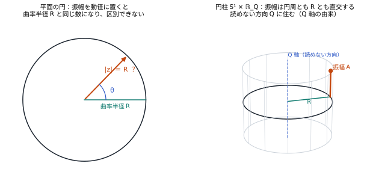
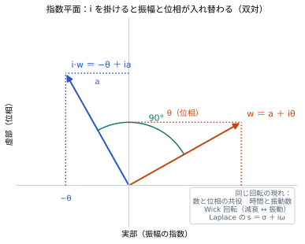
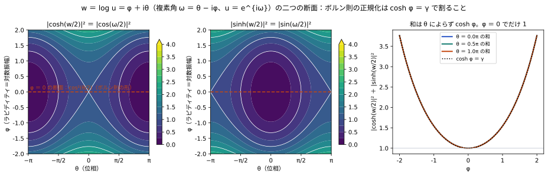
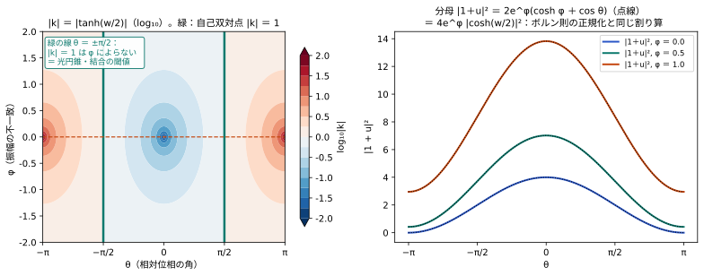
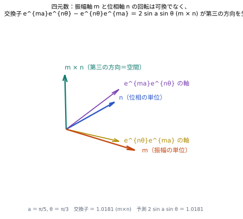
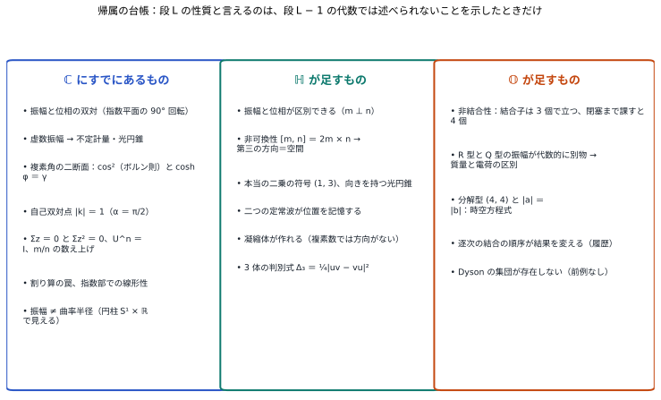

# 複素数を正しく理解していたか
## ― 振幅はどこに住むか、虚数読み、ℂ → ℍ → 𝕆 の帰属 ―

**著者：** 木原範昭（株式会社WFシステム）　ORCID 0009-0004-6753-4020
**日付：** 2026-10-23　　**版：** v1（公開前稿、Zenodo 未公開、DOI 未記入）
**同じフォルダ：** 図版と恒等式の確認 `図表/`（`make_figures.py`、`verify_identities.py`、`results/checks.txt`）、引用の対応表 `自己引用の対応表_20261023.md`・`外部引用の対応表_20261023.md`、課題の整理 `課題の整理_20261023.md`

---

## 要旨

著者の研究計画は、無名な複素数の集合 {zₙ} の関係だけから時空と粒子を読み出すことを目指し、ℝ → ℂ → ℍ → 𝕆 と構造のある数の体系を順に使ってきた。本稿はその途中で立ち止まり、複素数の段階ですでに存在している対称性を見落としていないかを点検する。点検を怠ると、四元数や八元数で見つけた性質を、その段で初めて現れたものと誤認する。点検には規則を一つ置く。**ある性質が段 L のものだと言ってよいのは、段 L − 1 の代数だけでは述べられないことを示したときだけ。**

点検は、素朴な一つの問いから始める。状態が円（または球殻）に乗っているとき、振幅はどこに住むのか。主な内容は次のとおり。

1. 平面の円では振幅 |z| と曲率半径 R が同じ数になり、二つが別物だと気づけない。曲率半径 R は測地線に沿う並進では見えず、面積を掃く閉路（ホロノミー）でしか読めない量である。振幅を動径に置くと、振幅の変化が曲率の変化になってしまう。
2. したがって振幅は、円周とも R とも直交する、読めない方向に住む。これが著者の時空方程式 x² ＋ y² ＋ z² ＋ (it)² ＋ (iR)² ＋ (iQ)² ＝ 0 の Q 軸の由来である。接方向 3 つが空間、法方向 3 つ（t、R、Q）が読めない方向で、読めない方向を虚数で書く。
3. 読めない方向にある振幅を虚数に読む。関係 u の対数 w ＝ log u ＝ φ ＋ iθ（φ ＝ 対数振幅、θ ＝ 位相）に対し、|cosh(w/2)|² ＝ (cosh φ ＋ cos θ)/2、|sinh(w/2)|² ＝ (cosh φ − cos θ)/2 で、和は 1 ではなく cosh φ ＝ γ（ローレンツ因子）である。φ ＝ 0 の断面でだけ cos²(θ/2) ＋ sin²(θ/2) ＝ 1 となり、これがボルン則の形である。確率に見せる正規化は γ で割ることであり、そこで捨てられる一次元がラピディティである。
4. 前稿の結合係数 k ＝ (1 − u)/(1 ＋ u) ＝ −tanh(w/2) の分母は |1 ＋ u|² ＝ 2e^φ(cosh φ ＋ cos θ) ＝ 4e^φ |cosh(w/2)|² で、ボルン則の正規化と同じ割り算である。|k| ＝ 1 となるのは cos θ ＝ 0 のときで、振幅の不一致 φ によらない。前稿で光円錐上の関係と同定した点が、結合と距離の自己双対点である。
5. 振幅と位相は共役・双対であり、その双対は指数平面で i を掛ける 90° の回転である。数と位相の共役、時間と振動数、Wick 回転、Laplace 変数は同じ回転の現れである。どの軸を虚部と読み、どこで割って正規化するかは、力学から導けず（自己参照）、公理として置く。ボルン則と光速度不変は、この一つの公理の二つの断面である。
6. 複素数では、虚数に読んだ振幅は位相と区別できない（単位が一つしかない）。四元数では振幅に別の単位 m ⊥ n を与えられ、振幅と位相が区別できる。しかも可換でなく、交換子 [e^{ma}, e^{nθ}] ＝ 2 sin a sin θ (m × n) が第三の方向を生む。三つで 3 次元の虚部、すなわち空間が埋まる。前稿の k が 3 次元ベクトルになる根はここにあり、k は修正ロドリゲス・パラメータの符号反転である。
7. 八元数では、振幅の単位を二つ（R の m と Q の l）と位相の n の三つ組にすると初めて結合子が立ち、R 型の振幅と Q 型の振幅が代数的に別物になる。時空側の四元数 a ＝ t ＋ xi ＋ yj ＋ zk と内部側の四元数 b ＝ R ＋ Q₁i ＋ Q₂j ＋ Q₃k で、同じ 1 ＋ 3 の分け方が繰り返される。読み B：質量 ＝ 時空曲率 R（内部側のスカラー部）、電荷 ＝ 内部曲率 Q（内部側のベクトル部）。振幅 ＝ |b|。前稿の仮説 1（質量 ∝ ノルム）はこの読みで精密化される。
8. 以上を帰属の台帳にまとめる。ℂ にすでにあるもの（双対、虚数振幅と光円錐、cos² と γ、自己双対点、U^n ＝ I と m/n、割り算の罠、振幅 ≠ 曲率半径）、ℍ が足すもの（振幅と位相の区別、第三の方向、向きを持つ光円錐、位置の記憶、凝縮体の可能性）、𝕆 が足すもの（結合子、質量型と電荷型の区別、分解型と |a| ＝ |b|、結合の順序）。

本稿で使う恒等式はすべて数値で確かめた（11 件、`図表/results/checks.txt`）。主張の区分と反証の形は §9 に置く。

**キーワード：** 複素数、四元数、八元数、振幅と位相、共役、双対、虚数読み、ラピディティ、ボルン則、ローレンツ因子、修正ロドリゲス・パラメータ、結合子、無名性、部分投射、帰属

---

## 1. 研究動機

### 1.1 出発点の問い

一般相対性理論と標準模型は統一できないのに、局所平坦に近似するとどちらも極めて高い精度で成り立つ。なぜか。任意のパラメータを持ち込まずにこれを説明する方法はないか。これが著者の研究計画の出発点であり、前稿 [S30] までの一連の論文はこの問いに、無名な複素数の集合 {zₙ} の関係だけから時空と粒子を読み出す、という方法で取り組んできた [S1] [S3] [S18] [S27] [S30]。

### 1.2 なぜ複素数に戻るのか

研究は ℝ → ℂ → ℍ → 𝕆 と、構造のある数の体系を順に使ってきた。中心投影による 4 次元空間の定式化から出発し [S29]、複素数で Σzₙ² ＝ 0 の閉塞を考え [S4] [S28]、二つの複素数で四元数を作って (1 ＋ 3) を読み出し [S27]、四元数の関係から結晶化としてのインフレーションを提案し [S30]、八元数の分解型で時空方程式を書いた [S30 §11]。

ここで一つ疑いが生じた。複素数の段階で存在している対称性を、正しく理解していたか。もし複素数の時点からあった対称性を見落としていれば、四元数や八元数で見つけた性質を、その段で初めて現れたものだと誤認する。帰属が狂えば、「なぜ四元数か」「なぜ八元数か」という問いへの答えも狂う。

したがって本稿は、先へ進む前に戻って点検する。点検には規則を一つ置く。

> **判定規則。** ある性質が段 L（ℂ、ℍ、𝕆）のものだと言ってよいのは、段 L − 1 の代数だけでは述べられないことを示したときだけである。主張ごとに、まず一つ下の段で書けるかを試し、書ければ下の段に帰属させる。

### 1.3 一つの素朴な問い

点検の入口は、素朴な問いである。複素数 z ＝ a ＋ ib を複素平面の円で読むと、振幅はそのまま実数の半径である。これを不思議に思わずに来た。しかし、状態が半径 R の円周（四元数なら 4 次元の球殻 S³）に乗っていると考えると、R はその円周の曲率半径であって、振幅とは別の量のはずである。振幅はどこに住むのか。

本稿はこの問いに沿って進む。§3 で振幅の置き場所を決め、§4 で振幅を虚数に読んだときに複素数の段で何が出るかを調べ、§5 で四元数が何を足すか、§6 で八元数が何を足すかを、判定規則で確かめながら書く。§7 に帰属の台帳、§8 に先行研究との比較、§9 に主張の区分と反証の形、§10 に結論を置く。

各節で、**数学的に自明なこと（恒等式）** と、**物理の読みとして選んでいること（どの断面を読むか、どこで割るか）** を分けて書く。

---

## 2. 約束

### 2.1 前稿から引き継ぐもの

公理と定義は前稿 [S30] と目録 [S3] のものをそのまま使う。無名性（要素は名前を持たず、特別な原点・座標・距離・符号・種類はない）[S1]、自己無撞着（系は自分自身を基準にとる）[S2]、区別可能性（読み出しはどの層の値かを区別できない）[S3]、部分投射 [S4] [S15]。線形閉塞 Σq ＝ 0 と本当の二乗の閉塞 Σq² ＝ 0 は、条件ではなく結果として扱う [S2] [S28]。

四元数の記法（q ＝ s ＋ v、極形式 q ＝ |q| e^{nθ}、共役 q̄、本当の二乗 q² ＝ (s² − |v|²) ＋ 2sv）、相対位相 u ＝ q₁⁻¹q₂、結合係数 k ＝ (q₁ ＋ q₂)⁻¹(q₁ − q₂)、距離 x ＝ k⁻¹ は前稿 [S27] [S30] のとおり。

### 2.2 記法と、割り算・原点・観測者の宣言

本系は積の系である。割り算は暗黙の正規化なので、読み出しの最後に一度だけ行い、そのたびに分母を宣言する。積の中の加法は原点を動かすので、加法を使うたびに原点を宣言する。すべての値は、誰の値かという観測者を伴う [S5] [S6]。本稿で使う量の宣言は次のとおり。

| 量 | 定義 | 分母 | 原点 | 観測者 |
|---|---|---|---|---|
| 相対位相 u | u ＝ q₁⁻¹q₂（左除算） | q₁ | — | q₁ |
| 対数 w | w ＝ log u ＝ φ ＋ iθ（複素数の場合）。φ ＝ 対数振幅 ＝ ラピディティ、θ ＝ 位相 | — | — | q₁ |
| 複素角 ω | ω ＝ θ − iφ、u ＝ e^{iω}、w ＝ iω | — | — | q₁ |
| 結合係数 k | k ＝ (1 ＋ u)⁻¹(1 − u) ＝ (q₁ ＋ q₂)⁻¹(q₁ − q₂) | 合成 1 ＋ u（＝ q₁ ＋ q₂） | 和と差の原点 O（Σq ＝ 0 が決める重心） | q₁ |
| 距離 D | D ＝ 1/\|k\| | k | 同上 | q₁ |
| 四元数の指数 | e^{ma}、e^{nθ}（m、n は単位純虚、m ⊥ n）。合成は e^{ma} e^{nθ} と e^{nθ} e^{ma} を区別し、e^{ma＋nθ} とも区別する（§5.2） | — | — | 掛ける順序で宣言 |

w で書けば cosh(w/2) ＝ cos(ω/2)、sinh(w/2) ＝ i sin(ω/2) である。本稿では w ＝ log u を主に使い、複素角 ω は対応を示すときだけ使う。

### 2.3 帰属の表記

各主張の末尾に、判定規則による帰属を【ℂ】【ℂ × ℝ】【ℍ】【𝕆】で示す。【ℂ × ℝ】は、複素数に読めない軸を一本足せば見えるもの（四元数は要らない）を指す。

---

## 3. 振幅はどこに住むか

### 3.1 平面の円では見えない

複素数 z ＝ R e^{iθ} を半径 R の円周に乗せると、振幅 |z| ＝ R である。振幅と円の半径が同じ数なので、二つが別の量であることに気づかない。振幅を「動径方向の成分」と読んで矛盾は出ない（図 2 左）。

### 3.2 曲率半径 R は閉路の面積でしか読めない

状態が半径 R の球殻 S³ に乗っているとする。局所座標は 3 次元で、R そのものは見えない。測地線（大円）に沿う並進では曲率の効果はゼロであり、面積を掃く 2 次元の移動、つまり閉路を一周して初めて、回転量 ＝ 掃いた面積 / R² として観測される（ホロノミー、Gauss–Bonnet [X3]、幾何学的位相 [X2]）。著者の系では、c ＝ 1 の面積スイープが時計であり [S7] [S8]、複素旋回波の面積の交差項から曲率の振動が読み出される [S9]。正曲率空間の測地的単位セルの歪みも面積・体積の評価として現れる [S10]。前稿 [S30] §5 は、局在した観測者には一様な曲率が見えず、潮汐だけが見えると述べた。これは同じことの言い換えである。

### 3.3 振幅を動径に置けない理由

振幅を動径方向に置くと、振幅は R と同じ軸の量になる。しかし R は閉路でしか読めない曲がりであり、振幅が変われば曲率が変わることになる。前稿 [S30] の仮説 1（質量 ∝ |q|²）を動径で読むと、質量の違う二つの状態は違う曲率半径の球殻に乗ることになり、同じ凝縮体の中で共通の曲率尺度を持てない。曲率半径の極限 [S11]、R ＝ 0 の縮退 [S12]、R の自己整合的な決定 [S13] は、いずれも R が振幅と独立に決まる量であることを前提にしている。前稿の時点で、曲率半径 R と状態の振幅 |q| を同一視してはならないことは意識されていたが（[S30] §9 の注意）、振幅の置き場所は決めていなかった。

振幅の舞台と時間方向の選択を論じた [S14]、位置が読まれていなかったことを示した読み出し階層 [S15] も、振幅が読み出しの階層のどこに置かれるかを問うていた。

### 3.4 円周とも R とも直交する方向：Q 軸の由来

振幅が動径に住めないなら、残る場所は、円周とも R とも直交する方向である。平面の円に対して、その平面の外へ立つ軸である。円は円柱 S¹ × ℝ になり、S³ なら S³ × ℝ_Q になる（図 2 右）。この軸は接方向（空間として読める）からは読めない。読めない方向を虚数で書く約束 [S27] に従えば、(iQ)² ＝ −Q² である。

これが、著者の時空方程式

x² ＋ y² ＋ z² ＋ (it)² ＋ (iR)² ＋ (iQ)² ＝ 0

の Q 軸の由来である。六つの項は、接方向 3（読める、空間）＋ 法方向 3（読めない：時間 t、曲率 R、振幅方向 Q）と分かれる。放射投影 ℝ⁶ → S⁵ の枠組み [S42] と、前稿 [S30] §11 の内部側の四元数 b ＝ R ＋ Q₁i ＋ Q₂j ＋ Q₃k は、この Q 軸を先に置いていた。本稿が加えるのは、Q が振幅の方向だという由来である。Q が三つあれば法方向は t、R、Q₁、Q₂、Q₃ の五つで、全部で八成分、八元数になる。

**図 2** 振幅の置き場所。左：平面の円では振幅を動径に置くと曲率半径 R と同じ数になり、区別できない。右：円柱 S¹ × ℝ_Q では振幅は円周とも R とも直交する読めない方向 Q に住む。

**帰属。** 振幅 ≠ 曲率半径であること、振幅が直交する軸に住むことは、複素数に読めない軸を一本足せば見える。4 次元球殻は、それを見やすくしただけである。【ℂ × ℝ】

---

## 4. 振幅を虚数に読む：複素数の段

### 4.1 指数部で読む

関係 u ＝ q₁⁻¹q₂ を指数部で読む。w ＝ log u ＝ φ ＋ iθ とすれば、φ は対数振幅（振幅の比 ρ ＝ e^φ）、θ は位相である。発展は掛け算の連鎖なので、指数部では足し算になり線形である。振幅と位相を ψ ＝ A e^{iθ} と分けて書くと、振幅は掛け算、位相は指数の中という別の扱いになり、そこで非線形が入る。Madelung の流体形式 [X11] と Bohm の量子ポテンシャル ∇²A/A [X12] が波動関数の節で発散するのは、途中で振幅と位相に分けて振幅で割るからであり、指数部だけで発展させる限り e^w は有限の w でゼロにならない。節は、読み出しの瞬間に和をとったときにだけ生じる。位相空間の面積としての保存量と Wick 回転は [S16] が扱い、平方量の読み出しによる線形単体化は [S26] が扱っている。

**帰属。** 指数部での線形性と、途中で対数を取ると発散することは、複素数の性質である。【ℂ】

### 4.2 振幅と位相の双対：i を掛けると入れ替わる

指数平面で w ＝ a ＋ iθ に i を掛けると i·w ＝ −θ ＋ ia となり、振幅の指数 a と位相 θ が入れ替わる（図 1）。振幅と位相は共役であり、その双対は指数空間の 90° 回転である。

この一つの回転は、物理のあちこちに別の名前で現れている。数（振幅²）と位相の共役 [X19] [X20] [X21]。時間と振動数、位置と波数。実の減衰 e^{−βH} と虚の振動 e^{−iHt} を結ぶ Wick 回転 [X17] [X18]、電子回路の Laplace 変数 s ＝ σ ＋ iω。著者の系では、保存量を位相空間の面積として読んだときのシンプレクティック対称性と Wick 回転 [S16] がこれにあたる。

どちらの軸を「虚部」と読むかは、この回転のどこで軸を止めるかの選択であり、成分の側に決まっているのではない [S3]。位相の巻き数という整数も、ある軸を選んで 2π で割った（円周に巻き取った）ときに初めて生まれる読み出しの産物である。

**図 1** 指数平面 w ＝ a ＋ iθ。i を掛けると i·w ＝ −θ ＋ ia で、振幅の指数と位相が入れ替わる。数と位相の共役、時間と振動数、Wick 回転、Laplace の s ＝ σ ＋ iω は同じ回転の現れである。

**帰属。** 双対そのものは複素数の性質である。【ℂ】

### 4.3 虚数読みの帰結（恒等式）

振幅の指数を虚数に読むとは、振幅を位相と同じ指数の中に、虚数単位を付けて置くことである。帰結は二段階ある。

**不定計量。** 振幅 A を iA と読めば (iA)² ＝ −A² で、二乗ノルムは負になれる。正の実数の振幅だけを認めていたからノルムが正定値で確率として読めたのであり、虚数の振幅を許せばノルムは正・負・零の不定計量になる。これは光円錐と同じ構造で、ψ ＝ 0 の節は光的な点にあたる。

**複素角の二つの断面。** w ＝ φ ＋ iθ に対し、次が成り立つ（`verify_identities.py` C0〜C2）。

|cosh(w/2)|² ＝ (cosh φ ＋ cos θ)/2、　|sinh(w/2)|² ＝ (cosh φ − cos θ)/2

|cosh(w/2)|² ＋ |sinh(w/2)|² ＝ cosh φ、　|cosh(w/2)|² − |sinh(w/2)|² ＝ cos θ

複素角 ω ＝ θ − iφ（u ＝ e^{iω}）で書けば cosh(w/2) ＝ cos(ω/2)、sinh(w/2) ＝ i sin(ω/2) であり、同じ式が cos と sin で書ける。ここから三つが読める（図 3）。

1. **φ ＝ 0 の断面は cos²(θ/2) と sin²(θ/2) で、和は 1。** これはボルン則の形である。U² ＝ I の離散系の射影の重みが cos² と sin² になること（Malus の法則と同じ幾何）、そして角 θ ＝ πm/n の回転を繰り返すと軌道が周期 n で閉じ、一周期の中でどちらの射影側に入るかの割合が整数比 m/n になることは、著者の系ではすでに [S19] [S20] [S21] が観測者–系ビートの等分布と再生核から出している。本稿はそれを「複素角の φ ＝ 0 の断面」として読み直す。
2. **θ ＝ 0 の断面は cosh²(φ/2) と sinh²(φ/2) で、和は cosh φ。** これはローレンツ因子 γ である。ブーストが虚数角の回転であること、ラピディティが加法的であることは Minkowski 以来の読みであり [X4]、複素角で回転とブーストを一つにするのは SL(2, ℂ) のスピノル計算の標準である [X5]。
3. **節は φ ＝ 0 の断面にしか現れない。** θ ＝ π でも |cosh(w/2)|² ＝ sinh²(φ/2) で、φ ≠ 0 ならゼロにならない。振幅ゼロの節は、φ ＝ 0 という一枚の断面に限って読んだときにだけ現れる。

**図 3** w ＝ log u ＝ φ ＋ iθ の二つの断面 |cosh(w/2)|² と |sinh(w/2)|²。φ ＝ 0 の断面が cos²(θ/2)（ボルン則の形）。和は θ によらず cosh φ ＝ γ で、φ ＝ 0 でだけ 1。

cosh x ＝ cos(ix) であるから、円関数と双曲線関数は同じ関数を i だけ回して読んだものである。量子力学の cos² と相対論の γ は、一つの複素指数の実の断面と虚の断面であり、群で言えば SL(2, ℂ) は SU(2) の複素化である。どちらが出ても不思議ではなく、両方が出るのが当然である。

**帰属。** 以上は恒等式であり、すべて複素数の段にある。【ℂ】

### 4.4 ボルン則の正規化と、前稿の分母

φ ＝ 0 でない一般の関係を確率に見せるには、和 cosh φ で割らなければならない。**その割り算で捨てられる一次元がラピディティ φ である。** 割った後の差は cos θ / cosh φ で、干渉の振れ幅は 1/cosh φ ＝ √(1 − v²) に縮む。正規化した瞬間に、その薄まりの原因は読めなくなる。

前稿の結合係数 k ＝ (1 − u)/(1 ＋ u) の分母は、u ＝ e^w として（`verify_identities.py` C3〜C5）

|1 ＋ u|² ＝ 1 ＋ 2e^φ cos θ ＋ e^{2φ} ＝ 2e^φ(cosh φ ＋ cos θ) ＝ 4e^φ |cosh(w/2)|²

であり、k ＝ −tanh(w/2)、|k|² ＝ (cosh φ − cos θ)/(cosh φ ＋ cos θ) である。**前稿 §2.2 で「合成 q₁ ＋ q₂」と宣言した分母は、ボルン則の正規化と同じ割り算である。** 前稿が「割り算は最後に一度、分母を宣言する」と要求した理由がここに現れる。割り算を途中でしてしまえば、φ の情報が消えたことに気づけない。

そして |k| ＝ 1 となるのは cos θ ＝ 0、すなわち θ ＝ ±π/2 のときで、**振幅の不一致 φ によらない**（図 4 左）。前稿 [S27] [S30] は |k| ＝ 1 の関係を光円錐上の関係と同定した。結合の地図 k と距離の地図 1/k が入れ替わって一致するのもこの点である（C10）。光円錐は、結合と距離の自己双対点である。

**図 4** 左：|k| ＝ |tanh(w/2)|（log₁₀）。自己双対点 |k| ＝ 1 は θ ＝ ±π/2 で、φ によらない。右：分母 |1 ＋ u|² ＝ 2e^φ(cosh φ ＋ cos θ) ＝ 4e^φ|cosh(w/2)|²。

**帰属。** 分母の恒等式と自己双対点は複素数の段にある。【ℂ】

### 4.5 複素数では振幅と位相が区別できない

ここで判定規則を使う。複素数で振幅の指数を虚数に読むと、e^{i(a ＋ θ)} となって a は θ に足し合わさり、大きさは 1 のままである（C9）。虚数読みした振幅は、位相の π/2 のずれと見分けがつかない。虚数単位が一つしかないからである。複素数の段で虚数読みから残るのは、二乗の符号の反転（Wick 回転の符号）だけである。

**帰属。** 「振幅と位相が区別できない」こと自体が、複素数の段の性質である。区別は次の段で初めて生じる。【ℂ】

### 4.6 どの断面を読み、どこで割るか

§4.3 の二つの断面のうち、量子力学は φ ＝ 0 を選んで「確率」と呼び、相対論は θ ＝ 0 を見て「速度の上限」と呼んでいる。ここまでは代数の結果であって物理ではない。物理として入ってくるのは、どの断面を読むか、どこで割って正規化するか、という選択だけである。

この選択を力学から導こうとすると、その力学自体がすでにどこかの断面で書かれているので、選択を前提にして選択を説明することになる。観測者が系の一部であり、読み出しが読み出される側に含まれている以上、この自己参照は避けられない。したがって、**どの軸を虚部と読み、どこで割るかは、公理として置く。** 既存の物理はボルン則と光速度不変を別々の二つの公理として置いているが、本節の整理では、どちらも同じ複素指数のどの断面を読みどこで割るかという一つの選択から出る。導出はできないが、二つの公理が一つに統合される。

どの虚数単位で読むかが力学の種類を選ぶという見方は、Heisenberg 群の表現を楕円型（i² ＝ −1、量子力学）・放物型（ε² ＝ 0、古典力学）・双曲型（j² ＝ ＋1、双曲力学）に分けた Kisil [X16] が最も近い。振幅を分解型に読む量子力学は Khrennikov [X13] [X14] が提案し、負の確率が出るという批判がある [X15]。確率を有理数 m/n の数え上げとして読む立場は Palmer の不変集合理論 [X22] [X23] と 't Hooft のセルオートマトン解釈 [X24] にあり、著者の系では有限位数 U^n ＝ I [S2] [S22] と有理ロック [S23] [S24] がそれにあたる。

**帰属。** 選択が公理であることは、どの段にも共通する。【ℂ】

---

## 5. 四元数の段：振幅と位相が区別でき、空間が生まれる

### 5.1 別の単位を与える

四元数では、振幅に位相とは別の虚数単位 m（m ⊥ n）を与えられる。q ＝ e^{ma ＋ nθ} の指数は純虚なので |q| ＝ 1 のまま、全部が S³ の上の回転である。振幅が動いてもノルムは動かない。「全体のスケールは読めない」[S3] が、公理ではなく構造になる。m と n は直交する別の方向なので、振幅と位相が区別できる。

**帰属。** 複素数では単位が一つで区別できなかった（§4.5）。区別できることは四元数が足すものである。【ℍ】

### 5.2 非可換性が第三の方向を生む

m と n の回転は可換でない。単位純虚 m ⊥ n について（`verify_identities.py` C7）

e^{ma} e^{nθ} − e^{nθ} e^{ma} ＝ 2 sin a sin θ (m × n)

である。振幅と位相の二つの虚数読みが、掛け算の順序を通して第三の方向 m × n を生み、三つで 3 次元の虚部、すなわち空間が埋まる（図 5）。合成回転の軸は、掛ける順序で m × n 成分の符号が反転する。この順序の違いが、前稿 [S27] の左除算・右除算であり、観測者の枠の選択である。さらに e^{ma ＋ nθ} と e^{ma} e^{nθ} は別物であり（Baker–Campbell–Hausdorff の補正、C8）、どちらを「振幅と位相を合わせた状態」と呼ぶかにも順序の宣言が要る（§2.2）。

振幅と位相の双対（§4.2）を四元数で見ると、振幅軸 m と位相軸 n を入れ替える回転は、第三の軸 m × n のまわりの 90° の空間回転である。複素数の段で「指数平面の回転」だった双対が、四元数では空間の一つの回転と同じものになる。

**図 5** 四元数：振幅軸 m と位相軸 n の回転は可換でなく、交換子 e^{ma}e^{nθ} − e^{nθ}e^{ma} ＝ 2 sin a sin θ (m × n) が第三の方向を生む。合成回転の軸は順序で m × n 成分の符号が反転する。

**帰属。** 第三の方向は非可換性から出る。複素数にはない。【ℍ】

### 5.3 前稿の k は修正ロドリゲス・パラメータである

前稿の結合係数は、単位四元数 u ＝ e^{nα} に対し k ＝ (1 ＋ u)⁻¹(1 − u) ＝ −n tan(α/2) ＝ −Im u / (1 ＋ Re u) である（C6）。これは**修正ロドリゲス・パラメータ**（MRP）の符号を反転したものである。MRP は単位四元数の立体射影座標で、航空宇宙の姿勢力学で古くから使われ [X29] [X30]、CG・ビジョンには Terzakis ほか [X28] が導入した。前稿が「相対位相の平方根の中心投影」と呼んだものは、この既知の写像である。

既存の MRP は三次元空間の中の回転姿勢を表すために使う。前稿は同じ写像を、背景空間を置かない状態間の関係を位置として読むために使った。写像の再発見と、読み出し原理としての位置づけは分けて書く。二つの複素数から三次元ベクトルへの古典的な写像（Kustaanheimo–Stiefel 変換 [X31]、Hopf 写像 [X32]）は定義に特別な方向の選択を含み、無名性の点で異なる。

k が 3 次元のベクトルになる根は §5.2 の第三の方向にある。二つの定常波が内在的に三次元の位置を記憶できるという前稿 [S27] の核心は、振幅と位相の二つの虚数読みが非可換であることの帰結として読める。

**帰属。** 3 次元ベクトルとしての k は四元数の段にある。【ℍ】

### 5.4 (1, 3) と、向きを持つ光円錐

前稿 [S27] は、共役をとらない本当の二乗のスカラー部 q₀² − |v|² が (1, 3) の符号を持ち、θ ＝ 45° が光円錐になることを示した [S28]。§4.3 の整理に照らすと、符号の反転（1 ＋ 1 の光円錐）は複素数の段にすでにあり、四元数が足したのは、光円錐が点の対ではなく**向き n を持つ錐**になることである。前稿が「光円錐は本当の二乗から出る」と書いた帰属は、こう精密化される。|k| ＝ 1 が光円錐上の関係であること自体は §4.4 のとおり複素数の段にあり、四元数はそこに向きを与える。

**帰属。** 符号は【ℂ】、向きを持つ錐は【ℍ】。

### 5.5 複素数では凝縮体が作れず、四元数で作れる理由

著者は、無名な複素数の集合から、背景も接続関係も与えずに局所的な結合構造（凝縮体）を作る問題で長く止まった。複素数の相対位相 u ＝ e^{i(θ_b − θ_a)} は一つの角度で、積は可換である。複数の関係がどの方向に広がり、どう組み合わさって三次元の局所構造を作るかが決まらない。四元数では相対位相 u ＝ e^{nα} が方向 n を持ち、二つの関係の方向について ab − ba ＝ 2a × b という非可換な構造があるので、方向どうしの区別、平行性、三角形や四面体の構成が考えられる。前稿 [S30] の凸包と四面体の結晶化は、ここから出る。

三つの四元数 q₁、q₂、q₃ が一枚の複素位相面に収まらないことは、正規化 pᵢ ＝ qᵢ/|qᵢ|、gᵢⱼ ＝ Re(p̄ᵢpⱼ) として判別式 Δ₃ ＝ det[gᵢⱼ] ＝ ¼|uv − vu|²（u ＝ q₁⁻¹q₂、v ＝ q₁⁻¹q₃）で判定できる。Δ₃ ＝ 0 なら相対位相の方向が同一直線上にあり複素数的、Δ₃ > 0 なら独立な二方向があり四元数的である。凝縮体の定義（共通の曲率尺度、ロック）は次の論文で扱う。

ここで区別しておく。複素定常波の真空から局在凝縮体・重心・質量的計量を**読み出す**ことは [S31] [S32] が行っている。本節で「作れない」と言うのは読み出しではなく、**自律的な結合**（どの状態とどの状態が結合するかを外から与えずに決まること）である。空間・物質・時計の生成条件が一致しないこと [S33] は、この区別と関係する。

**帰属。** 方向を持つ関係と凝縮体の可能性は四元数の段にある。【ℍ】

---

## 6. 八元数の段：質量型と電荷型の振幅が区別される

### 6.1 二つの元は結合的で、三つで結合子が立つ

任意の二つの八元数が生成する部分代数は結合的である（Artin の定理 [X36]）。二つの元をどれだけ掛けても四元数から抜け出せない。結合子 [a, b, c] ＝ (ab)c − a(bc) は三つの元で初めて検査でき、本当の二乗の閉塞まで課すと、八元数として閉じる最小の組は四つ（線形閉塞も課せば五つ）である [S30] [S4]。割り算のできる数の体系が 1・2・4・8 次元に限ること（Hurwitz [X37]、Baez [X27]）と合わせると、八元数は、三つ組の積の順序まで含めて初めて記述できる段である。

### 6.2 振幅の型が二つに分かれる

振幅の虚数単位を二つ（R の方向 m と Q の方向 l）、位相の単位 n と合わせて三つの独立な虚数方向にすると、ここで初めて結合子が 0 でなくなる。四元数では R と Q に別の単位を与えても、二つの虚数は必ず結合的な部分代数に収まり、どちらを質量と呼ぶかは名前の付け替えにすぎない。八元数では R・Q・位相の三つ組が非結合になり、**R 型の振幅と Q 型の振幅は代数的に別物になる。**

これは「なぜ質量と電荷を区別して測れるのか、別の実体なのか、同じものの別の読み出しではないのか」という問いに、「三つ目の虚数読みで初めて結合子が立つから」という代数の答えを与える。区別できるという事実そのものが、三つの虚数方向の非結合性である。

**帰属。** 二種類の振幅の区別は八元数の段にある。【𝕆】

### 6.3 分解型と |a| ＝ |b|

内部側の振幅 (R, Q₁, Q₂, Q₃) をすべて虚数に読むことは、前稿 [S30] §11 の分解型八元数（γ ＝ ＋1、符号 (4, 4)）を選ぶことそのものである。Cayley–Dickson 構成 (a, b) で a を時空側、b を内部側の四元数とすると、ヌル条件 N(o) ＝ |a|² − |b|² ＝ 0 は |a| ＝ |b|、すなわち

x² ＋ y² ＋ z² ＋ t² ＝ R² ＋ Q₁² ＋ Q₂² ＋ Q₃²

である。通常の八元数のノルムは正定値で非自明なヌル元を持たないから、閉塞が非自明であるためには分解型が要る。これは、Σxₙ² ＝ 0 が実数では自明解しか持たず複素数を要求する [S4] [S28] のと同じ論理である。

### 6.4 読み B：質量 ＝ 時空曲率 R、電荷 ＝ 内部曲率 Q

§3.4 で振幅は Q 軸に住むとした。ここで二つの読みが並ぶ。

- **読み A。** 振幅は Q に住み、質量 ＝ 振幅、電荷 ＝ その向き。
- **読み B。** 質量 ＝ 時空曲率 R そのもの、電荷 ＝ 内部曲率 Q そのもの。電荷は時空曲率に影響せず、内部曲率にだけ影響する。

本稿は B を採る。理由は三つある。第一に、質量が時空を曲げるという一般相対論そのものであり、前稿 [S30] §6.3 の「重力の源はノルムの不均一」は「R の不均一」と読み直せばそのまま成り立つ。第二に、電荷が内部幾何であるのは Kaluza–Klein 型の読みである。第三に、著者の内部記録と一致する。粒子の種類を tRQ₁Q₂Q₃ の符号ベクトルで読み、電荷が Q の符号から出ること [S34] [S35] [S36]、世代の構造 [S37]、質量の階層が R の相として現れること、規格化の基準を質量から電荷へ変えても状態の生成が変わらないこと [S25]。

読み B の辞書は、時空側と内部側で同じ 1 ＋ 3 を繰り返す（表 1）。

**表 1** 時空側と内部側の辞書（読み B）。

| 側 | 四元数 | スカラー部 | ベクトル部 |
|---|---|---|---|
| 時空側 | a ＝ t ＋ xi ＋ yj ＋ zk | t ＝ 時間 | (x, y, z) ＝ 空間 |
| 内部側 | b ＝ R ＋ Q₁i ＋ Q₂j ＋ Q₃k | R ＝ 質量（時空曲率） | (Q₁, Q₂, Q₃) ＝ 電荷（内部曲率） |

振幅とは内部側のノルム |b| ＝ √(R² ＋ ΣQ²) であり、ヌル条件 |a| ＝ |b| は「時空側の在庫 ＝ 内部側の在庫」である。前稿の仮説 1「質量 ∝ |q|²」は、読み B では「質量 ∝ 内部側のスカラー部 R」に精密化され、振幅のうち Q の部分は質量ではなく電荷として読まれる。本稿はこれを前稿 §6 の訂正として明記する。

読み B から出る読み（確かめる前のもの）が二つある。電荷は内部 3 ベクトルの**向きと符号**で、符号ベクトルは離散（一世代 16 通り [S34] [S36]）なので量子化される。質量はスカラーの**大きさ**で連続な値を取れる。電荷が e の整数倍でしか現れず、質量に階層はあっても量子化の規則が見えないことと合う。また、透過率として読んだ素電荷 1 − R ＝ sin²θ ＝ √(4πα) ＝ e_HL [S17] [S18] [S38] [S39] [S40] [S41] は、電荷の**大きさ**が普遍（内部ベクトルの長さが固定）であることを言い、符号と向きが Q の選択であることとは分けて読む。

前稿の k は時空側 a から作るので、そのベクトル部は空間の向きであって電荷ではない。電荷を読むには内部側 b の相対位相 u_b ＝ b₁⁻¹b₂ と k_内部 ＝ (1 ＋ u_b)⁻¹(1 − u_b) が要る。そのスカラー部（R の比 ＝ 質量比）とベクトル部（Q の向きの差 ＝ 電荷の関係）が、時空側の k と |a| ＝ |b| でどう結ばれるかが、読み A と B の決着であり、次の課題である（§9）。

**帰属。** 質量と電荷という名前をどちらの法方向に付けるかは読み出しの選択であり、成分の側に色はない。決め手は、R 側で一般相対論型、Q 側でゲージ型の読み出しが無矛盾に出るかである。この区別が代数的に成り立つのは八元数の段である。【𝕆】

### 6.5 前例がない段

Dyson の threefold way [X41] により、行列の集団（ランダム行列の対称性類）は ℝ・ℂ・ℍ の三つだけで、八元数にはない。四元数までは対数ガス・Dyson のブラウン運動・Sutherland 模型という厳密に解ける多体系の前例があるが、八元数の多体の力学には前例がない。八元数と標準模型の対応は Gürsey–Tze 以来の系譜があり [X38] [X39] [X40]、本稿はそこへ、振幅の二つの型という読みを加える位置にある。動力学は本稿の範囲外で、次の論文で扱う（§9）。

---

## 7. 帰属の台帳

判定規則で各主張を仕分けると、表 2 になる（図 6）。

**表 2** 帰属の台帳。

| ℂ にすでにあるもの | ℍ が足すもの | 𝕆 が足すもの |
|---|---|---|
| 振幅と位相の双対（指数平面の 90° 回転）§4.2 | 振幅と位相が区別できる（m ⊥ n）§5.1 | 非結合性：結合子は 3 個で立ち、閉塞まで課すと 4 個 §6.1 |
| 虚数振幅 → 不定計量・光円錐 §4.3 | 非可換性 [m, n] ＝ 2m × n → 第三の方向 ＝ 空間 §5.2 | R 型と Q 型の振幅が代数的に別物 → 質量と電荷の区別 §6.2 |
| 複素角の二断面：cos²（ボルン則）と cosh φ ＝ γ §4.3 | 本当の二乗の符号 (1, 3)、向きを持つ光円錐 §5.4 | 分解型 (4, 4) と \|a\| ＝ \|b\|：時空方程式 §6.3 |
| 自己双対点 \|k\| ＝ 1（θ ＝ ±π/2、φ によらない）§4.4 | 二つの定常波が位置を記憶する §5.3 | 逐次の結合の順序が結果を変える（履歴）§6.1 |
| Σz ＝ 0 と Σz² ＝ 0、U^n ＝ I、m/n の数え上げ §4.6 | 凝縮体が作れる（複素数では方向がない）§5.5 | Dyson の集団が存在しない（前例なし）§6.5 |
| 割り算の罠、指数部での線形性 §4.1、§4.4 | 三体の判別式 Δ₃ ＝ ¼\|uv − vu\|² §5.5 | |
| 振幅 ≠ 曲率半径（円柱 S¹ × ℝ で見える）§3 | | |

**図 6** 帰属の台帳。ℂ にすでにあるもの／ℍ が足すもの／𝕆 が足すもの。

点検の途中で、著者自身が誤認しかけた例を三つ記録しておく。第一に、振幅と曲率の直交を 4 次元球殻の性質として書きかけたが、円柱 S¹ × ℝ で見える。第二に、γ を四元数の (1, 3) 符号の帰結と読みたくなるが、複素角にある。四元数が足すのは符号ではなく空間の 3 方向である。第三に、前稿 [S27] は光円錐を「本当の二乗から出る」と書いたが、|k| ＝ 1 の関係は複素数にあり、四元数が足したのは錐の向きである。

---

## 8. 先行研究との比較

本稿の部品の一つ一つには、物理解釈を与えた先行研究がある。本稿の位置は、それらを一本にしたことと、台帳の右側にある。

| 部品 | 先行研究 | 本稿との違い |
|---|---|---|
| 位相 ＝ 空間の平面での回転 | Hestenes の実 Dirac 理論 [X6] [X7] [X8]：Dirac 方程式の i はスピンの向きに対応する空間的平面の回転の生成子。β（Yvon [X9]、Takabayasi [X10]）は双対回転の角 | 振幅 ρ を実数のまま位相と分けている。振幅の虚数読みはない |
| ブースト ＝ 虚数角の回転、γ ＝ cosh θ | Minkowski [X4]、Penrose–Rindler [X5] | ボルン則の正規化との同一視はない |
| どの虚数単位で読むかが力学を選ぶ | Kisil [X16]（楕円・放物・双曲）、Khrennikov [X13] [X14]、批判 [X15] | 単位の選択を理論ごとに行う。同じ一つの対象を二つの断面で読む、ではない |
| 実の指数 ↔ 虚の指数 ＝ 温度 ↔ 時間 | KMS、Connes–Rovelli [X17]、虚時間 [X18] | 統計と量子の入れ替えに限る |
| 数と位相の共役 | Dirac [X19]、Susskind–Glogower [X20]、Pegg–Barnett [X21] | 演算子の共役。指数空間の回転としての読みはない |
| cos² ＝ m/n の数え上げ、ベルを離散性で | Palmer [X22] [X23]、't Hooft [X24] | フラクタル不変集合・計算不能性から。有限位数 U^n ＝ I からではない |
| 写像 k ＝ −n tan(α/2) | 修正ロドリゲス・パラメータ [X28] [X29] [X30] | 回転姿勢の表示。位置の読み出しではない |
| 関係から幾何を再構成 | Penrose–Szabados 系列 [X33] [X34] [X35]：量子系の対称性と観測量から三次元空間・ミンコフスキー時空を再構成。背景の物理空間を置かず時間発展方程式も使わない | 既知の対称群（SU(2)、E(3)、Poincaré）と運動量・角運動量の観測量から出発する。無名の定常状態の相対関係から出発する構成ではない |
| 八元数と標準模型 | Singh [X40]（行列力学、例外ジョルダン代数、1/137）、Furey [X38] [X39]（対称変換の作用の一致から標準模型の群） | 進行位相すら置かない定常状態からの最小構成ではない。本稿は振幅の二つの型を加える |
| 3 次元空間は量子構造から一意に出ない | Stoica [X1] | 本稿も同じ立場（読み方の選択が入る）。四元数の定義と幾何は [X25] [X26] |

本稿にしかないのは次の四点である。cosh φ ＝ γ がボルン則の正規化で捨てる一次元であり、ボルン則と光速度不変が一つの公理の二つの断面であること（§4.4、§4.6）。振幅と位相の双対の自己双対点が光円錐であること（§4.4）。虚数読みを ℂ → ℍ → 𝕆 と上げると、位相との区別、次に質量型と電荷型の区別が結合子で生じること（§5、§6）。振幅を S³ の法方向 Q に住まわせること（§3.4）。

動力学の文献（蔵本模型 [X42]、位相を複素化した蔵本模型 [X43] [X44]、著者の蔵本型位相結合 [S43]、インフレーションの線形不安定 [S44] [S45] [S46] [S47]）は、本稿では引くだけで結果を使わない。

---

## 9. 主張の区分、検証、反証条件

### 9.1 主張の区分

| 主張 | 区分 |
|---|---|
| §4.3 の恒等式（二断面、和 ＝ cosh φ、差 ＝ cos θ）、§4.4 の分母と \|k\|² の式、§5.2 の交換子、§5.3 の MRP の一致、§4.5 の合流、§6.1 の Artin の定理 | 数学的に同一（`verify_identities.py` C0〜C10 で数値確認） |
| 振幅は動径に住めず直交する虚数方向に住む（§3）、どの断面を読みどこで割るかは公理（§4.6）、読み B（§6.4）、帰属の台帳（§7） | 読みの選択 |
| 電荷が量子化され質量が連続に見える理由（§6.4）、k_内部 で読み B が決着すること（§6.4） | 仮説 |

### 9.2 確かめたこと

`図表/verify_identities.py` が 11 件の恒等式を固定格子（θ ∈ [−π, π] × φ ∈ [−3, 3]、721 × 301 点）で確かめ、すべて 10⁻¹⁰ 以下の誤差で一致した（`results/checks.txt`）。乱数は使っていない。四元数の恒等式（C6〜C8）は単位四元数の積を直接計算した。

### 9.3 帰属の反証

判定規則の適用は、それ自体が反証の形を持つ。

1. 複素数だけで 3 方向の読み出しが作れれば、「第三の方向は四元数が足す」（§5.2）は誤りである。
2. 四元数だけで質量と電荷の区別が代数的に出れば、「二種類の振幅の区別は八元数が足す」（§6.2）は誤りである。
3. 振幅を動径に置いて、同じ凝縮体の中で共通の曲率尺度を保てる読みが作れれば、§3.3 は落ちる。
4. 内部側の k_内部 を計算して、読み A のほうが R 側で一般相対論型、Q 側でゲージ型の読み出しを無矛盾に出すなら、読み B は落ちる。

### 9.4 次の課題

1. 内部側の k_内部 ＝ (1 ＋ u_b)⁻¹(1 − u_b) を書き、そのスカラー部とベクトル部が時空側の k と |a| ＝ |b| でどう結ばれるかを確かめる（読み B の決着）。
2. 凝縮体の定義（Δ₃、共通の曲率尺度、動的なロック）。
3. 複素角で振幅と位相を合わせた状態を e^{ma ＋ nθ} と e^{ma} e^{nθ} のどちらで書くかの宣言、左右の除算、八元数の括弧の順序。
4. 動力学：土台の族（複素化蔵本 [X43] [X44]、著者の蔵本型結合 [S43]）、相対位相の関数の形（第一調和 (u − u⁻¹)/2 か、全奇数調和の (1 − u)/(1 ＋ u) か）、最小の系（八元数は 4、線形閉塞も課すと 5、等方性まで課すと 8 以上）、観測者を遠方の吸収体とする 2 体反応 [S48]、局在波の倍音の交換 [S49]、近くにあるのにロックしない組の判別 [S50]。
5. 前稿 [S30] §13 の数値実験 V1〜V5。本稿では走らせていない。

---

## 10. 結論

振幅はどこに住むか、という素朴な問いから始めた。平面の円では振幅と曲率半径が同じ数で区別できないが、曲率半径は閉路の面積でしか読めない量であり、振幅はそこに住めない。振幅は円周とも曲率半径とも直交する読めない方向に住み、それが著者の時空方程式の Q 軸の由来である。

読めない方向にある振幅を虚数に読むと、複素数の段ですでに、振幅と位相の双対（指数平面の 90° 回転）、不定計量と光円錐、cos²（ボルン則の形）と cosh φ ＝ γ（ローレンツ因子）という同じ複素指数の二つの断面、結合と距離の自己双対点 |k| ＝ 1 ＝ 光円錐、そして前稿の分母 |1 ＋ u|² がボルン則の正規化と同じ割り算であることが出る。どの断面を読みどこで割るかは公理であり、ボルン則と光速度不変はその一つの公理の二つの断面である。

複素数では虚数読みした振幅と位相は区別できない。四元数は別の単位 m ⊥ n でこれを区別し、非可換性 [m, n] ＝ 2m × n が第三の方向、すなわち空間を生む。前稿の k は修正ロドリゲス・パラメータであり、二つの定常波が位置を記憶できる根はここにある。八元数は振幅の型を R と Q の二つに分け、三つ組の結合子によって質量型と電荷型の振幅を代数的に別物にする。時空側 a ＝ t ＋ xyz と内部側 b ＝ R ＋ Q₁Q₂Q₃ で同じ 1 ＋ 3 が繰り返され、質量 ＝ 時空曲率 R、電荷 ＝ 内部曲率 Q と読む。

帰属の台帳は、各段が何を足したかを一つ下の段で反証できる形にした。複素数を正しく理解していたかという問いへの答えは、「複素数の段にあるものは思っていたより多く、四元数と八元数が足すものは思っていたより限定されていて、しかもその限定された部分が、空間と、質量と電荷の区別である」というものである。

---

## 参考文献

### 自己引用（Concept DOI、10.5281/zenodo.〔番号〕）

[S1] 木原範昭「無名等振幅複合波モデル基本公理系 v9」2026-07-24. Concept DOI 10.5281/zenodo.21315735.
[S2] 木原範昭「零閉包・有限位数・自己無撞着幾何からの対称性生成――唯一の外部指定パラメータ N と、一般化・動力学導出という残された課題」2026-08-20. Concept DOI 10.5281/zenodo.22028072.
[S3] 木原範昭「状態空間から時空を読み出すための対称性とマジックナンバーの目録 ― 無名性と自己無撞着を公理とする研究計画の答え合わせの基準 ―」2026-10-18. Concept DOI 10.5281/zenodo.23444451.
[S4] 木原範昭「無名部分投射による物理的対称性選択の公理的枠組み」2026-07-24. Concept DOI 10.5281/zenodo.21521899.
[S5] 木原範昭「あるモデル粒子をめぐる思考実験（続）——総和ゼロ条件から見る第五の振動数と合成曲率」2026-06-04. Concept DOI 10.5281/zenodo.20535894.
[S6] 木原範昭「あるモデル粒子をめぐる思考実験——位相面積の床から次元の許容条件へ」2026-06-03. Concept DOI 10.5281/zenodo.20528511.
[S7] 木原範昭「AB二体閉鎖位相系における調和読出しとc=1面積スイープ予備実験総括 v4」2026-07-15. Concept DOI 10.5281/zenodo.21318696.
[S8] 木原範昭「第二思考実験：クーロン型の逆二乗の力を、積の読み出しと面積の時計から導く」2026-09-21. Concept DOI 10.5281/zenodo.22867336.
[S9] 木原範昭「複素旋回波の面積交差項による曲率振動の読出し」2026-09-01. Concept DOI 10.5281/zenodo.22230940.
[S10] 木原範昭「論文0:正曲率定曲率空間における測地的単位セルの歪み — 一辺・角・面積・体積の厳密評価」2026-07-11. Concept DOI 10.5281/zenodo.20680269.
[S11] 木原範昭「中心投影における曲率半径の極限についての考察」2026-04-12. Concept DOI 10.5281/zenodo.19526548.
[S12] 木原範昭「超球殻間の中心投影の正則性: 接超平面を介さない定式化と R = 0 における縮退」2026-04-22. Concept DOI 10.5281/zenodo.19692191.
[S13] 木原範昭「曲率半径の自己整合的決定と Tangherlini 蒸発スケーリングの回復（論文5：動力学的接続）」2026-04-28. Concept DOI 10.5281/zenodo.19837595.
[S14] 木原範昭「論文14:時間方向の選択と振幅の舞台 — マーキング定理・導出 Z₄ 位相・反転ホロノミー・正準規約」2026-06-14. Concept DOI 10.5281/zenodo.20665661.
[S15] 木原範昭「論文13:位置は読まれていなかった — 符号セクター・双対性定理・読み出し階層・導出時計」2026-06-14. Concept DOI 10.5281/zenodo.20665633.
[S16] 木原範昭「位相空間の面積としての保存量と不確定性——シンプレクティック対称性・Wick 回転・Stone の定理の統一的視点」2026-06-03. Concept DOI 10.5281/zenodo.20521566.
[S17] 木原範昭「第十二思考実験：微細構造定数から観測写像とゲージ対称性へ」2026-10-08. Concept DOI 10.5281/zenodo.23226258.
[S18] 木原範昭「背景時空を置かない複素波の関係と干渉から、時間・空間・質量・電荷・並進速度・スピンを読み出す――閉じた円周の住民から四次元球殻の住民へ、そして α・四次元格子・E₈ に至る、思考実験の順序に沿った統合仮説――」2026-10-15. Concept DOI 10.5281/zenodo.23384928.
[S19] 木原範昭「観測者–系ビートの等分布によるボルン統計の創発 ― 局在核モデル上の予想」2026-06-28. Concept DOI 10.5281/zenodo.20967081.
[S20] 木原範昭「局在奇数倍音波の再生核性によるボルン分布の形の導出 ― 残す公準を二乗則とランダム性に絞る」2026-06-27. Concept DOI 10.5281/zenodo.20965526.
[S21] 木原範昭「観測者–系ビート予想の関連先行研究調査 ― 先行プログラムとの関係および検証可能領域の所在（補遺）」2026-06-28. Concept DOI 10.5281/zenodo.20985749.
[S22] 木原範昭「反復交換散乱における有限位数共鳴の発見」2026-07-18. Concept DOI 10.5281/zenodo.21421366.
[S23] 木原範昭「無名二チャネル閉鎖波系におけるロック動力学」2026-08-02. Concept DOI 10.5281/zenodo.21763999.
[S24] 木原範昭「ロック後の幾何——元の面と終端面が張る4次元（2つの非零主角）、面の乗り換えは長窓SVDの集約アーティファクトでない」2026-09-12. Concept DOI 10.5281/zenodo.22729107.
[S25] 木原範昭「第六思考実験 補遺：規格化基準を質量から電荷単位へ変更しても状態生成は変わるか」2026-09-27. Concept DOI 10.5281/zenodo.22985299.
[S26] 木原範昭「平方量読出しによる線形単体化と曲率補正候補の次元別整理」2026-06-21. Concept DOI 10.5281/zenodo.20785539.
[S27] 木原範昭「複素数の集合から時空 (1＋3) への写像 ― 四元数による読み出しと部分投射 ―」2026-10-18. Concept DOI 10.5281/zenodo.23451494.
[S28] 木原範昭「ゼロ閉塞は4次元だった — 主張案 v4」2026-08-12. Concept DOI 10.5281/zenodo.21902805.
[S29] 木原範昭「中心投影による4次元空間の幾何学的定式化」2026-04-05. Concept DOI 10.5281/zenodo.19427779.
[S30] 木原範昭「四元数の関係読み出しと、結晶化としてのインフレーション ― 無名性を保った自律的構造化と部分投射 ―」2026-10-21. Concept DOI 10.5281/zenodo.23523237.
[S31] 木原範昭「無名複素定常波真空からの局在凝縮体・重心・質量的計量の読出し」2026-09-03. Concept DOI 10.5281/zenodo.22282689.
[S32] 木原範昭「空間軸3軸と固有時間の創生——凝縮体からの読出しの再導出と、唯一読めない座標時間」2026-08-06. Concept DOI 10.5281/zenodo.21816651.
[S33] 木原範昭「空間・物質・時計の生成条件は一致しない——シードが粒子を生む条件と分解能の下限」2026-08-10. Concept DOI 10.5281/zenodo.21874481.
[S34] 木原範昭「質量構造の考察——軸スケール値と符号付き面積による質量分析の枠組み」2026-04-26. Concept DOI 10.5281/zenodo.19731609.
[S35] 木原範昭「符号付き面積の定式化——電荷構造の導出とスピン2配置の帰結」2026-04-26. Concept DOI 10.5281/zenodo.19731599.
[S36] 木原範昭「ゲージボソンの質量構造——符号ベクトルが示すヒッグス非関与性」2026-04-24. Concept DOI 10.5281/zenodo.19731607.
[S37] 木原範昭「世代混合の幾何学的構造——CKM行列とPMNS行列の定性的導出」2026-04-26. Concept DOI 10.5281/zenodo.19731601.
[S38] 木原範昭「微細構造定数の幾何学的恒等式：4次元単位球の体積とその充填不足から（論文7：α 恒等式）」2026-04-29. Concept DOI 10.5281/zenodo.19869266.
[S39] 木原範昭「4次元超立方格子上の鎖複体構造：Kihara 充填と Wilson 格子ゲージ理論の構造的対応（論文8：α 恒等式 II）」2026-04-29. Concept DOI 10.5281/zenodo.19880467.
[S40] 木原範昭「BH 熱力学プログラム 論文 9：α 自己整合方程式における 0.036 ドリフトの幾何学的起源」2026-05-21. Concept DOI 10.5281/zenodo.20319436.
[S41] 木原範昭「Release Notes: 交換重み G_R = 1 - R の選別と微細構造定数対応候補 v1」2026-07-16. Concept DOI 10.5281/zenodo.21396760.
[S42] N. Kihara, "Radial Projection: Definition and Relation to Central Projection," v3.3, 2026-06-06. Concept DOI 10.5281/zenodo.20462569.
[S43] 木原範昭「関係波閉鎖系における単一波の運動方程式——L(K_N) 上の蔵本型位相結合と、90°位相差骨格での自己無撞着床の条件」2026-09-12. Concept DOI 10.5281/zenodo.22728760.
[S44] 木原範昭「インフレーション曲線は床の線形不安定モードの指数増幅である——床ヤコビアンの最大固有値と非正規・時変補正」2026-09-12. Concept DOI 10.5281/zenodo.22729095.
[S45] 木原範昭「90度床からの自発的対称性の破れと縮退真空——微小シードによる対称性の破れと Δ=−2π/N ロック（N=6,…,40 全数）」2026-09-12. Concept DOI 10.5281/zenodo.22729088.
[S46] 木原範昭「幾何級数的急拡大は不安定な自己無撞着閉包に固有である——一般零閉塞初期状態による開始様式の因果判別」2026-08-05. Concept DOI 10.5281/zenodo.21798854.
[S47] 木原範昭「自己無撞着な関係波閉鎖系におけるインフレーション的急拡大の機構——正規化監査、rank 生成、二乗閉包保存、simplex 対称化および公理系の再構成」2026-08-30. Concept DOI 10.5281/zenodo.22112008.
[S48] 木原範昭「第十一思考実験：背景時空を置かない二体系の放出記録」2026-10-07. Concept DOI 10.5281/zenodo.23199299.
[S49] 木原範昭「第十三思考実験：質量を獲得した粒子は、なぜ散逸して消滅しないのか？」2026-10-10. Concept DOI 10.5281/zenodo.23266250.
[S50] 木原範昭「第十四思考実験：なぜ異なる対称性は、完全には整合できないのか？」2026-10-12. Concept DOI 10.5281/zenodo.23315557.

### 外部文献

[X1] O. C. Stoica, "3D-Space and the preferred basis cannot uniquely emerge from the quantum structure," arXiv:2102.08620.
[X2] M. V. Berry, "Quantal phase factors accompanying adiabatic changes," Proc. R. Soc. Lond. A 392, 45–57 (1984).
[X3] M. P. do Carmo, *Differential Geometry of Curves and Surfaces* (Prentice-Hall, 1976).
[X4] H. Minkowski, "Raum und Zeit," Physikalische Zeitschrift 10, 104–111 (1909).
[X5] R. Penrose, W. Rindler, *Spinors and Space-Time*, Vol. 1 (Cambridge University Press, 1984).
[X6] D. Hestenes, "Real Spinor Fields," J. Math. Phys. 8, 798–808 (1967).
[X7] D. Hestenes, "The zitterbewegung interpretation of quantum mechanics," Found. Phys. 20, 1213–1232 (1990).
[X8] D. Hestenes, "Spacetime physics with geometric algebra," Am. J. Phys. 71, 691–714 (2003).
[X9] J. Yvon, "Équations de Dirac-Madelung," J. Phys. Radium 1, 18–24 (1940).
[X10] T. Takabayasi, "Relativistic Hydrodynamics of the Dirac Matter," Prog. Theor. Phys. Suppl. 4, 2–80 (1957).
[X11] E. Madelung, "Quantentheorie in hydrodynamischer Form," Z. Phys. 40, 322–326 (1927).
[X12] D. Bohm, "A Suggested Interpretation of the Quantum Theory in Terms of 'Hidden' Variables. I," Phys. Rev. 85, 166–179 (1952).
[X13] A. Khrennikov, "Hyperbolic quantum mechanics," arXiv:quant-ph/0101002 (2001).
[X14] A. Khrennikov, "Representation of the contextual statistical model by hyperbolic amplitudes," J. Math. Phys. 46, 062111 (2005).
[X15] F. Moldoveanu, "Non viability of hyperbolic quantum mechanics as a theory of Nature," arXiv:1311.6461 (2013).
[X16] V. V. Kisil, "Hypercomplex Representations of the Heisenberg Group and Mechanics," Int. J. Theor. Phys. 51, 964–984 (2012).
[X17] A. Connes, C. Rovelli, "Von Neumann algebra automorphisms and time-thermodynamics relation in generally covariant quantum theories," Class. Quantum Grav. 11, 2899–2917 (1994).
[X18] J. B. Hartle, S. W. Hawking, "Wave function of the Universe," Phys. Rev. D 28, 2960–2975 (1983).
[X19] P. A. M. Dirac, "The quantum theory of the emission and absorption of radiation," Proc. R. Soc. Lond. A 114, 243–265 (1927).
[X20] L. Susskind, J. Glogower, "Quantum mechanical phase and time operator," Physics Physique Fizika 1, 49–61 (1964).
[X21] D. T. Pegg, S. M. Barnett, "Phase properties of the quantized single-mode electromagnetic field," Phys. Rev. A 39, 1665–1675 (1989).
[X22] T. N. Palmer, "The Invariant Set Postulate: a new geometric framework for the foundations of quantum theory and the role played by gravity," Proc. R. Soc. A 465, 3165–3185 (2009).
[X23] T. N. Palmer, "Discretization of the Bloch sphere, fractal invariant sets and Bell's theorem," Proc. R. Soc. A 476, 20190350 (2020).
[X24] G. 't Hooft, *The Cellular Automaton Interpretation of Quantum Mechanics* (Springer, Fundamental Theories of Physics 185, 2016).
[X25] W. R. Hamilton, "On Quaternions; or on a new System of Imaginaries in Algebra," Phil. Mag. (3) 25, 10–13 (1844).
[X26] J. H. Conway, D. A. Smith, *On Quaternions and Octonions: Their Geometry, Arithmetic, and Symmetry* (A K Peters, Natick, 2003).
[X27] J. C. Baez, "The Octonions," Bull. Amer. Math. Soc. 39, 145–205 (2002).
[X28] G. Terzakis, M. Lourakis, D. Ait-Boudaoud, "Modified Rodrigues Parameters: An Efficient Representation of Orientation in 3D Vision and Graphics," J. Math. Imaging Vis. 60, 422–442 (2018).
[X29] S. R. Marandi, V. J. Modi, "A preferred coordinate system and the associated orientation representation in attitude dynamics," Acta Astronautica 15, 833–843 (1987).
[X30] H. Schaub, J. L. Junkins, "Stereographic orientation parameters for attitude dynamics: A generalization of the Rodrigues parameters," J. Astronaut. Sci. 44, 1–19 (1996).
[X31] P. Kustaanheimo, E. Stiefel, "Perturbation theory of Kepler motion based on spinor regularization," J. reine angew. Math. 218, 204–219 (1965).
[X32] H. Hopf, "Über die Abbildungen der dreidimensionalen Sphäre auf die Kugelfläche," Math. Ann. 104, 637–665 (1931).
[X33] L. B. Szabados, "Three-Space from Quantum Mechanics," Found. Phys. 52, 102 (2022).
[X34] L. B. Szabados, "Minkowski Space from Quantum Mechanics," Found. Phys. 54, 24 (2024).
[X35] L. B. Szabados, "Curved spacetimes from quantum mechanics," arXiv:2502.07668 (2025).
[X36] R. D. Schafer, *An Introduction to Nonassociative Algebras* (Academic Press, 1966; Dover, 1995).
[X37] A. Hurwitz, "Ueber die Composition der quadratischen Formen von beliebig vielen Variablen," Nachr. Ges. Wiss. Göttingen, Math.-Phys. Kl. (1898) 309–316.
[X38] N. Furey, "An Algebraic Roadmap of Particle Theories, Part I: General Construction," Ann. Phys. (Berlin) 537, 2400322 (2025).
[X39] N. Furey, "An Algebraic Roadmap of Particle Theories, Part III: Intersections," Ann. Phys. (Berlin) 537, 2400324 (2025).
[X40] T. P. Singh, "Quantum theory without classical time: Octonions, and a theoretical derivation of the fine structure constant 1/137," Int. J. Mod. Phys. D 30, 2142010 (2021).
[X41] F. J. Dyson, "The Threefold Way. Algebraic Structure of Symmetry Groups and Ensembles in Quantum Mechanics," J. Math. Phys. 3, 1199–1215 (1962).
[X42] Y. Kuramoto, *Chemical Oscillations, Waves, and Turbulence* (Springer, Berlin, 1984).
[X43] M. Thümler, S. G. M. Srinivas, M. Schröder, M. Timme, "Synchrony for Weak Coupling in the Complexified Kuramoto Model," Phys. Rev. Lett. 130, 187201 (2023).
[X44] S. Lee, L. Braun, F. Bönisch, M. Schröder, M. Thümler, M. Timme, "Complexified synchrony," Chaos 34, 053141 (2024).

---

## 付録 A　図と恒等式の再現

図 1〜6 は、同じフォルダの `図表/make_figures.py` で生成した。`python3 make_figures.py` で日本語、`python3 make_figures.py en` で英語のラベルの図（`fig*_en`）を `図表/figures/` に PNG・SVG・PDF で出力する。計算と描画は同じで、文字だけが違う。依存は numpy と matplotlib。乱数は使わない。

本文で使う恒等式は `図表/verify_identities.py` が確かめる。C0：|cosh(w/2)|² ＝ |cos(ω/2)|²、C1：和 ＝ cosh φ、C2：差 ＝ cos θ、C3：|1 ＋ u|² の二つの表式、C4：k ＝ −tanh(w/2)、C5：|k|² の式と |k| ＝ 1 ⟺ cos θ ＝ 0、C6：修正ロドリゲス・パラメータとの一致、C7：交換子、C8：e^{ma＋nθ} ≠ e^{ma}e^{nθ}、C9：複素数では a と θ が和でしか入らない、C10：α ＝ π/2 で tan ＝ cot ＝ 1。結果は `図表/results/checks.txt`（2026-10-23 の実行で 11 件すべて OK）。`図表/run_all.sh` が図と確認を順に実行し、`SHA256SUMS.txt` を作り直す。

## 付録 B　対話の記録

本稿の内容は、前稿 [S30] の公開後に著者が行った対話（2026-10-21〜23）から固まった。経緯は前稿のフォルダ `../四元数関係の結晶化とインフレーション_20261021/` の `思考実験メモ2_結晶化の動力学へ_対称性拘束と複素化蔵本模型_20261021.md`（§23〜§30）、ChatGPT との対話の全記録 `思考実験_対話全記録_無名性と対称性から時空の読み出し_20261022-23.md`、Claude との発言録 `../蔵本引き込みと割り算の罠_思考実験_20261023/思考実験_蔵本引き込みと割り算の罠_発言録_20261023.md` に、校訂せずに残してある。cosh と cos の記法の取り違え（§2.2 の注）もそこに記録した。

## 版の履歴

- v1（2026-10-23）：初稿（公開前稿、Zenodo には公開していない。DOI 未記入）。
