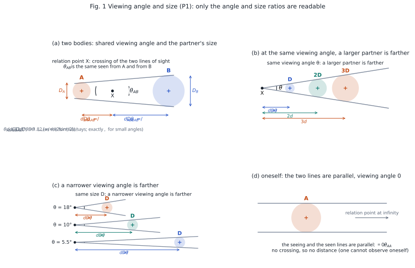
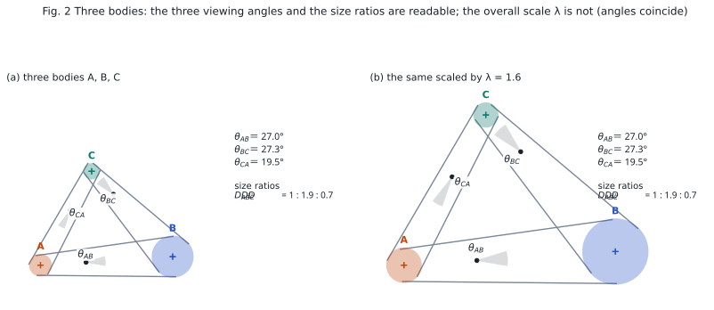
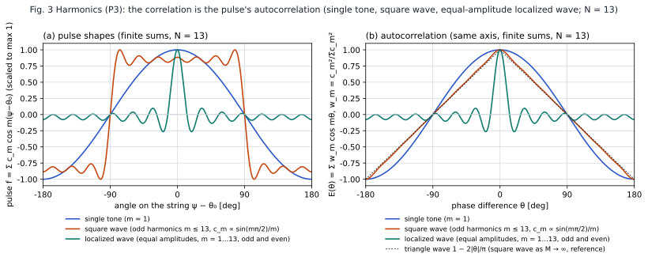
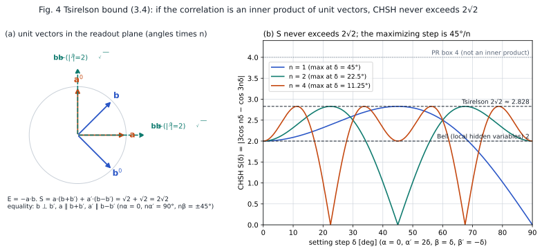
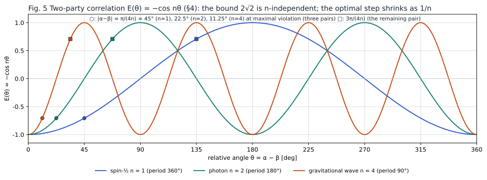

# Observation as Simultaneous Emission and Absorption
## ― Deriving the Born Rule, Bell Correlations and the Tsirelson Bound from a Viewing-Angle Readout Rule ―

**Author:** Noriaki Kihara (WF System Co., Ltd.)　ORCID 0009-0004-6753-4020
**Date:** 2026-11-01　　**Version:** v1.4 (pre-publication draft)
**Version DOI:** (assigned at publication)　　**Concept DOI:** (assigned at publication)
**Same folder:** figures in `図表/` (`make_figures.py`; English-label figures `fig*_en`), the self-review correction list `修正点_自己分析_v1.1_20261101.md`, and the hand-over note for the numerical experiments `申し送り_ClaudeCode_引用作成とベル数値実験E0-E5_20261101.md` (future work)
**Note:** The Japanese version (`paper_observation_handshake_bell_tsirelson_ja_v1.4.md`) is the authoritative text; this English version is a translation.

---

## Abstract

What quantum mechanics calls "observation" has lumped together three interactions of different character: one that switches the discrete state of the partner, one that leaves the partner's state unswitched and shifts only the internal phases, and one that severs the mutual phase relation. This paper places the substance of observation in the second, the "readout of the interference of a phase difference," and adopts only three premises. (P1) The distance between two parties is set by the ratio of a shared viewing angle to the partner's size; only ratios are readable and the absolute scale is not. (P2) An interaction is a single relation in which emission and absorption hold simultaneously; the speed of light appears on the readout side as a conversion factor between local clocks. (P3) The phase of a relation carries a harmonic order $n$ that depends on the kind of wave. From these, the fact that a probability is the product of an amplitude and its conjugate (the form of the Born rule), the two-party correlation $E=\mp\cos n\theta$, the upper bound $2\sqrt{2}$ of the CHSH quantity (the Tsirelson bound), and no-signaling follow in a few lines. The normalization that turns this into a probability is the division that discards the size ratio, i.e. the choice of the $\eta=0$ section [S1]. As a consequence, the bound is $2\sqrt{2}$ independently of the kind of wave, and the detector angle giving the maximal violation shrinks in proportion to $1/n$ (45° for spin-½, 22.5° for photons, 11.25° for gravitational waves).

---

## 1. Introduction: three interactions mixed into "observation"

In the standard account, "observing a system collapses the wave function," and the view that this is an update of the observer's information has recently gained ground [X1] [X2]. That account, however, bundles the following three physically distinct interactions under the single word "observation."

The first switches the partner's discrete state. As in resonant absorption, the energy level jumps and a selection takes place.

The second leaves the partner's discrete state unswitched and shifts the internal phases of both parties only slightly. The shifted phase difference is read out as interference. Detection of a phase shift by off-resonant dispersive coupling, non-demolition photon counting in cavity quantum electrodynamics, and dispersive readout of superconducting qubits are of this kind [X3] [X4] [X5] [X6].

The third is an interaction so strong or so numerous that the mutual phase relation itself is severed; the information scatters into the environment and can no longer be read as interference [X7] [X8] [X9].

The textbook "observation → collapse" identifies the third with the first and hardly treats the second. But the third is not a process of becoming readable; it is a process of becoming unreadable. This paper takes the substance of observation to lie in the second, "reading a phase difference while keeping the relation," and regards the first and the third as the boundaries at its two ends. On that basis it shows that the structure of quantum correlations follows from the minimal premises that govern this readout.

---

## 2. Premises

### (P1) Distance is the ratio of viewing angle to size, and only ratios are readable

Between two parties A and B there is a shared viewing angle $\theta_{AB}=\theta_{BA}$. The distance from A to B is the extent $D_B$ of B divided by the viewing angle,

$$
d_{A\to B}=\frac{D_B}{\theta_{AB}},\qquad d_{B\to A}=\frac{D_A}{\theta_{AB}}
$$

(the reading in the celestial configuration of the third thought experiment [S2]). The narrower the viewing angle, the farther; at the same viewing angle, the larger the partner, the farther. The derivation in this paper uses only two things: that only ratios are readable, and that the overall orientation and size are not. The viewing angle carries the symmetric part of the relation; the size carries the asymmetric part, "which party affects which, and by how much."

Toward oneself the seeing line and the seen line are parallel, $\theta_{AA}=0$, and no distance is defined: one cannot observe oneself. With two bodies alone the viewing angle is readable, but there is no external ruler for size, so the scale of the distance is not fixed (only the angle is readable). With three bodies a triangle forms: the interior angles (the three viewing angles) fix the shape, the size ratios fix the asymmetry of the coupling, and the interaction coefficients are read as dimensionless ratios. The common overall scale (the gauge) remains unreadable to the end [S3] [S2] [S4].

**Fig. 1** Viewing angle and size (P1). The internal common tangents of two discs are taken as the "lines of sight," and their crossing X is called the relation point. The angle at the crossing is the viewing angle $\theta_{AB}$, the same seen from A and from B (a). From X to the centre of each disc the distance is $d=D/(2\sin(\theta/2))$, $D/\theta$ for small angles, and $d_{A\to B}/d_{B\to A}=D_B/D_A$ holds. At the same viewing angle a larger partner is farther (b); a narrower viewing angle is farther (c). Toward oneself the two lines are parallel, $\theta_{AA}=0$, and with no crossing no distance is defined (d). All points are computed from the formulas (`図表/make_figures.py`).

**Fig. 2** Three bodies. The three viewing angles (the wedges at the relation points) and the size ratios are readable, but scaling the whole by λ leaves the three angles unchanged, so the scale λ is not readable (the gauge of P1).

### (P2) An interaction is a single relation in which emission and absorption hold simultaneously

When A reads the electromagnetic or gravitational wave emitted by B, B simultaneously reads its own emission through A. Emission and absorption are the two ends of one relation, not two events ordered in time. The relation itself holds as a single relation of zero spacetime interval, with no before and after.

The speed of light is not a propagation speed of the interaction; it appears on the readout side as a conversion factor, the offset between the records that the local clocks of A and B keep of this relation, divided by the distance. This does not contradict relativity: the spacetime interval between two points joined by light is zero, and the delay appears only in each observer's coordinate time [X10] [X11] [X12] [X13].

### (P3) The phase of a relation carries a harmonic order $n$

When the relation is turned by the detector setting angle $\theta$, the phase of the relation turns by $n\theta/2$. Here $n$ is the harmonic order fixed by the kind of wave; taking the fundamental to have period $4\pi$,

- spin-½: $n=1$ (period $4\pi$)
- electromagnetic wave (polarization): $n=2$ (returns at 180°)
- gravitational wave (polarization): $n=4$ (returns at 90°).

Twice the spin or helicity (½, 1, 2) corresponds to the harmonic order.

A localized relation is a sum of harmonics. Writing the pulse as $f(\psi)=c_0+\sum_{m\ge1}c_m\cos m(\psi-\theta_0)$, the cross term of two pulses on the same axis is orthogonal harmonic by harmonic, and the correlation becomes the autocorrelation of the pulse shape,
$$E(\theta)=\mp\sum_{m\ge1}w_m\cos m\theta,\qquad w_m=\frac{c_m^{2}}{\sum_{m'\ge1}c_{m'}^{2}}.$$
A single harmonic $w_m=\delta_{mn}$ is the $n$ above. The bound $2\sqrt{2}$ holds for any weights (the unit vectors of 3.4 merely move to $\mathbb{R}^{2M}$), but equality is attained only for a single harmonic. For a rectangular pulse (the limit $M\to\infty$) the cross term reduces to the length of the overlap of two arcs, i.e. the probability that a uniform $\lambda$ falls in both arcs, which is a local hidden-variable model, so $S\le2$. For a rectangular pulse occupying half the string (odd harmonics, $c_m\propto\sin(m\pi/2)/m$), $E$ is the triangle wave $1-2|\theta|/\pi$ and $S=2$. For a finite sum $N=13$ ripples remain on the triangle (Fig. 3). A readout that turns the direction of the axis has a cross term linear in $\kappa=\boldsymbol{n}_A\cdot\boldsymbol{n}_B$, so it gives $n=1$ regardless of the harmonics.

**Fig. 3** Harmonics and the autocorrelation of the pulse shape (P3), computed exactly as finite sums with $N=13$. (a) A single tone, a square wave (odd harmonics $m\le13$, $c_m\propto\sin(m\pi/2)/m$), and an equal-amplitude localized wave ($m=1\ldots13$, odd and even). (b) The correlation on the same axis, $E(\theta)=\sum_m w_m\cos m\theta$ with $w_m=c_m^2/\sum c_m^2$. The single tone gives $\cos\theta$. The square wave approaches the triangle wave $1-2|\theta|/\pi$ (the limit $M\to\infty$, dotted) with ripples left over. The equal-amplitude localized wave concentrates at the peak $\theta=0$ and elsewhere leaves only small ripples (minimum $-0.27$, and $-1/13$ at $\theta=\pi$: the even and odd harmonics cancel at the antipode).

---

## 3. Derivation

### 3.1 Normalization: only ratios are readable, hence directions of unit length

By (P1), only ratios are readable from a relation. Dividing out the partner's size from each relation leaves only the direction (the viewing angle). The one dimension discarded by this division is the logarithm of the size ratio, $\eta=\log(D_B/D_A)$ (the rapidity of [S1]); every derivation in this paper is carried out on the section $\eta=0$. The consequences of $\eta\neq0$ are left to the two points of §6. Each detector setting is therefore represented by a direction $\boldsymbol{u}$ of unit length, and the overlap of two relations on the readout is the inner product

$$
\boldsymbol{u}\cdot\boldsymbol{v}=\cos\varphi,
$$

where $\varphi$ is the angle between the two directions. This normalization determines the bound of Section 3.4.

### 3.2 The Born rule: the square comes from the handshake

By (P2), a single readout holds only when both "the overlap seen from the emitting side" and "the overlap seen from the absorbing side" are in place. The two are the same relation seen from opposite directions; reversing the direction reverses the sign of the phase, so the amplitudes are complex conjugates of each other. If the emitting side's amplitude is $a$, the absorbing side's is $a^{*}$, and the readout probability is

$$
P=a\,a^{*}=|a|^{2}.
$$

When the directions are real unit vectors, $P=\cos^{2}\varphi$. In a two-valued readout the projections onto the setting direction and onto the direction orthogonal to it correspond to the two mutually exclusive outcomes, and $\cos^{2}\varphi+\sin^{2}\varphi=1$ satisfies the normalization automatically. The reason the product $a\,a^{*}$ is the readable quantity is that a readout is the simultaneous holding of emission and absorption [X14] [X15]. The normalization that reads this as a probability (the division that makes the sum 1) is the very division of 3.1; the sum is in general $\cosh\eta=\gamma$ and equals 1 only at $\eta=0$ [S1].

### 3.3 Two-party correlation

Consider a source S and two detectors A, B with setting angles $\alpha,\beta$. The pair emitted by S is the two ends of one relation, and the readouts at A and at B hold simultaneously as a three-party relation S–A–B (P2). The overall rotation is unreadable (the gauge of P1), so the result depends only on the relative angle $\theta=\alpha-\beta$. By (P3), the angle that acts on the readout is $\varphi=n\theta/2$.

The two ends of one relation see each other from opposite directions. When the two ends are tied in mutually orthogonal directions, as in the spin singlet, the B end is read as the direction with the readout phase $\varphi$ shifted by $\pi/2$ (the spatial reversal $-\boldsymbol{u}$ for $n=1$, the orthogonal polarization for $n=2$). The overlap of $+$ at the A end with $+$ at the B end is $\cos^{2}(\varphi+\pi/2)=\sin^{2}\varphi$, which is the origin of the sign of the anticorrelation. The factor $\tfrac12$ is the uniform one-sided distribution that follows from the absolute direction being unreadable from one side alone (the gauge of P1). Hence

$$
P(++)=P(--)=\tfrac12\sin^{2}\varphi,\qquad P(+-)=P(-+)=\tfrac12\cos^{2}\varphi,
$$

$$
E(\alpha,\beta)=P(++)+P(--)-P(+-)-P(-+)=-\cos 2\varphi=-\cos\bigl(n(\alpha-\beta)\bigr).
$$

For $n=1$ this gives the spin-singlet $E=-\cos\theta$; for $n=2$, the polarization-entangled photon pair $E=\pm\cos 2\theta$. The sign is positive for the photon pair when the source ties the two ends in the same direction (the $\Phi^{+}$ type); the sign is fixed by the direction in which the source ties the relation.

### 3.4 The Tsirelson bound

Put $\boldsymbol{a}=(\cos n\alpha,\sin n\alpha)$ and $\boldsymbol{b}=(\cos n\beta,\sin n\beta)$; then $E(\alpha,\beta)=-\boldsymbol{a}\cdot\boldsymbol{b}$, and the correlation is the inner product of directions of unit length. For the CHSH quantity

$$
S=\bigl|E(\alpha,\beta)+E(\alpha,\beta')+E(\alpha',\beta)-E(\alpha',\beta')\bigr|
=\bigl|\boldsymbol{a}\cdot(\boldsymbol{b}+\boldsymbol{b}')+\boldsymbol{a}'\cdot(\boldsymbol{b}-\boldsymbol{b}')\bigr|,
$$

from $|\boldsymbol{a}|=|\boldsymbol{a}'|=1$ and $|\boldsymbol{b}+\boldsymbol{b}'|^{2}+|\boldsymbol{b}-\boldsymbol{b}'|^{2}=4$, the Cauchy–Schwarz inequality gives

$$
S\le|\boldsymbol{b}+\boldsymbol{b}'|+|\boldsymbol{b}-\boldsymbol{b}'|\le\sqrt{2}\sqrt{|\boldsymbol{b}+\boldsymbol{b}'|^{2}+|\boldsymbol{b}-\boldsymbol{b}'|^{2}}=2\sqrt{2}.
$$

Equality holds when $\boldsymbol{b}\perp\boldsymbol{b}'$, $\boldsymbol{a}\parallel\boldsymbol{b}+\boldsymbol{b}'$, $\boldsymbol{a}'\parallel\boldsymbol{b}-\boldsymbol{b}'$, i.e. at $n\alpha=0,\ n\alpha'=\pi/2,\ n\beta=\pi/4,\ n\beta'=-\pi/4$ [X16] [X17] [X18].

**Fig. 4** The Tsirelson bound. (a) The unit vectors $\boldsymbol{a},\boldsymbol{a}',\boldsymbol{b},\boldsymbol{b}'$ in the readout plane (angles multiplied by $n$) and $\boldsymbol{b}\pm\boldsymbol{b}'$. In the equality configuration $|\boldsymbol{b}+\boldsymbol{b}'|=|\boldsymbol{b}-\boldsymbol{b}'|=\sqrt2$ and $S=2\sqrt2$. (b) The CHSH quantity $S(\delta)=|3\cos n\delta-\cos 3n\delta|$ against the setting step δ ($\alpha=0,\ \alpha'=2\delta,\ \beta=\delta,\ \beta'=-\delta$). For every $n$ it never exceeds $2\sqrt2$, and the maximum lies at $\delta=45°/n$. 2 is Bell's bound, 4 the PR box.

By contrast, if each side's outcome were fixed at the source as $\pm1$ independently of the other side's setting, one would have $S\le2$ (Bell's inequality). In the present picture, the readout of a single-harmonic relation holds simultaneously as a three-party relation with both settings in place (P2), so this premise is not satisfied. For a rectangular-pulse relation the premise is satisfied and $S\le2$ returns (P3).

A correlation reaching $S=4$ (the PR box) cannot be written as an inner product of unit-length directions [X19]. Since the readout is bilinear in the directions of the two ends (the product of the emitting and absorbing sides, P2) and the lengths are normalized to 1 (P1), the correlation is necessarily an inner product, and PR-type correlations never appear. The reason the bound is $2\sqrt{2}$, neither $2$ nor $4$, reduces to these two: bilinearity and normalization.

### 3.5 No-signaling

The one-sided probability on A's side is

$$
P_A(+)=P(++)+P(+-)=\tfrac12\bigl(\sin^{2}\varphi+\cos^{2}\varphi\bigr)=\tfrac12,
$$

independent of B's setting $\beta$. This was already fixed in 3.3 when the factor $\tfrac12$ was placed from the gauge of P1; here we have checked that it is consistent with $\sin^{2}\varphi+\cos^{2}\varphi=1$. The correlation appears only when the records of both sides are compared. No-signaling is a consequence of P1: the absolute direction is unreadable from one side alone.

---

## 4. Consequences and comparison with known values

The three values below all agree with standard theory and are not the discriminating points of this paper. The discriminating points are whether $\tfrac12\sin^{2}\varphi$ of 3.3 emerges from P1–P3 alone (a numerical experiment, future work), the shape of $E(\theta)$ and the maximal violation when the relation is not a single harmonic (P3), and the two points of §6.

The two-party correlation is written in one formula in the harmonic order $n$,

$$
E(\theta)=\mp\cos(n\theta),
$$

with period $2\pi/n$. Since the argument of Section 3.4 does not depend on the scaling of the angle, the bound of the CHSH quantity is $2\sqrt{2}$ regardless of the kind of wave. The step of the detector angle giving the maximal violation is $\pi/(4n)$,

- spin-½ ($n=1$): 45°
- photon ($n=2$): 22.5°
- gravitational wave ($n=4$): 11.25°,

shrinking in inverse proportion to the harmonic order. All three coincide with the values of standard theory for spin/helicity ½, 1, 2. An experiment with gravitational waves is impractical, but "the bound is invariant and the optimal angle scales as $1/n$" is a point of comparison.

**Fig. 5** The two-party correlation $E(\theta)=-\cos n\theta$ ($n=1,2,4$). ○ marks the difference $|\alpha-\beta|=\pi/(4n)$ at the maximal violation (three pairs), □ marks $3\pi/(4n)$ (the remaining pair). The period is $2\pi/n$ and the optimal step shrinks as $1/n$.

---

## 5. Relation to earlier work

The idea that radiation holds as a relation with an absorber goes back to the Wheeler–Feynman absorber theory, in which the advanced response of the absorber returning to the source is the radiation reaction, and a lone charge does not act on itself [X12] [X13]. This corresponds to "the partner also reads its own emission" of (P2) and "one cannot read oneself" of (P1). Cramer's transactional interpretation depicts a quantum transition as a handshake between an offer wave and a confirmation wave, and attempted to explain the Born rule and Bell correlations [X14] [X15].

These gave the conditions under which a handshake holds, but had no rule for what is readable and by how much. The difference of this paper is that the content of the handshake is placed first as a readout rule. The shared viewing angle fixes the symmetric part of the handshake, the mutual sizes fix the asymmetric coupling, only ratios among three or more bodies are readable, and the scale remains anonymous. From this rule the square of the Born rule, the cosine form of the correlation, the bound $2\sqrt{2}$ and no-signaling follow in one chain. The assumption of a "perfectly absorbing universe" required by absorber theory may be replaced by the condition that ratios close among three bodies [S5].

What Bell's theorem excludes is local hidden-variable theories; the present picture, through the simultaneity of interaction (P2), does not adopt from the outset Bell's locality premise that each side's outcome is fixed at the source. No signal can be sent (3.5). The violation of Bell's inequality is therefore not a surprise but a consequence. Why quantum correlations stop at $2\sqrt{2}$ has been approached by derivations from principles such as information causality [X20] [X21] [X22] [X23] [X24]. This paper gives it from the geometry of a readout rule in which only ratios are readable.

---

## 6. Discussion

The three interactions of Section 1 are unified in the present picture. A readout is emission and absorption holding simultaneously so that a relation is tied; of these, the one in which the partner's discrete state switches is the first, the one in which only the phase shifts and the relation is kept is the second, and the one in which the relation has too many partners for the ratios to close is the third.

Two points are not derived in this paper, and both are the destination of the size ratio $\eta$ discarded in 3.1. One is to derive from (P1) that the offset of the local clock records appears in proportion to the distance (size ÷ viewing angle), i.e. why the speed of light looks the same to everyone. The other is the origin of the direction of time: the handshake is symmetric, yet in the records emission comes first and absorption later. The latter is expected to follow from the condition that ratios close among three or more bodies.

## 7. Classification

| Class | Content |
|---|---|
| Identities | 3.4 the bound $2\sqrt{2}$ of inner products of unit vectors [X18]; 3.5 the marginal $\tfrac12$; the autocorrelation of P3 and rectangle → local hidden variables |
| Readings | 3.1 normalization = choice of the $\eta=0$ section; 3.2 $a\,a^{*}$ = probability; 3.3 orthogonality of the B end and the factor $\tfrac12$ |
| Hypotheses | P2 simultaneity of emission and absorption; P3 $n$ = twice the spin/helicity; §5 perfect absorber → closure among three bodies |
| Agreement with known values | the three values of §4 (45°, 22.5°, 11.25°) |
| How it would fail | P1–P3 alone do not produce $\tfrac12\sin^{2}\varphi$ and $\cos^{2}$ has to be inserted by hand (future numerical experiment) / the maximum of $S$ for a single-harmonic relation falls short of $2\sqrt{2}$, or exceeds 2 for a rectangle / 3.5 breaks at $\eta\neq0$ |

---

## References

### Self-citations (Concept DOI, 10.5281/zenodo.〔number〕)

[S1] N. Kihara, "複素数を正しく理解していたか ― 振幅はどこに住むか、虚数読み、ℂ → ℍ → 𝕆 の帰属 ―" (Did We Understand Complex Numbers Correctly? Where the Amplitude Lives, the Imaginary Reading, and Attribution across ℂ → ℍ → 𝕆), 2026-10-23. Concept DOI 10.5281/zenodo.23585436.
[S2] N. Kihara, "第三思考実験：a b 2体の天体の軌道から a b 2体の状態を読み出す" (The Third Thought Experiment: Reading Out the State of Two Bodies a, b from the Orbit of Two Celestial Bodies a, b), 2026-09-23. Concept DOI 10.5281/zenodo.22909660.
[S3] N. Kihara, "状態と関係性から時空・粒子・相互作用の創発を探索する研究プロジェクト設計" (Designing a Research Project to Explore the Emergence of Spacetime, Particles, and Interactions from States and Relations), 2026-09-20. Concept DOI 10.5281/zenodo.22851944.
[S4] N. Kihara, "無名等振幅複合波モデル基本公理系 v9" (Anonymous Equal-Amplitude Composite-Wave Model: Basic Axiom System v9), 2026-07-24. Concept DOI 10.5281/zenodo.21315735.
[S5] N. Kihara, "第十一思考実験：背景時空を置かない二体系の放出記録" (The Eleventh Thought Experiment: Emission Records of Two-Body Systems without a Background Spacetime), 2026-10-07. Concept DOI 10.5281/zenodo.23199299.

### External references

[X1] C. A. Fuchs, R. Schack, "Quantum-Bayesian coherence," Rev. Mod. Phys. 85, 1693–1715 (2013). DOI 10.1103/RevModPhys.85.1693
[X2] C. A. Fuchs, N. D. Mermin, R. Schack, "An introduction to QBism with an application to the locality of quantum mechanics," Am. J. Phys. 82, 749–754 (2014). DOI 10.1119/1.4874855
[X3] V. B. Braginsky, Y. I. Vorontsov, K. S. Thorne, "Quantum Nondemolition Measurements," Science 209, 547–557 (1980). DOI 10.1126/science.209.4456.547
[X4] C. M. Caves, K. S. Thorne, R. W. P. Drever, V. D. Sandberg, M. Zimmermann, "On the measurement of a weak classical force coupled to a quantum-mechanical oscillator. I. Issues of principle," Rev. Mod. Phys. 52, 341–392 (1980). DOI 10.1103/RevModPhys.52.341
[X5] S. Haroche, J.-M. Raimond, *Exploring the Quantum: Atoms, Cavities, and Photons* (Oxford University Press, Oxford, 2006). DOI 10.1093/acprof:oso/9780198509141.001.0001
[X6] A. Blais, A. L. Grimsmo, S. M. Girvin, A. Wallraff, "Circuit quantum electrodynamics," Rev. Mod. Phys. 93, 025005 (2021). DOI 10.1103/RevModPhys.93.025005
[X7] W. H. Zurek, "Decoherence, einselection, and the quantum origins of the classical," Rev. Mod. Phys. 75, 715–775 (2003). DOI 10.1103/RevModPhys.75.715
[X8] M. Schlosshauer, "Quantum decoherence," Phys. Rep. 831, 1–57 (2019). DOI 10.1016/j.physrep.2019.10.001
[X9] B.-G. Englert, "Fringe Visibility and Which-Way Information: An Inequality," Phys. Rev. Lett. 77, 2154–2157 (1996). DOI 10.1103/PhysRevLett.77.2154
[X10] H. Tetrode, "Über den Wirkungszusammenhang der Welt. Eine Erweiterung der klassischen Dynamik," Z. Phys. 10, 317–328 (1922). DOI 10.1007/BF01332574
[X11] A. D. Fokker, "Ein invarianter Variationssatz für die Bewegung mehrerer elektrischer Massenteilchen," Z. Phys. 58, 386–393 (1929). DOI 10.1007/BF01340389
[X12] J. A. Wheeler, R. P. Feynman, "Interaction with the Absorber as the Mechanism of Radiation," Rev. Mod. Phys. 17, 157–181 (1945). DOI 10.1103/RevModPhys.17.157
[X13] J. A. Wheeler, R. P. Feynman, "Classical Electrodynamics in Terms of Direct Interparticle Action," Rev. Mod. Phys. 21, 425–433 (1949). DOI 10.1103/RevModPhys.21.425
[X14] J. G. Cramer, "The transactional interpretation of quantum mechanics," Rev. Mod. Phys. 58, 647–687 (1986). DOI 10.1103/RevModPhys.58.647
[X15] R. E. Kastner, *The Transactional Interpretation of Quantum Mechanics: The Reality of Possibility* (Cambridge University Press, Cambridge, 2013). DOI 10.1017/CBO9780511675768
[X16] J. S. Bell, "On the Einstein Podolsky Rosen paradox," Physics Physique Fizika 1, 195–200 (1964). DOI 10.1103/PhysicsPhysiqueFizika.1.195
[X17] J. F. Clauser, M. A. Horne, A. Shimony, R. A. Holt, "Proposed Experiment to Test Local Hidden-Variable Theories," Phys. Rev. Lett. 23, 880–884 (1969). DOI 10.1103/PhysRevLett.23.880
[X18] B. S. Cirel'son, "Quantum generalizations of Bell's inequality," Lett. Math. Phys. 4, 93–100 (1980). DOI 10.1007/BF00417500
[X19] S. Popescu, D. Rohrlich, "Quantum nonlocality as an axiom," Found. Phys. 24, 379–385 (1994). DOI 10.1007/BF02058098
[X20] M. Pawłowski, T. Paterek, D. Kaszlikowski, V. Scarani, A. Winter, M. Żukowski, "Information causality as a physical principle," Nature 461, 1101–1104 (2009). DOI 10.1038/nature08400
[X21] M. Navascués, H. Wunderlich, "A glance beyond the quantum model," Proc. R. Soc. A 466, 881–890 (2010). DOI 10.1098/rspa.2009.0453
[X22] L. Hardy, "Quantum Theory From Five Reasonable Axioms," arXiv:quant-ph/0101012 (2001).
[X23] G. Chiribella, G. M. D'Ariano, P. Perinotti, "Informational derivation of quantum theory," Phys. Rev. A 84, 012311 (2011). DOI 10.1103/PhysRevA.84.012311
[X24] Ll. Masanes, M. P. Müller, "A derivation of quantum theory from physical requirements," New J. Phys. 13, 063001 (2011). DOI 10.1088/1367-2630/13/6/063001

---

## Appendix A　Reproducing the figures

Figures 1–5 are generated by `図表/make_figures.py` in the same folder. `python3 make_figures.py` produces the Japanese labels and `python3 make_figures.py en` the English-label figures (`fig*_en`), written to `図表/figures/` as PNG, SVG and PDF. All points are computed directly from the formulas; no random numbers are used. The geometry of Figs. 1 and 2 takes the internal common tangents of two discs as the lines of sight and their crossing as the relation point; the angle at the crossing is the viewing angle, and the distance from the crossing to the centre of each disc is $D/(2\sin(\theta/2))$. Fig. 3 uses finite sums with $N=13$: the square wave has odd harmonics $c_m\propto\sin(m\pi/2)/m$, the equal-amplitude localized wave has $c_m=1$ ($m=1\ldots13$), and the autocorrelation is computed with $w_m=c_m^2/\sum c_m^2$. Dependencies: numpy and matplotlib.

## Version history

- v1 (2026-11-01): first draft, written with Claude.ai on the train between Shin-Yokohama and Tokyo.
- v1.1 (2026-11-01): citations numbered and 28 references attached (text unchanged).
- v1.2 (2026-11-01): the self-review corrections A–F applied. Consistency with the complex-number paper [S1] (the Born rule up to its form; normalization as the choice of the $\eta=0$ section), the reversal of 3.3 generalized to a phase shift of $\pi/2$, the basis of the inner product in 3.4 made bilinearity plus normalization, 3.5 made a consistency check, the harmonic generalization added to P3, §4 retitled "Consequences and comparison with known values," §7 Classification added.
- v1.3 (2026-11-01): Figs. 1–5 added (`図表/make_figures.py`). Text changes limited to figure references and Appendix A. Fig. 3 replaced, at the author's request, by exact finite sums with $N=13$ (square wave with odd harmonics; localized wave with equal amplitudes, odd and even).
- v1.4 (2026-11-01): pre-publication draft. Header aligned with the series format, references to the numerical experiments E0–E5 changed to future work, the $M\to\infty$ qualification and the sign of $c_m$ added to the rectangular-pulse statement of P3. This English version created (a translation; the Japanese version is authoritative). Citations re-numbered in the series convention, self-citations [S1]–[S5] and external references [X1]–[X24], in order of first appearance.
