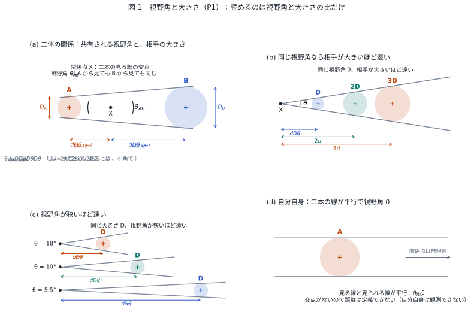
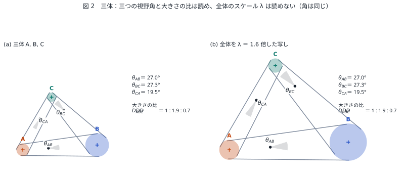
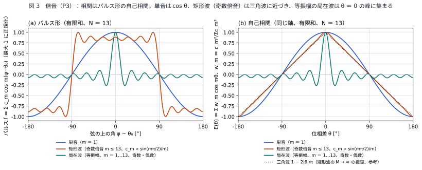
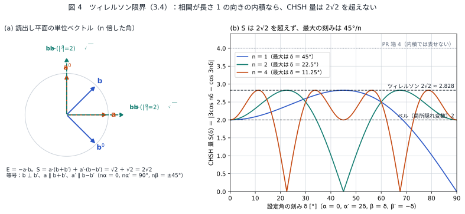
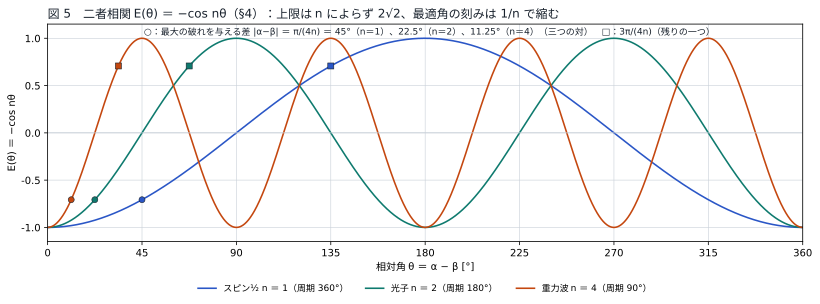

# 観測は放射と吸収の同時成立である
## ― 視野角と大きさの読出し規則からボルン則・ベル相関・ツィレルソン限界を導く ―

**著者：** 木原範昭（株式会社WFシステム）　ORCID 0009-0004-6753-4020
**日付：** 2026-11-01　　**版：** v1.4（公開準備稿）
**Version DOI：** （公開時に付与）　　**Concept DOI：** （公開時に付与）

---

## 要旨

量子力学の「観測」は、相手の離散状態を切り替える相互作用、相手の状態を切り替えずに内部位相だけをずらす相互作用、相互の位相関係を切ってしまう相互作用という性質の異なる三つを区別せずに一括してきた。本稿は、観測の本体を二番目の「位相差の干渉の読出し」に置き、次の三つの前提だけを置く。(P1) 二者間の距離は共有された視野角と相手の大きさの比で決まり、読めるのは比だけで絶対スケールは読めない。(P2) 相互作用は放射と吸収が同時に成立する一回の関係であり、光速は局所時計どうしの換算係数として読出し側に現れる。(P3) 関係の位相は波の種類ごとに倍音次数 $n$ をもつ。これらから、確率が振幅と共役振幅の積になること（ボルン則の形）、二者相関 $E=\mp\cos n\theta$、CHSH 量の上限 $2\sqrt{2}$（ツィレルソン限界）、信号不能性が数行で出る。確率として読むための正規化は大きさの比を落とす割り算であり、$\eta=0$ の断面の選択である[S1]。帰結として、上限は波の種類によらず $2\sqrt{2}$ であり、最大の破れを与える検出器角は $1/n$ に比例して縮む（スピン½で45°、光子で22.5°、重力波で11.25°）。

---

## 1. はじめに：「観測」に混在している三つの相互作用

標準的な記述では「系を観測すると波動関数が収縮する」とされ、近年はこれを観測者の情報の更新とみなす立場も有力である[X1] [X2]。しかしこの記述は、物理的に性質の異なる次の三つを「観測」の一語で括っている。

第一は、相手の離散状態を切り替える相互作用である。共鳴吸収のようにエネルギー階層がジャンプし、選択が起こる。

第二は、相手の離散状態を切り替えず、双方の内部位相だけがわずかにずれる相互作用である。ずれた位相差を干渉として読み出す。非共鳴の分散結合による位相シフトの検出、空洞量子電気力学における非破壊光子計数、超伝導量子ビットの分散読出しがこれに当たる[X3] [X4] [X5] [X6]。

第三は、作用が強すぎるか多すぎて相互の位相関係そのものが切れ、情報が環境に散って干渉として読み出せなくなる相互作用である[X7] [X8] [X9]。

教科書的な「観測→収縮」は第三を第一と同一視し、第二をほとんど扱わない。だが第三は読めるようになる過程ではなく、読めなくなる過程である。本稿は、観測の本体は第二の「関係を保ったまま位相差を読む」領域にあり、第一と第三はその両端の境界だとみなす。そのうえで、この読出しを規定する最小の前提から量子相関の構造が導かれることを示す。

---

## 2. 前提

### (P1) 距離は視野角と大きさの比であり、比しか読めない

二者 A, B の間には共有された視野角 $\theta_{AB}=\theta_{BA}$ がある。A から見た B までの距離は B の広がり $D_B$ を視野角で割ったもの、

$$
d_{A\to B}=\frac{D_B}{\theta_{AB}},\qquad d_{B\to A}=\frac{D_A}{\theta_{AB}}
$$

で与えられる（第三思考実験 [S2] の天体配置での読み）。視野角が狭いほど遠く、同じ視野角なら相手が大きいほど遠い。本稿の導出で使うのは、読めるのが比だけであること、全体の向きと大きさが読めないことの二つだけである。視野角は関係の対称な部分を、大きさは「どちらがどちらにどれだけ影響するか」という非対称な部分を担う。

自分自身に対しては見る線と見られる線が平行で $\theta_{AA}=0$ となり、距離は定義できない。すなわち自分自身は観測できない。二体だけでは、視野角は読めても大きさを測る外部の物差しがないので距離の目盛りは決まらない（読めるのは角だけである）。三体で三角形ができると、内角（三つの視野角）から形が、大きさの比から結合の非対称が決まり、相互作用の係数は無次元の比として読める。全体の共通スケール（ゲージ）は最後まで読めない[S3] [S2] [S4]。

**図 1** 視野角と大きさ（P1）。二つの円板の内共通接線を「見る線」とし、その交点 X を関係点と呼ぶ。交点の角が視野角 $\theta_{AB}$ で、A から見ても B から見ても同じである（a）。X から各円板の中心までは $d=D/(2\sin(\theta/2))$、小角で $D/\theta$ であり、$d_{A\to B}/d_{B\to A}=D_B/D_A$ が成り立つ。同じ視野角なら相手が大きいほど遠く（b）、視野角が狭いほど遠い（c）。自分自身では二本の線が平行になって $\theta_{AA}=0$、交点がないので距離は定義できない（d）。点はすべて式から計算した（`図表/make_figures.py`）。

**図 2** 三体。三つの視野角（関係点の扇形）と大きさの比は読めるが、全体を λ 倍しても三つの角は変わらないので、スケール λ は読めない（P1 のゲージ）。

### (P2) 相互作用は放射と吸収が同時に成立する一回の関係である

A が B の放った電磁波や重力波を読むとき、同時に B も自身の放ったものを A を介して読む。放射と吸収は一回の関係の両端であり、時間的に前後する二つの出来事ではない。関係そのものは時空間隔ゼロの一回の関係として成立し、前後はない。

光速は相互作用の伝播速度ではなく、A と B の局所時計がこの関係を刻んだ記録のずれを距離で割った換算係数として、読出し側に現れる。これは相対論とも矛盾しない。光が結ぶ二点の時空間隔はゼロであり、遅れは各観測者の座標時間にしか現れない[X10] [X11] [X12] [X13]。

### (P3) 関係の位相は倍音次数 $n$ をもつ

関係を検出器の設定角 $\theta$ だけ回したとき、関係の位相は $n\theta/2$ だけ回る。$n$ は波の種類で決まる倍音次数で、基音を周期 $4\pi$ のものとすると、

- スピン½：$n=1$（周期 $4\pi$）
- 電磁波（偏光）：$n=2$（180°で元に戻る）
- 重力波（偏光）：$n=4$（90°で元に戻る）

である。スピンまたはヘリシティ（½, 1, 2）の二倍が倍音次数に対応する。

局在した関係は倍音の和である。パルスを $f(\psi)=c_0+\sum_{m\ge1}c_m\cos m(\psi-\theta_0)$ と書くと、同じ軸の二つのパルスの交差項は倍音ごとに直交し、相関はパルス形の自己相関
$$E(\theta)=\mp\sum_{m\ge1}w_m\cos m\theta,\qquad w_m=\frac{c_m^{2}}{\sum_{m'\ge1}c_{m'}^{2}}$$
になる。単一倍音 $w_m=\delta_{mn}$ が上の $n$ である。上限 $2\sqrt{2}$ はどの重みでも成り立つ（3.4 の単位ベクトルが $\mathbb{R}^{2M}$ に移るだけ）が、等号は単一倍音でだけ達成される。矩形パルス（$M\to\infty$ の極限）では交差項が二つの弧の重なりの長さ、すなわち一様な $\lambda$ が両方の弧に入る確率に落ちて局所隠れ変数模型になり、$S\le2$ である。弦の半分を占める矩形パルス（奇数倍音、$c_m\propto\sin(m\pi/2)/m$）では $E$ は三角波 $1-2|\theta|/\pi$ で $S=2$ になる。有限和 $N=13$ では三角波に波打ちが残る（図 3）。軸の向きを回す読出しは交差項が $\kappa=\boldsymbol{n}_A\cdot\boldsymbol{n}_B$ に一次なので、倍音によらず $n=1$ である。

**図 3** 倍音とパルス形の自己相関（P3）。有限和 $N=13$ で厳密に計算した。(a) 単音、矩形波（奇数倍音 $m\le13$、$c_m\propto\sin(m\pi/2)/m$）、等振幅の局在波（$m=1\ldots13$、奇数・偶数）。(b) 同じ軸での相関 $E(\theta)=\sum_m w_m\cos m\theta$、$w_m=c_m^2/\sum c_m^2$。単音は $\cos\theta$。矩形波は三角波 $1-2|\theta|/\pi$（$M\to\infty$ の極限、点線）に波打ちを残して近づく。等振幅の局在波は $\theta=0$ の峰に集まり、他では小さな波打ちが残る（最小 $-0.27$、$\theta=\pi$ で $-1/13$。偶数と奇数の倍音が対蹠点で打ち消す）。

---

## 3. 導出

### 3.1 正規化：比しか読めないから長さ1の向き

(P1) により、関係から読めるのは比だけである。各関係から相手の大きさを割り算で落とすと、残るのは向き（視野角）だけになる。この割り算で落ちる一次元が大きさの比の対数 $\eta=\log(D_B/D_A)$（[S1] のラピディティ）であり、本稿の導出はすべて $\eta=0$ の断面で行う。$\eta\neq0$ の帰結は §6 の二点に残す。したがって各検出器の設定は長さ1の向き $\boldsymbol{u}$ として表され、二つの関係の読出し上の重なりは内積

$$
\boldsymbol{u}\cdot\boldsymbol{v}=\cos\varphi
$$

で与えられる。$\varphi$ は二つの向きのなす角である。この正規化が 3.4 節の上限を決める。

### 3.2 ボルン則：握手から二乗が出る

(P2) により、一回の読出しは「放射側から見た重なり」と「吸収側から見た重なり」の両方が揃って初めて成立する。両者は同じ関係を逆向きから見たものであり、向きを反転すると位相の符号が反転するので、振幅は互いに複素共役である。放射側の振幅を $a$ とすれば吸収側は $a^{*}$ で、読出しの確率は

$$
P=a\,a^{*}=|a|^{2}
$$

となる。向きが実の単位ベクトルで表される場合は $P=\cos^{2}\varphi$ である。二値の読出しでは、設定方向とそれに直交する方向への射影の二つが排他的な結果に対応し、$\cos^{2}\varphi+\sin^{2}\varphi=1$ により規格化は自動的に満たされる。積 $a\,a^{*}$ が読める量になる理由は、読出しが放射と吸収の同時成立だからである[X14] [X15]。これを確率と読む正規化（和を 1 にする割り算）は 3.1 の割り算そのもので、和は一般に $\cosh\eta=\gamma$、$\eta=0$ でだけ 1 になる[S1]。

### 3.3 二者相関

光源 S と二つの検出器 A, B（設定角 $\alpha,\beta$）を考える。S が放つ対は一つの関係の両端であり、A と B での読出しは S・A・B の三者の関係として同時に成立する（P2）。全体の回転は読めない（P1 のゲージ）ので、結果は相対角 $\theta=\alpha-\beta$ にしか依存しない。(P3) により、読出しに効く角は $\varphi=n\theta/2$ である。

一つの関係の両端は、互いを逆向きから見ている。スピン一重項のように両端が互いに直交する向きで結ばれる場合、B 端は読出しの位相 $\varphi$ を $\pi/2$ ずらした向きとして読まれる（$n=1$ では空間の反転 $-\boldsymbol{u}$、$n=2$ では直交偏光）。A 端の $+$ と B 端の $+$ の重なりは $\cos^{2}(\varphi+\pi/2)=\sin^{2}\varphi$ で、これが反相関の符号の起源である。係数 $\tfrac12$ は、片側だけでは絶対の向きが読めない（P1 のゲージ）ことによる片側の一様分布である。したがって

$$
P(++)=P(--)=\tfrac12\sin^{2}\varphi,\qquad P(+-)=P(-+)=\tfrac12\cos^{2}\varphi,
$$

$$
E(\alpha,\beta)=P(++)+P(--)-P(+-)-P(-+)=-\cos 2\varphi=-\cos\bigl(n(\alpha-\beta)\bigr).
$$

$n=1$ ではスピン一重項の $E=-\cos\theta$ を、$n=2$ では偏光もつれ光子対の $E=\pm\cos 2\theta$ を与える。光子対で符号が正になるのは、光源が両端を同じ向きとして結ぶ場合（$\Phi^{+}$ 型）で、符号は光源がどちらの向きで関係を結ぶかで決まる。

### 3.4 ツィレルソン限界

$\boldsymbol{a}=(\cos n\alpha,\sin n\alpha)$、$\boldsymbol{b}=(\cos n\beta,\sin n\beta)$ とおくと、$E(\alpha,\beta)=-\boldsymbol{a}\cdot\boldsymbol{b}$ であり、相関は長さ1の向きどうしの内積である。CHSH 量

$$
S=\bigl|E(\alpha,\beta)+E(\alpha,\beta')+E(\alpha',\beta)-E(\alpha',\beta')\bigr|
=\bigl|\boldsymbol{a}\cdot(\boldsymbol{b}+\boldsymbol{b}')+\boldsymbol{a}'\cdot(\boldsymbol{b}-\boldsymbol{b}')\bigr|
$$

について、$|\boldsymbol{a}|=|\boldsymbol{a}'|=1$ と $|\boldsymbol{b}+\boldsymbol{b}'|^{2}+|\boldsymbol{b}-\boldsymbol{b}'|^{2}=4$ から、コーシー＝シュワルツの不等式により

$$
S\le|\boldsymbol{b}+\boldsymbol{b}'|+|\boldsymbol{b}-\boldsymbol{b}'|\le\sqrt{2}\sqrt{|\boldsymbol{b}+\boldsymbol{b}'|^{2}+|\boldsymbol{b}-\boldsymbol{b}'|^{2}}=2\sqrt{2}.
$$

等号は $\boldsymbol{b}\perp\boldsymbol{b}'$、$\boldsymbol{a}\parallel\boldsymbol{b}+\boldsymbol{b}'$、$\boldsymbol{a}'\parallel\boldsymbol{b}-\boldsymbol{b}'$ のとき、すなわち $n\alpha=0,\ n\alpha'=\pi/2,\ n\beta=\pi/4,\ n\beta'=-\pi/4$ で達成される[X16] [X17] [X18]。

**図 4** ツィレルソン限界。(a) 読出し平面の単位ベクトル $\boldsymbol{a},\boldsymbol{a}',\boldsymbol{b},\boldsymbol{b}'$（角を $n$ 倍したもの）と $\boldsymbol{b}\pm\boldsymbol{b}'$。等号の配置では $|\boldsymbol{b}+\boldsymbol{b}'|=|\boldsymbol{b}-\boldsymbol{b}'|=\sqrt2$ で $S=2\sqrt2$。(b) 設定角の刻み δ（$\alpha=0,\ \alpha'=2\delta,\ \beta=\delta,\ \beta'=-\delta$）に対する CHSH 量 $S(\delta)=|3\cos n\delta-\cos 3n\delta|$。どの $n$ でも $2\sqrt2$ を超えず、最大は $\delta=45°/n$ にある。2 がベルの上限、4 が PR 箱。

対照として、各側の結果が光源で $\pm1$ に決まり、相手の設定によらない場合は $S\le2$ となる（ベルの不等式）。本稿の描像では、単一倍音の関係の読出しは両側の設定がそろった三者の関係として同時に成立するので（P2）、この前提は満たされない。矩形パルスの関係では前提が満たされ、$S\le2$ に戻る（P3）。

また $S=4$ に達する相関（PR ボックス）は、相関を長さ1の向きどうしの内積として表せない[X19]。読出しは両端の向きに双線形（放射側と吸収側の積、P2）で、長さは 1 に正規化されている（P1）から、相関は必ず内積であり、PR 型の相関は最初から現れない。上限が $2$ でも $4$ でもなく $2\sqrt{2}$ である理由は、この双線形性と正規化の二つに帰着する。

### 3.5 信号不能性

A 側だけの確率は

$$
P_A(+)=P(++)+P(+-)=\tfrac12\bigl(\sin^{2}\varphi+\cos^{2}\varphi\bigr)=\tfrac12
$$

で、B の設定 $\beta$ に依存しない。これは 3.3 で係数 $\tfrac12$ を P1 のゲージから置いた時点で決まっており、ここでは $\sin^{2}\varphi+\cos^{2}\varphi=1$ と整合することを確かめた。相関は双方の記録を突き合わせたときに初めて現れる。信号不能性は、片側だけでは絶対の向きが読めないという P1 の帰結である。

---

## 4. 帰結と既知との照合

以下の三つの値はいずれも標準理論と一致し、本稿の判別点ではない。判別点は、P1〜P3 だけから 3.3 の $\tfrac12\sin^{2}\varphi$ が出るかどうか（数値実験、今後の課題）、関係が単一倍音でないときの $E(\theta)$ の形と最大の破れ（P3）、§6 の二点である。

二者相関は倍音次数 $n$ について

$$
E(\theta)=\mp\cos(n\theta)
$$

の一本の式で書け、周期は $2\pi/n$ である。3.4 節の議論は角度の拡大縮小に依存しないので、CHSH 量の上限は波の種類によらず $2\sqrt{2}$ である。最大の破れを与える検出器角の刻みは $\pi/(4n)$ で、

- スピン½（$n=1$）：45°
- 光子（$n=2$）：22.5°
- 重力波（$n=4$）：11.25°

と倍音次数に反比例して縮む。三者とも標準理論のスピン・ヘリシティ ½, 1, 2 の値と同じである。重力波についての実験は現実には困難だが、「上限は不変、最適角は $1/n$」という形で照合点になる。

**図 5** 二者相関 $E(\theta)=-\cos n\theta$（$n=1,2,4$）。○ は最大の破れを与える差 $|\alpha-\beta|=\pi/(4n)$（三つの対）、□ は $3\pi/(4n)$（残りの一つ）。周期は $2\pi/n$ で、最適角の刻みは $1/n$ で縮む。

---

## 5. 先行研究との関係

放射は吸収体との関係として成立するという考えは、ウィーラー＝ファインマンの吸収体理論にさかのぼる。そこでは吸収体の先進波応答が放射源に戻ったものが放射反作用であり、単独の電荷は自身に作用しない[X12] [X13]。これは (P2) の「相手も自身の放ったものを読む」と、(P1) の「自分自身は読めない」に対応する。クレイマーのトランザクション解釈は、申し出波と確認波の握手として量子遷移を描き、ボルン則とベル相関の説明を試みた[X14] [X15]。

これらは握手が成立する条件を与えたが、何がどれだけ読めるかの規則はもたなかった。本稿の差分は、握手の中身を読出し規則として先に置いた点にある。共有された視野角が握手の対称部分を、互いの大きさが非対称な結合を決め、読めるのは三体以上での比だけで、スケールは無名のまま残る。この規則から、ボルン則の二乗、相関の cos 型、上限 $2\sqrt{2}$、信号不能性が一続きに出る。吸収体理論が必要とした「宇宙の完全吸収体」の仮定は、三体で比が閉じる条件に置き換えられる可能性がある[S5]。

ベルの定理が排除するのは局所的な隠れた変数理論であり、本稿の描像は相互作用の同時成立（P2）によって、各側の結果が光源で決まるというベルの局所性の前提を最初から採らない。信号は送れない（3.5）。したがってベルの不等式の破れは驚きではなく帰結である。量子相関の上限がなぜ $2\sqrt{2}$ で止まるかについては、情報因果律などの原理からの導出が試みられてきた[X20] [X21] [X22] [X23] [X24]。本稿はこれを、比しか読めないという読出し規則の幾何から与える。

---

## 6. 議論

第1節の三つの相互作用は、本稿の描像で一本にまとまる。放射と吸収が同時に成立して関係が結ばれることが読出しであり、そのうち相手の離散状態が切り替わるものが第一、位相だけがずれて関係が保たれるものが第二、関係の相手が多すぎて比が閉じないものが第三である。

本稿で導出していない点は二つあり、いずれも 3.1 で落とした大きさの比 $\eta$ の行き先である。一つは、局所時計の記録のずれが距離（大きさ÷視野角）に比例して現れることを (P1) から導くこと、すなわち光速が誰にとっても同じに見える理由である。もう一つは、握手は対称なのに記録上は放射が先・吸収が後になる時間の向きの起源である。後者は、三体以上で比が閉じる条件から与えられると見込んでいる。

## 7. 区分

| 区分 | 内容 |
|---|---|
| 恒等式 | 3.4 単位ベクトルの内積の上限 $2\sqrt{2}$ [X18]、3.5 周辺分布 $\tfrac12$、P3 の自己相関と矩形→局所隠れ変数 |
| 読み | 3.1 正規化＝$\eta=0$ 断面の選択、3.2 $a\,a^{*}$＝確率、3.3 B 端の直交と係数 $\tfrac12$ |
| 仮説 | P2 放射と吸収の同時成立、P3 $n$＝スピン・ヘリシティの二倍、§5 完全吸収体→三体の閉じ |
| 既知との一致 | §4 の三値（45°、22.5°、11.25°） |
| 落ちる形 | P1〜P3 だけでは $\tfrac12\sin^{2}\varphi$ が出ず $\cos^{2}$ を手で入れる必要が残る（今後の数値実験）／単一倍音の関係で $S$ の最大が $2\sqrt{2}$ に届かない、または矩形で 2 を超える／$\eta\neq0$ で 3.5 が破れる |

---

## 参考文献

### 自己引用（Concept DOI、10.5281/zenodo.〔番号〕）

[S1] 木原範昭「複素数を正しく理解していたか ― 振幅はどこに住むか、虚数読み、ℂ → ℍ → 𝕆 の帰属 ―」2026-10-23. Concept DOI 10.5281/zenodo.23585436.
[S2] 木原範昭「第三思考実験：a b 2体の天体の軌道から a b 2体の状態を読み出す」2026-09-23. Concept DOI 10.5281/zenodo.22909660.
[S3] 木原範昭「状態と関係性から時空・粒子・相互作用の創発を探索する研究プロジェクト設計」2026-09-20. Concept DOI 10.5281/zenodo.22851944.
[S4] 木原範昭「無名等振幅複合波モデル基本公理系 v9」2026-07-24. Concept DOI 10.5281/zenodo.21315735.
[S5] 木原範昭「第十一思考実験：背景時空を置かない二体系の放出記録」2026-10-07. Concept DOI 10.5281/zenodo.23199299.

### 外部文献

[X1] C. A. Fuchs, R. Schack, "Quantum-Bayesian coherence," Rev. Mod. Phys. 85, 1693–1715 (2013). DOI 10.1103/RevModPhys.85.1693
[X2] C. A. Fuchs, N. D. Mermin, R. Schack, "An introduction to QBism with an application to the locality of quantum mechanics," Am. J. Phys. 82, 749–754 (2014). DOI 10.1119/1.4874855
[X3] V. B. Braginsky, Y. I. Vorontsov, K. S. Thorne, "Quantum Nondemolition Measurements," Science 209, 547–557 (1980). DOI 10.1126/science.209.4456.547
[X4] C. M. Caves, K. S. Thorne, R. W. P. Drever, V. D. Sandberg, M. Zimmermann, "On the measurement of a weak classical force coupled to a quantum-mechanical oscillator. I. Issues of principle," Rev. Mod. Phys. 52, 341–392 (1980). DOI 10.1103/RevModPhys.52.341
[X5] S. Haroche, J.-M. Raimond, *Exploring the Quantum: Atoms, Cavities, and Photons* (Oxford University Press, Oxford, 2006). DOI 10.1093/acprof:oso/9780198509141.001.0001
[X6] A. Blais, A. L. Grimsmo, S. M. Girvin, A. Wallraff, "Circuit quantum electrodynamics," Rev. Mod. Phys. 93, 025005 (2021). DOI 10.1103/RevModPhys.93.025005
[X7] W. H. Zurek, "Decoherence, einselection, and the quantum origins of the classical," Rev. Mod. Phys. 75, 715–775 (2003). DOI 10.1103/RevModPhys.75.715
[X8] M. Schlosshauer, "Quantum decoherence," Phys. Rep. 831, 1–57 (2019). DOI 10.1016/j.physrep.2019.10.001
[X9] B.-G. Englert, "Fringe Visibility and Which-Way Information: An Inequality," Phys. Rev. Lett. 77, 2154–2157 (1996). DOI 10.1103/PhysRevLett.77.2154
[X10] H. Tetrode, "Über den Wirkungszusammenhang der Welt. Eine Erweiterung der klassischen Dynamik," Z. Phys. 10, 317–328 (1922). DOI 10.1007/BF01332574
[X11] A. D. Fokker, "Ein invarianter Variationssatz für die Bewegung mehrerer elektrischer Massenteilchen," Z. Phys. 58, 386–393 (1929). DOI 10.1007/BF01340389
[X12] J. A. Wheeler, R. P. Feynman, "Interaction with the Absorber as the Mechanism of Radiation," Rev. Mod. Phys. 17, 157–181 (1945). DOI 10.1103/RevModPhys.17.157
[X13] J. A. Wheeler, R. P. Feynman, "Classical Electrodynamics in Terms of Direct Interparticle Action," Rev. Mod. Phys. 21, 425–433 (1949). DOI 10.1103/RevModPhys.21.425
[X14] J. G. Cramer, "The transactional interpretation of quantum mechanics," Rev. Mod. Phys. 58, 647–687 (1986). DOI 10.1103/RevModPhys.58.647
[X15] R. E. Kastner, *The Transactional Interpretation of Quantum Mechanics: The Reality of Possibility* (Cambridge University Press, Cambridge, 2013). DOI 10.1017/CBO9780511675768
[X16] J. S. Bell, "On the Einstein Podolsky Rosen paradox," Physics Physique Fizika 1, 195–200 (1964). DOI 10.1103/PhysicsPhysiqueFizika.1.195
[X17] J. F. Clauser, M. A. Horne, A. Shimony, R. A. Holt, "Proposed Experiment to Test Local Hidden-Variable Theories," Phys. Rev. Lett. 23, 880–884 (1969). DOI 10.1103/PhysRevLett.23.880
[X18] B. S. Cirel'son, "Quantum generalizations of Bell's inequality," Lett. Math. Phys. 4, 93–100 (1980). DOI 10.1007/BF00417500
[X19] S. Popescu, D. Rohrlich, "Quantum nonlocality as an axiom," Found. Phys. 24, 379–385 (1994). DOI 10.1007/BF02058098
[X20] M. Pawłowski, T. Paterek, D. Kaszlikowski, V. Scarani, A. Winter, M. Żukowski, "Information causality as a physical principle," Nature 461, 1101–1104 (2009). DOI 10.1038/nature08400
[X21] M. Navascués, H. Wunderlich, "A glance beyond the quantum model," Proc. R. Soc. A 466, 881–890 (2010). DOI 10.1098/rspa.2009.0453
[X22] L. Hardy, "Quantum Theory From Five Reasonable Axioms," arXiv:quant-ph/0101012 (2001).
[X23] G. Chiribella, G. M. D'Ariano, P. Perinotti, "Informational derivation of quantum theory," Phys. Rev. A 84, 012311 (2011). DOI 10.1103/PhysRevA.84.012311
[X24] Ll. Masanes, M. P. Müller, "A derivation of quantum theory from physical requirements," New J. Phys. 13, 063001 (2011). DOI 10.1088/1367-2630/13/6/063001

---

## 付録 A　図の再現

図 1〜5 は、同じフォルダの `図表/make_figures.py` で生成した。`python3 make_figures.py` で日本語、`python3 make_figures.py en` で英語のラベルの図（`fig*_en`）を `図表/figures/` に PNG・SVG・PDF で出力する。点はすべて式から直接計算し、乱数は使わない。図 1・2 の幾何は、二つの円板の内共通接線を見る線、その交点を関係点としたもので、交点の角が視野角、交点から各円板の中心までが $D/(2\sin(\theta/2))$ である。図 3 は有限和 $N=13$ で、矩形波は奇数倍音 $c_m\propto\sin(m\pi/2)/m$、等振幅の局在波は $c_m=1$（$m=1\ldots13$）、自己相関は $w_m=c_m^2/\sum c_m^2$ で計算した。依存は numpy と matplotlib。

## 版の履歴

- v1（2026-11-01）：初稿。新横浜〜東京の車中で Claude.ai と作成。
- v1.1（2026-11-01）：引用を番号化し、参考文献 28 本を付けた（本文は同じ）。
- v1.2（2026-11-01）：自己分析の修正点 A〜F を適用。複素数論文 [S1] との整合（ボルン則は形まで、正規化は $\eta=0$ の断面の選択）、3.3 の反転を位相 $\pi/2$ のずらしに一般化、3.4 の内積の根拠を双線形性＋正規化に、3.5 を検算に、P3 に倍音の一般化、§4 を「帰結と既知との照合」に、§7 区分を追加。
- v1.3（2026-11-01）：図 1〜5 を追加（`図表/make_figures.py`）。本文の変更は図の参照と付録 A のみ。図 3 は著者の指摘で有限和 $N=13$（矩形波は奇数倍音、局在波は等振幅の奇数・偶数）に差し替えた。
- v1.4（2026-11-01）：公開準備稿。ヘッダーを系列の形式に合わせ、数値実験 E0〜E5 への言及を今後の課題に改め、P3 の矩形の命題に $M\to\infty$ の限定と $c_m$ の符号を入れた。英語版 `paper_observation_handshake_bell_tsirelson_en_v1.4.md` を作成（翻訳、日本語版が正本）。引用を系列の作法に合わせ、自己引用 [S1]〜[S5] と外部文献 [X1]〜[X24] に分けて初出順に採番し直した。
