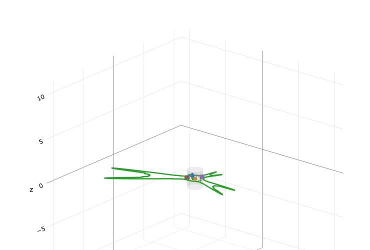
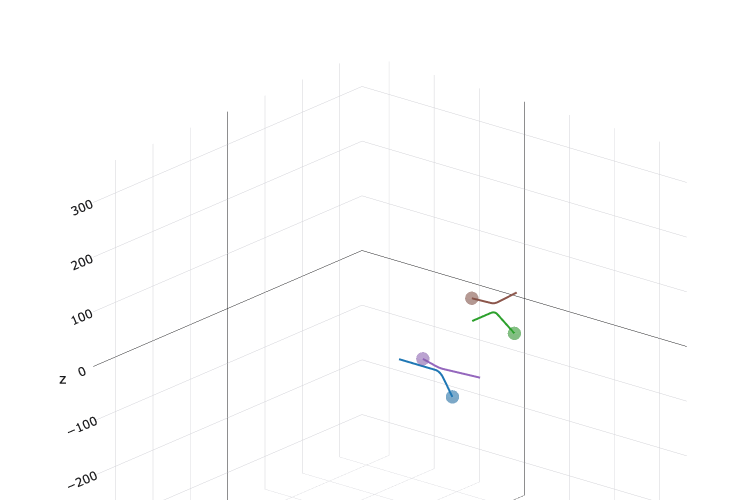
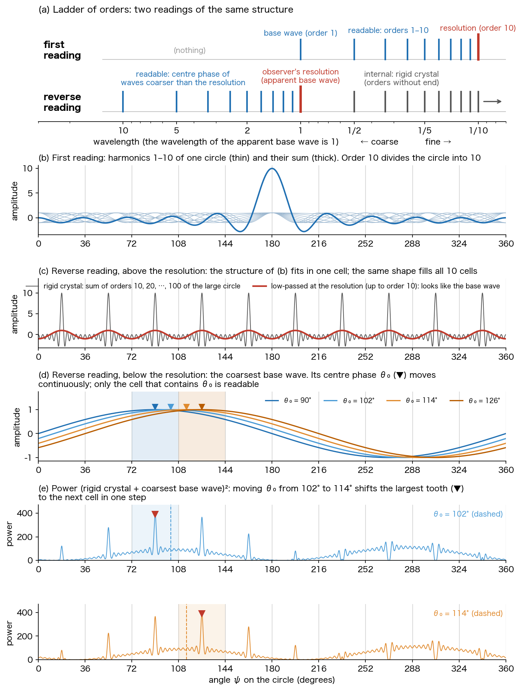

# The Observer's Resolution Is a Gauge
## ― A Thought Experiment That Reads the Harmonic Order in Reverse, and the Prediction of a Theory Assembled from Known Symmetries ―

**Author:** Noriaki Kihara (WF System Co., Ltd.)　ORCID 0009-0004-6753-4020
**Date:** 2026-11-10　　**Version:** v1.0
**Version DOI:** 10.5281/zenodo.24097612　　**Concept DOI:** 10.5281/zenodo.24097611
**Note:** The Japanese version (`paper_resolution_gauge_reverse_reading_ja_v1.0.md`) is the authoritative text; this English version is a translation.

---

## Abstract

A numerical experiment that builds quaternion pulses from integer-order harmonics on a closed circle and moves their centre phases came to a halt at a certain point: it used integer-order standing waves while treating the centre phase as a state that can be moved continuously. This paper records the chain of questions and answers that began there, in the order in which they arose, as a thought experiment in 19 steps, (T1)–(T19). The line of thought is as follows. Harmonics up to a maximum order $M$ divide the circle into $M$ parts, and a pulse of finite order becomes a rigid crystal. Pulses nevertheless appear to move continuously, because the wave that looks like the base wave is not the lowest-order wave but the observer's resolution, and what moves is the centre phase of a wave coarser than that resolution. The resolution is therefore not a property of the wave but a gauge of the observer. The order (winding number) and the phase are dual, and exchanging which of the two is read as the observation space exchanges the internal space and the observation space. For complex numbers this exchange is $1\Leftrightarrow1$, its form does not change, and it cannot be seen. For a quaternion $q=A\,e^{n\theta}$ it becomes $1\Leftrightarrow3$, an exchange between one closed circle and a three-component phase. What is conserved is the viewing angle; the resolution $M$ changes. All the parts used (the duality of the circle and the integers, the finite Weyl relation, harmonic analysis on $S^3$, the classification of the finite subgroups of $SU(2)$, cyclotomic fields and Niven's theorem, the McKay correspondence) are known. The prediction of this paper is that there is a map that joins these parts into one line under this reading, and that discreteness and quantumness, the continuity of three dimensions, integer magic numbers, and mass ratios that are not ratios of integers come out of it. Why there is a minimal viewing angle (Planck's constant) that does not depend on the observer is left as an open question.

---

## 1. Where the numerical experiment stopped

The author has written, with quaternions, a map that reads out spacetime (1+3) from a set of complex numbers[S1]. As its continuation, a numerical experiment that places quaternion pulses on a closed circle is in progress (unpublished; Appendix A). A pulse is

$$
Q_i(\psi)=A_i\,e^{n_i\varphi_{0i}}\left[\frac{\varphi_i}{360}+\frac{2}{\pi}\sum_{m=1}^{M}\frac{\sin(m\pi\varphi_i/360)}{m}\;e^{\,n_i\,m\pi(\psi-\theta_i)/180}\right]
$$

Here $\psi$ is the angle on the circle (degrees), $n_i$ is a unit pure-imaginary quaternion with $n_i^2=-1$, $A_i$ is the amplitude, $\varphi_{0i}$ the internal phase, $\theta_i$ the centre phase, $\varphi_i$ the width, and $M$ the maximum order. The default run has four pulses, $M=100$, $\varphi_i=20°$, $A_i=0.5,\,1,\,1.5,\,2$, and advances each centre phase by about $\pm1°$ per tick.

Figures 1 and 2 are two displays of this experiment at the same instant. Figure 1 draws the power of the sum of the four pulses, $\bigl|\sum_i Q_i(\psi)\bigr|^2$, radially on the circle. The pulses are on one closed circle. Figure 2 shows the points $r_i$, obtained by accumulating the advance of each pulse's centre phase along the direction of its axis $n_i$, and their trajectories. It looks as if four particles were moving in a three-dimensional space. But the three axes of Figure 2 are not coordinates of space. They are the three components of the imaginary part of a quaternion, that is, the internal phase space.

**Figure 1**　Left panel of the numerical experiment. From each angle on the closed circle, the power $\bigl|\sum_i Q_i(\psi)\bigr|^2$ at that angle is drawn radially (green). Default run of the version with interaction, tick 130.

**Figure 2**　Right panel at the same instant. The points $r_i$ (in degrees), obtained by accumulating the advance of each pulse's centre phase along its axis $n_i$, and their trajectories. The axes are the three components of the imaginary part of a quaternion; the internal phase space looks like a three-dimensional space.

**(T1)**　This experiment uses the standing waves of a closed string (integer-order harmonics). It nevertheless assumed that the centre phase $\theta_i$ of a pulse can be moved continuously. This assumption may be wrong.

The questions and answers that began with this doubt are written below as (T2) to (T19), in the order in which they arose. At each step, identities and theorems, readings, and hypotheses are kept apart. The classification is collected in the table of §16.

---

## 2. A pulse of finite order is a rigid crystal

**(T2)**　Harmonics up to a maximum order $M$ divide the circle into $M$ parts from the outset. This fixes the resolution, and the ruler (gauge) is fixed. Order 9 gives 9 divisions, order 8 gives 8 divisions; each time the order goes down, the resolution goes down. A pulse made of harmonics up to order 10 fills space with this ruler without a gap and has no freedom for its centre phase to move. This paper calls it a rigid crystal.

Two things in this step can be called identities. First, a harmonic of order $m$ coincides with itself under a shift of $360°/m$.

$$
e^{\,n\,m\pi(\psi+360/m)/180}=e^{\,n\,m\pi\psi/180}
$$

Second, for a real-valued wave, a sum up to order $M$ is fixed by $2M+1$ real numbers and carries the same information as its values at $2M+1$ equally spaced points (the sampling theorem[X1]). "Rigid crystal" and "has no freedom to move" are readings. Figure 3 (c) in §5 draws this reading.

---

## 3. Pulses nevertheless appear to move continuously

**(T3)**　If this map were right, the universe would be a rigid crystal lattice and nothing would happen. Yet pulses are observed to move continuously.

In the formula of §1, $\theta_i$ enters as the phase $e^{-n_i m\pi\theta_i/180}$ of the coefficient of each order and can take any value. The experiment ran accordingly. What is in question is not the formula but the reading of the formula. The reading of (T2) and the observation of (T3) are incompatible. The reading is wrong somewhere.

---

## 4. What looks like the base wave is the observer's resolution

**(T4)**　The mistake was to read the base wave as order 1. What looks like the base wave is not the lowest-order wave but the observer's resolution. The order of the wave is infinite. A pulse shape is observed because an infinitely sharp pulse is low-passed at the observable resolution (the wavelength of the base wave).

The formula of the experiment already has a form that agrees with this reading. An infinitely sharp pulse, with all orders at equal amplitude, is

$$
\delta(x)=\frac{1}{360}+\frac{1}{180}\sum_{m=1}^{\infty}\cos\frac{m\pi x}{180}
$$

($x$ in degrees). Averaging it with a window of width $\varphi$ gives

$$
\int_{x-\varphi/2}^{x+\varphi/2}\delta(y)\,dy=\frac{\varphi}{360}+\frac{2}{\pi}\sum_{m=1}^{\infty}\frac{\sin(m\pi\varphi/360)}{m}\cos\frac{m\pi x}{180}
$$

and the coefficients are identically equal to the constant term $c_0=\varphi/360$ and the order-$m$ coefficient $c_m=(2/\pi)\sin(m\pi\varphi/360)/m$ of the formula of §1. The pulse of the experiment is a sharp pulse smoothed by a window of width $\varphi$ and truncated at order $M$. In this reading the width $\varphi_i$ and the maximum order $M$ are not properties of the wave. They are quantities on the observer's side.

---

## 5. What moves is the centre phase of a wave coarser than the resolution

**(T5)**　The centre appears to move continuously because the centre phase of a wave of still lower order than this resolution is moving. A standing wave of harmonics up to order 10 looks like a rigid crystal. Add to it a base wave of still lower order. Then the side above the resolution looks like a pulse obtained by low-passing the rigid crystal, and the centre phase of the lowest-order base wave, coarser than the resolution, looks as if it could be changed continuously. In fact that centre phase, too, is discretised by the gauge of the resolution.

Figure 3 puts this step and the exchange of §7 into one picture. Everything is drawn with finite sums of integer-order cosines on a closed circle.

**Figure 3**　Reading the order in reverse (as the conjugate). (a) Two readings of the ladder of orders. The horizontal axis is the logarithm of the wavelength, with the wavelength of the wave that looks like the base wave set to 1. The upper row is the first reading: the base wave is the lowest order, and orders 2–10 stand above it. The lower row is the reverse reading: the wave that looks like the base wave is the observer's resolution, and orders continue on the coarser side as well. (b) The first reading. Harmonics $\cos(m(\psi-180°))$ of orders 1–10 of one circle, and their sum. (c) The reverse reading, above the resolution. The sum $\sum_{j=1}^{10}\cos(10j(\psi-18°))$ of orders 10, 20, …, 100 of the large circle (grey), and $\cos(10(\psi-18°))$, which keeps orders up to 10 (red). (d) Below the resolution. Order 1 of the large circle, $\cos(\psi-\theta_0)$. The cell that contains $\theta_0$ is shaded. (e) The power obtained by adding $10\cos(\psi-\theta_0)$ to the grey curve of (c) and squaring. ▼ marks the position of the largest tooth.

In (c), the structure of (b) enters every one of the 10 cells in the same form. The sum coincides with itself under a shift of $36°$, and nothing distinguishes one cell from another. This is the rigid crystal. Keeping orders up to 10 turns the teeth into the round wave $\cos(10(\psi-18°))$, and this looks like the base wave. The centre phase $\theta_0$ of the coarsest wave in (d) can be changed continuously as far as the formula goes. What can be read is which cell $\theta_0$ is in. In (e), moving $\theta_0$ continuously from $102°$ to $114°$ shifts the largest tooth from the cell at $90°$ to the cell at $126°$ in one step (it is at $90°$ for $\theta_0=90°,\,102°$ and at $126°$ for $114°,\,126°$). The number of cells 10, the amplitude 10 of the coarsest wave, and the use of the largest tooth as the marker are choices made in order to draw the figure, not quantities of the theory.

---

## 6. The observer's resolution is a gauge

**(T6)**　Therefore the observer's resolution is a gauge.

What is called a gauge here is the graduation of a ruler: a quantity brought in not by the wave but by the reader. The width and the maximum order of (T4) and the cells of (T5) are of this kind. A gauge in the sense of physics is a freedom whose choice does not change the relations that can be read. Whether the resolution is a gauge in that sense as well is decided by what stays unchanged when the resolution is changed. The answer is (T11) in §9.

---

## 7. Reading the order in reverse: exchanging the observation space and the internal space

**(T7)**　For this reason, only the winding number can be read. The phase space is the internal space, the space of winding numbers is the observable space (the observation space), and the boundary between the two is the resolution.

**(T8)**　The winding number and the phase are dual and conjugate, in the same way that frequency and wavelength are conjugate. If so, is it not a preconception that the observation space is the space of winding numbers? What happens if, conversely, the internal phase space, where the winding number cannot be read and only the phase can, is read as the observation space?

The winding number is the order $m$ of a harmonic. The characters on the circle $S^1$ are exhausted by $e^{im\theta}$ ($m$ an integer), and the characters on the integers $\mathbb{Z}$ are exhausted by the points of the circle. The circle and the integers are each other's duals (Pontryagin duality[X2]). The two stand on an equal footing, and mathematics does not decide which is placed on the side of observation. The reading decides.

The upper and lower rows of Figure 3 (a) are these two readings. The same ladder of orders is read in opposite directions. In the upper row, what can be read is the structure of the harmonics standing above the base wave, that is, the side of the order. In the lower row, the side finer than the resolution is smoothed as a rigid crystal, and what can be read is the centre phase of a wave coarser than the resolution, that is, the side of the phase. The exchange exchanges the internal space and the observation space.

---

## 8. The origin of discreteness and quantumness

**(T9)**　Is this not the origin of discreteness and quantumness?

What can be said within standard mathematics is the following. If the observation space is closed, its conjugate is the integers and is discrete (§7). With a resolution $M$, the phase becomes $M$ cells and the order folds back modulo $M$. The cyclic group $\mathbb{Z}_M$ is its own dual[X2]. The operation $T$ that shifts the phase by one cell and the operation $S$ that shifts the order by one do not commute, and satisfy

$$
TS=e^{2\pi i/M}\,ST,\qquad T^{M}=S^{M}=I
$$

(the finite Weyl relation[X3] [X4]). In the limit $M\to\infty$ this relation goes over to the Weyl form of the canonical commutation relation[X3] [X5]. Dynamics and the value of $M$ do not follow from here.

**(T10)**　The difference between this model and the standard theory is that $M$ is not determined. $M$ is zero-projected with respect to the observer and cannot be read. This point is essential. The standard theory may be the limit in which this $M$ is approximated by Planck's constant.

Zero projection is a term of the hypothesis[S2] that one and the same operation appears as a full projection, a partial projection, or a zero projection depending on the manner of projection; it means that in that projection the image is 0 and cannot be read.

---

## 9. The viewing angle is the conserved quantity; the resolution changes

**(T11)**　What is universal is the viewing angle. The viewing angle is the conserved quantity, and the resolution $M$ changes.

Only ratios can be read, and the relation between two parties is read through a shared viewing angle and the ratio of sizes[S3]. In the readout of the numerical experiment, the viewing angle of two pulses $i$, $j$ is read through the ratio of sizes

$$
\tan\alpha_{ij}=\frac{R_j}{R_i}
$$

$R_i$ is the size of the harmonic part of the pulse; in the formula of §1,

$$
R_i^{2}=A_i^{2}\sum_{m=1}^{M}c_m^{2}\;\xrightarrow{\;M\to\infty\;}\;2p(1-p)\,A_i^{2},\qquad p=\frac{\varphi}{360}
$$

If the two pulses are read at the same resolution (the same $\varphi$ and $M$),

$$
\tan\alpha_{ij}=\frac{A_j}{A_i}
$$

and the resolution drops out of the ratio. Changing the resolution does not change the ratio that can be read. This is the reason the resolution was called a gauge in §6.

Hence, when the limit of (T10) is read, one cell $360°/M$ must not be put in the place of Planck's constant. One cell is a quantity on the side that changes.

---

## 10. The remaining question: the minimal viewing angle

**(T12)**　Why, then, is there a minimal viewing angle (Planck's constant) that depends neither on the conditions of observation nor on the observer? This is the question that remains at the end.

$\tan\alpha_{ij}=A_j/A_i$ of §9 is continuous and has no lower bound. Nothing in the present formulas gives a minimum. What this paper fixes is the form of the question. Why does the viewing angle, which does not change when the resolution is changed, have a minimum that does not depend on the observer?

---

## 11. The overlooked symmetry: three dimensions and one dimension

**(T13)**　It is likely that there is still a symmetry that has been overlooked.

**(T14)**　With quaternions, the phase space can actually be mapped as a three-dimensional space (Figure 2). The radius of curvature $R$, on the other hand, is mapped to a one-dimensional space, a closed circle in a plane (Figure 1). The three dimensions and the one dimension look as if they were zero-projected, yet the relation between the two is kept. The candidate for the overlooked symmetry is here.

The core of a quaternion pulse[S1] is

$$
q=A\,e^{n\theta}=A(\cos\theta+n\sin\theta),\qquad n^{2}=-1
$$

The cross term of two unit quaternions $e^{n_i\beta_i}$ and $e^{n_j\beta_j}$ is

$$
\begin{aligned}
e^{n_i\beta_i}\,\overline{e^{n_j\beta_j}}={}&\bigl[\cos\beta_i\cos\beta_j+(n_i\cdot n_j)\sin\beta_i\sin\beta_j\bigr]\\
&+\bigl[\,n_i\sin\beta_i\cos\beta_j-n_j\cos\beta_i\sin\beta_j-(n_i\times n_j)\sin\beta_i\sin\beta_j\bigr]
\end{aligned}
$$

$R$ is the size used for the readout in §9, and $R^2$ is the power. Only the scalar part, the first bracket, enters $R^2$. The orientation $n_i\times n_j$ enters only the vector part. What remains from the three dimensions into $R$ is only a relation, the angle $n_i\cdot n_j$ between the axes. "Look as if they were zero-projected, yet the relation between the two is kept" has this form in the formulas.

The outside standards are as follows. The dual of the circle is the integers, a correspondence between one dimension and one dimension (§7). The dual of $S^3=SU(2)$ is a single label $k=1,2,3,\ldots$ of the irreducible representations, and the level $k$ has $k^2$ components (the Peter–Weyl theorem[X6]). This is a correspondence between a three-dimensional continuum and one-dimensional integers. Whether this correspondence is the map of (T14) has not been checked.

**(T15)**　If so, even though the centre phase on the one-dimensional circle is discretised by the viewing angle (the resolution), the three-dimensional space would be observed as continuous.

In standard group theory the situation is this. A rotation by one step $360°/M$ on one circle closes after $M$ times. When rotations of finite order about two axes of different orientation are composed, the result closes finitely only if it lies in a finite subgroup of $SU(2)$. These are limited to the cyclic groups, the binary dihedral groups, and the three groups with 24, 48 and 120 elements (Klein[X7]). The orders of the elements of the three groups are at most 10. Apart from these cases the composition generates an infinite group, which is in general dense in $S^3$. This has not yet been checked in the numerical experiment.

---

## 12. Connection with number-theoretic symmetry

**(T16)**　Here the structure may connect with number-theoretic symmetry, and integer magic numbers may appear. That mass ratios are not simple ratios of integers even though there are integer magic numbers is also thought to come from this map.

The list of integer magic numbers is collected in the catalogue[S2]. The outside standards are as follows. The number of steps $M$ in one turn is an integer. The projection of one step of rotation $360°/M$ is $\cos(360°/M)$. This is rational only for $M=1,2,3,4,6$ (Niven's theorem[X8]). For any other $M$ it is an algebraic irrational of degree $\phi(M)/2$, where $\phi$ is Euler's function, and the Galois group $(\mathbb{Z}/M)^{\times}/\{\pm1\}$ of the cyclotomic field permutes its conjugates. For the group with 120 elements, the order is an integer and the golden ratio enters the coordinates of the elements. Actual mass ratios have not yet been derived.

**(T17)**　The necessary parts have already been found by mathematicians, beginning with Galois. Is it not only the map connecting them that is missing?

Some bridges between the parts are also known. The finite subgroups of $SU(2)$ correspond one to one to the extended Dynkin diagrams of ADE type. The group with 120 elements (the binary icosahedral group) corresponds to $E_8$ (the McKay correspondence[X9]).

---

## 13. The 1+3 of quaternions, and the side of the extra dimension

**(T18)**　This structure is tied directly to the 1+3 space of quaternions. It is hard to notice while one works with complex numbers and becomes visible only with quaternions.

The exponent $n\theta$ of $q=A\,e^{n\theta}$ has three components. With $n$ held fixed, $\theta$ runs on one closed circle in the plane $\{1,n\}$. A harmonic $e^{n\,m\theta}$ is the winding number $m$ of this circle. The ladder of orders and the resolution are on the side of the circle, which has one component. The side of the phase has three components. The exchange of §7 becomes $1\Leftrightarrow3$ for quaternions. Read in reverse, the readable side is the three-component phase, that is, the space of Figure 2.

For complex numbers $n=i$ is fixed once and for all, and the exponent $i\theta$ has one component. The exchange is $1\Leftrightarrow1$, and its form does not change under the exchange. The author has re-examined the reading of complex numbers once[S4], but this exchange does not show in the form at the stage of complex numbers.

**(T19)**　The observable space is on the side that has been called the extra dimension.

The theory of Kaluza and Klein places a small closed circle in the internal space (the extra dimension) and places the open, wide side in the observed space[X10] [X11]. The reading of this paper points the other way. The one closed circle is on the side of the order and of the ruler of resolution. The observed three-dimensional space is on the side of the three-component phase that has been called internal.

---

## 14. Known parts and nearby research

As (T17) says, all the parts used in this paper are known. Table 1 lists them.

**Table 1**　Known parts.

| Part | Content | Step of this paper | Reference |
|----|---------|---|---|
| Sampling theorem | A wave with an upper limit on its band carries the same information as a finite number of equally spaced values | (T2), (T4) | [X1] |
| Duality of the circle and the integers | The conjugate of a closed space is discrete. $\mathbb{Z}_M$ is its own dual | (T7)–(T9) | [X2] |
| Finite Weyl relation | $TS=e^{2\pi i/M}ST$. Goes over to the canonical commutation relation as $M\to\infty$ | (T9), (T10) | [X3] [X4] |
| Harmonic analysis on $S^3$ | The dual of $SU(2)$ is a single label, with $k^2$ components at level $k$ | (T14) | [X6] |
| Classification of the finite subgroups of $SU(2)$ | Cyclic, binary dihedral, and only the three with 24, 48, 120 elements | (T15) | [X7] |
| Niven's theorem and cyclotomic fields | $\cos(360°/M)$ is rational only for $M=1,2,3,4,6$. Otherwise an algebraic irrational permuted by the Galois group | (T16) | [X8] |
| McKay correspondence | Correspondence between the finite subgroups of $SU(2)$ and the diagrams of ADE type. The group with 120 elements and $E_8$ | (T17) | [X9] |
| Extra dimension as a closed circle | The closed circle is placed inside, the open side in the observation space | (T19) | [X10] [X11] |

Table 2 sets nearby research against the steps of this paper. The "content" column follows the abstract of each reference.

**Table 2**　Nearby research and the difference from the reading of this paper.

| Research | Content (from the abstract) | Difference from the reading of this paper |
|-----|--------|------|
| Band-limited spacetime[X12] [X13] | If fields have an upper limit on their band, the sampling theorem lets them be written continuously or discretely with the same information. A continuous translation symmetry survives in a lattice theory | The band limit is a constant on nature's side, not a quantity on the observer's side |
| Rational quantum mechanics[X14] [X15] | Hilbert space is discretised, and sets of measurements that cannot be defined simultaneously follow from Niven's theorem. Quantum mechanics is the singular limit of zero discretisation width | The discretisation width is a constant fixed by gravity, not a gauge of the observer |
| Quantum mechanics with finite groups and cyclotomic numbers[X16] | Continuous unitary groups are replaced by finite groups, and complex numbers by cyclotomic numbers | No reading of resolution and viewing angle |
| Conjugate variables in finite dimensions[X5] | Conjugate variables in finite dimensions are built from clock and shift operators and return to position and momentum in the infinite-dimensional limit | The dimension is not a gauge of the observer |
| Quantum theory over finite mathematics[X17] | Standard quantum theory is the limit of infinite characteristic of a theory over a finite ring | The characteristic is a constant of nature |
| SICs and class field theory[X18] | Equiangular sets of states built as orbits of the finite Weyl–Heisenberg group lie in abelian extensions of real quadratic fields | A worked example of a map joining the finite Weyl pair and number theory. No reading of spacetime and mass |
| Galois conjugation of topological field theories[X19] | Galois conjugation maps a theory to another theory | A worked example in which a symmetry on the side of numbers becomes a map between theories |
| Modular flavour symmetry[X20] [X21] | Finite modular groups constrain the masses and mixings of quarks and leptons | The group is chosen by hand. There is neither observer nor resolution |
| Characters of finite groups and mixing matrices[X22] | Characters of finite groups narrow down the small groups that can reproduce the mixing matrices | A selection of groups, not a derivation of the map |
| Discretisation of the $SU(2)$ gauge field by finite subgroups[X23] [X24] | $SU(2)$ is replaced by a finite subgroup for quantum computation. On one side of the coupling it departs from the continuous group | A method of approximation for computation. It gives a numerical example that finite groups alone do not reach the three-dimensional continuum |
| $E_8$ from the spinors of the icosahedron[X25] | The 600-cell is built from 120 spinors, and the 240 roots of $E_8$ are constructed | A geometric construction, without a physical reading |
| Scale relativity[X26] | Resolution is taken as a state of the reference system, and the laws are required to keep their form under transformations of resolution | A non-differentiable fractal spacetime is placed as the background |
| Quantum reference frames[X27] [X28] | The choice of the observer (reference frame) is treated as a gauge | What is made a gauge is the choice of reference frame, not the resolution |
| Planck's constant running with resolution[X29] [X30] [X31] | The number of unresolved microscopic histories fixes the effective strength of quantisation. Planck's constant runs with the resolution | What changes is Planck's constant. In this paper what is universal is the viewing angle and what changes is $M$ (§9) |
| Duality as a choice of polarisation of phase space[X32] | The exchange of position and momentum is treated as a choice of submanifold of phase space | Within the framework of string theory |
| Physics of finite information[X33] | Real numbers carrying infinite information are not admitted as physical quantities | No structure of duality and gauge |
| Quantum mechanics from fast classical variables[X34] | Adding fast classical variables makes the Schrödinger equation appear for the slow variables | Not about the observer's resolution |

Within the range the author has surveyed, the following four were not found.

1. A reading that takes the resolution as a gauge and the viewing angle as the conserved quantity (§6, §9).
2. A reading that exchanges which of the space of phases and the space of winding numbers is read as the observation space (§7).
3. A map between the three dimensions and the one dimension of quaternions that makes discreteness on the circle and continuity in three dimensions compatible (§11, §13).
4. A map that joins all these into one line (§12). Bridges between individual parts are advancing separately: the finite Weyl pair and class field theory[X18], modular groups and masses[X20], the group with 120 elements and $E_8$[X9] [X25].

---

## 15. Predictions

The prediction of this paper is that combining known symmetries assembles one theory. Step by step it reads as follows.

1. **There is a connecting map.**　There exists a map that joins the parts of Table 1 into one line under the reading that the resolution is a gauge, the viewing angle is the conserved quantity, and the observation space and the internal space are exchanged (T17).
2. **Discreteness and quantumness come from the exchange.**　Which of the side of the phase and the side of the winding number is read as the observation space decides on which side discreteness appears. The standard theory appears as the limit in which the unreadable $M$ is approximated by Planck's constant (T9, T10).
3. **The viewing angle does not depend on the resolution.**　Changing the resolution does not change the ratio that can be read (T11).
4. **The circle is discrete and space is continuous.**　The centre phase on the circle is discretised by the resolution, and the space of the three-component phase is observed as continuous (T15).
5. **Integer magic numbers and mass ratios that are not ratios of integers come from the same map.**　Integer magic numbers appear from the connection with number-theoretic symmetry, and because of the same map, mass ratios are not simple ratios of integers (T16).
6. **The observed space is on the side of the phase.**　The observed three-dimensional space is not on the side of the closed circle but on the side of the three-component phase (T18, T19).

Two questions remain. One is the minimal viewing angle of (T12). The other is whether the wave coarser than the resolution in (T5) is a low-order component of the same pulse or a different wave.

---

## 16. Classification

| Class | Content |
|--|-------------|
| Identities and theorems | §2 the period $360°/m$ of a harmonic of order $m$, the sampling theorem[X1]／§4 the coefficients of the experiment have the form of a sharp pulse smoothed by a window／§7 the duality of the circle and the integers[X2]／§8 the finite Weyl relation and its limit[X3] [X4]／§9 $\tan\alpha_{ij}=A_j/A_i$ when read at the same resolution／§11 the scalar and vector parts of the cross term, the Peter–Weyl theorem[X6], the classification of finite subgroups[X7]／§12 Niven's theorem[X8], the Galois group of the cyclotomic field, the McKay correspondence[X9] |
| Readings | (T2) a pulse of finite order is a rigid crystal／(T4) what looks like the base wave is the observer's resolution; the width and the maximum order are quantities on the observer's side／(T5) what moves is the centre phase of a wave coarser than the resolution／(T6) the resolution is a gauge／(T7)(T8) the exchange of the observation space and the internal space／(T18) the exchange is $1\Leftrightarrow3$ for quaternions and $1\Leftrightarrow1$ for complex numbers／(T19) the observed space is on the side that has been called the extra dimension／the way Figure 3 is made |
| Hypotheses | (T9) the origin of discreteness and quantumness／(T10) the standard theory is the limit in which $M$ is approximated by Planck's constant／(T11) the viewing angle is the conserved quantity and $M$ changes／(T14) the map between three dimensions and one dimension is the overlooked symmetry／(T15) the circle is discrete, the three dimensions continuous／(T16) the connection with number-theoretic symmetry／(T17) the parts are known and only the connecting map is missing |
| Open | (T12) the observer-independent minimal viewing angle／the identity of the coarse wave of (T5)／whether the Peter–Weyl correspondence is the map of (T14)／dynamics and the value of $M$ |
| Ways it can fail | Only readouts in which the viewing angle changes when the resolution (width and maximum order) is changed can be built／under a finite resolution, the side of the three-component phase also closes into a finite subgroup of $SU(2)$／the minimal viewing angle comes out only in a form that depends on the resolution or on the observer |

---

## References

### Self-citations (Concept DOI, 10.5281/zenodo.〔number〕)

[S1] N. Kihara, "複素数の集合から時空 (1＋3) への写像 ― 四元数による読み出しと部分投射 ―" (A Map from a Set of Complex Numbers to Spacetime (1+3): Readout by Quaternions and Partial Projection), 2026-10-18. Concept DOI 10.5281/zenodo.23451494.  
[S2] N. Kihara, "状態空間から時空を読み出すための対称性とマジックナンバーの目録 ― 無名性と自己無撞着を公理とする研究計画の答え合わせの基準 ―" (A Catalogue of Symmetries and Magic Numbers for Reading Out Spacetime from a State Space: The Answer-Check Standard of a Research Programme Taking Anonymity and Self-Consistency as Axioms), 2026-10-18. Concept DOI 10.5281/zenodo.23444451.  
[S3] N. Kihara, "観測は放射と吸収の同時成立である ― 視野角と大きさの読出し規則からボルン則・ベル相関・ツィレルソン限界を導く ―" (Observation as Simultaneous Emission and Absorption: Deriving the Born Rule, Bell Correlations and the Tsirelson Bound from a Viewing-Angle Readout Rule), 2026-11-01. Concept DOI 10.5281/zenodo.23857884.  
[S4] N. Kihara, "複素数を正しく理解していたか ― 振幅はどこに住むか、虚数読み、ℂ → ℍ → 𝕆 の帰属 ―" (Did We Understand Complex Numbers Correctly? Where the Amplitude Lives, the Imaginary Reading, and Attribution across ℂ → ℍ → 𝕆), 2026-10-23. Concept DOI 10.5281/zenodo.23585436.

### External references

[X1] C. E. Shannon, "Communication in the Presence of Noise," Proc. IRE 37, 10–21 (1949). DOI 10.1109/JRPROC.1949.232969  
[X2] L. Pontrjagin, "The Theory of Topological Commutative Groups," Ann. Math. 35, 361 (1934). DOI 10.2307/1968438  
[X3] H. Weyl, "Quantenmechanik und Gruppentheorie," Z. Phys. 46, 1–46 (1927). DOI 10.1007/BF02055756  
[X4] J. Schwinger, "Unitary operator bases," Proc. Natl. Acad. Sci. USA 46, 570–579 (1960). DOI 10.1073/pnas.46.4.570  
[X5] A. Singh, S. M. Carroll, "Modeling Position and Momentum in Finite-Dimensional Hilbert Spaces via Generalized Pauli Operators," arXiv:1806.10134 (2018).  
[X6] F. Peter, H. Weyl, "Die Vollständigkeit der primitiven Darstellungen einer geschlossenen kontinuierlichen Gruppe," Math. Ann. 97, 737–755 (1927). DOI 10.1007/BF01447892  
[X7] F. Klein, *Vorlesungen über das Ikosaeder und die Auflösung der Gleichungen vom fünften Grade* (Teubner, Leipzig, 1884).  
[X8] I. Niven, *Irrational Numbers*, Carus Mathematical Monographs 11 (Mathematical Association of America, 1956).  
[X9] J. McKay, "Graphs, singularities, and finite groups," Proc. Symp. Pure Math. 37, 183–186 (1980). DOI 10.1090/pspum/037/604577  
[X10] Th. Kaluza, "Zum Unitätsproblem der Physik," Sitzungsber. Preuss. Akad. Wiss. Berlin (Math. Phys.) 1921, 966–972.  
[X11] O. Klein, "Quantentheorie und fünfdimensionale Relativitätstheorie," Z. Phys. 37, 895–906 (1926). DOI 10.1007/BF01397481  
[X12] A. Kempf, "Information-theoretic natural ultraviolet cutoff for spacetime," Phys. Rev. Lett. 103, 231301 (2009). DOI 10.1103/PhysRevLett.103.231301  
[X13] D. G. Lewis, A. Kempf, N. C. Menicucci, "Quantum lattice models that preserve continuous translation symmetry," Phys. Rev. D 108, 096024 (2023). DOI 10.1103/PhysRevD.108.096024  
[X14] T. N. Palmer, "Discretisation of the Bloch Sphere, Fractal Invariant Sets and Bell's Theorem," arXiv:1804.01734 (2018).  
[X15] T. Palmer, "Rational Quantum Mechanics: Testing Quantum Theory with Quantum Computers," arXiv:2510.02877 (2025).  
[X16] V. V. Kornyak, "Constructive quantum mechanics based on finite groups," arXiv:2409.18159 (2024).  
[X17] F. M. Lev, "Finite mathematics as the most general (fundamental) mathematics," Symmetry 16, 1340 (2024). DOI 10.3390/sym16101340  
[X18] M. Appleby, S. T. Flammia, G. S. Kopp, "A Constructive Approach to Zauner's Conjecture via the Stark Conjectures," arXiv:2501.03970 (2025).  
[X19] M. Buican, R. Radhakrishnan, "Galois Orbits of TQFTs: Symmetries and Unitarity," JHEP 01 (2022) 004. DOI 10.1007/JHEP01(2022)004  
[X20] G.-J. Ding, S. F. King, "Neutrino Mass and Mixing with Modular Symmetry," arXiv:2311.09282 (2023).  
[X21] M.-C. Chen, X. Li, X.-G. Liu, M. Ratz, "Modular Flavor Symmetries and Fermion Mass Hierarchies," arXiv:2506.23343 (2025).  
[X22] M. Planat, R. Aschheim, M. M. Amaral, K. Irwin, "Informationally Complete Characters for Quark and Lepton Mixings," Symmetry 12, 1000 (2020). DOI 10.3390/sym12061000  
[X23] Y. Ji, H. Lamm, S. Zhu, "Gluon Field Digitization via Group Space Decimation for Quantum Computers," Phys. Rev. D 102, 114513 (2020). DOI 10.1103/PhysRevD.102.114513  
[X24] B. Assi, H. Lamm, "Digitization and subduction of SU(N) gauge theories," arXiv:2405.12204 (2024).  
[X25] P.-P. Dechant, "The Birth of E₈ out of the Spinors of the Icosahedron," Proc. R. Soc. A 472, 20150504 (2016). DOI 10.1098/rspa.2015.0504  
[X26] L. Nottale, "Scale relativity and fractal space-time: theory and applications," Found. Sci. 15, 101–152 (2010). DOI 10.1007/s10699-010-9170-2  
[X27] A.-C. de la Hamette, T. D. Galley, P. A. Höhn, L. Loveridge, M. P. Müller, "Perspective-neutral approach to quantum frame covariance for general symmetry groups," arXiv:2110.13824 (2021).  
[X28] J. De Vuyst, S. Eccles, P. A. Höhn, J. Kirklin, "Gravitational entropy is observer-dependent," JHEP 07 (2025) 146. DOI 10.1007/JHEP07(2025)146  
[X29] A. Maiezza, J. C. Vasquez, "Minimal Proper-time in Quantum Field Theory," Nucl. Phys. B 1025, 117409 (2026). DOI 10.1016/j.nuclphysb.2026.117409  
[X30] A. Maiezza, "Minimal Proper Time and Deterministic Microstates: Emergent Quantum Fields and Relativistic Spacetime," Eur. Phys. J. C 86, 829 (2026). DOI 10.1140/epjc/s10052-026-16089-x  
[X31] G. Kapilevich, "Renormalization group ontology in quantum foundations: a non-interacting spin-0 toy model," arXiv:2608.19458 (2026).  
[X32] L. Freidel, R. G. Leigh, D. Minic, "Born Reciprocity in String Theory and the Nature of Spacetime," Phys. Lett. B 730, 302–306 (2014). DOI 10.1016/j.physletb.2014.01.067  
[X33] N. Gisin, "Mathematical languages shape our understanding of time in physics," Nature Physics 16, 114–116 (2020). DOI 10.1038/s41567-019-0748-5  
[X34] G. 't Hooft, "Fast Vacuum Fluctuations and the Emergence of Quantum Mechanics," Found. Phys. 51, 63 (2021). DOI 10.1007/s10701-021-00464-7

---

## Appendix A　Reproducing the figures

Figures 1 and 2 are the left and right panels cut out of the still image `figs/v12q4i_default_tick130.png` (taken by `shoot.sh` in the same folder with the default initial conditions) of the unpublished numerical experiment `有界な定常波の再検討_閉じた弦のパルス_フーリエ級数_20261028/四元数化の検討_4パルス_相互作用版_20261109/index_v12q4i.html`. The cropping is done by `図表/make_crops.py`; no pixel is altered. Figure 3 is generated by `概念図_次数を逆に読む/fig_reverse_reading.py` (argument `en` for the English version). Every point is computed directly from the formulas; no random numbers are used. The step in $\psi$ is $0.025°$. The positions of the largest tooth in Figure 3 (e) are recorded in `概念図_次数を逆に読む/figs/check_v0.1.txt`. Dependencies: numpy, matplotlib, Pillow.

## Version history

- v1.0 (2026-11-10): Published version. Version DOI 10.5281/zenodo.24097612 and Concept DOI 10.5281/zenodo.24097611 entered. English translation of the Japanese v1.0; Figure 3 uses the English figure (`fig_reverse_reading_v0.1_en.png`).
