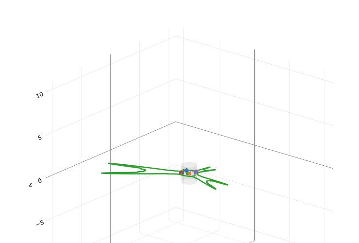
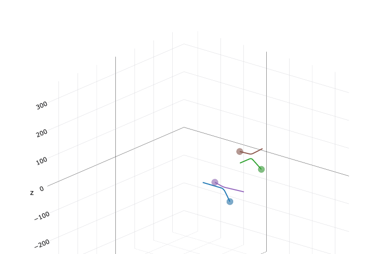
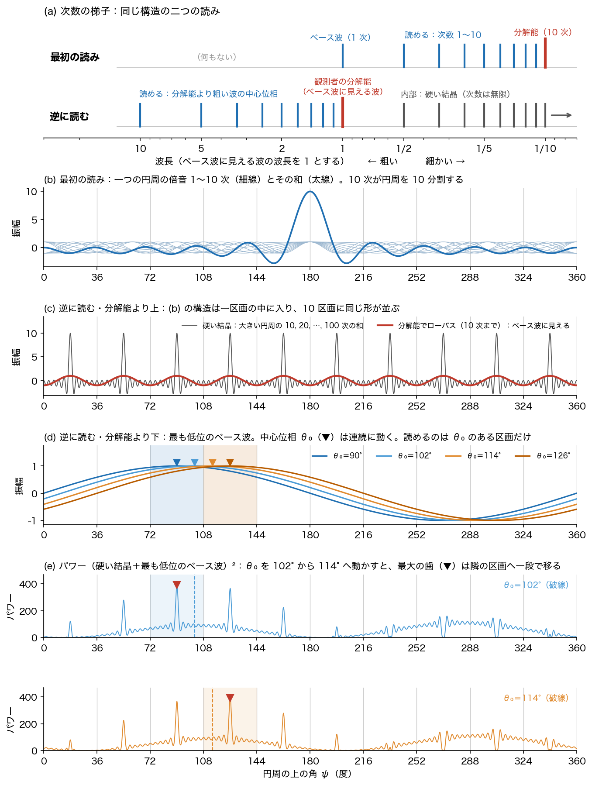

# 観測者の分解能はゲージである
## ― 次数を逆に読む思考実験と、既知の対称性から組み上がる理論の予言 ―

**著者：** 木原範昭（株式会社WFシステム）　ORCID 0009-0004-6753-4020
**日付：** 2026-11-10　　**版：** v0.1（草稿）
**Version DOI：** 未取得　　**Concept DOI：** 未取得

---

## 要旨

閉じた円周の上の整数次の倍音で四元数のパルスを作り、その中心位相を動かす数値実験は、ある所で止まった。整数次の定常波を使いながら、中心位相を連続に動かせる状態として扱っていたからである。本稿は、そこから始まった一続きの問答を、起こった順に 19 段の思考実験 (T1)〜(T19) として記録する。筋は次のとおりである。最大次数 $M$ の倍音は円周を $M$ 個に分け、有限次数のパルスは硬い結晶になる。それでもパルスが連続に動いて見えるのは、ベース波に見える波が最低次の波ではなく観測者の解像度であり、動いているのがそれより粗い波の中心位相だからである。したがって分解能は波の性質ではなく、観測者のゲージである。次数（巻き数）と位相は双対であり、どちらを観測空間と読むかを入れ替えると、内部空間と観測空間が入れ替わる。この入れ替えは、複素数では $1\Leftrightarrow1$ で形が変わらず見えない。四元数 $q=A\,e^{n\theta}$ では、閉じた円周 1 本と 3 成分の位相の入れ替え $1\Leftrightarrow3$ になる。保存されるのは視野角で、分解能 $M$ は変わる。使った部品（円周と整数の双対、有限のワイルの関係、$S^3$ の調和解析、$SU(2)$ の有限部分群の分類、円分体とニーヴンの定理、マッカイ対応）はどれも既知である。本稿の予言は、これらの部品をこの読みで一本につなぐ写像があり、そこから離散性と量子性、3 次元の連続、整数のマジックナンバーと整数比にならない質量比が出る、というものである。観測者によらない最小の視野角（プランク定数）がなぜあるのかは、未解決の問いとして残す。

---

## 1. 数値実験が止まった場所

著者は、複素数の集合から時空 (1＋3) を読み出す写像を四元数で書いた[S1]。その延長で、閉じた円周の上に四元数のパルスを置く数値実験を続けている（公開前、付録 A）。パルスは

$$
Q_i(\psi)=A_i\,e^{n_i\varphi_{0i}}\left[\frac{\varphi_i}{360}+\frac{2}{\pi}\sum_{m=1}^{M}\frac{\sin(m\pi\varphi_i/360)}{m}\;e^{\,n_i\,m\pi(\psi-\theta_i)/180}\right]
$$

である。$\psi$ は円周の上の角（度）、$n_i$ は $n_i^2=-1$ を満たす単位の純虚四元数、$A_i$ は振幅、$\varphi_{0i}$ は内部位相、$\theta_i$ は中心位相、$\varphi_i$ は幅、$M$ は最大次数である。既定の走行はパルス 4 本、$M=100$、$\varphi_i=20°$、$A_i=0.5,\,1,\,1.5,\,2$ で、中心位相を 1 tick あたり約 $\pm1°$ ずつ進める。

図 1 と図 2 は、この実験の同じ時刻の二つの表示である。図 1 は、4 本の和のパワー $\bigl|\sum_i Q_i(\psi)\bigr|^2$ を円周の上に放射方向に描いたものである。パルスは一本の閉じた円周の上にある。図 2 は、各パルスの中心位相の進みを軸 $n_i$ の向きに積んだ点 $r_i$ とその軌跡である。3 次元の空間の中を 4 個の粒子が動いているように見える。しかし図 2 の 3 本の軸は空間の座標ではない。四元数の虚部の 3 成分、つまり内部の位相空間である。

**図 1**　数値実験の左のパネル。閉じた円周の上の各角から放射方向に、その角でのパワー $\bigl|\sum_i Q_i(\psi)\bigr|^2$ を描いた（緑）。相互作用を入れた版の既定の走行、tick 130。

**図 2**　同じ時刻の右のパネル。各パルスの中心位相の進みを軸 $n_i$ の向きに積んだ点 $r_i$（単位は度）と軌跡。軸は四元数の虚部の 3 成分であり、内部の位相空間が 3 次元の空間のように見えている。

**(T1)**　この実験は、閉じた弦の定常波（整数次の倍音）を使っている。にもかかわらず、パルスの中心位相 $\theta_i$ を連続に動かせると仮定していた。これが大きな誤りである可能性がある。

以下、この疑いから始まった問答を、起こった順に (T2) から (T19) として記す。各段で、恒等式・定理と、読みと、仮説を分ける。分け方は §16 の表にまとめる。

---

## 2. 有限次数のパルスは硬い結晶である

**(T2)**　最大次数 $M$ の倍音は、円周を最初から $M$ 個に分割している。分解能はこれで決まり、物差し（ゲージ）は固定されている。9 次は 9 分割、8 次は 8 分割と、次数が下がるごとに分解能は下がる。10 次までの倍音で作ったパルスは、空間をこの物差しでびっしり埋めた、中心位相の動く自由度のない硬い結晶である。

この段で恒等式と呼べるのは二つである。第一に、$m$ 次の倍音は $360°/m$ のずらしで自分自身に重なる。

$$
e^{\,n\,m\pi(\psi+360/m)/180}=e^{\,n\,m\pi\psi/180}
$$

第二に、実数値の波なら、$M$ 次までの和は $2M+1$ 個の実数で決まり、等間隔の $2M+1$ 点での値と同じ情報である（標本化定理[X1]）。「硬い結晶」と「動く自由度がない」は読みである。この読みを図にしたものが、§5 の図 3 (c) である。

---

## 3. それでもパルスは連続に動いて見える

**(T3)**　この写像のとおりなら、宇宙は硬い結晶格子で、何も起こらないはずである。ところが、パルスは連続に移動して観測される。

§1 の式では、$\theta_i$ は各次数の係数の位相 $e^{-n_i m\pi\theta_i/180}$ として入り、どの値でも取れる。実験はそのとおりに動いた。問われているのは式ではなく、式の読みである。(T2) の読みと (T3) の観測は両立しない。どこかで読みを誤っている。

---

## 4. ベース波に見えるものが観測者の解像度である

**(T4)**　誤っていたのは、ベース波を 1 次と読んだことである。ベース波に見えるものは最低次の波ではなく、観測者の本当の解像度である。波の次数は、実は無限である。パルス状に観測されるのは、無限に鋭いパルスを、観測可能な分解能（ベース波の波長）でローパスフィルターしているからである。

実験の式は、この読みと合う形をすでに持っている。全次数が等振幅の、無限に鋭いパルスは

$$
\delta(x)=\frac{1}{360}+\frac{1}{180}\sum_{m=1}^{\infty}\cos\frac{m\pi x}{180}
$$

である（$x$ は度）。これを幅 $\varphi$ の窓でならすと

$$
\int_{x-\varphi/2}^{x+\varphi/2}\delta(y)\,dy=\frac{\varphi}{360}+\frac{2}{\pi}\sum_{m=1}^{\infty}\frac{\sin(m\pi\varphi/360)}{m}\cos\frac{m\pi x}{180}
$$

となり、係数は §1 の式の $c_0=\varphi/360$、$c_m=(2/\pi)\sin(m\pi\varphi/360)/m$ と恒等的に等しい。実験のパルスは、鋭いパルスを幅 $\varphi$ の窓でならし、$M$ 次で打ち切ったものである。この読みでは、幅 $\varphi_i$ と最大次数 $M$ は波の性質ではない。観測者の側の量である。

---

## 5. 動いているのは、分解能より粗い波の中心位相である

**(T5)**　連続して中心が動いて見えるのは、この分解能よりさらに低次の波の中心位相が動いているからである。10 次までの倍音の定常波は硬い結晶に見える。そこへ、さらに低位にベース波を足す。すると、分解能より上は硬い結晶をローパスしたパルスに見え、分解能より粗い最も低位のベース波の中心位相は、連続に変えられるように見える。実際には、その中心位相も分解能のゲージで離散化している。

図 3 は、この段と §7 の入れ替えを一枚にしたものである。すべて、閉じた円周の上の整数次の余弦の有限和で描いた。

**図 3**　次数を逆（共役）に読む。(a) 次数の梯子の二つの読み。横軸は波長の対数で、ベース波に見える波の波長を 1 とした。上段は最初の読みで、ベース波が最低次であり、その上に 2〜10 次が並ぶ。下段は逆の読みで、ベース波に見える波は観測者の解像度であり、それより粗い側にも次数が続く。(b) 最初の読み。一つの円周の 1〜10 次の倍音 $\cos(m(\psi-180°))$ と、その和。(c) 逆の読みの、分解能より上。大きい円周の 10, 20, …, 100 次の和 $\sum_{j=1}^{10}\cos(10j(\psi-18°))$（灰色）と、10 次までを残した $\cos(10(\psi-18°))$（赤）。(d) 分解能より下。大きい円周の 1 次 $\cos(\psi-\theta_0)$。$\theta_0$ のある区画に色を付けた。(e) (c) の灰色に $10\cos(\psi-\theta_0)$ を足して二乗したパワー。▼ は最大の歯の位置。

(c) では、(b) の構造が 10 個の区画のすべてに同じ形で入る。和は $36°$ のずらしで自分自身に重なり、区画どうしを区別するものがない。これが硬い結晶である。10 次までを残すと歯は丸い波 $\cos(10(\psi-18°))$ になり、これがベース波に見える。(d) の最も粗い波の中心位相 $\theta_0$ は、式の上では連続に変えられる。読めるのは、$\theta_0$ がどの区画にあるかである。(e) で $\theta_0$ を $102°$ から $114°$ へ連続に動かすと、最大の歯は $90°$ の区画から $126°$ の区画へ一段で移る（$\theta_0=90°,\,102°$ で $90°$、$114°,\,126°$ で $126°$）。区画の数 10、最も粗い波の振幅 10、最大の歯を目印にしたことは、図を描くための選択であり、理論の量ではない。

---

## 6. 観測者の分解能がゲージである

**(T6)**　つまり、観測者の分解能がゲージである。

ここでゲージと呼ぶのは物差しの刻みのことで、波の側ではなく、読む側が持ち込む量である。(T4) の幅と最大次数、(T5) の区画がこれに当たる。物理でいうゲージは、選び方を変えても読める関係が変わらない自由度である。分解能がその意味でもゲージであるかどうかは、分解能を変えたときに何が変わらないかで決まる。その答えが §9 の (T11) である。

---

## 7. 次数を逆に読む：観測空間と内部空間の入れ替え

**(T7)**　だから、巻き数しか読めない。位相空間が内部空間であり、巻き数の空間がわれわれの観測可能な観測空間であり、その境界が分解能である。

**(T8)**　巻き数と位相は双対で、共役である。振動数と波長が共役であるのと同じである。では、われわれは、観測空間が巻き数の空間だと信じ込んでいないか。逆に、巻き数が読めず位相しか読めない、内部の位相空間こそが観測空間だと発想を変えると、どうなるか。

巻き数は倍音の次数 $m$ のことである。円周 $S^1$ の上の指標は $e^{im\theta}$（$m$ は整数）で尽き、整数 $\mathbb{Z}$ の上の指標は円周の点で尽きる。円周と整数は互いの双対である（ポントリャーギンの双対[X2]）。二つは対等であり、どちらを観測の側に置くかを数学は決めない。決めるのは読みである。

図 3 (a) の上段と下段が、この二つの読みである。同じ次数の梯子を逆向きに読んでいる。上段では、読めるのはベース波の上に並ぶ倍音の構造、つまり次数の側である。下段では、分解能より細かい側は硬い結晶としてならされ、読めるのは分解能より粗い波の中心位相、つまり位相の側である。入れ替えると、内部空間と観測空間が入れ替わる。

---

## 8. 離散性と量子性の起源

**(T9)**　これが、離散性と量子性が生まれる原因ではないか。

標準の数学の範囲で言えることは次のとおりである。観測空間が閉じていれば、その共役は整数であり、離散である（§7）。分解能 $M$ があると、位相は $M$ 個の区画になり、次数は $M$ を法として折り返す。巡回群 $\mathbb{Z}_M$ は自分自身の双対である[X2]。位相を一区画ずらす操作 $T$ と、次数を一つずらす操作 $S$ は可換でなく、

$$
TS=e^{2\pi i/M}\,ST,\qquad T^{M}=S^{M}=I
$$

を満たす（有限のワイルの関係[X3] [X4]）。$M\to\infty$ の極限で、この関係は正準交換関係のワイルの形に移る[X3] [X5]。動力学と $M$ の値は、ここからは出ない。

**(T10)**　このモデルと標準理論の違いは、$M$ が決まらないことである。$M$ は観測者からはゼロ投射になっていて、読めない。これが重要である。標準理論は、この $M$ をプランク定数で近似した極限である可能性がある。

ゼロ投射は、同じ演算が投影の方法によって全投射にも部分投射にもゼロ投射にも見えるという仮説[S2]の用語で、その投影では射影が 0 になり、読めないことを指す。

---

## 9. 視野角が保存量で、分解能は変わる

**(T11)**　普遍なのは視野角である。視野角が保存量で、分解能 $M$ は変わる。

読めるのは比だけであり、二者の関係は共有された視野角と大きさの比で読む[S3]。数値実験の読出しでは、二つのパルス $i$、$j$ の視野角を大きさの比

$$
\tan\alpha_{ij}=\frac{R_j}{R_i}
$$

で読む。$R_i$ はパルスの倍音の部分の大きさで、§1 の式では

$$
R_i^{2}=A_i^{2}\sum_{m=1}^{M}c_m^{2}\;\xrightarrow{\;M\to\infty\;}\;2p(1-p)\,A_i^{2},\qquad p=\frac{\varphi}{360}
$$

である。二つのパルスを同じ分解能（同じ $\varphi$ と $M$）で読めば

$$
\tan\alpha_{ij}=\frac{A_j}{A_i}
$$

となり、分解能は比から落ちる。分解能を変えても、読める比は変わらない。§6 で分解能をゲージと呼んだ理由がこれである。

したがって、(T10) の極限を読むとき、一区画 $360°/M$ をプランク定数の位置に置いてはならない。一区画は変わる側の量である。

---

## 10. 残る謎：最小の視野角

**(T12)**　では、なぜそれが、観測条件や観測者によらず、最小の視野角（プランク定数）になるのか。これが最後まで残る謎である。

§9 の $\tan\alpha_{ij}=A_j/A_i$ は連続で、下限がない。最小値を与えるものは、いまの式には入っていない。本稿が固定するのは問いの形である。分解能を変えても変わらない視野角に、なぜ、観測者によらない最小値があるのか。

---

## 11. 見落としていた対称性：3 次元と 1 次元

**(T13)**　まだ見落としている対称性があるはずである。

**(T14)**　四元数では、位相空間が実際に 3 次元の空間として写像できる（図 2）。ところが、曲率半径 $R$ は、2 次元の平面の閉じた円周の上の 1 次元空間という、不思議な写像になっている（図 1）。3 次元と 1 次元はゼロ投射されているようにも見えるが、関係性は維持されている。見落としている対称性の候補は、ここである。

四元数のパルスの核は

$$
q=A\,e^{n\theta}=A(\cos\theta+n\sin\theta),\qquad n^{2}=-1
$$

である[S1]。二つの単位の四元数 $e^{n_i\beta_i}$ と $e^{n_j\beta_j}$ の交差項は

$$
e^{n_i\beta_i}\,\overline{e^{n_j\beta_j}}=\bigl[\cos\beta_i\cos\beta_j+(n_i\cdot n_j)\sin\beta_i\sin\beta_j\bigr]+\bigl[\,n_i\sin\beta_i\cos\beta_j-n_j\cos\beta_i\sin\beta_j-(n_i\times n_j)\sin\beta_i\sin\beta_j\bigr]
$$

で、$R^2$ に入るのは前の括弧のスカラー部だけである。向き $n_i\times n_j$ はベクトル部にしか入らない。3 次元から $R$ へ残るのは、軸どうしの角 $n_i\cdot n_j$ という関係だけである。「ゼロ投射されているようにも見えるが、関係性は維持されている」は、式の上ではこの形をしている。

外の基準を並べる。円周の双対は整数であり、1 次元と 1 次元の対応である（§7）。$S^3=SU(2)$ の双対は既約表現の番号 $k=1,2,3,\ldots$ 一つであり、番号 $k$ の段に $k^2$ 個の成分がある（ピーター＝ワイルの定理[X6]）。3 次元の連続と 1 次元の整数の対応である。この対応が (T14) の写像に当たるかどうかは、確かめていない。

**(T15)**　それなら、1 次元の円周の上の中心位相は視野角（分解能）で離散化していても、3 次元の空間は連続的に観測されるのだろう。

標準の群論では、こうなる。一つの円周の上の一歩 $360°/M$ の回転は、$M$ 回で閉じる。向きの違う二つの軸のまわりの有限位数の回転を合成したとき、有限に閉じるのは $SU(2)$ の有限部分群に入る場合だけである。それは巡回群、二項二面体群と、24 個・48 個・120 個の三つの群に限られる（クライン[X7]）。三つの群の元の位数は最大 10 である。この場合を除けば、合成は無限の群を生成し、一般には $S^3$ の中で稠密になる。数値実験では、まだ確かめていない。

---

## 12. 数論の対称性との接続

**(T16)**　ここで高度な数論的な対称性と接続して、整数のマジックナンバーが出てくるのかもしれない。整数のマジックナンバーがあるのに質量比が単純な整数比にならないのも、このあたりの写像のためだろう。

整数のマジックナンバーの一覧は、目録[S2]にまとめた。外の基準は次のとおりである。整数は、一巻きの段数 $M$ の側にある。読める比は、射影 $\cos(360°/M)$ の側にある。$\cos(360°/M)$ が有理数になるのは $M=1,2,3,4,6$ だけである（ニーヴンの定理[X8]）。それ以外の $M$ では、オイラーの関数を $\phi$ として次数 $\phi(M)/2$ の代数的無理数になり、円分体のガロア群 $(\mathbb{Z}/M)^{\times}/\{\pm1\}$ がその共役を入れ替える。120 個の群は、位数は整数であり、元の座標には黄金比が入る。実際の質量比は、まだ出していない。

**(T17)**　難しいようで、実はすでにガロアや多くの数学者が見つけている。誰も、その間をつなぐ写像に気づいていないだけではないか。

部品どうしの橋も、一部は既知である。$SU(2)$ の有限部分群は、ADE 型の拡大ディンキン図と一対一に対応する。120 個の群（二項正二十面体群）は $E_8$ に対応する（マッカイ対応[X9]）。

---

## 13. 四元数の 1＋3 と、余剰次元の側

**(T18)**　この構造は、四元数の 1＋3 の空間と直接に結びついている。複素数で検討している段階では極めて気づきにくく、四元数にして初めて見えるようになった。

$q=A\,e^{n\theta}$ の指数 $n\theta$ は 3 成分である。$n$ を止めると、$\theta$ は平面 $\{1,n\}$ の中の閉じた円周 1 本の上を回る。倍音 $e^{n\,m\theta}$ は、この円周の巻き数 $m$ である。次数の梯子と分解能は円周の側にあり、成分は 1 である。位相の側は 3 成分である。§7 の入れ替えは、四元数では $1\Leftrightarrow3$ になる。逆に読むと、読める側は 3 成分の位相、つまり図 2 の空間である。

複素数では $n=i$ が一つに決まっていて、指数 $i\theta$ は 1 成分である。入れ替えは $1\Leftrightarrow1$ で、入れ替えても形が変わらない。著者は複素数の読みを一度検討し直しているが[S4]、この入れ替えは複素数の段階では形に現れない。

**(T19)**　観測可能な空間は、余剰次元と呼ばれてきた側にある。

カルツァとクラインの理論は、閉じた小さい円を内部の空間（余剰次元）に置き、開いた広い側を観測される空間に置く[X10] [X11]。本稿の読みは向きが逆である。閉じた円周 1 本は、次数と分解能の物差しの側である。観測される 3 次元の空間は、内部と呼んできた 3 成分の位相の側にある。

---

## 14. 既知の部品と、近い研究

(T17) のとおり、本稿が使った部品はどれも既知である。表 1 に並べる。

**表 1**　既知の部品。

| 部品 | 内容 | 本稿の段 | 文献 |
|---|---|---|---|
| 標本化定理 | 帯域に上限のある波は、等間隔の有限個の値と同じ情報である | (T2)、(T4) | [X1] |
| 円周と整数の双対 | 閉じた空間の共役は離散である。$\mathbb{Z}_M$ は自分自身の双対である | (T7)〜(T9) | [X2] |
| 有限のワイルの関係 | $TS=e^{2\pi i/M}ST$。$M\to\infty$ で正準交換関係に移る | (T9)、(T10) | [X3] [X4] |
| $S^3$ の調和解析 | $SU(2)$ の双対は番号一つで、番号 $k$ の段に $k^2$ 成分 | (T14) | [X6] |
| $SU(2)$ の有限部分群の分類 | 巡回、二項二面体、24・48・120 個の三つだけ | (T15) | [X7] |
| ニーヴンの定理と円分体 | $\cos(360°/M)$ が有理数になるのは $M=1,2,3,4,6$ だけ。ほかはガロア群が入れ替える代数的無理数 | (T16) | [X8] |
| マッカイ対応 | $SU(2)$ の有限部分群と ADE 型の図式の対応。120 個の群と $E_8$ | (T17) | [X9] |
| 閉じた円としての余剰次元 | 閉じた円を内部に、開いた側を観測空間に置く | (T19) | [X10] [X11] |

近い研究は、2020 年以降に増えている。表 2 に、本稿の段との対比を並べる。内容の欄は各文献の要旨による。

**表 2**　近い研究と、本稿の読みとの違い。

| 研究 | 内容（要旨） | 本稿の読みとの違い |
|---|---|---|
| 帯域制限された時空[X12] [X13] | 場に帯域の上限があれば、標本化定理により、連続でも離散でも同じ情報で書ける。格子の理論に連続の並進対称性が残る | 帯域の上限は自然の側の定数であり、観測者の側の量ではない |
| 有理量子力学[X14] [X15] | ヒルベルト空間を離散化し、ニーヴンの定理から、同時には定義できない測定の組を出す。量子力学は離散化の幅 0 の特異な極限とする | 離散化の幅は重力で決まる定数であり、観測者のゲージではない |
| 有限群と円分数による量子力学[X16] | 連続のユニタリ群を有限群に、複素数を円分数に置き換える | 分解能と視野角の読みはない |
| 有限次元の共役変数[X5] | 時計とシフトの演算子で有限次元の共役変数を作り、無限次元の極限で位置と運動量に戻す | 次元は観測者のゲージではない |
| 有限の数学の上の量子論[X17] | 標準の量子論は、有限の環の上の理論の、標数が無限大の極限である | 標数は自然の定数である |
| SIC と類体論[X18] | 有限のワイル＝ハイゼンベルク群の軌道として作る等角の状態の組が、実二次体のアーベル拡大に入る | 有限のワイル対と数論をつなぐ写像の実例である。時空と質量の読みはない |
| 位相的場の理論のガロア共役[X19] | ガロアの共役が、理論を別の理論に写す | 数の側の対称性が理論の間の写像になる実例である |
| モジュラーなフレーバー対称性[X20] [X21] | 有限のモジュラー群で、クォークとレプトンの質量と混合を縛る | 群は手で選ぶ。観測者も分解能もない |
| 有限群の指標と混合行列[X22] | 有限群の指標で、混合行列を再現できる小さい群を絞る | 群の選別であり、写像の導出ではない |
| $SU(2)$ ゲージ場の有限部分群による離散化[X23] [X24] | 量子計算のために $SU(2)$ を有限部分群で置き換える。結合の一方の側で、連続群と食い違う | 計算の近似法である。有限の群だけでは 3 次元の連続に届かないことの数値の例になっている |
| 正二十面体のスピノルから $E_8$[X25] | 120 個のスピノルから 600 胞体を作り、$E_8$ の根 240 個を構成する | 幾何の構成であり、物理の読みはない |
| 尺度相対性[X26] | 分解能を参照系の状態とし、分解能の変換のもとで法則の形が変わらないことを要求する | 微分できないフラクタルな時空を背景に置く |
| 量子参照系[X27] [X28] | 観測者（参照系）の選び方をゲージとして扱う | ゲージにするのは参照系の選び方であり、分解能ではない |
| 解像度で流れるプランク定数[X29] [X30] [X31] | 解像されない微視的な履歴の数が、有効な量子化の強さを決める。プランク定数が解像度とともに流れる | 変わるのがプランク定数の側である。本稿では、普遍なのは視野角で、変わるのは $M$ である（§9） |
| 位相空間の偏極の選び方としての双対[X32] | 位置と運動量の入れ替えを、位相空間の部分多様体の選び方として扱う | 弦理論の枠の中の話である |
| 有限の情報量の物理[X33] | 無限の情報を持つ実数を、物理の量として認めない | 双対とゲージの構造はない |
| 速い古典変数からの量子力学[X34] | 速い古典の変数を足すと、遅い変数にシュレーディンガー方程式が現れる | 観測者の分解能の話ではない |

著者の調べた範囲で見つからなかったものは、次の四つである。

1. 分解能をゲージとし、視野角を保存量とする読み（§6、§9）。
2. 位相の空間と巻き数の空間のどちらを観測空間と読むかを入れ替える読み（§7）。
3. 四元数の 3 次元と 1 次元の写像で、円周の上の離散と 3 次元の連続を両立させるもの（§11、§13）。
4. これらを一本につなぐ写像（§12）。部品どうしの橋は、有限のワイル対と類体論[X18]、モジュラー群と質量[X20]、120 個の群と $E_8$[X9] [X25] で、個別に進んでいる。

---

## 15. 予言

本稿の予言は、既知の対称性を組み合わせると一つの理論が組み上がる、というものである。段ごとに書くと次のとおりである。

1. **つなぐ写像がある。**　表 1 の部品を、分解能はゲージ、視野角は保存量、観測空間と内部空間は入れ替わる、という読みで一本につなぐ写像が存在する（T17）。
2. **離散性と量子性は入れ替えから出る。**　閉じた側と開いた側のどちらを観測空間と読むかで、離散性が現れる側が決まる。標準理論は、読めない $M$ をプランク定数で近似した極限として現れる（T9、T10）。
3. **視野角は分解能によらない。**　分解能を変えても、読める比は変わらない（T11）。
4. **円周は離散で、空間は連続である。**　円周の上の中心位相は分解能で離散化し、3 成分の位相の空間は連続に観測される（T15）。
5. **整数のマジックナンバーと、整数比にならない質量比は、同じ写像から出る。**　数論の対称性との接続から整数のマジックナンバーが現れ、同じ写像のために、質量比は単純な整数比にならない（T16）。
6. **観測される空間は位相の側である。**　観測される 3 次元の空間は、閉じた円周の側ではなく、3 成分の位相の側にある（T18、T19）。

残る問いは二つである。一つは (T12) の最小の視野角である。もう一つは、(T5) の分解能より粗い波が、同じパルスの低次の成分なのか、別の波なのかである。

---

## 16. 区分

| 区分 | 内容 |
|---|---|
| 恒等式・定理 | §2 $m$ 次の倍音の周期 $360°/m$、標本化定理[X1]／§4 実験の係数は鋭いパルスを窓でならした形／§7 円周と整数の双対[X2]／§8 有限のワイルの関係とその極限[X3] [X4]／§9 同じ分解能で読めば $\tan\alpha_{ij}=A_j/A_i$／§11 交差項のスカラー部とベクトル部、ピーター＝ワイルの定理[X6]、有限部分群の分類[X7]／§12 ニーヴンの定理[X8]、円分体のガロア群、マッカイ対応[X9] |
| 読み | (T2) 有限次数のパルスは硬い結晶／(T4) ベース波に見えるものは観測者の解像度、幅と最大次数は観測者の側の量／(T5) 動くのは分解能より粗い波の中心位相／(T6) 分解能はゲージ／(T7)(T8) 観測空間と内部空間の入れ替え／(T18) 入れ替えは四元数で $1\Leftrightarrow3$、複素数で $1\Leftrightarrow1$／(T19) 観測される空間は余剰次元と呼ばれてきた側／図 3 の作り方 |
| 仮説 | (T9) 離散性と量子性の起源／(T10) 標準理論は $M$ をプランク定数で近似した極限／(T11) 視野角が保存量で $M$ は変わる／(T14) 3 次元と 1 次元の写像が見落としていた対称性／(T15) 円周は離散、3 次元は連続／(T16) 数論の対称性との接続／(T17) 部品は既知で、つなぐ写像だけがない |
| 未解決 | (T12) 観測者によらない最小の視野角／(T5) の粗い波の正体／ピーター＝ワイルの対応が (T14) の写像に当たるか／動力学と $M$ の値 |
| 落ちる形 | 分解能（幅と最大次数）を変えると視野角が変わる読出ししか作れない／有限の分解能のもとで、3 成分の位相の側も $SU(2)$ の有限部分群に閉じてしまう／最小の視野角が、分解能か観測者に依存する形でしか出ない |

---

## 参考文献

### 自己引用（Concept DOI、10.5281/zenodo.〔番号〕）

[S1] 木原範昭「複素数の集合から時空 (1＋3) への写像 ― 四元数による読み出しと部分投射 ―」2026-10-18. Concept DOI 10.5281/zenodo.23451494.  
[S2] 木原範昭「状態空間から時空を読み出すための対称性とマジックナンバーの目録 ― 無名性と自己無撞着を公理とする研究計画の答え合わせの基準 ―」2026-10-18. Concept DOI 10.5281/zenodo.23444451.  
[S3] 木原範昭「観測は放射と吸収の同時成立である ― 視野角と大きさの読出し規則からボルン則・ベル相関・ツィレルソン限界を導く ―」2026-11-01. Concept DOI 10.5281/zenodo.23857884.  
[S4] 木原範昭「複素数を正しく理解していたか ― 振幅はどこに住むか、虚数読み、ℂ → ℍ → 𝕆 の帰属 ―」2026-10-23. Concept DOI 10.5281/zenodo.23585436.

### 外部文献

[X1] C. E. Shannon, "Communication in the Presence of Noise," Proc. IRE 37, 10–21 (1949). DOI 10.1109/JRPROC.1949.232969  
[X2] L. Pontrjagin, "The Theory of Topological Commutative Groups," Ann. Math. 35, 361 (1934). DOI 10.2307/1968438  
[X3] H. Weyl, "Quantenmechanik und Gruppentheorie," Z. Phys. 46, 1–46 (1927). DOI 10.1007/BF02055756  
[X4] J. Schwinger, "Unitary operator bases," Proc. Natl. Acad. Sci. USA 46, 570–579 (1960). DOI 10.1073/pnas.46.4.570  
[X5] A. Singh, S. M. Carroll, "Modeling Position and Momentum in Finite-Dimensional Hilbert Spaces via Generalized Pauli Operators," arXiv:1806.10134 (2018).  
[X6] F. Peter, H. Weyl, "Die Vollständigkeit der primitiven Darstellungen einer geschlossenen kontinuierlichen Gruppe," Math. Ann. 97, 737–755 (1927). DOI 10.1007/BF01447892  
[X7] F. Klein, *Vorlesungen über das Ikosaeder und die Auflösung der Gleichungen vom fünften Grade* (Teubner, Leipzig, 1884).  
[X8] I. Niven, *Irrational Numbers*, Carus Mathematical Monographs 11 (Mathematical Association of America, 1956).  
[X9] J. McKay, "Graphs, singularities, and finite groups," Proc. Symp. Pure Math. 37, 183–186 (1980). DOI 10.1090/pspum/037/604577  
[X10] Th. Kaluza, "Zum Unitätsproblem der Physik," Sitzungsber. Preuss. Akad. Wiss. Berlin (Math. Phys.) 1921, 966–972.  
[X11] O. Klein, "Quantentheorie und fünfdimensionale Relativitätstheorie," Z. Phys. 37, 895–906 (1926). DOI 10.1007/BF01397481  
[X12] A. Kempf, "Information-theoretic natural ultraviolet cutoff for spacetime," Phys. Rev. Lett. 103, 231301 (2009). DOI 10.1103/PhysRevLett.103.231301  
[X13] D. G. Lewis, A. Kempf, N. C. Menicucci, "Quantum lattice models that preserve continuous translation symmetry," Phys. Rev. D 108, 096024 (2023). DOI 10.1103/PhysRevD.108.096024  
[X14] T. N. Palmer, "Discretisation of the Bloch Sphere, Fractal Invariant Sets and Bell's Theorem," arXiv:1804.01734 (2018).  
[X15] T. Palmer, "Rational Quantum Mechanics: Testing Quantum Theory with Quantum Computers," arXiv:2510.02877 (2025).  
[X16] V. V. Kornyak, "Constructive quantum mechanics based on finite groups," arXiv:2409.18159 (2024).  
[X17] F. M. Lev, "Finite mathematics as the most general (fundamental) mathematics," Symmetry 16, 1340 (2024). DOI 10.3390/sym16101340  
[X18] M. Appleby, S. T. Flammia, G. S. Kopp, "A Constructive Approach to Zauner's Conjecture via the Stark Conjectures," arXiv:2501.03970 (2025).  
[X19] M. Buican, R. Radhakrishnan, "Galois Orbits of TQFTs: Symmetries and Unitarity," JHEP 01 (2022) 004. DOI 10.1007/JHEP01(2022)004  
[X20] G.-J. Ding, S. F. King, "Neutrino Mass and Mixing with Modular Symmetry," arXiv:2311.09282 (2023).  
[X21] M.-C. Chen, X. Li, X.-G. Liu, M. Ratz, "Modular Flavor Symmetries and Fermion Mass Hierarchies," arXiv:2506.23343 (2025).  
[X22] M. Planat, R. Aschheim, M. M. Amaral, K. Irwin, "Informationally Complete Characters for Quark and Lepton Mixings," Symmetry 12, 1000 (2020). DOI 10.3390/sym12061000  
[X23] Y. Ji, H. Lamm, S. Zhu, "Gluon Field Digitization via Group Space Decimation for Quantum Computers," Phys. Rev. D 102, 114513 (2020). DOI 10.1103/PhysRevD.102.114513  
[X24] B. Assi, H. Lamm, "Digitization and subduction of SU(N) gauge theories," arXiv:2405.12204 (2024).  
[X25] P.-P. Dechant, "The Birth of E₈ out of the Spinors of the Icosahedron," Proc. R. Soc. A 472, 20150504 (2016). DOI 10.1098/rspa.2015.0504  
[X26] L. Nottale, "Scale relativity and fractal space-time: theory and applications," Found. Sci. 15, 101–152 (2010). DOI 10.1007/s10699-010-9170-2  
[X27] A.-C. de la Hamette, T. D. Galley, P. A. Höhn, L. Loveridge, M. P. Müller, "Perspective-neutral approach to quantum frame covariance for general symmetry groups," arXiv:2110.13824 (2021).  
[X28] J. De Vuyst, S. Eccles, P. A. Höhn, J. Kirklin, "Gravitational entropy is observer-dependent," JHEP 07 (2025) 146. DOI 10.1007/JHEP07(2025)146  
[X29] A. Maiezza, J. C. Vasquez, "Minimal Proper-time in Quantum Field Theory," Nucl. Phys. B 1025, 117409 (2026). DOI 10.1016/j.nuclphysb.2026.117409  
[X30] A. Maiezza, "Minimal Proper Time and Deterministic Microstates: Emergent Quantum Fields and Relativistic Spacetime," Eur. Phys. J. C 86, 829 (2026). DOI 10.1140/epjc/s10052-026-16089-x  
[X31] G. Kapilevich, "Renormalization group ontology in quantum foundations: a non-interacting spin-0 toy model," arXiv:2608.19458 (2026).  
[X32] L. Freidel, R. G. Leigh, D. Minic, "Born Reciprocity in String Theory and the Nature of Spacetime," Phys. Lett. B 730, 302–306 (2014). DOI 10.1016/j.physletb.2014.01.067  
[X33] N. Gisin, "Mathematical languages shape our understanding of time in physics," Nature Physics 16, 114–116 (2020). DOI 10.1038/s41567-019-0748-5  
[X34] G. 't Hooft, "Fast Vacuum Fluctuations and the Emergence of Quantum Mechanics," Found. Phys. 51, 63 (2021). DOI 10.1007/s10701-021-00464-7

---

## 付録 A　図の再現

図 1 と図 2 は、公開前の数値実験 `有界な定常波の再検討_閉じた弦のパルス_フーリエ級数_20261028/四元数化の検討_4パルス_相互作用版_20261109/index_v12q4i.html` の静止画 `figs/v12q4i_default_tick130.png`（同じフォルダの `shoot.sh` が既定の初期条件で撮ったもの）から、左右のパネルを切り抜いた。切り抜きは `図表/make_crops.py` で行い、画素の加工はしていない。図 3 は `概念図_次数を逆に読む/fig_reverse_reading.py` で生成した。点はすべて式から直接計算し、乱数は使わない。$\psi$ の刻みは $0.025°$ である。図 3 (e) の最大の歯の位置は `概念図_次数を逆に読む/figs/check_v0.1.txt` に記録した。依存は numpy、matplotlib、Pillow。

## 版の履歴

- v0.1（2026-11-10）：草稿。2026-11-10 の問答を、起こった順に 19 段 (T1)〜(T19) として記録した。図 1・2 は数値実験の既存の静止画の切り抜き、図 3 は概念図 v0.1。
