# An algebraic quantization of gravity from the null cone

> Source: arXiv:2611.34924v1 [hep-th], submitted 25 Nov 2026. https://arxiv.org/abs/2611.34924  
> This Markdown was converted mechanically from the arXiv HTML version (LaTeXML); the equations are the TeX of that version, and the figures are cropped from the arXiv PDF. The PDF is the authoritative text. Reference numbers [n] follow the HTML version (alphabetical) and differ from those printed in the PDF; they are consistent with the reference list below.  
> License of the original: arXiv.org perpetual, non-exclusive license (http://arxiv.org/licenses/nonexclusive-distrib/1.0/).

**Venkatesa Chandrasekaran**

*Leinweber Institute for Theoretical Physics, Stanford University, Stanford, CA 94305, USA*

November 23, 2026

## Abstract

We propose a background independent quantization of vacuum general relativity on four dimensional Lorentzian spacetimes. Starting from first order gravity, we solve the gravitational constraints on intersecting null cones of a bulk subregion and obtain the reduced phase space at finite $G_{N}$. We promote its canonical Poisson brackets to commutation relations and use deformations of the reduced action to define an algebra of observables. Equipped with this, we use Gaussian wavefunctions of canonical pairs to construct a nonperturbative Hilbert space representation, for which this algebra generates a type I factor. By composing amplitudes between states prepared on null cones, we then obtain a Lorentzian path integral in which each sum over intermediate states converges absolutely. As a check, we compute the amplitude for graviton pair creation and annihilation on a null cone nonperturbatively in $G_{N}$ and find a finite closed form expression, even though expanding first in $G_{N}$ yields a logarithmic divergence. We next use diffeomorphism invariance of the path integral to show that a macroscopic causal diamond with a given maximum size has a finite dimensional Hilbert space. From the Lorentzian trace we obtain the Bekenstein Hawking entropy for marginally trapped surfaces and calculate its logarithmic correction for large Schwarzschild black holes, recovering at one loop the coefficient Sen obtained through Euclidean methods. We end by deriving the semiclassical Einstein equations to one loop as the low energy limit of this theory.

## 1 Introduction

In perturbative quantum gravity we typically choose a fixed background spacetime and quantize small fluctuations of its metric. But nonperturbatively, background independence requires us to treat all spacetimes dynamically, so we must specify observables independently of any particular background. One way to do this is to dress a bulk field to a reference frame defined by gravitational data on the boundary of a finite subregion. Relative to this frame we can specify where to evaluate the field in different spacetimes even as the metric fluctuates strongly. We would like to use these observables to define finite transition amplitudes between gravitational states on initial and final spacelike slices, and to understand when a classical spacetime satisfying the Einstein equations emerges from these amplitudes.

For scattering about Minkowski spacetime we usually specify momenta and polarizations of incoming and outgoing gravitons at the asymptotic boundary, but loop corrections to their scattering amplitudes in pure general relativity lead to UV divergences that make the theory perturbatively nonrenormalizable [41]. String theory addresses this difficulty by replacing pointlike interactions with the splitting and joining of strings. At long wavelengths string amplitudes reproduce general relativity [77], but the expansion in string coupling does not fix them nonperturbatively even for flat space scattering, let alone for transitions between states on the fluctuating boundary of a finite subregion.

Loop quantum gravity on the other hand begins with a densitized triad on a spacelike slice that determines its metric, while the conjugate Ashtekar Barbero connection encodes its extrinsic curvature [5, 7]. In these variables one can impose invariance under diffeomorphisms within the slice by group averaging [4]. For general boundary states, it remains an open problem how to then solve the Hamiltonian constraint so that the physical inner product is independent of how one slices spacetime and its semiclassical continuum limit recovers the Einstein equations [82].

In AdS/CFT we can construct gravitational observables through their representations in a boundary conformal field theory, whose inner product and Hamiltonian already define amplitudes in the bulk dual nonperturbatively [61]. Observables in a boundary subregion can even tell us about gravitational subregions in the bulk. For example, the Ryu Takayanagi formula relates the entanglement entropy of such a subregion to the area of a bulk minimal surface [76], while quantum error correction explains how different boundary subregions can represent the same bulk observable [2, 44].

Motivated by the above, we seek in this paper a nonperturbative algebra of observables for a finite bulk subregion directly from gravitational data on its own boundary, with the gravitational action determining the time evolution of its observables [68]. In a causal diamond we can dress these observables to a dynamical reference frame at the spacelike corner where the future null cone from its past tip intersects the past null cone from its future tip. This frame specifies where we evaluate an observable as the metric fluctuates, so we include its position and orientation as gravitational edge modes in the reduced phase space. This dressing is invariant under a diffeomorphism acting on the bulk metric and boundary edge modes together, while surface symmetries transform edge modes relative to the metric and act on the observables through gravitational surface charges [33, 80]. Describing two subregions independently introduces a reference frame on each side of the boundary between them, so gluing requires invariance under the surface symmetry acting on both sides together. On the boundary Hilbert spaces this condition defines the entangling product, wherein one restricts their tensor product to states annihilated by the sum of charges on the two boundaries, each defined using its outward normal [33].[^1]

On solutions of the gravitational constraints, the Hamiltonian reduces to a surface charge [71, 55], so a boundary algebra containing it also contains time translations of its observables. This property, together with the Einstein equations and the equations of motion for matter, allows perturbative reconstruction of bulk observables from boundary data in asymptotically flat and AdS spacetimes [63]. In perturbative quantum gravity, the bulk subregion algebras of black hole exteriors and static regions of de Sitter spacetime likewise contain a boundary (or observer) Hamiltonian [20, 19]. And for subregions of a black hole horizon, the algebra of dressed fields and surface charges can be derived directly by canonically quantizing metric perturbations and gravitational edge modes [18].

A description of the interior in terms of boundary observables is particularly natural when the boundary is null. To specify a classical solution inside a null cone, we can choose two functions along its generators together with data at its cuts and solve the null constraints [21, 23]. Expressing the symplectic form in terms of this data yields the Poisson brackets of freely specifiable fields [72, 73, 17]. We can thus quantize the gravitational data of one subregion without first expanding the metric about a chosen classical solution. On a boundary shared by two such subregions, the same data specifies which quantum states we must match when we join them. Composing their amplitudes in this way allows us to define a gravitational path integral on a spacetime covered by subregions.

In pure Jackiw Teitelboim (JT) gravity with two asymptotic boundaries one can readily complete this program to obtain the Hilbert space and Hamiltonian [45] on the disk. In three dimensional pure gravity, one can actually do the same for causal diamonds [3]. To see how boundary states can determine the amplitude for a larger region, we can turn to gravity with negative cosmological constant, where quantization of the reduced phase space leads to Virasoro TQFT [29]. With geodesic lengths or dihedral angles fixed on the outer boundary of a triangulation [48], we glue the amplitudes for individual tetrahedra by summing over labels on interior edges to obtain the gravitational partition function at fixed topology.

Extending this description to four dimensions requires us to account for propagating degrees of freedom of the gravitational field in each subregion when we sum over states on its boundary. Our starting point is first order gravity, in which the tetrad determines the metric and defines a local Lorentz frame, while the spin connection $\omega^{\mu\nu}$ specifies parallel transport in that frame. Upon recasting the Einstein Hilbert action in terms of these variables, the curvature of $\omega^{\mu\nu}$ couples to a spacetime two-form $B^{\mu\nu}$ with antisymmetric indices. If this two-form is varied freely, the theory is topological and has no local propagating degrees of freedom. To obtain general relativity, we impose the simplicity constraint that $B^{\mu\nu}$ be the Hodge dual of $e^{\mu}\curlywedge e^{\nu}$, where $e^{\mu}$ are the tetrad one-forms and $\curlywedge$ denotes their spacetime wedge product.[^2] Varying the connection then sets torsion to zero, while varying $B^{\mu\nu}$ yields the Einstein equations. Since the constraint contains no derivatives, it adds no boundary term to variation of the bulk action. The same boundary variables can therefore be used for gluing, now with the two local propagating degrees of freedom of general relativity included.

Once the null constraints are solved, the action depends only on boundary fields and edge modes. To quantize them we follow the algebraic formulation of quantum field theory, in which observables and their relations can be specified before choosing a state [42, 43]. This is important even for QFT in curved spacetime, where there need not be a preferred vacuum [83]. Here the spacetime itself can fluctuate, so it becomes critical. We use the first order action to determine relational observables, including boundary and corner terms in order for composition in time to agree with gluing. Coupling a source $j$ to an observable in the action then lets us insert that observable in an amplitude by differentiating with respect to $j$.

To construct the gravitational path integral over all of spacetime, we identify the outgoing boundary of one subregion with the incoming boundary of another and sum over physical states on their shared boundary. A cobordism $\mathscr{M}:\Sigma_{0}\to\Sigma_{1}$ is a spacetime subregion bounded by an incoming hypersurface $\Sigma_{0}$, an outgoing hypersurface $\Sigma_{1}$, and possibly additional boundary components on which states are specified (Figure 19). In order to specify incoming and outgoing states for a causal diamond $\mathscr{D}$, we cut off its past and future tips with small spacelike hypersurfaces $\Sigma_{0}$ and $\Sigma_{1}$, which we refer to throughout as the *caps* of $\mathscr{D}$.[^3] Following the null generators from either cap, we reach the corner $S$ where the two null cones intersect (Figure 7). With the affine parameter of an incoming null generator set to zero at $\Sigma_{0}$ and its scale fixed by the gravitational boundary data there, its value at $S$ defines the reading of a gravitational clock. To specify bulk fields on either null cone we must say where in spacetime they are evaluated and in which local Lorentz frame their components are measured, hence the boundary edge modes enter the sum over states along with bulk fields when we join two causal diamonds.

We organize the remainder of the paper as follows. We start with JT gravity in Section 2, where the clock reading increases with the proper width of a causal diamond while the curvature stays fixed. With the dilaton fixed at both corners, we show that even a causal diamond of bounded width admits infinitely many orthogonal states with identical clock probabilities, while its observables generate a type $\mathrm{I}_{\infty}$ factor. In Section 3 we obtain the reduced phase space and Hamiltonian of a causal diamond in four dimensions, where gravitational radiation changes the clock reading even at fixed corner area. We determine the Poisson brackets of radiative and corner data and how to match this data on the overlap of two subregions. In Section 4 we quantize these brackets and construct a Hilbert space representation in which the boundary observables generate a type I factor. At finite $G_{N}$ each sum over intermediate states in the resulting Lorentzian path integral converges absolutely. We evaluate one such sum in closed form for graviton pair creation and annihilation on a null cone, and explicitly obtain a finite result, even though expanding in $G_{N}$ before summing yields a logarithmic UV divergence.

In Section 5 we show that a macroscopic causal diamond with a given maximum size has a finite dimensional Hilbert space and hence that its area operator has a discrete spectrum. From the trace over interior states we obtain the Bekenstein Hawking entropy for marginally trapped surfaces and calculate its logarithmic correction for large Schwarzschild black holes. At fixed mass we recover the one loop coefficient Sen obtained from the Euclidean path integral [78]. With the boundary conditions held fixed, we show in Section 5.4 that a state prepared on a connected slice can also be represented by an entangled superposition on two disconnected spatial components, realizing the algebraic criterion for $\mathrm{ER}=\mathrm{EPR}$ derived by [65]. Finally, in Section 6 we recover the semiclassical Einstein equations through one loop for coherent initial states.

In Appendix E we show that first order gravity satisfies Lorentzian axioms under which amplitudes on closed spacetimes determine a Hilbert space on a cut and a trace on boundary observables. These axioms are equivalent to the Euclidean axioms of [27] when the Euclidean cylinder has finite trace.

## 2 A prologue in JT gravity

In a background independent theory of gravity, the clocks and reference frames with which we compare events belong to the same quantum system as spacetime itself. Given a classical metric, two observers can follow worldlines $\gamma_{i}$ between intersections $p,q$ and compare the proper times $\tau_{i}=\int^{\gamma_{i}}(-g_{ab}\,\mathrm{d}x^{a}\,\mathrm{d}x^{b})^{1/2}$ recorded by their clocks. When no single metric accounts for a quantum state, however, neither the worldlines nor their readings can be fixed in advance. The observers can still start and stop their clocks where their worldlines intersect. We likewise define a gravitational clock for a causal diamond by following an incoming null generator from the spacelike cap $\Sigma_{0}$ that cuts off the past tip to the corner $S$ where it meets the outgoing null cone. Fixing the tangent vector in a local Lorentz frame on $\Sigma_{0}$ sets the scale of the affine parameter, so if we take it to vanish there its value at the corner defines the clock reading.

To understand what a bound on this reading tells us about the state of the region, we start with JT gravity coupled to a massless scalar field. Here the proper width of a causal diamond, and hence its clock reading, can fluctuate even though the metric has the same curvature in every solution. At each width we can solve for the dilaton sourced by the matter field along both null generators.

In the usual $3+1$ quantization of general relativity one specifies a wavefunction of the spatial metric on an entire Cauchy slice of fixed topology [31]. Even for a clock that runs only from $\Sigma_{0}$ to $S$, the argument of this wavefunction includes the metric outside the causal diamond. Two preparations that differ only outside $S$ can therefore have vanishing overlap on the full slice. To determine how many independent states the causal diamond admits, we need an inner product for preparations in the region itself. Since characteristic data on the incoming null cone, together with compatible data on $\Sigma_{0}$, determines the solution in the domain of dependence of the two surfaces [21], we can quantize this data to prepare a joint state of the clock and the matter field before adjoining an exterior. To obtain the amplitude for a larger region, we glue neighboring null cone preparations by matching their fields at the shared corner $S$. We then compose the amplitudes to the past and future of the joined slice $\Sigma$ by summing their product over a basis of states on that slice (Figure 1).

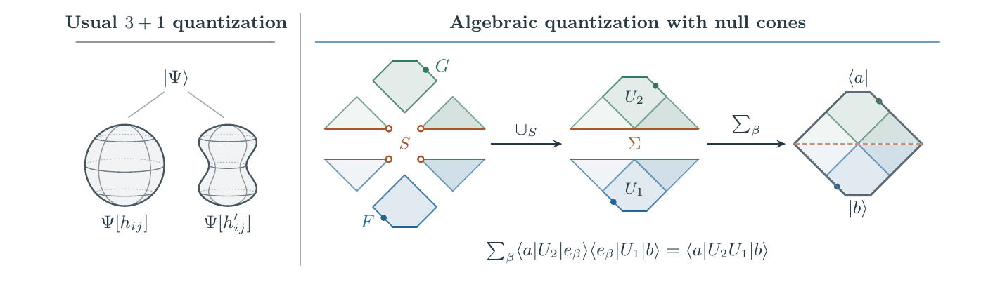

**Figure 1:** On the left one evaluates the wavefunction on two spatial metrics of the same Cauchy slice, shown with one spatial dimension suppressed. On the right we match the tetrad and spin connection at $S$ to join the two parts of $\Sigma$. Summing over its basis states $|e_{\beta}\rangle$ composes the time evolution operators $U_{1}$ and $U_{2}$, with the sources $G$ and $F$ on opposite sides of the slice.

In short, we show that in JT gravity a causal diamond of bounded size admits infinitely many orthogonal states with identical clock probabilities, even when we fix the dilaton at both corners and prepare the matter field in the same state, and despite us finding that the associated algebra is type $\mathrm{I}_{\infty}$. In four dimensions on the other hand, shear changes the affine parameter at which a null generator reaches a given area element at the corner, so a bound on the clock reading also restricts gravitational radiation. In Section 5 we show that it is precisely this fact which, unlike in JT gravity, yields a finite dimensional Hilbert space, including states prepared on different spatial topologies.

### 2.1 A gravitational clock on a finite null cone

In JT gravity we can vary the flux of matter across a null generator while holding the metric and hence the clock reading fixed. To compare boost charges at that reading, we solve for the dilaton sourced by the flux, since the value of the dilaton at the corner generates the boost.

To that aim, null generators of the incoming null cone $\mathscr{H}_{p}$ of a causal diamond $\mathscr{D}$ run from $\Sigma_{0}$ to the corners $S=\{S_{L},S_{R}\}$ where they meet the outgoing null cone $\mathscr{H}_{q}$. On either null generator the affine parameter specifies where to insert a field. The embedding $X[\mathfrak{h}]$ into spacetime depends on the gravitational boundary data $\mathfrak{h}$, including the local Lorentz frame $\mathfrak{e}_{\Sigma_{0}}$, so under a diffeomorphism $f$,

$$
\displaystyle X[f^{*}\mathfrak{h}]=f^{-1}\circ X[\mathfrak{h}],\ X[f^{*}\mathfrak{h}]^{*}(f^{*}g)=X[\mathfrak{h}]^{*}g. \tag{2.1}
$$

The metric $X^{*}g$ can therefore distinguish field configurations by what an observer would find, while assigning the same reading to those related by a diffeomorphism [33, 34].

To determine the metric that enters this clock reading, we write $g_{ab}=\eta_{\mu\nu}e^{\mu}{}_{a}e^{\nu}{}_{b}$, where $\mu,\nu=0,1$, and vary $e^{\mu}{}_{a}$ independently of the spin connection $\omega_{a}{}^{\mu\nu}$, whose only independent component $\omega^{01}$ enters the torsion two-form $T^{\mu}=\mathrm{d}e^{\mu}+\omega^{\mu}{}_{\nu}\curlywedge e^{\nu}$. Absorbing the overall gravitational coupling into $\Phi$ and $Y_{\mu}$, we write the first order action [54] with a minimally coupled scalar field $\varphi$ as

$$
\displaystyle I[e,\omega,Y,\Phi,\varphi]=\int_{\mathscr{D}}\!\left[Y_{\mu}T^{\mu}+\Phi\big(\mathrm{d}\omega^{01}+L_{\rm AdS}^{-2}\bm{\epsilon}_{g}\big)-\frac{1}{2}\mathrm{d}\varphi\curlywedge\star\mathrm{d}\varphi\right]+I_{\partial\mathscr{D}}, \tag{2.2}
$$

where $L_{\rm AdS}$ is the AdS radius, $\bm{\epsilon}_{g}=e^{0}\curlywedge e^{1}$ the spacetime volume two-form, and $\star$ the Hodge dual defined by $g_{ab}$. Varying the Lagrange multipliers $Y_{\mu}$ imposes $T^{\mu}=0$ and fixes the spin connection in terms of $e^{\mu}{}_{a}$, and varying the dilaton $\Phi$ yields $R=-2/L_{\rm AdS}^{2}$.

With the curvature fixed, we use global coordinates $\tau,\sigma$ centered at the midpoint of the spacelike geodesic $\Sigma$ of length $w$ joining the corners. Its ends lie at $(0,\pm\sigma_{S})$. In these coordinates the metric and the incoming null generators take the form

$$
\mathrm{d}s^{2}=L_{\rm AdS}^{2}\sec^{2}\!\sigma\,(-\mathrm{d}\tau^{2}+\mathrm{d}\sigma^{2}),\ \tau=|\sigma|-\sigma_{S}. \tag{2.3}
$$

Along the right sided null generator the affine parameter $u$ vanishes at the past tip $p$ and satisfies $(\partial_{u}\lambda)|_{p}=1$, where $\lambda$ denotes proper distance from the center on a slice of constant $\tau$. $\Sigma_{0}$ lies on such a slice with its ends at $\lambda_{c}=\epsilon w/2$ for fixed $0<\epsilon<1$. At the right sided corner $\lambda=w/2$ (Figure 2), so the clock reads

$$
\displaystyle\lambda=L_{\rm AdS}\int_{0}^{\sigma}\sec s\,\mathrm{d}s, \tag{2.4a}
$$

$$
\displaystyle u=L_{\rm AdS}\tan\sigma=L_{\rm AdS}\sinh(\lambda/L_{\rm AdS}), \tag{2.4b}
$$

$$
\displaystyle u_{*}(w)=(\partial_{u}\lambda)|_{\Sigma_{0}}[u(w/2)-u(\lambda_{c})]=L_{\rm AdS}\,\frac{\sinh[w/(2L_{\rm AdS})]-\sinh(\lambda_{c}/L_{\rm AdS})}{\cosh(\lambda_{c}/L_{\rm AdS})}. \tag{2.4c}
$$

**Figure 2:** In this side view of the $\mathrm{AdS}_{2}$ hyperboloid (gray), the null generators from $p$ meet $\Sigma_{0}$ a proper distance $\lambda_{c}=\epsilon w/2$ from its midpoint. We normalize their tangents there and follow the solid blue segments to the corners of $\Sigma$, each a proper distance $w/2$ from its midpoint, to obtain the clock reading $u_{*}(w)$ in (2.4c).

Because $(\partial_{u}\lambda)|_{\Sigma_{0}}$ in (2.4c) compensates any rescaling of $u$, the reflection about the midpoint of $\Sigma$ that exchanges the two null generators preserves the clock reading. We can therefore infer the width $w$ from a clock on either side, since its reading increases strictly from zero.

To compare the flux of matter at fixed clock reading, we take $u=0$ and $\partial_{u}\lambda=1$ on $\Sigma_{0}$, so $u=u_{*}$ at $S_{R}$. After eliminating the spin connection in (2.2), variation with respect to $g^{ab}$ yields the null constraint along the right sided null generator [6]. For initial data $\Phi(0),\partial_{u}\Phi(0)$, integrating this constraint determines the change relative to a solution with constant $\varphi$,

$$
\partial_{u}^{2}\Phi=-(\partial_{u}\varphi)^{2},\ \Delta\Phi(u_{*})=-\int_{0}^{u_{*}}(u_{*}-u)(\partial_{u}\varphi)^{2}\,\mathrm{d}u. \tag{2.5}
$$

**Figure 3:** Penrose diagram of the finite causal diamond between the timelike boundaries $\sigma=\pm\pi/2$ of global $\mathrm{AdS}_{2}$. The spacelike geodesic $\Sigma$ of proper length $w$ joins the two corners. For the matter shock in (2.5) we set $u=0$ on $\Sigma_{0}$ and $u=u_{*}$ at $S_{R}$. The shock crosses the right sided incoming null generator at $u_{0}$ and lowers $\Phi(S_{R})$ at fixed $u_{*}$.

The two solutions can therefore have the same affine parameter $u_{*}$ at $S_{R}$ and different values of $\Phi(S_{R})$ (Figure 3). Even in vacuum we can change the corner values of the dilaton by rescaling $\Phi$ on the same spacetime.

In order to then quantize the field $\varphi$ whose flux changes the corner dilaton in (2.5), we label cuts on each null generator by $v=2\lambda/w$, from $v=\epsilon$ at the ends of $\Sigma_{0}$ to $v=1$ at the corner. The wave equation $\partial_{+}\partial_{-}\varphi=0$ determines the field in the causal diamond from its two profiles $\varphi_{i}(v)$ and the field $\varphi_{0}(x)$ and momentum density $\pi_{\varphi}(x)$ in a fixed coordinate $x$ on $\Sigma_{0}$. To find their brackets and the momentum conjugate to the clock, we integrate the bulk symplectic potential of (2.2),

$$
\displaystyle\bm{\theta}_{\mathscr{M}}=Y_{\mu}\,\delta e^{\mu}+\Phi\,\delta\omega^{01}-(\star\mathrm{d}\varphi)\,\delta\varphi. \tag{2.6}
$$

Integrating from $S_{L}$ to $S_{R}$, we traverse the left sided null generator toward $\Sigma_{0}$ and the right sided null generator away from it. The pullback of $\star\mathrm{d}\varphi$ changes sign between them, so the two scalar contributions add, while matching the scalar field and the local Lorentz frame cancels the terms at the two ends of $\Sigma_{0}$. Furthermore, a variation of $u_{*}$ displaces the null generators and $\Sigma_{0}$ together in $(\tau,\sigma)$, with conjugate momentum $p_{u_{*}}$. Therefore, including the rapidity $\Gamma_{i}$ of the local Lorentz frame at each corner yields, up to an exact variation,

$$
\displaystyle\Theta=p_{u_{*}}\,\delta u_{*}+\sum_{i=L,R}\int_{\epsilon}^{1}(\partial_{v}\varphi_{i})\,\delta\varphi_{i}\,\mathrm{d}v+\int_{\Sigma_{0}}\pi_{\varphi}\,\delta\varphi_{0}\,\mathrm{d}x+\sum_{i=L,R}\mathscr{K}_{i}\,\delta\Gamma_{i}. \tag{2.7}
$$

We note that in the symplectic form $\Omega=\delta\Theta$, the corner dilaton $\mathscr{K}_{i}=\Phi(S_{i})$ generates boosts at $S_{i}$.

Now, with the scalar field and both corner charges fixed, the dilaton on $\Sigma_{0}$ can still vary. For two such solutions on the same spacetime the matter stress tensor cancels when we subtract the equations obtained by varying $g^{ab}$. Eliminating $\nabla^{2}\Delta\Phi$ with the trace then yields

$$
\nabla_{a}\nabla_{b}\Delta\Phi=\frac{g_{ab}\Delta\Phi}{L_{\rm AdS}^{2}}. \tag{2.8}
$$

Of its three independent solutions $\cos\tau/\cos\sigma$, $\sin\tau/\cos\sigma$ and $\tan\sigma$, only $\sin\tau/\cos\sigma$ vanishes at both corners [6]. Hence, with the tetrad $e^{0}=L_{\rm AdS}\sec\sigma\,\mathrm{d}\tau$ and $e^{1}=L_{\rm AdS}\sec\sigma\,\mathrm{d}\sigma$, varying $\omega^{01}$ determines $\Delta Y_{\mu}$ from $\Delta\Phi$. The resulting constraint and its substitution in (2.6) at fixed $v,x$ yield

$$
\displaystyle\mathrm{d}\Phi+Y_{0}e^{1}+Y_{1}e^{0}=0, \tag{2.9a}
$$

$$
\displaystyle\Delta\Phi=c\,\frac{\sin\tau}{\cos\sigma}, \tag{2.9b}
$$

$$
\displaystyle\Delta\bm{\theta}_{\mathscr{M}}|_{\mathscr{H}_{p}\cup\Sigma_{0}}=-c\,\mathrm{d}\!\left(\frac{\cos\tau}{\cos\sigma}\,\delta\sigma\right)\Big|_{\mathscr{H}_{p}\cup\Sigma_{0}}, \tag{2.9c}
$$

$$
\displaystyle\Delta p_{u_{*}}\,\delta u_{*}=-2c\sec\sigma_{S}\,\delta\sigma_{S}=-\frac{c}{L_{\rm AdS}}\,\delta w, \tag{2.9d}
$$

where the boundary displacements $\delta\sigma=\pm\delta\sigma_{S}$ add, with $\delta w=2L_{\rm AdS}\sec\sigma_{S}\,\delta\sigma_{S}$ and, since $c$ is arbitrary, $p_{u_{*}}$ ranges over the real line at each $u_{*}>0$.

### 2.2 Quantization and gluing

The dilaton mode in (2.9) allows us to vary the momentum conjugate to $u_{*}$ even with the matter field and both corner charges fixed. Once we quantize this pair, two wavefunctions with the same modulus yield the same distribution of clock readings, yet we can make their overlap vanish by choosing how their relative phase varies with $u_{*}$.

To see this, note that at fixed corner charges the terms for $\varphi$ in (2.7) are independent of $u_{*}$ and $p_{u_{*}}$, so we can quantize the clock and the matter field separately. For smooth $f$ supported away from the ends of null generator $i$, integration by parts in $\Omega$ shows that the smeared current $j_{i}(f)$ shifts $\varphi_{i}$ by $f/2$. With $u_{*}$ represented on $L^{2}(\mathbb{R}_{+},\mathrm{d}u_{*})$ and a boost of rapidity $\eta$ at $S_{i}$ generated by $\Phi(S_{i})$, we obtain

$$
\displaystyle j_{i}(f)=\int_{\epsilon}^{1}f\,\partial_{v}\varphi_{i}\,\mathrm{d}v, \tag{2.10a}
$$

$$
\displaystyle[\widehat{j}_{i}(f),\widehat{j}_{j}(g)]=\frac{i\hbar}{2}\delta_{ij}\int_{\epsilon}^{1}f(v)\,\partial_{v}g(v)\,\mathrm{d}v\,\widehat{1}, \tag{2.10b}
$$

$$
\displaystyle(\widehat{u}_{*}\psi)(u_{*})=u_{*}\psi(u_{*}), \tag{2.10c}
$$

$$
\displaystyle\big(e^{i\eta\widehat{\mathscr{K}}_{i}/\hbar}\psi\big)(u_{*})=e^{i\eta\Phi(S_{i})/\hbar}\psi(u_{*}). \tag{2.10d}
$$

For the scalar field we choose a pure Gaussian state $|\Omega_{\varphi}\rangle$ of canonical pairs $(q_{j},p_{j})$ for the two profiles $\varphi_{i}$ on the null generators and the fields $\varphi_{0},\pi_{\varphi}$ on $\Sigma_{0}$. The scalar field has a single constant mode on $\mathscr{H}_{p}\cup\Sigma_{0}$, and its conjugate momentum follows from (2.7),

$$
p_{1}=\int_{\Sigma_{0}}\pi_{\varphi}\,\mathrm{d}x+\sum_{i=L,R}[\varphi_{i}(1)-\varphi_{i}(\epsilon)]. \tag{2.11}
$$

Averaging $\varphi_{0}$ with a smooth weight that integrates to unity defines $q_{1}$, for which the Gaussian wavefunction lies in $L^{2}(\mathbb{R},\mathrm{d}q_{1})$. For centers $q_{j}^{0},p_{j}^{0}$ and widths $\Delta q_{j}>0$, the operators $\mathfrak{a}_{j}$ annihilate $|\Omega_{\varphi}\rangle$ and satisfy $[\mathfrak{a}_{j},\mathfrak{a}_{k}^{\dagger}]=\delta_{jk}\widehat{1}$, hence their adjoints generate the occupation number basis,

$$
\displaystyle\mathfrak{a}_{j}=\frac{\widehat{q}_{j}-q_{j}^{0}}{2\Delta q_{j}}+\frac{i\Delta q_{j}}{\hbar}(\widehat{p}_{j}-p_{j}^{0}),\ j=1,2,\ldots, \tag{2.12a}
$$

$$
\displaystyle|\bm{n}\rangle=\prod_{j:\,n_{j}>0}\frac{(\mathfrak{a}_{j}^{\dagger})^{n_{j}}}{\sqrt{n_{j}!}}\,|\Omega_{\varphi}\rangle, \tag{2.12b}
$$

$$
\displaystyle\mathcal{H}_{\varphi}\simeq\bigoplus_{m=0}^{\infty}\operatorname{Sym}^{m}\ell^{2}(\mathbb{N}). \tag{2.12c}
$$

The vectors with finite total occupation $m=\sum_{j}n_{j}$ are orthonormal and span a dense subspace of $\mathcal{H}_{\varphi}$.

Having quantized the clock and the matter field on $\mathscr{H}_{p}\cup\Sigma_{0}$, we can prepare a state on the geodesic $\Sigma$ joining the corners. At fixed corner charges the coefficient of each occupation number state of $\varphi$ is a wavefunction of $u_{*}$. Bounding the clock reading by $\ell(\mathscr{D})$ restricts each of these wavefunctions to the same interval,

$$
\displaystyle\mathcal{H}_{\Sigma}=L^{2}(\mathbb{R}_{+},\mathrm{d}u_{*})\otimes\mathcal{H}_{\varphi}, \tag{2.13a}
$$

$$
\displaystyle(P_{\mathscr{D}}\psi)(u_{*})=\mathbf{1}_{[0,\ell(\mathscr{D})]}(u_{*})\,\psi(u_{*}), \tag{2.13b}
$$

$$
\displaystyle\mathcal{H}_{\mathscr{D}}=P_{\mathscr{D}}\mathcal{H}_{\Sigma}\simeq L^{2}([0,\ell(\mathscr{D})],\mathrm{d}u_{*})\otimes\mathcal{H}_{\varphi}. \tag{2.13c}
$$

We take the inner product by pairing the matter excitations in the bra and ket and integrating over their common clock reading (Figure 4).

**Figure 4:** (a) An open line adds one excitation to the Gaussian state $|\Omega_{\varphi}\rangle$. Joining it to a line in the adjoint state identifies their mode indices. At fixed corner charges the clock line identifies the two readings, and $P_{\mathscr{D}}$ restricts their common value (2.13b). (b) For a product of a clock state and the Gaussian matter state, the clock kernel in (a) multiplies both matter field contractions. The $n_{j}!$ Wick contractions in mode $j$ account for the normalization $(n_{j}!)^{-1/2}$ in (2.12b).

In Section 5.1 we construct $\mathcal{H}_{\mathscr{D}}$ in four dimensions from a Gaussian state centered on a spherical null cone by projecting onto the allowed clock readings before and after acting with boundary observables (5.20). In JT gravity the projector acts on the clock alone, so we can hold the field in a normalized state $|\xi\rangle\in\mathcal{H}_{\varphi}$ and vary the phase of a normalized smooth clock wavefunction $h(u_{*})$ supported in $0<u_{*}<\ell(\mathscr{D})$. The states $\Psi_{n}$, $n\in\mathbb{Z}$, all have the same cumulative probability $F$ for the clock reading. We evaluate their overlap by gluing on $\Sigma$ (Figure 5a) and using the variable $s=F(u_{*})$,

$$
\displaystyle\Psi_{n}(u_{*})=h(u_{*})e^{2\pi inF(u_{*})}|\xi\rangle, \tag{2.14a}
$$

$$
\displaystyle F(u_{*})=\int_{0}^{u_{*}}|h(v)|^{2}\,\mathrm{d}v, \tag{2.14b}
$$

$$
\displaystyle\langle\Psi_{m}|\Psi_{n}\rangle=\int_{0}^{1}e^{2\pi i(n-m)s}\,\mathrm{d}s=\delta_{mn}. \tag{2.14c}
$$

To distinguish these states we can measure the generator of dilations of $u_{*}$, which differentiates the phase $e^{2\pi inF(u_{*})}$. Its symmetrically ordered form is $\mathcal{Q}(u_{*}p_{u_{*}})=-i\hbar(u_{*}\partial_{u_{*}}+1/2)$, where $\mathcal{Q}$ denotes Weyl quantization (Appendix C.2). Since $F^{\prime}(u_{*})=|h(u_{*})|^{2}$, we find

$$
\displaystyle\langle\Psi_{n}|\mathcal{Q}(u_{*}\,p_{u_{*}})|\Psi_{n}\rangle-\langle\Psi_{0}|\mathcal{Q}(u_{*}\,p_{u_{*}})|\Psi_{0}\rangle=2\pi n\hbar\int_{0}^{\infty}u_{*}|h(u_{*})|^{4}\,\mathrm{d}u_{*}. \tag{2.15}
$$

For any one choice of $|\xi\rangle$, the states $\Psi_{n}$ thus span an infinite dimensional subspace of $\mathcal{H}_{\mathscr{D}}$.

Having projected the states of a single interval onto the allowed clock readings, we can now join two such intervals to prepare a state on a larger spatial slice. On the time symmetric slice of the eternal black hole in pure JT gravity [45], we cut the geodesic at the bifurcation surface $S$. When we match the dilaton there, the opposite orientations make the two corner terms in (2.7) sum to $\Phi(S)\,\delta(\Gamma_{R}-\Gamma_{L})$ (Figure 5b), so a common boost has zero charge, though of course the sum of the two proper lengths can still fluctuate in the joint state. In four dimensions, matching the area elements at $S$ likewise cancels the charge associated to a common boost (3.66), while a collar of fixed proper width can enclose different volumes (Figure 18).

**Figure 5:** (a) On $\Sigma$ we multiply the wavefunction of $|b\rangle$ by the conjugate wavefunction of $|a\rangle$ at the same clock reading and matter field occupation numbers. We sum over these mode occupations and integrate $u_{*}$ over the range in (2.13b). For $\Psi_{n}$ and $\Psi_{m}$ the overlap of matter states is one and the clock integral equals $\delta_{mn}$. (b) Joining neighboring geodesic intervals identifies their dilatons at $S$. Since the two copies of $S$ have opposite orientations, the corner term in (2.7) depends only on the relative boost.

In a similar vein, to extend a preparation $|b\rangle$ in time at fixed spatial topology, we glue it to a cobordism $\mathscr{M}:\Sigma_{0}\to\Sigma_{1}$ by summing over a basis on $\Sigma_{0}$. Partitioning the possible readings of the outgoing clock into intervals $I_{\alpha}$, we obtain

$$
\displaystyle|\psi\rangle=U_{\mathscr{M}}|b\rangle=\sum_{\alpha}P_{\alpha}U_{\mathscr{M}}|b\rangle,\ P_{\alpha}=\mathbf{1}_{I_{\alpha}}(\widehat{u}_{*}). \tag{2.16}
$$

The state on $\Sigma_{1}$ can therefore be a coherent superposition of different elapsed times. To distinguish outgoing states with the same probabilities for $I_{\alpha}$, we combine bounded functions of $\widehat{u}_{*}$ and dilations with smearings of $\varphi_{i}$ on the null generators and of $\varphi_{0},\pi_{\varphi}$ on $\Sigma_{0}$. At fixed $\Phi(S_{L}),\Phi(S_{R})$ these observables generate all rank one operators under weak closure (Appendix C.3). Restricting both external states to $\mathcal{H}_{\mathscr{D}}$ then yields $\mathcal{B}(\mathcal{H}_{\mathscr{D}})$, of type $\mathrm{I}_{\infty}$ since the $\Psi_{n}$ form an infinite orthonormal family. Intuitively, this is because we prepare a joint state $|u\rangle$ of the clock and the matter field on $\mathscr{H}_{p}\cup\Sigma_{0}$ before specifying an exterior, such that gluing its adjoint to $\Sigma_{1}$ yields the probability $|\langle u|U_{\mathscr{M}}|b\rangle|^{2}$ for normalized states.

To compute the contribution of each $\Psi_{n}$ to the trace, we prepare the future half of $\mathscr{D}$. Analytically continuing the boost rapidity $\eta$ to $i\pi$ in (2.10d) multiplies $\Psi_{n}$ by $\exp[-\pi\Phi(S_{i})/\hbar]$ at each $S_{i}$. After time evolution $U_{\mathscr{M}}$ to $\Sigma_{1}$, we glue this preparation $C_{\mathscr{D}}$ to its time reflection, summing over all states of the clock and $\varphi$. Its unnormalized density operator $W=C_{\mathscr{D}}^{\dagger}C_{\mathscr{D}}$ (Figure 6) then satisfies

$$
\displaystyle\langle\Psi_{m}|W|\Psi_{n}\rangle=e^{-2\pi(\mathscr{K}_{L}+\mathscr{K}_{R})/\hbar}\langle\Psi_{m}|U_{\mathscr{M}}^{\dagger}U_{\mathscr{M}}|\Psi_{n}\rangle=e^{-2\pi(\mathscr{K}_{L}+\mathscr{K}_{R})/\hbar}\delta_{mn}, \tag{2.17a}
$$

$$
\displaystyle\operatorname{Tr}_{\mathcal{H}_{\mathscr{D}}}W\geq\sum_{n=1}^{N}\langle\Psi_{n}|W|\Psi_{n}\rangle=Ne^{-2\pi(\mathscr{K}_{L}+\mathscr{K}_{R})/\hbar} \tag{2.17b}
$$

for arbitrary $N$. Thus $\operatorname{Tr}W=\infty$ and $W/\operatorname{Tr}W$ cannot define a density matrix.

**Figure 6:** Gluing the preparation to its time reflection sums over a complete basis on $\Sigma_{1}$, so the time evolution cancels by unitarity. On each copy the orange half turns multiply the state by $e^{-\pi\mathscr{K}_{L}/\hbar}$ at $S_{L}$ and $e^{-\pi\mathscr{K}_{R}/\hbar}$ at $S_{R}$. Identifying the two remaining intervals sets $j=i$ on the radial cut of the annulus, so the trace sums over $i$. Each orthogonal $\Psi_{n}$ enters with the same weight in (2.17a).

Fundamentally, every occupation number state of $\varphi$ in JT gravity can have the same clock wavefunction, since $u_{*}$ depends only on the geodesic length (2.4c), (2.13b). But this is not true in four dimensions, where, with the initial area element and expansion fixed, shear increases the clock reading at a cut of a given area element (Figure 17), so projecting onto $\bar{u}_{*}\leq\ell(\mathscr{D})$ also restricts the radiative states at fixed corner area (4.10c), (5.2).

Additionally, gluing across a time reflection weights a state by the two corner dilatons in JT gravity (2.17a) and by the corner area $\mathscr{A}$ in four dimensions (5.23). But it is only in four dimensions that the null constraints also bound $\mathscr{A}$ for a given $\ell(\mathscr{D})$ and thereby constrain the relative boost generator $\mathscr{A}/(8\pi G_{N})$. In Section 5.2 we use the change in the graviton two point function across $S$ under a relative boost to show that a causal diamond of bounded size admits only finitely many independent states.

## 3 Reduced phase space of intersecting null cones

In JT gravity the matter shock lowered the dilaton at the corner without changing the clock reading, since at fixed proper width the null generator followed the same geodesic. We could thus prepare any state of the matter field with the same clock wavefunction. In four dimensions the radiation we wish to quantize changes the transverse metric on the null cone itself.

As gravitational radiation shears neighboring null generators, their transverse separations grow at different rates in different directions. This change of shape affects the clock because the square of the shear reduces the expansion through the Raychaudhuri equation, even in vacuum [73]. With the same initial area element and expansion at $\partial\Sigma_{0}$, the null generators therefore enclose less area at a given affine parameter than they would without shear. Reaching the same area element at $S$ then takes a larger clock reading, so a bound on the average reading restricts the radiation on the null cone.

The same focusing can bring neighboring null generators to a caustic before they reach $S$. In solving the null constraints at finite $G_{N}$, we must then determine how much of the spacetime can be recovered from one null cone and compatible data on its spacelike cap [21]. Where the spacetime itself remains smooth, we can place a spacelike cap before the null generators focus (Figure 8) and choose a second causal diamond whose null boundaries are regular near the caustic [69]. Matching tetrads and spin connections on the overlap then allows us to continue the same solution using the characteristic data on the second causal diamond (Figure 10). Since every point of a smooth globally hyperbolic vacuum spacetime admits such a neighborhood, we can choose a cover for each solution and recover the full reduced phase space $\mathcal{P}(\mathscr{M})$ by gluing overlapping causal diamonds. In (3.31) we identify different covers of the same solution while holding fixed the data on the boundary of $\mathscr{M}$.

To describe a single causal diamond $\mathscr{D}$, we fix a smooth cobordism between the spacelike caps $\Sigma_{0}$ and $\Sigma_{1}$, with truncated null cones $\mathscr{H}_{p}$ and $\mathscr{H}_{q}$ meeting transversely at $S$ (Figure 7). We write $\mathfrak{e}_{\Sigma}$ for the embedding $X$ and local Lorentz frame of each boundary component $\Sigma$. A displacement of $\Sigma$ or a boost of its local Lorentz frame relative to the bulk fields can carry a surface charge, so the variables on which these charges act become edge modes [46, 17]. We therefore vary the first order action with its boundary terms included. The boundary variation determines the symplectic form, and translating a cap determines the Hamiltonian generating time evolution of both the radiative modes and the edge modes.

**Figure 7:** A causal diamond $\mathscr{D}$. Small spacelike caps $\Sigma_{0}$ and $\Sigma_{1}$ replace the vertices and make the region a cobordism $\mathscr{D}:\Sigma_{0}\to\Sigma_{1}$. The null cones $\mathscr{H}_{p}$ and $\mathscr{H}_{q}$ extend from their respective caps and intersect at the corner $S$. The fields $B^{\mu\nu},\omega^{\mu\nu}$ and the boundary frames determine the tetrad through the simplicity and null constraints. The arrows $\ell_{p}^{a}$ and $\ell_{q}^{a}$ are the future directed null generators of these boundaries at $S$, normalized by the choice of affine parameter on $\mathscr{H}_{p}$ and $\mathscr{H}_{q}$, respectively. Time $t$ increases upwards. Dashed arcs lie behind the visible part of $\mathscr{D}$.

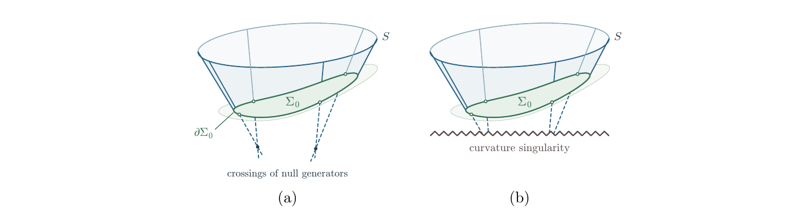

**Figure 8:** A smooth spacelike slice meets the incoming null generators at different affine parameters measured from $S$. The resulting cut $\partial\Sigma_{0}$ bounds the past cap $\Sigma_{0}$, shown in green. The dashed curves follow the null generators to the past of this cut, where they cross in pairs at distinct regular points in (a) and terminate at a spacelike curvature singularity in (b).

### 3.1 First order gravity

When we joined two geodesic intervals in JT gravity, matching the dilaton at their shared corner canceled the charge of a common boost. In four dimensions we can tilt a spacelike slice about $S$ by a rapidity that varies across the surface, so we must match the boost charge at each point when we join the two sides. The component of the spin connection in the plane normal to $S$ transports the local Lorentz frame by a boost. We therefore vary $\omega^{\mu\nu}$ independently in the first order action, with $B^{\mu\nu}$ subject to the simplicity constraint, to identify the area element that weights the change of rapidity in the corner term.[^4]

Using a torsion free spacetime derivative $\nabla_{a}$, we write the curvature two form in a local Lorentz frame as

$$
F^{\mu\nu}{}_{ab}=2\nabla_{[a}\omega_{b]}{}^{\mu\nu}+2\omega_{[a}{}^{\mu}{}_{\rho}\,\omega_{b]}{}^{\rho\nu}. \tag{3.1}
$$

The action is then [70]

$$
I[B,\omega,\Phi]=\frac{1}{16\pi G_{N}}\int_{\mathscr{M}}\left(B_{\mu\nu}\curlywedge F^{\mu\nu}-\frac{1}{2}\Phi_{\mu\nu\rho\sigma}B^{\mu\nu}\curlywedge B^{\rho\sigma}\right)+I_{\partial\mathscr{M}}, \tag{3.2}
$$

where the Lagrange multiplier satisfies $\Phi_{\mu\nu\rho\sigma}=\Phi_{[\mu\nu][\rho\sigma]}=\Phi_{\rho\sigma\mu\nu}$ and $\epsilon^{\mu\nu\rho\sigma}\Phi_{\mu\nu\rho\sigma}=\penalty 4\Lambda$. We use $\epsilon_{0123}=1$, so $\epsilon^{\mu\nu\rho\sigma}\epsilon_{\mu\nu\rho\sigma}=-24$. The trace part of $\Phi_{\mu\nu\rho\sigma}$ is therefore $-(\Lambda/6)\epsilon_{\mu\nu\rho\sigma}$ and is fixed by $\Lambda$.

Varying the tracefree part of $\Phi$ imposes

$$
\mathfrak{S}^{\mu\nu\rho\sigma}=B^{\mu\nu}\curlywedge B^{\rho\sigma}+\frac{1}{24}\epsilon^{\mu\nu\rho\sigma}\epsilon_{\alpha\beta\gamma\delta}B^{\alpha\beta}\curlywedge B^{\gamma\delta}=0. \tag{3.3}
$$

With an invertible tetrad $e^{\mu}{}_{a}$ and fixed orientation, we choose the following solution of $\mathfrak{S}=0$

$$
B^{\mu\nu}=\frac{1}{2}\epsilon^{\mu\nu}{}_{\rho\sigma}e^{\rho}\curlywedge e^{\sigma}, \tag{3.4}
$$

with $g_{ab}=\eta_{\mu\nu}e^{\mu}{}_{a}e^{\nu}{}_{b}$. Thus $B^{\mu\nu}$ fixes $e^{\mu}{}_{a}$ up to local Lorentz transformations and hence fixes $g_{ab}$. Varying $\omega^{\mu\nu}$ and $B^{\mu\nu}$ then yields

$$
\displaystyle\nabla_{[a}B^{\mu\nu}{}_{bc]}=0, \tag{3.5a}
$$

$$
\displaystyle F_{\mu\nu}=\Phi_{\mu\nu\rho\sigma}B^{\rho\sigma}. \tag{3.5b}
$$

With (3.4), equations (3.5) imply $\nabla_{[a}e^{\mu}{}_{b]}=0$ and $R_{ab}=\Lambda g_{ab}$. These equations constrain the Ricci tensor, while the Weyl tensor carries the two local radiative degrees of freedom as usual.

To see how (3.2) arises, we start from the usual Einstein Hilbert action

$$
\displaystyle\frac{1}{16\pi G_{N}}\int_{\mathscr{M}}(R-2\Lambda)\,\bm{\epsilon}_{g}, \tag{3.6}
$$

where $\bm{\epsilon}_{g}=\sqrt{-g}\,\mathrm{d}^{4}x$ is the spacetime volume form. For the torsion free spin connection $\omega(e)$ of the tetrad, it can be shown that

$$
\displaystyle R\,\bm{\epsilon}_{g}=\frac{1}{2}\epsilon_{\mu\nu\rho\sigma}e^{\mu}\curlywedge e^{\nu}\curlywedge F^{\rho\sigma}[\omega(e)], \tag{3.7a}
$$

$$
\displaystyle\bm{\epsilon}_{g}=\frac{1}{24}\epsilon_{\mu\nu\rho\sigma}e^{\mu}\curlywedge e^{\nu}\curlywedge e^{\rho}\curlywedge e^{\sigma}. \tag{3.7b}
$$

On the solution (3.4), $B^{\mu\nu}\curlywedge B^{\rho\sigma}$ is proportional to $\epsilon^{\mu\nu\rho\sigma}$, so only the fixed trace of $\Phi$ enters the volume term. Using the two tetrad identities above, we can thus write the bulk action with $\omega$ varied independently as

$$
I-I_{\partial\mathscr{M}}=\frac{1}{32\pi G_{N}}\int_{\mathscr{M}}\epsilon_{\mu\nu\rho\sigma}e^{\mu}\curlywedge e^{\nu}\curlywedge\left(F^{\rho\sigma}-\frac{\Lambda}{6}e^{\rho}\curlywedge e^{\sigma}\right). \tag{3.8}
$$

Before reduction the boundary data $\mathfrak{h}_{\Sigma}$ consists of $\mathfrak{e}_{\Sigma}$ and the pullbacks of $B^{\mu\nu}$ and $\omega^{\mu\nu}$ to $\Sigma$. Varying the spin connection at fixed $B$ and $\Phi$ and integrating by parts yields

$$
\delta_{\omega}\bigl(I-I_{\partial\mathscr{M}}\bigr)=\frac{1}{16\pi G_{N}}\left[-\frac{1}{2}\int_{\mathscr{M}}(\bm{\epsilon}_{g})^{dabc}\,\delta\omega_{d\mu\nu}\,\nabla_{[a}B^{\mu\nu}{}_{bc]}\,\bm{\epsilon}_{g}+\int_{\partial\mathscr{M}}B_{\mu\nu}\curlywedge\delta\omega^{\mu\nu}\right]. \tag{3.9}
$$

The bulk term vanishes by (3.5a). To cancel the boundary term we use the covariant derivatives of the future null generators $\ell_{s}^{\mu}$ of $\mathscr{H}_{p},\mathscr{H}_{q}$ and the future unit normals $n_{i}^{\mu}$ to $\Sigma_{0},\Sigma_{1}$. Holding fixed the tetrad and null normals, we vary only the spin connection to obtain

$$
\displaystyle\delta_{\omega}(\nabla_{a}\ell_{s}^{\mu})=\delta\omega_{a}{}^{\mu}{}_{\nu}\,\ell_{s}^{\nu}, \tag{3.10a}
$$

$$
\displaystyle\delta_{\omega}(\nabla_{a}n_{i}^{\mu})=\delta\omega_{a}{}^{\mu}{}_{\nu}\,n_{i}^{\nu}. \tag{3.10b}
$$

Where the two null cones meet at $S$, their normals also enter the boundary action through $\ell_{p}\cdot\ell_{q}$. This inner product depends on the normalization of the null generators, which we fix by choosing a parameter on each null cone. On a cut of $\mathscr{H}_{s}$ we choose the other null normal $n_{s}$ so that $n_{s}\cdot\ell_{s}=-1$. At $S$ this yields

$$
n_{p}^{\mu}=\frac{\ell_{q}^{\mu}}{-\ell_{p}\cdot\ell_{q}}. \tag{3.11}
$$

Truncating the vertices introduces a joint at each $\partial\Sigma_{i}$. There the unit normal to the spacelike cap lies in the plane of $\ell_{s}^{\mu}$ and $n_{s}^{\mu}$, so its inner product with the null generator specifies its direction,

$$
n_{i}^{\mu}=\frac{\ell_{s}^{\mu}}{2(-n_{i}\cdot\ell_{s})}-(n_{i}\cdot\ell_{s})n_{s}^{\mu},\ \ (s,i)=(p,0),(q,1). \tag{3.12}
$$

Writing $\ell_{s}^{a}=e_{\mu}{}^{a}\ell_{s}^{\mu}$, we use the inverse tetrad $E_{\mu}{}^{a}$ projected onto a cut to express the inaffinity and expansion along a null boundary. On a spacelike cap the corresponding term depends on the trace of its extrinsic curvature, with $n_{i}^{a}=e_{\mu}{}^{a}n_{i}^{\mu}$ and $h_{i}^{ab}$ the inverse induced metric. In these conventions,

$$
\displaystyle\kappa_{s}=-n_{s\mu}\ell_{s}^{a}\nabla_{a}\ell_{s}^{\mu}, \tag{3.13a}
$$

$$
\displaystyle\Theta_{(\ell_{s})}=E_{\mu}{}^{a}\nabla_{a}\ell_{s}^{\mu}, \tag{3.13b}
$$

$$
\displaystyle K_{i}=h_{i}^{ab}e_{b\mu}\nabla_{a}n_{i}^{\mu}. \tag{3.13c}
$$

From the area element $\bm{\mu}=E^{2}\curlywedge E^{3}$ determined by $B^{\mu\nu}$ at the joints, we obtain both the corner area and the volume form on each null boundary,

$$
\mathscr{A}=\int_{S}\bm{\mu},\ \bm{\eta}_{s}=\mathrm{d}u_{s}\curlywedge\bm{\mu}. \tag{3.14}
$$

With $\bm{\epsilon}_{\Sigma}$ the volume form on a cap, the boundary action combines these curvature terms with the logarithms of the normal inner products at the three joints,

$$
\displaystyle\begin{aligned} &I_{\partial\mathscr{M}}=\sum_{s=p,q}I_{\mathscr{H}_{s}}+\frac{1}{8\pi G_{N}}\bigg[\int_{\Sigma_{0}}\bm{\epsilon}_{\Sigma}K_{0}-\int_{\Sigma_{1}}\bm{\epsilon}_{\Sigma}K_{1}\\ &+\int_{\partial\Sigma_{0}}\bm{\mu}\log(-n_{0}\cdot\ell_{p})+\int_{\partial\Sigma_{1}}\bm{\mu}\log(-n_{1}\cdot\ell_{q})-\int_{S}\bm{\mu}\log(-\ell_{p}\cdot\ell_{q}/2)\bigg],\end{aligned} \tag{3.15a}
$$

$$
\displaystyle I_{\mathscr{H}_{s}}=\frac{\epsilon_{s}}{8\pi G_{N}}\biggl[\int_{\mathscr{H}_{s}}\bm{\eta}_{s}(\kappa_{s}+\Theta_{(\ell_{s})})-\int_{C_{s,+}}\bm{\mu}+\int_{C_{s,-}}\bm{\mu}\biggr], \tag{3.15b}
$$

where the null contributions have signs $\epsilon_{p}=1$ and $\epsilon_{q}=-1$. The cuts $C_{s,-}$ and $C_{s,+}$ are at the lower and upper ends of $\mathscr{H}_{s}$ in $u_{s}$, respectively. The $\kappa_{s}+\Theta_{(\ell_{s})}$ terms cancel variations of the normal and transverse components of $\omega$ in $B_{\mu\nu}\curlywedge\delta\omega^{\mu\nu}$ [56]. After imposing torsionlessness, $\pounds_{\ell_{s}}\bm{\mu}=\Theta_{(\ell_{s})}\bm{\mu}$ integrates to the difference of the areas of the two cuts, so only the inaffinity enters the null boundary action [59],

$$
\int_{\mathscr{H}_{s}}\bm{\eta}_{s}\Theta_{(\ell_{s})}=\int_{C_{s,+}}\bm{\mu}-\int_{C_{s,-}}\bm{\mu},\ I_{\mathscr{H}_{s}}=\frac{\epsilon_{s}}{8\pi G_{N}}\int_{\mathscr{H}_{s}}\bm{\eta}_{s}\kappa_{s}. \tag{3.16}
$$

This cancellation is made after variation: $\delta\omega$ and the terms at $C_{s,\pm}$ remain in the symplectic potential. In Appendix A, we derive the signs from the orientations in (3.15a). The integrals over $\Sigma_{0},\Sigma_{1},\partial\Sigma_{0},\partial\Sigma_{1}$ vanish as the caps shrink to smooth vertices.

### 3.2 Null initial data

On the incoming null cone $\mathscr{H}_{p}$ we are free to specify the two polarizations of gravitational radiation through the conformal metric of its cuts. Since the null normal is tangent to $\mathscr{H}_{p}$, the variation of this metric along each null generator fixes the shear. Given the area element and expansion at $\partial\Sigma_{0}$, we can then integrate the focusing equation to determine the area element as a function of affine parameter [73].

On either null boundary $\mathscr{H}$ we omit the label $s$ and write $\ell^{\mu}$ for the future directed, affinely parametrized null normal and $n^{\mu}$ for the transverse null normal, with $\ell\cdot n=-1$. The affine parameter $u$ has tangent $\ell^{\mu}=e^{\mu}{}_{a}(\partial_{u})^{a}$, and the coordinates $y^{A}$ label the null generators. Since $\star_{\eta}^{2}=-1$ on two forms, the simplicity constraints determine the tetrad $E_{A}^{\mu}$ pulled back to a cut and hence its induced metric $q_{AB}=\eta_{\mu\nu}E_{A}^{\mu}E_{B}^{\nu}$. To separate the bulk degrees of freedom[^5] from the area, we choose the conformal metric $\bar{q}_{AB}$ to have unit determinant relative to the fixed area two form $\bm{\epsilon}_{0}$ and write

$$
\displaystyle(\star_{\eta}B_{uA})^{\mu\nu}=-2\ell^{[\mu}E_{A}^{\nu]}, \tag{3.17a}
$$

$$
\displaystyle E_{A}^{\mu}=n_{\nu}(\star_{\eta}B_{uA})^{\nu\mu}, \tag{3.17b}
$$

$$
\displaystyle q_{AB}=\varrho^{2}\bar{q}_{AB}, \tag{3.17c}
$$

$$
\displaystyle\mathrm{d}A=\varrho^{2}\bm{\epsilon}_{0}. \tag{3.17d}
$$

On each null cone let $\gamma_{y}$ and $\gamma_{y^{\prime}}$ denote the segments of any two distinct null generators between $\partial\Sigma_{i}$ and $S$. To specify $\partial\Sigma_{i}$ and keep the null cone regular up to $S$, we impose conditions on the tetrad $e$ and the embeddings $X$ in $\mathfrak{e}_{\Sigma}$. The allowed pairs form the set

$$
\mathscr{B}_{\epsilon}=\bigl\{(e,\mathfrak{e}_{\Sigma})\mid\mathrm{d}A|_{\partial\Sigma_{i}}=\epsilon^{2}\,\mathrm{d}A|_{S},\ \varrho|_{\gamma_{y}}>0,\ \gamma_{y}\cap\gamma_{y^{\prime}}=\varnothing\bigr\}. \tag{3.18}
$$

At fixed $0<\epsilon<1$, both the corner area and the affine parameter at $S$ can vary. For smooth invertible tetrads the vacuum field equations (3.5) then yield the reduced phase space

$$
\mathcal{P}(\mathscr{D})=\bigl\{(e,\omega(e),\mathfrak{e}_{\Sigma})\mid R_{ab}=\Lambda g_{ab},\ (e,\mathfrak{e}_{\Sigma})\in\mathscr{B}_{\epsilon}\bigr\}\big/\!\sim, \tag{3.19}
$$

where $\sim$ identifies configurations related by a diffeomorphism or a local Lorentz transformation acting on the bulk fields and gravitational boundary data together.[^6] The data on $\mathscr{H}_{p}$ and $\Sigma_{0}$, together with compatible data at their joint $\partial\Sigma_{0}$, determines the solution in their domain of dependence and hence the metric induced there on the outgoing null cone $\mathscr{H}_{q}$ [75, 21].

To determine how the cut expands and shears, we need the change in separation of neighboring null generators, measured by

$$
K_{AB}=E_{B\mu}\nabla_{A}\ell^{\mu},\ E_{A}=\frac{\partial}{\partial y^{A}},\ [\ell,E_{A}]=0. \tag{3.20}
$$

Since $\ell$ is normal to the cut, the torsionless condition yields

$$
\nabla_{[a}e^{\mu}{}_{b]}=0\ \Longrightarrow\ \ell^{a}\nabla_{a}E_{A}{}^{b}=E_{A}{}^{a}\nabla_{a}\ell^{b},\ K_{[AB]}=0. \tag{3.21}
$$

The trace of $K_{ab}$ is the expansion and its tracefree part is the shear,[^7]

$$
\Theta_{(\ell)}=q^{ab}K_{ab},\ \sigma_{ab}=K_{ab}-\frac{1}{2}\Theta_{(\ell)}q_{ab}. \tag{3.22}
$$

We use the Raychaudhuri equation to determine how the cross sectional area changes along a null generator. Our curvature conventions are

$$
2\nabla_{[c}\nabla_{d]}v^{a}=R^{a}{}_{bcd}v^{b},\ R_{bd}=R^{a}{}_{bad}. \tag{3.23}
$$

For an affinely parametrized null generator in a solution of the vacuum field equations (3.5),

$$
\ell^{a}\nabla_{a}\ell^{\mu}=0,\ R_{ab}\ell^{a}\ell^{b}=0, \tag{3.24}
$$

so $K_{ab}$ determines focusing along each null generator.

To determine the area from the shear, we use the inverse conformal metric to raise indices on its variations, so $(\partial_{u}\bar{q})^{AB}=\bar{q}^{AC}\bar{q}^{BD}\partial_{u}\bar{q}_{CD}$. Expressing the expansion and shear in these variables puts the Raychaudhuri equation in the form

$$
\displaystyle\pounds_{\ell}q_{AB}=2K_{AB}=2\sigma_{AB}+\Theta_{(\ell)}q_{AB}, \tag{3.25a}
$$

$$
\displaystyle\pounds_{\ell}\Theta_{(\ell)}=-K_{ab}K^{ab}-R_{ab}\ell^{a}\ell^{b}, \tag{3.25b}
$$

$$
\displaystyle\Theta_{(\ell)}=\frac{2\pounds_{\ell}\varrho}{\varrho}, \tag{3.25c}
$$

$$
\displaystyle\sigma_{AB}=\frac{\varrho^{2}}{2}\pounds_{\ell}\bar{q}_{AB}, \tag{3.25d}
$$

$$
\displaystyle\mathfrak{C}_{\ell}\equiv\pounds_{\ell}\Theta_{(\ell)}+\frac{1}{2}\Theta_{(\ell)}^{2}+\sigma_{ab}\sigma^{ab}=0, \tag{3.25e}
$$

$$
\displaystyle\frac{\mathrm{d}^{2}\varrho}{\mathrm{d}u^{2}}+\frac{\varrho}{8}(\partial_{u}\bar{q})^{AB}\,\partial_{u}\bar{q}_{AB}=0. \tag{3.25f}
$$

The Raychaudhuri equation $\mathfrak{C}_{\ell}=0$ determines $\varrho$ from $\bar{q}$, $\varrho(0)$ and $\partial_{u}\varrho(0)$ [73, 17]. At a smooth vertex we measure solid angle in a local Lorentz frame with unit time direction $t^{a}$. Setting $u=0$ there and normalizing each null tangent by $|t_{a}\ell^{a}|=1$ then yields, for the solid angle element $\bm{\epsilon}_{0}$ of this local Lorentz frame, $\varrho(0)=0$ and $\partial_{u}\varrho(0)=1$. For another $\bm{\epsilon}_{0}$, $\partial_{u}\varrho(0)$ corresponds to a positive function of $y^{A}$.

To compare values of the affine parameter at a given area element on an expanding null generator, we use $v=\varrho/\varrho_{S}(y)$, where $\varrho_{S}(y)$ is the value of $\varrho$ at $S$. The cap condition in (3.18) puts $\partial\Sigma_{i}$ at $v=\epsilon$ and $S$ at $v=1$. We can therefore integrate (3.25f) from $\partial\Sigma_{i}$. For initial slope $p_{\epsilon,y}=\left.\partial_{u}\varrho\right|_{v=\epsilon}>0$ we obtain

$$
\displaystyle\partial_{v}\log(\partial_{u}\varrho)=-\frac{v}{8}(\partial_{v}\bar{q})^{AB}\partial_{v}\bar{q}_{AB}, \tag{3.26a}
$$

$$
\displaystyle\partial_{u}\varrho=p_{\epsilon,y}\exp[-\Xi_{y}(v)], \tag{3.26b}
$$

$$
\displaystyle\Xi_{y}(v)=\frac{1}{8}\int_{\epsilon}^{v}s\,(\partial_{s}\bar{q})^{AB}\,\partial_{s}\bar{q}_{AB}\,\mathrm{d}s, \tag{3.26c}
$$

$$
\displaystyle p_{\epsilon,y}[u(v,y)-u(\epsilon,y)]=\varrho_{S}(y)\int_{\epsilon}^{v}e^{\Xi_{y}(s)}\mathrm{d}s. \tag{3.26d}
$$

For a smooth vertex $\epsilon=0$ and $p_{0,y}=1$, so at the corner the clock reads $u_{*}(y)=u(1,y)$. Since $\Xi_{y}(v)\geq 0$, shear increases the affine parameter needed to reach a given $\varrho_{S}(y)$ from the vertex. Shear encountered near the initial cut enters $\Xi_{y}(v)$ at every subsequent cut, so the delay continues to grow even after the shear has vanished (Figure 9). On a capped null cone, rescaling $u$ by a positive factor multiplies the change in affine parameter from $\partial\Sigma_{i}$ to $S$ by that factor and divides $p_{\epsilon,y}$ by it. Their product therefore defines a clock independent of this normalization,

$$
u_{*}(y)=p_{\epsilon,y}[u(1,y)-u(\epsilon,y)]=\varrho_{S}(y)\int_{\epsilon}^{1}e^{\Xi_{y}(v)}\,\mathrm{d}v. \tag{3.27}
$$

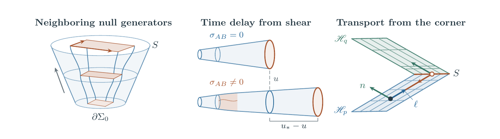

**Figure 9:** The orange quadrilaterals mark the same four null generators on successive cuts. In the center the shear free congruence reaches the corner area element at the dotted line. The sheared congruence reaches it at the later clock reading $u_{*}$. On the right the intersecting null cone $\mathscr{H}_{q}$ supplies the transverse expansion and shear at $S$. The orange arrow transports this data along $\mathscr{H}_{p}$ to the marked cut, where $\ell$ is tangent to the null generator and $n$ is its transverse null normal.

With $\int_{S}\bm{\epsilon}_{0}=4\pi$, the area and averaged clock are

$$
\mathscr{A}=\int_{S}\varrho_{S}(y)^{2}\bm{\epsilon}_{0},\ \bar{u}_{*}=\frac{\int_{S}\varrho_{S}u_{*}\bm{\epsilon}_{0}}{\int_{S}\varrho_{S}\bm{\epsilon}_{0}}. \tag{3.28}
$$

Each solution thus determines its own reading $\bar{u}_{*}$.[^8]

Although (3.26b) ensures $\partial_{u}\varrho>0$ wherever $v$ is a regular coordinate on the expanding null cone, the Raychaudhuri equation (3.25f) allows shear to bring this derivative to zero while $\varrho>0$. At such a turning point $v=\varrho/\varrho_{S}$ ceases to be a coordinate, although $u$ still parametrizes a smooth null boundary until neighboring null generators focus at a caustic or distinct null generators intersect while $\varrho>0$ [73]. If either happens between $\partial\Sigma_{i}$ and $S$, the null generators cease to define the embedded null boundary required in (3.18). We can still cover the point where these null generators focus or cross with a new causal diamond, since every point of a smooth globally hyperbolic vacuum spacetime admits a causally convex normal neighborhood. Within that neighborhood we choose one vertex to the timelike past of the point and the other to its timelike future, sufficiently close that their null cones intersect at a smooth cut while $\partial_{u}\varrho$ is still positive on each null generator.[^9] The characteristic data induced on each causal diamond then reconstructs the metric in its domain of dependence [75, 21, 23], including in neighborhoods where a congruence from farther away has already focused (Figure 10).

Before the original null generators focus, we can pass from one causal diamond to the next across a spacelike cap $\Sigma$ where their embedded images $\mathscr{D}_{i},\mathscr{D}_{j}\subset\mathscr{M}$ overlap. Writing $X_{i},X_{j}$ for the embeddings of $\Sigma$ as the future cap of $\mathscr{M}_{i}\subset\mathscr{D}_{i}$ and the past cap of $\mathscr{M}_{j}\subset\mathscr{D}_{j}$, respectively, we fix its edge by $(X_{i}^{*}v)|_{\partial\Sigma}=\epsilon$ so that the affine parameter there can vary with shear as in (3.26d). To continue the solution from $\mathscr{M}_{i}$ into $\mathscr{M}_{j}$, we match $X_{i}^{*}B_{i}=X_{j}^{*}B_{j}$ and $X_{i}^{*}\omega_{i}=X_{j}^{*}\omega_{j}$ in one local Lorentz frame. Both portions then induce the same metric and extrinsic curvature with respect to the future directed unit normal to $\Sigma$, so their cap integrals in (3.15a) cancel by opposite orientation. Since solutions with matching data on $\Sigma$ have the same local development there, we obtain [16]

$$
\displaystyle\mathcal{P}(\mathscr{M}_{j}\circ_{\Sigma}\mathscr{M}_{i})\simeq\left.\big(\mathcal{P}(\mathscr{M}_{i})\times\mathcal{P}(\mathscr{M}_{j})\big)\right|_{\mathfrak{h}_{\Sigma,i}=\mathfrak{h}_{\Sigma,j}}\big/\!\sim, \tag{3.29}
$$

where we identify simultaneous changes of the embedding and local Lorentz frame on both sides of the internal cap, since these preserve the spacetime obtained by gluing.

On a spatial slice we instead join two subregions at their shared corner $S$. Identifying angular coordinates by $Y$, we match the induced metric and its normal derivatives as in (3.62). The same area element enters the two boost charges with opposite signs. Upon quotienting by simultaneous changes of the local Lorentz frames, $\Omega_{+}+\Omega_{-}$ descends to the symplectic form on the union, with relative boost angle $\Gamma_{R}-\Gamma_{L}$ conjugate to $\mathscr{K}(y)=\varrho_{S}(y)^{2}/(8\pi G_{N})$ as in (3.66) [17, 33].

Agreement on $\Sigma$ determines the metric in its domain of dependence [21, 22]. Wherever the overlap $O_{ij}=\mathscr{D}_{i}\cap\mathscr{D}_{j}$ extends beyond that domain, we must specify further characteristic data. To keep both causal diamonds in full, we thus match tetrads and spin connections throughout $O_{ij}$ (Figure 10) and obtain

$$
\displaystyle\mathcal{P}(\mathscr{D}_{i}\cup\mathscr{D}_{j})\simeq\big(\mathcal{P}(\mathscr{D}_{i})\times\mathcal{P}(\mathscr{D}_{j})\big)\big|_{(e_{i},\omega_{i})=(e_{j},\omega_{j})}\big/\!\sim. \tag{3.30}
$$

Each pair includes the identification of points and frames on $O_{ij}$. As in (3.29), we quotient by changes of the internal embeddings and frames that preserve the glued solution and its boundary data. Moving the surface dividing a spatial slice within $O_{ij}$ adds to one side precisely the integral of the symplectic current that we subtract from the other, since the fields and their variations agree throughout the overlap. Combining the corner terms as in (3.66), we thus obtain the same reduced symplectic form on the union wherever we divide the slice.

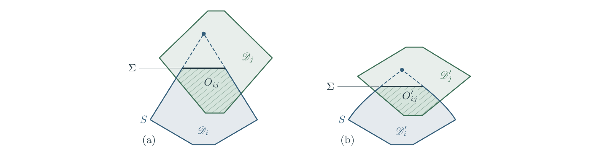

**Figure 10:** In each spacetime the blue and green causal diamonds overlap in the hatched region. We truncate the blue null cone at $\Sigma$. Its null generators continue along the dashed curves to a caustic (dot), which occurs at a smaller change in affine parameter in (b) because the shear is greater for the same area and expansion at $S$. We match the tetrads and spin connections throughout the overlap. The green null generators then extend our description of the spacetime beyond the caustic.

For a globally hyperbolic spacetime $\mathscr{M}=\bigcup_{i}\mathscr{D}_{i}$, we can now choose a cover separately for each solution.[^10] Writing $L_{ij}$ for the local Lorentz transformation taking $e_{j}$ to $e_{i}$ on $O_{ij}$, we impose (3.30) on all overlaps to obtain

$$
\displaystyle\mathcal{P}(\mathscr{M})\simeq\left(\bigsqcup_{\{\mathscr{D}_{i}\}}\left\{(z_{i},L_{ij})\,\middle|\,z_{i}\in\mathcal{P}(\mathscr{D}_{i}),\ e_{i}=L_{ij}e_{j},\ L_{ij}L_{jk}=L_{ik}\right\}\right)\big/\!\sim. \tag{3.31}
$$

Since $\omega_{i}$ is the torsion free spin connection of $e_{i}$, the same $L_{ij}$ relates $\omega_{i}$ and $\omega_{j}$ as in (3.60). We compare two covers on smaller causal diamonds, each contained in one member of each cover. The quotient in (3.31) identifies descriptions whose fields agree there up to diffeomorphism and local Lorentz transformation, with the same data on the external boundary. The matched metrics define a single smooth vacuum spacetime on their union, and every smooth globally hyperbolic vacuum spacetime restricts to such data.

### 3.3 The symplectic form with edge modes

Displacing a cut along its null generators changes the area it encloses even on a fixed spacetime. At a given affine parameter, boosting the local Lorentz frame at the cut can likewise change the event at which we measure bulk observables. To identify the charges for these transformations, we vary the embedding and local Lorentz frame independently of the bulk fields. A displacement $\xi^{a}$ of the cut on a fixed solution then defines a variation $\delta_{\xi}$ with charge variation

$$
\delta H_{\xi}=\Omega(\delta,\delta_{\xi}). \tag{3.32}
$$

A diffeomorphism acting on the fields and the embedding together preserves pullbacks and amounts to a gauge transformation.

For a radiative observable $\mathcal{O}$ and a charge $H_{\xi}$ acting on the edge modes $\mathfrak{e}$, the symplectic form $\Omega=\delta\Theta$ on the reduced phase space determines the Poisson bracket

$$
\{\mathcal{O},H_{\xi}\}=\delta_{\xi}\mathcal{O}. \tag{3.33}
$$

In the symplectic potential $\Theta$ we therefore need to track variations of $\varrho$, $\omega$, $\ell$ and $n$ induced by the null constraints. It is easy to show that the symplectic potential takes the form

$$
\bm{\theta}_{\mathscr{M}}=\frac{1}{16\pi G_{N}}B_{\mu\nu}\curlywedge\delta\omega^{\mu\nu},\ \bm{\theta}=\bm{\theta}_{\mathscr{M}}+\mathrm{d}\bm{\alpha}. \tag{3.34}
$$

With $\star_{g}$ denoting the Hodge dual for the spacetime metric,

$$
\bm{\alpha}=\frac{1}{16\pi G_{N}}\,\star_{g}\bigl(e_{\mu}\curlywedge\delta e^{\mu}\bigr). \tag{3.35}
$$

On the constraint surface, $\mathrm{d}\bm{\alpha}$ removes the charge associated to a local Lorentz transformation acting on $e^{\mu}{}_{a}$ and $\omega^{\mu\nu}$ together [30]. On the other hand displacing a boundary frame changes an observable’s location or components, so its charge remains.

For the bulk contribution, we define $\beta_{a}$ and the one forms $K^{\mu}$ for $\mu=2,3$ by

$$
\displaystyle\beta_{a}=-n_{\mu}\nabla_{a}\ell^{\mu}, \tag{3.36a}
$$

$$
\displaystyle K^{\mu}=K_{A}{}^{\mu}\,\mathrm{d}y^{A}, \tag{3.36b}
$$

$$
\displaystyle K_{A}{}^{\mu}=q^{BC}E_{C}{}^{\mu}K_{AB}. \tag{3.36c}
$$

Using $\bm{\theta}_{\mathscr{M}}$ above, we obtain

$$
\int_{\mathscr{H}}\bm{\theta}_{\mathscr{M}}=\frac{1}{8\pi G_{N}}\int_{\mathscr{H}}\left[\bm{\mu}\curlywedge\delta\beta+\mathrm{d}u\curlywedge(E^{2}\curlywedge\delta K^{3}-E^{3}\curlywedge\delta K^{2})\right]. \tag{3.37}
$$

At fixed tetrad the integrand reduces to

$$
\bm{\eta}\bigl(\delta\kappa+\delta\Theta_{(\ell)}\bigr), \tag{3.38}
$$

where $\kappa=\ell^{a}\beta_{a}$. Varying the action on the null boundary cancels this term. For $\nabla_{[a}e^{\mu}{}_{b]}=0$, we first hold the null normals and angular coordinates fixed, $\delta\ell^{a}=\delta n^{a}=0$ and $\delta y^{A}=0$. Collecting the terms at the cuts in $\Theta_{\partial}$, we obtain the null symplectic potential [72, 17]

$$
\Theta_{\mathscr{H}}=\frac{1}{16\pi G_{N}}\int_{\mathscr{H}}\bm{\eta}\left[\sigma^{AB}\delta q_{AB}-(2\kappa+\Theta_{(\ell)})\delta\log\varrho^{2}\right]+\Theta_{\partial}. \tag{3.39}
$$

As is well known, shear is conjugate to the conformal metric since $\sigma^{AB}\delta q_{AB}=(1/2)(\partial_{u}\bar{q})^{AB}\,\delta\bar{q}_{AB}$. In Appendix A we evaluate (3.37) in an adapted tetrad, keeping the corner term $\int_{\partial\mathscr{H}}\bm{\alpha}$ and allowing the null normals to vary along $\mathscr{H}$ as in (A.8)–(A.9).

To account for displacements of the boundary as well, we must vary its embedding $X$ in $\mathscr{M}$. Under a displacement $\chi^{a}=\delta X^{a}\circ X^{-1}$, the pullback of a spacetime tensor $T$ transforms as [80],

$$
\delta(X^{*}T)=X^{*}(\delta T+\pounds_{\chi}T). \tag{3.40}
$$

Hence a simultaneous diffeomorphism of $T$ and $X$ preserves $X^{*}T$, whereas varying $X$ alone produces a surface charge. For variations of the two null normals, the corner symplectic potential is

$$
\Theta_{S}=\frac{1}{8\pi G_{N}}\int_{S}\bm{\mu}\left(\delta\Gamma+\frac{\ell_{a}\delta n^{a}-n_{a}\delta\ell^{a}}{2(-\ell\cdot n)}\right). \tag{3.41}
$$

Here $\Gamma$ parametrizes boosts of the boundary frame, with conjugate momentum $\bm{\mu}/(8\pi G_{N})$ [14]. The variations $\delta\ell^{a}$ and $\delta n^{a}$ include their dependence on $\mathfrak{h}$; angular displacements of $X$ couple to the tangential surface momentum [33, 80].

For a smooth null cone, substituting (3.26) into $\Theta_{\mathscr{H}}$ and expressing variations at fixed $v$ further cancels out the terms proportional to $\delta u_{*}$ at $v=1$:

$$
\displaystyle\Theta=\int_{S}\bm{\epsilon}_{0}\mathscr{K}(y)(\alpha-2\delta J+\delta\Gamma+\Upsilon), \tag{3.42a}
$$

$$
\displaystyle\begin{aligned} \Omega=\int_{S}\bm{\epsilon}_{0}\bigl[&\mathscr{K}(y)\,\delta\alpha+\mathscr{K}(y)\,\delta\Upsilon+\delta\mathscr{K}(y)\wedge(\alpha-2\delta J+\delta\Gamma+\Upsilon)\bigr].\end{aligned} \tag{3.42b}
$$

$$
\displaystyle\alpha=\frac{1}{4}\int_{0}^{1}v^{2}\,(\partial_{v}\bar{q})^{AB}\,\delta\bar{q}_{AB}\,\mathrm{d}v, \tag{3.42c}
$$

$$
\displaystyle J=\frac{1}{16}\int_{0}^{1}v(1-v^{2})\,(\partial_{v}\bar{q})^{AB}\,\partial_{v}\bar{q}_{AB}\,\mathrm{d}v. \tag{3.42d}
$$

The boost generator is the integral over $S$ of the charge aspect $\mathscr{K}(y)=\varrho_{S}(y)^{2}/(8\pi G_{N})$,

$$
\displaystyle\mathscr{K}=\int_{S}\bm{\epsilon}_{0}\mathscr{K}(y)=\frac{\mathscr{A}}{8\pi G_{N}}. \tag{3.43}
$$

Even with the angular embedding held fixed in (3.42b), $\mathscr{K}(y)$ couples to the conformal metric through $\delta\mathscr{K}(y)\wedge\alpha$ and to the choice of null normals through the term in (3.41),

$$
\Upsilon=\frac{\ell_{a}\delta n^{a}-n_{a}\delta\ell^{a}}{2(-\ell\cdot n)}. \tag{3.44}
$$

If we also vary the angular embedding, the Lie derivative in (3.40) enters the shear term in the symplectic potential and couples the angular edge modes to the conformal metric as in (A.14).

Finally, we use $\mathfrak{T}=0$ for the independent constraints on $\omega_{\mu\nu}$ required to preserve $\mathfrak{S}=0$ under time evolution, and $\mathfrak{C}_{A}=0$ for the constraints solved in the reduction, including $\mathfrak{S}=0$, $\mathfrak{T}=0$, the Gauss constraint and the null constraints. We identify configurations related by a gauge transformation of both the fields and the boundary frame. In canonical coordinates $\phi=(q,p)$ on the resulting phase space, the embedding into the constraint surface determines the boundary fields and their symplectic form,

$$
\mathfrak{h}=\iota(\phi),\ \mathfrak{C}_{A}(\iota(\phi))=0,\ \Omega=\iota^{*}\delta\Theta. \tag{3.45}
$$

In Section 4.3, $\Omega$ fixes normalization of commutators of the smeared canonical variables.

### 3.4 The reduced Hamiltonian

Once we impose the gravitational constraints, the Hamiltonian that advances a slice in time reduces to a surface charge [71, 46]. To evaluate this charge on a null cone we must solve the constraints along the null generators between the two cuts. For a time translation normalized at $S$, changing the shear between the cuts can change how far the inner cut advances along the transverse null normal. The surface charge thus depends on the radiative canonical variables, and the reduced Hamiltonian can generate their time evolution through its Poisson brackets. To identify this Hamiltonian in the action we choose a foliation and write $\omega^{\mu\nu}=\omega_{t}^{\mu\nu}\mathrm{d}t+\omega_{\Sigma}^{\mu\nu}$ and $B^{\mu\nu}=\mathrm{d}t\curlywedge B_{t}^{\mu\nu}+B_{\Sigma}^{\mu\nu}$. Integrating the term containing $(\nabla_{i}\omega_{t}^{\mu\nu})\,\mathrm{d}x^{i}$ by parts separates the bulk symplectic potential,

$$
\displaystyle\Theta_{\Sigma}=\frac{1}{16\pi G_{N}}\int_{\Sigma}B_{\Sigma\mu\nu}\curlywedge\delta\omega_{\Sigma}^{\mu\nu}, \tag{3.46}
$$

from the Hamiltonian

$$
\displaystyle H_{\Sigma}=-\frac{1}{16\pi G_{N}}\int_{\Sigma}B_{t\mu\nu}\curlywedge(F_{\Sigma}^{\mu\nu}-\Phi^{\mu\nu}{}_{\rho\sigma}B_{\Sigma}^{\rho\sigma})
$$

$$
\displaystyle-\frac{1}{16\pi G_{N}}\int_{\Sigma}\omega_{t}^{\mu\nu}\frac{1}{2}\nabla_{[i}(B_{\Sigma})_{|\mu\nu|jk]}\,\mathrm{d}x^{i}\curlywedge\mathrm{d}x^{j}\curlywedge\mathrm{d}x^{k}+\frac{1}{16\pi G_{N}}\int_{\partial\Sigma}B_{\Sigma\mu\nu}\omega_{t}^{\mu\nu}. \tag{3.47}
$$

Here $F_{\Sigma}^{\mu\nu}$ is the curvature of $\omega_{\Sigma}^{\mu\nu}$. Varying $B_{t}^{\mu\nu}$ and $\omega_{t}^{\mu\nu}$ imposes the constraints

$$
\displaystyle F_{\Sigma}^{\mu\nu}=\Phi^{\mu\nu}{}_{\rho\sigma}B_{\Sigma}^{\rho\sigma}, \tag{3.48a}
$$

$$
\displaystyle\nabla_{[i}(B_{\Sigma})_{|\mu\nu|jk]}=0, \tag{3.48b}
$$

so $H_{\Sigma}$ reduces to a pure boundary term [71]. Here we have included the boundary action $I_{\partial\mathscr{M}}$ of (3.15a) and varied the edge modes $\mathfrak{e}$ in $I$ [46].[^11] Varying the limits of integration evaluates the integrand at the two cuts $u_{-}$ and $u_{+}$ with opposite signs. In Appendix B we evaluate these contributions by writing the action as

$$
I=\int_{t_{i}}^{t_{f}}\bigl[\Theta_{t}(\dot{\mathfrak{h}})-H\bigr]\,\mathrm{d}t. \tag{3.49}
$$

For a boundary displacement $\xi^{a}$, the Noether charge and its variation are simply

$$
\displaystyle\bm{Q}_{\xi}=\frac{1}{16\pi G_{N}}B_{\mu\nu}(i_{\xi}\omega^{\mu\nu})+\bm{\alpha}(\pounds_{\xi}e), \tag{3.50a}
$$

$$
\displaystyle\delta H_{\xi}=\int_{\partial\Sigma}\left(\delta\bm{Q}_{\xi}-\bm{Q}_{\delta\xi}-i_{\xi}\bm{\theta}\right). \tag{3.50b}
$$

$$
\xi \bm{Q}_{\delta\xi}
$$

$$
\displaystyle(\bm{Q}_{\xi})_{ab}=-\frac{1}{16\pi G_{N}}(\bm{\epsilon}_{g})_{abcd}\nabla^{c}\xi^{d}. \tag{3.50c}
$$

For a unit boost at $S$, $\xi|_{S}=0$ and $\nabla_{a}\xi^{b}|_{S}=\epsilon^{b}{}_{a}$, where $\epsilon^{a}{}_{b}=n^{a}\ell_{b}-\ell^{a}n_{b}$. Since $\epsilon^{a}{}_{b}\epsilon^{b}{}_{a}=2$ implies $\epsilon^{a}{}_{b}\delta\epsilon^{b}{}_{a}=0$, we obtain

$$
\bm{Q}_{\xi}=\frac{\bm{\mu}}{8\pi G_{N}},\ \bm{Q}_{\delta\xi}=0. \tag{3.51}
$$

The associated surface charge is thence the boost generator $\mathscr{K}$, as in (3.41). When we translate a cap, the map $\mathfrak{h}=\iota_{t}(\phi)$ changes even at fixed canonical coordinates $\phi=(q,p)$.

To separate this displacement from the time evolution of $\phi$, we pull the symplectic potential back to the reduced phase space,

$$
\Theta_{t}(\dot{\mathfrak{h}})=(\iota_{t}^{*}\Theta_{t})(\dot{\phi})+\Theta_{t}(\partial_{t}\iota_{t}),\ \iota_{t}^{*}\Theta_{t}=p_{k}\,\delta q^{k}+\delta\chi_{t}. \tag{3.52}
$$

Extracting the total derivative $\mathrm{d}\chi_{t}/\mathrm{d}t$ from $\delta\chi_{t}(\dot{\phi})$ puts the action in canonical form,

$$
\displaystyle I=\int_{t_{i}}^{t_{f}}(p_{k}\dot{q}^{k}-H_{c})\,\mathrm{d}t+[\chi_{t}]_{t_{i}}^{t_{f}}, \tag{3.53a}
$$

$$
\displaystyle H_{c}(\phi,t)=H(\iota_{t}(\phi),t)-\Theta_{t}(\partial_{t}\iota_{t})+\partial_{t}\chi_{t}. \tag{3.53b}
$$

We take both partial derivatives at fixed $\phi$. For a spacelike cap $\Sigma_{t}=X_{t}(\Sigma)$, we read $H$ and $\Theta_{t}$ from the action including the cap and joint terms in (B.14a). When $X_{t}$ moves, the Hamiltonian term $-\Theta_{t}(\partial_{t}\iota_{t})$ includes the surface charge $-\int_{\partial\Sigma_{t}}\bm{Q}_{\partial_{t}X_{t}\circ X_{t}^{-1}}$ of (B.21).

To see how radiation enters even at fixed cuts, we evaluate the charge on an expanding null cone between closed cuts at $v_{-}$ and $v_{+}$. In the coordinates of (B.1), with $\varrho=v\varrho_{S}$ and $\bm{\epsilon}_{0}=\mathrm{d}^{2}y$, the divergence (B.7) reduces (3.47) to

$$
H_{\Sigma}=\frac{1}{16\pi G_{N}}\left[\int_{C}\bm{\epsilon}_{0}\left\{v^{2}\varrho_{S}^{2}\left(\mu_{c}+\frac{\partial_{v}F}{2N}\right)-V^{A}\Pi_{A}\right\}\right]_{v_{-}}^{v_{+}}. \tag{3.54}
$$

Here we integrate the transverse connection $\mu_{c}$ against the area element $v^{2}\varrho_{S}^{2}\bm{\epsilon}_{0}$ on each cut, while the angular shift $V^{A}$ couples to the momentum $\Pi_{A}$. In the area coordinate $v$, the lapse $N$ specifies the displacement along the transverse null normal per unit coordinate time. The null constraint (B.3) relates $N$ at either cut to its value at $S$,

$$
\partial_{v}\log N=\partial_{v}\Xi_{y},\ N(v,y)=N(1,y)\exp[\Xi_{y}(v)-\Xi_{y}(1)]. \tag{3.55}
$$

Thus even at fixed corner normalization $N(1,y)$, the lapse depends on the shear between the cut and $S$ through the same integral (3.26c) that enters the clock (Figure 11). The angular divergence of shear enters (B.4), which determines $\Pi_{A}$ and $V^{A}$ from their values at $S$. With initial data from the intersecting null cone, the transverse constraints (B.5)–(B.6) also determine $\mu_{c}$ and the metric coefficient $F$ for the chosen foliation.

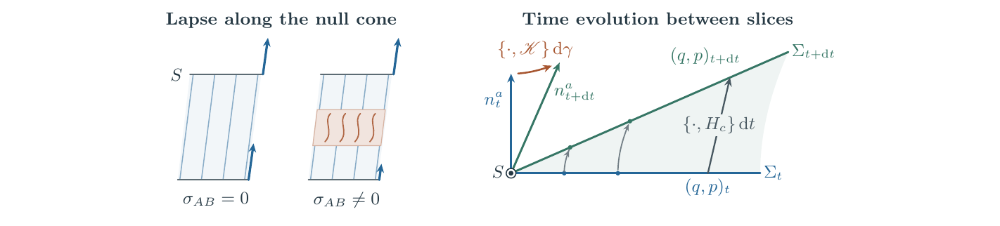

**Figure 11:** On the left the blue arrows show the lapse at the two cuts for the same displacement parameter. Shear in the shaded strip reduces the lapse at the inner cut even though the shear vanishes there. On the right the gray arrows follow two points as the slice moves. The central arrow shows the time evolution of the canonical pairs generated by $H_{c}$ in (3.53b). At fixed $S$ the future unit normal undergoes a uniform boost generated by $\mathscr{K}$.

### 3.5 The metric and dressed observables

To measure the same polarization of gravitational radiation amongst two solutions, we must specify both the event and the polarization relative to the gravitational boundary data $\mathfrak{h}$ in each. Integration along the null generators in Section 3.2 fixes $e^{\mu}|_{\Sigma}$, while (3.5) determines how the tetrad varies away from the null boundary. We parallel transport the local Lorentz frame $\mathfrak{e}$ along a geodesic from the boundary and measure the field in that frame at a specified affine parameter. If gluing places this frame in the interior, we can identify the same observable in both subregions by matching their tetrads and spin connections along the geodesic.

In the $2+2$ formulation, reconstructing the metric off $\mathscr{H}_{p}$ also requires its derivative in the transverse null direction. The intersecting null cone $\mathscr{H}_{q}$ supplies the transverse expansion and shear at $S$ (Figure 9). To transport this data along $\mathscr{H}_{p}$ we use the normal connection and the transverse second fundamental form,

$$
\displaystyle\varpi_{a}=q_{a}{}^{b}\beta_{b}=-n_{\mu}q_{a}{}^{b}\nabla_{b}\ell^{\mu}, \tag{3.56a}
$$

$$
\displaystyle K^{(n)}_{ab}=q_{a}{}^{c}q_{b}{}^{d}e_{d\mu}\nabla_{c}n^{\mu}=\sigma^{(n)}_{ab}+\frac{1}{2}\Theta_{(n)}q_{ab}. \tag{3.56b}
$$

The Damour Navier Stokes equation [53] and cross focusing equation [50] are the two curvature constraints $\mathfrak{C}_{\ell a}=0$ and $\mathfrak{C}_{\ell n}=0$. With $\nabla_{[a}e^{\mu}{}_{b]}=0$, these equations and the tracefree transverse projection of $F^{\mu\nu}=\Phi^{\mu\nu}{}_{\rho\sigma}B^{\rho\sigma}$ become

$$
\displaystyle\mathfrak{C}_{\ell a}=q_{a}{}^{b}R_{bc}\ell^{c}=0, \tag{3.57a}
$$

$$
\displaystyle\mathfrak{C}_{\ell n}=\frac{1}{2}q^{ab}R_{ab}-\Lambda=(G_{ab}+\Lambda g_{ab})\ell^{a}n^{b}=0, \tag{3.57b}
$$

$$
\displaystyle(\pounds_{\ell}+\Theta_{(\ell)})\varpi_{a}=\frac{1}{2}q_{a}{}^{b}\nabla_{b}\Theta_{(\ell)}-q_{a}{}^{b}q^{cd}\nabla_{c}\sigma_{db}, \tag{3.57c}
$$

$$
\displaystyle(\pounds_{\ell}+\Theta_{(\ell)})\Theta_{(n)}=-\frac{1}{2}R[q]+q^{ab}\nabla_{a}\varpi_{b}+\varpi_{a}\varpi^{a}+\Lambda, \tag{3.57d}
$$

$$
\displaystyle(\pounds_{\ell}\sigma^{(n)}_{ab})^{\rm TF}=\frac{1}{2}\Theta_{(\ell)}\sigma^{(n)}_{ab}-\frac{1}{2}\Theta_{(n)}\sigma_{ab}+(q_{a}{}^{c}q_{b}{}^{d}\nabla_{(c}\varpi_{d)}+\varpi_{a}\varpi_{b})^{\rm TF}. \tag{3.57e}
$$

Here $\ell^{a}\nabla_{a}\ell^{b}=0$, $R[q]$ is the scalar curvature of $q_{ab}$, and $\mathrm{TF}$ removes the trace with $q_{ab}$. The expansion and shear in $\mathfrak{C}_{\ell a}=0$ are already determined by $\pounds_{\ell}q_{ab}$. Multiplying (3.57c) by the area element turns its left hand side into a total derivative along the null generator. With $\varpi_{a}$ known, the cross focusing equation fixes $\Theta_{(n)}$, which in turn enters the equation for $\sigma^{(n)}_{ab}$. In each case the initial data comes from the intersecting null boundary or from smoothness at a vertex. Here $R_{ab}\ell^{a}n^{b}=-\Lambda$, and only $\mathfrak{C}_{\ell n}$ contains $\Lambda$ explicitly.

In Appendix B, we integrate (3.5) with $\nabla_{[a}e^{\mu}{}_{b]}=0$ to determine derivatives of $e^{\mu}{}_{a}$ and $\omega_{a}{}^{\mu\nu}$ transverse to $\mathscr{H}$ and express the lapse, angular shift and $g_{ab}$ in terms of $\mathfrak{h}$. Smooth compatible data determines a unique local solution up to diffeomorphism [75, 21, 23] in which changing the local Lorentz frame transforms the tetrad and spin connection together while preserving the metric.

We use the edge modes $\mathfrak{e}$ to dress bulk observables, specifying both the event and the frame in which we measure components of tensors [15]. More specifically, geodesics launched from the corner embedding $X$ in directions fixed by $\mathfrak{e}$ define local coordinates, with frames parallel transported by $\omega$ [34]. Then, under $\delta\mathfrak{h}$, $\chi^{a}=(\delta X\circ X^{-1})^{a}$ is the displacement of a point on a geodesic with tangent $t^{a}$, holding the affine parameter and its initial location and direction relative to $\mathfrak{e}$ fixed. This displacement obeys

$$
t^{b}\nabla_{b}(t^{c}\nabla_{c}\chi^{a})+R^{a}{}_{bcd}t^{b}\chi^{c}t^{d}=-\delta\Gamma^{a}{}_{bc}t^{b}t^{c}, \tag{3.58}
$$

where we obtain $\delta\Gamma^{a}{}_{bc}$ by varying the torsion free spin connection and the tetrad as in (A.5), while the edge modes fix how the initial point and tangent to the geodesic vary. For $g_{ab}$, the variations combine as $\delta(X^{*}g)=X^{*}(\delta g+\pounds_{\chi}g)$.

For example, we choose $f^{AB}$ with compact support near the event reached at a chosen affine parameter along a null geodesic from $S$. Its components in the local Lorentz frame parallel transported along that geodesic select the polarization of the smeared graviton operator, which we evaluate on the solution with boundary data $\mathfrak{h}$. Under a diffeomorphism, $\delta T=\pounds_{\xi}T$ for a spacetime tensor $T$ and $\chi=-\xi$, so (3.40) yields

$$
\sigma_{f}[\mathfrak{h}]=\int\mathrm{d}u\,\mathrm{d}A\,f^{AB}\sigma_{AB},\ \delta\sigma_{f}[\mathfrak{h}]=0. \tag{3.59}
$$

### 3.6 Matching fields across subregions

A measurement of the smeared shear $\sigma_{f}[\mathfrak{h}]$ in the overlap $O_{ij}=\mathscr{D}_{i}\cap\mathscr{D}_{j}$ must refer to the same support and polarization whichever causal diamond we use to describe it. We therefore match the local Lorentz frames parallel transported by $\omega_{i}$ and $\omega_{j}$ along the geodesic from $S$. For a vector $v$ of the transported frame and tangent $t^{a}$ to the geodesic, matching as in (3.30) requires the Lorentz transformation $L_{ij}$ between the two frames to satisfy

$$
\displaystyle v_{i}=L_{ij}v_{j}, \tag{3.60a}
$$

$$
\displaystyle(t^{a}\nabla_{a}v)_{i}=L_{ij}(t^{a}\nabla_{a}v)_{j}=0, \tag{3.60b}
$$

$$
\displaystyle B_{i}=L_{ij}B_{j}L_{ij}^{-1}, \tag{3.60c}
$$

$$
\displaystyle(\nabla_{a}L_{ij})^{\mu}{}_{\nu}=0, \tag{3.60d}
$$

where $L_{ij}L_{jk}=L_{ik}$ on triple overlaps. In $\nabla_{a}L_{ij}$, the spin connection $\omega_{i}$ acts on the upper index $\mu$ and $\omega_{j}$ on the lower index $\nu$. With (3.4), $e_{i}=L_{ij}e_{j}$ implies $g_{i}=g_{j}$ on each overlap, and the induced metrics define a metric on the glued cobordism.

For example, circular null geodesics that start together on the Schwarzschild photon sphere in different orbital planes meet at its antipode at the same Schwarzschild time [84]. We truncate their null cone before they meet and choose a second causal diamond containing the caustic. Matching the tetrad and spin connection on the overlap continues the same Schwarzschild geometry across it (Figure 12).

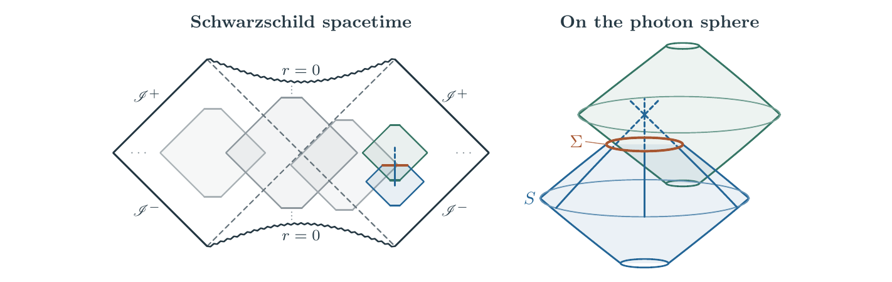

**Figure 12:** The Penrose diagram on the left shows capped causal diamonds in maximally extended Schwarzschild spacetime. The dashed gray lines are the horizons. On the right we draw the blue and green causal diamonds on the photon sphere, with time increasing upwards in both views. Three null generators of the blue null cone reach $\Sigma$ at distinct angles. Their dashed continuations meet inside the green causal diamond, which overlaps the blue one before $\Sigma$.

To match the connection across $S$, we use $Y$ to pull the null frame $(\ell_{L}^{a},n_{L}^{a})$ from the $-$ side back to the $+$ side, where we compare it with $(\ell_{R}^{a},n_{R}^{a})$. For a boost of rapidity $\gamma=\Gamma_{R}-\Gamma_{L}$, the normals satisfy

$$
\ell_{R}=\exp(\gamma)Y^{*}\ell_{L},\ n_{R}=\exp(-\gamma)Y^{*}n_{L}. \tag{3.61}
$$

It follows that

$$
\displaystyle q_{+}=Y^{*}q_{-}, \tag{3.62a}
$$

$$
\displaystyle K^{(\ell)}_{+}=e^{\gamma}Y^{*}K^{(\ell)}_{-}, \tag{3.62b}
$$

$$
\displaystyle K^{(n)}_{+}=e^{-\gamma}Y^{*}K^{(n)}_{-}, \tag{3.62c}
$$

$$
\displaystyle\varpi_{+}=Y^{*}\varpi_{-}+\mathrm{d}\gamma. \tag{3.62d}
$$

After pullback by $Y$, the derivative of the boost angle drops out of the projected normal curvatures and enters the normal connection. Thus a relative boost affects $\varpi_{a}$ at fixed $q_{ab}$. Equations (3.62) match the metric and both normal derivatives, so the connection agrees on the cut and the constraints in (3.57) propagate the same data along the null generators on either side.

Importantly, these two subregions induce opposite orientations on the cut, so their boost terms enter the symplectic potential with opposite signs. After identifying the angular coordinates, let $\varrho_{S,\pm}(y)^{2}$ denote the area per unit solid angle on either side. For the boost charges we write

$$
\displaystyle\mathscr{K}_{\pm}(y)=\frac{\varrho_{S,\pm}(y)^{2}}{8\pi G_{N}}, \tag{3.63a}
$$

$$
\displaystyle\mathscr{K}(y)=\frac{\mathscr{K}_{+}(y)+\mathscr{K}_{-}(y)}{2}, \tag{3.63b}
$$

$$
\displaystyle\Delta\mathscr{K}(y)=\mathscr{K}_{+}(y)-\mathscr{K}_{-}(y). \tag{3.63c}
$$

Matching the induced metrics then yields

$$
\mathscr{K}_{+}(y)\delta\Gamma_{R}-\mathscr{K}_{-}(y)\delta\Gamma_{L}=\mathscr{K}(y)\,\delta\gamma,\ \Delta\mathscr{K}(y)=0. \tag{3.64}
$$

Consequently, a simultaneous shift of $\Gamma_{R}$ and $\Gamma_{L}$ then has zero charge and is a gauge transformation. What then remains is the relative boost $\gamma$ conjugate to $\mathscr{K}(y)$ [17]. Lastly, when $S$ serves only to subdivide a region, its frame is no longer part of the boundary data after gluing.

For the angular embeddings, we use $g_{S}$ to map a fixed cut into the first subregion and $Y$ to identify it with the second. Varying their composition yields

$$
s_{-}=Y\circ g_{S},\ (s_{-}^{-1})_{*}\delta s_{-}=(g_{S}^{-1})_{*}\bigl[(Y^{-1})_{*}\delta Y\bigr]+(g_{S}^{-1})_{*}\delta g_{S}. \tag{3.65}
$$

On pulling both angular momentum aspects back to the cut, we find that $J_{-A}$ couples to variations of $Y$. Including this contribution in $\Theta_{+\cup-}$ separates it from the charge $J_{+A}+J_{-A}$ for displacements of $g_{S}$,

$$
\Theta_{+}+\Theta_{-}=\Theta_{+\cup-}+\int_{S}\mathrm{d}^{2}y\,(J_{+A}+J_{-A})[(g_{S}^{-1})_{*}\delta g_{S}]^{A}+\delta B_{S}. \tag{3.66}
$$

Here $B_{S}$ comes from the integrals over the corners in $I_{\partial\mathscr{M}}$. Once the outward charges cancel, changes of $g_{S}$ are gauge transformations, and the symplectic form is $\Omega_{+\cup-}=\delta\Theta_{+\cup-}$ [33, 18]. In $\Omega_{+\cup-}$, $Y$ and $\gamma$ are coupled to the bulk degrees of freedom, while gluing cancels out the contributions of the two null boundaries to $I_{\partial\mathscr{M}}$.

On the two copies $S_{+}$ and $S_{-}$ of the intermediate cut, our matching conditions identify the integrands in $\delta H_{\xi}$. Their contributions cancel by opposite orientation, so the charge on the union has support only at its outer boundary. In Appendix B we check explicitly this cancellation for a translated cut. For adjacent subregions sweeping out $\mathscr{M}_{i}$ and $\mathscr{M}_{j}$, the internal boundary terms in the action likewise cancel, so $I_{\mathscr{M}}=I_{\mathscr{M}_{i}}+I_{\mathscr{M}_{j}}$.

## 4 Quantization on the null cone and path integral representation

When we match the gravitational boundary data of two adjoining subregions, their internal boundary terms cancel and their reduced actions add. If the geometry on their shared spacelike cut $\Sigma$ is in superposition, we impose the same matching by pairing the incoming wavefunction with the complex conjugate of the outgoing one at each boundary configuration. Their overlap then yields the amplitude for the uncut region.

To evaluate this amplitude with a graviton insertion, we must specify where its source acts in every geometry entering the overlap. Coupling the source to the radiation at the same value of the affine parameter along a null geodesic from $S$ defines a single deformation of the reduced action without choosing a background metric (Section 3.5). If two such sources act on opposite sides of $\Sigma$, gluing fixes the ordering of their insertions because the later source acts on the state prepared by the earlier one. For a canonical coordinate and its conjugate momentum on the same slice, promoting their reduced Poisson bracket to a commutator fixes the difference between the two orderings of insertions. Since these relations hold for any pair of boundary wavefunctions, we can define the algebra of observables before choosing a Hilbert space representation in which to evaluate their matrix elements [42, 43, 12].

We can prepare excitations on the incoming null cone at a single corner area and calculate their overlaps before specifying amplitudes for transitions to other areas. Since the charge of a uniform relative boost at $S$ is proportional to the total corner area, we start with the observables that preserve this charge. The resulting states all acquire the same phase under the boost, while the distribution of area over $S$ and the two polarizations of radiation can still fluctuate. We choose a Gaussian wavefunction for each independent canonical pair to specify the center and width of these fluctuations. Excitations of the product wavefunction then span the Fock space at that area. Since shear reduces the expansion of the null generators, the affine parameter needed to reach a given corner area element depends on the radiation even at fixed initial expansion. Quantizing the angular average of these readings, with their normalization fixed at $\partial\Sigma_{0}$ as in (3.28), yields a gravitational clock $\widehat{\bar{u}}_{*}$. Restricting its readings therefore also restricts graviton states (Section 5.1).

Since a graviton insertion can change the total corner area, we fix the inner product (4.16) by choosing a pure extension of the incoming Gaussian state to the full algebra. The incoming and outgoing states have square summable coefficients in any orthonormal basis on $\Sigma$, since time evolution to the cut preserves their norms. Cauchy Schwarz then bounds the sum of the absolute values in (4.29) by the product of these norms (4.30), so the sum over intermediate states converges absolutely at finite $G_{N}$.

### 4.1 Algebra of observables

To insert the smeared graviton operator $\widehat{\sigma}_{f}$ in a transition amplitude, we vary the strength of a source coupled to the classical observable $\sigma_{f}[\mathfrak{h}]$ of (3.59). The dressing specifies where the source acts relative to $S$ as the geometry varies, and its smearing $f^{AB}$ selects a polarization in the local Lorentz frame parallel transported from the corner.

For an observable $\mathcal{O}[\mathfrak{h}(t)]$, coupling a source $j(t)$ deforms the reduced action $I$ by $F[j]$. To isolate its effect on an incoming state we evolve from $\Sigma_{0}$ to $\Sigma_{1}$ with the source turned on and return to $\Sigma_{0}$ under the undeformed action. This glues the two copies of $\Sigma_{1}$ with opposite orientations (Figure 13). Identifying the boundary states as in Appendix C, we obtain the source operator $S_{I}(F)$ in a Hamiltonian representation,

$$
U_{I}(t_{f},t_{i})=\mathrm{T}\exp\!\left[-(i/\hbar)\int_{t_{i}}^{t_{f}}\widehat{H}(t)\,\mathrm{d}t\right],\ S_{I}(F)=U_{I}^{\dagger}U_{I+F},\ F[j]=\int j(t)\mathcal{O}[\mathfrak{h}(t)]\,\mathrm{d}t. \tag{4.1}
$$

Here $\mathrm{T}$ denotes time ordering. For this source, derivatives with respect to $j$ yield operator insertions whose matrix elements determine time ordered correlation functions, including contact terms [52]. We calculate these derivatives in Appendix C.2.

More generally, $F$ can contain nonlinear functions of $\mathfrak{h}$. We require $I+F$ to define an action on the same reduced phase space as $I$, including its boundary terms, and with $\mathfrak{S}=\mathfrak{T}=0$ as constraints. In canonical coordinates $\phi(t)$ we write the deformation as $F[\phi]=\int f_{t}[\phi(t)]\,\mathrm{d}t$, with real valued $f_{t}$ that vanishes outside a specified range of time. Its dependence on fields across a spatial boundary may be nonlocal.

With no deformation we have $S_{I}(0)=\widehat{1}$, while adding a constant $c$ to the action multiplies the unitary by a phase, $S_{I}(F+c)=\exp(ic/\hbar)S_{I}(F)$. Changing variables by $\phi(t)\mapsto\phi(t)+s(t)$, with $s$ vanishing near the boundary, preserves transition amplitudes. Under this change of variables the deformation $F^{s}+\Delta_{s}I$ describes the same time evolution as $F$. In the presence of an additional deformation $N$, the time evolution operators must also compose whenever $F$ acts later than $G$. Imposing both requirements on the generators [12], we obtain

$$
\displaystyle F^{s}[\phi]=F[\phi+s], \tag{4.2a}
$$

$$
\displaystyle\Delta_{s}I=I^{s}-I, \tag{4.2b}
$$

$$
\displaystyle I+F^{s}+\Delta_{s}I=(I+F)^{s}, \tag{4.2c}
$$

$$
\displaystyle S_{I}(F^{s}+\Delta_{s}I)=S_{I}(F), \tag{4.2d}
$$

$$
\displaystyle S_{I}(F+N)S_{I}(N)^{-1}S_{I}(G+N)=S_{I}(F+G+N). \tag{4.2e}
$$

Differentiating (4.2d) with respect to $s$ and $j$ yields the Schwinger Dyson equations for time ordered correlation functions, including terms from varying the insertions [52].

**Figure 13:** On the left both open ends lie on the incoming slice. We obtain $S_{I}(F)$ by gluing the cobordism with the source to an undeformed copy with opposite orientation. On the right $G$ prepares the state arriving at $\Sigma$. The later source $F$ acts on this state, fixing the ordering of the insertions in (4.2e).

Shifts that reach the boundary can also act on its edge modes and charges. In particular, Appendix C.1 keeps track of the resulting corner phases under gluing. Next, for $F$ to the future of $G$, the causal factorization in (4.2e) reduces to $S_{I}(F)S_{I}(G)=S_{I}(F+G)$ at $N=0$. For a finite sum $x=\sum_{j}c_{j}g_{j}$ of products of these generators and their adjoints, unitarity bounds $\|x\|_{\mathrm{u}}=\sup_{\pi}\|\pi(x)\|\leq\sum_{j}|c_{j}|$, where $\pi$ ranges over unitary representations satisfying (4.2d) and (4.2e) with the specified boundary phases. Quotienting by the kernel of this seminorm and completing defines the $C^{*}$ algebra $\mathcal{A}$.

For an additional deformation $F$ of $I+V$, time evolution in the interaction picture is described by the relative $S$ matrix [35],

$$
R_{V}(F)=S_{I}(V)^{-1}S_{I}(V+F). \tag{4.3}
$$

For admissible deformations this change of reference action preserves both relations (4.2d) and (4.2e), with inverse obtained by using $-V$ relative to $I+V$ [12]. To use the resulting isomorphism for gravitational amplitudes we must also identify the boundary states, including their phases.

When we translate the cap, the boundary term in the reduced action of Section 3.4 multiplies the matrix element $\langle q_{f}|U_{\mathscr{M}}|q_{i}\rangle$ by $e^{i(\chi_{t_{f}}-\chi_{t_{i}})/\hbar}$. Under the same identification of boundary data a wavefunction acquires the phase $e^{i\chi_{t}/\hbar}$, so the phases of the incoming ket and outgoing bra cancel out this factor. Taking $I_{0}$ as the reference action identifies $V_{\mathscr{M}}$ as its deformation,

$$
I_{0}=\int p_{k}\dot{q}^{k}\,\mathrm{d}t,\ V_{\mathscr{M}}=-\int H_{c}\,\mathrm{d}t,\ U_{\mathscr{M}}=S_{I_{0}}(V_{\mathscr{M}}). \tag{4.4}
$$

Using the reduced Hamiltonian (3.53b), we thus obtain the Lorentzian path integral

$$
\langle q_{f}|U_{\mathscr{M}}|q_{i}\rangle=\int_{q(t_{i})=q_{i}}^{q(t_{f})=q_{f}}\!\mathcal{D}q\,\mathcal{D}p\,\exp\!\left[\frac{i}{\hbar}\int_{t_{i}}^{t_{f}}\!\bigl(p_{k}\dot{q}^{k}-H_{c}(q,p,t)\bigr)\,\mathrm{d}t\right]. \tag{4.5}
$$

The Liouville measure $\mathcal{D}q\,\mathcal{D}p$ includes the canonical pairs at the corner (Appendix D.1), with the midpoint prescription for $H_{c}$ implementing Weyl ordering (Appendix C.2).

If the incoming wavefunction is specified on $\Sigma_{0}$ and we couple a source $F$ to the null cone, we can leave $\Sigma_{1}$ open. At each outgoing configuration $q_{f}$, the kernel prepares the wavefunction

$$
\Psi_{\Sigma_{1}}(q_{f})=\int\mathcal{D}q_{i}\,\langle q_{f}|U_{I+F}|q_{i}\rangle\,\Psi_{\Sigma_{0}}(q_{i}). \tag{4.6}
$$

Two marked points on $\Sigma_{1}$ can have different proper separations in different configurations $q_{f}$ (Figure 14). Pairing this wavefunction with an outgoing bra then yields the transition amplitude.

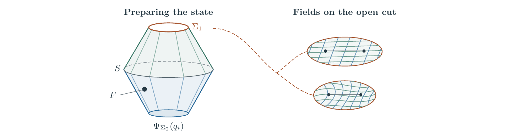

**Figure 14:** The incoming wavefunction on $\Sigma_{0}$ weights the initial configuration $q_{i}$, and the filled point marks the source $F$ on the null cone. The same two marked points on $\Sigma_{1}$ have different proper separations in configurations $q_{f}$ on the right. Each $q_{f}$ is an argument of the outgoing wavefunction in (4.6).

### 4.2 Hilbert space representation

At fixed values of $\mathscr{A}$, a state on the incoming null cone can fluctuate in both graviton polarizations and in the distribution of area over $S$. To calculate overlaps between such preparations at finite $G_{N}$, we choose a Gaussian wavefunction for their independent canonical pairs. Its expectation values determine the inner product on the Fock space of graviton and edge mode excitations at fixed area. To include insertions that change the area we will then extend the state to the full algebra of observables. Since we choose a pure extension, this algebra generates a type I factor in the resulting representation. Its Hilbert space is the closed span of the images of the incoming Fock space under unitary insertions, which can prepare superpositions of different corner areas.

We begin with the unital subalgebra generated by deformations of the incoming data that preserve corner area and by relative boosts at the corner. Recall that for fixed $\mathscr{A}$ a boost of constant rapidity $\eta$ acts by $e^{i\eta\mathscr{A}/(8\pi G_{N}\hbar)}$. At this area we expand both radiative polarizations on the incoming null cone and the independent corner variables on $S$ in a countable basis of canonical pairs $(q_{j},p_{j})$, $j=1,2,\ldots$.[^12] To realize the canonical commutation relations $[\widehat{q}_{j},\widehat{p}_{j}]=i\hbar\widehat{1}$ on wavefunctions $\chi_{j}(q_{j})$, we represent $\widehat{q}_{j}$ by multiplication and $\exp(-ia\widehat{p}_{j}/\hbar)$ by the shift $\chi_{j}(q_{j})\mapsto\chi_{j}(q_{j}-a)$. Unitarity requires translations to preserve overlaps, so intervals of equal length carry equal measure. The measure is therefore proportional to $\mathrm{d}q_{j}$, and we set its overall constant to one. To construct a basis of incoming states at fixed area, we use excitations of a Gaussian state for each canonical pair.[^13] For centers $(q_{j}^{0},p_{j}^{0})$ and widths $\Delta q_{j}>0$, normalizing each factor yields

$$
\displaystyle|\Omega_{\mathscr{A}}\rangle=\bigotimes_{j=1}^{\infty}|\Omega_{j}\rangle,\ \langle q_{j}|\Omega_{j}\rangle=\frac{1}{[2\pi(\Delta q_{j})^{2}]^{1/4}}\exp\!\left[-\frac{(q_{j}-q_{j}^{0})^{2}}{4(\Delta q_{j})^{2}}+\frac{i}{\hbar}p_{j}^{0}(q_{j}-q_{j}^{0})\right]. \tag{4.7}
$$

For a finite set $\mathcal{L}$ of mode indices, take $\phi_{j}(q_{j}),\chi_{j}(q_{j})\in L^{2}(\mathbb{R},\mathrm{d}q_{j})$ for $j\in\mathcal{L}$ and $|\phi_{j}\rangle=|\chi_{j}\rangle=|\Omega_{j}\rangle$ otherwise. Their overlap is

$$
\langle\phi|\chi\rangle=\int_{\mathbb{R}^{|\mathcal{L}|}}\prod_{j\in\mathcal{L}}\bigl[\phi_{j}(q_{j})^{*}\chi_{j}(q_{j})\,\mathrm{d}q_{j}\bigr]=\prod_{j\in\mathcal{L}}\langle\phi_{j}|\chi_{j}\rangle,\ |\chi\rangle=\bigl(\underset{j\in\mathcal{L}}{\otimes}|\chi_{j}\rangle\bigr)\otimes\bigl(\underset{j\notin\mathcal{L}}{\otimes}|\Omega_{j}\rangle\bigr). \tag{4.8}
$$

We define the Hilbert space $\mathcal{K}_{\mathscr{A}}$ at fixed corner area by completing the span of these product states in the norm induced by (4.8). To find an orthonormal basis, we use $\widehat{p}_{j}=-i\hbar\partial_{q_{j}}$ in (4.7) to obtain annihilation and creation operators with $\mathfrak{a}_{j}|\Omega_{j}\rangle=0$ and $[\mathfrak{a}_{j},\mathfrak{a}_{k}^{\dagger}]=\delta_{jk}$,

$$
\mathfrak{a}_{j}=\frac{\widehat{q}_{j}-q_{j}^{0}}{2\Delta q_{j}}+\frac{i\Delta q_{j}}{\hbar}(\widehat{p}_{j}-p_{j}^{0}),\ \mathfrak{a}_{j}^{\dagger}=\frac{\widehat{q}_{j}-q_{j}^{0}}{2\Delta q_{j}}-\frac{i\Delta q_{j}}{\hbar}(\widehat{p}_{j}-p_{j}^{0}). \tag{4.9}
$$

Acting $n$ times with $\mathfrak{a}_{j}^{\dagger}$ thus prepares a normalized occupation number state of that mode. These wavefunctions form the Hermite basis of $L^{2}(\mathbb{R},\mathrm{d}q_{j})$, so we can expand each factor in (4.8) in the states $|n\rangle_{j}$. Multiplying the expansions for $j\in\mathcal{L}$, we obtain the coefficient $\prod_{j\in\mathcal{L}}{}_{j}\langle n_{j}|\chi_{j}\rangle$ of the occupation number state $|\bm{n}\rangle$, with $n_{j}=0$ outside $\mathcal{L}$. The single mode excitations $\mathfrak{a}_{j}^{\dagger}|\Omega_{\mathscr{A}}\rangle$ form an orthonormal basis of the one particle space $\ell^{2}(\mathbb{N})$, so grouping the occupation number states by $m=\sum_{j}n_{j}$ identifies $\mathcal{K}_{\mathscr{A}}$ with the bosonic Fock space illustrated for two radiative modes in Figure 15

$$
\displaystyle|\bm{n}\rangle=\prod_{j\in\mathcal{L}}\frac{(\mathfrak{a}_{j}^{\dagger})^{n_{j}}}{\sqrt{n_{j}!}}\,|\Omega_{\mathscr{A}}\rangle, \tag{4.10a}
$$

$$
\displaystyle 0\leq\Big\|\sum_{\bm{n}}c_{\bm{n}}|\bm{n}\rangle\Big\|^{2}=\sum_{\bm{n}}|c_{\bm{n}}|^{2}<\infty, \tag{4.10b}
$$

$$
\displaystyle\mathcal{K}_{\mathscr{A}}\simeq\bigoplus_{m=0}^{\infty}\operatorname{Sym}^{m}\ell^{2}(\mathbb{N}). \tag{4.10c}
$$

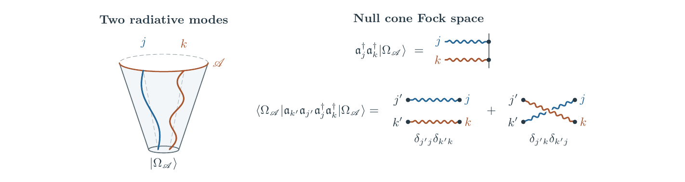

**Figure 15:** The two creation operators excite modes $j$ and $k$ on the incoming null cone. In the overlap with a state prepared in modes $j^{\prime},k^{\prime}$, each line carries a Kronecker delta between the two mode indices it joins. When both excitations occupy the same mode the two Wick contractions each contribute one to the squared norm, hence the factor of $1/\sqrt{2!}$ in (4.10a).

Even at fixed $\mathscr{A}$, variations of the area element $\mathrm{d}A$ couple to the conformal metric in (A.14). Since $\mathrm{d}A/(8\pi G_{N})$ is conjugate to a local relative boost angle $\gamma=\Gamma_{R}-\Gamma_{L}$ between null frames (Section 3.6), one excitation $|1,0,\ldots\rangle=\mathfrak{a}_{1}^{\dagger}|\Omega_{\mathscr{A}}\rangle$ can change fluctuations in a graviton polarization and in differences of $\gamma$ across $S$ (Figure 16).

To measure $|\langle 1,0,\ldots|\psi\rangle|^{2}$ in a normalized state $|\psi\rangle\in\mathcal{K}_{\mathscr{A}}$, we need the projector $|1,0,\ldots\rangle\langle 1,0,\ldots|$ to belong to the algebra of incoming observables. For $u,v$ in a dense subspace of $\mathcal{K}_{\mathscr{A}}$, coupling boundary sources to functions of the canonical coordinates and momenta yields $|u\rangle\langle v|$ as a strong limit of observables (Appendix C.3). The von Neumann algebra $\mathcal{M}_{\mathscr{A}}$ generated by the incoming observables at this area is therefore

$$
\displaystyle\mathcal{M}_{\mathscr{A}}=\mathcal{B}(\mathcal{K}_{\mathscr{A}}). \tag{4.11}
$$

Taking expectation values in $|\Omega_{\mathscr{A}}\rangle$ thus defines a pure state on the incoming subalgebra.

Every occupation number state in (4.10a) has corner area $\mathscr{A}$. To see how a graviton insertion can change this area, consider $\widehat{\sigma}_{f_{R}}$ with its smearing specified in the right sided null frame at $S$, as in Section 5.2. Holding $\ell_{L}$ fixed, a uniform boost of this frame sends $\sigma_{AB}(u)$ to $e^{\eta}\sigma_{AB}(e^{\eta}u)$ in the source deformation $F$ entering the relative $S$ matrix $S_{I}(F)=U_{I}^{\dagger}U_{I+F}$, where $u$ is the affine parameter from $S$.

Let $a$ be a product of relative $S$ matrices and their adjoints. Conjugating $a$ by $e^{i\eta\widehat{\mathscr{A}}/(8\pi G_{N}\hbar)}$ produces the boosted insertion $\alpha_{\eta}(a)$. For boundary states $|i\rangle,|j\rangle$ of corner areas $\mathscr{A}_{i},\mathscr{A}_{j}$, respectively, the phase of the matrix element fixes the change in area when the insertion on $|i\rangle$ has definite boost frequency $k$,

$$
\displaystyle\langle j|\alpha_{\eta}(a)|i\rangle=e^{i\eta(\mathscr{A}_{j}-\mathscr{A}_{i})/(8\pi G_{N}\hbar)}\langle j|a|i\rangle, \tag{4.12a}
$$

$$
\displaystyle\widehat{\mathscr{A}}\,a|i\rangle=(\mathscr{A}_{i}+8\pi G_{N}\hbar k)\,a|i\rangle. \tag{4.12b}
$$

To select an interval $J$ of final areas, choose smooth, compactly supported Fourier transforms bounded between zero and one such that

$$
\widetilde{g}_{m}(k)=\int_{\mathbb{R}}g_{m}(\eta)\exp(ik\eta)\,\mathrm{d}\eta\xrightarrow[m\to\infty]{}\mathbf{1}_{J}(\mathscr{A}_{i}+8\pi G_{N}\hbar k). \tag{4.13}
$$

By the spectral theorem the following limit holds in norm even for a continuous distribution of area,

$$
\int_{\mathbb{R}}g_{m}(\eta)\alpha_{\eta}(a)|i\rangle\,\mathrm{d}\eta=\widetilde{g}_{m}\!\left(\frac{\widehat{\mathscr{A}}-\mathscr{A}_{i}}{8\pi G_{N}\hbar}\right)a|i\rangle\xrightarrow[m\to\infty]{}\mathbf{1}_{J}(\widehat{\mathscr{A}})\,a|i\rangle. \tag{4.14}
$$

For an incoming occupation number state $|\bm{n}\rangle$, equation (4.14) selects the component of $a|\bm{n}\rangle$ with final area in $J$. Summing over disjoint intervals that cover the spectrum recovers the Fock space inner product since $a^{\dagger}a=\widehat{1}$,

$$
\sum_{J}\langle\bm{m}|a^{\dagger}\mathbf{1}_{J}(\widehat{\mathscr{A}})a|\bm{n}\rangle=\delta_{\bm{m}\bm{n}}. \tag{4.15}
$$

The states $a|\bm{n}\rangle$ thus form an orthonormal basis of $a\mathcal{K}_{\mathscr{A}}$, with creation operators $a\mathfrak{a}_{j}^{\dagger}a^{\dagger}$ acting on $a|\Omega_{\mathscr{A}}\rangle$. A state with definite occupation numbers in this basis can have components across several areas.

To superpose preparations made with different unitary insertions $a,b$, we also need their mutual overlap, which enters the norm of the superposition. The Gaussian state fixes this overlap whenever $a^{\dagger}b$ belongs to the incoming subalgebra generated by relative boosts at $S$ and deformations of the incoming data that preserve corner area. For general insertions, $b$ can take the preparation to a different area and $a^{\dagger}$ can bring it back. Evaluating overlaps for products outside the incoming subalgebra requires a state on $\mathcal{A}$. By (4.11) the Gaussian wavefunction defines a pure state on the incoming subalgebra, so we can choose a pure state $\omega$ on $\mathcal{A}$ with $\omega(c)=\langle\Omega_{\mathscr{A}}|c|\Omega_{\mathscr{A}}\rangle$ for every $c$ in that subalgebra [57]. We use one such $\omega$ throughout. Two boundary preparations $a,b\in\mathcal{A}$ then have GNS inner product [43]

$$
\langle a|b\rangle_{\omega}=\omega(a^{\dagger}b). \tag{4.16}
$$

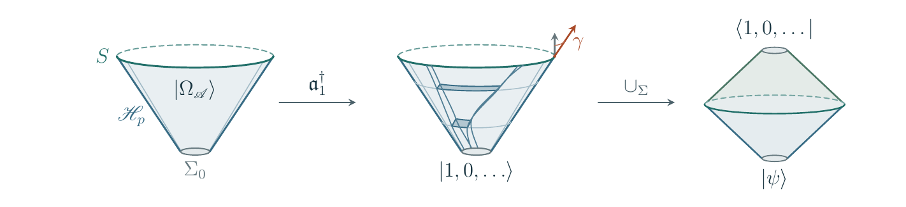

**Figure 16:** On the left we prepare a Gaussian state at fixed corner area. The middle null cone shows what an excitation by $\mathfrak{a}_{1}^{\dagger}$ might look like. Its graviton component shears the blue area element, while its edge mode component is a fluctuation of the relative boost angle $\gamma$ between the null frames at $S$. On the right we glue the reflected excitation to a normalized $|\psi\rangle$ along $\Sigma$. Their squared overlap is the probability $p=|\langle 1,0,\ldots|\psi\rangle|^{2}$.

We obtain the GNS Hilbert space $\mathcal{H}_{\omega}$ by identifying preparations whose difference has zero norm in (4.16) and completing in this inner product. Each $a\in\mathcal{A}$ acts by left multiplication, $\pi_{\omega}(a)|b\rangle=|ab\rangle$. For incoming $a$, the map $a|\Omega_{\mathscr{A}}\rangle\mapsto|a\rangle$ preserves inner products by (4.16) and embeds $\mathcal{K}_{\mathscr{A}}$ in $\mathcal{H}_{\omega}$. Taking $a=\mathbf{1}$ identifies $|\Omega_{\mathscr{A}}\rangle$ with the vector $|\mathbf{1}\rangle$ prepared with no insertion. Since $|a\rangle=\pi_{\omega}(a)|\Omega_{\mathscr{A}}\rangle$ and products of the source unitaries and their adjoints span a dense subalgebra, $\mathcal{H}_{\omega}$ is the closed span of the spaces $\pi_{\omega}(a)\mathcal{K}_{\mathscr{A}}$ as $a$ ranges over these products. In particular, $\mathcal{H}_{\omega}$ is infinite dimensional before we restrict the clock readings. Moreover, $\omega$ is pure, so the algebra acts irreducibly and

$$
\displaystyle\pi_{\omega}(\mathcal{A})^{\prime\prime}=\mathcal{B}(\mathcal{H}_{\omega}). \tag{4.17}
$$

The von Neumann algebra generated in this representation is therefore a type I factor. For states prepared by cobordisms, gluing one to the reflection of the other computes their overlap in (4.16), with reflection acting as the adjoint.

To time evolve $|b\rangle$ between two caps, we insert the real valued deformation $V_{\mathscr{M}}=-\int_{t_{i}}^{t_{f}}H_{c}\,\mathrm{d}t$ of $I_{0}$. When $I_{0}+V_{\mathscr{M}}$ defines an action on the same reduced phase space as $I_{0}$, with associated boundary terms and constraints $\mathfrak{S}=\mathfrak{T}=0$, $U_{\mathscr{M}}=S_{I_{0}}(V_{\mathscr{M}})$ is a unitary in $\mathcal{A}$. Using (4.16) to evaluate the norm of $U_{\mathscr{M}}b$, we find

$$
\displaystyle\big\|\,|U_{\mathscr{M}}b\rangle\big\|_{\omega}^{2}=\omega(b^{\dagger}U_{\mathscr{M}}^{\dagger}U_{\mathscr{M}}b)=\omega(b^{\dagger}b). \tag{4.18}
$$

Multiplication by $U_{\mathscr{M}}$ therefore preserves null states and extends by continuity to $\mathcal{H}_{\omega}$, with inverse multiplication by $U_{\mathscr{M}}^{\dagger}$. This establishes exact unitary time evolution under a finite displacement of the cap in each GNS representation (Figure 17). In particular, the states $U_{\mathscr{M}}|\bm{n}\rangle$ form an orthonormal basis of $U_{\mathscr{M}}\mathcal{K}_{\mathscr{A}}$ on the final cap.

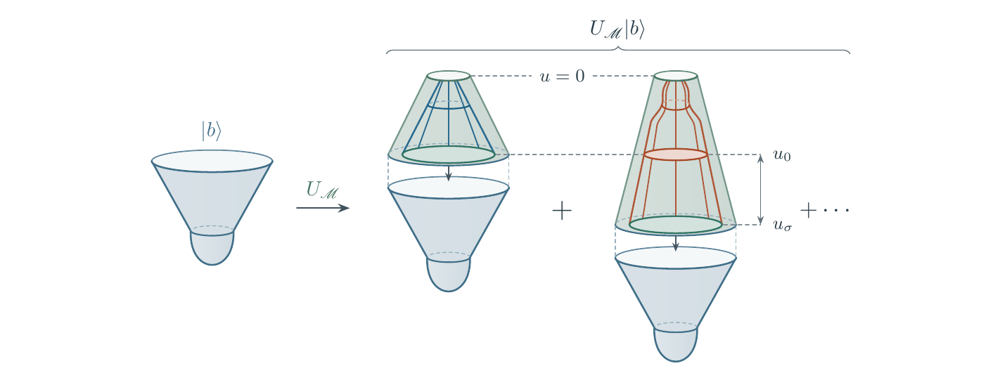

**Figure 17:** After gluing $\mathscr{M}$ to $|b\rangle$, the outgoing state $U_{\mathscr{M}}|b\rangle$ can be a superposition of different gravitational clock readings. With the initial area element and expansion held fixed, the shear free null generator (blue) reaches $S$ at $u_{0}$ and the sheared null generator (red) reaches the same corner area element at $u_{\sigma}>u_{0}$ by (3.27).

In any GNS representation we can therefore use (4.16) to evaluate the overlap of $|U_{\mathscr{M}}b\rangle$ with an outgoing state $|a\rangle$ and, by the Born rule, the probability of an outcome $0\leq\widehat{E}\leq\widehat{1}$,

$$
\displaystyle\langle a|U_{\mathscr{M}}|b\rangle=\omega(a^{\dagger}U_{\mathscr{M}}b), \tag{4.19a}
$$

$$
\displaystyle p(\widehat{E}\mid\mathscr{M},b)=\omega(b^{\dagger}U_{\mathscr{M}}^{\dagger}\widehat{E}U_{\mathscr{M}}b), \tag{4.19b}
$$

where $\omega(b^{\dagger}b)=1$. Interference between states and the sum over intermediate states therefore use one and the same inner product. Moreover, inserting a complete basis of states at each intermediate cap yields (4.5), as in Section 4.4.

For boundary states sharply peaked about smooth classical data, $\langle\widehat{g}_{ab}\rangle\to g_{0\,ab}$ as $\hbar\to 0$, with $G_{ab}[g_{0}]+\Lambda g_{0\,ab}=0$ (Section 6). Gluing joins these solutions across successive caps (Figure 19), so in this limit a clock measures proper time along its worldline in the resulting spacetime.

### 4.3 Quantization of boundary observables

When holding fixed the corner area $\mathscr{A}$, we find that a sheared null cone takes a larger clock reading to reach $S$ than a shear free one with the same initial area element and expansion. Hence, given the quantum state will generically be a superposition over gravitons, an upper limit on the reading restricts the set of graviton states that we can prepare. For the classical relation (3.27) to bound the spectrum of $\widehat{\mathscr{A}}$, the shear contribution $\widehat{\Xi}_{y}(v)$ must remain nonnegative as an operator.

To quantize $\Xi_{y}(v)$ in (3.26c), we express $(\partial_{s}\bar{q})^{AB}$ and $\partial_{s}\bar{q}_{AB}$ in canonical variables $\phi^{I}$ before choosing an ordering for their product. For real valued smearings $\lambda,\lambda^{\prime}$ with symplectic pairing $\lambda_{I}J^{IJ}\lambda^{\prime}_{J}$, the inverse reduced symplectic form $J^{IJ}$ fixes the Weyl relations,

$$
\displaystyle D(\lambda)=e^{i\lambda_{I}\widehat{\phi}^{I}},\ D(\lambda)D(\lambda^{\prime})=e^{-i\hbar\lambda_{I}J^{IJ}\lambda^{\prime}_{J}/2}D(\lambda+\lambda^{\prime}). \tag{4.20}
$$

Derivatives of $D(\lambda)$ at $\lambda=0$ along smooth smearings yield symmetrized products of the corresponding field operators on their common domain in $\mathcal{K}_{\mathscr{A}}$ [67]. For a function $f$ of the boundary fields, we express $f\circ\iota_{t}$ in canonical variables and use Weyl ordering wherever the smeared products are defined. Since $\mathfrak{C}_{A}\circ\iota_{t}=0$, the tetrad, metric and volume form in each insertion refer to the same solution $\mathfrak{h}=\iota_{t}(\phi)$.

To express the shear term in $\widehat{\Xi}_{y}(v)$ as a sum of squares, we write the conformal metric in terms of two independent components $z^{1},z^{2}$ and evaluate the metric on two variations,

$$
\displaystyle\bar{q}_{AB}=\begin{pmatrix}e^{z^{1}}&e^{z^{1}}z^{2}\\ e^{z^{1}}z^{2}&e^{-z^{1}}+e^{z^{1}}(z^{2})^{2}\end{pmatrix}, \tag{4.21a}
$$

$$
\displaystyle\mathsf{g}_{\alpha\beta}\delta z^{\alpha}\delta^{\prime}z^{\beta}=\frac{1}{2}\bar{q}^{AC}\bar{q}^{BD}\delta\bar{q}_{AB}\,\delta^{\prime}\bar{q}_{CD}, \tag{4.21b}
$$

$$
\displaystyle(\mathsf{g}_{\alpha\beta})=\operatorname{diag}(1,\exp(2z^{1})). \tag{4.21c}
$$

Defining $\widehat{z}^{1}=\mathcal{Q}(z^{1})$, $\widehat{z}^{2}=\mathcal{Q}(z^{2})$ we find that

$$
\widehat{\Xi}_{y}(v)=\frac{1}{4}\int_{\epsilon}^{v}s\left[(\partial_{s}\widehat{z}^{1})^{\dagger}\partial_{s}\widehat{z}^{1}+(\partial_{s}\widehat{z}^{2})^{\dagger}e^{2\widehat{z}^{1}}\partial_{s}\widehat{z}^{2}\right]\mathrm{d}s, \tag{4.22}
$$

which is nonnegative since $e^{2\widehat{z}^{1}}$ is positive.

To average the clock in (3.27) over generators, we must also account for how the area of $S$ is distributed among them. At fixed $\mathscr{A}$, a real valued function $f_{S}$ on $S$ specifies $\mathrm{d}A=\varrho_{S}^{2}\bm{\epsilon}_{0}$ through

$$
\varrho_{S}(y)^{2}=\frac{\mathscr{A}\exp(f_{S}(y))}{\int_{S}\exp(f_{S}(y^{\prime}))\bm{\epsilon}_{0}(y^{\prime})}. \tag{4.23}
$$

With $\widehat{\mathscr{A}}=\mathscr{A}\widehat{1}$ and $\widehat{f}_{S}(y)=\mathcal{Q}(f_{S}(y))$, we use the normalization

$$
\widehat{w}_{y}=\left[\int_{S}e^{\widehat{f}_{S}(y^{\prime})}\bm{\epsilon}_{0}(y^{\prime})\right]^{-1/2}e^{\widehat{f}_{S}(y)}\left[\int_{S}e^{\widehat{f}_{S}(y^{\prime})}\bm{\epsilon}_{0}(y^{\prime})\right]^{-1/2}, \tag{4.24a}
$$

$$
\widehat{\varrho}_{S}(y)=\sqrt{\mathscr{A}}\,\widehat{w}_{y}^{1/2},\ \int_{S}\widehat{w}_{y}\bm{\epsilon}_{0}=\widehat{1}. \tag{4.24b}
$$

Thus the density integrates to the fixed corner area,

$$
\int_{S}\widehat{\varrho}_{S}(y)^{2}\bm{\epsilon}_{0}=\mathscr{A}\widehat{1}. \tag{4.25}
$$

Using the same angular average as in the classical expression, the clock operator takes the form

$$
\widehat{\mathsf{a}}=\int_{S}\widehat{\varrho}_{S}(y)\bm{\epsilon}_{0},\ \widehat{\bar{u}}_{*}=\widehat{\mathsf{a}}^{-1/2}\left[\int_{S}\bm{\epsilon}_{0}(y)\int_{\epsilon}^{1}\mathrm{d}v\,\widehat{\varrho}_{S}(y)e^{\widehat{\Xi}_{y}(v)}\widehat{\varrho}_{S}(y)\right]\widehat{\mathsf{a}}^{-1/2}. \tag{4.26}
$$

Each factor in (4.26) acts within $\mathcal{K}_{\mathscr{A}}$, so the clock preserves the corner area on incoming wavefunctions. Inverse powers of $\widehat{\mathsf{a}}$ act on its positive spectral support, so with the ordering in (4.26), the clock is defined by the closed quadratic form [58, Chapter VI, Section 2][^14]

$$
\left\|\widehat{\bar{u}}_{*}^{1/2}|\psi\rangle\right\|^{2}=\int_{S}\bm{\epsilon}_{0}(y)\int_{\epsilon}^{1}\mathrm{d}v\,\left\|e^{\widehat{\Xi}_{y}(v)/2}\widehat{\varrho}_{S}(y)\widehat{\mathsf{a}}^{-1/2}|\psi\rangle\right\|^{2}. \tag{4.27}
$$

To insert an observable in an amplitude, we turn on $j$ and vary $H$, $\iota_{t}$ and $\chi_{t}$ as in (3.53b). For a fixed smearing function with coefficient $j$, we define for $r\geq 1$ the operator $\widehat{\mathcal{O}}_{r}=-\partial_{j}^{r}\widehat{H}[j]\big|_{j=0}$. Hence, denoting by $U_{j}$ time evolution with $\widehat{H}[j]$, expanding in $j$ yields

$$
\left.\partial_{j}^{2}(U_{0}^{\dagger}U_{j})\right|_{j=0}=\frac{i}{\hbar}\int\mathrm{d}t\,\widehat{\mathcal{O}}_{2,\mathrm{I}}(t)-\frac{2}{\hbar^{2}}\int_{t>s}\mathrm{d}t\,\mathrm{d}s\,\widehat{\mathcal{O}}_{1,\mathrm{I}}(t)\widehat{\mathcal{O}}_{1,\mathrm{I}}(s). \tag{4.28}
$$

The subscript $\mathrm{I}$ denotes the interaction picture of $\widehat{H}=\mathcal{Q}(H_{c}[0])$. Varying a time ordered product with respect to $j$ or to the metric can in general produce contact terms [51, 52], and in fact $\widehat{\mathcal{O}}_{2}$ is the contribution from varying $j$ twice at the same time.[^15]

### 4.4 Finiteness of transition amplitudes

An amplitude obtained by varying a source as in (4.28) must be independent of how we subdivide the cobordism. Introducing a spacelike cut requires us to sum over intermediate states, which can contain gravitons of arbitrarily short wavelength even when we fix the incoming and outgoing states. To see why this sum converges absolutely at finite $G_{N}$, we first determine which states we can prepare on the cut by joining neighboring subregions.

To join two neighboring subregions in space, the entangling product matches their fields at $S$ and identifies states related by a simultaneous change of frame [33, 26]. Let $\mathsf{J}_{t}$ map the matched states at time $t$ to states on the union. For two subregions prepared at fixed corner areas $\mathscr{A}_{+}$ and $\mathscr{A}_{-}$, the charges for a simultaneous uniform boost at $S$ cancel only when $\mathscr{A}_{+}=\mathscr{A}_{-}$. In the occupation number bases of Section 4.2, $\mathsf{J}_{t}$ joins superpositions of $|\bm{n}\rangle_{+}\otimes|\bm{m}\rangle_{-}$ that match the fields in (3.62) and are invariant under simultaneous surface symmetries at $S$ (Figure 18).

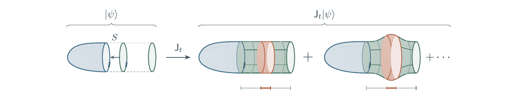

**Figure 18:** Different spatial metrics in the interior can satisfy the same matching conditions at $S$. We form $\mathsf{J}_{t}|\psi\rangle$ by joining each pair with its amplitude in $|\psi\rangle$. At fixed proper width $w$ and induced metrics on both faces, larger intermediate areas make the second collar enclose more volume.

To compose amplitudes in time, we now fix a spacelike cut $\Sigma$ and match the fields induced on the future cap of $\mathscr{M}_{1}$ to those on the past cap of $\mathscr{M}_{2}$ as in (3.29) (Figure 19).[^16] Because the two caps have opposite orientations, their terms in the action cancel. The action deformations thus add, and causal factorization (4.2e) yields $U_{\mathscr{M}_{2}\circ_{\Sigma}\mathscr{M}_{1}}=U_{\mathscr{M}_{2}}U_{\mathscr{M}_{1}}$. By unitarity (4.18), the adjoints cancel the two time evolutions upon closing the cut, inserting the identity (Figure 28a). Resolving this identity in an orthonormal basis $|e_{\alpha}\rangle$ on $\Sigma$ yields

$$
\langle\phi|U_{\mathscr{M}_{2}}U_{\mathscr{M}_{1}}|\psi\rangle=\sum_{\alpha}\langle\phi|U_{\mathscr{M}_{2}}|e_{\alpha}\rangle\langle e_{\alpha}|U_{\mathscr{M}_{1}}|\psi\rangle. \tag{4.29}
$$

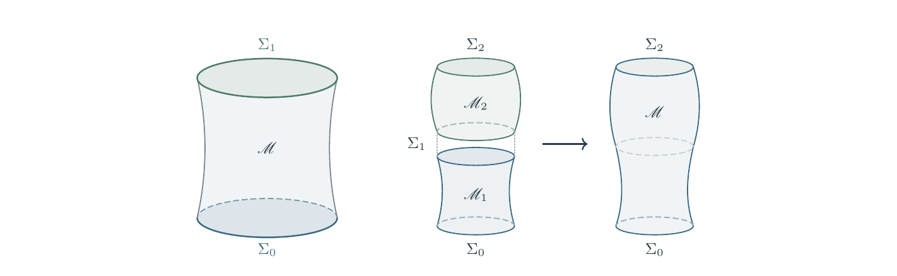

**Figure 19:** The outgoing cap $\Sigma_{1}$ on the left becomes an intermediate cut when we glue $\mathscr{M}_{2}$ to $\mathscr{M}_{1}$ by matching $\mathfrak{h}_{\Sigma_{1}}$ on their oppositely oriented caps (center). To obtain the amplitude for $\mathscr{M}_{2}\circ_{\Sigma_{1}}\mathscr{M}_{1}$ on the right, we therefore sum over states on $\Sigma_{1}$ (dashed ellipse) in the composition law (4.29), holding fixed the incoming state on $\Sigma_{0}$, the outgoing state on $\Sigma_{2}$ and the state on the rest of the boundary.

The two factors in each summand of (4.29) are components of $U_{\mathscr{M}_{2}}^{\dagger}|\phi\rangle$ and $U_{\mathscr{M}_{1}}|\psi\rangle$ in the same basis on $\Sigma$. Since time evolution preserves their norms, the Cauchy Schwarz inequality implies

$$
\sum_{\alpha}\big|\langle\phi|U_{\mathscr{M}_{2}}|e_{\alpha}\rangle\langle e_{\alpha}|U_{\mathscr{M}_{1}}|\psi\rangle\big|\leq\sqrt{\langle\phi|\phi\rangle\langle\psi|\psi\rangle}. \tag{4.30}
$$

Thus the resolution of identity in (4.29) converges absolutely in the amplitude, even when $\Sigma$ admits infinitely many independent states. Changing variables or boundary frame on $\Sigma$ acts by $V_{ji}(t)$ on the incoming factor and by $V_{ji}(t)^{-1}$ on the outgoing factor, including the phases from the boundary action (3.53a). These unitaries cancel in the sum, as shown in Appendix C.1.

For several cuts, let $P_{j}$ project onto the states included on cap $j$, and let $U_{j}$ denote time evolution between consecutive caps. Restoring the omitted states from the incoming cap onwards, we find that the state reaching cut $j$ is $U_{j}\cdots U_{1}|\psi\rangle$. Only its component orthogonal to the range of $P_{j}$ is missing there, and none of the remaining unitary operators or projections can increase the norm of this component. Thus

$$
\big|\langle\phi|(U_{m}\cdots U_{1}-U_{m}P_{m-1}U_{m-1}\cdots P_{1}U_{1})|\psi\rangle\big|\leq\sqrt{\langle\phi|\phi\rangle}\sum_{j=1}^{m-1}\|(\widehat{1}-P_{j})U_{j}\cdots U_{1}|\psi\rangle\|. \tag{4.31}
$$

On each cut, $\|(\widehat{1}-P_{j})U_{j}\cdots U_{1}|\psi\rangle\|\to 0$ as we include the remaining states, independently of the sums on the other cuts. Restoring all intermediate states therefore recovers the amplitude between $|\psi\rangle$ on the initial cap and $|\phi\rangle$ on the final cap for any finite subdivision.

The sum over intermediate states in (4.30) converges at finite $G_{N}$ even when we include gravitons of arbitrarily short wavelength. We would like to understand how summing over those wavelengths can nevertheless yield a UV divergence when we calculate an amplitude order by order in $G_{N}$. A familiar example is $2\to 2$ graviton scattering about Minkowski spacetime in four dimensional pure gravity, where the on shell amplitude at two loops requires a counterterm cubic in the Riemann tensor [41].

Even when the external momenta are small, a virtual pair can carry large and nearly opposite momenta. With a fixed UV cutoff, the magnitude $p$ of either graviton’s momentum stays bounded, so $G_{N}p^{2}/\hbar$ tends uniformly to zero as $G_{N}\to 0$. Removing the cutoff at fixed $G_{N}$ takes the integrals through $p\sim\hbar/\ell_{P}$, where the same parameter is of order unity. To see explicitly what exchanging these limits does to an amplitude, we consider a connected two point function on a single incoming null cone (Figure 20). The first insertion creates a graviton pair from the incoming Gaussian state. By choosing the phase with which the second insertion annihilates the pair, we can calculate its contribution at each radial wavelength and perform the sum at finite $G_{N}$.

**Figure 20:** The two quadratic insertions on the incoming null cone create and annihilate a graviton pair in radial mode $k$. Advancing the annihilation source by $1/(s\omega_{1})$ multiplies each graviton by $e^{-ik/s}$, yielding the pair phase $e^{-2ik/s}$.

At fixed corner area $\mathscr{A}$, we select one polarization and one real valued angular harmonic. We expand its profile along the null generators in radial modes as in Appendix D.3, so that increasing the mode number $k$ shortens the wavelength at fixed angular momentum. For the dimensionless canonical coordinates $q_{k}$ we choose the Gaussian wavefunction (4.7) with $q_{k}^{0}=p_{k}^{0}=0$, and write $s=\mathscr{A}/(4G_{N}\hbar)$. The variance has the short wavelength dependence of the squared amplitude of one graviton. After subtracting its Gaussian expectation value, the quadratic insertion creates a pair in mode $k$ with amplitude $\sqrt{2}(\Delta q_{k})^{2}$ by (4.9).

A Fourier mode proportional to $\exp(-ik\omega_{1}u)$, where $\omega_{1}$ is the fundamental radial frequency, acquires the phase $\exp(-ik/s)$ when we advance the affine parameter $u$ by $1/(s\omega_{1})$. We choose this relative phase for radial mode $k$ at the second insertion by rotating the modes with a boundary unitary. The variance, the quadratic insertion and this unitary are, respectively,

$$
(\Delta q_{k})^{2}=\frac{1}{2sk},\ \sum_{k=1}^{N}\widehat{q}_{k}^{\,2},\ \exp[-(i/s)\sum_{k=1}^{N}k\,\mathfrak{a}_{k}^{\dagger}\mathfrak{a}_{k}]. \tag{4.32}
$$

At the annihilation insertion the two phases multiply, yielding $\exp(-2ik/s)$ for either Wick contraction (Figure 21). Summing the connected overlap over modes, we obtain

$$
\lim_{N\to\infty}\sum_{j,k=1}^{N}\bigl\langle(e^{ij\mathfrak{a}_{j}^{\dagger}\mathfrak{a}_{j}/s}\,\widehat{q}_{j}^{\,2}\,e^{-ij\mathfrak{a}_{j}^{\dagger}\mathfrak{a}_{j}/s})\,\widehat{q}_{k}^{\,2}\bigr\rangle_{\!c}=\lim_{N\to\infty}2\sum_{k=1}^{N}(\Delta q_{k})^{4}e^{-2ik/s}=\frac{\operatorname{Li}_{2}(e^{-2i/s})}{2s^{2}}. \tag{4.33}
$$

$\displaystyle\kern 15.55812pt\color[rgb]{0.1484,0.2227,0.2656}\hbox to63.71pt{\vbox to32.66pt{\pgfpicture\makeatletter\hbox{\hskip 8.39049pt\lower-11.9522pt\hbox to0.0pt{\lxSVG@begingroup@{_scopebegin=1} \lxSVG@begingroup@{stroke=#263944} \lxSVG@begingroup@{fill=#263944} \lxSVG@setlinewidth{\the\pgflinewidth}\lxSVG@begingroup@{stroke-width=0.4pt} \lx@inpgf@ignorespaces\nullfont\hbox to0.0pt{\lxSVG@begingroup@{_scopebegin=1} {}{{\lx@inpgf@ignorespaces}}\lx@inpgf@ignorespaces\hbox{\hbox{{\lxSVG@begingroup@{_scopebegin=1} {{}{{}}{}{}} \lxSVG@closescope }}} {}{{\lx@inpgf@ignorespaces}}\lx@inpgf@ignorespaces\hbox{\hbox{{\lxSVG@begingroup@{_scopebegin=1} {{}{{}}{}{}} \lxSVG@closescope }}} {}{{\lx@inpgf@ignorespaces}}\lx@inpgf@ignorespaces\hbox{\hbox{{\lxSVG@begingroup@{_scopebegin=1} {{}{{}}{}{}} \lxSVG@closescope }}} {}{{\lx@inpgf@ignorespaces}}\lx@inpgf@ignorespaces\hbox{\hbox{{\lxSVG@begingroup@{_scopebegin=1} {{}{{}}{}{}} \lxSVG@closescope }}} {{}}{}{{}}{}{{}} {}{}{}{}{{{}{}}}{{\lx@inpgf@ignorespaces}}\lxSVG@begingroup@{_scopebegin=1} \lxSVG@begingroup@{stroke=#246697} \lxSVG@setlinewidth{\the\pgflinewidth}\lxSVG@begingroup@{stroke-width=0.95pt} \lx@inpgf@ignorespaces\lxSVG@roundcap\lxSVG@begingroup@{stroke-linecap=round} \lx@inpgf@ignorespaces{}\lxSVG@stroke\lxSVG@drawpath@unclipped{M 0 10.63 L 63.78 10.63}{fill:none} \lx@inpgf@ignorespaces\hbox{\hbox{{\lxSVG@begingroup@{_scopebegin=1} {{}{}{{ {}{}}}{ {}{}} {{}{{\lx@inpgf@ignorespaces}}}{{}{\lx@inpgf@ignorespaces}}{}{{}{\lx@inpgf@ignorespaces}} {\lx@inpgf@ignorespaces }{{{{\lx@inpgf@ignorespaces}}\lxSVG@begingroup@{_scopebegin=1} \lxSVG@transformcm{1.0}{0.0}{0.0}{1.0}{12.01689pt}{10.65736pt}\lxSVG@begingroup@{transform=matrix(1.0 0.0 0.0 1.0 16.63 14.75)} \pgfsys@hbox{58}\lxSVG@closescope }}} \lxSVG@closescope }}} \lxSVG@closescope {{}}{}{{}}{}{{}} {}{}{}{}{{{}{}}}{{\lx@inpgf@ignorespaces}}\lxSVG@begingroup@{_scopebegin=1} \lxSVG@begingroup@{stroke=#246697} \lxSVG@setlinewidth{\the\pgflinewidth}\lxSVG@begingroup@{stroke-width=0.95pt} \lx@inpgf@ignorespaces\lxSVG@roundcap\lxSVG@begingroup@{stroke-linecap=round} \lx@inpgf@ignorespaces{}\lxSVG@stroke\lxSVG@drawpath@unclipped{M 0 -10.63 L 63.78 -10.63}{fill:none} \lx@inpgf@ignorespaces\hbox{\hbox{{\lxSVG@begingroup@{_scopebegin=1} {{}{}{{ {}{}}}{ {}{}} {{}{{\lx@inpgf@ignorespaces}}}{{}{\lx@inpgf@ignorespaces}}{}{{}{\lx@inpgf@ignorespaces}} {\lx@inpgf@ignorespaces }{{{{\lx@inpgf@ignorespaces}}\lxSVG@begingroup@{_scopebegin=1} \lxSVG@transformcm{1.0}{0.0}{0.0}{1.0}{12.01689pt}{-4.70735pt}\lxSVG@begingroup@{transform=matrix(1.0 0.0 0.0 1.0 16.63 -6.51)} \pgfsys@hbox{58}\lxSVG@closescope }}} \lxSVG@closescope }}} \lxSVG@closescope {{}}{}{{}}{}{{{}} {\lx@inpgf@ignorespaces}{}{\lx@inpgf@ignorespaces}{}{}{}{}{} }\lxSVG@begingroup@{_scopebegin=1} \color[rgb]{0.1484,0.2227,0.2656}\lxSVG@fill\lxSVG@drawpath@unclipped{M 0 10.63 M 2.21 10.63 C 2.21 11.85 1.22 12.84 0 12.84 C -1.22 12.84 -2.21 11.85 -2.21 10.63 C -2.21 9.41 -1.22 8.42 0 8.42 C 1.22 8.42 2.21 9.41 2.21 10.63 Z M 0 10.63}{stroke:none} \lx@inpgf@ignorespaces \lxSVG@closescope {{}}{}{{}}{}{{{}} {\lx@inpgf@ignorespaces}{}{\lx@inpgf@ignorespaces}{}{}{}{}{} }\lxSVG@begingroup@{_scopebegin=1} \color[rgb]{0.1484,0.2227,0.2656}\lxSVG@fill\lxSVG@drawpath@unclipped{M 63.78 10.63 M 65.99 10.63 C 65.99 11.85 65 12.84 63.78 12.84 C 62.56 12.84 61.57 11.85 61.57 10.63 C 61.57 9.41 62.56 8.42 63.78 8.42 C 65 8.42 65.99 9.41 65.99 10.63 Z M 63.78 10.63}{stroke:none} \lx@inpgf@ignorespaces \lxSVG@closescope {{}}{{}}{{\lx@inpgf@ignorespaces}}\lx@inpgf@ignorespaces\hbox{\hbox{{\lxSVG@begingroup@{_scopebegin=1} {{}{}{{{}{}}}{{}{}} {{}{{\lx@inpgf@ignorespaces}}}{{}{\lx@inpgf@ignorespaces}}{}{{}{\lx@inpgf@ignorespaces}} {\lx@inpgf@ignorespaces }{{{{\lx@inpgf@ignorespaces}}\lxSVG@begingroup@{_scopebegin=1} \lxSVG@transformcm{1.0}{0.0}{0.0}{1.0}{-8.39049pt}{5.35695pt}\lxSVG@begingroup@{transform=matrix(1.0 0.0 0.0 1.0 -11.61 7.41)} \pgfsys@hbox{58}\lxSVG@closescope }}} \lxSVG@closescope }}} {{}}{{}}{{\lx@inpgf@ignorespaces}}\lx@inpgf@ignorespaces\hbox{\hbox{{\lxSVG@begingroup@{_scopebegin=1} {{}{}{{ {}{}}}{ {}{}} {{}{{\lx@inpgf@ignorespaces}}}{{}{\lx@inpgf@ignorespaces}}{}{{}{\lx@inpgf@ignorespaces}} {\lx@inpgf@ignorespaces }{{{{\lx@inpgf@ignorespaces}}\lxSVG@begingroup@{_scopebegin=1} \lxSVG@transformcm{1.0}{0.0}{0.0}{1.0}{49.79332pt}{4.21014pt}\lxSVG@begingroup@{transform=matrix(1.0 0.0 0.0 1.0 68.9 5.83)} \pgfsys@hbox{58}\lxSVG@closescope }}} \lxSVG@closescope }}} {{}}{}{{}}{}{{{}} {\lx@inpgf@ignorespaces}{}{\lx@inpgf@ignorespaces}{}{}{}{}{} }\lxSVG@begingroup@{_scopebegin=1} \color[rgb]{0.1484,0.2227,0.2656}\lxSVG@fill\lxSVG@drawpath@unclipped{M 0 -10.63 M 2.21 -10.63 C 2.21 -9.41 1.22 -8.42 0 -8.42 C -1.22 -8.42 -2.21 -9.41 -2.21 -10.63 C -2.21 -11.85 -1.22 -12.84 0 -12.84 C 1.22 -12.84 2.21 -11.85 2.21 -10.63 Z M 0 -10.63}{stroke:none} \lx@inpgf@ignorespaces \lxSVG@closescope {{}}{}{{}}{}{{{}} {\lx@inpgf@ignorespaces}{}{\lx@inpgf@ignorespaces}{}{}{}{}{} }\lxSVG@begingroup@{_scopebegin=1} \color[rgb]{0.1484,0.2227,0.2656}\lxSVG@fill\lxSVG@drawpath@unclipped{M 63.78 -10.63 M 65.99 -10.63 C 65.99 -9.41 65 -8.42 63.78 -8.42 C 62.56 -8.42 61.57 -9.41 61.57 -10.63 C 61.57 -11.85 62.56 -12.84 63.78 -12.84 C 65 -12.84 65.99 -11.85 65.99 -10.63 Z M 63.78 -10.63}{stroke:none} \lx@inpgf@ignorespaces \lxSVG@closescope {{}}{{}}{{\lx@inpgf@ignorespaces}}\lx@inpgf@ignorespaces\hbox{\hbox{{\lxSVG@begingroup@{_scopebegin=1} {{}{}{{{}{}}}{{}{}} {{}{{\lx@inpgf@ignorespaces}}}{{}{\lx@inpgf@ignorespaces}}{}{{}{\lx@inpgf@ignorespaces}} {\lx@inpgf@ignorespaces }{{{{\lx@inpgf@ignorespaces}}\lxSVG@begingroup@{_scopebegin=1} \lxSVG@transformcm{1.0}{0.0}{0.0}{1.0}{-8.39049pt}{-10.00777pt}\lxSVG@begingroup@{transform=matrix(1.0 0.0 0.0 1.0 -11.61 -13.85)} \pgfsys@hbox{58}\lxSVG@closescope }}} \lxSVG@closescope }}} {{}}{{}}{{\lx@inpgf@ignorespaces}}\lx@inpgf@ignorespaces\hbox{\hbox{{\lxSVG@begingroup@{_scopebegin=1} {{}{}{{ {}{}}}{ {}{}} {{}{{\lx@inpgf@ignorespaces}}}{{}{\lx@inpgf@ignorespaces}}{}{{}{\lx@inpgf@ignorespaces}} {\lx@inpgf@ignorespaces }{{{{\lx@inpgf@ignorespaces}}\lxSVG@begingroup@{_scopebegin=1} \lxSVG@transformcm{1.0}{0.0}{0.0}{1.0}{49.79332pt}{-11.15457pt}\lxSVG@begingroup@{transform=matrix(1.0 0.0 0.0 1.0 68.9 -15.43)} \pgfsys@hbox{58}\lxSVG@closescope }}} \lxSVG@closescope }}} \lxSVG@closescope {\lx@inpgf@ignorespaces}{\lx@inpgf@ignorespaces}{\lx@inpgf@ignorespaces}\hss}\lxSVG@discardpath\lxSVG@closescope \hss}}\lxSVG@closescope\endpgfpicture}}+\hbox to63.71pt{\vbox to23.9pt{\pgfpicture\makeatletter\hbox{\hskip 8.39049pt\lower-11.9522pt\hbox to0.0pt{\lxSVG@begingroup@{_scopebegin=1} \lxSVG@begingroup@{stroke=#263944} \lxSVG@begingroup@{fill=#263944} \lxSVG@setlinewidth{\the\pgflinewidth}\lxSVG@begingroup@{stroke-width=0.4pt} \lx@inpgf@ignorespaces\nullfont\hbox to0.0pt{\lxSVG@begingroup@{_scopebegin=1} {}{{\lx@inpgf@ignorespaces}}\lx@inpgf@ignorespaces\hbox{\hbox{{\lxSVG@begingroup@{_scopebegin=1} {{}{{}}{}{}} \lxSVG@closescope }}} {}{{\lx@inpgf@ignorespaces}}\lx@inpgf@ignorespaces\hbox{\hbox{{\lxSVG@begingroup@{_scopebegin=1} {{}{{}}{}{}} \lxSVG@closescope }}} {}{{\lx@inpgf@ignorespaces}}\lx@inpgf@ignorespaces\hbox{\hbox{{\lxSVG@begingroup@{_scopebegin=1} {{}{{}}{}{}} \lxSVG@closescope }}} {}{{\lx@inpgf@ignorespaces}}\lx@inpgf@ignorespaces\hbox{\hbox{{\lxSVG@begingroup@{_scopebegin=1} {{}{{}}{}{}} \lxSVG@closescope }}} {{}}{}{{}}{}{{}} {}{}\lxSVG@begingroup@{_scopebegin=1} \lxSVG@begingroup@{stroke=#246697} \lxSVG@setlinewidth{\the\pgflinewidth}\lxSVG@begingroup@{stroke-width=0.95pt} \lx@inpgf@ignorespaces\lxSVG@roundcap\lxSVG@begingroup@{stroke-linecap=round} \lx@inpgf@ignorespaces{}\lxSVG@stroke\lxSVG@drawpath@unclipped{M 0 10.63 L 63.78 -10.63}{fill:none} \lx@inpgf@ignorespaces \lxSVG@closescope {{}}{}{{}}{}{{}} {}{}{\lxSVG@begingroup@{_scopebegin=1} \lxSVG@begingroup@{_scopebegin=1} \lxSVG@begingroup@{stroke=#FFFFFF} \lxSVG@setlinewidth{\the\pgflinewidth}\lxSVG@begingroup@{stroke-width=3.0pt} \lx@inpgf@ignorespaces{}\lxSVG@stroke\lxSVG@drawpath@unclipped{M 0 -10.63 L 63.78 10.63}{fill:none} \lx@inpgf@ignorespaces \lxSVG@closescope \lxSVG@closescope }\lxSVG@begingroup@{_scopebegin=1} \lxSVG@begingroup@{stroke=#246697} \lxSVG@setlinewidth{\the\pgflinewidth}\lxSVG@begingroup@{stroke-width=0.95pt} \lx@inpgf@ignorespaces\lxSVG@roundcap\lxSVG@begingroup@{stroke-linecap=round} \lx@inpgf@ignorespaces{}\lxSVG@stroke\lxSVG@drawpath@unclipped{M 0 -10.63 L 63.78 10.63}{fill:none} \lx@inpgf@ignorespaces \lxSVG@closescope {{}}{}{{}}{}{{{}} {\lx@inpgf@ignorespaces}{}{\lx@inpgf@ignorespaces}{}{}{}{}{} }\lxSVG@begingroup@{_scopebegin=1} \color[rgb]{0.1484,0.2227,0.2656}\lxSVG@fill\lxSVG@drawpath@unclipped{M 0 10.63 M 2.21 10.63 C 2.21 11.85 1.22 12.84 0 12.84 C -1.22 12.84 -2.21 11.85 -2.21 10.63 C -2.21 9.41 -1.22 8.42 0 8.42 C 1.22 8.42 2.21 9.41 2.21 10.63 Z M 0 10.63}{stroke:none} \lx@inpgf@ignorespaces \lxSVG@closescope {{}}{}{{}}{}{{{}} {\lx@inpgf@ignorespaces}{}{\lx@inpgf@ignorespaces}{}{}{}{}{} }\lxSVG@begingroup@{_scopebegin=1} \color[rgb]{0.1484,0.2227,0.2656}\lxSVG@fill\lxSVG@drawpath@unclipped{M 63.78 10.63 M 65.99 10.63 C 65.99 11.85 65 12.84 63.78 12.84 C 62.56 12.84 61.57 11.85 61.57 10.63 C 61.57 9.41 62.56 8.42 63.78 8.42 C 65 8.42 65.99 9.41 65.99 10.63 Z M 63.78 10.63}{stroke:none} \lx@inpgf@ignorespaces \lxSVG@closescope {{}}{{}}{{\lx@inpgf@ignorespaces}}\lx@inpgf@ignorespaces\hbox{\hbox{{\lxSVG@begingroup@{_scopebegin=1} {{}{}{{{}{}}}{{}{}} {{}{{\lx@inpgf@ignorespaces}}}{{}{\lx@inpgf@ignorespaces}}{}{{}{\lx@inpgf@ignorespaces}} {\lx@inpgf@ignorespaces }{{{{\lx@inpgf@ignorespaces}}\lxSVG@begingroup@{_scopebegin=1} \lxSVG@transformcm{1.0}{0.0}{0.0}{1.0}{-8.39049pt}{5.35695pt}\lxSVG@begingroup@{transform=matrix(1.0 0.0 0.0 1.0 -11.61 7.41)} \pgfsys@hbox{58}\lxSVG@closescope }}} \lxSVG@closescope }}} {{}}{{}}{{\lx@inpgf@ignorespaces}}\lx@inpgf@ignorespaces\hbox{\hbox{{\lxSVG@begingroup@{_scopebegin=1} {{}{}{{ {}{}}}{ {}{}} {{}{{\lx@inpgf@ignorespaces}}}{{}{\lx@inpgf@ignorespaces}}{}{{}{\lx@inpgf@ignorespaces}} {\lx@inpgf@ignorespaces }{{{{\lx@inpgf@ignorespaces}}\lxSVG@begingroup@{_scopebegin=1} \lxSVG@transformcm{1.0}{0.0}{0.0}{1.0}{49.79332pt}{4.21014pt}\lxSVG@begingroup@{transform=matrix(1.0 0.0 0.0 1.0 68.9 5.83)} \pgfsys@hbox{58}\lxSVG@closescope }}} \lxSVG@closescope }}} {{}}{}{{}}{}{{{}} {\lx@inpgf@ignorespaces}{}{\lx@inpgf@ignorespaces}{}{}{}{}{} }\lxSVG@begingroup@{_scopebegin=1} \color[rgb]{0.1484,0.2227,0.2656}\lxSVG@fill\lxSVG@drawpath@unclipped{M 0 -10.63 M 2.21 -10.63 C 2.21 -9.41 1.22 -8.42 0 -8.42 C -1.22 -8.42 -2.21 -9.41 -2.21 -10.63 C -2.21 -11.85 -1.22 -12.84 0 -12.84 C 1.22 -12.84 2.21 -11.85 2.21 -10.63 Z M 0 -10.63}{stroke:none} \lx@inpgf@ignorespaces \lxSVG@closescope {{}}{}{{}}{}{{{}} {\lx@inpgf@ignorespaces}{}{\lx@inpgf@ignorespaces}{}{}{}{}{} }\lxSVG@begingroup@{_scopebegin=1} \color[rgb]{0.1484,0.2227,0.2656}\lxSVG@fill\lxSVG@drawpath@unclipped{M 63.78 -10.63 M 65.99 -10.63 C 65.99 -9.41 65 -8.42 63.78 -8.42 C 62.56 -8.42 61.57 -9.41 61.57 -10.63 C 61.57 -11.85 62.56 -12.84 63.78 -12.84 C 65 -12.84 65.99 -11.85 65.99 -10.63 Z M 63.78 -10.63}{stroke:none} \lx@inpgf@ignorespaces \lxSVG@closescope {{}}{{}}{{\lx@inpgf@ignorespaces}}\lx@inpgf@ignorespaces\hbox{\hbox{{\lxSVG@begingroup@{_scopebegin=1} {{}{}{{{}{}}}{{}{}} {{}{{\lx@inpgf@ignorespaces}}}{{}{\lx@inpgf@ignorespaces}}{}{{}{\lx@inpgf@ignorespaces}} {\lx@inpgf@ignorespaces }{{{{\lx@inpgf@ignorespaces}}\lxSVG@begingroup@{_scopebegin=1} \lxSVG@transformcm{1.0}{0.0}{0.0}{1.0}{-8.39049pt}{-10.00777pt}\lxSVG@begingroup@{transform=matrix(1.0 0.0 0.0 1.0 -11.61 -13.85)} \pgfsys@hbox{58}\lxSVG@closescope }}} \lxSVG@closescope }}} {{}}{{}}{{\lx@inpgf@ignorespaces}}\lx@inpgf@ignorespaces\hbox{\hbox{{\lxSVG@begingroup@{_scopebegin=1} {{}{}{{ {}{}}}{ {}{}} {{}{{\lx@inpgf@ignorespaces}}}{{}{\lx@inpgf@ignorespaces}}{}{{}{\lx@inpgf@ignorespaces}} {\lx@inpgf@ignorespaces }{{{{\lx@inpgf@ignorespaces}}\lxSVG@begingroup@{_scopebegin=1} \lxSVG@transformcm{1.0}{0.0}{0.0}{1.0}{49.79332pt}{-11.15457pt}\lxSVG@begingroup@{transform=matrix(1.0 0.0 0.0 1.0 68.9 -15.43)} \pgfsys@hbox{58}\lxSVG@closescope }}} \lxSVG@closescope }}} \lxSVG@closescope {\lx@inpgf@ignorespaces}{\lx@inpgf@ignorespaces}{\lx@inpgf@ignorespaces}\hss}\lxSVG@discardpath\lxSVG@closescope \hss}}\lxSVG@closescope\endpgfpicture}}=2\,\delta_{jk}(\Delta q_{k})^{4}e^{-2ik/s}\kern-15.55812pt$

**Figure 21:** Each line carries $\delta_{jk}(\Delta q_{k})^{2}e^{-ik/s}$, so the two connected Wick contractions have equal weight.

This sum converges absolutely for every $s>0$.[^17]

At fixed $\mathscr{A}$ each variance $1/(2sk)$ is of order $G_{N}$. To obtain the cubic term before taking $N\to\infty$, we expand the phase on one line (Figure 22),

$$
\frac{G_{N}^{3}}{3!}\left.\frac{\partial^{3}}{\partial G_{N}^{3}}\left[\frac{1}{2s^{2}}\sum_{k=1}^{N}\frac{e^{-2ik/s}}{k^{2}}\right]\right|_{G_{N}=0}=-\frac{i}{s^{3}}\sum_{k=1}^{N}\frac{1}{k}=-\frac{i}{s^{3}}\bigl[\log N+O(1)\bigr]. \tag{4.34}
$$

$\displaystyle 2\left(\hbox to64.54pt{\vbox to41.52pt{\pgfpicture\makeatletter\hbox{\hskip 9.22084pt\lower-19.15735pt\hbox to0.0pt{\lxSVG@begingroup@{_scopebegin=1} \lxSVG@begingroup@{stroke=#263944} \lxSVG@begingroup@{fill=#263944} \lxSVG@setlinewidth{\the\pgflinewidth}\lxSVG@begingroup@{stroke-width=0.4pt} \lx@inpgf@ignorespaces\nullfont\hbox to0.0pt{\lxSVG@begingroup@{_scopebegin=1} {}{{\lx@inpgf@ignorespaces}}\lx@inpgf@ignorespaces\hbox{\hbox{{\lxSVG@begingroup@{_scopebegin=1} {{}{{}}{}{}} \lxSVG@closescope }}} {}{{\lx@inpgf@ignorespaces}}\lx@inpgf@ignorespaces\hbox{\hbox{{\lxSVG@begingroup@{_scopebegin=1} {{}{{}}{}{}} \lxSVG@closescope }}} {}{{\lx@inpgf@ignorespaces}}\lx@inpgf@ignorespaces\hbox{\hbox{{\lxSVG@begingroup@{_scopebegin=1} {{}{{}}{}{}} \lxSVG@closescope }}} {}{{\lx@inpgf@ignorespaces}}\lx@inpgf@ignorespaces\hbox{\hbox{{\lxSVG@begingroup@{_scopebegin=1} {{}{{}}{}{}} \lxSVG@closescope }}} {{}}{}{{}}{}{{}} {}{}{}{}{{{}{}}}{{\lx@inpgf@ignorespaces}}\lxSVG@begingroup@{_scopebegin=1} \lxSVG@begingroup@{stroke=#246697} \lxSVG@setlinewidth{\the\pgflinewidth}\lxSVG@begingroup@{stroke-width=0.95pt} \lx@inpgf@ignorespaces\lxSVG@roundcap\lxSVG@begingroup@{stroke-linecap=round} \lx@inpgf@ignorespaces{}\lxSVG@stroke\lxSVG@drawpath@unclipped{M 0 10.63 L 63.78 10.63}{fill:none} \lx@inpgf@ignorespaces\hbox{\hbox{{\lxSVG@begingroup@{_scopebegin=1} {{}{}{{ {}{}}}{ {}{}} {{}{{\lx@inpgf@ignorespaces}}}{{}{\lx@inpgf@ignorespaces}}{}{{}{\lx@inpgf@ignorespaces}} {\lx@inpgf@ignorespaces }{{{{\lx@inpgf@ignorespaces}}\lxSVG@begingroup@{_scopebegin=1} \lxSVG@transformcm{1.0}{0.0}{0.0}{1.0}{9.8322pt}{14.40736pt}\lxSVG@begingroup@{transform=matrix(1.0 0.0 0.0 1.0 13.6 19.94)} \pgfsys@hbox{58}\lxSVG@closescope }}} \lxSVG@closescope }}} \lxSVG@closescope {{}}{}{{}}{}{{}} {}{}{}{}{{{}{}}}{{\lx@inpgf@ignorespaces}}\lxSVG@begingroup@{_scopebegin=1} \lxSVG@begingroup@{stroke=#246697} \lxSVG@setlinewidth{\the\pgflinewidth}\lxSVG@begingroup@{stroke-width=0.95pt} \lx@inpgf@ignorespaces\lxSVG@roundcap\lxSVG@begingroup@{stroke-linecap=round} \lx@inpgf@ignorespaces{}\lxSVG@stroke\lxSVG@drawpath@unclipped{M 0 -10.63 L 63.78 -10.63}{fill:none} \lx@inpgf@ignorespaces\hbox{\hbox{{\lxSVG@begingroup@{_scopebegin=1} {{}{}{{ {}{}}}{ {}{}} {{}{{\lx@inpgf@ignorespaces}}}{{}{\lx@inpgf@ignorespaces}}{}{{}{\lx@inpgf@ignorespaces}} {\lx@inpgf@ignorespaces }{{{{\lx@inpgf@ignorespaces}}\lxSVG@begingroup@{_scopebegin=1} \lxSVG@transformcm{1.0}{0.0}{0.0}{1.0}{20.73418pt}{-17.95735pt}\lxSVG@begingroup@{transform=matrix(1.0 0.0 0.0 1.0 28.69 -24.85)} \pgfsys@hbox{58}\lxSVG@closescope }}} \lxSVG@closescope }}} \lxSVG@closescope {{}}{}{{}}{}{{}} {}{}{}{}{{{}{}}}\lx@inpgf@ignorespaces\hbox{\hbox{{\lxSVG@begingroup@{_scopebegin=1} {{}{{}}{}{}} \lxSVG@closescope }}} \lxSVG@begingroup@{_scopebegin=1} {{}}{{}} {}{{}}{} {}{}{}{{}}{} {}{}\lxSVG@begingroup@{_scopebegin=1} \color[rgb]{0.6641,0.293,0.1523}\lxSVG@setlinewidth{\the\pgflinewidth}\lxSVG@begingroup@{stroke-width=0.95pt} \lx@inpgf@ignorespaces\lxSVG@roundcap\lxSVG@begingroup@{stroke-linecap=round} \lx@inpgf@ignorespaces{}\lxSVG@stroke\lxSVG@drawpath@unclipped{M 29.02 7.76 L 34.76 13.5 M 29.02 13.5 L 34.76 7.76}{fill:none} \lx@inpgf@ignorespaces \lxSVG@closescope \lxSVG@closescope {{}}{}{{}}{}{{{}} {\lx@inpgf@ignorespaces}{}{\lx@inpgf@ignorespaces}{}{}{}{}{} }\lxSVG@begingroup@{_scopebegin=1} \color[rgb]{0.1484,0.2227,0.2656}\lxSVG@fill\lxSVG@drawpath@unclipped{M 0 10.63 M 2.21 10.63 C 2.21 11.85 1.22 12.84 0 12.84 C -1.22 12.84 -2.21 11.85 -2.21 10.63 C -2.21 9.41 -1.22 8.42 0 8.42 C 1.22 8.42 2.21 9.41 2.21 10.63 Z M 0 10.63}{stroke:none} \lx@inpgf@ignorespaces \lxSVG@closescope {{}}{}{{}}{}{{{}} {\lx@inpgf@ignorespaces}{}{\lx@inpgf@ignorespaces}{}{}{}{}{} }\lxSVG@begingroup@{_scopebegin=1} \color[rgb]{0.1484,0.2227,0.2656}\lxSVG@fill\lxSVG@drawpath@unclipped{M 63.78 10.63 M 65.99 10.63 C 65.99 11.85 65 12.84 63.78 12.84 C 62.56 12.84 61.57 11.85 61.57 10.63 C 61.57 9.41 62.56 8.42 63.78 8.42 C 65 8.42 65.99 9.41 65.99 10.63 Z M 63.78 10.63}{stroke:none} \lx@inpgf@ignorespaces \lxSVG@closescope {{}}{{}}{{\lx@inpgf@ignorespaces}}\lx@inpgf@ignorespaces\hbox{\hbox{{\lxSVG@begingroup@{_scopebegin=1} {{}{}{{{}{}}}{{}{}} {{}{{\lx@inpgf@ignorespaces}}}{{}{\lx@inpgf@ignorespaces}}{}{{}{\lx@inpgf@ignorespaces}} {\lx@inpgf@ignorespaces }{{{{\lx@inpgf@ignorespaces}}\lxSVG@begingroup@{_scopebegin=1} \lxSVG@transformcm{1.0}{0.0}{0.0}{1.0}{-9.22084pt}{4.21014pt}\lxSVG@begingroup@{transform=matrix(1.0 0.0 0.0 1.0 -12.76 5.83)} \pgfsys@hbox{58}\lxSVG@closescope }}} \lxSVG@closescope }}} {{}}{{}}{{\lx@inpgf@ignorespaces}}\lx@inpgf@ignorespaces\hbox{\hbox{{\lxSVG@begingroup@{_scopebegin=1} {{}{}{{ {}{}}}{ {}{}} {{}{{\lx@inpgf@ignorespaces}}}{{}{\lx@inpgf@ignorespaces}}{}{{}{\lx@inpgf@ignorespaces}} {\lx@inpgf@ignorespaces }{{{{\lx@inpgf@ignorespaces}}\lxSVG@begingroup@{_scopebegin=1} \lxSVG@transformcm{1.0}{0.0}{0.0}{1.0}{49.79332pt}{4.21014pt}\lxSVG@begingroup@{transform=matrix(1.0 0.0 0.0 1.0 68.9 5.83)} \pgfsys@hbox{58}\lxSVG@closescope }}} \lxSVG@closescope }}} {{}}{}{{}}{}{{{}} {\lx@inpgf@ignorespaces}{}{\lx@inpgf@ignorespaces}{}{}{}{}{} }\lxSVG@begingroup@{_scopebegin=1} \color[rgb]{0.1484,0.2227,0.2656}\lxSVG@fill\lxSVG@drawpath@unclipped{M 0 -10.63 M 2.21 -10.63 C 2.21 -9.41 1.22 -8.42 0 -8.42 C -1.22 -8.42 -2.21 -9.41 -2.21 -10.63 C -2.21 -11.85 -1.22 -12.84 0 -12.84 C 1.22 -12.84 2.21 -11.85 2.21 -10.63 Z M 0 -10.63}{stroke:none} \lx@inpgf@ignorespaces \lxSVG@closescope {{}}{}{{}}{}{{{}} {\lx@inpgf@ignorespaces}{}{\lx@inpgf@ignorespaces}{}{}{}{}{} }\lxSVG@begingroup@{_scopebegin=1} \color[rgb]{0.1484,0.2227,0.2656}\lxSVG@fill\lxSVG@drawpath@unclipped{M 63.78 -10.63 M 65.99 -10.63 C 65.99 -9.41 65 -8.42 63.78 -8.42 C 62.56 -8.42 61.57 -9.41 61.57 -10.63 C 61.57 -11.85 62.56 -12.84 63.78 -12.84 C 65 -12.84 65.99 -11.85 65.99 -10.63 Z M 63.78 -10.63}{stroke:none} \lx@inpgf@ignorespaces \lxSVG@closescope {{}}{{}}{{\lx@inpgf@ignorespaces}}\lx@inpgf@ignorespaces\hbox{\hbox{{\lxSVG@begingroup@{_scopebegin=1} {{}{}{{{}{}}}{{}{}} {{}{{\lx@inpgf@ignorespaces}}}{{}{\lx@inpgf@ignorespaces}}{}{{}{\lx@inpgf@ignorespaces}} {\lx@inpgf@ignorespaces }{{{{\lx@inpgf@ignorespaces}}\lxSVG@begingroup@{_scopebegin=1} \lxSVG@transformcm{1.0}{0.0}{0.0}{1.0}{-9.22084pt}{-11.15457pt}\lxSVG@begingroup@{transform=matrix(1.0 0.0 0.0 1.0 -12.76 -15.43)} \pgfsys@hbox{58}\lxSVG@closescope }}} \lxSVG@closescope }}} {{}}{{}}{{\lx@inpgf@ignorespaces}}\lx@inpgf@ignorespaces\hbox{\hbox{{\lxSVG@begingroup@{_scopebegin=1} {{}{}{{ {}{}}}{ {}{}} {{}{{\lx@inpgf@ignorespaces}}}{{}{\lx@inpgf@ignorespaces}}{}{{}{\lx@inpgf@ignorespaces}} {\lx@inpgf@ignorespaces }{{{{\lx@inpgf@ignorespaces}}\lxSVG@begingroup@{_scopebegin=1} \lxSVG@transformcm{1.0}{0.0}{0.0}{1.0}{49.79332pt}{-11.15457pt}\lxSVG@begingroup@{transform=matrix(1.0 0.0 0.0 1.0 68.9 -15.43)} \pgfsys@hbox{58}\lxSVG@closescope }}} \lxSVG@closescope }}} \lxSVG@closescope {\lx@inpgf@ignorespaces}{\lx@inpgf@ignorespaces}{\lx@inpgf@ignorespaces}\hss}\lxSVG@discardpath\lxSVG@closescope \hss}}\lxSVG@closescope\endpgfpicture}}+\hbox to64.54pt{\vbox to41.52pt{\pgfpicture\makeatletter\hbox{\hskip 9.22084pt\lower-22.35736pt\hbox to0.0pt{\lxSVG@begingroup@{_scopebegin=1} \lxSVG@begingroup@{stroke=#263944} \lxSVG@begingroup@{fill=#263944} \lxSVG@setlinewidth{\the\pgflinewidth}\lxSVG@begingroup@{stroke-width=0.4pt} \lx@inpgf@ignorespaces\nullfont\hbox to0.0pt{\lxSVG@begingroup@{_scopebegin=1} {}{{\lx@inpgf@ignorespaces}}\lx@inpgf@ignorespaces\hbox{\hbox{{\lxSVG@begingroup@{_scopebegin=1} {{}{{}}{}{}} \lxSVG@closescope }}} {}{{\lx@inpgf@ignorespaces}}\lx@inpgf@ignorespaces\hbox{\hbox{{\lxSVG@begingroup@{_scopebegin=1} {{}{{}}{}{}} \lxSVG@closescope }}} {}{{\lx@inpgf@ignorespaces}}\lx@inpgf@ignorespaces\hbox{\hbox{{\lxSVG@begingroup@{_scopebegin=1} {{}{{}}{}{}} \lxSVG@closescope }}} {}{{\lx@inpgf@ignorespaces}}\lx@inpgf@ignorespaces\hbox{\hbox{{\lxSVG@begingroup@{_scopebegin=1} {{}{{}}{}{}} \lxSVG@closescope }}} {{}}{}{{}}{}{{}} {}{}{}{}{{{}{}}}{{\lx@inpgf@ignorespaces}}\lxSVG@begingroup@{_scopebegin=1} \lxSVG@begingroup@{stroke=#246697} \lxSVG@setlinewidth{\the\pgflinewidth}\lxSVG@begingroup@{stroke-width=0.95pt} \lx@inpgf@ignorespaces\lxSVG@roundcap\lxSVG@begingroup@{stroke-linecap=round} \lx@inpgf@ignorespaces{}\lxSVG@stroke\lxSVG@drawpath@unclipped{M 0 -10.63 L 63.78 -10.63}{fill:none} \lx@inpgf@ignorespaces\hbox{\hbox{{\lxSVG@begingroup@{_scopebegin=1} {{}{}{{ {}{}}}{ {}{}} {{}{{\lx@inpgf@ignorespaces}}}{{}{\lx@inpgf@ignorespaces}}{}{{}{\lx@inpgf@ignorespaces}} {\lx@inpgf@ignorespaces }{{{{\lx@inpgf@ignorespaces}}\lxSVG@begingroup@{_scopebegin=1} \lxSVG@transformcm{1.0}{0.0}{0.0}{1.0}{9.8322pt}{-18.90736pt}\lxSVG@begingroup@{transform=matrix(1.0 0.0 0.0 1.0 13.6 -26.16)} \pgfsys@hbox{58}\lxSVG@closescope }}} \lxSVG@closescope }}} \lxSVG@closescope {{}}{}{{}}{}{{}} {}{}{}{}{{{}{}}}{{\lx@inpgf@ignorespaces}}\lxSVG@begingroup@{_scopebegin=1} \lxSVG@begingroup@{stroke=#246697} \lxSVG@setlinewidth{\the\pgflinewidth}\lxSVG@begingroup@{stroke-width=0.95pt} \lx@inpgf@ignorespaces\lxSVG@roundcap\lxSVG@begingroup@{stroke-linecap=round} \lx@inpgf@ignorespaces{}\lxSVG@stroke\lxSVG@drawpath@unclipped{M 0 10.63 L 63.78 10.63}{fill:none} \lx@inpgf@ignorespaces\hbox{\hbox{{\lxSVG@begingroup@{_scopebegin=1} {{}{}{{ {}{}}}{ {}{}} {{}{{\lx@inpgf@ignorespaces}}}{{}{\lx@inpgf@ignorespaces}}{}{{}{\lx@inpgf@ignorespaces}} {\lx@inpgf@ignorespaces }{{{{\lx@inpgf@ignorespaces}}\lxSVG@begingroup@{_scopebegin=1} \lxSVG@transformcm{1.0}{0.0}{0.0}{1.0}{20.73418pt}{12.15736pt}\lxSVG@begingroup@{transform=matrix(1.0 0.0 0.0 1.0 28.69 16.82)} \pgfsys@hbox{58}\lxSVG@closescope }}} \lxSVG@closescope }}} \lxSVG@closescope {{}}{}{{}}{}{{}} {}{}{}{}{{{}{}}}\lx@inpgf@ignorespaces\hbox{\hbox{{\lxSVG@begingroup@{_scopebegin=1} {{}{{}}{}{}} \lxSVG@closescope }}} \lxSVG@begingroup@{_scopebegin=1} {{}}{{}} {}{{}}{} {}{}{}{{}}{} {}{}\lxSVG@begingroup@{_scopebegin=1} \color[rgb]{0.6641,0.293,0.1523}\lxSVG@setlinewidth{\the\pgflinewidth}\lxSVG@begingroup@{stroke-width=0.95pt} \lx@inpgf@ignorespaces\lxSVG@roundcap\lxSVG@begingroup@{stroke-linecap=round} \lx@inpgf@ignorespaces{}\lxSVG@stroke\lxSVG@drawpath@unclipped{M 29.02 -13.5 L 34.76 -7.76 M 29.02 -7.76 L 34.76 -13.5}{fill:none} \lx@inpgf@ignorespaces \lxSVG@closescope \lxSVG@closescope {{}}{}{{}}{}{{{}} {\lx@inpgf@ignorespaces}{}{\lx@inpgf@ignorespaces}{}{}{}{}{} }\lxSVG@begingroup@{_scopebegin=1} \color[rgb]{0.1484,0.2227,0.2656}\lxSVG@fill\lxSVG@drawpath@unclipped{M 0 10.63 M 2.21 10.63 C 2.21 11.85 1.22 12.84 0 12.84 C -1.22 12.84 -2.21 11.85 -2.21 10.63 C -2.21 9.41 -1.22 8.42 0 8.42 C 1.22 8.42 2.21 9.41 2.21 10.63 Z M 0 10.63}{stroke:none} \lx@inpgf@ignorespaces \lxSVG@closescope {{}}{}{{}}{}{{{}} {\lx@inpgf@ignorespaces}{}{\lx@inpgf@ignorespaces}{}{}{}{}{} }\lxSVG@begingroup@{_scopebegin=1} \color[rgb]{0.1484,0.2227,0.2656}\lxSVG@fill\lxSVG@drawpath@unclipped{M 63.78 10.63 M 65.99 10.63 C 65.99 11.85 65 12.84 63.78 12.84 C 62.56 12.84 61.57 11.85 61.57 10.63 C 61.57 9.41 62.56 8.42 63.78 8.42 C 65 8.42 65.99 9.41 65.99 10.63 Z M 63.78 10.63}{stroke:none} \lx@inpgf@ignorespaces \lxSVG@closescope {{}}{{}}{{\lx@inpgf@ignorespaces}}\lx@inpgf@ignorespaces\hbox{\hbox{{\lxSVG@begingroup@{_scopebegin=1} {{}{}{{{}{}}}{{}{}} {{}{{\lx@inpgf@ignorespaces}}}{{}{\lx@inpgf@ignorespaces}}{}{{}{\lx@inpgf@ignorespaces}} {\lx@inpgf@ignorespaces }{{{{\lx@inpgf@ignorespaces}}\lxSVG@begingroup@{_scopebegin=1} \lxSVG@transformcm{1.0}{0.0}{0.0}{1.0}{-9.22084pt}{4.21014pt}\lxSVG@begingroup@{transform=matrix(1.0 0.0 0.0 1.0 -12.76 5.83)} \pgfsys@hbox{58}\lxSVG@closescope }}} \lxSVG@closescope }}} {{}}{{}}{{\lx@inpgf@ignorespaces}}\lx@inpgf@ignorespaces\hbox{\hbox{{\lxSVG@begingroup@{_scopebegin=1} {{}{}{{ {}{}}}{ {}{}} {{}{{\lx@inpgf@ignorespaces}}}{{}{\lx@inpgf@ignorespaces}}{}{{}{\lx@inpgf@ignorespaces}} {\lx@inpgf@ignorespaces }{{{{\lx@inpgf@ignorespaces}}\lxSVG@begingroup@{_scopebegin=1} \lxSVG@transformcm{1.0}{0.0}{0.0}{1.0}{49.79332pt}{4.21014pt}\lxSVG@begingroup@{transform=matrix(1.0 0.0 0.0 1.0 68.9 5.83)} \pgfsys@hbox{58}\lxSVG@closescope }}} \lxSVG@closescope }}} {{}}{}{{}}{}{{{}} {\lx@inpgf@ignorespaces}{}{\lx@inpgf@ignorespaces}{}{}{}{}{} }\lxSVG@begingroup@{_scopebegin=1} \color[rgb]{0.1484,0.2227,0.2656}\lxSVG@fill\lxSVG@drawpath@unclipped{M 0 -10.63 M 2.21 -10.63 C 2.21 -9.41 1.22 -8.42 0 -8.42 C -1.22 -8.42 -2.21 -9.41 -2.21 -10.63 C -2.21 -11.85 -1.22 -12.84 0 -12.84 C 1.22 -12.84 2.21 -11.85 2.21 -10.63 Z M 0 -10.63}{stroke:none} \lx@inpgf@ignorespaces \lxSVG@closescope {{}}{}{{}}{}{{{}} {\lx@inpgf@ignorespaces}{}{\lx@inpgf@ignorespaces}{}{}{}{}{} }\lxSVG@begingroup@{_scopebegin=1} \color[rgb]{0.1484,0.2227,0.2656}\lxSVG@fill\lxSVG@drawpath@unclipped{M 63.78 -10.63 M 65.99 -10.63 C 65.99 -9.41 65 -8.42 63.78 -8.42 C 62.56 -8.42 61.57 -9.41 61.57 -10.63 C 61.57 -11.85 62.56 -12.84 63.78 -12.84 C 65 -12.84 65.99 -11.85 65.99 -10.63 Z M 63.78 -10.63}{stroke:none} \lx@inpgf@ignorespaces \lxSVG@closescope {{}}{{}}{{\lx@inpgf@ignorespaces}}\lx@inpgf@ignorespaces\hbox{\hbox{{\lxSVG@begingroup@{_scopebegin=1} {{}{}{{{}{}}}{{}{}} {{}{{\lx@inpgf@ignorespaces}}}{{}{\lx@inpgf@ignorespaces}}{}{{}{\lx@inpgf@ignorespaces}} {\lx@inpgf@ignorespaces }{{{{\lx@inpgf@ignorespaces}}\lxSVG@begingroup@{_scopebegin=1} \lxSVG@transformcm{1.0}{0.0}{0.0}{1.0}{-9.22084pt}{-11.15457pt}\lxSVG@begingroup@{transform=matrix(1.0 0.0 0.0 1.0 -12.76 -15.43)} \pgfsys@hbox{58}\lxSVG@closescope }}} \lxSVG@closescope }}} {{}}{{}}{{\lx@inpgf@ignorespaces}}\lx@inpgf@ignorespaces\hbox{\hbox{{\lxSVG@begingroup@{_scopebegin=1} {{}{}{{ {}{}}}{ {}{}} {{}{{\lx@inpgf@ignorespaces}}}{{}{\lx@inpgf@ignorespaces}}{}{{}{\lx@inpgf@ignorespaces}} {\lx@inpgf@ignorespaces }{{{{\lx@inpgf@ignorespaces}}\lxSVG@begingroup@{_scopebegin=1} \lxSVG@transformcm{1.0}{0.0}{0.0}{1.0}{49.79332pt}{-11.15457pt}\lxSVG@begingroup@{transform=matrix(1.0 0.0 0.0 1.0 68.9 -15.43)} \pgfsys@hbox{58}\lxSVG@closescope }}} \lxSVG@closescope }}} \lxSVG@closescope {\lx@inpgf@ignorespaces}{\lx@inpgf@ignorespaces}{\lx@inpgf@ignorespaces}\hss}\lxSVG@discardpath\lxSVG@closescope \hss}}\lxSVG@closescope\endpgfpicture}}\right)=-\frac{i}{s^{3}k}$

**Figure 22:** Expanding either graviton’s phase at the annihilation insertion yields the linear term $-ik/s$ on the marked line, with an overall factor of two from the connected Wick contractions in Figure 21.

As $G_{N}\to 0$, the phase shift tends to zero for each fixed radial mode, while a pair with $k\sim s$ still accumulates a phase of order unity. Summing before expanding converts the $\log N$ divergence in (4.34) into the finite term $-i\log s/s^{3}$ in (4.33). The sum over graviton pairs of arbitrarily short wavelength thus defines a finite amplitude at every positive $G_{N}$, even though its third derivative diverges as $G_{N}\to 0^{+}$.

## 5 Hilbert space of a causal diamond and black hole entropy

In Section 4 we constructed the Hilbert space $\mathcal{H}_{\omega}$ on the incoming null cone, allowing both the corner area and the reading of the gravitational clock to fluctuate. To determine how many orthogonal states we can prepare in a causal diamond $\mathscr{D}$ of given maximum size, we restrict the clock readings as we did in JT gravity (Section 2.2). There we bounded the proper width by projecting onto all readings up to $\ell(\mathscr{D})$ at once, preserving coherence among them. Even with the dilaton fixed at both corners and the matter field in the same state, varying only the phase of the clock wavefunction yielded infinitely many orthogonal states with identical clock probabilities.

In four dimensions shear changes the affine parameter at which a null generator reaches a given area element at $S$, so an upper limit on the reading of the gravitational clock (4.27) also restricts the graviton states we can prepare at fixed corner area. Indeed, semiclassically the covariant entropy bound [11] suggests that the corner area limits the number of orthogonal states this projection admits.

To show that this number is finite, we measure a relative boost at $S$ by inserting a graviton operator on each side of the corner. Closing the cut at $S$ inserts the identity as in (4.29), so the sum over intermediate states reproduces the unnormalized amplitude for the same preparation and insertions on the uncut causal diamond. By comparing the change under the boost in the cut and uncut amplitudes, we show that the Hilbert space of the causal diamond is finite dimensional and hence that its area operator has a discrete spectrum. We use the distinct outcomes of an area measurement in this causal diamond to then also bound the number of states in a finite interval of energy at a reflecting AdS boundary. When the corner is a marginally trapped surface, the trace over the allowed interior states yields the Bekenstein Hawking entropy and, for a large Schwarzschild black hole, its logarithmic correction.

### 5.1 Existence of states in a causal diamond

To prepare a state of a macroscopic causal diamond, we need an incoming wavefunction with nonzero probability for an allowed clock reading. We estimate this probability at finite $G_{N}$ in the Gaussian wavefunction (4.7) centered on a spherically symmetric incoming null cone of corner area $\mathscr{A}=4\pi b^{2}$, with $b\gg\ell_{P}$. On this null cone the shear vanishes and $\varrho_{S}(y)=b$ on every null generator, so the classical clock reads $(1-\epsilon)b$. Although both graviton polarizations and the distribution of area over $S$ fluctuate in $|\Omega_{\mathscr{A}}\rangle$, the clock preserves total area and we can project this state within $\mathcal{K}_{\mathscr{A}}$.

On $\mathcal{H}_{\omega}$ the projection onto readings at most $\ell(\mathscr{D})$ of the clock operator (4.27) selects the Hilbert space of the causal diamond,

$$
\displaystyle\mathcal{H}_{\mathscr{D}}=P_{\mathscr{D}}\mathcal{H}_{\omega}, \tag{5.1}
$$

$$
\displaystyle P_{\mathscr{D}}=\mathbf{1}_{[0,\ell(\mathscr{D})]}(\widehat{\bar{u}}_{*}). \tag{5.2}
$$

Since $\widehat{\bar{u}}_{*}$ commutes with $\widehat{\mathscr{A}}$, selecting this range of clock readings preserves any specified interval of corner areas. If an ideal observation of the clock in a normalized state $|\psi\rangle\in\mathcal{H}_{\mathscr{D}}$ yields $\bar{u}_{*}\in I$, the conditional probability that a subsequent observation finds the corner area $\mathscr{A}$ in $J$ is

$$
\displaystyle\Pr_{\psi}(\mathscr{A}\in J\mid\bar{u}_{*}\in I)=\frac{\|\mathbf{1}_{J}(\widehat{\mathscr{A}})\mathbf{1}_{I}(\widehat{\bar{u}}_{*})|\psi\rangle\|^{2}}{\|\mathbf{1}_{I}(\widehat{\bar{u}}_{*})|\psi\rangle\|^{2}}, \tag{5.3}
$$

whenever the denominator is nonzero. Thus a reading of the gravitational clock $\widehat{\bar{u}}_{*}$ can condition a measurement of the area operator $\widehat{\mathscr{A}}$ even when neither observable has a sharp value in $|\psi\rangle$.

But before we can condition a measurement of the area operator on the clock operator as in (5.3), we need an allowed reading of $\widehat{\bar{u}}_{*}$ to occur with nonzero probability in $|\Omega_{\mathscr{A}}\rangle$. Gravitons enter the clock operator through $\exp(\widehat{\Xi}_{y}(v))$ in (4.26), so $\langle\Omega_{\mathscr{A}}|\widehat{\bar{u}}_{*}|\Omega_{\mathscr{A}}\rangle$ can diverge even when very long time delays carry little probability. To bound the probability of a reading above $\ell(\mathscr{D})$, we seek a state $|\Psi\rangle$ close to $|\Omega_{\mathscr{A}}\rangle$ in norm for which $\langle\Psi|\widehat{\bar{u}}_{*}|\Psi\rangle<\infty$. To that aim, by the triangle inequality, we have as a starting point

$$
\langle\Omega_{\mathscr{A}}|(\widehat{1}-P_{\mathscr{D}})|\Omega_{\mathscr{A}}\rangle\leq\bigl[\|(\widehat{1}-P_{\mathscr{D}})|\Psi\rangle\|+\|\,|\Omega_{\mathscr{A}}\rangle-|\Psi\rangle\,\|\bigr]^{2}. \tag{5.4}
$$

To construct this state we first bound the exponential in (4.26) by replacing $\widehat{\Xi}_{y}(v)$ with $\min(\widehat{\Xi}_{y}(v),\Xi_{*})$. The resulting clock operator $\widehat{\bar{u}}_{*}(\Xi_{*})$ is positive and self adjoint (C.11). We then solve for an unnormalized wavefunction $|\Psi\rangle$ that minimizes the functional

$$
\|\,|\Psi\rangle-|\Omega_{\mathscr{A}}\rangle\,\|^{2}+\frac{\langle\Psi|\widehat{\bar{u}}_{*}(\Xi_{*})|\Psi\rangle}{L}, \tag{5.5}
$$

where $1/L>0$ is the Lagrange multiplier for $\langle\widehat{\bar{u}}_{*}\rangle$. At each reading $u$ the second term weights $|\langle u|\Psi\rangle|^{2}$ by $u/L$, so varying $\langle\Psi|u\rangle$ yields $(1+u/L)\langle u|\Psi\rangle=\langle u|\Omega_{\mathscr{A}}\rangle$ (C.12). At fixed $L$ this wavefunction converges in norm as we remove the focusing cutoff (C.13),

$$
|\Psi_{L}\rangle=\lim_{\Xi_{*}\to\infty}\frac{L}{L+\widehat{\bar{u}}_{*}(\Xi_{*})}|\Omega_{\mathscr{A}}\rangle. \tag{5.6}
$$

Moreover, at fixed $\Xi_{*}$ and finite $u$, $\langle u|\Psi\rangle$ tends to $\langle u|\Omega_{\mathscr{A}}\rangle$ as $L$ grows. To bound the distance from $|\Psi_{L}\rangle$ to $|\Omega_{\mathscr{A}}\rangle$, we then integrate $[u/(L+u)]^{2}\leq u/(L+u)$ over the clock readings in $|\Omega_{\mathscr{A}}\rangle$ before taking $\Xi_{*}\to\infty$ (C.14),

$$
\|\,|\Omega_{\mathscr{A}}\rangle-|\Psi_{L}\rangle\,\|^{2}\leq 1-\langle\Omega_{\mathscr{A}}|\Psi_{L}\rangle=\lim_{\Xi_{*}\to\infty}\left\langle\frac{\widehat{\bar{u}}_{*}(\Xi_{*})}{L+\widehat{\bar{u}}_{*}(\Xi_{*})}\right\rangle_{\Omega_{\mathscr{A}}}. \tag{5.7}
$$

At zeroth order in the Weyl product (C.9), we evaluate the fraction in (5.7) with the full nonlinear classical clock $\bar{u}_{*}(q,p)$ at fixed $G_{N}$, where $(q,p)$ are the reduced canonical pairs on the incoming null cone. As before, we use $v=\varrho/\varrho_{S}$ as a coordinate in (3.26) when the area element increases along each incoming null generator from $\partial\Sigma_{0}$ to $S$, so that $\partial_{u}\varrho>0$ throughout. Then, at fixed angular and radial resolution, the focusing integral (3.26c) is finite for a conformal metric smooth in $v$, hence averaging the clock readings over $S$ as in (3.28) yields

$$
\bar{u}_{*}\leq\max_{y\in S}u_{*}(y)\leq(1-\epsilon)\max_{y\in S}\bigl[\varrho_{S}(y)e^{\Xi_{y}(1)}\bigr]<\infty. \tag{5.8}
$$

In order to obtain $1-\langle\Omega_{\mathscr{A}}|\Psi_{L}\rangle$ in (5.7), we now average over the incoming state. The Weyl ordering in (4.20) represents each Fourier mode of $f(q,p)$ by the displacement operator $D(\lambda)$, so the measure with which we perform the average is the inverse Fourier transform of $\langle\Omega_{\mathscr{A}}|D(\lambda)|\Omega_{\mathscr{A}}\rangle$, namely the Wigner function [67]. At zeroth order in $\hbar$ the Weyl product is ordinary multiplication, so the fraction removed at each clock reading in (5.6) fixes the leading term $f_{0}$,

$$
\langle\mathcal{Q}(f)\rangle_{\Omega_{\mathscr{A}}}=\int\mathrm{d}q\,\mathrm{d}p\,W_{\Omega_{\mathscr{A}}}(q,p)\,f(q,p),\ f_{0}=\frac{\bar{u}_{*}}{L+\bar{u}_{*}}. \tag{5.9}
$$

For each finite clock reading in (5.8), $f_{0}$ tends to zero as $L$ grows. Since $0\leq f_{0}\leq 1$, its integral against the positive, normalized Wigner function (C.15a) of the Gaussian state (4.7) also tends to zero, even if $\langle\bar{u}_{*}\rangle=\infty$ (C.15b).

Using the full nonlinear classical clock at fixed $G_{N}$, we have thus shown at zeroth order in $\hbar$ that $\langle\Omega_{\mathscr{A}}|\Psi_{L}\rangle\to 1$ as $L\to\infty$. To see whether each higher order correction vanishes in the same limit, we determine $f$ from the inverse in (5.7) at finite $\Xi_{*}$,

$$
\mathcal{Q}(f)=\frac{\widehat{\bar{u}}_{*}(\Xi_{*})}{L+\widehat{\bar{u}}_{*}(\Xi_{*})},\ (L+\widehat{\bar{u}}_{*}(\Xi_{*}))\,\mathcal{Q}(f)=\widehat{\bar{u}}_{*}(\Xi_{*}). \tag{5.10}
$$

With the clock operator at its classical order in (5.10), $f$ still depends on $\hbar$ through the Weyl product (C.9). Since $f_{0}$ in (5.9) depends only on $\bar{u}_{*}$, we have

$$
\displaystyle(L+\bar{u}_{*})\star f=\bar{u}_{*}, \tag{5.11a}
$$

$$
\displaystyle\{L+\bar{u}_{*},f_{0}\}=0. \tag{5.11b}
$$

With $\phi=(q,p)$ and $J^{IJ}=\{\phi^{I},\phi^{J}\}$ as in (4.20), expanding (5.11a) to first nonvanishing order thus yields

$$
f-f_{0}=-\frac{L\hbar^{2}}{8(L+\bar{u}_{*})}J^{IJ}J^{KM}\frac{\partial^{2}\bar{u}_{*}}{\partial\phi^{I}\partial\phi^{K}}\frac{\partial^{2}}{\partial\phi^{J}\partial\phi^{M}}\left(\frac{1}{L+\bar{u}_{*}}\right)+O(\hbar^{3}). \tag{5.12}
$$

Thus far we have computed the first correction to $f$ from the Weyl product at fixed $(q,p)$ in (5.12). To now obtain the overlap in (5.7), we use (5.9) to average $f$ over fluctuations of the incoming Gaussian state about the spherical data $\phi_{0}=(q^{0},p^{0})$. For $\Delta\widehat{\phi}^{I}=\widehat{\phi}^{I}-\phi_{0}^{I}$, holding $G_{N}$, $b$ and $(\Delta q_{j})^{2}/\hbar$ fixed in (4.7) yields the propagator

$$
\Sigma^{IJ}=\frac{1}{2}\langle\{\Delta\widehat{\phi}^{I},\Delta\widehat{\phi}^{J}\}\rangle_{\Omega_{\mathscr{A}}}=O(\hbar). \tag{5.13}
$$

The classical term $f_{0}$ therefore already contributes to the overlap at order $\hbar$ through the single Wick contraction in Figure 23,

$$
\left.\frac{\Sigma^{IJ}}{2}\frac{\partial^{2}}{\partial\phi^{I}\partial\phi^{J}}\left(\frac{\bar{u}_{*}}{L+\bar{u}_{*}}\right)\right|_{\phi_{0}}=\left.\frac{L\Sigma^{IJ}}{2(L+\bar{u}_{*})^{2}}\left(\frac{\partial^{2}\bar{u}_{*}}{\partial\phi^{I}\partial\phi^{J}}-\frac{2}{L+\bar{u}_{*}}\frac{\partial\bar{u}_{*}}{\partial\phi^{I}}\frac{\partial\bar{u}_{*}}{\partial\phi^{J}}\right)\right|_{\phi_{0}}. \tag{5.14}
$$

**Figure 23:** Each blue line represents the propagator $\Sigma^{IJ}$ of canonical fluctuations in the incoming state.

A simple calculation shows that the contraction in (5.14) is $O(L^{-1})$. For the full clock, expanding (5.10) with $\widehat{\varrho}_{S}$ and $e^{\widehat{\Xi}_{y}}$ ordered as in (4.26) yields the same suppression for every fixed derivative of each coefficient of $f$ at $\phi_{0}$ (C.15d). Since each Wick contraction supplies one power of $\hbar$, only finitely many of these derivatives enter the coefficient of $\hbar^{n}$ in $1-\langle\Omega_{\mathscr{A}}|\Psi_{L}\rangle$. This coefficient is therefore $O(L^{-1})$ for every $n$ (C.15e).

Of course, derivatives at $\phi_{0}$ suffice order by order, but at finite $\hbar$ the desired overlap also depends on the probability of time delays in the incoming state itself. Given that a reading $u\geq L$ removes at least half its weight $|\langle u|\Omega_{\mathscr{A}}\rangle|^{2}$ from the overlap, since $u/(L+u)\geq 1/2$ in (5.7), we must estimate the probability of clock readings of order $L$ or larger as $L\to\infty$, after first taking $\Xi_{*}\to\infty$ at fixed $L$.

To estimate this probability we begin with clock readings that can be large even when $\Xi_{y}(v)=0$ along every null generator. At fixed $\mathscr{A}$, concentrating the corner area density $\varrho_{S}(y)^{2}$ on a small part of $S$ decreases the denominator of the angular average in (3.28) and increases the clock reading. In the clock operator (4.26) this denominator is the positive operator $\widehat{\mathsf{a}}$. At $\Xi_{*}=0$ we have $e^{\min(\widehat{\Xi}_{y}(v),\Xi_{*})}=\widehat{1}$, so the area normalization (4.25) fixes the clock at finite $\hbar$. Bounding the same exponential at finite $\Xi_{*}$ then yields

$$
\widehat{\bar{u}}_{*}(0)=(1-\epsilon)\mathscr{A}\,\widehat{\mathsf{a}}^{-1},\ \widehat{\bar{u}}_{*}(\Xi_{*})\leq e^{\Xi_{*}}\widehat{\bar{u}}_{*}(0). \tag{5.15}
$$

In (5.15) we choose $\Xi_{*}=\tfrac{1}{2}\log(L/b)$ so that the cutoff grows with $L$ while $Le^{-\Xi_{*}}=\sqrt{bL}$ suppresses the corner contribution (C.16a).

Taking $\Xi_{*}\to\infty$ at this same $L$ can increase a classical reading only if the focusing along some null generator exceeds the chosen cutoff. Since $u/(L+u)\leq 1$, we estimate the further loss of overlap by the probability of this event, using both polarizations of the full conformal metric to evaluate $\Xi_{y}(1)$ (C.16b),

$$
1-\langle\Omega_{\mathscr{A}}|\Psi_{L}\rangle\ \lesssim\ \left\langle\frac{(1-\epsilon)\mathscr{A}}{(1-\epsilon)\mathscr{A}+\sqrt{bL}\,\widehat{\mathsf{a}}}\right\rangle_{\Omega_{\mathscr{A}}}+\int\mathrm{d}q\,\mathrm{d}p\,W_{\Omega_{\mathscr{A}}}(q,p),\ L>b, \tag{5.16}
$$

where we integrate over $(q,p)$ with $\Xi_{y}(1)>\tfrac{1}{2}\log(L/b)$ for some $y\in S$. At fixed $\mathscr{A}>0$, the corner term in (5.16) tends to zero because its denominator grows with $L$ for every $a>0$ and $a=0$ has zero probability (C.16a). On each smooth incoming null cone the focusing is bounded over $S$, so the probability of exceeding the growing cutoff also tends to zero (C.16d). Together with (5.7), this provides strong evidence at finite $G_{N}$ and $\hbar$ that $\|\,|\Psi_{L}\rangle-|\Omega_{\mathscr{A}}\rangle\,\|\to 0$ as $L\to\infty$.[^18]

We can now combine this estimate of the distance to $|\Omega_{\mathscr{A}}\rangle$ with a bound on readings above $\ell(\mathscr{D})$ in $|\Psi_{L}\rangle$, as in (5.4). The weight $u[L/(L+u)]^{2}$ in Figure 24 is at most $L/4$ (C.14), which bounds this probability at finite $G_{N}$ and $\hbar$,

$$
\big\|(\widehat{1}-P_{\mathscr{D}})|\Psi_{L}\rangle\big\|^{2}\leq\frac{\langle\Psi_{L}|\widehat{\bar{u}}_{*}|\Psi_{L}\rangle}{\ell(\mathscr{D})}\leq\frac{L}{4\ell(\mathscr{D})}. \tag{5.17}
$$

**Figure 24:** The green line represents the propagator $\langle u^{\prime}|u\rangle$ in the clock basis, so the same reading $u$ passes through all three insertions.

Combining (5.4) and (5.17) for $|\Psi\rangle=|\Psi_{L}\rangle$, we thus obtain

$$
\|(\widehat{1}-P_{\mathscr{D}})|\Omega_{\mathscr{A}}\rangle\|\leq\|\,|\Omega_{\mathscr{A}}\rangle-|\Psi_{L}\rangle\,\|+\frac{1}{2}\sqrt{\frac{L}{\ell(\mathscr{D})}}. \tag{5.18}
$$

We first choose $L$ large to suppress the first term in (5.18), then raise $\ell(\mathscr{D})$ at that same $L$ to suppress the second, and thus argue that at fixed $b$

$$
\lim_{\ell(\mathscr{D})\to\infty}\big\|P_{\mathscr{D}}|\Omega_{\mathscr{A}}\rangle\big\|^{2}=1. \tag{5.19}
$$

The limit in (5.19) implies that the incoming wavefunction has nonzero projection for some finite maximum reading $\ell(\mathscr{D})$. Normalizing this projection prepares $|\psi\rangle$. Since $P_{\mathscr{D}}$ commutes with $\widehat{\mathscr{A}}$, $|\psi\rangle$ has the same corner area $\mathscr{A}$ as the incoming Gaussian state.[^19]

At fixed $\mathscr{A}$, acting on $|\psi\rangle$ can excite either radiative polarization or change the area element on $S$. Since $|\psi\rangle\neq 0$, insertions from the full algebra generate a dense subspace of $\mathcal{H}_{\omega}$ by the argument leading to (4.17). Projecting these preparations onto the allowed clock readings yields

$$
|\psi\rangle=\frac{P_{\mathscr{D}}|\Omega_{\mathscr{A}}\rangle}{\|P_{\mathscr{D}}|\Omega_{\mathscr{A}}\rangle\|},\ \overline{\{P_{\mathscr{D}}\pi_{\omega}(X)|\psi\rangle:X\in\mathcal{A}\}}=P_{\mathscr{D}}\mathcal{H}_{\omega}=\mathcal{H}_{\mathscr{D}}. \tag{5.20}
$$

The first projection prepares $|\psi\rangle$. We apply $P_{\mathscr{D}}$ again only after the last insertion in $X$ (Figure 25), so between successive insertions the state can range over $\mathcal{H}_{\omega}$ as in (C.21). By (4.17), $P_{\mathscr{D}}\pi_{\omega}(\mathcal{A})^{\prime\prime}P_{\mathscr{D}}=\mathcal{B}(\mathcal{H}_{\mathscr{D}})$ on the allowed states. In particular, every interval of area with nonzero spectral projection in this space can occur in a preparation from $|\psi\rangle$. In Section 5.2 we identify a graviton insertion that connects two distinct allowed areas.[^20]

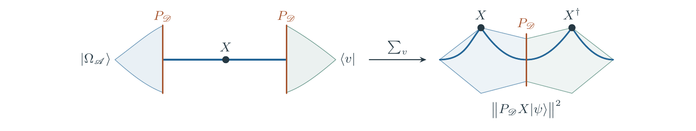

**Figure 25:** On the left the first clock projection prepares $|\psi\rangle$ from the Gaussian state, and the second selects allowed readings after the insertion $X$. Summing the squared amplitudes over outgoing states $|v\rangle$ glues the preparation to its adjoint on the right. The clock projections from the two sides of the shared cut select the same subspace.

### 5.2 The discrete spectrum of the area operator

In (5.20) we restricted every preparation from $|\psi\rangle$ to clock readings at most $\ell(\mathscr{D})$, which also limits the corner area through the focusing in (4.27). If $\mathcal{H}_{\mathscr{D}}$ were infinite dimensional, we could therefore find infinitely many orthogonal states supported in an arbitrarily narrow interval of corner area. A relative boost at $S$ acts by nearly the same phase throughout such an interval. On a smooth null cone, the same boost changes the separation of two graviton insertions across $S$ and hence their two point function. To compare these two descriptions, we glue the future half of $\mathscr{D}$ to its time reflection along $\Sigma_{1}$ (Figure 26). One copy of $S$ carries a bra and the other a ket, so closing the cut at $S$ sums over the intermediate states in $\mathcal{H}_{\mathscr{D}}$.

We can read the clock along either null boundary, from $\partial\Sigma_{0}$ to $S$ on $\mathscr{H}_{p}$ or from $\partial\Sigma_{1}$ to $S$ on $\mathscr{H}_{q}$. On each null generator the affine parameter is normalized at $\partial\Sigma_{i}$ as in (3.27), and $\widehat{\bar{u}}_{*}$ averages its change from $v=\epsilon$ there to $v=1$ at $S$.[^21] At fixed area, shear can only increase the clock reading. Indeed, $\widehat{\Xi}_{y}(v)\geq 0$ in (4.27) bounds the clock from below, and Cauchy Schwarz on $S$ bounds the angular integral of the area density. Since $[\widehat{\bar{u}}_{*},\widehat{\mathscr{A}}]=0$, an upper limit on $\widehat{\bar{u}}_{*}$ also bounds $\widehat{\mathscr{A}}$ on $\mathcal{H}_{\mathscr{D}}$,

$$
\displaystyle\widehat{\bar{u}}_{*}\geq(1-\epsilon)\widehat{\mathscr{A}}\widehat{\mathsf{a}}^{-1}, \tag{5.21a}
$$

$$
\displaystyle\widehat{\mathsf{a}}^{\,2}\leq 4\pi\int_{S}\widehat{\varrho}_{S}(y)^{2}\bm{\epsilon}_{0}=4\pi\widehat{\mathscr{A}}, \tag{5.21b}
$$

$$
\displaystyle\widehat{\bar{u}}_{*}\geq(1-\epsilon)(\widehat{\mathscr{A}}/4\pi)^{1/2}, \tag{5.21c}
$$

$$
\displaystyle 0\leq P_{\mathscr{D}}\widehat{\mathscr{A}}P_{\mathscr{D}}\leq\frac{4\pi\ell(\mathscr{D})^{2}}{(1-\epsilon)^{2}}P_{\mathscr{D}}. \tag{5.21d}
$$

To calculate the weight of a state of given area, we follow the normal frame around the corner $S$. Recall that real valued boosts are generated by $\widehat{\mathscr{K}}=\widehat{\mathscr{A}}/(8\pi G_{N})$,

$$
\alpha_{\eta}(\widehat{\mathcal{O}})=e^{i\eta\widehat{\mathscr{K}}/\hbar}\widehat{\mathcal{O}}e^{-i\eta\widehat{\mathscr{K}}/\hbar}. \tag{5.22}
$$

To prepare the future half of $\mathscr{D}$, we analytically continue the boost to $i\pi$ and use $U$ for time evolution from $S$ to $\Sigma_{1}$ (Appendix C). Gluing to its time reflection along $\Sigma_{1}$ pairs $U$ with $U^{\dagger}$ (Figure 26). By unitarity, only the area dependence of the imaginary boost and the restriction on the clock remain in $C_{\mathscr{D}}^{\dagger}C_{\mathscr{D}}$,

$$
\displaystyle C_{\mathscr{D}}=Ue^{-\widehat{\mathscr{A}}/(8G_{N}\hbar)}P_{\mathscr{D}}, \tag{5.23a}
$$

$$
\displaystyle C_{\mathscr{D}}^{\dagger}C_{\mathscr{D}}=P_{\mathscr{D}}e^{-\widehat{\mathscr{A}}/(4G_{N}\hbar)}P_{\mathscr{D}}. \tag{5.23b}
$$

For the state of area $\mathscr{A}$ prepared in Section 5.1, $P_{\mathscr{D}}|\psi\rangle=|\psi\rangle$, so $\|C_{\mathscr{D}}|\psi\rangle\|^{2}=\exp[-\mathscr{A}/(4G_{N}\hbar)]>0$. Closing the cut at $S$ inserts the identity on $\mathcal{H}_{\mathscr{D}}$, so by (5.20) we can use a basis prepared from $|\psi\rangle$ before we know the dimension. Each basis state enters with the weight fixed by (5.23).

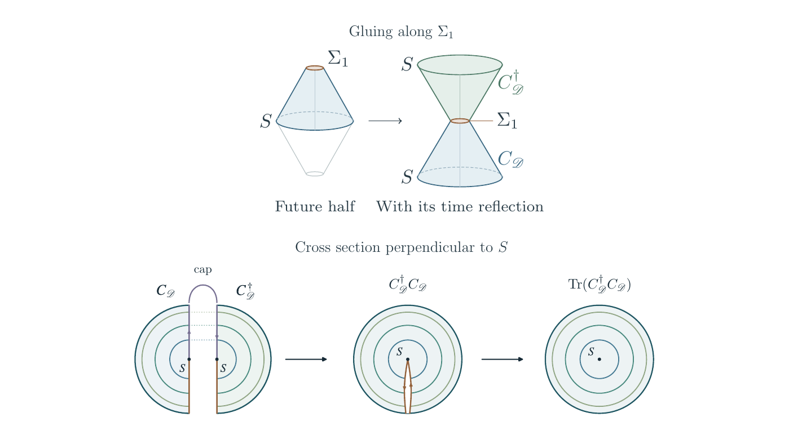

**Figure 26:** Gluing the future half of $\mathscr{D}$ (blue) to its time reflection (green) along $\Sigma_{1}$ forms $C_{\mathscr{D}}^{\dagger}C_{\mathscr{D}}$. In cross section perpendicular to $S$, the cut remains open until we take $\operatorname{Tr}(C_{\mathscr{D}}^{\dagger}C_{\mathscr{D}})$, which identifies the two copies of $S$.

To compare the amplitude on a smooth geometry with the sum over all allowed states, we choose a preparation centered on the corner area of that geometry. We write the dimensionless area operator as

$$
\hat{s}=\frac{\widehat{\mathscr{A}}}{4G_{N}\hbar}. \tag{5.24}
$$

On the bounded range of $\hat{s}$ in (5.21d), $e^{-s}f_{b}(s)$ is bounded away from zero for the positive continuous weight $f_{b}$ centered at any $s_{b}=\pi b^{2}/(G_{N}\hbar)$, as in (5.30c). We insert $f_{b}(\hat{s})$ in the trace by replacing $C_{\mathscr{D}}$ with

$$
C_{b}=C_{\mathscr{D}}f_{b}(\hat{s})^{1/2},\ f_{b}(s)=\exp[-(s-s_{b})^{2}/(2\sigma_{s}^{2})]. \tag{5.25}
$$

A freely falling observer can compare the local Lorentz frames in the normal plane on opposite sides of $S$ by following a null congruence across it. Matching $q_{AB}$ and $K^{(\ell)}_{AB}$ as in (3.62) makes the expansion and shear continuous along the congruence. In the observer’s affine parameter $u$, we can therefore separate the two factors of $\sigma_{AB}\sigma^{AB}$ in the Raychaudhuri equation (3.25e), centering $f_{L}^{AB}$ at $-d$ and $f_{R}^{AB}$ at $d$. We represent $\widehat{\sigma}_{f_{L}}$ on the outgoing cap $\Sigma_{1}$ and hold it fixed as we boost the null frame defining $\widehat{\sigma}_{f_{R}}$ across $S$.

To evaluate this two point function, we expand about a smooth solution $g_{0}$ of the Einstein equations with the chosen data on the spacelike cap and $\bar{u}_{*}[g_{0}]<\ell(\mathscr{D})$ (Section 6.1). We can now choose $4\pi b^{2}=\mathscr{A}[g_{0}]$ so that $f_{b}$ peaks at its corner area. In the local Lorentz frame parallel transported from the boundary (Section 3.5), the radius of curvature of $g_{0}$ is set by $R_{c}^{-2}=\sup_{x\in\mathscr{D}}\max_{\mu,\nu,\rho,\sigma}|R_{\mu\nu\rho\sigma}[g_{0}](x)|$. We therefore take the induced metric on $S$ to be spherically symmetric in the flat space approximation $b\ll R_{c}$, with fractional corrections of order $b^{2}/R_{c}^{2}$ from the curvature of $g_{0}$.

For a boost of rapidity $\eta$ of order one, we can localize both insertions near $S$ by separating their widths from their distance to the corner. For a smearing of width $\Delta u$ in $u$ we take

$$
\ell_{P}\ll\Delta u\ll d\ll b\ll R_{c}. \tag{5.26}
$$

We use the same transverse smearing on both sides, of size at least $\Delta u$ in a basis parallel transported along the congruence. To see why perturbation theory applies at these distances, we write $g_{ab}=g_{0\,ab}+h_{ab}$, with $h_{AB}$ the trace free transverse part of $h_{ab}$ in this basis. For a graviton wave packet of size $\Delta u$, the quadratic part of the reduced action in (4.5) fixes the size of fluctuations with $I^{(2)}[h]/\hbar=O(1)$,

$$
\frac{I^{(2)}[h]}{\hbar}\sim(\Delta u/\ell_{P})^{2}h_{AB}h^{AB},\ h_{AB}=O(\ell_{P}/\Delta u). \tag{5.27}
$$

Each additional graviton loop then carries a factor $G_{N}\hbar/(\Delta u)^{2}$.

To find how a relative boost changes the correlation across $S$, we first glue the two halves at fixed $C_{b},j_{L},j_{R}$ to obtain the unnormalized amplitude $Z(j_{L},j_{R})$. On the shear free background the sources couple linearly to the fluctuations at one loop. Completing the square with the Hessian $K_{0}$ in (D.16) yields

$$
\frac{Z(j_{L},j_{R})}{Z(0,0)}=\frac{(\det_{\mathcal{C}}K_{0})^{-1/2}}{(\det_{\mathcal{C}}K_{0})^{-1/2}}\,\exp\!\left[-\frac{i\hbar}{2}\sum_{a,c=L,R}j_{a}j_{c}(\delta_{I}\sigma_{f_{a}})(K_{0}^{-1})^{IJ}(\delta_{J}\sigma_{f_{c}})\right], \tag{5.28a}
$$

$$
\frac{1}{2}\big\langle\{\widehat{\sigma}_{f_{L}},\widehat{\sigma}_{f_{R}}\}\big\rangle=-\left.\operatorname{Re}\frac{\partial^{2}\log Z(j_{L},j_{R})}{\partial j_{L}\,\partial j_{R}}\right|_{j_{L}=j_{R}=0}. \tag{5.28b}
$$

$$
u<0<u^{\prime} \sigma_{AB}^{(1)}=\partial_{u}h_{AB}/2
$$

$$
\mathcal{G}_{\sigma}(u,u^{\prime})=\frac{1}{2}\langle\{\widehat{\sigma}_{AB}(u),\widehat{\sigma}^{AB}(u^{\prime})\}\rangle\simeq\frac{1}{8}\big\langle\{\partial_{u}h_{AB}(u),\partial_{u^{\prime}}h^{AB}(u^{\prime})\}\big\rangle, \tag{5.28c}
$$

$$
u,u^{\prime}
$$

$$
\mathcal{G}_{\sigma,0}(u,u^{\prime})=-\frac{c_{\perp}}{(u-u^{\prime})^{2}}, \tag{5.28d}
$$

where $c_{\perp}>0$ is fixed by the transverse smearing. Since $\sigma_{AB}$ is linear in the null tangent, boosting $\ell_{R}^{a}$ at fixed $\ell_{L}^{a}$ takes $\sigma_{AB}(u^{\prime})$ to $e^{\eta}\sigma_{AB}(e^{\eta}u^{\prime})$. For insertions centered at $-d$ and $d$ (Figure 27) we therefore obtain

$$
\frac{e^{\eta}\mathcal{G}_{\sigma,0}(-d,e^{\eta}d)}{\mathcal{G}_{\sigma,0}(-d,d)}=\frac{4e^{\eta}}{(1+e^{\eta})^{2}}. \tag{5.29}
$$

**Figure 27:** The wavy line contracts the two graviton insertions across $S$ in (5.29). The left sided smearing stays fixed while the right sided smearing moves along the null generator. The dashed tick marks its position before the boost.

For smearing functions reflection symmetric about $-d$ and $d$, respectively, the boost thus reduces the magnitude of the two point function by a fraction $\tanh^{2}(\eta/2)+O((\Delta u/d)^{2})$. The supports of the two insertions are disjoint, and their transverse normalization $c_{\perp}$ cancels in (5.29).

The vacuum subtracted correlators in (D.21) have finite coincidence limits at $S$ in the point split Raychaudhuri equation. With data on the cap and transverse smearing fixed in units of $b$, $\mathcal{G}_{\sigma}-\mathcal{G}_{\sigma,0}=O(c_{\perp}/b^{2})$ near $S$ on the smooth background. Its contribution to (5.29) is therefore of order $(d/b)^{2}$.

A boost acting by a single phase would preserve this two point function. If there were infinitely many intermediate states, however, arbitrarily many orthogonal states could lie in a narrow area interval where the boost phases are nearly equal. To bound the effect of the states outside that interval, we use a bounded function of the two graviton insertions whose expectation value also changes under the boost (Appendix D.2). On the intermediate states the boost in (5.29) acts by $e^{i\eta\hat{s}/(2\pi)}$. Over the range of areas allowed by (5.21d), the Gaussian weight $f_{b}$ in (5.25) has a positive minimum, so

$$
\displaystyle 0\leq\hat{s}\leq s_{*},\ s_{*}=\frac{\pi\ell(\mathscr{D})^{2}}{G_{N}\hbar(1-\epsilon)^{2}}, \tag{5.30a}
$$

$$
\displaystyle\widetilde{\rho}_{\mathscr{D}}=C_{\mathscr{D}}^{\dagger}C_{\mathscr{D}},\ m_{b,\mathscr{D}}=\min_{0\leq s\leq s_{*}}f_{b}(s)>0, \tag{5.30b}
$$

$$
\displaystyle e^{-s_{*}}m_{b,\mathscr{D}}\widehat{1}\leq m_{b,\mathscr{D}}\widetilde{\rho}_{\mathscr{D}}\leq C_{b}^{\dagger}C_{b}=f_{b}(\hat{s})\widetilde{\rho}_{\mathscr{D}}\leq\widetilde{\rho}_{\mathscr{D}}\leq\widehat{1}. \tag{5.30c}
$$

For a finite set of orthonormal intermediate states $|i\rangle$, write $P=\sum_{i}|i\rangle\langle i|$. Pairing each $|i\rangle$ with its time reflection $|i^{*}\rangle$ across $S$, we obtain the expectation value of a bounded observable $\widehat{\mathcal{O}}$ before the boost,

$$
\langle\widehat{\mathcal{O}}\rangle_{0,P}=\frac{\sum_{i,j}(\langle i|C_{b}^{\dagger}\otimes\langle i^{*}|)\,\widehat{\mathcal{O}}\,(C_{b}|j\rangle\otimes|j^{*}\rangle)}{\sum_{i}\langle i|C_{b}^{\dagger}C_{b}|i\rangle}. \tag{5.31}
$$

If nearly all the weight of the normalized state $\rho_{P}$ lies near $s_{0}$, the boost acts nearly by the same phase on those states. In Appendix D.2 we bound the resulting change in $\langle\widehat{\mathcal{O}}\rangle$ by

$$
\rho_{P}=\frac{PC_{b}^{\dagger}C_{b}P}{\operatorname{Tr}(PC_{b}^{\dagger}C_{b})},\ \big|\langle\widehat{\mathcal{O}}\rangle_{\eta,P}-\langle\widehat{\mathcal{O}}\rangle_{0,P}\big|\leq\frac{|\eta|}{\pi}\|\widehat{\mathcal{O}}\|\,\sqrt{\operatorname{Tr}[\rho_{P}(\hat{s}-s_{0})^{2}]}. \tag{5.32}
$$

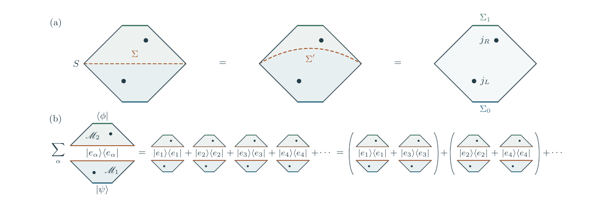

**Figure 28:** (a) The cuts $\Sigma$ and $\Sigma^{\prime}$ share a boundary $S$, where we match the gravitational boundary data. At fixed external states and sources $j_{L},j_{R}$, diffeomorphism invariance of (4.5) requires the amplitude be the same regardless of where we make the cut or whether we make one at all. (b) Closing the cut inserts the identity. Grouping the terms of (4.29) into cycles of $V$ includes each $|e_{\alpha}\rangle\langle e_{\alpha}|$ once.

We evaluate (5.32) by coupling real valued sources $j_{L}$ and $j_{R}$ to the two graviton insertions and choosing an observable with $\|\widehat{\mathcal{O}}\|\leq 1$,

$$
\widehat{\mathcal{O}}=\sin(j_{L}\widehat{\sigma}_{f_{L}})\sin(j_{R}\widehat{\sigma}_{f_{R}}),\ \langle\widehat{\sigma}_{f_{L}}\widehat{\sigma}_{f_{R}}\rangle=\left.\partial_{j_{L}}\partial_{j_{R}}\langle\widehat{\mathcal{O}}\rangle\right|_{j_{L}=j_{R}=0}. \tag{5.33}
$$

The relative boost in (5.29) therefore deforms $\langle\widehat{\mathcal{O}}\rangle$ when the right sided insertion moves from $d$ to $e^{\eta}d$. For the freely falling vacuum $|0\rangle$, we may fix $j_{L},j_{R}$ so that

$$
\Delta_{\eta}\widehat{\mathcal{O}}=\widehat{\mathcal{O}}_{\eta}-\widehat{\mathcal{O}}_{0},\ \delta_{\eta}=\langle 0|\Delta_{\eta}\widehat{\mathcal{O}}|0\rangle\neq 0. \tag{5.34}
$$

How closely $C_{b}$ reproduces this change at the two separations $2d$ and $(1+e^{\eta})d$ depends on the excitation of the polarization common to both insertions. For this polarization we use the smeared graviton operator

$$
\widehat{\sigma}_{\perp}(u)=\int_{S}f_{\perp}^{AB}\widehat{\sigma}^{(1)}_{AB}(u,y)\,\mathrm{d}A. \tag{5.35}
$$

Suppressing the boost deformation requires an excitation of this polarization on an interval containing both insertions. Appendix D.2 bounds the integral of its normal ordered square from below for states that suppress the deformation and from above for the uncut preparation $C_{b}$,

$$
\displaystyle\big|\langle\Delta_{\eta}\widehat{\mathcal{O}}\rangle\big|\leq\frac{|\delta_{\eta}|}{2}\ \Longrightarrow\ \int g^{2}\langle\mathopen{\vcentcolon}\,\widehat{\sigma}_{\perp}^{2}\,\mathclose{\vcentcolon}\rangle\,\mathrm{d}u\gtrsim\frac{c_{f}}{d}, \tag{5.36a}
$$

$$
\displaystyle\int g^{2}\langle\mathopen{\vcentcolon}\,\widehat{\sigma}_{\perp}^{2}\,\mathclose{\vcentcolon}\rangle_{C_{b}}\,\mathrm{d}u=O(c_{f}B/b^{2}),\ d\ll B\ll b. \tag{5.36b}
$$

Here the real valued smearing function $g$ equals one on both insertions before and after the boost (D.27) and $c_{f}>0$ fixes the vacuum two point function of $\widehat{\sigma}_{\perp}$.

If $\mathcal{H}_{\mathscr{D}}$ were infinite dimensional, one of finitely many narrow intervals partitioning the allowed areas would have a spectral subspace of the same dimension as $\mathcal{H}_{\mathscr{D}}$. In a basis adapted to that interval, we place each vector outside it in a cycle with $r-1$ vectors inside, then group the remaining vectors inside into cycles of the same length (Figure 29). The resulting permutation $V$ satisfies $V^{r}(i)=i$, and every cycle contains at most one vector outside the interval. The bounds on the weight of each state in (5.30c) make the fraction of the weight outside this interval small in every finite union of cycles as $r$ increases. We can choose the interval sufficiently narrow and $r$ sufficiently large that (5.32) bounds the change in $\langle\widehat{\mathcal{O}}\rangle_{P}$ by $|\delta_{\eta}|/2$ for every such projection $P$ (Appendix D.2). Every state enters with its cycle, as illustrated for $r=2$ in Figure 28b, so $P\to\widehat{1}$ strongly as we include the cycles, ordered by inclusion for an uncountable basis. By diffeomorphism invariance, closing this internal cut with $C_{b}$ and both insertions fixed must reproduce the unnormalized amplitude on the uncut preparation (Section 3.6).

**Figure 29:** The left panel partitions the allowed areas up to $s_{*}$. Dots are basis vectors in the narrow interval $I$, and the square is a vector outside it. The arrows follow $V$ around two cycles of length five. The first contains one vector outside $I$, and the second lies wholly within it.

To compare the two amplitudes, we subtract half the vacuum expectation value $\delta_{\eta}$ in (5.34) from $\Delta_{\eta}\widehat{\mathcal{O}}$ and insert the resulting operator $X$. Since the observable in (5.33) is odd in $j_{L}$, we choose the sign of $j_{L}$ so that $\delta_{\eta}>0$. The remainder estimate (D.36) then lets us choose $B$ and $b$ so that $X$ has a positive expectation value in the uncut preparation $C_{b}$,

$$
X=\Delta_{\eta}\widehat{\mathcal{O}}-\frac{\delta_{\eta}}{2}\widehat{1}, \tag{5.37a}
$$

$$
\bigl|\langle\Delta_{\eta}\widehat{\mathcal{O}}\rangle_{P}\bigr|\leq\frac{\delta_{\eta}}{2}<\langle\Delta_{\eta}\widehat{\mathcal{O}}\rangle_{C_{b}}. \tag{5.37b}
$$

Gluing $C_{b}$ to its time reflection multiplies $\langle X\rangle_{C_{b}}$ by its squared norm, so the unnormalized amplitude $Z[X]$ is strictly positive (Figure 30). On the cut, the same subtraction makes the unnormalized amplitude nonpositive for every nonempty finite union of cycles,

$$
Z_{P}[X]=\operatorname{Tr}(PC_{b}^{\dagger}C_{b})\left(\langle\Delta_{\eta}\widehat{\mathcal{O}}\rangle_{P}-\frac{\delta_{\eta}}{2}\right)\leq 0<Z[X]. \tag{5.38}
$$

**Figure 30:** In both amplitudes we glue $C_{b}$ to its time reflection on $\Sigma_{1}$ with the same graviton insertions. The ring at $S$ shows a cycle of the basis labels in Figure 29. Each ket is sewn to its own bra. Including all the cycles inserts the identity on the cut, so the partial sums in (5.38) must reproduce the uncut amplitude.

Every basis vector belongs to a cycle, so gluing at $S$ requires these partial sums to approach the uncut amplitude $Z[X]$ by (4.29). Their sign in (5.38) makes this impossible. Hence $\mathcal{H}_{\mathscr{D}}$ is finite dimensional.[^22]

Since $0<\widetilde{\rho}_{\mathscr{D}}\leq\widehat{1}$, finiteness of the dimension also bounds the thermal trace. For a boundary insertion $\widehat{\mathcal{O}}$ the normalized amplitude is $\operatorname{Tr}(\rho_{\mathscr{D}}\widehat{\mathcal{O}})$, where

$$
\displaystyle\rho_{\mathscr{D}}=\frac{e^{-\widehat{\mathscr{A}}/(4G_{N}\hbar)}}{Z_{\mathscr{D},1}}, \tag{5.39a}
$$

$$
\displaystyle Z_{\mathscr{D},1}=\operatorname{Tr}_{\mathcal{H}_{\mathscr{D}}}e^{-\widehat{\mathscr{A}}/(4G_{N}\hbar)}<\infty, \tag{5.39b}
$$

$$
\displaystyle d_{\mathscr{D}}=\dim\mathcal{H}_{\mathscr{D}}=Z_{\mathscr{D},1}\operatorname{Tr}\!\left(\rho_{\mathscr{D}}e^{\widehat{\mathscr{A}}/(4G_{N}\hbar)}\right)<\infty. \tag{5.39c}
$$

The corner area can therefore take at most $d_{\mathscr{D}}$ distinct values. Denoting its eigenvalues by $\mathscr{A}_{1},\ldots,\mathscr{A}_{m}$, we can resolve the physical Hilbert space by area,

$$
\mathcal{H}_{\mathscr{D}}=\bigoplus_{j=1}^{m}\mathcal{H}_{\mathscr{D},\mathscr{A}_{j}}. \tag{5.40}
$$

As an independent check, in Appendix D.3 we evaluate the amplitudes for two copies of $C_{b}^{\dagger}C_{b}$ joined cyclically or closed separately through one loop. The calculation also illustrates how focusing restricts the radiative modes. For a graviton of given angular momentum, a higher radial frequency reduces the effect of angular variation on the inward expansion at $S$ but strengthens focusing along the past null boundary. The resulting bounds on occupation numbers for both polarizations yield a positive ratio in (D.49).

We can now identify an insertion that changes the area of a state prepared from $|\psi\rangle$. Within the chosen range of clock readings, $P_{\mathscr{A}_{j}}=P_{\mathscr{D}}\mathbf{1}_{\{\mathscr{A}_{j}\}}(\widehat{\mathscr{A}})$ projects onto states of area $\mathscr{A}_{j}$. If $\sin(j_{R}\widehat{\sigma}_{f_{R}})$ acted only within each area eigenspace, the boost phases of its bra and ket would cancel. By (D.36) we have $\langle\Delta_{\eta}\widehat{\mathcal{O}}\rangle_{C_{b}}\neq 0$, so the right sided insertion has a matrix element between different eigenspaces of $\widehat{\mathscr{A}}$. By (5.20), the vectors $P_{\mathscr{A}_{j}}\pi_{\omega}(X)|\psi\rangle$ span the eigenspace at $\mathscr{A}_{j}$. Hence for some $X\in\mathcal{A}$ and $k\neq j$ we have

$$
P_{\mathscr{A}_{k}}\sin(j_{R}\widehat{\sigma}_{f_{R}})P_{\mathscr{A}_{j}}\pi_{\omega}(X)|\psi\rangle\neq 0. \tag{5.41}
$$

The two distinct area eigenvalues connected by (5.41) also let us constrain the spectrum of energy at a reflecting AdS boundary. We close a thermal cylinder disjoint from $\mathscr{D}$ and use a measurement of area on $\mathscr{D}$ to determine whether the sum over states on the joint cut converges. We take the conformal boundary metric to be

$$
\mathrm{d}s^{2}=-\mathrm{d}t^{2}+L_{\rm AdS}^{2}\,\mathrm{d}\Omega_{2}^{2}. \tag{5.42}
$$

Taking $E_{0}$ to be the lower bound of the boundary Hamiltonian $\widehat{H}$, we measure energies from $E_{0}$ and write the operator for time evolution through half the period $\hbar\beta$ as

$$
C=\exp\!\left[-\frac{\beta}{2}(\widehat{H}-E_{0})\right],\ C^{\dagger}C=e^{-\beta(\widehat{H}-E_{0})}\leq\widehat{1}. \tag{5.43}
$$

We choose an area band $I$ containing one of the eigenvalues distinguished by the relative boost (5.29) and excluding the other. Its probability in the thermal state on $\mathscr{D}$ then satisfies $0<p<1$, with $p=\operatorname{Tr}[\rho_{\mathscr{D}}\mathbf{1}_{I}(\widehat{\mathscr{A}})]$. On the causal diamond we use an orthonormal area eigenbasis $|a\rangle$ and write $v_{a}=\langle a|\rho_{\mathscr{D}}|a\rangle$. On the AdS boundary we can choose any orthonormal basis $|i\rangle$ and write $w_{i}=\langle i|C^{\dagger}C|i\rangle$. We insert $\mathbf{1}_{I}(\widehat{\mathscr{A}})-p\widehat{1}$ on the causal diamond before closing the joint cut. Time evolution acts independently on the two components, so summing over a finite set $F$ of pairs $|i\rangle\otimes|a\rangle$ yields the unnormalized amplitude

$$
\sum_{(i,a)\in F}w_{i}v_{a}\bigl[\mathbf{1}_{I}(\mathscr{A}_{a})-p\bigr]. \tag{5.44}
$$

For each basis vector $|i\rangle$ on the reflecting AdS boundary, summing over all $|a\rangle$ in (5.44) yields zero since $\sum_{a}v_{a}=1$ and $\sum_{\mathscr{A}_{a}\in I}v_{a}=p$. Since the causal diamond has a finite basis, every pair on the joint cut enters as we complete the sum for each $|i\rangle$. Closing the joint cut with the insertion held fixed must therefore yield zero. Now choose $|a_{0}\rangle$ with $\mathscr{A}_{a_{0}}\notin I$. After completing any finite set of pairs, we can add $|i\rangle\otimes|a_{0}\rangle$ for a finite set $J$ of unused indices $i$, changing the sum by $-p\,v_{a_{0}}\sum_{i\in J}w_{i}$. Since $p\,v_{a_{0}}>0$, a divergent $\sum_{i}w_{i}$ would allow arbitrarily negative sums after any such completion, contradicting convergence to zero. Hence for each admitted $\beta>0$,

$$
Z_{\beta}=\operatorname{Tr}(C^{\dagger}C)=\sum_{i}w_{i}<\infty. \tag{5.45}
$$

For states in $[E_{0},E_{0}+\Lambda]$, $C^{\dagger}C\geq e^{-\beta\Lambda}\widehat{1}$, so

$$
\dim\!\left(\mathbf{1}_{[E_{0},E_{0}+\Lambda]}(\widehat{H})\mathcal{H}\right)\leq e^{\beta\Lambda}Z_{\beta}<\infty. \tag{5.46}
$$

Since $C^{\dagger}C$ is compact, $\widehat{H}$ has a lowest eigenvalue with finite multiplicity.

To identify the observables on the sector generated from a ground state, we let $\mathcal{M}_{\partial}$ denote the von Neumann algebra generated by bounded functions of the smeared boundary stress tensor, observables of the boundary frame and bounded functions of $\widehat{H}$. In particular the ground state projection $Q_{0}$ belongs to $\mathcal{M}_{\partial}$ [63]. Its range is finite dimensional, so $Q_{0}\mathcal{M}_{\partial}Q_{0}$ contains a minimal nonzero projection $P_{0}$. For a normalized ground state $|0\rangle$ in its range and for every $\widehat{\mathcal{O}}\in\mathcal{M}_{\partial}$, minimality implies

$$
P_{0}\mathcal{M}_{\partial}P_{0}=\mathbb{C}P_{0},\ P_{0}\widehat{\mathcal{O}}|0\rangle=\langle 0|\widehat{\mathcal{O}}|0\rangle|0\rangle. \tag{5.47}
$$

Thus $P_{0}$ acts as $|0\rangle\langle 0|$ on the sector $\mathcal{H}_{\partial}=\overline{\mathcal{M}_{\partial}|0\rangle}$. For $|v_{i}\rangle=\widehat{\mathcal{O}}_{i}|0\rangle$, we therefore have on this sector

$$
\widehat{\mathcal{O}}_{i}P_{0}\widehat{\mathcal{O}}_{j}^{\dagger}=|v_{i}\rangle\langle v_{j}|. \tag{5.48}
$$

Since these vectors span a dense subspace, the boundary algebra on $\mathcal{H}_{\partial}$ is $\mathcal{B}(\mathcal{H}_{\partial})$.

Time translations preserve $\mathcal{H}_{\partial}$, so closing the thermal circle with an insertion $\widehat{\mathcal{O}}$ computes its expectation value $\operatorname{Tr}_{\mathcal{H}_{\partial}}(\rho\widehat{\mathcal{O}})$ in a normal Hartle Hawking state. This state satisfies the KMS condition on $\mathcal{B}(\mathcal{H}_{\partial})$, including for operators that change area. Since $C^{\dagger}C=e^{-\beta(\widehat{H}-E_{0})}$, it follows that

$$
\rho=\frac{e^{-\beta\widehat{H}}}{Z},\ Z=\operatorname{Tr}_{\mathcal{H}_{\partial}}e^{-\beta\widehat{H}}\leq e^{-\beta E_{0}}Z_{\beta}<\infty.\rule[-9.0pt]{0.0pt}{9.0pt} \tag{5.49}
$$

### 5.3 Entropy of marginally trapped surfaces

In (5.39) we obtained a density operator on the finite dimensional Hilbert space of a causal diamond, with thermal weights determined by the area operator. Its von Neumann entropy is therefore

$$
S(\rho_{\mathscr{D}})=-\operatorname{Tr}(\rho_{\mathscr{D}}\log\rho_{\mathscr{D}})=\frac{\langle\widehat{\mathscr{A}}\rangle}{4G_{N}\hbar}+\log Z_{\mathscr{D},1}. \tag{5.50}
$$

To identify the area term in (5.50) with the Bekenstein Hawking entropy, we need a condition on $S$ that we can impose on the interior states in the trace before gluing on an exterior. But whether $S$ lies on the event horizon depends on which exterior we glue to the same interior data, since later infall can trap outgoing null generators that would otherwise reach future null infinity [50] (Figure 31).

For this reason we use a marginally trapped surface as our local notion of a black hole. More precisely, on a spherically symmetric cut of the Schwarzschild horizon, $\ell^{a}$ is tangent to the stationary horizon, so the area element is constant along it, whereas it decreases along $n^{a}$. With $\ell\cdot n=-1$, we vary $\mathscr{A}$ subject to

$$
\left.\Theta_{(\ell)}\right|_{S}=0,\ \left.\Theta_{(n)}\right|_{S}<0. \tag{5.51}
$$

With $S$ specified, the correction to the area term in (5.50) depends on how $Z_{\mathscr{D},1}$ grows with $\mathscr{A}$. To define the gravitational clock that selects the states in this trace, we truncate the future inward null cone of $S$ at $\Sigma_{1}$ before its null generators reach a caustic and normalize their affine parameter there (3.27). Fixing the maximum reading $\ell(\mathscr{D})$ then specifies which interior states enter (5.39b).

To determine the weight of each state admitted by the clock, we glue the future half of $\mathscr{D}$ to its time reflection along $\Sigma_{1}$ (Figure 32). The time evolution cancels against its adjoint in the sum over states on $\Sigma_{1}$ (5.23), so the weight is fixed by the relative boost at $S$. Analytically continuing only this boost through a half turn on each copy yields the full $2\pi$ rotation. As at any corner of a causal diamond, a state of dimensionless area $s_{i}$ (5.24) therefore enters the trace with weight $\exp(-s_{i})$ (5.39a). This boost weight yields the Bekenstein Hawking term [10, 49] in (5.50) at finite $G_{N}$ [19, 20, 18].

For a large Schwarzschild black hole in equilibrium, we compare the average clock reading on the inward null cone with its maximum $\ell(\mathscr{D})$ to show that $\log Z_{\mathscr{D},1}$ contributes only a logarithmic correction to the entropy. We will evaluate this correction at one loop from the Lorentzian trace and, at fixed mass with angular momenta summed, recover the result Sen obtained from the Euclidean path integral [78].

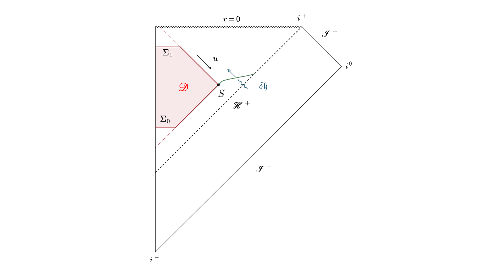

**Figure 31:** Penrose diagram of a black hole formed from collapse. The shaded region is a radial section of $\mathscr{D}$ bounded on the left by the regular centre. The green curve tracks marginally trapped surfaces and joins the event horizon $\mathscr{H}^{+}$ after an incoming perturbation $\delta\mathfrak{h}$.

**Figure 32:** The blue arrow follows the time evolution from one copy of $S$ to $\Sigma_{1}$, and the green arrow follows its adjoint back to the other copy. Gluing at $\Sigma_{1}$ identifies the outgoing label $j$ with the incoming label $i$. The orange semicircles show the two corner boosts analytically continued to half turns. Closing at $S$ sums the weights $\exp(-s_{i})$ over the states admitted by the clock projection $P_{\mathscr{D}}$.

Recall that we end each null generator on $\Sigma_{1}$ at $\varrho=\epsilon\varrho_{S}(y)$, with fixed $\epsilon\ll 1$. Choosing $u=0$ and $\partial_{u}\varrho=1$ there makes $u_{*}(y)$ in (3.27) just the value of $u$ at $S$.

On the Schwarzschild background we choose $\bm{\epsilon}_{0}$ invariant under rotations. Then $\varrho$ is constant on each spherically symmetric cut by (3.17d), and its two null derivatives determine the expansions in (5.51). We thus obtain

$$
\left.\nabla_{a}\varrho\,\nabla^{a}\varrho\right|_{S}=-\frac{\varrho_{S}^{2}}{2}\left.\Theta_{(\ell)}\Theta_{(n)}\right|_{S}=0. \tag{5.52a}
$$

$$
\mathscr{A} S
$$

$$
\bar{u}_{*}=\varrho_{S}\int_{\epsilon}^{1}\mathrm{d}v=(1-\epsilon)\sqrt{\frac{\mathscr{A}}{4\pi}}. \tag{5.52b}
$$

Although focusing can increase this reading in a microstate at the same area, the classical contribution to the average time delay vanishes at each horizon area in the expansion about Schwarzschild. Thus, as $r_{h}/\ell_{P}\to\infty$ at fixed $G_{N}$,

$$
\langle\widehat{\bar{u}}_{*}-(1-\epsilon)(\widehat{\mathscr{A}}/4\pi)^{1/2}\rangle=o(r_{h}),\ 4\pi r_{h}^{2}=\langle\widehat{\mathscr{A}}\rangle. \tag{5.53}
$$

To compare these interiors as the black hole grows, we must specify how the maximum clock reading scales with horizon area. In (3.27) the integral multiplying $\varrho_{S}(y)$ depends only on the conformal metric along null generator $y$ as a function of $v$. Rescaling lengths in a given interior therefore rescales its clock reading by the same factor. At fixed $\ell(\mathscr{D})/r_{h}>1-\epsilon$ the maximum exceeds $(1-\epsilon)r_{h}$ by an amount of order $r_{h}$. The $o(r_{h})$ average time delay in (5.53) therefore keeps the average reading a finite fraction below the maximum as the black hole grows. For the limiting ratio $q$ we obtain an upper bound from concavity of the square root and a lower bound from focusing along the null generators,

$$
\displaystyle\langle\widehat{\mathscr{A}}^{1/2}\rangle\leq\langle\widehat{\mathscr{A}}\rangle^{1/2}=\sqrt{4\pi}\,r_{h}, \tag{5.54a}
$$

$$
\displaystyle q=\lim_{r_{h}/\ell_{P}\to\infty}\frac{\langle\widehat{\bar{u}}_{*}\rangle}{\ell(\mathscr{D})}\leq(1-\epsilon)\frac{r_{h}}{\ell(\mathscr{D})}<1, \tag{5.54b}
$$

$$
\displaystyle q\geq\left[(1-\epsilon)\frac{r_{h}}{\ell(\mathscr{D})}\right]^{2}>0. \tag{5.54c}
$$

Combining the bound (5.21c) from the Raychaudhuri equation with $\bar{u}_{*}\leq\ell(\mathscr{D})$, we obtain the lower bound from the second moment,

$$
(1-\epsilon)^{2}r_{h}^{2}\leq\langle(\widehat{\bar{u}}_{*})^{2}\rangle\leq\ell(\mathscr{D})\langle\widehat{\bar{u}}_{*}\rangle. \tag{5.55}
$$

To relate $\langle\widehat{\bar{u}}_{*}\rangle$ to $Z_{\mathscr{D},1}$, we vary only the upper limit $\ell$ in the clock projector. We write $Z(\ell)$ for the thermal trace and $\langle\cdot\rangle_{\ell}$ for expectation values with $\mathbf{1}_{[0,\ell]}(\widehat{\bar{u}}_{*})$ in place of $P_{\mathscr{D}}$. Since $\widehat{s}$ and $\widehat{\bar{u}}_{*}$ commute by (5.21), a joint eigenstate starts to contribute weight $e^{-s_{i}}$ as soon as the upper limit reaches its reading $\bar{u}_{*,i}$. In the integral over $\ell^{\prime}$ this state contributes from $\bar{u}_{*,i}$ to $\ell$, so

$$
Z(\ell)=\sum_{\bar{u}_{*,i}\leq\ell}e^{-s_{i}},\ \int_{0}^{\ell}Z(\ell^{\prime})\,\mathrm{d}\ell^{\prime}=\sum_{\bar{u}_{*,i}\leq\ell}(\ell-\bar{u}_{*,i})e^{-s_{i}}=Z(\ell)\bigl(\ell-\langle\widehat{\bar{u}}_{*}\rangle_{\ell}\bigr), \tag{5.56}
$$

where the sum counts independent states with the same $(s_{i},\bar{u}_{*,i})$ separately. This integral is continuous across eigenvalues of $\widehat{\bar{u}}_{*}$, and between them (5.56) implies

$$
\displaystyle\ell\,\frac{\mathrm{d}}{\mathrm{d}\ell}\log\!\left[\frac{1}{\ell}\int_{0}^{\ell}Z(\ell^{\prime})\,\mathrm{d}\ell^{\prime}\right]=\frac{\langle\widehat{\bar{u}}_{*}\rangle_{\ell}}{\ell-\langle\widehat{\bar{u}}_{*}\rangle_{\ell}}. \tag{5.57a}
$$

$$
\displaystyle\frac{1}{\ell}\int_{0}^{\ell}Z(\ell^{\prime})\,\mathrm{d}\ell^{\prime}=[1-q+o(1)]Z(\ell). \tag{5.57b}
$$

Since $q<1$, the average in (5.57b) is asymptotically a positive multiple of $Z(\ell)$ by (5.54b) and (5.56). The right hand side of (5.57a) tends to $q/(1-q)$, so integrating from any fixed $\ell_{0}$ with $\int_{0}^{\ell_{0}}Z(\ell^{\prime})\,\mathrm{d}\ell^{\prime}>0$ up to $\ell(\mathscr{D})$ yields

$$
\log Z_{\mathscr{D},1}=\int_{\ell_{0}}^{\ell(\mathscr{D})}\frac{\sum_{\bar{u}_{*,i}\leq\ell^{\prime}}\bar{u}_{*,i}e^{-s_{i}}}{\sum_{\bar{u}_{*,i}\leq\ell^{\prime}}(\ell^{\prime}-\bar{u}_{*,i})e^{-s_{i}}}\,\frac{\mathrm{d}\ell^{\prime}}{\ell^{\prime}}+O(1)=\left[\frac{q}{1-q}+o(1)\right]\log\frac{\ell(\mathscr{D})}{\ell_{0}}. \tag{5.58}
$$

To express (5.58) in terms of horizon area at fixed $\ell(\mathscr{D})/r_{h}$,[^23] we use

$$
\langle\widehat{s}\rangle=\frac{\pi r_{h}^{2}}{G_{N}\hbar},\ \log\frac{\ell(\mathscr{D})}{\ell_{0}}=\frac{1}{2}\log\langle\widehat{s}\rangle+\log\!\left(\frac{\ell(\mathscr{D})}{r_{h}}\frac{\ell_{P}}{\sqrt{\pi}\,\ell_{0}}\right). \tag{5.59}
$$

For $q<1$, $\log Z_{\mathscr{D},1}$ grows only logarithmically with the maximum clock reading (5.58). Using (5.59) to compare the correction with the Bekenstein Hawking term at large horizon area, we obtain

$$
\frac{\log Z_{\mathscr{D},1}}{\langle\widehat{s}\rangle}=O\!\left(\frac{\log\langle\widehat{s}\rangle}{\langle\widehat{s}\rangle}\right). \tag{5.62}
$$

The entropy (5.50) of a large Schwarzschild black hole is therefore[^24]

$$
S(\rho_{\mathscr{D}})=\frac{\langle\widehat{\mathscr{A}}\rangle}{4G_{N}\hbar}+\frac{q}{2(1-q)}\log\!\left(\frac{\langle\widehat{\mathscr{A}}\rangle}{4G_{N}\hbar}\right)+o\!\left(\log\langle\widehat{s}\rangle\right). \tag{5.65}
$$

We now explicitly compute $q$ at one loop. The probability of finding $s_{*}/4<s<s_{*}/2$ in the state $\rho_{\mathscr{D}}$ tends to a positive limit as the black hole grows. By (5.58), it therefore suffices to evaluate how the contribution of these states to $Z(\ell)$ grows with $\ell$. Choosing $\sigma_{s}^{2}=2s_{b}$ in (5.25), the following integral is unity at each area eigenvalue $s$, so we can express the trace as

$$
\int_{0}^{\infty}f_{b}(s)\,\frac{\mathrm{d}s_{b}}{(4\pi s_{b})^{1/2}}=1,\ Z(\ell)=\int_{0}^{\infty}\frac{\mathrm{d}s_{b}}{(4\pi s_{b})^{1/2}}\,\operatorname{Tr}(C_{b}^{\dagger}C_{b}). \tag{5.66}
$$

To evaluate the integrand we expand the reduced action about the Schwarzschild background with horizon area $4G_{N}\hbar s_{b}$. The Gaussian term $-\langle\log f_{b}(\hat{s})\rangle_{C_{b}}$ in the entropy of the state prepared by $C_{b}$ is $O(1)$ (5.50). The logarithmic correction to the area term therefore determines the power of $s_{b}$ in $\operatorname{Tr}(C_{b}^{\dagger}C_{b})$.

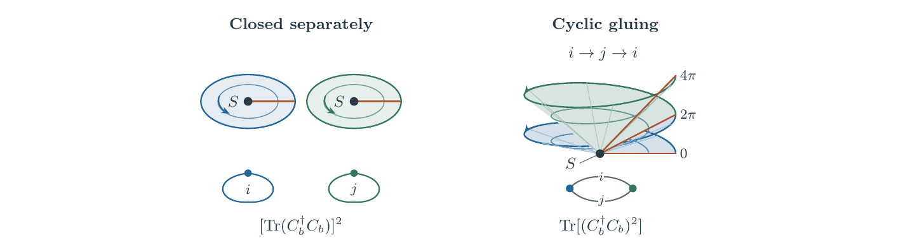

**Figure 33:** The disks show the plane normal to $S$ on two copies of the preparation. Closing the copies separately returns to the same copy in one turn and sums the state indices $i$ and $j$ independently. Cyclic gluing joins the ket of each copy to the bra of the other, so the two copies form a single trace with opening angle $4\pi$ at $S$.

On this background the logarithmic term in the graviton and ghost determinant is proportional to a bulk curvature integral [8]. At fixed $s$, we use the same Schwarzschild interior on each of the $n$ copies, whether we join them cyclically in the Lorentzian trace [28] or close them separately. The smooth bulk and cap contributions to the logarithm therefore cancel, leaving only the change in opening angle at $S$ (Appendix D.3 and Figure 33). On the smooth background $R_{ab}=0$, so the integral takes the four dimensional Gauss Bonnet form,

$$
\int_{\mathscr{D}}R_{abcd}R^{abcd}\,\bm{\epsilon}_{g}=\int_{\mathscr{D}}\bigl(R_{abcd}R^{abcd}-4R_{ab}R^{ab}+R^{2}\bigr)\,\bm{\epsilon}_{g}. \tag{5.67a}
$$

$$
2\pi n S n=1 R_{ab}=0
$$

$$
\displaystyle 2K^{ab}K^{(n)}_{ab}-2R_{abcd}\ell^{a}n^{b}\ell^{c}n^{d}=R[q]+2\Theta_{(\ell)}\Theta_{(n)}=R[q], \tag{5.67b}
$$

$$
\displaystyle\log\operatorname{Tr}(C_{b}^{\dagger}C_{b})=\frac{53}{45(4\pi)^{2}}\left(8\pi\int_{S}R[q]\,\mathrm{d}A\right)\log(s_{b}^{1/2})+O(1)=\frac{106}{45}\log s_{b}+O(1), \tag{5.67c}
$$

where we used $\int_{S}R[q]\,\mathrm{d}A=8\pi$ by the Gauss Bonnet theorem for a cut of two-sphere topology. In (5.66) the measure adds a factor of $1/2$ to the power $106/45$ from (5.67c). Using $s_{*}\propto\ell^{2}$ in (5.58) then yields

$$
q=\frac{257}{302}. \tag{5.68}
$$

The area term in (5.65) follows from the boost weight at $S$. The logarithm depends on how many interior states contribute at each area. To compare its coefficient with the first quantum correction to the thermodynamic entropy, we fix the mass measured at infinity. Evaluating (5.52a) on a Schwarzschild background of mass $M$ fixes the area of $S$ to be $16\pi G_{N}^{2}M^{2}$. Integrating over horizon areas in (5.66) therefore includes different Schwarzschild masses. To extract the density of states at a given $M$, we restore the factor $\exp(s)$ at each area and change variables from horizon area to mass. Rotational fluctuations shift $s$ by $O(1)$ at fixed $M$. With angular momenta summed, this change of variables yields the coefficient of $\log s_{b}$ in the entropy at fixed mass,

$$
s_{b}=\frac{4\pi G_{N}M^{2}}{\hbar},\ \frac{\mathrm{d}s_{b}}{s_{b}^{1/2}}\propto\mathrm{d}M,\ \frac{q}{2(1-q)}-\frac{1}{2}=\frac{106}{45}, \tag{5.69}
$$

in agreement with Sen’s classic result [78].

To expound upon this result, in deriving (5.68) we fix the maximum clock reading on the future null cone and sum over states on $\Sigma_{1}$ by gluing the future half of $\mathscr{D}$ to its time reflection. Only the relative boost at $S$ is analytically continued to a rotation. We can form this trace at any smooth marginally trapped surface bounding $\mathscr{D}$, including one inside the event horizon of a black hole formed by collapse (Figure 31). In the Euclidean calculation of [78], one instead expands the gravitational path integral about the Euclidean black hole saddle, where smoothly shrinking the thermal circle at the bifurcation surface fixes its period at infinity in terms of $M$. By computing $q$ for the gravitational clock on the future null cone of a marginally trapped surface, we have thus recovered the same logarithmic correction to the entropy of a Schwarzschild black hole at fixed mass.

### 5.4 Spatial topology and null states

When we build a spatial slice from causal diamonds, we can hold the data at its boundaries fixed and still vary how we join them in the interior. For example, a slice can connect two boundaries, or it can have two components, one ending on each boundary. To determine which fillings prepare independent quantum states, we compute their overlaps by gluing (4.29).

This issue arises even for a single boundary $\Sigma$ in the thermal trace (5.39b), since we can add arbitrarily many handles to the interior. For the states $|v_{i}\rangle=|\mathscr{M}_{i}\rangle$ prepared by these fillings, gluing $\mathscr{M}_{j}$ to the time reflection of $\mathscr{M}_{i}$ along $\Sigma$ yields

$$
\mathsf{G}_{ij}=\langle v_{i}|v_{j}\rangle,\ \bigl\|\sum_{i}c_{i}|v_{i}\rangle\bigr\|^{2}=c^{\dagger}\mathsf{G}c,\ \operatorname{rank}\mathsf{G}\leq d_{\mathscr{D}}. \tag{5.70}
$$

Any set of more than $d_{\mathscr{D}}$ such fillings therefore admits a null superposition [64]. Since the boundary preparations in (5.20) already span $\mathcal{H}_{\mathscr{D}}$, adding a handle can change an amplitude without adding an independent state to the trace.

With two boundaries we can prepare product states by filling each boundary separately. Gluing the connected filling $\mathscr{M}$ to its time reflection yields the squared norm of the state it prepares. A natural, as well as important, question is whether the Hilbert space of the two boundaries factorizes [45, 64], in which case the squared overlaps with an orthonormal basis of product states must sum to this norm.

To this aim, we compute each overlap by gluing one filling to each of the two boundaries of $\mathscr{M}$. These overlaps are the matrix elements of an operator $N_{\mathscr{M}}$ on $\mathcal{H}_{\Sigma}$. Time reflection conjugates amplitudes, so gluing $\mathscr{M}_{2}$ to the reflection of $\mathscr{M}_{1}$ sums their products over states at both boundaries,

$$
\langle\mathscr{M}_{1}|\mathscr{M}_{2}\rangle=\operatorname{Tr}_{\mathcal{H}_{\Sigma}}\bigl(N_{\mathscr{M}_{1}}^{\dagger}N_{\mathscr{M}_{2}}\bigr). \tag{5.71}
$$

We can prepare a complete orthonormal basis $|u_{i}\rangle$ independently at each boundary when boundary sources generate $\mathcal{B}(\mathcal{H}_{\Sigma})$. For the cap Hilbert space constructed in Section 5.1, boundary sources generate $\mathcal{B}(\mathcal{H}_{\mathscr{D}})$, so we can choose the basis states to have definite area or to be superpositions of different areas. The disjoint union $q_{ij}$ corresponds to $|u_{i}\rangle\langle u_{j}|$,

$$
q_{ij}=u_{i}\sqcup u_{j}^{\dagger},\ \langle q_{ij}|\mathscr{M}\rangle=(N_{\mathscr{M}})_{ij}. \tag{5.72}
$$

Subtracting the superposition over these product states with their respective overlaps yields

$$
\bigl\||\mathscr{M}\rangle-\sum_{i,j}(N_{\mathscr{M}})_{ij}|q_{ij}\rangle\bigr\|^{2}=\operatorname{Tr}(N_{\mathscr{M}}^{\dagger}N_{\mathscr{M}})-\sum_{i,j}|(N_{\mathscr{M}})_{ij}|^{2}=0. \tag{5.73}
$$

At an AdS boundary the sum in (5.73) can be infinite. With the boundary energies restricted to bounded intervals, $\operatorname{Tr}(N_{\mathscr{M}}^{\dagger}N_{\mathscr{M}})<\infty$ (Appendix E.3), so the superposition of product states converges in the physical norm. Since $|\mathscr{M}\rangle$ and this superposition differ by a null state, they represent the same physical state. Interactions in $H_{c}$ enter the coefficients $(N_{\mathscr{M}})_{ij}$, while (5.73) follows directly from gluing.

The reflected states $|u_{j}^{*}\rangle$ form a basis of the conjugate Hilbert space $\mathcal{H}_{\Sigma}^{*}$, so for the two boundaries we have

$$
\mathcal{K}_{\Sigma}\simeq\mathcal{H}_{\Sigma}\otimes\mathcal{H}_{\Sigma}^{*}. \tag{5.74}
$$

In the model of [64], a state of connected topology can have a nonzero component orthogonal to all product states. Here that component is null by (5.73), so spatial topology does not correspond to a superselection sector within $\mathcal{B}(\mathcal{H}_{\Sigma})$, whose center contains only multiples of the identity. At fixed area, we use $C_{\mathscr{D}}=c_{\mathscr{A}}U$ from Section 5.2, where $c_{\mathscr{A}}=\exp[-\mathscr{A}/(8G_{N}\hbar)]$. In the basis $U|u_{i}\rangle$ at the cap, we obtain coefficients $c_{\mathscr{A}}\delta_{ij}$; each term on the right of (5.73) is then $d_{\mathscr{A}}|c_{\mathscr{A}}|^{2}$, where $d_{\mathscr{A}}=\dim\mathcal{H}_{\Sigma,\mathscr{A}}$. After normalization, all $d_{\mathscr{A}}$ states on either side have equal probability, since the physical trace assigns unit weight to each rank one projection, so the entropy on either side is $\log d_{\mathscr{A}}$.

The Hartle Hawking state of a two sided Schwarzschild black hole illustrates the geometric content of (5.73) [62]. In the connected spacetime, a generator of the left past horizon continues through the bifurcation surface onto the right future horizon. On the disconnected caps, each horizon has its own corner (Figure 34). To compare the two descriptions, we place a reflecting wall in each exterior. At inverse temperature $\beta_{R}$ measured at either wall, the path integral over half the thermal circle assigns the product state $|q_{ij}\rangle$ the amplitude $\langle u_{i}|e^{-b\widehat{H}/\hbar}|u_{j}\rangle$ up to normalization, where $b=\hbar\beta_{R}/2$ and $\widehat{H}=\mathcal{Q}(H_{c})$ generates proper time translations at the wall [47, 60]. For a horizon of radius $r_{h}\gg\ell_{P}$, we expand $H_{c}$ to second order and retain one odd parity quadrupole [66]. At wall frequency $\omega$, the thermal amplitude pairs the state of $n$ gravitons on the left with its time reflection on the right,

$$
|\Psi_{\omega}\rangle\propto\sum_{n=0}^{\infty}e^{-nb\omega}|n\rangle_{L}|n^{*}\rangle_{R},\langle\mathfrak{a}_{L}\mathfrak{a}_{R}\rangle=\frac{1}{2\sinh(b\omega)}, \tag{5.75}
$$

where $\mathfrak{a}_{L}$ and $\mathfrak{a}_{R}$ are the annihilation operators for the respective graviton modes.

Choose future directed affine parameters $-u_{L}<0$ and $u_{R}>0$ on the two horizons, measured from their respective corners with the same normalization under time reflection. A translation in proper time at the right wall rescales $u_{R}$ by $e^{\pi\delta t_{R}/b}$, so a pair at frequency $\nu=b\omega/\pi$ enters the shear two point function with phase $(u_{L}/u_{R})^{i\nu}$. For $\ell_{P}\ll u_{L},u_{R}\ll r_{h}$, with $c_{\perp}$ as in (D.19), summing the paired modes yields

$$
\mathcal{G}_{\sigma}(-u_{L},u_{R})=-\frac{c_{\perp}}{u_{L}u_{R}}\int_{0}^{\infty}\frac{\nu\cos[\nu\log(u_{L}/u_{R})]}{\sinh(\pi\nu)}\,\mathrm{d}\nu=-\frac{c_{\perp}}{(u_{L}+u_{R})^{2}}. \tag{5.76}
$$

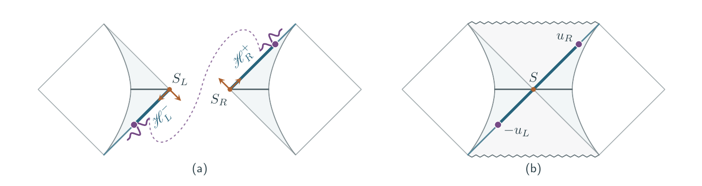

**Figure 34:** On the disconnected spacetime we dress each graviton insertion (violet) to the null frame at its own corner (orange), where the area operator generates boosts. Violet dashes denote entanglement between the modes in (5.75). In this state the Raychaudhuri equation along each horizon yields the same two point function (5.77b) of second null derivatives of area as at the two marked cuts on one generator through $S$.

The dependence on $u_{L}+u_{R}$ in (5.76) follows from entangling the left and right graviton modes as in (5.75), even on two fixed Schwarzschild backgrounds. When the horizons themselves fluctuate, the same entanglement correlates the areas of the two cuts, since the shear on each horizon focuses its null generators. For the odd parity quadrupole $Y_{AB}$ with $\int\mathrm{d}A_{0}\,Y_{AB}Y^{AB}=1$, the expansion vanishes through first order, so the Raychaudhuri equation (3.25e) yields

$$
\displaystyle\partial_{u}^{2}\widehat{\mathscr{A}}^{(2)}(u)=-\int\mathrm{d}A_{0}\,\mathopen{\vcentcolon}\,\widehat{\sigma}^{(1)}_{AB}(u)\widehat{\sigma}_{(1)}^{AB}(u)\,\mathclose{\vcentcolon}, \tag{5.77a}
$$

$$
\displaystyle\big\langle\partial_{u_{L}}^{2}\widehat{\mathscr{A}}^{(2)}_{L}(u_{L})\,\partial_{u_{R}}^{2}\widehat{\mathscr{A}}^{(2)}_{R}(u_{R})\big\rangle_{c}=2\mathcal{G}_{\sigma}(-u_{L},u_{R})^{2}=\frac{2c_{\perp}^{2}}{(u_{L}+u_{R})^{4}}. \tag{5.77b}
$$

The factor of two counts the Wick contractions between cuts after normal ordering in the freely falling vacuum. Thus the area fluctuations on the disconnected caps reproduce the dependence on affine parameter along one Schwarzschild horizon generator from $-u_{L}$ to $u_{R}$.

## 6 The semiclassical limit

A state sharply peaked about smooth initial data $\mathfrak{h}_{\Sigma_{0}}$ specifies a classical geometry on the incoming null cone. For its time evolution to describe a spacetime between the external boundaries, metrics reconstructed in neighboring causal diamonds must agree on their overlap. We follow the metric measured relative to the local Lorentz frame of the boundary in each causal diamond. In this limit, invariance of the amplitude under field shifts in the interior yields the Einstein equations in each subregion, and matching Cauchy data across the intermediate slices joins their solutions into a single spacetime between the external boundaries, as in Figure 19.

At the next order the center of the incoming state no longer suffices to determine the metric. Its fluctuations propagate into both the bulk fields and the boundary frame relative to which they are dressed. For an incoming coherent state, the connected two point function of the metric through $O(\hbar)$ determines the correction $\langle\widehat{g}_{ab}\rangle-g_{0\,ab}$ to the classical metric $g_{0}$.

### 6.1 The classical solution

In an incoming coherent state the expectation values of the canonical variables specify smooth boundary data $\mathfrak{h}_{\Sigma_{i}}$. We can use their time evolution to determine which classical spacetime the state describes. In canonical variables $\phi=(q,p)$, with $\mathfrak{h}=\iota_{t}(\phi)$, we take $\hbar\to 0$ at fixed initial data $\phi_{i}$. The variance of each smeared canonical variable is $O(\hbar)$, so over a time interval on which the state remains localized in the reduced phase space, the expectation value of a smoothly smeared observable follows the classical trajectory through $\phi_{i}$ generated by $H_{c}$ in (3.53b).

With the quantization of Appendix C.2, the Heisenberg time evolution of $\mathcal{Q}(\mathcal{O})$ reduces at leading order to Hamiltonian time evolution. For $\iota_{t_{i}}(\phi_{i})=\mathfrak{h}_{\Sigma_{i}}$, the classical trajectory $\phi(t)$ satisfies Hamilton’s equations with incoming data $\phi(t_{i})=\phi_{i}$,

$$
\frac{i}{\hbar}[\mathcal{Q}(H_{c}),\mathcal{Q}(\mathcal{O})]=\mathcal{Q}(\{\mathcal{O},H_{c}\})+O(\hbar^{2}), \tag{6.1a}
$$

$$
\dot{q}^{k}=\{q^{k},H_{c}\},\ \dot{p}_{k}=\{p_{k},H_{c}\}. \tag{6.1b}
$$

Given a dimensionless functional $f[\phi]$, we deform the action to $I_{\mathscr{M}}+\hbar f$ and calculate

$$
\langle R_{V_{\mathscr{M}}}(\hbar f)\rangle_{\phi_{i}}=e^{if[\phi]}\bigl[1+O(\hbar)\bigr], \tag{6.2}
$$

where $V_{\mathscr{M}}=-\int H_{c}\,\mathrm{d}t$ and $\langle\cdot\rangle_{\phi_{i}}$ denotes expectation values in the incoming state. For smooth $f$ the correction starts at $O(\hbar)$ because $\langle\widehat{\phi}^{I}-\phi_{i}^{I}\rangle_{\phi_{i}}=0$ and $\langle(\widehat{\phi}^{I}-\phi_{i}^{I})^{2}\rangle_{\phi_{i}}=O(\hbar)$ for each smeared component of the incoming data.

Hamiltonian time evolution specifies a trajectory for the incoming data, so to establish that the metric along it solves the Einstein equations, we use the invariance of the amplitude under changes of the fields in the interior. For a shift $\phi\mapsto\phi+rs$ supported there, (4.2d) implies invariance for every $r$. Differentiating at $r=0$ and evaluating the variation on the classical trajectory at leading order using (6.2) yields

$$
R_{V_{\mathscr{M}}}(\Delta_{rs}I_{\mathscr{M}})=\widehat{1},\ \langle\delta_{s}I_{\mathscr{M}}\rangle_{\phi_{i}}=0,\ \delta_{s}I_{\mathscr{M}}[\phi]=0. \tag{6.3}
$$

On $\mathfrak{S}=\mathfrak{T}=0$, stationarity imposes the field equations (3.5). Using $B^{\mu\nu}=(1/2)\epsilon^{\mu\nu}{}_{\rho\sigma}e^{\rho}\curlywedge e^{\sigma}$ and $\epsilon^{\mu\nu\rho\sigma}\Phi_{\mu\nu\rho\sigma}=\penalty 4\Lambda$, we then obtain

$$
R_{ab}-\frac{1}{2}Rg_{ab}+\Lambda g_{ab}=0. \tag{6.4}
$$

Thus $\phi(t)$ determines a solution of the nonlinear Einstein equations with incoming data $\mathfrak{h}_{\Sigma_{i}}$.

To calculate the outgoing expectation values, we write $E_{\mathscr{M}}(\mathfrak{h}_{\Sigma_{i}})$ for the classical data on $\Sigma_{f}$. For $f_{+}$ supported after $V_{\mathscr{M}}$, composition in time implies $S_{I_{0}}(V_{\mathscr{M}}+\hbar f_{+})=S_{I_{0}}(\hbar f_{+})S_{I_{0}}(V_{\mathscr{M}})$, so $R_{V_{\mathscr{M}}}(\hbar f_{+})=U_{\mathscr{M}}^{\dagger}S_{I_{0}}(\hbar f_{+})U_{\mathscr{M}}$. Consequently,

$$
\left\langle U_{\mathscr{M}}^{\dagger}S_{I_{0}}(\hbar f_{+})U_{\mathscr{M}}\right\rangle_{\phi_{i}}=e^{if_{+}[E_{\mathscr{M}}(\mathfrak{h}_{\Sigma_{i}})]}\bigl[1+O(\hbar)\bigr]. \tag{6.5}
$$

Matching the classical solutions across a glued boundary implies $E_{\mathscr{M}_{2}\circ\mathscr{M}_{1}}=E_{\mathscr{M}_{2}}\circ E_{\mathscr{M}_{1}}$.

### 6.2 Graviton fluctuations and backreaction

A graviton fluctuation with vanishing expectation value can still source the metric through the quadratic term in the Einstein tensor. The relevant quantity at one loop is the connected graviton two point function. For an incoming Gaussian state $\rho_{G}$, fluctuations of the initial data have variance $O(\hbar)$, whereas the first correction to Hamiltonian time evolution in the commutator of Section 6.1 is $O(\hbar^{2})$ [67]. Through one loop, $\langle\widehat{g}_{ab}\rangle$ therefore depends on classical time evolution of fluctuations in incoming data.

For fixed smearings, let $\phi^{I}$ denote the components of the incoming canonical pairs $(q,p)$. The two point function of their fluctuations is

$$
\Sigma^{IJ}=\frac{1}{2}\langle\{\Delta\widehat{\phi}^{I},\Delta\widehat{\phi}^{J}\}\rangle_{\rho_{G}}=O(\hbar), \tag{6.6}
$$

where $\Delta\widehat{\phi}^{I}=\widehat{\phi}^{I}-\phi_{0}^{I}$ and $\phi_{0}^{I}=\langle\widehat{\phi}^{I}\rangle_{\rho_{G}}$. To propagate these fluctuations to the interior, we vary the initial data and solve for the resulting perturbation of the classical fields. At a fixed spacetime point, varying (3.5) yields

$$
\displaystyle\nabla_{[a}(\delta B)^{\mu\nu}{}_{bc]}+\delta\omega_{[a}{}^{\mu}{}_{\rho}B^{\rho\nu}{}_{bc]}+\delta\omega_{[a}{}^{\nu}{}_{\rho}B^{\mu\rho}{}_{bc]}=0, \tag{6.7a}
$$

$$
\displaystyle 2\nabla_{[a}\delta\omega_{b]}{}^{\mu\nu}=(\delta\Phi)^{\mu\nu}{}_{\rho\sigma}B^{\rho\sigma}{}_{ab}+\Phi^{\mu\nu}{}_{\rho\sigma}(\delta B)^{\rho\sigma}{}_{ab}, \tag{6.7b}
$$

with $\delta\mathfrak{S}=0$. Varying $\nabla_{[a}e^{\mu}{}_{b]}=0$ fixes $\delta\omega$ in terms of $\delta e^{\mu}{}_{a}$. Together with the linearized simplicity constraint, the second equation then implies $\delta R_{ab}=\Lambda\,\delta g_{ab}$. We use the reduced symplectic form $\Omega$ to normalize the graviton modes that solve these linearized equations.

When we dress the metric to the boundary frame, the same variation can displace the event at which we measure the field. We therefore vary $X^{*}g$ using (3.40), with $\chi^{a}=(\delta X\circ X^{-1})^{a}$ for the map $X$ of Section 3.5 [80, 18]. Under a second variation $\delta^{\prime}$, the event at which we evaluate $\delta g$ moves by $\chi^{\prime}{}^{a}=(\delta^{\prime}X\circ X^{-1})^{a}$, and $\chi^{a}$ itself varies. For commuting variations we therefore have

$$
\delta^{\prime}\delta(X^{*}g)=X^{*}\bigl[\delta^{\prime}\delta g+\pounds_{\chi^{\prime}}\delta g+\pounds_{\chi}\delta^{\prime}g+\pounds_{\delta^{\prime}\chi}g+\pounds_{\chi^{\prime}}\pounds_{\chi}g\bigr]. \tag{6.8}
$$

At a fixed reference point $p$, expanding the pulled back metric $g_{ab}(p)$ about $\phi_{0}=\langle\widehat{\phi}\rangle$ yields

$$
\displaystyle\bar{g}_{ab}(p)=g_{ab}(p)+\frac{1}{2}(\delta_{I}\delta_{J}g_{ab})(p)\Sigma^{IJ}+O(\hbar^{2}), \tag{6.9a}
$$

$$
\displaystyle\mathcal{G}_{abc^{\prime}d^{\prime}}(p,p^{\prime})=(\delta_{I}g_{ab})(p)\Sigma^{IJ}(\delta_{J}g_{c^{\prime}d^{\prime}})(p^{\prime})+O(\hbar^{2}). \tag{6.9b}
$$

Here $\bar{g}_{ab}=\langle\widehat{g}_{ab}\rangle$ and $\mathcal{G}$ is the two point function of metric fluctuations, symmetrized in its arguments. Primed indices refer to the second point. Moreover, with $J^{IJ}=\{\phi^{I},\phi^{J}\}$, the connected Wightman function is

$$
\langle\widehat{g}_{ab}(p)\widehat{g}_{c^{\prime}d^{\prime}}(p^{\prime})\rangle_{c}=(\delta_{I}g_{ab})(p)\left(\Sigma^{IJ}+\frac{i\hbar}{2}J^{IJ}\right)(\delta_{J}g_{c^{\prime}d^{\prime}})(p^{\prime})+O(\hbar^{2}). \tag{6.10}
$$

To determine $\bar{g}_{ab}-g_{0\,ab}$, we use $E_{ab}[g(\phi)]=0$ for every solution in the family containing $g_{0}=g(\phi_{0})$, where $E_{ab}[g]=G_{ab}[g]+\Lambda g_{ab}$ by (3.5). With the convention

$$
E_{ab}[g_{0}+\varepsilon h]=\varepsilon E^{(1)}_{ab}[h]+\varepsilon^{2}E^{(2)}_{ab}[h,h]+O(\varepsilon^{3}), \tag{6.11}
$$

commuting variations $\delta,\delta^{\prime}$ of the incoming data satisfy $E^{(1)}_{ab}[\delta g]=0$ and

$$
E^{(1)}_{ab}[\delta^{\prime}\delta g]=-2E^{(2)}_{ab}[\delta g,\delta^{\prime}g]. \tag{6.12}
$$

To obtain backreaction from (6.12), we use the two point function $\Sigma^{IJ}$ of fluctuations in the incoming data. By (6.9), $\tfrac{1}{2}\Sigma^{IJ}\delta_{I}\delta_{J}g$ is the shift $\bar{g}-g_{0}$ to order $\hbar$, while $\Sigma^{IJ}$ pairs $\delta_{I}g$ with $\delta_{J}g$ to form the graviton two point function $\mathcal{G}$. Keeping terms through first order in $\hbar$ in (6.11) and (6.12), the equation for the expectation value becomes

$$
E_{ab}[\bar{g}]+\langle E^{(2)}_{ab}[h,h]\rangle_{\mathcal{G}}=O(\hbar^{2}). \tag{6.13}
$$

Here $\langle h_{ab}(p)h_{c^{\prime}d^{\prime}}(p^{\prime})\rangle_{\mathcal{G}}=\mathcal{G}_{abc^{\prime}d^{\prime}}(p,p^{\prime})$ is the associated symmetrized two point function. With smearing held fixed, we differentiate at separated points before taking $p^{\prime}\to p$, for example

$$
\langle\nabla_{e}h_{ab}\nabla_{f}h_{cd}\rangle_{\mathcal{G}}=\left[\nabla_{e}\nabla_{f^{\prime}}\mathcal{G}_{abc^{\prime}d^{\prime}}(p,p^{\prime})\right]_{p^{\prime}=p}. \tag{6.14}
$$

We expand the contracted Bianchi identity for $g_{0}+\varepsilon h$ with $h_{ab}=\delta g_{ab}$. At order $\varepsilon^{2}$ the terms from varying the divergence operator vanish by the background field equations and their linearization, so the quadratic source in (6.13) is conserved,

$$
\displaystyle E[g_{0}]=E^{(1)}[h]=0,\ \nabla^{a}E^{(2)}_{ab}[h,h]=0. \tag{6.15}
$$

$$
\bar{g}=g_{0}+\Delta g
$$

$$
\displaystyle\Delta g=\Delta g_{0}-\mathcal{G}_{R}\langle E^{(2)}[h,h]\rangle_{\mathcal{G}}+O(\hbar^{2}), \tag{6.16}
$$

where $\mathcal{G}_{R}$ is the retarded Green’s function of the linearized Einstein equations on the reduced phase space. The homogeneous solution $\Delta g_{0}$ propagates perturbations of initial data from $\Sigma_{0}$, with only graviton and edge mode fluctuations in the causal past of the event at which we evaluate $\Delta g$ entering the integral against $\mathcal{G}_{R}$.

Finally, joining the forward time evolution to its adjoint at the final cap sums over final states while keeping the incoming state fixed [13]. Appendix D.1 shows that, with the reduced measure and the same boundary conditions, the resulting one loop generating functional agrees with that of constrained general relativity [32]. For coherent incoming data, its source derivatives yield the graviton two point function in (6.9) that drives the backreaction in (6.13).

## Acknowledgements

For helpful discussions and comments on the draft, I thank Ahmed Abdalla, Raphael Bousso, Xi Dong, Éanna Flanagan, Tom Hartman, Luca Iliesiu, Adam Levine, Guanda Lin, Juan Maldacena, Geoff Penington, Eva Silverstein, Andy Strominger, Gabriele Di Ubaldo, Misha Usatyuk, and especially Wayne Weng. I also thank Sam Altman, Sebastien Bubeck, and my OpenAI colleagues for encouragement throughout the project. Several of the calculations and proofs in this paper were developed through detailed, back and forth collaboration with GPT-6 Astra over the course of many months, amounting to $\sim$400M total tokens spent; I thank OpenAI for providing this compute.

## Appendix A Null constraints and symplectic reduction

To quantize the gravitational boundary data of Section 3, we need the Poisson brackets of the radiative modes on intersecting null cones, both with one another and with the degrees of freedom at the corner. We derive these brackets here from the first order action, allowing the cuts to move as we vary the fields. After imposing the null constraints, we invert the reduced symplectic form including the terms that couple the corner area and boundary frame to the radiative modes.

### A.1 The tetrad and spin connection on a null boundary

To identify the momentum conjugate to the conformal metric on a null cone, we separate the terms supported on the two cuts bounding it from the radiative part of the variation of the first order action. In (3.37) the area form $\bm{\mu}$ pairs with $\delta\beta$. For $\ell\cdot n=-1$, the components of $\beta_{a}=-n_{\mu}\nabla_{a}\ell^{\mu}$ in (B.2h) are

$$
\beta_{v}=\partial_{v}\log N,\ \beta_{A}=w_{A}-\frac{1}{2}\mathring{\nabla}_{A}f,\ f=-\log N. \tag{A.1}
$$

Holding the tetrad fixed in (3.37), we obtain

$$
\left.\int_{\mathscr{H}}\bm{\theta}_{\mathscr{M}}\right|_{\delta e=0}=-\frac{\epsilon_{\mathscr{H}}}{8\pi G_{N}}\int_{\mathscr{H}}\bm{\eta}\bigl(\delta\kappa+\delta\Theta_{(\ell)}\bigr). \tag{A.2}
$$

The variation of the null boundary action cancels this term for the orientation in (3.15b) [59, 56]. To see how this cancellation works before we impose vanishing torsion, we use the relation between the expansion and the area two form,

$$
\pounds_{\ell}\bm{\mu}=(\Theta_{(\ell)}+E_{\mu}{}^{A}T^{\mu}_{\ell A})\bm{\mu},\ I_{\mathscr{H}}=\frac{\epsilon_{\mathscr{H}}}{8\pi G_{N}}\int_{\mathscr{H}}\bm{\eta}\bigl(\kappa-E_{\mu}{}^{A}T^{\mu}_{\ell A}\bigr). \tag{A.3}
$$

For $T^{\mu}=\delta T^{\mu}=0$ we thus have

$$
\delta I_{\mathscr{H}}=\frac{\epsilon_{\mathscr{H}}}{8\pi G_{N}}\,\delta\int_{\mathscr{H}}\bm{\eta}\,\kappa. \tag{A.4}
$$

On $\Sigma_{0}$ and $\Sigma_{1}$ the extrinsic curvature terms in (3.15a) cancel the terms proportional to $\delta K_{i}$. We can now read off the boundary momenta from the remaining coefficients of $\delta e^{\mu}$. In particular, separating the trace of $K_{AB}$ from the shear identifies the momenta conjugate to $\varrho^{2}$ and the conformal metric in Section 3. The improvement $\mathrm{d}\bm{\alpha}$ in (3.34) makes a simultaneous local Lorentz transformation of the tetrad and spin connection a degeneracy of the symplectic form on torsion free configurations [30].

With both null normals allowed to vary, the variations of $\nabla_{[a}e^{\mu}{}_{b]}=0$ and $F^{\mu\nu}{}_{ab}$ are

$$
\nabla_{[a}\delta e^{\mu}{}_{b]}+\delta\omega^{\mu}{}_{\nu[a}e^{\nu}{}_{b]}=0,\ \delta F^{\mu\nu}{}_{ab}=2\nabla_{[a}\delta\omega_{b]}{}^{\mu\nu}. \tag{A.5}
$$

Writing $h_{ab}=2e_{\mu(a}\delta e^{\mu}{}_{b)}$ and $h=g^{ab}h_{ab}$, we use the torsion free connection in (A.5) to express the potential $\bm{\theta}_{\mathscr{M}}+\mathrm{d}\bm{\alpha}$ in metric variables [30],

$$
(\bm{\theta})_{abc}=\frac{\epsilon_{dabc}}{16\pi G_{N}}(\nabla_{e}h^{de}-\nabla^{d}h). \tag{A.6}
$$

Writing the null normal as

$$
\ell_{a}=-\exp(\psi)\nabla_{a}t, \tag{A.7}
$$

we separate a change in its normalization from a change in its direction by setting $\upsilon^{a}=\delta\ell^{a}-\ell^{a}\delta\psi=-h^{ab}\ell_{b}$. Indeed, $\ell_{a}\upsilon^{a}=0$, and it is the angular part of $\upsilon^{a}$ that changes the direction. With $q^{ab}h_{ab}=h-2n_{a}\upsilon^{a}$ the projection of (A.6) onto a cut then yields

$$
\bm{\theta}\big|_{\mathscr{H}}=\frac{1}{8\pi G_{N}}\delta(\kappa\bm{\eta})+\mathrm{d}\bm{b}+\bm{\mathcal{E}}, \tag{A.8}
$$

with

$$
16\pi G_{N}\,\bm{\mathcal{E}}=\bm{\eta}\left[\sigma^{ab}h_{ab}-\left(\kappa+\frac{1}{2}\Theta_{(\ell)}\right)q^{ab}h_{ab}-2(\varpi_{a}+\Theta_{(\ell)}n_{a})\upsilon^{a}+2\Theta_{(\ell)}\delta\psi\right], \tag{A.9}
$$

where $16\pi G_{N}\,\bm{b}=(h-2\delta\psi)\bm{\mu}+i_{\upsilon}\bm{\eta}$. For $\left.h_{ab}\ell^{a}\ell^{b}\right|_{\mathscr{H}}=0$,

$$
\delta\kappa-\kappa\,\delta\psi-\ell^{a}\nabla_{a}(\delta\psi)=\upsilon^{a}\nabla_{a}\psi+\frac{1}{2}n^{a}\nabla_{a}(h_{bc}\ell^{b}\ell^{c}). \tag{A.10}
$$

The boundary action thus cancels the exact variation of $\kappa\bm{\eta}$ with the sign appropriate to the orientation of the null boundary, yielding the symplectic current $\bm{\omega}=\delta\bm{\mathcal{E}}+\mathrm{d}\delta\bm{b}$ [17].

### A.2 Corners and edge modes

We saw in Section 3.2 that the corner charge $\mathscr{K}(y)$ is conjugate to a relative boost. To compute the brackets of these variables with the radiative modes in (A.9), we first need to know what freedom remains in identifying the null generators on the two null boundaries once their induced metrics agree at the corner. For $\mathscr{H}_{L}$ and $\mathscr{H}_{R}$ intersecting at $S$, we write the induced metric on $\mathscr{H}_{j}$ as

$$
q_{AB}=\varrho_{S}(y)^{2}v_{j}^{2}\bar{q}_{AB}, \tag{A.11}
$$

where $j=L,R$, $v_{j}|_{S}=1$ and $\varrho_{S}(y)=\varrho|_{S}$. In these coordinates the induced metrics agree when $\bar{q}_{L}|_{S}=\bar{q}_{R}|_{S}$, while the relative normalization of the two null generators can still vary through $\lambda=-\log|\partial_{v_{L}}\cdot\partial_{v_{R}}|$.

Varying the angular identification also displaces the null generators on one null boundary relative to those on the other. The momenta for these displacements depend on the normal connections $\varpi_{L},\varpi_{R}$. The angular coordinates $s_{j}^{i}(y)$ specify where the null generator labeled by $y$ meets the cut, and their gradients form the Jacobian of $s_{j}$. Choosing the left sided null generators as coordinates sets $s_{L}=\mathrm{id}$, so the relative angular identification $Y=s_{R}$ has momentum $p_{i}$,

$$
\displaystyle t_{L}=\varrho_{S}(y)^{2}(\mathrm{d}\lambda+\varpi_{L}-\varpi_{R}), \tag{A.12a}
$$

$$
\displaystyle t_{R}=\varrho_{S}(y)^{2}(\mathrm{d}\lambda-\varpi_{L}+\varpi_{R}), \tag{A.12b}
$$

$$
\displaystyle\widetilde{t}_{ji}\mathring{\nabla}_{a}s_{j}^{i}=t_{ja}, \tag{A.12c}
$$

$$
\displaystyle p_{i}=\frac{\widetilde{t}_{Ri}}{16\pi G_{N}}. \tag{A.12d}
$$

Together with the pair $(\mathscr{K}(y),\lambda)$, the two angular pairs $(Y^{i},p_{i})$ account for the three corner degrees of freedom and their momenta. Their coupling to the conformal metric on each null boundary follows from the symplectic form in these coordinates.

On each null boundary we use the coordinates $z_{j}$ of (4.21a) and define $\xi_{j}=\delta s_{j}\circ s_{j}^{-1}$, so

$$
\delta^{y}z_{j}=\delta z_{j}-\pounds_{\xi_{j}}z_{j},\ \delta^{o}z_{j}=\delta^{y}z_{j}-\frac{v_{j}}{2}\delta^{y}\log(\varrho_{S}(y)^{2})\,\partial_{v_{j}}z_{j}. \tag{A.13}
$$

Here $\delta^{y}z_{j}$ removes the variation induced by changing $s_{j}$, while $\delta^{o}z_{j}$ compares variations at the same area. The Lie derivatives act on the conformal metric, then on its coordinates $z_{j}$. Substitution in $\Omega$ yields [72, 73]

$$
\displaystyle\Omega=\frac{1}{16\pi G_{N}}\sum_{j=L,R}\int_{S}\bm{\epsilon}_{0}\bigg[\delta\lambda\wedge\delta(\varrho_{S}(y)^{2})+\delta\widetilde{t}_{ji}\wedge\delta s_{j}^{i}-\frac{1}{2}\delta^{y}(\varrho_{S}(y)^{2})\wedge\mathsf{g}_{\alpha\beta}\,\partial_{v_{j}}z_{j}^{\alpha}\,\delta^{y}z_{j}^{\beta} \tag{A.14}
$$

$$
\displaystyle+\varrho_{S}(y)^{2}\int_{1}^{b_{j}}v_{j}^{2}\mathsf{g}_{\alpha\beta}\,\nabla_{v_{j}}(\delta^{o}z_{j})^{\alpha}\wedge(\delta^{o}z_{j})^{\beta}\mathrm{d}v_{j}\bigg].
$$

Along a curve $z^{\alpha}(v)$ the covariant derivative of a variation $X^{\alpha}$ is

$$
\nabla_{v}X^{\alpha}=\partial_{v}X^{\alpha}+\Gamma^{\alpha}{}_{\beta\gamma}(\partial_{v}z^{\beta})X^{\gamma}, \tag{A.15}
$$

with $\Gamma^{\alpha}{}_{\beta\gamma}$ determined by $\mathsf{g}_{\alpha\beta}$. For the three corner pairs we obtain [14]

$$
\Omega\supset\int_{S}\bm{\epsilon}_{0}\bigl[\delta\lambda\wedge\delta\mathscr{K}(y)+\delta p_{i}\wedge\delta Y^{i}\bigr], \tag{A.16}
$$

while the mixed terms in (A.14) couple $\varrho_{S}(y)^{2}$ and $s_{j}$ to $z_{j}$.

At an outer cut $C_{j}=\{v_{j}=b_{j}\}$ the variation depends on how we specify its location. Fixing $\varrho_{C_{j}}^{2}$ determines $b_{j}$. Holding the affine coordinate $u(b,z)$ fixed instead determines the displacement of the cut and hence its area variation,

$$
\displaystyle b_{j}^{2}=\frac{\varrho_{C_{j}}(s_{j})^{2}\lvert\det(\mathring{\nabla}_{a}s_{j}^{i})\rvert}{\varrho_{S}(y)^{2}}, \tag{A.17a}
$$

$$
\displaystyle\delta b=\left.(\partial_{u}v)\right|_{v=b}[\delta[u(b,z)]-(\delta_{z}u)(b)], \tag{A.17b}
$$

$$
\displaystyle\delta\bm{\mu}_{C}=[b^{2}\delta(\varrho_{S}(y)^{2})+2\varrho_{S}(y)^{2}b\,\delta b]\bm{\epsilon}_{0}. \tag{A.17c}
$$

The symplectic potential on the spacelike cap bounded by $C$ contains

$$
-\frac{\epsilon_{C}}{8\pi G_{N}}\int_{C}\log(-n_{C}\cdot\ell)\,\delta\bm{\mu}_{C}, \tag{A.18}
$$

where $n_{C}$ is the future unit normal of the cap and $\epsilon_{C}$ is its oriented sign.

A cut at fixed affine parameter can move in the area coordinate as we vary the fields. Its displacement $Y_{u}$ enters the variation $X^{\alpha}$ of the conformal metric,

$$
Y_{u}=\delta^{y}u-\frac{v\,\delta^{y}\log(\varrho_{S}(y)^{2})}{2\partial_{u}v},\ X^{\alpha}=\delta^{y}_{u}z^{\alpha}+Y_{u}\partial_{u}z^{\alpha}. \tag{A.19}
$$

For a second variation $\delta^{\prime}$ we write $X^{\prime}{}^{\alpha}$ and $Y^{\prime}_{u}$ for the same quantities. The contribution of the null boundaries to the symplectic form is

$$
\Omega_{\mathscr{H}}(\delta,\delta^{\prime})=\frac{1}{16\pi G_{N}}\sum_{j}\int_{S}\bm{\epsilon}_{0}\int\varrho_{S}(y)^{2}v^{2}\left[X^{\prime}_{\alpha}\nabla_{u}X^{\alpha}-X_{\alpha}\nabla_{u}X^{\prime}{}^{\alpha}\right]\mathrm{d}u. \tag{A.20}
$$

In addition to terms linear in the displacements $Y_{u}$ and $Y^{\prime}_{u}$, the integrand in (A.20) contains the mixed term

$$
\mathsf{g}_{\alpha\beta}Y^{\prime}_{u}(\partial_{u}z^{\beta})\nabla_{u}(Y_{u}\partial_{u}z^{\alpha})-(\delta\leftrightarrow\delta^{\prime}). \tag{A.21}
$$

At the corner, varying (3.27) yields the displacement entering (A.19),

$$
\delta u(1,y)=\delta u(\epsilon,y)+\delta\left[\frac{u_{*}(y)}{p_{\epsilon,y}}\right]. \tag{A.22}
$$

To find how the affine parameter of a cut at fixed $v$ depends on the conformal metric, we vary the null constraint $\mathfrak{C}_{\ell}=0$. Writing $u=u(1,y)+\exp(\Gamma)s$, we separate off changes in affine origin and normalization by introducing $f$. Holding the area parameter fixed under variations, we obtain

$$
\displaystyle f=(\partial_{u}v)[\delta u-\delta u(1,y)-(u-u(1,y))\delta\Gamma], \tag{A.23a}
$$

$$
\displaystyle\delta_{v}z=\delta_{u}^{y}z+f\partial_{v}z, \tag{A.23b}
$$

$$
\displaystyle\delta\log(\partial_{u}v)=-\delta\Gamma-\partial_{v}f-\kappa_{v}f, \tag{A.23c}
$$

$$
\displaystyle\kappa_{v}=-\partial_{v}\log(\partial_{u}v)=\frac{v}{4}\mathsf{g}_{\alpha\beta}(\partial_{v}z^{\alpha})(\partial_{v}z^{\beta}). \tag{A.23d}
$$

Linearizing $\mathfrak{C}_{\ell}=0$ yields

$$
\left(\partial_{v}^{2}-\kappa_{v}\partial_{v}+\frac{\kappa_{v}}{v}\right)f=\frac{v}{2}\mathsf{g}_{\alpha\beta}(\partial_{v}z^{\alpha})\nabla_{v}(\delta_{u}^{y}z)^{\beta}. \tag{A.24}
$$

The corner data $f(1)$ and $(\partial_{v}f)(1)$ fix the coefficients of the two homogeneous solutions

$$
v,\ v\int_{1}^{v}\frac{\mathrm{d}w}{w^{2}(\partial_{u}v)(w)}. \tag{A.25}
$$

Including variations of radiative modes, we obtain

$$
f(v)=vf(1)+G(v,1)[(\partial_{v}f)(1)-f(1)]+\int_{1}^{v}G(v,w)\frac{w}{2}\mathsf{g}_{\alpha\beta}(\partial_{w}z^{\alpha})\nabla_{w}(\delta_{u}^{y}z)^{\beta}\,\mathrm{d}w, \tag{A.26}
$$

where

$$
G(v,w)=vw(\partial_{u}v)(w)\int_{w}^{v}\frac{\mathrm{d}s}{s^{2}(\partial_{u}v)(s)}. \tag{A.27}
$$

On a smooth null cone, $(\partial_{v}\bar{q})^{AB}\delta\bar{q}_{AB}=2\mathsf{g}_{\alpha\beta}(\partial_{v}z^{\alpha})\delta z^{\beta}$ expresses the shear terms of (3.42) in these coordinates. Varying the angular identification also yields the terms involving $s_{j}$ in (A.14).

For the null normals $\ell_{p},\ell_{q}$ on the intersecting null cones, we write $k_{q}=\exp(\Gamma_{q})\ell_{q}$. Then $\Gamma_{q}=\log(-\ell_{p}\cdot k_{q})-\eta$, where $\eta=\log(-\ell_{p}\cdot\ell_{q})$. At fixed $\ell_{p},\ell_{q}$, $k_{q}\mapsto\exp(s)k_{q}$ implies $\Gamma_{q}\mapsto\Gamma_{q}+s$. The two corner terms therefore combine into one canonical pair, $(\mathscr{K}(y),\lambda-\gamma)$,

$$
-\mathscr{K}(y)\delta\lambda+\mathscr{K}(y)\delta\gamma=-\mathscr{K}(y)\delta(\lambda-\gamma). \tag{A.28}
$$

As for the angular coordinates, $Y$ identifies the copies of $S$ on $\mathscr{H}_{p}$ and $\mathscr{H}_{q}$, so we match their area two forms after pullback by $Y$. The clock on each null cone fixes its own $\varrho_{S,p}$ or $\varrho_{S,q}$ through (3.26d). With inward null generators, the area elements and normal connections obey

$$
Y^{*}(\varrho_{S,q}^{\,2}\bm{\epsilon}_{0,q})=\varrho_{S,p}^{\,2}\bm{\epsilon}_{0,p},\ \varpi_{p}+Y^{*}\varpi_{q}=\mathrm{d}\eta. \tag{A.29}
$$

### A.3 The null constraints

At a given affine parameter the area element depends on the shear integrated from the vertex. In using this relation to define a clock it matters whether we vary the null data or merely reparametrize the same null generator. For a choice of parameter $v$ the constraint $\mathfrak{C}_{v}=0$ generates the latter transformation, while the momentum conjugate to $\varrho^{2}$ in the symplectic potential is proportional to $\mu=\kappa+(\partial_{v}\varrho^{2})/(2\varrho^{2})$. Including the terms at the cuts in $\Theta_{\partial}$, we have [53]

$$
\displaystyle\Theta=\frac{1}{8\pi G_{N}}\int\left[-\mu\,\delta(\varrho^{2})+\frac{\varrho^{2}}{2}\mathsf{g}_{\alpha\beta}\,\partial_{v}z^{\alpha}\,\delta z^{\beta}\right]\mathrm{d}v+\Theta_{\partial}, \tag{A.30a}
$$

$$
\displaystyle\mathfrak{C}_{v}=\partial_{v}^{2}\varrho^{2}-\mu(\partial_{v}\varrho^{2})+\frac{\varrho^{2}}{2}\mathsf{g}_{\alpha\beta}(\partial_{v}z^{\alpha})(\partial_{v}z^{\beta})=0. \tag{A.30b}
$$

For affine $u$, $\mathfrak{C}_{u}=\varrho^{2}\mathfrak{C}_{\ell}$. A reparametrization generated by $(8\pi G_{N})^{-1}\int f\mathfrak{C}_{v}\,\mathrm{d}v$ has charge $[\varrho^{2}\partial_{v}f-f\partial_{v}\varrho^{2}]/(8\pi G_{N})$ at a cut [53].

We choose a parameter $V$ satisfying $\mu=\partial_{v}\log(\partial_{v}V)$ [24, 25], and write $\varrho^{2}=\varrho(V)^{2}$ and $z=\zeta(V)$. With $\dot{\zeta}^{\alpha}=\partial_{V}\zeta^{\alpha}$ and $\dot{\zeta}_{\alpha}=\mathsf{g}_{\alpha\beta}\dot{\zeta}^{\beta}$, the constraint involves a second order differential operator,

$$
\mathcal{D}_{\varrho^{2}}=\partial_{V}^{2}+\frac{1}{2}\dot{\zeta}^{\alpha}\dot{\zeta}_{\alpha},\ \mathfrak{C}_{v}=(\partial_{v}V)^{2}\mathcal{D}_{\varrho^{2}}(\varrho^{2}). \tag{A.31}
$$

In the coordinate $V$ the symplectic potential is

$$
\displaystyle\Theta=\int\frac{\mathfrak{C}_{v}}{8\pi G_{N}(\partial_{v}V)}\,\delta V\,\mathrm{d}v+\frac{1}{16\pi G_{N}}\int\varrho^{2}\,\mathsf{g}_{\alpha\beta}\,\partial_{V}\zeta^{\alpha}\,\delta\zeta^{\beta}\mathrm{d}V+\Theta_{\partial} \tag{A.32}
$$

$$
\displaystyle}{\displaystyle+\frac{1}{8\pi G_{N}}\left[\varrho^{2}\,\delta\log(\partial_{v}V)-\frac{\partial_{v}\varrho^{2}}{\partial_{v}V}\delta V\right]_{\partial}.
$$

Thus $\mathfrak{C}_{v}=0$ sets the momentum conjugate to $V$ to zero in the interior, while the terms at the cuts still enter the symplectic potential. To determine the variation of the area element we hold $\varrho(V_{0})^{2}$ and $(\partial_{V}\varrho^{2})(V_{0})$ fixed. The linearized constraint then determines the area variation,

$$
\displaystyle\mathcal{D}_{\varrho^{2}}\,\delta(\varrho^{2})=-\frac{1}{2}\varrho^{2}\delta(\dot{\zeta}^{\alpha}\dot{\zeta}_{\alpha}), \tag{A.33a}
$$

$$
\displaystyle\delta(\varrho^{2})(V)=-\frac{1}{2}\int_{V_{0}}^{V}G_{\varrho^{2}}(V,s)\varrho(s)^{2}\delta(\dot{\zeta}^{\alpha}\dot{\zeta}_{\alpha})(s)\mathrm{d}s, \tag{A.33b}
$$

$$
\displaystyle G_{\varrho^{2}}(V,s)=\varrho(V)^{2}\varrho(s)^{2}\int_{s}^{V}\frac{\mathrm{d}t}{\varrho(t)^{4}}. \tag{A.33c}
$$

The affine parameter $u$ satisfies $\mathrm{d}V/\mathrm{d}u=c\varrho$ for a positive normalization constant $c$, and hence $\Delta u=c^{-1}\int\mathrm{d}V/\varrho$.

At fixed area element, the momenta $\pi_{\alpha}$ conjugate to $z^{\alpha}$ obey second class constraints whose Poisson brackets act as a differential operator on $\delta z^{\alpha}$ [72, 1],

$$
\pi_{\alpha}-\frac{\varrho^{2}}{16\pi G_{N}}\,\mathsf{g}_{\alpha\beta}\partial_{v}z^{\beta}=0,\ (\Delta_{\mathfrak{C}}\delta z)_{\alpha}=-\frac{\varrho}{8\pi G_{N}}\,\mathsf{g}_{\alpha\beta}\nabla_{v}(\varrho\,\delta z^{\beta}). \tag{A.34}
$$

The inverse along a null generator involves parallel transport $\mathsf{P}(v,w)$ from $z(w)$ to $z(v)$. Integration by parts yields the boundary term

$$
-\frac{1}{16\pi G_{N}}\bigl[\varrho^{2}\mathsf{g}_{\alpha\beta}\,\delta z^{\beta}\,\delta^{\prime}z^{\alpha}\bigr]_{\partial}, \tag{A.35}
$$

which enters the boundary conditions together with $\delta\Theta_{\partial}$ from the cuts. With these contributions included the kernel is

$$
(\Delta_{\mathfrak{C}}^{-1})^{\alpha\beta}(v,w)=-\frac{8\pi G_{N}\operatorname{sgn}(v-w)}{2\varrho(v)\varrho(w)}\,\mathsf{P}^{\alpha}{}_{\gamma}(v,w)\mathsf{g}^{\gamma\beta}(z(w))+\mathsf{k}_{\partial}^{\alpha\beta}(v,w). \tag{A.36}
$$

The conditions at the cuts and corners in (A.14) fix $\mathsf{k}_{\partial}$. On a null cone, $\varrho^{2}=\varrho_{S}(y)^{2}v^{2}$, so the coefficient of parallel transport is $-\operatorname{sgn}(v-w)/(2\mathscr{K}(y)vw)$. Configurations of the conformal metric at separated points on one null generator thus have a nonzero reduced bracket [72]. To allow the area element to vary as well, we must include $\delta(\varrho^{2})$ from (A.33b) in the symplectic form before taking its inverse.

For a variation $U$ of the bulk degrees of freedom between cuts $V_{-}$ and $V_{+}$, we solve for the area variation with homogeneous data at $V_{-}$ and for $b$ with homogeneous data at $V_{+}$,

$$
\displaystyle\delta_{U}(\varrho^{2})=-\mathcal{D}_{\varrho^{2},-}^{-1}[\varrho^{2}\,\dot{\zeta}_{\alpha}\nabla_{V}U^{\alpha}], \tag{A.37a}
$$

$$
\displaystyle\delta_{U}(\varrho^{2})(V_{-})=(\partial_{V}\delta_{U}(\varrho^{2}))(V_{-})=0, \tag{A.37b}
$$

$$
\displaystyle b=\mathcal{D}_{\varrho^{2},+}^{-1}[\dot{\zeta}_{\alpha}U^{\alpha}], \tag{A.37c}
$$

$$
\displaystyle b(V_{+})=(\partial_{V}b)(V_{+})=0. \tag{A.37d}
$$

In terms of these solutions, the operator acting on $U$ is

$$
(\mathcal{D}_{z}U)^{\alpha}=(2\varrho^{2}\nabla_{V}+\partial_{V}\varrho^{2})U^{\alpha}+\dot{\zeta}^{\alpha}\delta_{U}(\varrho^{2})-\nabla_{V}(\varrho^{2}\dot{\zeta}^{\alpha}b). \tag{A.38}
$$

Pairing $\mathcal{D}_{z}U$ with a second variation $\eta$ yields the bulk integral in the symplectic form,

$$
\Omega(U,\eta)=\frac{1}{16\pi G_{N}}\int_{V_{-}}^{V_{+}}\eta_{\alpha}(\mathcal{D}_{z}U)^{\alpha}\mathrm{d}V+\Omega_{\partial}(U,\eta). \tag{A.39}
$$

The contribution $\Omega_{\partial}$ includes all terms at $V_{-},V_{+}$ from $\delta\Theta$ in (A.32). In terms of

$$
w=U-\frac{b}{2}\,\dot{\zeta},\ y=\delta_{U}(\varrho^{2})-\frac{b}{2}\,\partial_{V}(\varrho^{2}), \tag{A.40}
$$

the equation $\mathcal{D}_{z}U=f$ then reduces to

$$
\partial_{V}^{2}y=-\frac{1}{2}\dot{\zeta}_{\alpha}f^{\alpha},\ (2\varrho^{2}\nabla_{V}+\partial_{V}\varrho^{2})w^{\alpha}=f^{\alpha}-\dot{\zeta}^{\alpha}y,\ \partial_{V}^{2}b=\dot{\zeta}_{\alpha}w^{\alpha}, \tag{A.41}
$$

with $U=w+(b/2)\dot{\zeta}$. The initial conditions in (A.37b) then imply

$$
y(V_{-})=-\frac{1}{2}(\partial_{V}\varrho^{2})(V_{-})b(V_{-}),\ (\partial_{V}y)(V_{-})=-\frac{1}{2}\bigl[(\partial_{V}^{2}\varrho^{2})(V_{-})b(V_{-})+(\partial_{V}\varrho^{2})(V_{-})(\partial_{V}b)(V_{-})\bigr]. \tag{A.42}
$$

Together with the boundary contribution $\Omega_{\partial}$ these conditions fix $y(V_{-})$, $(\partial_{V}y)(V_{-})$ and $w(V_{-})$. For nonzero $\delta(\varrho^{2})(V_{-})$ or $(\partial_{V}\delta(\varrho^{2}))(V_{-})$ the homogeneous solution enters the boundary symplectic form $\Omega_{\partial}$ at $V_{\pm}$. This form also depends on variations of $\mathfrak{e}|_{V_{-}}$. It is thus the full symplectic form in (A.14) that determines the brackets of bulk degrees of freedom and edge modes for arbitrary angular dependence, and hence the normalization of the canonical variables used in Section 4.

## Appendix B Boundary terms in the Hamiltonian

Although we evaluate the Hamiltonian $H_{\Sigma}$ at the cuts in Section 3, the spin connection there depends on the radiative modes between them. To use the Poisson brackets of Appendix A to generate time evolution, we make this dependence explicit by solving the null constraints for the connection in terms of the conformal metric and corner data. Translating a cut varies its embedding and hence its normal frame in the boundary action. At an interior cut the two contributions cancel when the fields and normal frames match, since the two sides induce opposite orientations.

### B.1 The Hamiltonian

On a null cone, $q_{AB}(v,y)$ fixes the shear, while the charge (3.47) for a displacement in $t$ also depends on derivatives along the other null normal, which we determine from corner data using the constraints. With the tetrad of Appendix A in coordinates $(t,v,y^{A})$ adapted to the intersecting null cones, we write the spacetime metric near $S$ as

$$
\mathrm{d}s^{2}=-F\,\mathrm{d}t^{2}-2N\,\mathrm{d}t\,\mathrm{d}v+q_{AB}(\mathrm{d}y^{A}+V^{A}\mathrm{d}t)(\mathrm{d}y^{B}+V^{B}\mathrm{d}t). \tag{B.1}
$$

Where the null boundary is expanding, we use area per unit solid angle to define a radial coordinate, $\varrho^{2}=\varrho_{S}(t,y)^{2}v^{2}$, with $\varrho_{S}(t,y)=\varrho(t,1,y)$. Since $\sqrt{\det q_{AB}}\,\mathrm{d}^{2}y=\varrho^{2}\bm{\epsilon}_{0}$, we can choose local angular coordinates for which $\bm{\epsilon}_{0}=\mathrm{d}^{2}y$. In these coordinates it remains to determine $N,V^{A},F$ from the null constraints.

With $\mathring{\nabla}_{A}$ the derivative operator compatible with $q_{AB}$ and $f=-\log N$, we write $K^{(n)}_{AB}$ for the extrinsic curvature along the other null normal $n$ and obtain

$$
\displaystyle K_{AB}=\frac{1}{2}\partial_{v}q_{AB}=\frac{1}{2}\Theta_{(\ell)}q_{AB}+\sigma_{AB}, \tag{B.2a}
$$

$$
\displaystyle NK^{(n)}_{AB}=\frac{1}{2}(\partial_{t}-\pounds_{V})q_{AB}-\frac{F}{2N}K_{AB}, \tag{B.2b}
$$

$$
\displaystyle\eta_{AB}=NK^{(n)}_{AB}-\frac{1}{2}\vartheta q_{AB}, \tag{B.2c}
$$

$$
\displaystyle w_{A}=-\frac{1}{2N}q_{AB}\partial_{v}V^{B}, \tag{B.2d}
$$

$$
\displaystyle\mu_{c}=(\partial_{t}-V^{A}\mathring{\nabla}_{A})f+\frac{\partial_{v}F}{2N}, \tag{B.2e}
$$

$$
\displaystyle n=\frac{1}{N}\left[\partial_{t}-V^{A}\partial_{A}-\frac{F}{2N}\partial_{v}\right], \tag{B.2f}
$$

$$
\displaystyle\vartheta=Nq^{AB}K^{(n)}_{AB}, \tag{B.2g}
$$

$$
\displaystyle\varpi_{A}=w_{A}-\frac{1}{2}\mathring{\nabla}_{A}f, \tag{B.2h}
$$

where $\Theta_{(\ell)}=2/v$. The tensors $\sigma_{AB},\eta_{AB}$ are trace free. For $\ell=\partial_{v}$ the inaffinity is $(\partial_{v}N)/N$, and we normalize the transverse null normal by $\ell\cdot n=-1$. Here $\mu_{c}$ denotes a transverse component of the connection, whereas $\mu=\kappa+(\partial_{v}\varrho^{2})/(2\varrho^{2})$ in (A.30) involves derivatives along the null generators.

The $\ell\ell$ projection of $F^{\mu\nu}=\Phi^{\mu\nu}{}_{\rho\sigma}B^{\rho\sigma}$ is $R_{vv}=0$, hence

$$
\partial_{v}f=-\frac{\sigma_{AB}\sigma^{AB}}{\Theta_{(\ell)}}. \tag{B.3}
$$

The integration constant fixes the normalization of the affine parameter at the corner. Once $f$ is known, the constraint $\mathfrak{C}_{\ell a}=0$ in Section 3.5 determines the momentum $\Pi_{A}=-2\varrho^{2}w_{A}$ and angular shift $V^{A}$ along each null generator,

$$
\displaystyle\partial_{v}\Pi_{A}=\varrho^{2}\bigl(2\mathring{\nabla}_{B}\sigma^{B}{}_{A}\mathbin{+}\mathring{\nabla}_{A}\partial_{v}f\mathbin{-}\mathring{\nabla}_{A}\Theta_{(\ell)}\mathbin{-}\Theta_{(\ell)}\mathring{\nabla}_{A}f\bigr), \tag{B.4a}
$$

$$
\displaystyle V^{A}(v)=V^{A}(v_{0})+\int_{v_{0}}^{v}\frac{N(s)}{\varrho(s)^{2}}q^{AB}(s)\Pi_{B}(s)\mathrm{d}s. \tag{B.4b}
$$

Here $\Pi_{A}(v_{0})$ and $V^{A}(v_{0})$ specify the momentum and angular frame at the corner, respectively, with angular derivatives taken with respect to $q_{AB}$.

The other normal and transverse projections of $F^{\mu\nu}=\Phi^{\mu\nu}{}_{\rho\sigma}B^{\rho\sigma}$ propagate the connection components $\eta_{AB},\vartheta,\mu_{c}$ [50],

$$
\displaystyle\partial_{v}(\varrho^{2}\vartheta)=-N\varrho^{2}\left[\frac{1}{2}R[q]-\mathring{\nabla}_{A}\varpi^{A}-\varpi_{A}\varpi^{A}-\Lambda\right], \tag{B.5a}
$$

$$
\displaystyle(\partial_{v}\eta_{AB})^{\rm TF}=\frac{1}{2}\Theta_{(\ell)}\eta_{AB}-\frac{1}{2}\vartheta\sigma_{AB}+N(\mathring{\nabla}_{(A}\varpi_{B)}+\varpi_{A}\varpi_{B})^{\rm TF}, \tag{B.5b}
$$

$$
\displaystyle\partial_{v}\mu_{c}=\sigma^{AB}\eta_{AB}-\frac{1}{2}\Theta_{(\ell)}\vartheta+N\left[-\frac{1}{2}R[q]-\frac{1}{4}\mathring{\nabla}_{A}f\mathring{\nabla}^{A}f+3w_{A}w^{A}+w^{A}\mathring{\nabla}_{A}f\right]. \tag{B.5c}
$$

Here the intersecting null boundary and its normal supply the initial values. Since $R_{ab}\ell^{a}n^{b}=-\Lambda$, $\Lambda$ enters the equation for $\varrho^{2}\vartheta$ directly and the one for $\mu_{c}$ through $\vartheta$.

We can now use (B.2) to read off the coefficient $F$ together with the time derivatives of $q_{AB}$ and $f$,

$$
\displaystyle F=Nv\,[\partial_{t}\log(\varrho_{S}(y)^{2})-\mathring{\nabla}_{A}V^{A}-\vartheta], \tag{B.6a}
$$

$$
\displaystyle\partial_{t}q_{AB}=\pounds_{V}q_{AB}+2\eta_{AB}+\vartheta q_{AB}+\frac{F}{N}K_{AB}, \tag{B.6b}
$$

$$
\displaystyle\partial_{t}f=\mu_{c}-\frac{\partial_{v}F}{2N}+V^{A}\mathring{\nabla}_{A}f. \tag{B.6c}
$$

Once $q_{AB},N,V^{A}$ are known, equations (B.5) for $\varrho^{2}\vartheta,\eta_{AB},\mu_{c}$ are linear along each null generator. Their values on one cut thus suffice to determine them along the adjacent null boundary.

On a solution of the constraints the terms proportional to $N\varrho^{2}$ in (3.47) form a divergence. With $\varpi_{A}=w_{A}-\mathring{\nabla}_{A}f/2$, the first equation in (B.5) reads

$$
N\varrho^{2}\left[-R[q]-\frac{1}{2}\mathring{\nabla}_{A}f\mathring{\nabla}^{A}f+2w_{A}w^{A}+2\Lambda\right]=2\partial_{v}(\varrho^{2}\vartheta)-2\partial_{A}(N\varrho^{2}\varpi^{A}). \tag{B.7}
$$

For a closed cut $C$, the angular divergence integrates to zero, so only the terms at $v_{\pm}$ survive. Including $\mathrm{d}\bm{\alpha}$ from (3.34), we thus recover the surface charge (3.54). Translating a cut also varies the boundary action $I_{\partial\mathscr{M}}$ through its boundary frame $\mathfrak{e}$.

### B.2 Translating the boundary

We now evaluate the charge on the displaced null boundary. In the coordinates of (B.1) its new location $v=b(t,y)$ fixes the normal $s_{a}$, which must satisfy $s_{a}s^{a}=0$ there. The corresponding null generator $m^{a}$ has $m^{t}=1$ and $m^{b}\nabla_{b}m^{a}=\kappa_{m}m^{a}$. For $n^{a}=d\,m^{a}$ to be affinely parametrized the normalization must compensate the inaffinity. In terms of the metric on the displaced boundary, these conditions read

$$
\displaystyle s_{a}=N\nabla_{a}(v-b), \tag{B.8a}
$$

$$
\displaystyle m^{a}=-g^{ab}s_{b}, \tag{B.8b}
$$

$$
\displaystyle m^{a}\nabla_{a}\log d=-\kappa_{m}, \tag{B.8c}
$$

$$
\displaystyle s_{a}s^{a}=F+2N(\partial_{t}b-V^{A}\mathring{\nabla}_{A}b)+N^{2}q^{AB}\mathring{\nabla}_{A}b\mathring{\nabla}_{B}b, \tag{B.8d}
$$

$$
\displaystyle m=\partial_{t}+(N\mathring{\nabla}^{A}b-V^{A})\partial_{A}+\frac{N^{2}q^{AB}\mathring{\nabla}_{A}b\mathring{\nabla}_{B}b-F}{2N}\partial_{v}, \tag{B.8e}
$$

$$
\displaystyle\kappa_{m}=m^{a}\nabla_{a}\log N-\frac{\partial_{v}(s_{a}s^{a})}{2N}, \tag{B.8f}
$$

$$
\displaystyle m^{a}\nabla_{a}\log(dN)=\frac{\partial_{v}(s_{a}s^{a})}{2N}. \tag{B.8g}
$$

Here $\partial_{v}(s_{a}s^{a})$ is evaluated at fixed $b$, $\partial_{t}b$ and $\partial_{A}b$. Specifying $d$ on one cut fixes the normalization of $n^{a}$ along each null generator of the displaced boundary. If $c_{L}$ fixes the scale of the other null normal, the boost angle is $\log(c_{L}dN/2)$. For the affine coordinate $r$ used below, the metric has the form (B.1) with $r$ in place of $v$ and $N=1$.

Translating a cut also changes the limits of integration in the action. To see which surface terms this entails, we evaluate the bulk action in the null coordinates of (B.1), keeping the total derivatives that arise upon integration by parts. For the expansions and shears along the two coordinate directions we set

$$
\displaystyle\Theta_{(t)}=\frac{(\partial_{t}-\pounds_{V})\varrho^{2}}{\varrho^{2}}, \tag{B.9a}
$$

$$
\displaystyle\Theta_{(r)}=\frac{\partial_{r}\varrho^{2}}{\varrho^{2}}, \tag{B.9b}
$$

$$
\displaystyle\sigma_{t\,AB}=\frac{1}{2}[(\partial_{t}-\pounds_{V})q_{AB}-\Theta_{(t)}q_{AB}], \tag{B.9c}
$$

$$
\displaystyle\sigma_{r\,AB}=\frac{1}{2}(\partial_{r}q_{AB}-\Theta_{(r)}q_{AB}). \tag{B.9d}
$$

Substituting the spin connection determined by $\nabla_{[a}e^{\mu}{}_{b]}=0$ into the bulk action and writing the total derivatives as $\partial_{a}L^{a}$, we obtain

$$
B_{\mu\nu}\curlywedge F^{\mu\nu}-\frac{1}{2}B^{\mu\nu}\curlywedge\Phi_{\mu\nu\rho\sigma}B^{\rho\sigma}=(L_{0}+\Delta L_{0}+\partial_{a}L^{a})\,\mathrm{d}t\curlywedge\mathrm{d}r\curlywedge\mathrm{d}^{2}y, \tag{B.10}
$$

where

$$
\displaystyle L_{0}=\varrho^{2}\left[2\sigma_{t}^{AB}\sigma_{r\,AB}-\Theta_{(t)}\Theta_{(r)}+R[q]+2w_{A}w^{A}-2\Lambda\right], \tag{B.11a}
$$

$$
\displaystyle\Delta L_{0}=(\partial_{r}\varrho^{2})(\partial_{r}F)+F\left[\frac{(\partial_{r}\varrho^{2})^{2}}{2\varrho^{2}}-\varrho^{2}\,\sigma_{r}^{AB}\sigma_{r\,AB}\right], \tag{B.11b}
$$

$$
\displaystyle L^{t}=2(\partial_{r}\varrho^{2}), \tag{B.11c}
$$

$$
\displaystyle L^{r}=2(\partial_{t}\varrho^{2})-2\partial_{A}(\varrho^{2}V^{A})-\varrho^{2}(\partial_{r}F)-2F(\partial_{r}\varrho^{2}), \tag{B.11d}
$$

$$
\displaystyle L^{A}=-2(\partial_{r}\varrho^{2})V^{A}. \tag{B.11e}
$$

Here $w_{A}=-q_{AB}(\partial_{r}V^{B})/2$. On $r=b(t,y)$ we use the null condition $s_{a}s^{a}=0$ to evaluate the boundary term from the divergence,

$$
s_{a}L^{a}=2(\partial_{t}\varrho^{2})-2\partial_{A}(\varrho^{2}V^{A})-\varrho^{2}(\partial_{r}F)-F(\partial_{r}\varrho^{2})+(\partial_{r}\varrho^{2})q^{AB}\mathring{\nabla}_{A}b\mathring{\nabla}_{B}b. \tag{B.12}
$$

Since $g^{tt}=0$ in (B.1), we describe each spacelike cap $\Sigma_{i}$ locally by $t=\tau_{i}(r,y)$. We choose $w_{i}=t-\tau_{i}$ to increase toward the future. With its future unit normal fixed by this choice, pulling the divergence in (B.10) back to this cap brings in all three components,

$$
W_{i}=(-\nabla_{a}w_{i}\nabla^{a}w_{i})^{1/2}>0,\ n_{i\,a}=-\frac{\partial_{a}w_{i}}{W_{i}},\ L^{a}\partial_{a}w_{i}=L^{t}-L^{r}\partial_{r}\tau_{i}-L^{A}\partial_{A}\tau_{i}. \tag{B.13}
$$

Writing $\bm{\lambda}=L^{a}i_{\partial_{a}}(\mathrm{d}t\curlywedge\mathrm{d}r\curlywedge\mathrm{d}^{2}y)$ for the corresponding three form, we thus obtain

$$
\displaystyle I=\frac{1}{16\pi G_{N}}\bigg[\int_{\mathscr{M}}(L_{0}+\Delta L_{0})\mathrm{d}t\,\mathrm{d}r\,\mathrm{d}^{2}y+\int_{\mathscr{H}}\bm{\lambda}+\left[\int_{\Sigma_{i}}L^{a}\partial_{a}w_{i}\,\mathrm{d}r\,\mathrm{d}^{2}y\right]_{i=0}^{1}\bigg]+I_{\partial\mathscr{M}}, \tag{B.14a}
$$

$$
\displaystyle I_{\mathscr{H}}=\frac{1}{8\pi G_{N}}\int\mathrm{d}t\sum_{s}\epsilon_{s}\int_{C_{s}}\varrho^{2}[\kappa_{m}+m^{a}\nabla_{a}\log d]\mathrm{d}^{2}y. \tag{B.14b}
$$

We orient $\mathscr{H}$ outward in the first line while in the second we use coordinates $r=b(t,y)$ on each null boundary and integrate over its cuts $C_{s}$ at fixed $t$. In the boundary action (3.15a), the cap volume form and extrinsic curvature are

$$
\bm{\epsilon}_{\Sigma}=\varrho^{2}W_{i}\,\mathrm{d}r\,\mathrm{d}^{2}y,\ K_{i}=\frac{\partial_{a}(\varrho^{2}n_{i}^{a})}{\varrho^{2}}. \tag{B.15}
$$

The two cap integrals therefore combine with the divergence to yield the density $L^{a}\partial_{a}w_{i}-2\varrho^{2}W_{i}K_{i}$ in the boundary terms. At $\partial\Sigma_{0}$ and $\partial\Sigma_{1}$ we then evaluate $-n_{i}\cdot\ell_{s}=\ell_{s}^{a}\partial_{a}w_{i}/W_{i}$ for $s=p,q$, respectively, where the joint at $S$ preserves the relative normalization of the two null normals in (3.15a).

When $\Sigma_{i}$ deforms, we vary the pullback of each surface or joint integrand $\bm{a}$ by its embedding $X$, so

$$
\delta(X^{*}\bm{a})=X^{*}(\delta\bm{a}+\pounds_{\chi}\bm{a}), \tag{B.16}
$$

with $\chi=\delta X\circ X^{-1}$. This includes the displacement of $\partial\Sigma_{i}$. We vary $I_{\mathscr{H}}$ before imposing (B.8g). If two subregions share this null boundary, matching identifies the integrands and their contributions then cancel by opposite orientations.

For $\chi=\delta X\circ X^{-1}$ with $\chi^{t}=0$ near the cut $C$ at $r=b(t,y)$, the torsion free Noether charge of Section 3.4 yields

$$
\bm{Q}_{\chi}\big|_{C}=\frac{1}{16\pi G_{N}}\varrho^{2}\left[\partial_{r}\chi^{r}-q_{AB}(\partial_{r}V^{A})\chi^{B}-q^{AC}\mathring{\nabla}_{C}b\,\partial_{r}(q_{AB}\chi^{B})\right]\mathrm{d}^{2}y. \tag{B.17}
$$

The term $\partial_{r}\chi^{r}$ generates a boost, while $\chi^{A}$ is the angular displacement of $X$ along $C$. When we vary $X$ at fixed $t$, the symplectic potential contains the surface charge

$$
\int_{C}\bm{Q}_{\delta X\circ X^{-1}}. \tag{B.18}
$$

For a translation of the spacelike cap $X_{T}(\Sigma)$ at fixed canonical data $\phi$, the charge enters the Hamiltonian with the opposite sign,

$$
-\int_{C}\bm{Q}_{\partial_{T}X_{T}\circ X_{T}^{-1}}. \tag{B.19}
$$

For this deformation we use the covariant charge (3.50c), since $\partial_{T}X_{T}$ can have a component along $\partial_{t}$.

Equivalently, the pulled back first order fields vary as

$$
\delta(X^{*}B^{\mu\nu})=X^{*}\bigl(\delta B^{\mu\nu}+\pounds_{\chi}B^{\mu\nu}\bigr),\ \delta(X^{*}\omega^{\mu\nu})=X^{*}\bigl(\delta\omega^{\mu\nu}+\pounds_{\chi}\omega^{\mu\nu}\bigr). \tag{B.20}
$$

The extended potential is

$$
\Theta_{\Sigma}^{(X)}=\int_{\Sigma}(\bm{\theta}+i_{\chi}\bm{L})+\int_{\partial\Sigma}\bm{Q}_{\chi}, \tag{B.21}
$$

Here $\bm{\theta}$ is the bulk symplectic potential with the improvement (3.34), and $\bm{L}$ is the first order Lagrangian. In writing the potential this way we include $\delta I_{\partial\mathscr{M}}$ only once [80]. Since $\delta^{2}=0$ on the pulled back fields, $\delta\chi+(1/2)[\chi,\chi]=0$, and the last integral contains the charge $\bm{Q}_{\chi}$, which reduces to (B.17) for the displacement at fixed $t$.

After gluing, we integrate the divergence in (B.10) in the original coordinate $u_{s}$ of each null boundary segment $s$. Its contribution to the symplectic potential is

$$
\frac{1}{16\pi G_{N}}\,\delta\!\left[\sum_{s}\epsilon_{s}\int_{u_{s,-}}^{u_{s,+}}\!\left(2\partial_{u_{s}}\varrho_{s}^{2}-\varrho_{s}^{2}\partial_{u_{s}}f_{s}\right)\mathrm{d}u_{s}\,\mathrm{d}^{2}y\right]. \tag{B.22a}
$$

$$
C_{s} \dot{u}_{s} u_{s}
$$

$$
-\frac{1}{16\pi G_{N}}\sum_{s}\epsilon_{s}\int_{C_{s}}\dot{u}_{s}\left(2\partial_{u_{s}}\varrho_{s}^{2}-\varrho_{s}^{2}\partial_{u_{s}}f_{s}\right)\mathrm{d}^{2}y. \tag{B.22b}
$$

Equation (B.22) accounts for the null segments, while the terms on the spacelike caps and their joints enter through (B.14a). The terms involving $\delta\mathfrak{e}$ on adjacent null boundaries remain when $\partial_{u_{s}}f_{s}=0$.

### B.3 The reduced Hamiltonian

The term $-\Theta_{T}(\partial_{T}\iota_{T})$ in (3.53b) accounts for the change in the embedding $\iota_{T}$ of the reduced data as we deform $\Sigma_{T}=X_{T}(\Sigma)$ at fixed $\phi$. On this slice the spin connection enters (3.47) through

$$
\omega_{T}=i_{\partial_{T}X_{T}\circ X_{T}^{-1}}\omega. \tag{B.23}
$$

We include the cap and joint terms in (B.14a) and vary the embedding as in (B.21) before setting $\mathfrak{C}_{A}=0$ or $\kappa_{s}=0$. At fixed $\phi$, the boundary terms $[B_{S}]_{T_{i}}^{T_{f}}$ in the action shift $\Theta_{T}$ by $\delta B_{S}$ and $H$ by $-\partial_{T}B_{S}$ in (3.53b). For two null boundaries joined at $S$, the shift $\delta B_{S}$ appears explicitly in the symplectic potential (3.66).

After subtracting $[B_{S}]_{T_{i}}^{T_{f}}$ from the action, we have $\Upsilon=\tfrac{1}{2}\delta\log|c_{L}/d|$ in (3.42a), where the normalization factors $c_{L}$ and $d$ of the null normals depend on the metric and on the location $r=b(t,y)$ of the boundary.

When we translate an intermediate cut, the displacements on the two sides must also preserve the matching there. Thus the map $\iota_{t}$ in (3.53b) is constrained even after we identify configurations related by simultaneous gauge transformations. For an angular displacement, the counterpart of the boost charge in Section 3 for the canonical pairs $(q^{i},\Pi_{i})$ and $(\mathscr{K}(y),\Pi_{\mathscr{K}})$ is

$$
\int_{S}\bm{\epsilon}_{0}\left[\sum_{i}\Pi_{i}\pounds_{\xi}q^{i}+\Pi_{\mathscr{K}}\partial_{A}(\mathscr{K}(y)\xi^{A})\right]. \tag{B.24}
$$

## Appendix C Representations of the algebra of observables

The relations of Section 4 determine products of $S_{I}(F)$ before we specify any state. Choosing a positive normalized state $\omega$ supplies the inner product $\langle a|b\rangle=\omega(a^{\dagger}b)$ with which we represent $S_{I}(F)$ on physical states and sum over intermediate states when we glue. For a causal diamond we can then identify which states enter the equilibrium trace once we impose the boundary condition on the clock.

### C.1 Physical inner product

A change of boundary variables acts on a preparation by a unitary that includes the phase from the boundary action. To follow this phase through two successive shifts at fixed cosmological constant, we restrict the variation of the Lagrange multiplier by $\epsilon^{\mu\nu\rho\sigma}\varphi_{\mu\nu\rho\sigma}=0$ and include $I_{\partial\mathscr{M}}$ in the action whenever a shift reaches a cut. For states on the cap $\Sigma_{t}$, the unitary $V_{ji}(t)$ implements the change from boundary variables $i$ to $j$. Since $I+F^{s}+\Delta_{s}I=(I+F)^{s}$, changing variables on $\Sigma_{t_{a}}$ and $\Sigma_{t_{b}}$ yields

$$
U_{I+F^{s}+\Delta_{s}I}(t_{b},t_{a})=V_{ji}(t_{b})\,U_{I+F}(t_{b},t_{a})\,V_{ji}(t_{a})^{-1}. \tag{C.1}
$$

In particular, (4.2d) sets $S_{I}(\Delta_{s}I)=\widehat{1}$ for a shift supported in the interior, whereas a shift at an outer boundary acts on the edge modes there and thus enters the identification of boundary states. For successive shifts $s$ from $i$ to $j$ and $s^{\prime}$ from $j$ to $k$,

$$
\Delta_{s+s^{\prime}}I=(\Delta_{s}I)^{s^{\prime}}+\Delta_{s^{\prime}}I. \tag{C.2}
$$

Applying (C.1) twice yields

$$
U_{I+F^{s+s^{\prime}}+\Delta_{s+s^{\prime}}I}(t_{b},t_{a})=V_{kj}(t_{b})V_{ji}(t_{b})\,U_{I+F}(t_{b},t_{a})\,V_{ji}(t_{a})^{-1}V_{kj}(t_{a})^{-1}. \tag{C.3}
$$

For a change of reference action by $V$, the admissible deformations of $I+V$ are precisely those $F$ for which $V+F$ is admissible for $I$. The relative $S$ matrix $R_{V}$ of Section 4 identifies the two algebras [35, 12],

$$
\beta_{I,V}(S_{I+V}(F))=R_{V}(F). \tag{C.4}
$$

For $\phi\mapsto\phi+s$ with $s$ vanishing near the boundary, applying (4.2d) to $V+F$ yields

$$
\Delta_{s}(I+V)=\Delta_{s}I+V^{s}-V,\ R_{V}(F^{s}+\Delta_{s}(I+V))=R_{V}(F). \tag{C.5}
$$

When $s$ reaches an outer boundary we include its action on the boundary state, along with its phase, in comparing amplitudes via (C.4). Thus a state $\omega_{I}$ for the original action corresponds to the pullback state $\omega_{I+V}$ for the deformed action.

Consequently, for a normalized state $\omega$, the change of reference action in (C.4) preserves the physical inner product (4.16) and hence its null states [43],

$$
\omega_{I+V}=\omega_{I}\circ\beta_{I,V},\ \langle a|b\rangle_{\omega_{I+V}}=\langle\beta_{I,V}(a)|\beta_{I,V}(b)\rangle_{\omega_{I}}. \tag{C.6}
$$

Since $\beta_{I,V}$ preserves products and is onto, $|a\rangle\mapsto|\beta_{I,V}(a)\rangle$ extends to a unitary between the two Hilbert spaces, with $a$ and $\beta_{I,V}(a)$ acting identically on corresponding states. Time evolution likewise preserves null states by (4.18). In a causal diamond, $\rho_{\mathscr{D}}$ is strictly positive on $\mathcal{H}_{\mathscr{D}}$ by (5.39a), so $\operatorname{Tr}(\rho_{\mathscr{D}}Q^{\dagger}Q)=0$ precisely when $Q$ annihilates every state in $\mathcal{H}_{\mathscr{D}}$. For a product of insertions $Q$ this criterion applies to the product itself, with its intermediate states summed as in (C.21).

Under a change of boundary variables, a state on $\Sigma_{t}$ acquires the phase $\exp(i\chi_{t}/\hbar)$ from (3.53a). At an intermediate cap the adjacent factors in (C.1) cancel as $V_{ji}(t)^{-1}V_{ji}(t)=\widehat{1}$ and only the identifications at the outer boundaries survive gluing.

### C.2 Weyl ordering and contact terms

To obtain the contact terms in (4.28) we vary $U_{j}$ with respect to $j$, holding the canonical coordinates $\phi$ fixed. The boundary data $\mathfrak{h}_{j}=\iota_{j,t}(\phi)$ still varies on the constraint surface since $\iota_{j,t}$ depends on $j$. We therefore evaluate the tetrad and metric on the same $\mathfrak{h}_{j}$ when differentiating $H_{c}[j]$ in (3.53b).[^25]

For a deformation $F=\int f_{t}\,\mathrm{d}t$ of $I_{0}$, suppose $\mathcal{Q}(f_{t})$ is bounded, self adjoint and strongly continuous with $\int\|\mathcal{Q}(f_{t})\|\,\mathrm{d}t<\infty$. The time evolution operator on $\mathcal{K}_{\mathscr{A}}$ is

$$
U(t_{b},t_{a})=\mathrm{T}\exp\!\left[\frac{i}{\hbar}\int_{t_{a}}^{t_{b}}\mathcal{Q}(f_{t})\,\mathrm{d}t\right]. \tag{C.7}
$$

Differentiating $U_{j}$ at $j=0$ thus inserts the operator

$$
\widehat{\mathcal{O}}_{1}(t)=-\left.\partial_{j}\widehat{H}[j](t)\right|_{j=0} \tag{C.8}
$$

between $U_{0}(t_{f},t)$ and $U_{0}(t,t_{i})$, as in Section 4.3. For functions $f,g$ of smeared canonical variables, Weyl ordering expresses the product of their operators as [67],

$$
\mathcal{Q}(f)\mathcal{Q}(g)=\mathcal{Q}(f\star g),\ f\star g=f\exp\!\left[\frac{i\hbar}{2}\overleftarrow{\delta}_{I}J^{IJ}\overrightarrow{\delta}_{J}\right]g. \tag{C.9}
$$

To evaluate $e^{\widehat{\Xi}_{y}(v)}$, let $x$ denote the phase space function obtained by multiplying the factors in (4.22) with the indicated ordering using (C.9), so that $\widehat{\Xi}_{y}(v)=\mathcal{Q}(x)$. Order by order,

$$
e^{\widehat{\Xi}_{y}(v)}=\mathcal{Q}(1+x+\frac{1}{2}x\star x+\frac{1}{3!}x\star x\star x+\cdots). \tag{C.10}
$$

To now justify the norm limit in (5.6), let $Q_{\Xi_{*}}$ denote the quadratic form (4.27) with $\widehat{\Xi}_{y}(v)$ replaced by $\min(\widehat{\Xi}_{y}(v),\Xi_{*})$. At positive corner area, $\widehat{\mathsf{a}}$ has trivial kernel. Indeed, if $\widehat{\mathsf{a}}\psi=0$, positivity of $\widehat{\varrho}_{S}(y)$ implies $\widehat{\varrho}_{S}(y)\psi=0$ for almost every $y$. The area normalization in (4.25) then yields $\mathscr{A}\|\psi\|^{2}=0$, hence $\psi=0$. It follows that $\widehat{\mathsf{a}}^{-1/2}$ has dense domain, on which the same normalization yields

$$
(1-\epsilon)\mathscr{A}\|\widehat{\mathsf{a}}^{-1/2}\psi\|^{2}\leq Q_{\Xi_{*}}[\psi]\leq(1-\epsilon)\mathscr{A}e^{\Xi_{*}}\|\widehat{\mathsf{a}}^{-1/2}\psi\|^{2}. \tag{C.11}
$$

Thus $Q_{\Xi_{*}}$ is closed and defines the positive self adjoint operator $\widehat{\bar{u}}_{*}(\Xi_{*})$. As we raise $\Xi_{*}$, the quadratic forms $Q_{\Xi_{*}}$ increase to the integral $Q$ in (4.27).

For any normalized incoming state $|\psi\rangle$, write $\psi(u)$ and $\Psi(u)$ for the wavefunctions in the spectral representation of $\widehat{\bar{u}}_{*}(\Xi_{*})$. Completing the square in the integrand of (5.5) yields

$$
\|\Psi(u)-\psi(u)\|^{2}+\frac{u}{L}\|\Psi(u)\|^{2}=\left(1+\frac{u}{L}\right)\left\|\Psi(u)-\frac{L}{L+u}\psi(u)\right\|^{2}+\frac{u}{L+u}\|\psi(u)\|^{2}. \tag{C.12}
$$

At fixed $L$, monotone convergence for closed quadratic forms determines the norm limit as $\Xi_{*}\to\infty$. If $M$ is the closure of the domain of $Q$, with $P_{M}$ the projection onto $M$ and the clock acting on $M$, the resulting wavefunction is

$$
L(L+\widehat{\bar{u}}_{*}(\Xi_{*}))^{-1}\psi\longrightarrow\Psi_{L}=L(L+\widehat{\bar{u}}_{*})^{-1}P_{M}\psi. \tag{C.13}
$$

Its projections onto finite readings extend by zero on $M^{\perp}$ [9, Theorem 4.2].

Integrating $uL^{2}/(L+u)^{2}\leq L/4$ over the clock readings in $P_{M}\psi$ bounds $Q[\Psi_{L}]$. Taking the inner product of $(\widehat{1}+\widehat{\bar{u}}_{*}/L)\Psi_{L}=P_{M}\psi$ with $\Psi_{L}$ then relates the integral to the overlap with $\psi$,

$$
Q[\Psi_{L}]\leq\frac{L}{4},\ \|\psi-\Psi_{L}\|^{2}+\frac{Q[\Psi_{L}]}{L}=1-\langle\psi|\Psi_{L}\rangle. \tag{C.14}
$$

As $L\to\infty$, $|\Psi_{L}\rangle\to P_{M}|\psi\rangle$, so $1-\langle\psi|\Psi_{L}\rangle$ tends to $\|(\widehat{1}-P_{M})|\psi\rangle\|^{2}$.

For the finite set $\mathcal{L}$ of reduced canonical pairs, Fourier transformation of the density matrix in (4.7) with respect to the difference of its configuration space arguments at fixed midpoint $q$ yields

$$
W_{\Omega_{\mathscr{A}}}(q,p)=\prod_{j\in\mathcal{L}}\frac{1}{\pi\hbar}\exp\!\left[-\frac{(q_{j}-q_{j}^{0})^{2}}{2(\Delta q_{j})^{2}}-\frac{2(\Delta q_{j})^{2}(p_{j}-p_{j}^{0})^{2}}{\hbar^{2}}\right]. \tag{C.15a}
$$

$$
(q,p) \iota(q,p) v S \bar{u}_{*}(\Xi_{*}) \Xi_{*} L W_{\Omega_{\mathscr{A}}}
$$

$$
\sup_{\Xi_{*}>0}\int\mathrm{d}q\,\mathrm{d}p\,W_{\Omega_{\mathscr{A}}}(q,p)\,\frac{\bar{u}_{*}(\Xi_{*})}{L+\bar{u}_{*}(\Xi_{*})}=\int\mathrm{d}q\,\mathrm{d}p\,W_{\Omega_{\mathscr{A}}}(q,p)\,\frac{\bar{u}_{*}}{L+\bar{u}_{*}}\to 0. \tag{C.15b}
$$

$$
G_{N} \phi_{0}=(q^{0},p^{0}) \partial_{u}\varrho>0 S \Xi_{y}(v) \Xi_{*} L u_{n} f_{n} \hbar^{n} f u_{0}=\bar{u}_{*}
$$

$$
\displaystyle f_{1}=\frac{L\,u_{1}}{(L+\bar{u}_{*})^{2}}, \tag{C.15c}
$$

$$
\displaystyle f_{n}=\frac{1}{L+\bar{u}_{*}}\left(u_{n}-\left[\left(\sum_{m=0}^{n}\hbar^{m}u_{m}\right)\star\sum_{j=0}^{n-1}\hbar^{j}f_{j}\right]_{\hbar^{n}}\right),\ n\geq 1. \tag{C.15d}
$$

$$
[\cdot]_{\hbar^{n}} \hbar^{n} (L+\bar{u}_{*})^{-1} L+\bar{u}_{*} u_{n} f_{n} 1/L
$$

The Taylor coefficient with $2m$ fluctuations in $f_{n-m}$ carries $1/(2m)!$. After contraction with its symmetric derivatives, the $(2m)!/(2^{m}m!)$ Wick contractions have equal weight. With $\partial_{I}=\partial/\partial\phi^{I}$ and the propagator $\Sigma^{IJ}$ in (5.13), this yields

$$
\big[1-\langle\Omega_{\mathscr{A}}|\Psi_{L}\rangle\big]_{\hbar^{n}}=\sum_{m=0}^{n}\frac{1}{2^{m}m!}\left[\left(\frac{\Sigma^{IJ}}{\hbar}\partial_{I}\partial_{J}\right)^{m}f_{n-m}\right]_{\phi=\phi_{0}}=O(L^{-1}). \tag{C.15e}
$$

For the first term in (5.16), we use operator monotonicity of $u/(L+u)=1-L/(L+u)$ for $u\geq 0$ in (5.15). This yields

$$
\left\langle\frac{\widehat{\bar{u}}_{*}(\Xi_{*})}{L+\widehat{\bar{u}}_{*}(\Xi_{*})}\right\rangle_{\Omega_{\mathscr{A}}}\leq\left\langle\frac{(1-\epsilon)\mathscr{A}}{(1-\epsilon)\mathscr{A}+Le^{-\Xi_{*}}\widehat{\mathsf{a}}}\right\rangle_{\Omega_{\mathscr{A}}}. \tag{C.16a}
$$

$$
\Xi_{*}=\tfrac{1}{2}\log(L/b) \widehat{\mathsf{a}} a>0 \widehat{\mathsf{a}} \mathscr{A}
$$

Substituting the conformal metric (4.21) on the reduced fields $\mathfrak{h}=\iota(\phi)$ into (3.26c), then using (3.26b), we obtain

$$
\Xi_{y}(1;\phi)=\frac{1}{4}\int_{\epsilon}^{1}v\left[(\partial_{v}z^{1})^{2}+e^{2z^{1}}(\partial_{v}z^{2})^{2}\right]\mathrm{d}v=\log\!\left(\frac{p_{\epsilon,y}}{\left.\partial_{u}\varrho\right|_{v=1}}\right). \tag{C.16b}
$$

As we increase $\Xi_{*}$ above $\tfrac{1}{2}\log(L/b)$ at fixed $L$, the classical clock (3.27), (3.28) is unchanged unless the focusing on some null generator exceeds $\tfrac{1}{2}\log(L/b)$. Monotonicity of the reading in $\Xi_{*}$ then implies

$$
0\leq\frac{L}{L+\bar{u}_{*}(\tfrac{1}{2}\log(L/b))}-\frac{L}{L+\bar{u}_{*}(\Xi_{*})}\leq\mathbf{1}_{\{\max_{y\in S}\Xi_{y}(1;\phi)>\tfrac{1}{2}\log(L/b)\}}. \tag{C.16c}
$$

For any $\delta>0$ we choose a compact set $K$ in the regular domain of $\iota(q,p)$ carrying at least $1-\delta$ of the measure (C.15a). At fixed resolution $\Xi_{y}(1;\phi)$ in (C.16b) attains a finite maximum on $K\times S$ by continuity. Once $\tfrac{1}{2}\log(L/b)$ reaches this maximum, the integral over the subset in (C.16c) receives contributions only from outside $K$, so

$$
L\geq b\exp\!\left[2\max_{\phi\in K,\,y\in S}\Xi_{y}(1;\phi)\right]\ \Longrightarrow\ \int_{\max_{y\in S}\Xi_{y}(1)>\tfrac{1}{2}\log(L/b)}\mathrm{d}q\,\mathrm{d}p\,W_{\Omega_{\mathscr{A}}}(q,p)\leq\delta. \tag{C.16d}
$$

Since $K$ is independent of $\Xi_{*}$ and $\delta$ is arbitrary, the classical integral of the difference in (C.16c) tends to zero uniformly for $\Xi_{*}\geq\tfrac{1}{2}\log(L/b)$.

For (5.19) we need this estimate only for $\Omega_{\mathscr{A}}$. To see how it extends to occupation number states, we displace the center of mode $j$ by a real valued coherent amplitude $\alpha$. Choosing the phase so that $\langle\Omega_{\mathscr{A}}|\Omega_{\alpha}\rangle>0$, we have

$$
e^{\alpha^{2}/2}|\Omega_{\alpha}\rangle=e^{\alpha\mathfrak{a}_{j}^{\dagger}}|\Omega_{\mathscr{A}}\rangle. \tag{C.17}
$$

The finite differences defining the $n$th derivative at $\alpha=0$ converge in norm to $(\mathfrak{a}_{j}^{\dagger})^{n}|\Omega_{\mathscr{A}}\rangle$. If $1-\langle\psi|\Psi_{L}\rangle$ tends to zero as $L$ increases for each nearby displaced wavefunction $\psi$, (C.14) implies that each belongs to $M$. Since $M$ is closed, it also contains their derivatives. Mixed derivatives in finitely many modes then yield every occupation number state in (4.10a), so under the same estimate the domain of (4.27) is dense in $\mathcal{K}_{\mathscr{A}}$.

### C.3 Boundary operators

To construct the rank one operators of Section 4.2, we work at fixed corner area on the Hilbert space $\mathcal{K}_{\mathscr{A}}$ before imposing $P_{\mathscr{D}}$. It suffices to realize a rank one operator on $n$ canonical pairs tensored with the identity on the remaining modes, since the projections in (C.20) converge on every state in $\mathcal{K}_{\mathscr{A}}$ as $n\to\infty$. In the canonical coordinates $\phi^{I}$ of Section 4, with $\mathfrak{C}_{A}\circ\iota_{t}=0$, we therefore deform the reduced action by $F_{\lambda,f}$ for real valued $f\in\mathcal{S}(\mathbb{R}^{2n})$ and a smooth real valued $j$ of compact support. To isolate the operator due to $f$ when $I=I_{0}+V$, we form $Y_{f}(\lambda)$ from the two relative $S$ matrices. The factors of $S_{I_{0}}(V)^{-1}$ in (C.4) cancel in this product. On the incoming Fock space $\mathcal{K}_{\mathscr{A}}$, the time ordered exponential of Appendix C.2 represents $S_{I_{0}}(F_{\lambda,f})$. We denote this operator by $\widehat{Y}_{f}(\lambda)$. Since $j(t)$ multiplies the same bounded operator $\mathcal{Q}(f)$ at every $t$, time ordering is immaterial and $\int j(t)\,\mathrm{d}t=1$ yields

$$
\displaystyle F_{\lambda,f}=\lambda\int j(t)f(q(t),p(t))\,\mathrm{d}t, \tag{C.18a}
$$

$$
\displaystyle Y_{f}(\lambda)=S_{I}(-V)^{-1}S_{I}(F_{\lambda,f}-V), \tag{C.18b}
$$

$$
\displaystyle\beta_{I_{0},V}(Y_{f}(\lambda))=S_{I_{0}}(F_{\lambda,f}), \tag{C.18c}
$$

$$
\displaystyle\widehat{Y}_{f}(\lambda)=\exp\!\left[\frac{i\lambda}{\hbar}\mathcal{Q}(f)\right]. \tag{C.18d}
$$

To realize $|u\rangle\langle v|$ we take $u,v$ to be Schwartz functions of the first $n$ configuration variables. Weyl quantization then yields

$$
\displaystyle f_{uv}(q,p)=\int\mathrm{d}^{n}y\,e^{-ip\cdot y/\hbar}u(q+y/2)v^{*}(q-y/2), \tag{C.19a}
$$

$$
\displaystyle\mathcal{Q}(f_{uv})=|u\rangle\langle v|\otimes\widehat{1}_{>n}, \tag{C.19b}
$$

$$
\displaystyle|u\rangle\langle u|\otimes\widehat{1}_{>n}=\frac{\widehat{1}-\widehat{Y}_{f_{uu}}(\pi\hbar)}{2},\;\|u\|=1. \tag{C.19c}
$$

To realize the generally complex $f_{uv}$ using real valued deformations, we couple $\operatorname{Re}f_{uv}$ and $\operatorname{Im}f_{uv}$ separately. For the Gaussian state $|\Omega_{\mathscr{A}}\rangle$ of Section 4.2 and operators $\widehat{a},\widehat{b}$ in the algebra generated by these deformations,

$$
E_{N}=\bigotimes_{j\leq N}|\Omega_{j}\rangle\langle\Omega_{j}|\otimes\widehat{1}_{>N}\longrightarrow|\Omega_{\mathscr{A}}\rangle\langle\Omega_{\mathscr{A}}|,\ \overline{\operatorname{span}\{\widehat{a}|\Omega_{\mathscr{A}}\rangle\}}=\mathcal{K}_{\mathscr{A}}. \tag{C.20}
$$

On a product vector with only finitely many factors different from $|\Omega_{j}\rangle$, $E_{N}$ acts as $|\Omega_{\mathscr{A}}\rangle\langle\Omega_{\mathscr{A}}|$ for all sufficiently large $N$. Such products span a dense subspace of $\mathcal{K}_{\mathscr{A}}$, and $\|E_{N}\|=1$, so the convergence holds in norm on every state. The products $\widehat{a}|\Omega_{\mathscr{A}}\rangle\langle\Omega_{\mathscr{A}}|\widehat{b}^{\dagger}$ thus generate the rank one operators used in (4.11).

On $\mathcal{K}_{\mathscr{A}}$, the reflected amplitude in (5.23) assigns zero norm precisely to $\ker P_{\mathscr{D}}(\mathscr{A})$, since the weight $\exp[-\mathscr{A}/(4G_{N}\hbar)]$ is strictly positive. Each class $[\xi]\in\mathcal{K}_{\mathscr{A}}/\ker P_{\mathscr{D}}(\mathscr{A})$ is thus represented by $P_{\mathscr{D}}(\mathscr{A})\xi$. For the pure state on $\mathcal{A}$ subsequently chosen in Section 4.2, the inner product (4.16) embeds $\mathcal{K}_{\mathscr{A}}$ isometrically in $\mathcal{H}_{\omega}$. For boundary operators $X,Y\in\pi_{\omega}(\mathcal{A})$, we restrict clock readings only on external states when evaluating a matrix element of their product $XY$. Between $Y$ and $X$ we therefore insert a resolution of identity on $\mathcal{K}_{\mathscr{A}}$ for insertions that preserve area and on $\mathcal{H}_{\omega}$ in general, so that

$$
\displaystyle P_{\mathscr{D}}XYP_{\mathscr{D}}=(P_{\mathscr{D}}XP_{\mathscr{D}})(P_{\mathscr{D}}YP_{\mathscr{D}})+P_{\mathscr{D}}X(\widehat{1}-P_{\mathscr{D}})YP_{\mathscr{D}}. \tag{C.21}
$$

Since $E_{N}$ converges to $|\Omega_{\mathscr{A}}\rangle\langle\Omega_{\mathscr{A}}|$ on every state, multiplication by the bounded operators $P_{\mathscr{D}}\widehat{a}$ and $\widehat{b}^{\dagger}P_{\mathscr{D}}$ preserves this limit, so

$$
\lim_{N\to\infty}P_{\mathscr{D}}\widehat{a}E_{N}\widehat{b}^{\dagger}P_{\mathscr{D}}=P_{\mathscr{D}}\widehat{a}|\Omega_{\mathscr{A}}\rangle\langle\Omega_{\mathscr{A}}|\widehat{b}^{\dagger}P_{\mathscr{D}}. \tag{C.22}
$$

These rank one operators generate all bounded operators on $P_{\mathscr{D}}(\mathscr{A})\mathcal{K}_{\mathscr{A}}$.

## Appendix D Fluctuations about the classical solution

The backreaction of gravitons in Section 6.2 depends on the state on $\Sigma_{0}$ through the boundary conditions for the graviton two point function. We obtain this propagator here from the first order action, including the boundary term for that state. With a graviton operator on each side of $S$, the same calculation lets us check the boost dependence of $\mathcal{G}_{\sigma}$ after gluing in Section 5.2. At one loop we also bound the number of graviton states allowed by focusing.

### D.1 One loop determinant

Evaluating (3.53a) at nonzero $j$, we write the action in canonical coordinates on the Schwinger Keldysh contour $\mathcal{C}$. With $\Omega_{0}=\delta\theta_{0}$, the action and its Hessian at the stationary point $\phi_{j}$ take the form

$$
\displaystyle I_{j}[\phi]=\int_{\mathcal{C}}\mathrm{d}t\,[p_{k}\dot{q}^{k}-H_{c}[j](\phi,t)]+I_{\partial,j}, \tag{D.1a}
$$

$$
\displaystyle(K_{j})_{IJ}(t,t^{\prime})=\left[(\Omega_{0})_{IJ}\partial_{t}-\delta_{I}\delta_{J}H_{c}[j]\right]\delta_{\mathcal{C}}(t-t^{\prime})+(K_{\partial,j})_{IJ}(t,t^{\prime}), \tag{D.1b}
$$

Symmetrizing $p_{k}\dot{q}^{k}$ on each branch, we include $\tfrac{1}{2}[p_{k}q^{k}]_{t_{a}}^{t_{b}}$ in the boundary action. The boundary action also includes the initial density operator and the inner product on $\Sigma_{1}$, where we join the two branches. Its second variation $K_{\partial,j}$, together with the surface terms from integration by parts, thus fixes the boundary conditions for $K_{j}^{-1}$. The contour and the state fix the phase of the determinant, so normalizing at $j=0$ yields

$$
\mathcal{W}[j_{+},j_{-}]=\Delta_{j}\left(I_{j}[\phi_{j}]+\frac{i\hbar}{2}\operatorname{Tr}_{\mathcal{C}}\log K_{j}-i\hbar\log\mu_{0,j}\right)+O(\hbar^{2}). \tag{D.2}
$$

Here $\Delta_{j}f=f[j]-f[0]$ and $\mu_{0,j}=\mu_{j}[\phi_{j}]$. For independent sources on the two branches,

$$
\mathcal{W}[j_{+},j_{-}]=-i\hbar\log Z[j_{+},j_{-}]. \tag{D.3}
$$

Unitarity implies $Z[j,j]=1$. Weyl ordering introduces no correction linear in $\hbar$ to the classical function inserted in the integral.

To evaluate the one loop determinant in first order variables, we vary the independent fields about a classical solution according to $(B,\omega,\Phi)\mapsto(B,\omega,\Phi)+\varepsilon(b,\delta\omega,\varphi)$ and keep the coefficient of $\varepsilon^{2}$,

$$
\displaystyle I_{\mathscr{M}}^{(2)}=\frac{1}{64\pi G_{N}}\int_{\mathscr{M}}\bigl[2b_{\mu\nu ab}\nabla_{[c}\delta\omega_{d]}^{\mu\nu}+2B_{\mu\nu ab}\delta\omega_{[c}{}^{\mu}{}_{\rho}\delta\omega_{d]}{}^{\rho\nu} \tag{D.4}
$$

$$
\displaystyle-\frac{1}{2}b_{\mu\nu ab}\Phi^{\mu\nu}{}_{\rho\sigma}b^{\rho\sigma}_{cd}-b_{\mu\nu ab}\varphi^{\mu\nu}{}_{\rho\sigma}B^{\rho\sigma}_{cd}\bigr]\mathrm{d}x^{a}\curlywedge\mathrm{d}x^{b}\curlywedge\mathrm{d}x^{c}\curlywedge\mathrm{d}x^{d}+I_{\partial\mathscr{M}}^{(2)}.
$$

With $\epsilon^{\mu\nu\rho\sigma}\varphi_{\mu\nu\rho\sigma}=0$, $\delta_{\varphi}I_{\mathscr{M}}^{(2)}=0$ imposes the linearization of (3.4). We can therefore eliminate $\delta\omega$ using the linearized torsion equation of Section 6.2 and write the result as $I_{\mathscr{M}}^{(2)}[h,\delta\mathfrak{e}]$ with $h_{ab}=2e_{\mu(a}\delta e^{\mu}{}_{b)}$. The boundary frame $\mathfrak{e}$ must vary along with the bulk fields.

For two independent variations $h_{ab}=\delta_{h}g_{ab}$ and $k_{ab}=\delta_{k}g_{ab}$, with $k=g^{ab}k_{ab}$ and $E_{ab}=G_{ab}+\Lambda g_{ab}$, we have

$$
\delta_{k}\delta_{h}I=-\frac{1}{16\pi G_{N}}\int_{\mathscr{M}}\bm{\epsilon}\,h_{ab}\left(g^{ac}g^{bd}E^{(1)}_{cd}[k]+\frac{1}{2}kE^{ab}-2k^{c(a}E^{b)}{}_{c}\right)+\delta_{k}\!\left[\int_{\partial\mathscr{M}}\bm{\theta}_{g}(h)+\delta_{h}I_{\partial\mathscr{M}}\right]. \tag{D.5}
$$

Thus the boundary conditions for the inverse of the bulk operator in (D.5) follow from the surface integral together with the second variation of $I_{\partial\mathscr{M}}$ in (3.15a). This includes the displacement of each boundary as in (6.8). Then, on a vacuum solution $R_{ab}=\Lambda g_{ab}$, only the term with $E^{(1)}_{ab}[k]$ contributes to the bulk Hessian in (D.5) [32]. On a classical solution with $j\neq 0$, the terms proportional to $E_{ab}$ in (D.5), variations of $F[j]$ and the constraint terms also contribute. Furthermore, at fixed $j$, the fields $\mathfrak{h}=\iota_{j,t}(\phi)$ satisfy $\mathfrak{C}_{A}\circ\iota_{j}=0$, so their variations are tangent to the constraint surface. At a stationary point of $I\circ\iota_{j}$ we have $\delta I=-\lambda^{A}\delta\mathfrak{C}_{A}$ so for fixed canonical variations $\delta,\delta^{\prime}$, differentiating $\mathfrak{C}_{A}\circ\iota_{j}=0$ twice then yields

$$
\delta^{\prime}\delta(I\circ\iota_{j})=\left(\frac{\delta^{2}I}{\delta\mathfrak{h}^{2}}+\lambda^{A}\frac{\delta^{2}\mathfrak{C}_{A}}{\delta\mathfrak{h}^{2}}\right)(\delta\mathfrak{h},\delta^{\prime}\mathfrak{h}). \tag{D.6}
$$

Here $I$ includes $F[j]$ and the boundary state. Evaluating the quadratic form in parentheses on $\delta_{I}\mathfrak{h}$ and $\delta_{J}\mathfrak{h}$ yields the components $(K_{j})_{IJ}$ of the canonical Hessian.

It remains to include the measure in these coordinates. On a smooth nondegenerate region satisfying (3.4) it takes the form

$$
\mathrm{d}\mu_{\phi}=\mathcal{D}\mathfrak{h}\,\delta(\mathfrak{C}^{(2)})\sqrt{|\det\{\mathfrak{C}^{(2)},\mathfrak{C}^{(2)}\}|}\,\delta(\mathfrak{C}^{(1)})\delta(\mathfrak{G})|\det\{\mathfrak{G},\mathfrak{C}^{(1)}\}_{D}|. \tag{D.7}
$$

Here $\mathfrak{C}^{(1)}$ and $\mathfrak{C}^{(2)}$ denote first class constraints and second class constraints, $\mathfrak{G}=0$ is the gauge condition, and $\{\,\ \}_{D}$ is the Dirac bracket after imposing $\mathfrak{C}^{(2)}=0$ [79]. In the canonical coordinates $\phi$ this reduces to the Liouville measure, including the pairs at the corners. What the change of variables to $\phi$ preserves is the combination $\mu_{0,j}(\det_{\mathcal{C}}K_{j})^{-1/2}$, since the Jacobians in the measure and determinant cancel. In particular, integrating out $\eta$ with invertible Hessian $K_{\eta\eta}$ yields the Hessian for the remaining fluctuations and a factor in $\mu_{0,j}$, respectively,

$$
K_{j}=K_{\phi\phi}-K_{\phi\eta}K_{\eta\eta}^{-1}K_{\eta\phi},\ (\det K_{\eta\eta})^{-1/2}. \tag{D.8}
$$

For the spin connection this is precisely the step that produced $I_{\mathscr{M}}^{(2)}[h,\delta\mathfrak{e}]$, including the variation of the boundary frame.

To insert the metric at $p$ we quantize $g_{ab}(p)$, including its dependence on the boundary frame $\mathfrak{e}(\phi)$, and use (C.9) for products. The $j$ dependence of $\iota_{j,t}$ and $\chi_{j,t}$ at fixed $\phi$ enters the contact term $\widehat{\mathcal{O}}_{2}$ in (4.28). The one loop contribution to $\delta^{\prime}\delta\mathcal{W}$ in (D.2) is

$$
\frac{i\hbar}{2}\operatorname{Tr}_{\mathcal{C}}\left(K_{j}^{-1}\delta^{\prime}\delta K_{j}-K_{j}^{-1}\delta^{\prime}K_{j}K_{j}^{-1}\delta K_{j}\right)-i\hbar\delta^{\prime}\delta\log\mu_{0,j}. \tag{D.9}
$$

Here the derivatives with respect to $j$ also act on $\phi_{j}$ and $I_{\partial,j}$. In particular $(i\hbar/2)\operatorname{Tr}_{\mathcal{C}}(K_{j}^{-1}\delta^{\prime}\delta K_{j})$ is the contact term required by (4.28).

To obtain $\langle\Delta\phi^{I}\rangle$ to first order in $\hbar$, we need $I_{j}$ through cubic order and $\mu_{j}[\phi]$ through first order about $\phi_{j}$. With integrals over $\mathcal{C}$ understood,

$$
\langle\Delta\phi^{I}\rangle=i\hbar(K_{j}^{-1})^{IJ}\left[\frac{\delta\log\mu_{j}[\phi]}{\delta\phi^{J}}-\frac{1}{2}(K_{j}^{-1})^{KL}\frac{\delta^{3}I_{j}}{\delta\phi^{J}\,\delta\phi^{K}\,\delta\phi^{L}}\right]_{\phi_{j}}+O(\hbar^{2}). \tag{D.10}
$$

Consequently the expectation value of a Weyl ordered observable is

$$
\langle\mathcal{Q}(\mathcal{O})\rangle=\mathcal{O}(\phi_{j})+(\delta_{I}\mathcal{O})(\phi_{j})\langle\Delta\phi^{I}\rangle+\frac{i\hbar}{2}(\delta_{I}\delta_{J}\mathcal{O})(\phi_{j})(K_{j}^{-1})^{IJ}+O(\hbar^{2}). \tag{D.11}
$$

The derivative of $\log\mu_{j}$ in (D.10) accounts for the variation of the reduced measure on the contour.

The Schwinger Keldysh effective action [13], obtained by the Legendre transform in sources for the canonical variables, has the expansion

$$
\Gamma_{\mathcal{C}}[\bar{\phi}]=\left.I_{j}[\bar{\phi}]\right|_{j=0}+\hbar\Gamma_{\mathcal{C}}^{(1)}+O(\hbar^{2}),\ \delta\Gamma_{\mathcal{C}}^{(1)}=\frac{i}{2}\operatorname{Tr}_{\mathcal{C}}(K^{-1}\delta K)-i\delta\log\mu_{0}. \tag{D.12}
$$

With (6.12), stationarity of the effective action, $\delta\Gamma_{\mathcal{C}}=0$, thus recovers the semiclassical Einstein equations (6.13).

### D.2 Corner boosts and two sided graviton correlators

Section 5.2 uses the fact that boosting the normal frame on just one side of $S$ changes a graviton two point function across the cut. To determine this change, we evaluate the boost generated by $\widehat{\mathscr{A}}/(8\pi G_{N})$ first on $\sigma_{AB}$ in a freely falling local Lorentz frame and then on the intermediate states over which we sum when we close the cut.

To glue the normal frames $(\ell_{R}^{a},n_{R}^{a})$ and $(\ell_{L}^{a},n_{L}^{a})$ at $S$, we integrate over the rapidity $\alpha$ of the intermediate normal frame. On a state $|s\rangle$ with $\widehat{\mathscr{A}}|s\rangle=4G_{N}\hbar s|s\rangle$, a boost of rapidity $\Gamma$ acts by $\exp[i\Gamma s/(2\pi)]$. Composing the boosts from $\Gamma_{L}$ to $\alpha$ and from $\alpha$ to $\Gamma_{R}$ yields

$$
\int_{\mathbb{R}}\frac{\mathrm{d}\alpha}{4\pi^{2}}e^{\,i[s_{R}(\Gamma_{R}-\alpha)+s_{L}(\alpha-\Gamma_{L})]/(2\pi)}=\delta(s_{R}-s_{L})\,e^{\,is_{R}(\Gamma_{R}-\Gamma_{L})/(2\pi)}. \tag{D.13}
$$

Thus the two areas must agree, $s_{R}=s_{L}$, but the amplitude still depends on the relative boost $\Gamma_{R}-\Gamma_{L}$. To determine how this enters $\mathcal{G}_{\sigma}$, we take a trace free radiative perturbation $h_{AB}$ of the shear free congruence in Section 5.2. In the observer’s affine parameter $u$ we have $\sigma_{AB}^{(1)}=\partial_{u}h_{AB}/2$ to linear order, so to leading order in $d/b$ (see (5.25) and (5.28c)),

$$
\mathcal{G}_{\sigma}(u,u^{\prime})=\frac{1}{8}\partial_{u}\partial_{u^{\prime}}\,\langle\{h_{AB}(u),h^{AB}(u^{\prime})\}\rangle. \tag{D.14}
$$

In a transverse basis parallel transported along each null generator, the smearing functions of Section 5.2 are $f_{L,R}^{AB}(u,y)=f^{AB}(u\pm d,y)$, with $\operatorname{supp}f$ in $|u|<\Delta u$. To compute the two point function of $\widehat{\sigma}_{f_{L}}$ and $\widehat{\sigma}_{f_{R}}$ at leading order, we rescale $\Delta\phi_{a}\mapsto\lambda\Delta\phi_{a}$ on each half $a=L,R$ and keep the coefficient $I_{a}^{(2)}$ of $\lambda^{2}$ in the action and the coefficient of $\lambda$ in each insertion $\sigma_{f_{a}}$. By (5.20), the states $P_{\mathscr{D}}\pi_{\omega}(X)|\psi\rangle$ span a dense subspace of $\mathcal{H}_{\mathscr{D}}$. Using an orthonormal basis obtained from these states, we insert a resolution of identity at the cut. The external preparation $C_{b}$ fixes the weight at each area, including the factor $f_{b}(\hat{s})^{1/2}$. In the unnormalized amplitude at quadratic order we integrate once over the data $\Delta\mathfrak{h}$ on $\Sigma_{1}$ and $S$ in (5.23). For the ordering $\exp(ij_{L}\widehat{\sigma}_{f_{L}})\exp(ij_{R}\widehat{\sigma}_{f_{R}})$ this yields

$$
Z(j_{L},j_{R})=\int\mathcal{D}\Delta\mathfrak{h}\,\prod_{a=L,R}\big[\int_{\Delta\mathfrak{h}}\mathcal{D}\Delta\phi_{a}\,e^{\,iI_{a}^{(2)}/\hbar+ij_{a}(\delta_{I}\sigma_{f_{a}})\Delta\phi_{a}^{I}}\big]. \tag{D.15}
$$

After matching at $S$, the bulk and boundary terms on the two oriented halves add to a single quadratic action,

$$
I_{L}^{(2)}+I_{R}^{(2)}=\frac{1}{2}\Delta\phi^{I}(K_{0})_{IJ}\Delta\phi^{J}. \tag{D.16}
$$

Completing the square with the Hessian $K_{0}$ in (D.1b) at $j_{L}=j_{R}=0$ yields the same factor $(\det_{\mathcal{C}}K_{0})^{-1/2}$ in $Z(j_{L},j_{R})$ and $Z(0,0)$. Since shear vanishes on the background, the logarithm of the normalized amplitude is quadratic in $j_{L},j_{R}$,

$$
\log\frac{Z(j_{L},j_{R})}{Z(0,0)}=\frac{1}{2}\sum_{a,c=L,R}j_{a}j_{c}\left.\frac{\partial^{2}\log Z}{\partial j_{a}\,\partial j_{c}}\right|_{0}=-\frac{i\hbar}{2}\sum_{a,c}j_{a}j_{c}(\delta_{I}\sigma_{f_{a}})(K_{0}^{-1})^{IJ}(\delta_{J}\sigma_{f_{c}}). \tag{D.17}
$$

Here we evaluate the derivatives at $j_{L}=j_{R}=0$. For real valued smearing functions the two orderings are complex conjugates, so taking the real part yields $\mathcal{G}_{\sigma}$,

$$
\frac{1}{2}\langle\{\widehat{\sigma}_{f_{L}},\widehat{\sigma}_{f_{R}}\}\rangle=-\left.\operatorname{Re}\frac{\partial^{2}\log Z}{\partial j_{L}\,\partial j_{R}}\right|_{0}=\operatorname{Re}\!\left[i\hbar(\delta_{I}\sigma_{f_{L}})(K_{0}^{-1})^{IJ}(\delta_{J}\sigma_{f_{R}})\right]. \tag{D.18}
$$

We implement $\ell_{R}^{a}\mapsto e^{\eta}\ell_{R}^{a}$ in (D.17) by transforming $\sigma_{f_{R}}$ while keeping $\sigma_{f_{L}}$ fixed. On a flat null plane the radiative symplectic form fixes the positive frequency measure of $\sigma_{AB}$ to be proportional to $\omega\,\mathrm{d}\omega$ [73, 25]. With the transverse smearing of Section 5.2, the freely falling vacuum at $u\neq u^{\prime}$ therefore has

$$
\mathcal{G}_{\sigma,0}(u,u^{\prime})=c_{\perp}\lim_{\tau\downarrow 0}\int_{0}^{\infty}\omega e^{-\tau\omega}\cos[\omega(u-u^{\prime})]\,\mathrm{d}\omega=-\frac{c_{\perp}}{(u-u^{\prime})^{2}}, \tag{D.19}
$$

where $c_{\perp}>0$ includes the transverse smearing and both polarizations. We choose a polarization for which the correlator in (5.29) changes under the boost. For this choice, the two graviton insertions commute since their supports are disjoint and $[\widehat{\sigma}^{(1)}_{AB}(u),\widehat{\sigma}^{(1)}_{CD}(u^{\prime})]$ is proportional to $\partial_{u}\delta(u-u^{\prime})$ at this order. We may therefore use (D.17) at fixed $j_{L},j_{R}$ to evaluate (5.33) in the freely falling vacuum. Writing $G_{ac}=\tfrac{1}{2}\langle 0|\{\widehat{\sigma}_{f_{a}},\widehat{\sigma}_{f_{c}}\}|0\rangle$ for $a,c\in\{L,R\}$, we obtain

$$
\langle 0|\widehat{\mathcal{O}}|0\rangle=\exp[-(j_{L}^{2}G_{LL}+j_{R}^{2}G_{RR})/2]\sinh(j_{L}j_{R}G_{LR}). \tag{D.20}
$$

A relative boost preserves $G_{LL}$ and $G_{RR}$ but deforms $G_{LR}$ by (5.29), so $\delta_{\eta}\neq 0$ for suitable $j_{L},j_{R}$.

Since the background is shear free, this same contraction determines $\langle\sigma_{AB}\sigma^{AB}\rangle$ in the Raychaudhuri equation (3.25e) through one loop. In particular the derivatives in (D.14) act at separated points as in (6.14). We subtract the local vacuum singularity before taking coincidence in both the affine and transverse coordinates, then integrate against the transverse smearing function [83, 51]. The local curvature terms agree under both approaches to $S$. If boosting $\ell_{R}^{a}$ at fixed $\ell_{L}^{a}$ preserved $\mathcal{G}_{\sigma}$, subtracting (D.19) would require

$$
d^{2}\big[(\mathcal{G}_{\sigma}-\mathcal{G}_{\sigma,0})(-d,d)-e^{\eta}(\mathcal{G}_{\sigma}-\mathcal{G}_{\sigma,0})(-d,e^{\eta}d)\big]=\frac{c_{\perp}}{4}\tanh^{2}(\eta/2). \tag{D.21}
$$

Both subtracted two point functions have a finite coincidence limit at $S$, so the left hand side vanishes as $d\to 0$ for fixed $\eta\neq 0$. This is incompatible with the positive right hand side. At finite separation, the ratio in (5.29) measures the same change in $\mathcal{G}_{\sigma}$.

To evaluate the same boost on intermediate states in (5.31), we pair $|i\rangle$ with its conjugate $|i^{*}\rangle$ on the oppositely oriented copy of $S$, so the sum computes an expectation value in

$$
|\Psi_{P}\rangle=\frac{\sum_{i}C_{b}|i\rangle\otimes|i^{*}\rangle}{\sqrt{\operatorname{Tr}(PC_{b}^{\dagger}C_{b})}}. \tag{D.22}
$$

Since an overall phase drops out of $\langle\widehat{\mathcal{O}}\rangle$, we are free to multiply the boosted state by $e^{-i\eta s_{0}/(2\pi)}$ for any $s_{0}$. Writing $\hat{s}^{*}$ for the area in units of $4G_{N}\hbar$ on the conjugate copy of $S$, we can therefore use $|e^{ix}-1|\leq|x|$ to bound the distance between the two states,

$$
\left\|\bigl(\widehat{1}\otimes e^{i\eta(\hat{s}^{*}-s_{0})/(2\pi)}-\widehat{1}\bigr)|\Psi_{P}\rangle\right\|^{2}\leq\frac{\eta^{2}}{4\pi^{2}}\operatorname{Tr}[\rho_{P}(\hat{s}-s_{0})^{2}]. \tag{D.23}
$$

The corresponding change in $\langle\widehat{\mathcal{O}}\rangle$ is at most $2\|\widehat{\mathcal{O}}\|$ times this distance in norm, which proves (5.32).

Under the hypothesis $\dim\mathcal{H}_{\mathscr{D}}=\infty$, infinitely many orthogonal states have support in the interval $I$ of width at most $\Delta s$ chosen in Section 5.2, whether the spectrum in $I$ is discrete or continuous. Given any $k$ orthonormal intermediate states we can therefore add $N$ more from $I$, orthogonal to the first $k$. For $s_{0}\in I$, $\operatorname{Tr}[P(\widehat{1}-\mathbf{1}_{I}(\hat{s}))]\leq k$, and (5.30c) implies $PC_{b}^{\dagger}C_{b}P\leq P$ and $\operatorname{Tr}(PC_{b}^{\dagger}C_{b})\geq(k+N)e^{-s_{*}}m_{b,\mathscr{D}}$. It follows that

$$
\operatorname{Tr}[\rho_{P}(\hat{s}-s_{0})^{2}]\leq(\Delta s)^{2}+\frac{s_{*}^{2}k}{(k+N)e^{-s_{*}}m_{b,\mathscr{D}}}. \tag{D.24}
$$

To keep the fraction of states outside $I$ in (D.24) small for every finite union of complete cycles, it suffices to include at most one such state in each cycle of length $r$. We can arrange this for an infinite basis of any cardinality by partitioning $[0,s_{*}]$ into finitely many intervals of width at most $\Delta s$. Since their spectral subspaces span $\mathcal{H}_{\mathscr{D}}$, at least one interval $I$ satisfies $\dim(\mathbf{1}_{I}(\hat{s})\mathcal{H}_{\mathscr{D}})=\dim\mathcal{H}_{\mathscr{D}}$. A basis adapted to $\mathbf{1}_{I}(\hat{s})$ thus has enough vectors in $I$ to group $r-1$ of them with each vector outside $I$ and to form any further cycles entirely within $I$. For the resulting permutation $V$, every projection $P$ onto a finite union of complete cycles then satisfies $VPV^{\dagger}=P$. By (D.24) the fraction of states outside the interval bounds the spread in area,

$$
\operatorname{Tr}[P(\widehat{1}-\mathbf{1}_{I}(\hat{s}))]\leq\frac{\operatorname{rank}(P)}{r},\ \operatorname{Tr}[\rho_{P}(\hat{s}-s_{0})^{2}]\leq(\Delta s)^{2}+\frac{s_{*}^{2}}{re^{-s_{*}}m_{b,\mathscr{D}}}. \tag{D.25}
$$

For a fixed boost with $\delta_{\eta}\neq 0$ in (D.20), we may thus choose $\Delta s$ and $r$ so that the upper bound in (5.32) is less than $|\delta_{\eta}|/2$ for every finite union of cycles.

The sum over cycles can thus suppress $\langle\Delta_{\eta}\widehat{\mathcal{O}}\rangle_{P}$ even though $\delta_{\eta}\neq 0$. To determine what this would cost in focusing along the null generators through $S$, we use the transverse smearing $f_{\perp}^{AB}$ of (5.35). Writing $f_{L}^{AB}=p_{L}(u)f_{\perp}^{AB}(y)$ and $f_{R}^{AB}=p_{R}(u)f_{\perp}^{AB}(y)$, we have $p_{R,\alpha}(u)=p_{R}(e^{-\alpha}u)$ for a relative boost of rapidity $\alpha$. For smearing in the affine parameter we write

$$
\widehat{\sigma}_{\perp}[h]=\int h(u)\widehat{\sigma}_{\perp}(u)\,\mathrm{d}u. \tag{D.26}
$$

To include both insertions before and after the boost, we choose a real valued function $g(u)=g_{0}(u/B)$ with

$$
g_{0}\in C_{c}^{\infty}((-1,1)),\ g_{0}(v)=1\ (|v|\leq\frac{1}{2}), \tag{D.27a}
$$

$$
2\max(1,e^{\eta})(d+\Delta u)<B\ll b. \tag{D.27b}
$$

To the order used in (D.19), $\mathrm{d}A=b^{2}\mathrm{d}\Omega$ at $S$. With $c_{f}$ the coefficient of that two point function for $f_{\perp}^{AB}$, subtracting the freely falling vacuum before taking $u^{\prime}\to u$ yields

$$
E_{g}=\int g^{2}\langle\mathopen{\vcentcolon}\,\widehat{\sigma}_{\perp}^{2}\,\mathclose{\vcentcolon}\rangle\,\mathrm{d}u+\frac{c_{f}}{2}\|\partial_{u}g\|_{2}^{2}=\frac{1}{\pi}\int_{0}^{\infty}\langle\widehat{\sigma}_{\perp}[ge^{iku}]^{\dagger}\widehat{\sigma}_{\perp}[ge^{iku}]\rangle\,\mathrm{d}k. \tag{D.28}
$$

Indeed, the commutator cancels out upon subtraction, so $\langle\mathopen{\vcentcolon}\,\widehat{\sigma}_{\perp}(u)\widehat{\sigma}_{\perp}(u^{\prime})\,\mathclose{\vcentcolon}\rangle=\langle\mathopen{\vcentcolon}\,\widehat{\sigma}_{\perp}(u^{\prime})\widehat{\sigma}_{\perp}(u)\,\mathclose{\vcentcolon}\rangle$ and integrating over $k>0$ takes $u^{\prime}$ to $u$. For $\widetilde{g}(k)=\int e^{-iku}g(u)\,\mathrm{d}u$, the integral on the right in $|0\rangle$ is

$$
\frac{c_{f}}{\pi}\int_{0}^{\infty}\mathrm{d}k\int_{0}^{\infty}\mathrm{d}\xi\,\xi|\widetilde{g}(k+\xi)|^{2}=\frac{c_{f}}{2}\|\partial_{u}g\|_{2}^{2}. \tag{D.29}
$$

We can use the positive integral in (D.28) to bound the change in $\langle\widehat{\mathcal{O}}\rangle$ because the two graviton insertions commute. Before and after the relative boost,

$$
2\widehat{\mathcal{O}}_{\alpha}=\cos\widehat{\sigma}_{\perp}[h_{\alpha,-}]-\cos\widehat{\sigma}_{\perp}[h_{\alpha,+}], \tag{D.30}
$$

where

$$
h_{\alpha,\pm}=j_{L}p_{L}\pm j_{R}p_{R,\alpha},\ \alpha\in\{0,\eta\}. \tag{D.31}
$$

For each such $h$ we use its positive frequency part to define the mode operator. Since $gh=h$, the operator and its adjoint sum to the smeared graviton operator,

$$
h_{+}(u)=\frac{1}{2\pi}\int_{0}^{\infty}\widetilde{h}(k)e^{iku}\,\mathrm{d}k,\ \mathfrak{a}_{h}=\widehat{\sigma}_{\perp}[gh_{+}],\ \mathfrak{a}_{h}+\mathfrak{a}_{h}^{\dagger}=\widehat{\sigma}_{\perp}[h]. \tag{D.32}
$$

Where $g$ differs from the identity, $h_{+}$ is purely imaginary, so $\operatorname{Im}(\overline{h_{+}}\partial_{u}h_{+})=0$ there and

$$
[\mathfrak{a}_{h},\mathfrak{a}_{h}^{\dagger}]=v_{h}\widehat{1},\ v_{h}=c_{f}\int_{0}^{\infty}k|\widetilde{h}(k)|^{2}\,\mathrm{d}k. \tag{D.33}
$$

The Fock space vacuum $\mathfrak{a}_{h}|0_{h}\rangle=0$ reproduces $\langle 0|\cos\widehat{\sigma}_{\perp}[h]|0\rangle=e^{-v_{h}/2}$ since $v_{h}=\langle 0|\widehat{\sigma}_{\perp}[h]^{2}|0\rangle$. For a state $\rho_{h}$ of this mode, the expectation value of the occupation number bounds the probability of a nonzero occupation and hence the trace distance to the vacuum. Using $\|\cos\widehat{\sigma}_{\perp}[h]\|\leq 1$ in the trace distance bound and applying Cauchy Schwarz to the integral for $\mathfrak{a}_{h}$, we obtain

$$
\displaystyle 1-\langle 0_{h}|\rho_{h}|0_{h}\rangle\leq\frac{\langle\mathfrak{a}_{h}^{\dagger}\mathfrak{a}_{h}\rangle}{v_{h}}, \tag{D.34a}
$$

$$
\displaystyle\frac{1}{2}\|\rho_{h}-|0_{h}\rangle\langle 0_{h}|\|_{1}\leq(1-\langle 0_{h}|\rho_{h}|0_{h}\rangle)^{1/2}, \tag{D.34b}
$$

$$
\displaystyle\left|\langle\cos\widehat{\sigma}_{\perp}[h]\rangle-e^{-v_{h}/2}\right|^{2}\leq\frac{4}{v_{h}}\langle\mathfrak{a}_{h}^{\dagger}\mathfrak{a}_{h}\rangle\leq\frac{\|h\|_{2}^{2}}{v_{h}}E_{g}. \tag{D.34c}
$$

For any state on $(-B,B)$, we can now sum (D.34c) over the four functions $h$ in (D.31). Using $E_{g}$ from (D.28), we find

$$
\int g^{2}\langle\mathopen{\vcentcolon}\,\widehat{\sigma}_{\perp}^{2}\,\mathclose{\vcentcolon}\rangle\,\mathrm{d}u\geq\frac{4\big|\langle\Delta_{\eta}\widehat{\mathcal{O}}\rangle-\delta_{\eta}\big|^{2}}{\left(\sum_{h}\frac{\|h\|_{2}}{\sqrt{v_{h}}}\right)^{2}}-\frac{c_{f}}{2}\|\partial_{u}g\|_{2}^{2}. \tag{D.35}
$$

At fixed $\sqrt{c_{f}}\,j_{L}p_{L}$ and $\sqrt{c_{f}}\,j_{R}p_{R}$ as functions of $u/d$, $\delta_{\eta}$ is independent of $d$ and $(\sum_{h}\|h\|_{2}/\sqrt{v_{h}})^{2}\propto d/c_{f}$. Since $\|\partial_{u}g\|_{2}^{2}=B^{-1}\|\partial_{v}g_{0}\|_{2}^{2}$, this proves the lower bound in (5.36a) for $d\ll B$. For the uncut preparation $C_{b}$ we have $\langle\mathopen{\vcentcolon}\,\widehat{\sigma}_{\perp}^{2}\,\mathclose{\vcentcolon}\rangle_{C_{b}}=O(c_{f}/b^{2})$ on the smooth background as in Section 5.2. Applying (D.35) to this state therefore yields

$$
\big|\langle\Delta_{\eta}\widehat{\mathcal{O}}\rangle_{C_{b}}-\delta_{\eta}\big|^{2}\lesssim\frac{d}{B}+\frac{dB}{b^{2}}. \tag{D.36}
$$

At fixed $\ell_{P}\ll\Delta u\ll d$, we can thus choose $B$ and $b$ so that $|\langle\Delta_{\eta}\widehat{\mathcal{O}}\rangle_{C_{b}}-\delta_{\eta}|<|\delta_{\eta}|/2$, as required in (5.37b).

### D.3 Focusing and the number of graviton states

We can also check the finiteness result of Section 5.2 at one loop by bounding the number of graviton states allowed by focusing at fixed corner area. To that end we expand about a causal diamond with a spherical corner, for which $4\pi\varrho_{S}^{2}=\mathscr{A}$ and corrections to the flat spacetime calculation are of order $\varrho_{S}^{2}/R_{c}^{2}$. The dependence on $\Lambda$ is especially simple. For a spherical cut $C_{u}$ at affine parameter $u$ we have

$$
\int_{C_{u}}R[q]\,\mathrm{d}A=8\pi, \tag{D.37}
$$

so integrating (3.57d) over $C_{u}$ yields

$$
\partial_{u}\int_{C_{u}}\Theta_{(n)}\,\mathrm{d}A=-4\pi+\int_{C_{u}}|\varpi|^{2}\,\mathrm{d}A+\Lambda\,\mathscr{A}(C_{u}). \tag{D.38}
$$

With the affine parameter fixed at $\partial\Sigma_{i}$ as in (3.27), the $\Lambda$ term is suppressed by $O(|\Lambda|\varrho_{S}^{2})$ relative to the spherical term, while $R_{ab}\ell^{a}\ell^{b}=0$ on the original null boundary.

Where $\partial_{u}\varrho>0$, we write a regular perturbation of the conformal metric in tensor harmonics normalized on the unit sphere, with coefficients $h_{I}(v)$. Here $I=(j,m,p)$, with $p$ distinguishing the two polarizations. With $t_{j}^{2}=(j-1)(j+2)/2$ the coefficient $\varpi_{I}$ of the induced normal connection obeys the linearized angular constraint

$$
\partial_{v}(v^{2}\varpi_{I})=-\frac{t_{j}}{2}v^{2}\partial_{v}h_{I}. \tag{D.39}
$$

The regular data at $\partial\Sigma_{i}$ fixes the integration constant for the normal connection. In terms of $v$, the change in $\Theta_{(n)}$ in (D.38) contains the following positive contribution at second order in $h_{I}$,

$$
Q[h]=\sum_{I}\int_{\epsilon}^{1}\mathrm{d}v\,\left(|\varpi_{I}|^{2}+\frac{v^{2}}{8}|\partial_{v}h_{I}|^{2}\right). \tag{D.40}
$$

The $|\varpi_{I}|^{2}$ term comes from transverse focusing [50], while $v^{2}|\partial_{v}h_{I}|^{2}/8$ accounts for the change in affine slope on the original null boundary. With the corner data fixed, specifying $\int_{C_{u}}\Theta_{(n)}\,\mathrm{d}A$ at $C_{u}=\partial\Sigma_{i}$ in (D.38) bounds $Q[h]$ by $Q_{*}$.

The short wavelength behavior of $Q[h]$ already indicates how focusing limits the number of states. For one graviton of radial frequency $|k|$, the symplectic form (3.42b) fixes $s|k|\,|h_{I}|^{2}$ at a given radial profile. By (D.39) the shear and normal connection terms in (D.40) then scale at large $j$ as

$$
k^{2}|h_{I}|^{2}\propto\frac{|k|}{s},\ j(j+1)|h_{I}|^{2}\propto\frac{j(j+1)}{s|k|}. \tag{D.41}
$$

Increasing the radial frequency thus suppresses the second contribution at the expense of the first.

To bound the number of radiative modes, we hold the data on $\Sigma_{i}$ and at $S$ fixed in the spherically symmetric causal diamond. The symplectic pairing of two perturbations $h,g$ in one harmonic depends on their first derivatives along a null generator. Since $g(\epsilon)=g(1)=0$, integration by parts in (D.39) expresses this pairing in terms of the normal connection $\varpi_{I}[h]$ induced by $h$. Cauchy Schwarz in (D.40) therefore bounds the pairing,

$$
\displaystyle\Omega(h,g)\propto\frac{\varrho_{S}^{2}}{G_{N}}\int_{\epsilon}^{1}v^{2}[(\partial_{v}h)g-(\partial_{v}g)h]\,\mathrm{d}v, \tag{D.42a}
$$

$$
\displaystyle\int_{\epsilon}^{1}v^{2}(\partial_{v}h)g\,\mathrm{d}v=\frac{2}{t_{j}}\int_{\epsilon}^{1}v^{2}\varpi_{I}[h]\partial_{v}g\,\mathrm{d}v, \tag{D.42b}
$$

$$
\displaystyle|\Omega(h,g)|\leq C_{\epsilon}\frac{\varrho_{S}^{2}}{G_{N}t_{j}}\sqrt{Q[h]Q[g]}. \tag{D.42c}
$$

The radial dependence constrains the same pairing. With $x=vh$ and $y=vg$ the integral in (D.42a) becomes

$$
\int_{\epsilon}^{1}\bigl[(\partial_{v}x)y-(\partial_{v}y)x\bigr]\,\mathrm{d}v, \tag{D.43}
$$

where $\|\partial_{v}x\|_{2}^{2}\leq C_{\epsilon}Q[h]$ by (D.40). On the complement of the first $N-1$ radial sine modes we also have

$$
\|x\|_{2}\leq\frac{(1-\epsilon)\|\partial_{v}x\|_{2}}{\pi N}, \tag{D.44}
$$

and similarly for $y$, so the pairing there is suppressed by $1/N$.

Combining the angular and radial bounds, the two polarizations with $j\leq J$ in the first $J$ radial modes account for $2J\sum_{j=2}^{J}(2j+1)=O(J^{3})$ directions. On their complement the pairing is suppressed by order $1/J$ in the $Q$ norm, whereas quantization requires a symplectic area of order $\hbar$ per excitation. If a graviton in mode $i$ increases $Q[h]$ by $\nu_{i}$, these estimates bound the number of modes with $\nu_{i}\leq\nu$. The radiative harmonics start at $j=2$, and a radially constant perturbation that vanishes at $\partial\Sigma_{i}$ must vanish everywhere. At fixed $s$, $d(s)$ includes only states whose graviton occupation numbers $n_{i}$ satisfy $\sum_{i}n_{i}\nu_{i}\leq Q_{*}$. For every $\beta>0$ we therefore have

$$
\displaystyle\sum_{i:\,\nu_{i}\leq\nu}1\leq C_{\epsilon}(s\nu)^{3}, \tag{D.45a}
$$

$$
\displaystyle\log d(s)\leq\beta Q_{*}-\sum_{i}\log\!\left(1-e^{-\beta\nu_{i}}\right)\ \lesssim_{\epsilon}\ \beta Q_{*}+(s/\beta)^{3}+1. \tag{D.45b}
$$

For the logarithm in (D.45b), we bound the sum using the number of modes, then choose $\beta$ to minimize the bound for $Q_{*}>0$,

$$
\displaystyle\sum_{m\geq 1}m^{-1}\sum_{i}e^{-m\beta\nu_{i}}\lesssim_{\epsilon}(s/\beta)^{3}\sum_{m\geq 1}m^{-4}, \tag{D.46a}
$$

$$
\displaystyle\beta=(s^{3}/Q_{*})^{1/4}, \tag{D.46b}
$$

$$
\displaystyle\log d(s)\lesssim_{\epsilon}1+(sQ_{*})^{3/4}. \tag{D.46c}
$$

On the expanding null cone in flat spacetime, $Q_{*}\lesssim_{\epsilon}1+[\ell(\mathscr{D})/\varrho_{S}-(1-\epsilon)]^{1/3}$, so $sQ_{*}$ stays bounded even as $\varrho_{S}$ tends to zero. On a weakly curved background the correction from $\Lambda$ is controlled by (D.38).

We can now use the bound on $d(s)$ to compare the two ways of closing the thermal trace. We first sum over a finite dimensional subspace $\mathcal{V}$ of intermediate states, with $\widetilde{\rho}_{\mathcal{V}}=P_{\mathcal{V}}C^{\dagger}CP_{\mathcal{V}}$ and $Z_{\mathcal{V}}=\operatorname{Tr}_{\mathcal{V}}\widetilde{\rho}_{\mathcal{V}}$. Closing $n$ copies separately then yields $Z_{\mathcal{V}}^{n}$, whereas cyclic gluing carries a single state index through all $n$ copies. For $0\leq C^{\dagger}C\leq\widehat{1}$ and $n>1$, this bounds their ratio on $\mathcal{V}$. If the ratio has a positive limit as we include all intermediate states, then

$$
R_{\mathcal{V}}(n)=\frac{\operatorname{Tr}_{\mathcal{V}}(\widetilde{\rho}_{\mathcal{V}}^{\,n})}{Z_{\mathcal{V}}^{n}}\leq Z_{\mathcal{V}}^{1-n},\ R_{\mathcal{V}}(n)\to R(n)>0,\ \operatorname{Tr}(C^{\dagger}C)\leq R(n)^{-1/(n-1)}. \tag{D.47}
$$

For $C=C_{\mathscr{D}}$, we have $R(n)=\operatorname{Tr}(\rho_{\mathscr{D}}^{\,n})$, so $\dim\mathcal{H}_{\mathscr{D}}<\infty$ (Section 5.2) implies $R(2)>0$ and $\lim_{n\downarrow 1}R(n)=1$.

To evaluate both choices of gluing for $C_{b}$ at one loop, we sum over the $d(s)$ states allowed by focusing at each $s$. Their weights for one copy are the eigenvalues $k_{a}(s)\geq 0$ of the reflected amplitude obtained from the Hessian (D.6). In addition to $f_{b}$, each $k_{a}(s)$ includes a factor $e^{s}$ from a disk normal to $S$. Indeed, by the Gauss Bonnet theorem the Euclidean action of this disk tends to $-\hbar s$ as it shrinks, once its boundary term is included [14]. With two copies glued cyclically there is only one such disk, so $k_{a}(s)^{2}$ enters with a factor $e^{s}/e^{2s}=e^{-s}$,

$$
Z_{1}^{\rm reg}=\int\mathrm{d}s\,\sum_{a=1}^{d(s)}k_{a}(s),\ Z_{2,\rm cyc}^{\rm reg}=\int\mathrm{d}s\,e^{-s}\sum_{a=1}^{d(s)}k_{a}(s)^{2}. \tag{D.48}
$$

The area integral runs over the regular family of saddles within $0\leq s\leq s_{*}$. Applying Cauchy Schwarz to $\exp(s/2)$ and $\exp(-s/2)k_{a}(s)$ under the integral and the sum over $a$ yields

$$
R_{2}^{\rm reg}=\frac{Z_{2,\rm cyc}^{\rm reg}}{(Z_{1}^{\rm reg})^{2}}\ \geq\ \frac{1}{\int\mathrm{d}s\,e^{s}d(s)}>0. \tag{D.49}
$$

Since (D.45b) bounds the number of graviton states throughout the allowed range of $s$, this lower bound stays positive when we include them all.

Even if shear is concentrated on a region $P$ of area $A_{P}$, the clock and the radiative symplectic form weight it by the same area element $\mathrm{d}A=\varrho_{S}^{2}\bm{\epsilon}_{0}$. Positivity in (3.27) and the bound on area in (5.21d) imply

$$
\int_{P}\mathrm{d}A\int_{\epsilon}^{1}e^{\Xi_{y}}\,\mathrm{d}v\leq(1-\epsilon)\mathscr{A}_{*}(\mathscr{D}),\ \mathscr{A}_{*}(\mathscr{D})=4G_{N}\hbar s_{*}. \tag{D.50}
$$

Along null generator $y$ we write the total variation of the conformal metric as

$$
D(y)=\int_{\epsilon}^{1}\bigl[(\partial_{v}\bar{q})^{AB}\partial_{v}\bar{q}_{AB}\bigr]^{1/2}\,\mathrm{d}v. \tag{D.51}
$$

With $t=[1+\log(\mathscr{A}_{*}(\mathscr{D})/A_{P})]^{-1}$, Cauchy Schwarz along each null generator and Hölder’s inequality on $P\times[\epsilon,1]$ yield

$$
\displaystyle D(y)^{2}=8\left(\int_{\epsilon}^{1}(\partial_{v}\Xi_{y}/v)^{1/2}\mathrm{d}v\right)^{2}\leq\frac{8[1-e^{-t\Xi_{y}(1)}]}{\epsilon t}\int_{\epsilon}^{1}e^{t\Xi_{y}}\mathrm{d}v, \tag{D.52a}
$$

$$
\displaystyle\int_{P}D(y)^{2}\mathrm{d}A\leq\frac{8(1-\epsilon)A_{P}}{\epsilon t}\left(\frac{\mathscr{A}_{*}(\mathscr{D})}{A_{P}}\right)^{t}\leq\frac{8e(1-\epsilon)A_{P}}{\epsilon}\left[1+\log\!\left(\frac{\mathscr{A}_{*}(\mathscr{D})}{A_{P}}\right)\right]. \tag{D.52b}
$$

To see whether deformations confined to $P$ can enclose a symplectic area of order $\hbar$, we compare four radiative profiles that agree outside $P$ and at $\partial\Sigma_{i}$ and $S$. We vary only the conformal metric, keeping $\varrho_{S}(y)$, the null normals $(\ell^{a},n^{a})$ at $\partial\Sigma_{i}$ and at $S$, and the angular coordinates $y^{A}$ fixed. At fixed $(v,y)$, $z_{t}$ lies a fraction $t$ of the way along the geodesic between successive profiles $z_{0}$ and $z_{1}$, with distance measured by $\mathsf{g}_{\alpha\beta}$ in (4.21b). Since the profiles agree at $\partial\Sigma_{i}$ and distances between geodesics are convex in $t$,

$$
|\partial_{t}z_{t}|\leq\frac{D_{0}+D_{1}}{\sqrt{2}},\ |\partial_{v}z_{t}|\leq(1-t)|\partial_{v}z_{0}|+t|\partial_{v}z_{1}|, \tag{D.53}
$$

where $D_{i}=D(y)$ on profile $i$. By (3.27) the entire loop lies within the allowed range of the gravitational clock,

$$
\bar{u}_{*}[z_{t}]\leq(1-t)\bar{u}_{*}[z_{0}]+t\bar{u}_{*}[z_{1}]\leq\ell(\mathscr{D}). \tag{D.54}
$$

Since the corner data is fixed, only the radiative term of (3.42b) contributes to its symplectic area. The exact variations integrate to zero around the loop, and (D.52b) along each edge $(i,j)$ implies

$$
\left|\oint\Theta_{\mathrm{rad}}\right|{}\leq\frac{1}{64\pi G_{N}}\sum_{(i,j)}\int_{P}(D_{i}+D_{j})^{2}\,\mathrm{d}A\lesssim_{\epsilon}\frac{A_{P}}{G_{N}}\left[1+\log\!\left(\frac{\mathscr{A}_{*}(\mathscr{D})}{A_{P}}\right)\right]. \tag{D.55}
$$

At fixed $\ell(\mathscr{D})$ the symplectic area enclosed by these four deformations falls below $\hbar$ for sufficiently small $A_{P}$, even if the polarization changes along each null generator.

If only $\mathscr{A}$ is fixed, the classical clock attains the lower bound in (5.21c) for vanishing shear and $\varrho_{S}(y)=\sqrt{\mathscr{A}/(4\pi)}$.

## Appendix E Axiomatic formulation of Lorentzian quantum gravity

The overlap of a connected preparation with a disconnected one was determined entirely by closing their boundaries in Section 5.4. More generally, amplitudes on closed spacetimes can tell us which states propagate across a cut and with what multiplicities they enter a trace. We would like to recover that Hilbert space and its operator algebra from the amplitudes themselves.

In Euclidean gravity these properties follow from axioms for amplitudes on closed manifolds [27]. Reflection positivity ensures a positive inner product after quotienting by null states, while the full set of axioms determines type I algebras of boundary observables with positive integer weights in their traces. These traces identify entropy computed by the replica trick with von Neumann entropy at finite coupling, without assuming a dual field theory.

### E.1 Conditions on amplitudes

Gluing a Lorentzian preparation to its time reflection pairs the time evolution operator with its adjoint. We denote a cut with compact spatial sections and specified boundary sources $j$ by $\Sigma$. Reversing the orientation of a cobordism $\mathscr{M}$ and conjugating $j$ defines $\mathscr{M}^{\dagger}$. Once every boundary has been closed, $\zeta_{L}(\mathscr{M})$ is its unnormalized amplitude.

1. *Diffeomorphism invariance.* We require invariance under diffeomorphisms that preserve the boundary conditions and under changes of intermediate cuts. For three adjacent subregions we may glue either neighboring pair first, and in a closed configuration we may start gluing at any cut. We allow adjoints, disjoint unions and every pairing of labelled boundaries with matching data, including pairings between different components.
2. *Reality and positivity.* Let $|\mathscr{M}_{i}\rangle_{\Sigma}$ denote the states prepared by a finite collection of cobordisms with matching boundaries in the domain of condition 5. For every allowed pairing of any number of boundary components and all coefficients $c_{i}$ we require

   $$
   \displaystyle\zeta_{L}(\mathscr{M}^{\dagger})=\zeta_{L}(\mathscr{M})^{*}, \tag{E.1a}
   $$

   $$
   \displaystyle\langle\mathscr{M}_{1}|\mathscr{M}_{2}\rangle_{\Sigma}=\zeta_{L}(\mathscr{M}_{1}^{\dagger}\cup_{\Sigma}\mathscr{M}_{2}), \tag{E.1b}
   $$

   $$
   \displaystyle\sum_{i,j}c_{i}^{*}c_{j}\langle\mathscr{M}_{i}|\mathscr{M}_{j}\rangle_{\Sigma}\geq 0. \tag{E.1c}
   $$
3. *Factorization.* For disjoint closed configurations, we require

   $$
   \zeta_{L}(\mathscr{M}\sqcup\mathscr{N})=\zeta_{L}(\mathscr{M})\zeta_{L}(\mathscr{N}),\;\zeta_{L}(\varnothing)=1. \tag{E.2}
   $$
4. *Continuous unitary time evolution.* Real time evolution $U$ from $\Sigma$ to $\Sigma^{\prime}$ has inverse $U^{\dagger}$ and preserves the inner product. At fixed $\Sigma$ the translations form a one parameter unitary group with continuous matrix elements between preparations,

   $$
   T_{\Sigma}(t+s)=T_{\Sigma}(t)T_{\Sigma}(s),\;T_{\Sigma}(t)^{\dagger}=T_{\Sigma}(-t),\;T_{\Sigma}(0)=\widehat{1}. \tag{E.3}
   $$
5. *Spectrum and finiteness.* To restrict boundary energies to bounded intervals we superpose time translations using the Fourier transforms of smooth functions $g(E)$ of compact support,

   $$
   \displaystyle F_{\Sigma,g}=\int_{\mathbb{R}}\mathrm{d}t\,\check{g}(t)T_{\Sigma}(t), \tag{E.4a}
   $$

   $$
   \displaystyle\check{g}(t)=\frac{1}{2\pi\hbar}\int_{\mathbb{R}}\mathrm{d}E\,g(E)e^{iEt/\hbar}. \tag{E.4b}
   $$

   where $t$ and $E$ denote time and energy for time translations, or rapidity and boost charge at a corner. We evaluate these integrals in matrix elements between preparations of finite norm. Gluing and conjugation respect superposition.

   For a cobordism $\mathscr{M}$ we allow $F_{\Sigma,g}\mathscr{M}F_{\Sigma,h}$, their finite linear combinations, products and adjoints. Every compatible pairing that closes their boundaries must have finite amplitude. Denoting the identification of the last two matching boundaries by $\operatorname{cl}_{\Sigma}$, we require

   $$
   \zeta_{L}\!\left(\operatorname{cl}_{\Sigma}(F_{\Sigma,g}^{\dagger}F_{\Sigma,h})\right)=\int g^{*}(E)h(E)\,\mathrm{d}\nu_{\Sigma}(E). \tag{E.5}
   $$

   where $\nu_{\Sigma}$ is a positive measure supported in $[E_{0,\Sigma},\infty)$.

### E.2 Equivalence with Euclidean formulation

To continue a boundary time translation to a Euclidean cylinder, we first construct the Hilbert space on which it acts. For two matching boundaries $\Sigma$, let $\mathcal{A}_{0}$ be the span of the preparations $F_{\Sigma,g}\mathscr{M}F_{\Sigma,h}$. Closing the boundaries of $a\in\mathcal{A}_{0}$ fixes its trace, and gluing $b$ to the time reflection of $a$ yields their inner product,

$$
\tau_{0}(a)=\zeta_{L}(\operatorname{cl}_{\Sigma}a),\ \langle a|b\rangle_{\mathrm{L}}=\tau_{0}(a^{\dagger}b). \tag{E.6}
$$

We quotient by null states and complete to obtain $\mathcal{K}_{\Sigma}$. Gluing on the two open boundaries acts by $L(a)|b\rangle=|ab\rangle$ and $R(a)|b\rangle=|ba\rangle$. Moving the cut yields $\tau_{0}(ab)=\tau_{0}(ba)$, so reversal is isometric. Exchanging the left boundaries of $a\sqcup b$ and applying Cauchy Schwarz yields $\|L(a)\|\leq\|a\|_{2}$ [27]. For $e_{m}=F_{\Sigma,\chi_{m}}$ choose $0\leq\chi_{m}\leq 1$ smooth of compact support, $\chi_{m+1}=1$ on $\operatorname{supp}\chi_{m}$, and $\chi_{m}(E)\to 1$. Composing the smearings in (E.4) yields $e_{m}=e_{m}T_{\Sigma}(0)e_{m+1}\in\mathcal{A}_{0}$ and $e_{m}a=ae_{m}=a$ for all sufficiently large $m$. The preparations thus form a Hilbert algebra, whose trace extends to a faithful normal semifinite trace $\tau_{\mathrm{L}}$ on the left algebra [81].

The boundary translations are strongly continuous by unitarity and continuity of their matrix elements. Smearing their self adjoint generators yields $L(F_{\Sigma,g})=g(\widehat{H}_{L})$ and $R(F_{\Sigma,g})=g(\widehat{H}_{R})$. A smearing supported below $E_{0,\Sigma}$ has zero norm by (E.5), so both generators are bounded below. With $Q_{m}^{L,R}=\chi_{m}(\widehat{H}_{L,R})\uparrow\widehat{1}$, normality and (E.5) yield, for $A\geq 0$ and any closed bounded interval $I$,

$$
\displaystyle\tau_{\mathrm{L}}(A)=\sup_{m}\langle e_{m}|A|e_{m}\rangle_{\mathrm{L}}, \tag{E.7a}
$$

$$
\displaystyle\tau_{\mathrm{L}}(\mathbf{1}_{I}(\widehat{H}_{L}))=\nu_{\Sigma}(I)<\infty. \tag{E.7b}
$$

Continuing the left boundary translation to $t=-is$ inserts a Euclidean cylinder between the two preparations. Cutting it in half yields reflection positivity,

$$
C(s)=e^{-s\widehat{H}_{L}/\hbar},\ \langle\psi|C(s)|\psi\rangle_{\mathrm{L}}=\|C(s/2)|\psi\rangle\|^{2}. \tag{E.8}
$$

The lower bound $\widehat{H}_{L}\geq E_{0,\Sigma}$ ensures norm continuity for $s>0$, with $\|C(s)\|\leq e^{-sE_{0,\Sigma}/\hbar}$. As $s\downarrow 0$, strong convergence to the identity recovers $\langle a|b\rangle_{\mathrm{L}}$.

For a bounded insertion $A$ and smooth $g$ of compact support, the spectral bound (E.7b) lets us close the cylinder,

$$
\big|\tau_{\mathrm{L}}(Ag(\widehat{H}_{L})C(s))\big|\leq\|A\|\,\|g\|_{\infty}e^{-sE_{0,\Sigma}/\hbar}\tau_{\mathrm{L}}(\mathbf{1}_{\operatorname{supp}g}(\widehat{H}_{L}))<\infty. \tag{E.9}
$$

Without an energy restriction, $|\tau_{\mathrm{L}}(AC(s))|\leq\|A\|\tau_{\mathrm{L}}(C(s))$ suffices whenever the cylinder has finite trace, as at a reflecting AdS boundary in (5.45). Reversal conjugates the amplitude and disjoint closures multiply. At fixed insertions we require all decompositions of a given closed configuration to be related by the diffeomorphisms and changes of cut of axiom 1.

Conversely, for cylinder amplitudes satisfying the Euclidean axioms [27], gluing and reflection yield

$$
C(s+t)=C(s)C(t),\ C(s)=C(s/2)^{\dagger}C(s/2)\geq 0. \tag{E.10}
$$

If $C(s_{0})\psi=0$, composition gives $C(s)^{m}\psi=0$ for $ms>s_{0}$, and positivity implies $C(s)\psi=0$ for all $s>0$. The ranges of short cylinders span densely because every preparation admits one at its boundary, so $\psi=0$. Subdivision and continuity then determine

$$
C(s)=C(s_{0})^{s/s_{0}},\ \widehat{H}=-\frac{\hbar}{s_{0}}\log C(s_{0}). \tag{E.11}
$$

The Hamiltonian is self adjoint, bounded below and independent of $s_{0}$.

By [27] the Euclidean boundary algebra is a sum of type I factors $\mathcal{B}(\mathcal{H}_{\mu})$ with positive integer weights $m(\mu)$ in the trace. In this trace each energy $E\leq R$ carries weight at least $e^{-s_{0}R/\hbar}$. Closing the cylinder thus bounds the spectral weight in condition 5,

$$
\tau_{\mathrm{E}}(\mathbf{1}_{(-\infty,R]}(\widehat{H}))\leq e^{s_{0}R/\hbar}\tau_{\mathrm{E}}(C(s_{0}))<\infty,\ \nu_{\Sigma}=\sum_{\mu,j}m(\mu)\delta_{E_{\mu j}}. \tag{E.12}
$$

Since $m(\mu)\geq 1$, the spectral projection below $R$ has finite rank across all sectors. As $R$ increases these subspaces span the $\mathcal{H}_{\mu}$. Smearing multiplies each eigenvector by $g(E_{\mu j})$, with weight $m(\mu)$ in (E.5). With compact energy support each gluing is a finite contraction of the indices fixed by the pairing. Euclidean reflection ensures positivity and conjugation, and disjoint components factorize.

For $a,b\in\mathcal{A}_{0}$, let $\iota(a),\iota(b)$ denote their Euclidean preparations. Choose smooth $g$ of compact support equal to one on their left boundary energy intervals. Smearing with $g_{s}(E)=g(E)e^{-sE/\hbar}$ inserts the cylinder,

$$
L(F_{g_{s}})=g(\widehat{H}_{L})C_{\mathrm{L}}(s),\ \langle\iota(a)|C_{\mathrm{E}}(s)|\iota(b)\rangle_{\mathrm{E}}=\langle a|L(F_{g_{s}})|b\rangle_{\mathrm{L}}. \tag{E.13}
$$

Taking $s\downarrow 0$ equates the two inner products, since $C_{\mathrm{E}}(s)\to\widehat{1}$ strongly and $g_{s}\to g$ uniformly. Thus $V|a\rangle_{\mathrm{L}}=|\iota(a)\rangle_{\mathrm{E}}$ extends by completion to an isometry.

For any finite norm Euclidean preparation built from these insertions and cylinders of positive length, $Q_{m}^{L}Q_{m}^{R}|\mathscr{M}\rangle_{\mathrm{E}}\to|\mathscr{M}\rangle_{\mathrm{E}}$ in norm. At fixed $m$, replace each internal cylinder in turn by the smearing with $\chi_{n}(E)e^{-sE/\hbar}$. Uniform convergence for $E\geq E_{0,\Sigma}$ approximates the restricted preparation in norm by $\iota(a)$ with $a\in\mathcal{A}_{0}$. Thus $V$ maps onto this Euclidean sector. Gluing identifies $\iota(ab)=\iota(a)\iota(b)$, so $V$ intertwines both boundary algebras and their cylinders. Smearing also identifies $V|e_{m}^{\mathrm{L}}\rangle=|e_{m}^{\mathrm{E}}\rangle$, hence for $A_{\mathrm{E}}=VAV^{\dagger}\geq 0$ we have

$$
\displaystyle V|a\rangle_{\mathrm{L}}=|\iota(a)\rangle_{\mathrm{E}}, \tag{E.14a}
$$

$$
\displaystyle VC_{\mathrm{L}}(s)V^{\dagger}=C_{\mathrm{E}}(s), \tag{E.14b}
$$

$$
\displaystyle\tau_{\mathrm{L}}(A)=\sup_{m}\langle e_{m}^{\mathrm{E}}|A_{\mathrm{E}}|e_{m}^{\mathrm{E}}\rangle=\sup_{m}\tau_{\mathrm{E}}(A_{\mathrm{E}}^{1/2}\chi_{m}(\widehat{H})^{2}A_{\mathrm{E}}^{1/2})=\tau_{\mathrm{E}}(A_{\mathrm{E}}) \tag{E.14c}
$$

by normality, including for infinite trace. The same trace therefore determines the positive integer sector weights and identifies the normalized replica moments with those of an ordinary density operator, as in the Euclidean theory [27].

### E.3 Realization in first order gravity

In first order gravity we can evaluate the same amplitude by closing a cobordism in the path integral or by summing over the states already constructed on the cut. For either $\mathcal{H}_{\Sigma}=\mathcal{H}_{\mathscr{D}}$ or $\mathcal{H}_{\Sigma}=\mathcal{H}_{\partial}$ of Section 5.2, this comparison lets us verify the axioms directly. If $\widehat{a}$ represents a linear combination $a$ of cobordisms, closing $a$ sums its diagonal matrix elements. Gluing $b$ to the reflection of $a$ then computes their overlap,

$$
\displaystyle\zeta_{L}(\operatorname{cl}_{\Sigma}a)=\operatorname{Tr}_{\mathcal{H}_{\Sigma}}\widehat{a}, \tag{E.15a}
$$

$$
\displaystyle\langle a|b\rangle_{\Sigma}=\operatorname{Tr}_{\mathcal{H}_{\Sigma}}(\widehat{a}^{\dagger}\widehat{b}). \tag{E.15b}
$$

The boundary identifications in (C.1) act by unitaries $V$ whose factors $V^{-1}V$ cancel at a cut, including the phases from the boundary action, and for a causal diamond, the map $Y$ in (3.62) identifies the points on the two copies of $S$ that label the null generators. Changing variables by $Y$ in (4.27) and conjugating each operator by $V$, we thus obtain

$$
\widehat{\bar{u}}_{*}^{\prime}=V\widehat{\bar{u}}_{*}V^{\dagger},\ P_{\mathscr{D}}^{\prime}=VP_{\mathscr{D}}V^{\dagger}. \tag{E.16}
$$

Therefore, $V$ identifies the allowed subspaces and maps null states to null states. Relabeling several boundaries permutes their matching conditions and clock projectors together, preserving the pairing in (E.15).

The trace in (E.15) is positive on $\widehat{a}^{\dagger}\widehat{a}$, respects conjugation and factorizes on tensor products. Unitary time evolution preserves this inner product, and self adjoint generators yield strongly continuous unitary groups.

Finally, in (5.39c), we proved $d_{\mathscr{D}}=\dim\mathcal{H}_{\mathscr{D}}<\infty$ for a causal diamond with a fixed range of the clock. We can therefore choose a smooth function $g$ of compact support equal to unity on the bounded spectrum of the boost generator:

$$
F_{\Sigma,g}=g(\widehat{\mathscr{K}})=\widehat{1},\ \left|\operatorname{Tr}_{\mathcal{H}_{\mathscr{D}}}\widehat{a}\right|\leq d_{\mathscr{D}}\|\widehat{a}\|. \tag{E.17}
$$

Every closed contraction of finitely many allowed operators is consequently finite, as required by condition 5 on the full physical Hilbert space.

On the AdS boundary sector, the thermal trace bounds the number of states in each bounded energy interval by (5.46). It follows that $g(\widehat{H})$ has finite rank for every smooth $g$ of compact support, and all compatible contractions of $g(\widehat{H})\widehat{a}\,h(\widehat{H})$ are finite. This lets us approximate any state of finite norm in (E.15) by states prepared with boundary sources. Indeed, $\|\widehat{a}\|_{2}^{2}=\operatorname{Tr}(\widehat{a}^{\dagger}\widehat{a})$ is a sum of squared matrix elements. When it converges, $\|P_{\Lambda}\widehat{a}P_{\Lambda^{\prime}}-\widehat{a}\|_{2}\to 0$ as $\Lambda,\Lambda^{\prime}\to\infty$, where $P_{\Lambda}=\mathbf{1}_{[E_{0},E_{0}+\Lambda]}(\widehat{H})$. Since the energy levels are isolated, we can choose a smooth $g$ of compact support with $g(\widehat{H})=P_{\Lambda}$. The time smearings in (E.4) thus restrict the approximation to finitely many matrix elements in these two intervals.

In Section 5.2 we also showed that boundary sources generate $\mathcal{B}(\mathcal{H}_{\partial})$, so we can choose uniformly bounded $\widehat{a}_{i}$ in the algebra of boundary insertions with $\widehat{a}_{i}|\psi\rangle\to\widehat{a}|\psi\rangle$ for every $|\psi\rangle$. Between the selected intervals this convergence controls the error in the physical inner product,

$$
\|P_{\Lambda}(\widehat{a}_{i}-\widehat{a})P_{\Lambda^{\prime}}\|_{2}^{2}=\sum_{\begin{subarray}{c}E_{m}\leq E_{0}+\Lambda\\ E_{n}\leq E_{0}+\Lambda^{\prime}\end{subarray}}|\langle m|(\widehat{a}_{i}-\widehat{a})|n\rangle|^{2}\xrightarrow{i\to\infty}0. \tag{E.18}
$$

Gluing a bounded insertion $\widehat{b}$ on either side preserves finite norm even when $\widehat{b}$ changes area, since $\max\{\|\widehat{b}\widehat{a}\|_{2},\|\widehat{a}\widehat{b}\|_{2}\}\leq\|\widehat{b}\|\,\|\widehat{a}\|_{2}$. This verifies condition 5 even when $\mathcal{H}_{\partial}$ is infinite dimensional.

## References

- **[1]** S. Alexandrov and S. Speziale (2015) First order gravity on the light front. Phys. Rev. D 91, pp. 064043. External Links: [Document](https://dx.doi.org/10.1103/PhysRevD.91.064043), 1412.6057, [Link](https://arxiv.org/abs/1412.6057) Cited by: §A.3.

- **[2]** A. Almheiri, X. Dong, and D. Harlow (2015) Bulk locality and quantum error correction in AdS/CFT. JHEP 04, pp. 163. External Links: 1411.7041, [Link](https://arxiv.org/abs/1411.7041) Cited by: §1.

- **[3]** R. Andrade e Silva and T. Jacobson (2023) Causal diamonds in (2+1)-dimensional quantum gravity. Phys. Rev. D 107, pp. 024033. External Links: [Document](https://dx.doi.org/10.1103/PhysRevD.107.024033), 2203.10084, [Link](https://arxiv.org/abs/2203.10084) Cited by: §1.

- **[4]** A. Ashtekar, J. Lewandowski, D. Marolf, J. Mourao, and T. Thiemann (1995) Quantization of diffeomorphism invariant theories of connections with local degrees of freedom. J. Math. Phys. 36, pp. 6456–6493. External Links: [Link](https://arxiv.org/abs/gr-qc/9504018), [Document](https://dx.doi.org/10.1063/1.531252), gr-qc/9504018 Cited by: §1.

- **[5]** A. Ashtekar (1986) New Variables for Classical and Quantum Gravity. Phys. Rev. Lett. 57, pp. 2244. External Links: [Link](https://doi.org/10.1103/PhysRevLett.57.2244), [Document](https://dx.doi.org/10.1103/PhysRevLett.57.2244) Cited by: §1.

- **[6]** D. Bak, C. Kim, and S. Yi (2023) Quantization of Jackiw-Teitelboim gravity with a massless scalar. JHEP 05, pp. 045. External Links: [Document](https://dx.doi.org/10.1007/JHEP05%282023%29045), 2303.05057 Cited by: §2.1, §2.1.

- **[7]** J. F. Barbero (1995) Real Ashtekar Variables for Lorentzian Signature Space-times. Phys. Rev. D 51, pp. 5507–5510. External Links: [Link](https://arxiv.org/abs/gr-qc/9410014), gr-qc/9410014, [Document](https://dx.doi.org/10.1103/PhysRevD.51.5507) Cited by: §1.

- **[8]** F. Bastianelli, R. Bonezzi, and M. Melis (2022) Gauge-invariant coefficients in perturbative quantum gravity. Eur. Phys. J. C 82, pp. 1139. External Links: [Document](https://dx.doi.org/10.1140/epjc/s10052-022-11119-w), 2206.13287 Cited by: §5.3.

- **[9]** J. Behrndt, S. Hassi, H. de Snoo, and R. Wietsma (2010) Monotone convergence theorems for semi-bounded operators and forms with applications. Proc. Roy. Soc. Edinburgh Sect. A 140 (5), pp. 927–951. External Links: [Document](https://dx.doi.org/10.1017/S030821050900078X) Cited by: §C.2.

- **[10]** J. D. Bekenstein (1973) Black holes and entropy. Phys. Rev. D 7, pp. 2333–2346. External Links: [Link](https://doi.org/10.1103/PhysRevD.7.2333), [Document](https://dx.doi.org/10.1103/PhysRevD.7.2333) Cited by: §5.3.

- **[11]** R. Bousso (1999) A Covariant Entropy Conjecture. JHEP 07, pp. 004. External Links: [Document](https://dx.doi.org/10.1088/1126-6708/1999/07/004), hep-th/9905177 Cited by: §5.

- **[12]** D. Buchholz and K. Fredenhagen (2020) A C\*-algebraic approach to interacting quantum field theories. Commun. Math. Phys. 377, pp. 947–969. External Links: [Document](https://dx.doi.org/10.1007/s00220-020-03700-9), 1902.06062, [Link](https://arxiv.org/abs/1902.06062) Cited by: §C.1, §4.1, §4.1, §4.

- **[13]** E. Calzetta and B. L. Hu (1987) Closed-time-path functional formalism in curved spacetime: Application to cosmological back-reaction problems. Phys. Rev. D 35, pp. 495–509. External Links: [Document](https://dx.doi.org/10.1103/PhysRevD.35.495), [Link](https://journals.aps.org/prd/abstract/10.1103/PhysRevD.35.495) Cited by: §D.1, §6.2.

- **[14]** S. Carlip and C. Teitelboim (1995) The Off-Shell Black Hole. Class. Quant. Grav. 12, pp. 1699–1704. External Links: [Document](https://dx.doi.org/10.1088/0264-9381/12/7/011), gr-qc/9312002, [Link](https://arxiv.org/abs/gr-qc/9312002) Cited by: §A.2, §D.3, §3.3.

- **[15]** S. Carrozza, S. Eccles, and P. A. Höhn (2024) Edge modes as dynamical frames: charges from post-selection in generally covariant theories. SciPost Phys. 17, pp. 048. External Links: [Document](https://dx.doi.org/10.21468/SciPostPhys.17.2.048), 2205.00913 Cited by: §3.5.

- **[16]** A. S. Cattaneo, P. Mnev, and N. Reshetikhin (2014) Classical BV Theories on Manifolds with Boundary. Commun. Math. Phys. 332, pp. 535–603. External Links: [Document](https://dx.doi.org/10.1007/s00220-014-2145-3), 1201.0290 Cited by: §3.2.

- **[17]** V. Chandrasekaran and É. É. Flanagan (2023) Horizon phase spaces in general relativity. External Links: 2309.03871, [Link](https://arxiv.org/abs/2309.03871) Cited by: §A.1, §1, §3.2, §3.2, §3.3, §3.6, §3.

- **[18]** V. Chandrasekaran and É. É. Flanagan (2026) Subregion algebras in classical and quantum gravity. External Links: 2601.07915, [Link](https://arxiv.org/abs/2601.07915) Cited by: §1, §3.6, §5.3, §6.2.

- **[19]** V. Chandrasekaran, R. Longo, G. Penington, and E. Witten (2023) An algebra of observables for de Sitter space. JHEP 02, pp. 082. External Links: 2206.10780, [Link](https://arxiv.org/abs/2206.10780) Cited by: §1, §5.3.

- **[20]** V. Chandrasekaran, G. Penington, and E. Witten (2023) Large N algebras and generalized entropy. JHEP 04, pp. 009. External Links: 2209.10454, [Link](https://arxiv.org/abs/2209.10454) Cited by: §1, §5.3.

- **[21]** Y. Choquet-Bruhat, P. T. Chruściel, and J. M. Martín-García (2011) The Cauchy problem on a characteristic cone for the Einstein equations in arbitrary dimensions. Ann. Henri Poincaré 12, pp. 419. External Links: 1006.4467, [Link](https://arxiv.org/abs/1006.4467) Cited by: §1, §2, §3.2, §3.2, §3.2, §3.5, §3.

- **[22]** Y. Choquet-Bruhat and R. Geroch (1969) Global aspects of the Cauchy problem in general relativity. Commun. Math. Phys. 14, pp. 329–335. External Links: [Document](https://dx.doi.org/10.1007/BF01645389), [Link](https://link.springer.com/article/10.1007/BF01645389) Cited by: §3.2.

- **[23]** P. T. Chruściel (2012) The existence theorem for the general relativistic Cauchy problem on the light-cone. External Links: 1209.1971, [Link](https://arxiv.org/abs/1209.1971) Cited by: §1, §3.2, §3.5.

- **[24]** L. Ciambelli, L. Freidel, and R. G. Leigh (2024) Null Raychaudhuri: canonical structure and the dressing time. JHEP 01, pp. 166. External Links: [Document](https://dx.doi.org/10.1007/JHEP01%282024%29166), 2309.03932, [Link](https://arxiv.org/abs/2309.03932) Cited by: §A.3, footnote 21.

- **[25]** L. Ciambelli, L. Freidel, and R. G. Leigh (2024) Quantum null geometry and gravity. JHEP 12, pp. 028. External Links: [Document](https://dx.doi.org/10.1007/JHEP12%282024%29028), 2407.11132, [Link](https://arxiv.org/abs/2407.11132) Cited by: §A.3, §D.2, footnote 21.

- **[26]** L. Ciambelli and M. S. Klinger (2026) Quantization of Gravity on Null Hypersurfaces. External Links: 2607.07785, [Link](https://arxiv.org/abs/2607.07785) Cited by: §4.4, footnote 21.

- **[27]** E. Colafranceschi, X. Dong, D. Marolf, and Z. Wang (2024) Algebras and hilbert spaces from gravitational path integrals: understanding Ryu-Takayanagi/HRT as entropy without AdS/CFT. JHEP 10, pp. 063. External Links: 2310.02189, [Document](https://dx.doi.org/10.1007/JHEP10%282024%29063) Cited by: §E.2, §E.2, §E.2, §E.2, Appendix E, §1.

- **[28]** S. Colin-Ellerin, X. Dong, D. Marolf, M. Rangamani, and Z. Wang (2021) Real-time gravitational replicas: Formalism and a variational principle. JHEP 05, pp. 117. External Links: 2012.00828, [Link](https://arxiv.org/abs/2012.00828) Cited by: §5.3.

- **[29]** S. Collier, L. Eberhardt, and M. Zhang (2023) Solving 3d gravity with Virasoro TQFT. SciPost Phys. 15, pp. 151. External Links: [Document](https://dx.doi.org/10.21468/SciPostPhys.15.4.151), 2304.13650, [Link](https://arxiv.org/abs/2304.13650) Cited by: §1.

- **[30]** E. De Paoli and S. Speziale (2018) A gauge-invariant symplectic potential for tetrad general relativity. JHEP 07, pp. 040. External Links: [Document](https://dx.doi.org/10.1007/JHEP07%282018%29040), 1804.09685, [Link](https://arxiv.org/abs/1804.09685) Cited by: §A.1, §A.1, 3.50, §3.3.

- **[31]** B. S. DeWitt (1967) Quantum Theory of Gravity. I. The Canonical Theory. Phys. Rev. 160, pp. 1113. External Links: [Document](https://dx.doi.org/10.1103/PhysRev.160.1113), [Link](https://doi.org/10.1103/PhysRev.160.1113) Cited by: §2.

- **[32]** B. S. DeWitt (1967) Quantum Theory of Gravity. II. The Manifestly Covariant Theory. Phys. Rev. 162, pp. 1195. External Links: [Document](https://dx.doi.org/10.1103/PhysRev.162.1195), [Link](https://doi.org/10.1103/PhysRev.162.1195) Cited by: §D.1, §6.2.

- **[33]** W. Donnelly and L. Freidel (2016) Local subsystems in gauge theory and gravity. JHEP 09, pp. 102. External Links: 1601.04744, [Link](https://arxiv.org/abs/1601.04744) Cited by: §1, §2.1, §3.2, §3.3, §3.6, §4.4.

- **[34]** W. Donnelly and S. B. Giddings (2016) Diffeomorphism-invariant observables and their nonlocal algebra. Phys. Rev. D 93, pp. 024030. External Links: [Document](https://dx.doi.org/10.1103/PhysRevD.93.024030), 1507.07921, [Link](https://arxiv.org/abs/1507.07921) Cited by: §2.1, §3.5.

- **[35]** M. Dütsch and K. Fredenhagen (2001) Algebraic Quantum Field Theory, Perturbation Theory, and the Loop Expansion. Commun. Math. Phys. 219, pp. 5–30. External Links: [Document](https://dx.doi.org/10.1007/PL00005563), hep-th/0001129 Cited by: §C.1, §4.1, footnote 25.

- **[36]** G. D’Appollonio, P. Di Vecchia, R. Russo, and G. Veneziano (2010) High-energy string-brane scattering: leading eikonal and beyond. JHEP 11, pp. 100. External Links: [Document](https://dx.doi.org/10.1007/JHEP11%282010%29100), 1008.4773 Cited by: footnote 17.

- **[37]** L. Freidel, M. Geiller, and D. Pranzetti (2020) Edge modes of gravity. Part II. Corner metric and Lorentz charges. JHEP 11, pp. 027. External Links: [Document](https://dx.doi.org/10.1007/JHEP11%282020%29027), 2007.03563, [Link](https://arxiv.org/abs/2007.03563) Cited by: footnote 1.

- **[38]** L. Freidel, R. Oliveri, D. Pranzetti, and S. Speziale (2021) Extended corner symmetry, charge bracket and Einstein’s equations. JHEP 09, pp. 083. External Links: [Document](https://dx.doi.org/10.1007/JHEP09%282021%29083), 2104.12881, [Link](https://arxiv.org/abs/2104.12881) Cited by: 3.50.

- **[39]** A. Fuchs and M. P. Reisenberger (2017) Integrable structures and the quantization of free null initial data for gravity. External Links: 1704.06992, [Link](https://arxiv.org/abs/1704.06992) Cited by: footnote 10.

- **[40]** D. V. Fursaev, A. Patrushev, and S. N. Solodukhin (2013) Distributional geometry of squashed cones. Phys. Rev. D 88, pp. 044054. External Links: [Document](https://dx.doi.org/10.1103/PhysRevD.88.044054), 1306.4000 Cited by: 5.67.

- **[41]** M. H. Goroff and A. Sagnotti (1986) The ultraviolet behavior of Einstein gravity. Nucl. Phys. B 266, pp. 709–736. External Links: [Document](https://dx.doi.org/10.1016/0550-3213%2886%2990193-8) Cited by: §1, §4.4.

- **[42]** R. Haag and D. Kastler (1964) An algebraic approach to quantum field theory. J. Math. Phys. 5, pp. 848–861. External Links: [Document](https://dx.doi.org/10.1063/1.1704187) Cited by: §1, §4.

- **[43]** R. Haag (1996) Local quantum physics: fields, particles, algebras. 2 edition, Springer, Berlin, Heidelberg. External Links: [Document](https://dx.doi.org/10.1007/978-3-642-61458-3) Cited by: §C.1, §1, §4.2, §4.

- **[44]** D. Harlow (2017) The Ryu-Takayanagi formula from quantum error correction. Commun. Math. Phys. 354, pp. 865–912. External Links: 1607.03901, [Link](https://arxiv.org/abs/1607.03901) Cited by: §1.

- **[45]** D. Harlow and D. Jafferis (2020) The Factorization Problem in Jackiw-Teitelboim Gravity. JHEP 02, pp. 177. External Links: 1804.01081, [Document](https://dx.doi.org/10.1007/JHEP02%282020%29177), [Link](https://arxiv.org/abs/1804.01081) Cited by: §1, §2.2, §5.4.

- **[46]** D. Harlow and J. Wu (2020) Covariant phase space with boundaries. JHEP 10, pp. 146. External Links: 1906.08616, [Document](https://dx.doi.org/10.1007/JHEP10%282020%29146), [Link](https://arxiv.org/abs/1906.08616) Cited by: §3.4, §3.4, §3.

- **[47]** J. B. Hartle and S. W. Hawking (1976) Path-integral derivation of black-hole radiance. Phys. Rev. D 13, pp. 2188–2203. External Links: [Document](https://dx.doi.org/10.1103/PhysRevD.13.2188), [Link](https://doi.org/10.1103/PhysRevD.13.2188) Cited by: §5.4.

- **[48]** T. Hartman (2025) Conformal Turaev-Viro Theory. External Links: 2507.11652, [Link](https://arxiv.org/abs/2507.11652) Cited by: §1.

- **[49]** S. W. Hawking (1975) Particle creation by black holes. Commun. Math. Phys. 43, pp. 199–220. External Links: [Link](https://doi.org/10.1007/BF02345020), [Document](https://dx.doi.org/10.1007/BF02345020) Cited by: §5.3.

- **[50]** S. A. Hayward (1994) General Laws of Black-Hole Dynamics. Phys. Rev. D 49, pp. 6467–6474. External Links: [Document](https://dx.doi.org/10.1103/PhysRevD.49.6467), gr-qc/9303006, [Link](https://arxiv.org/abs/gr-qc/9303006) Cited by: §B.1, §D.3, §3.5, §5.3.

- **[51]** S. Hollands and R. M. Wald (2001) Local Wick Polynomials and Time Ordered Products of Quantum Fields in Curved Spacetime. Commun. Math. Phys. 223, pp. 289–326. External Links: [Document](https://dx.doi.org/10.1007/s002200100540), gr-qc/0103074 Cited by: §D.2, §4.3.

- **[52]** S. Hollands and R. M. Wald (2005) Conservation of the stress tensor in perturbative interacting quantum field theory in curved spacetimes. Rev. Math. Phys. 17, pp. 227–312. External Links: [Document](https://dx.doi.org/10.1142/S0129055X05002340), gr-qc/0404074 Cited by: §4.1, §4.1, §4.3, footnote 25.

- **[53]** F. Hopfmüller and L. Freidel (2018) Null conservation laws for gravity. Phys. Rev. D 97 (12), pp. 124029. External Links: [Document](https://dx.doi.org/10.1103/PhysRevD.97.124029), 1802.06135, [Link](https://arxiv.org/abs/1802.06135) Cited by: §A.3, §A.3, §3.5.

- **[54]** L. V. Iliesiu, S. S. Pufu, H. Verlinde, and Y. Wang (2019) An exact quantization of Jackiw-Teitelboim gravity. JHEP 11, pp. 091. External Links: [Document](https://dx.doi.org/10.1007/JHEP11%282019%29091), 1905.02726 Cited by: §2.1.

- **[55]** V. Iyer and R. M. Wald (1994) Some properties of Noether charge and a proposal for dynamical black hole entropy. Phys. Rev. D 50, pp. 846. External Links: gr-qc/9403028, [Link](https://arxiv.org/abs/gr-qc/9403028) Cited by: §1, 3.50.

- **[56]** I. Jubb, J. Samuel, R. D. Sorkin, and S. Surya (2016) Boundary and Corner Terms in the Action for General Relativity. External Links: 1612.00149, [Link](https://arxiv.org/abs/1612.00149) Cited by: §A.1, §3.1.

- **[57]** R. V. Kadison and I. M. Singer (1959) Extensions of pure states. American Journal of Mathematics 81 (2), pp. 383–400. External Links: [Document](https://dx.doi.org/10.2307/2372748) Cited by: §4.2.

- **[58]** T. Kato (1995) Perturbation Theory for Linear Operators. 2 edition, Classics in Mathematics, Springer, Berlin, Heidelberg. External Links: [Document](https://dx.doi.org/10.1007/978-3-642-66282-9), [Link](https://doi.org/10.1007/978-3-642-66282-9) Cited by: §4.3.

- **[59]** L. Lehner, R. C. Myers, E. Poisson, and R. D. Sorkin (2016) Gravitational action with null boundaries. Phys. Rev. D 94, pp. 084046. External Links: 1609.00207, [Link](https://arxiv.org/abs/1609.00207) Cited by: §A.1, §3.1.

- **[60]** J. Louko and B. F. Whiting (1995) Hamiltonian thermodynamics of the Schwarzschild black hole. Phys. Rev. D 51, pp. 5583–5599. External Links: [Document](https://dx.doi.org/10.1103/PhysRevD.51.5583), gr-qc/9411017 Cited by: §5.4.

- **[61]** J. M. Maldacena (1998) The large N limit of superconformal field theories and supergravity. Adv. Theor. Math. Phys. 2, pp. 231. External Links: hep-th/9711200, [Link](https://arxiv.org/abs/hep-th/9711200) Cited by: §1.

- **[62]** J. Maldacena and L. Susskind (2013) Cool horizons for entangled black holes. Fortschr. Phys. 61, pp. 781–811. External Links: [Document](https://dx.doi.org/10.1002/prop.201300020), 1306.0533 Cited by: §5.4.

- **[63]** D. Marolf (2008) Unitarity and holography in gravitational physics. External Links: 0808.2842, [Link](https://arxiv.org/abs/0808.2842) Cited by: §1, §5.2.

- **[64]** D. Marolf and H. Maxfield (2020) Transcending the ensemble: baby universes, spacetime wormholes, and the order and disorder of black hole information. JHEP 08, pp. 044. External Links: [Document](https://dx.doi.org/10.1007/JHEP08%282020%29044), 2002.08950 Cited by: §5.4, §5.4, §5.4.

- **[65]** J. McNamara and Z. Wang (2026) Wormholes as red herrings: reflection positivity and the reconstruction of unitary quantum field theories. External Links: 2607.01322 Cited by: §1.

- **[66]** V. Moncrief (1974) Gravitational perturbations of spherically symmetric systems. i. the exterior problem. Annals Phys. 88, pp. 323–342. External Links: [Document](https://dx.doi.org/10.1016/0003-4916%2874%2990173-0) Cited by: §5.4.

- **[67]** J. E. Moyal (1949) Quantum mechanics as a statistical theory. Proc. Cambridge Philos. Soc. 45 (1), pp. 99–124. External Links: [Document](https://dx.doi.org/10.1017/S0305004100000487), [Link](https://doi.org/10.1017/S0305004100000487) Cited by: §C.2, §4.3, §5.1, §6.2.

- **[68]** G. Penington and E. Witten (2023) Algebras and states in JT gravity. External Links: 2301.07257 Cited by: §1.

- **[69]** R. Penrose (1972) Techniques of differential topology in relativity. Society for Industrial and Applied Mathematics, Philadelphia. External Links: [Document](https://dx.doi.org/10.1137/1.9781611970609) Cited by: §3, footnote 9.

- **[70]** J. F. Plebański (1977) On the separation of Einsteinian substructures. J. Math. Phys. 18, pp. 2511–2520. External Links: [Document](https://dx.doi.org/10.1063/1.523215), [Link](https://doi.org/10.1063/1.523215) Cited by: §3.1, footnote 2.

- **[71]** T. Regge and C. Teitelboim (1974) Role of surface integrals in the Hamiltonian formulation of general relativity. Ann. Phys. 88, pp. 286–318. External Links: [Link](https://doi.org/10.1016/0003-4916(74)90404-7), [Document](https://dx.doi.org/10.1016/0003-4916%2874%2990404-7) Cited by: §1, §3.4, §3.4.

- **[72]** M. P. Reisenberger (2008) The Poisson bracket on free null initial data for gravity. Phys. Rev. Lett. 101, pp. 211101. External Links: 0712.2541, [Link](https://arxiv.org/abs/0712.2541) Cited by: §A.2, §A.3, §A.3, §1, §3.3.

- **[73]** M. P. Reisenberger (2013) The symplectic 2-form for gravity in terms of free null initial data. Class. Quantum Grav. 30, pp. 155022. External Links: 1211.3880, [Link](https://arxiv.org/abs/1211.3880) Cited by: §A.2, §D.2, §1, §3.2, §3.2, §3.2, §3.

- **[74]** M. P. Reisenberger (2007) The symplectic 2-form and Poisson bracket of null canonical gravity. External Links: gr-qc/0703134 Cited by: footnote 10.

- **[75]** A. D. Rendall (1990) Reduction of the characteristic initial value problem to the Cauchy problem and its applications to the Einstein equations. Proc. R. Soc. Lond. A 427, pp. 221–239. External Links: [Document](https://dx.doi.org/10.1098/rspa.1990.0009), [Link](https://doi.org/10.1098/rspa.1990.0009) Cited by: §3.2, §3.2, §3.5.

- **[76]** S. Ryu and T. Takayanagi (2006) Holographic derivation of entanglement entropy from AdS/CFT. Phys. Rev. Lett. 96, pp. 181602. External Links: hep-th/0603001, [Link](https://arxiv.org/abs/hep-th/0603001) Cited by: §1.

- **[77]** J. Scherk and J. H. Schwarz (1974) Dual models for non-hadrons. Nucl. Phys. B 81, pp. 118–144. External Links: [Link](https://www.sciencedirect.com/science/article/pii/0550321374900108), [Document](https://dx.doi.org/10.1016/0550-3213%2874%2990010-8) Cited by: §1.

- **[78]** A. Sen (2013) Logarithmic Corrections to Schwarzschild and Other Non-extremal Black Hole Entropy in Different Dimensions. JHEP 04, pp. 156. External Links: [Document](https://dx.doi.org/10.1007/JHEP04%282013%29156), 1205.0971 Cited by: §1, §5.3, §5.3, §5.3.

- **[79]** P. Senjanović (1976) Path integral quantization of field theories with second-class constraints. Ann. Phys. 100, pp. 227–261. External Links: [Document](https://dx.doi.org/10.1016/0003-4916%2876%2990062-2), [Link](https://www.sciencedirect.com/science/article/pii/0003491676900622) Cited by: §D.1.

- **[80]** A. J. Speranza (2018) Local phase space and edge modes for diffeomorphism-invariant theories. JHEP 02, pp. 021. External Links: 1706.05061, [Link](https://arxiv.org/abs/1706.05061) Cited by: §B.2, §1, §3.3, §3.3, §6.2.

- **[81]** M. Takesaki (1970) Tomita’s Theory of Modular Hilbert Algebras and its Applications. Lecture Notes in Mathematics, Vol. 128, Springer, Berlin, Heidelberg. External Links: [Document](https://dx.doi.org/10.1007/BFb0065832), [Link](https://doi.org/10.1007/BFb0065832) Cited by: §E.2.

- **[82]** T. Thiemann and K. Giesel (2023) Hamiltonian Theory: Dynamics. External Links: [Link](https://arxiv.org/abs/2303.18172), 2303.18172 Cited by: §1.

- **[83]** R. M. Wald (1994) Quantum field theory in curved spacetime and black hole thermodynamics. University of Chicago Press, Chicago. External Links: ISBN 9780226870274 Cited by: §D.2, §1.

- **[84]** A. Zenginoğlu and C. R. Galley (2012) Caustic echoes from a Schwarzschild black hole. Phys. Rev. D 86, pp. 064030. External Links: [Document](https://dx.doi.org/10.1103/PhysRevD.86.064030), 1206.1109 Cited by: §3.6.

---

## Footnotes

[^1]: This is in the spirit of existing proposals in the literature on quantizing gravitational subregions through representations of the corner symmetry algebra [37].

[^2]: The theory with an unrestricted two-form is called BF theory. The Plebański action for constrained BF theory reproduces general relativity for this choice of $B^{\mu\nu}$ with an invertible tetrad [70].

[^3]: One might worry that cutting off the tips might discard Planck scale physics near either vertex. Each cap bounds only one causal diamond, however, and another can cover the subregion we excise (Fig. 10). A process localized near the vertex then contributes to the amplitude for this second causal diamond and hence to the amplitude for the full region when we sum over physical states on the cap as in (4.29).

[^4]: The indices $\mu,\nu$ refer to an oriented vector bundle with metric $\eta_{\mu\nu}$ of signature $(-+++)$, while Latin indices $a,b$ serve as abstract spacetime indices.

[^5]: We use “bulk” both for data along a null boundary, in contrast to corner data, and for the spacetime interior. It should be clear from context which we mean.

[^6]: By the Gauss and Codazzi equations, the metric and extrinsic curvature induced on each spacelike cap by a vacuum solution in $\mathcal{P}(\mathscr{D})$ satisfy the Hamiltonian and momentum constraints. We thus impose these constraints before choosing the Gaussian wavefunction of the reduced radiative and corner variables in Section 4.2.

[^7]: Recall that lowercase Latin indices are abstract spacetime indices and capital indices denote components on a cut, projected with $q^{a}{}_{b}=\delta^{a}{}_{b}+\ell^{a}n_{b}+n^{a}\ell_{b}$.

[^8]: In Section 5.2 we impose $\bar{u}_{*}\leq\ell(\mathscr{D})$ to count the states of a causal diamond of bounded size. Both $\bar{u}_{*}$ and $\mathscr{A}$ vary on this subset of (3.19), with $(1-\epsilon)\sqrt{\mathscr{A}/(4\pi)}\leq\bar{u}_{*}$ by (3.27) and Cauchy Schwarz on $S$.

[^9]: For example, at a smooth point $x$ in a high energy collision of gravitational waves, take the vertices at $\gamma(\pm L)$ on a unit timelike geodesic through $x=\gamma(0)$. Halving $L$ eventually places the entire causal diamond in a convex normal neighborhood of $x$ [69]. With $|\dot{\gamma}\cdot\ell|=1$ at each vertex and tidal curvature of order $\ell_{P}^{-2}$, where $\ell_{P}=\sqrt{G_{N}\hbar}$ is the Planck length, the geodesic deviation equation predicts a transverse separation $u\,\delta\theta[1+O(u^{2}/\ell_{P}^{2})]$ for null generators initially an angle $\delta\theta$ apart. Since $u\simeq L$ at $S$, we can take $L\ll\ell_{P}$ and place the caps at $v=\epsilon$ while preserving the curvature at $x$.

[^10]: A cover by the domains of dependence of intersecting double null sheets was proposed in [74]. Such sheets can be constructed from truncated past null cones [39].

[^11]: We note that when varying $I$, $\delta\kappa$ is completely unconstrained around $\kappa=0$.

[^12]: The $L^{2}$ spaces on $S$ and on the interval in $v$ are separable, so products of angular and radial basis functions provide a countable basis for smearings on the incoming null cone.

[^13]: We choose the Gaussian wavefunction in (4.7) because the expectation values $(q_{j}^{0},p_{j}^{0})$ and widths $\Delta q_{j}$ fix all moments of the reduced canonical variables at finite $G_{N}$. We count excitations of the incoming radiative and corner data relative to this state.

[^14]: In Appendix C.2 we argue that (4.27) is finite on a dense set of wavefunctions, as required for it to define a self adjoint clock operator on $\mathcal{K}_{\mathscr{A}}$.

[^15]: For deformations of $I_{0}$ with bounded generators on $\mathcal{K}_{\mathscr{A}}$, we obtain both terms in (4.28) by differentiating the time ordered exponential of Appendix C.2 twice with respect to $j$. For polynomial interactions we evaluate these derivatives order by order with $\widehat{H}=\mathcal{Q}(H_{c})$, keeping the same smearings in products and contractions.

[^16]: For two covers of the same solution (3.31), the change of variables on $\Sigma$ preserves the amplitude (Appendix C.1).

[^17]: The corner area enters both the amplitude for pair creation and the phase we choose for pair annihilation. To interpret this, we can compare with the overlap for a pair of excitations on a closed string. In high energy scattering off a stack of D-branes, the variation of their gravitational field across the string couples to the squared transverse displacement from its center of mass, averaged along the string. For a given transverse direction and mode number $n$, this operator has matrix element $-\alpha^{\prime}/n$ between the vacuum and the state with one excitation in each of the left and right moving modes [36].If we annihilate the pair a worldsheet time $\tau$ later, summing over $n$ yields $(\alpha^{\prime})^{2}\operatorname{Li}_{2}(e^{-2i\tau})$. Just as the string tension sets the size of a transverse fluctuation, the corner area density that generates boosts normalizes metric perturbations on the null cone. In our Gaussian state the variance $(\Delta q_{k})^{2}=1/(2sk)$ scales with the ratio of Planck area to corner area, yielding the prefactor $1/(2s^{2})$ for the two insertions. Given fixed corner data, perturbing a shear free null cone increases the clock reading at quadratic order in the shear, so one graviton in the fundamental radial mode increases the expected reading by a fraction of order $1/s$. For a mode spanning the null cone, this motivates the affine shift $1/(s\omega_{1})$ in our boundary source, with $1/s$ playing the role of $\tau$.

[^18]: Integrating (C.16c) against $W_{\Omega_{\mathscr{A}}}$ bounds the change in the classical expectation value of $\bar{u}_{*}/(L+\bar{u}_{*})$ as $\Xi_{*}$ increases from $\tfrac{1}{2}\log(L/b)$ to infinity at fixed $L$. Using it to estimate the increase of the exact matrix element (5.7) is a heuristic for the noncommuting operators in (4.26).

[^19]: Small displacements of the Gaussian state centered on spherically symmetric data vary continuously in norm, so nearby Gaussian states centered on data with shear in either polarization or angular variation in $\varrho_{S}$ also have nonzero projection. Time evolution to $\Sigma_{1}$ preserves the norm of $|\psi\rangle$ by (4.18). The probability that the clock on $\Sigma_{1}$ reads in an interval $I$ is $\|\mathbf{1}_{I}(\widehat{\bar{u}}_{*})U_{\mathscr{M}}|\psi\rangle\|^{2}$.

[^20]: We defer to future work whether different choices of $\omega$ in Section 4.2 yield unitarily equivalent representations for the same range of clock readings.

[^21]: Closely related work uses null constraints to construct a gravitational clock [24] and quantize fields along null generators [25]. Their classical solution reproduces the nonlinear dependence of our clock on shear after changing to our affine parameter (Appendix A), but their treatment of gravitons is perturbative. In [26] one quantizes the bulk fields about a classical background and matches area and tangential momentum where two null boundaries intersect. The type of the resulting algebra and the existence of a trace remain open in that construction. In our quantization of the full nonlinear reduced phase space, the pure state we choose in Section 4.2 yields an irreducible representation in which the observables generate a type I factor.

[^22]: Restricting $\widehat{\bar{u}}_{*}$ to a smaller interval selects a subspace of $\mathcal{H}_{\mathscr{D}}$, so the conclusion also holds when the interval is too short to contain the smooth causal diamond used to evaluate $\mathcal{G}_{\sigma}$.

[^23]: We can also evaluate the coefficient from $r_{h}^{2}=\langle\widehat{\mathscr{A}}\rangle_{\ell}/(4\pi)$. With $x=(1-\epsilon)r_{h}/\ell$, the focusing inequality (5.21c) and the Schwarzschild expectation value in (5.53) fix the second moment of the clock. To recover the first moment from the second, we use the following identity for each reading $u$,  $\displaystyle \langle(\widehat{\bar{u}}_{*}/\ell)^{2}\rangle_{\ell}=x^{2}+o(1),\ u=\frac{u^{2}}{\ell}+\int_{u}^{\ell}(u/t)^{2}\,\mathrm{d}t.$ (5.60) Summing this identity over clock readings as in (5.56) yields  $\displaystyle q=x^{2}(2-q),\ q=\frac{2x^{2}}{1+x^{2}},\ \frac{q}{2(1-q)}=\frac{x^{2}}{1-x^{2}}.$ (5.61)

[^24]: We can also infer how many orthogonal states lie below a given area from their contribution to $Z(\ell)$. To see this, write $s_{*}=\pi\ell^{2}/[(1-\epsilon)^{2}\ell_{P}^{2}]$ for the upper bound on $s_{i}$ from focusing. Using (5.56) and the relation between clock reading and area given just above (5.54), we find for any fixed $0<a\leq 1$ as the black hole grows  $\displaystyle \Pr_{\rho_{\mathscr{D}}}(s_{i}\leq as_{*})\to a^{q/[2(1-q)]}.$ (5.63) For any fixed $0<\delta<a$, the band $((a-\delta)s_{*},as_{*}]$ has positive limiting probability in $\rho_{\mathscr{D}}$. Since each state has weight $e^{-s_{i}}$ in the trace and $\log Z(\ell)=o(s_{*})$, the number of orthogonal states below the given area satisfies  $\displaystyle \dim\!\left(\mathbf{1}_{[0,as_{*}]}(\widehat{s})\mathcal{H}_{\mathscr{D}}\right)=\exp[as_{*}+o(s_{*})].$ (5.64)

[^25]: For two tetrad variations the contact term in (4.28) is $-\mathcal{Q}(\partial_{j_{r}}\partial_{j_{s}}H_{c})|_{0}$ in the interaction picture [35, 52].
